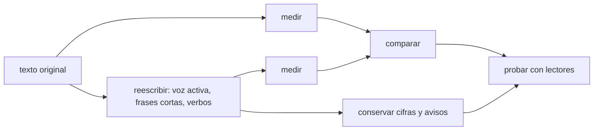

# B128-C08 — Lenguaje claro y redacción accesible

<!-- nav:top -->
[🏠 Programa](../../../../README.md) · [📚 Bloque B128](../../../tronco-comun/B128-accesibilidad-e-inclusion-en-la-ensenanza-de-la-astronomia.md) · [← Anterior: B128-C07 — Modelos táctiles y sonificación](../B128-C07-modelos-tactiles-y-sonificacion/CLASE.md) · [Siguiente: B128-C09 — Apoyo multilingüe y glosarios →](../B128-C09-apoyo-multilingue-y-glosarios/CLASE.md)
<!-- /nav -->

## 1. Ubicación, nivel y alcance

Clase 8 del bloque B128. Nivel N4. Un texto técnico puede ser correcto y aun así inaccesible: frases de más de cincuenta palabras, voz pasiva, nombres abstractos en lugar de verbos y jerga sin definir. Aquí reescribes un párrafo sintético sobre un eclipse siguiendo las recomendaciones de una guía de lenguaje claro y mides el antes y el después con métricas simples. Las métricas no miden comprensión: miden rasgos del texto.

## 2. Por qué esta clase existe

El lenguaje claro ayuda a personas con dificultades de lectura, a quienes leen en una segunda lengua, a quien lee con prisa y a quien usa un lector de pantalla. La decisión central: **¿qué cambios hacen el texto más claro sin perder ninguna cifra ni ningún aviso de seguridad?**

## 3. Lo que podrás hacer al terminar

1. Aplicar voz activa, tiempo presente, verbos en vez de sustantivos escondidos y frases cortas.
2. Medir palabras por frase, frases largas, pasivas y nominalizaciones.
3. Comprobar que la reescritura conserva todas las cifras.
4. Definir la jerga al primer uso o sustituirla.
5. Reconocer lo que las métricas no miden.
6. Separar lo consultado (recomendaciones) de lo del curso (umbrales).

La evidencia es el **texto reescrito con métricas** del ejercicio 12 (sección 20).

## 4. Con qué llegas y cómo comprobarlo

1. ¿Qué es la voz pasiva?
2. ¿Qué es una nominalización?
3. ¿Qué es la jerga?
4. ¿Qué es un dato sintético?
5. ¿Qué es una verificación por segunda vía?

<details>
<summary>Ver respuestas</summary>

1. Una construcción en que el sujeto recibe la acción («los datos fueron registrados»). 2. Convertir un verbo en sustantivo («realización de la observación»). 3. Vocabulario propio de un grupo que otros no conocen. 4. Un dato inventado para el ejemplo. 5. Calcular lo mismo con otro método y comparar.
</details>

Con cuatro o cinco aciertos, sigue; si no, repasa los prerrequisitos.

## 5. Un caso de contexto y casos de referencia

El párrafo original tiene 3 frases y 66 palabras: una media de 22,0 y una frase de 51 palabras, con 4 pasivas, 3 nominalizaciones y 3 términos de jerga. La reescritura tiene 5 frases y 43 palabras: media 8,6, máximo 13, 0 pasivas, 0 nominalizaciones y 2 términos de jerga que se conservan y se definen. Las cifras (3 horas, 12 %) se conservan. Es el **ejemplo conductor**; los textos son **sintéticos**.

## 6. Vocabulario

El **lenguaje claro** es el que el lector encuentra, entiende y usa a la primera. La **voz activa** nombra a quien actúa. Un **verbo escondido** es un sustantivo en lugar de un verbo («hacer un análisis» por «analizar»). La **jerga** es vocabulario no compartido. Una **métrica de superficie** mide rasgos del texto, no su comprensión.

## 7. Modelo mental: quitar lo que estorba sin quitar lo que dice



*Descripción textual:* se mide el original, se reescribe conservando cifras y avisos, se mide de nuevo, se comparan y se prueba con lectores.

Analogía: pulir una piedra sin cambiar su forma. Límite: un texto puede cumplir todas las métricas y seguir siendo confuso; solo los lectores lo saben.

## 8. La explicación, paso a paso

### 8.1 Recomendaciones consultadas

La guía de digital.gov recomienda voz activa (nombrar al actor), tiempo presente, quitar verbos escondidos, secciones cortas con títulos, listas para elementos paralelos, hablar al lector («usted/tú») y términos familiares. **No fija límites numéricos** de longitud de frase o párrafo.

### 8.2 Métricas del laboratorio

Palabras por frase, frases de más de 25 palabras (umbral del curso), pasivas (heurística con `fue/fueron/es/son/siendo` + participio), nominalizaciones (`realización de`, `utilización de`…) y términos de jerga de una lista corta. Son heurísticas del curso, no consultadas.

### 8.3 La reescritura

«La realización de la observación del eclipse fue efectuada por los estudiantes durante 3 horas» pasa a «Los estudiantes observaron el eclipse durante 3 horas». El aviso de seguridad se mantiene y se vuelve instrucción directa: «Usen siempre filtros solares certificados: protegen los ojos». La cifra «12 %» se conserva.

### 8.4 Lo que se perdió y lo que no

Se conservan las dos cifras (comprobado por conjuntos). La jerga baja de 3 a 2: «elongación angular» y «paralaje» siguen, y deben definirse en un glosario ([C09](../B128-C09-apoyo-multilingue-y-glosarios/CLASE.md)). Reescribir no es simplificar el contenido: es cambiar la forma sin perder precisión.

## 9. Magnitudes, símbolos y unidades

| Símbolo | Qué es | Unidad | Valor / nota |
|---|---|---|---|
| frases | número de frases | conteo | 3 → 5 |
| palabras | número de palabras | conteo | 66 → 43 |
| media | palabras por frase | palabras | 22,0 → 8,6 |
| máximo | frase más larga | palabras | 51 → 13 |
| pasivas | construcciones pasivas | conteo | 4 → 0 |

## 10. Convenciones y referencias

Texto en español sin tildes en el laboratorio donde la consola podría fallar. El umbral de 25 palabras, la heurística de pasivas y la lista de jerga son del curso. Las cifras se comparan como conjuntos de números enteros del texto.

## 11. De dónde sale lo que afirmamos

| ID | Fuente | Localizador | Respalda | Estado |
|---|---|---|---|---|
| S1 | digital.gov, Writing for understanding — https://digital.gov/guides/plain-language/writing (consultada 2026-11-11) | página completa | voz activa, presente, verbos escondidos, secciones cortas con títulos, listas, hablar al lector; sin límites numéricos | Consultada |
| S2 | digital.gov, Plain language — https://digital.gov/guides/plain-language (consultada 2026-11-11) | página de índice | las guías de lenguaje claro tienen cuatro categorías: principios, escribir, diseñar y probar la comprensión | Consultada |
| — | Norma ISO 24495-1 de lenguaje claro; índices de legibilidad en español; evidencia sobre comprensión | — | — | No consultada |

Límites: la guía consultada es de EE. UU. y de lengua inglesa; su transferencia al español es un supuesto del curso. No se afirma que las métricas predigan la comprensión.

## 12. Cómo ver el antes y el después

| Métrica | Original | Reescrito |
|---|---|---|
| frases | 3 | 5 |
| media de palabras | 22,0 | 8,6 |
| máximo | 51 | 13 |
| pasivas | 4 | 0 |
| cifras conservadas | 3 y 12 | 3 y 12 |

Descripción larga: las frases se acortan de 22 a 8,6 palabras de media, desaparecen las pasivas y las nominalizaciones y se conservan las dos cifras.

## 13. Ejemplo trabajado: un verbo escondido

**Paso 1 · Detectar.** «la ocurrencia de daños oculares».

**Paso 2 · Preguntar.** ¿Qué ocurre y a quién?

**Paso 3 · Reescribir.** «los filtros evitan daños a los ojos».

**Paso 4 · Comprobar.** Mismo aviso, menos palabras y verbo directo.

## 14. Distintas formas de describir un texto claro

**Por frase:** corta y con un verbo. **Por voz:** activa. **Por estructura:** títulos y listas. **Por vocabulario:** términos definidos. **Por prueba:** lectores reales.

## 15. Práctica guiada

**Ejercicio 1 · con los pasos indicados.** Calcula la media de palabras por frase de un texto de 66 palabras y 3 frases. *Pasos:* divide.

<details><summary>Solución comentada</summary>

`66/3 = 22,0`.
</details>

**Ejercicio 2 · con una pista.** Reescribe «fue efectuada por los estudiantes». *Pista:* nombra al actor.

<details><summary>Solución comentada</summary>

«Los estudiantes efectuaron» o mejor «los estudiantes hicieron».
</details>

**Ejercicio 3 · casi autónomo.** ¿Cuántas frases supera 25 palabras en el original?

<details><summary>Solución comentada</summary>

1 (la de 51 palabras).
</details>

## 16. Práctica autónoma, transferencia e integrador

**Ejercicio 4 · autónomo.** Reescribe «la utilización de filtros es necesaria».

<details><summary>Solución comentada</summary>

«Use filtros».
</details>

**Ejercicio 5 · autónomo.** ¿Qué métrica empeora si divides una frase sin agregar sujeto?

<details><summary>Solución comentada</summary>

La claridad: la frase queda sin actor; la métrica de longitud mejora pero el texto no.
</details>

**Ejercicio 6 · autónomo.** Escribe una definición breve de «paralaje».

<details><summary>Solución comentada</summary>

«Desplazamiento aparente de un astro al cambiar el punto de vista».
</details>

**Ejercicio 7 · autónomo.** ¿Cuántas palabras se redujeron entre original y reescrito?

<details><summary>Solución comentada</summary>

`66 − 43 = 23` (35 %).
</details>

**Ejercicio 8 · autónomo.** Convierte las instrucciones de seguridad en lista numerada.

<details><summary>Solución comentada</summary>

1. Usen filtros solares certificados. 2. No miren el Sol sin filtro. Cada paso, una acción.
</details>

**Ejercicio 9 · transferencia.** **Transferencia.** Un colega dice que el lenguaje claro «le quita rigor» al texto científico. ¿Qué respondes?

<details><summary>Solución comentada</summary>

La reescritura conserva cifras y términos (con definición); cambia la forma, no la precisión. Se verifica con la comparación de cifras.
</details>

**Ejercicio 10 · transferencia.** **Transferencia.** ¿Qué métrica añadirías para un texto con muchas siglas?

<details><summary>Solución comentada</summary>

Siglas sin definir al primer uso; es una heurística del curso, no consultada.
</details>

**Ejercicio 11 · transferencia.** **Transferencia.** Las métricas mejoran pero los estudiantes no entienden. ¿Qué sigue?

<details><summary>Solución comentada</summary>

Probar el texto con lectores reales y revisar; las métricas miden la forma, no la comprensión.
</details>

**Ejercicio 12 · integrador.** **Integrador.** Elabora tu *texto reescrito con métricas*: un párrafo técnico tuyo, la reescritura, la tabla antes/después, la verificación de cifras y las definiciones de la jerga que quede.

<details><summary>Solución comentada</summary>

Secciones 8.2–8.4 y la salida del laboratorio.
</details>

## 17. Laboratorio: claridad antes y después

El script [claridad.py](claridad.py) calcula las métricas de un texto sintético original y de su reescritura y compara las cifras (**comprueba** que las cifras se conservan y que las métricas mejoran).

**Datos:** textos **sintéticos**; umbral y heurísticas **del curso**. **Predice antes de ejecutar:** ¿cuántas pasivas quedan? (0.) **Ejecución del 2026-11-11 (Python 3.12.9):**

```text
Python 3.12.9 (biblioteca estandar)
Textos SINTETICOS; umbral de 25 palabras y heuristicas ILUSTRATIVOS (la guia consultada no fija numeros).
metrica             original  reescrito
frases                     3          5
palabras                  66         43
media                   22.0        8.6
max                       51         13
largas                     1          0
pasivas                    4          0
nominalizaciones           3          0
jerga                      3          2
Cifras conservadas: original ['12', '3'] | reescrito ['12', '3']
Pruebas superadas.
```

```bash
python programa/clases/B128/B128-C08-lenguaje-claro-y-redaccion-accesible/claridad.py
```

**Límites:** las métricas son de superficie; la heurística de pasivas puede fallar; no miden comprensión.

## 18. Errores frecuentes y cómo corregirlos

**Acortar a costa de perder cifras o avisos.** Se corrige con 8.4.

**Confiar en las métricas como prueba.** Se corrige con el ejercicio 11.

**Dejar la jerga sin definir.** Se corrige con el ejercicio 6.

**Escribir frases cortas sin actor.** Se corrige con el ejercicio 5.

## 19. Cómo sabrás que vas bien

Tras la sección 8: ¿qué media esperabas para el texto reescrito y cuál obtuviste? Si dudas, repasa el ejemplo 13. Tras el laboratorio: ¿qué comprueba? (ver la sección 17).

## 20. Qué entregas y cómo se evalúa

El producto es tu **texto reescrito con métricas** (ejercicio 12).

| Criterio | Inicial | En desarrollo | Logrado | Destacado |
|---|---|---|---|---|
| Conceptos | Los confunde | Parciales | Aplica voz activa y verbos | Explica los límites |
| Cálculo | Sin conteo | Con errores | Métricas correctas | Calcula casos nuevos |
| Numérico | Sin comprobar | Un caso | Cifras conservadas verificadas | Interpreta las diferencias |
| Fuentes | Sin fuente | Sin fecha | Fuentes con fecha y estado | Declara lo del curso y lo no consultado |
| Límites | No los nombra | Uno | Tres | Plantea la prueba con lectores |

**Condiciones críticas (no se compensan con promedio):** conservar cifras y avisos de seguridad; no presentar las métricas como prueba de comprensión; citar solo lo consultado.

## 21. Ética, seguridad y límites

Clase educativa y respetuosa: el lenguaje claro no «infantiliza»; respeta el tiempo y el contexto de quien lee. El aviso de seguridad de la observación solar se conserva siempre. Los textos son sintéticos. Accesibilidad: tablas equivalentes a las gráficas, fórmulas en texto, ejercicios sin conexión.

## 22. Para cerrar y seguir

Un párrafo de 66 palabras pasó a 43, con media de 8,6 palabras por frase, sin pasivas y con las mismas dos cifras. Queda una pregunta: ¿cómo se mantiene coherente un texto cuando se traduce a otros idiomas?

**Glosario español–inglés.** lenguaje claro · *plain language*; voz activa · *active voice*; verbo escondido · *hidden verb*; jerga · *jargon*; legibilidad · *readability*.

**Continuidad.** [B128-C09](../B128-C09-apoyo-multilingue-y-glosarios/CLASE.md) trata el apoyo multilingüe y los glosarios.

**Referencias:** ver sección 11.

<!-- nav:bottom -->
---

[← Anterior: B128-C07 — Modelos táctiles y sonificación](../B128-C07-modelos-tactiles-y-sonificacion/CLASE.md) · [📚 Bloque B128](../../../tronco-comun/B128-accesibilidad-e-inclusion-en-la-ensenanza-de-la-astronomia.md) · [Siguiente: B128-C09 — Apoyo multilingüe y glosarios →](../B128-C09-apoyo-multilingue-y-glosarios/CLASE.md)
<!-- /nav -->
