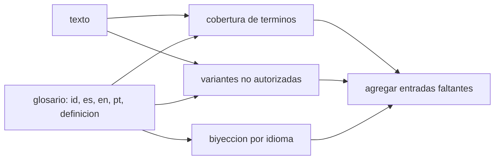

# B128-C09 — Apoyo multilingüe y glosarios

<!-- nav:top -->
[🏠 Programa](../../../../README.md) · [📚 Bloque B128](../../../tronco-comun/B128-accesibilidad-e-inclusion-en-la-ensenanza-de-la-astronomia.md) · [← Anterior: B128-C08 — Lenguaje claro y redacción accesible](../B128-C08-lenguaje-claro-y-redaccion-accesible/CLASE.md) · [Siguiente: B128-C10 — Acceso con baja conectividad →](../B128-C10-acceso-con-baja-conectividad/CLASE.md)
<!-- /nav -->

## 1. Ubicación, nivel y alcance

Clase 9 del bloque B128. Nivel N4. Aprender astronomía en una lengua que no es la propia suma una barrera a la del vocabulario técnico. Aquí construyes y compruebas un glosario trilingüe (español, inglés, portugués) de seis términos: identificadores únicos, sin términos repetidos, con cobertura del texto y sin variantes no autorizadas. El glosario y el texto son sintéticos; **las traducciones son propuestas del curso y no se consultaron en glosarios de la IAU**.

## 2. Por qué esta clase existe

Si el mismo concepto aparece como «agujero negro» y «hoyo negro», un estudiante puede creer que son dos cosas, y más si traduce con una herramienta automática. La decisión central: **¿cómo mantengo un vocabulario coherente entre idiomas y dentro de un mismo texto?**

## 3. Lo que podrás hacer al terminar

1. Estructurar un glosario con identificador, términos por idioma y definición.
2. Comprobar que no hay términos repetidos dentro de un idioma.
3. Medir qué términos del texto tienen entrada en el glosario.
4. Detectar variantes no autorizadas del mismo concepto.
5. Detectar términos usados sin entrada.
6. Declarar que las traducciones son propuestas hasta validarlas con una fuente y hablantes.

La evidencia es el **glosario trilingüe validado** del ejercicio 12 (sección 20).

## 4. Con qué llegas y cómo comprobarlo

1. ¿Qué es un glosario?
2. ¿Qué es un cognado?
3. ¿Qué es una variante terminológica?
4. ¿Qué es un dato sintético?
5. ¿Qué es una verificación por segunda vía?

<details>
<summary>Ver respuestas</summary>

1. Una lista de términos con su significado. 2. Una palabra de origen común en dos idiomas («transit»/«tránsito»). 3. Otra forma de nombrar lo mismo. 4. Un dato inventado para el ejemplo. 5. Calcular lo mismo con otro método y comparar.
</details>

Con cuatro o cinco aciertos, sigue; si no, repasa los prerrequisitos.

## 5. Un caso de contexto y casos de referencia

El glosario tiene 6 términos; los 6 aparecen en el texto de ejemplo. El texto usa además dos variantes no autorizadas («hoyo negro» y «gráfica de brillo») y un término sin entrada («nebulosa»). Es el **ejemplo conductor**; todo es **sintético** y las traducciones son **propuestas del curso**.

## 6. Vocabulario

Un **glosario** da, para cada concepto, sus términos y una definición. Una **entrada** es un concepto con sus términos. Una **variante no autorizada** es un sinónimo que el glosario desaconseja. La **biyección** entre términos exige que cada término apunte a una sola entrada. La **cobertura** es la fracción de términos del texto con entrada.

## 7. Modelo mental: un diccionario compartido



*Descripción textual:* el glosario se contrasta con el texto para medir la cobertura y detectar variantes; los resultados llevan a agregar entradas o corregir el texto.

Analogía: una guía de estilo que el equipo comparte. Límite: la coherencia no garantiza que la traducción sea correcta; eso lo valida una fuente y hablantes.

## 8. La explicación, paso a paso

### 8.1 Estructura de una entrada

`id`: `agujero-negro`; `es`: agujero negro; `en`: black hole; `pt`: buraco negro; definición breve en español. El identificador es único.

### 8.2 Comprobaciones

(1) Identificadores únicos (6 de 6). (2) Sin términos repetidos en un idioma (ninguno). (3) Cobertura: 6 de 6 términos aparecen en el texto, calculado por subcadena y por tokens, con el mismo resultado. (4) Variantes: se detectan «hoyo negro» y «gráfica de brillo»; «lente de ojo» no aparece. (5) Términos usados sin entrada: «nebulosa».

### 8.3 Por qué importa

La página de UNESCO sobre educación inclusiva identifica el idioma entre las barreras que dejan a personas fuera del aprendizaje. Un glosario consistente es una forma concreta de reducir esa barrera, junto con lenguaje claro ([C08](../B128-C08-lenguaje-claro-y-redaccion-accesible/CLASE.md)).

### 8.4 Qué no resuelve

No decide la traducción correcta ni la normativa regional (por ejemplo, el término en portugués europeo o brasileño). Para eso hay que consultar glosarios publicados (no consultados aquí) y a hablantes.

## 9. Magnitudes, símbolos y unidades

| Símbolo | Qué es | Unidad | Valor / nota |
|---|---|---|---|
| términos | entradas del glosario | conteo | 6 |
| idiomas | columnas | conteo | 3 |
| cobertura | términos del glosario presentes en el texto | conteo | 6 de 6 |
| variantes | sinónimos desaconsejados presentes | conteo | 2 |
| faltantes | términos sin entrada | conteo | 1 |

## 10. Convenciones y referencias

Los términos van en minúscula y sin tildes en el laboratorio. Las traducciones al inglés y al portugués las propone el curso como ejemplo; no son terminología normativa. La lista de variantes no autorizadas es del autor del glosario.

## 11. De dónde sale lo que afirmamos

| ID | Fuente | Localizador | Respalda | Estado |
|---|---|---|---|---|
| S1 | UNESCO, Inclusion in education — https://www.unesco.org/en/inclusion-education (consultada 2026-11-11) | página completa | el idioma figura entre las causas de exclusión; identificar los obstáculos y quitarlos | Consultada |
| S2 | digital.gov, Writing for understanding — https://digital.gov/guides/plain-language/writing (consultada 2026-11-11) | página completa | usar términos familiares y escribir para el lector | Consultada |
| — | Glosarios multilingües de la IAU; normas terminológicas; calidad de la traducción automática | — | — | No consultada |

Límites: las traducciones son propuestas del curso y no se validaron; no se afirma que el glosario del ejemplo sea correcto ni completo.

## 12. Cómo ver el resultado

| Comprobación | Resultado |
|---|---|
| términos del glosario | 6 |
| presentes en el texto | 6 de 6 |
| variantes no autorizadas | 2 |
| usados sin entrada | 1 («nebulosa») |

Descripción larga: el glosario cubre todo el vocabulario del texto salvo «nebulosa», y el texto incumple el glosario en dos puntos.

## 13. Ejemplo trabajado: corregir una variante

**Paso 1 · Detectar.** «hoyo negro» no es el término del glosario.

**Paso 2 · Consultar.** Entrada `agujero-negro`: es «agujero negro».

**Paso 3 · Corregir.** Reemplazar en el texto.

**Paso 4 · Verificar.** La variante deja de aparecer.

## 14. Distintas formas de describir un glosario

**Por entrada:** id y términos. **Por idioma:** lista alfabética. **Por texto:** términos presentes. **Por calidad:** biyección y cobertura.

## 15. Práctica guiada

**Ejercicio 1 · con los pasos indicados.** ¿Cómo se dice «curva de luz» en inglés según el glosario? *Pasos:* busca la entrada.

<details><summary>Solución comentada</summary>

*light curve*.
</details>

**Ejercicio 2 · con una pista.** ¿Cuántos términos del texto tienen entrada? *Pista:* 6 de 6.

<details><summary>Solución comentada</summary>

6.
</details>

**Ejercicio 3 · casi autónomo.** ¿Qué término falta en el glosario?

<details><summary>Solución comentada</summary>

«nebulosa».
</details>

## 16. Práctica autónoma, transferencia e integrador

**Ejercicio 4 · autónomo.** Agrega la entrada «nebulosa» en los tres idiomas.

<details><summary>Solución comentada</summary>

es nebulosa; en *nebula*; pt nebulosa; definición: «nube de gas y polvo en el espacio». Debe validarse con una fuente.
</details>

**Ejercicio 5 · autónomo.** ¿Qué hallazgo produciría repetir «ocular» en dos entradas?

<details><summary>Solución comentada</summary>

«términos repetidos en idioma es: ['ocular']».
</details>

**Ejercicio 6 · autónomo.** ¿Por qué se calcula la cobertura de dos maneras?

<details><summary>Solución comentada</summary>

La subcadena y los tokens son vías distintas; coinciden aquí y detectan fallos de código.
</details>

**Ejercicio 7 · autónomo.** Un término en español tiene dos traducciones al inglés. ¿Cómo lo registras?

<details><summary>Solución comentada</summary>

Como un solo término preferido y los demás como variantes desaconsejadas, con la razón.
</details>

**Ejercicio 8 · autónomo.** Redacta una definición breve de «tránsito» en lenguaje claro.

<details><summary>Solución comentada</summary>

«Paso de un cuerpo por delante de una estrella».
</details>

**Ejercicio 9 · transferencia.** **Transferencia.** Una herramienta de traducción automática convierte «curva de luz» en «curva de ligero». ¿Qué haces?

<details><summary>Solución comentada</summary>

Usas el glosario para fijar el término y revisas la traducción con una persona hablante.
</details>

**Ejercicio 10 · transferencia.** **Transferencia.** El portugués de Brasil y el de Portugal difieren en un término. ¿Cómo lo manejas?

<details><summary>Solución comentada</summary>

Una columna por variedad; no se consultó ninguna fuente, por lo que se valida con hablantes de cada una.
</details>

**Ejercicio 11 · transferencia.** **Transferencia.** ¿Qué no puede decir el laboratorio sobre la calidad de las traducciones?

<details><summary>Solución comentada</summary>

Nada: solo verifica coherencia interna, no corrección lingüística.
</details>

**Ejercicio 12 · integrador.** **Integrador.** Elabora tu *glosario trilingüe validado*: 10 términos de tu curso con id, tres idiomas y definición, el informe de comprobaciones, las variantes no autorizadas y la fuente con que validaste cada traducción (o «no validada»).

<details><summary>Solución comentada</summary>

Secciones 8.1–8.4 y la salida del laboratorio.
</details>

## 17. Laboratorio: coherencia de un glosario

El script [glosario.py](glosario.py) comprueba un glosario sintético (**comprueba** la cobertura por dos vías y las variantes detectadas).

**Datos:** glosario y texto **sintéticos**; traducciones **propuestas por el curso**. **Predice antes de ejecutar:** ¿qué término falta? («nebulosa».) **Ejecución del 2026-11-11 (Python 3.12.9):**

```text
Python 3.12.9 (biblioteca estandar)
Glosario y texto SINTETICOS; traducciones PROPUESTAS por el curso (no normativas, no consultadas en la IAU).
Terminos: 6; idiomas: es, en, pt
Hallazgos de biyeccion: ninguno
Terminos del glosario que aparecen en el texto: 6 de 6 -> ['agujero-negro', 'curva-de-luz', 'magnitud', 'ocular', 'paralaje', 'transito']
Variantes NO autorizadas detectadas en el texto:
  'hoyo negro' -> usar 'agujero negro' (en: black hole, pt: buraco negro)
  'grafica de brillo' -> usar 'curva de luz' (en: light curve, pt: curva de luz)
Terminos usados sin entrada en el glosario: ['nebulosa']
Terminos identicos en es y en (cognados; no hace falta traducir): []
Pruebas superadas.
```

```bash
python programa/clases/B128/B128-C09-apoyo-multilingue-y-glosarios/glosario.py
```

**Límites:** coherencia interna, no corrección lingüística; no maneja flexión ni plurales.

## 18. Errores frecuentes y cómo corregirlos

**Dar por correctas las traducciones del ejemplo.** Se corrige con la sección 10.

**Usar dos términos para un concepto.** Se corrige con el ejemplo 13.

**Dejar términos sin entrada.** Se corrige con el ejercicio 4.

**Creer que el glosario sustituye la revisión por hablantes.** Se corrige con el ejercicio 11.

## 19. Cómo sabrás que vas bien

Tras la sección 8: ¿qué variantes esperabas y cuáles se detectaron? Si dudas, repasa el ejemplo 13. Tras el laboratorio: ¿qué comprueba? (ver la sección 17).

## 20. Qué entregas y cómo se evalúa

El producto es tu **glosario trilingüe validado** (ejercicio 12).

| Criterio | Inicial | En desarrollo | Logrado | Destacado |
|---|---|---|---|---|
| Conceptos | Los confunde | Parciales | Estructura entradas y variantes | Explica los límites |
| Cálculo | Sin conteo | Con errores | Cobertura y variantes correctas | Revisa casos nuevos |
| Numérico | Sin comprobar | Un caso | Dos vías coinciden | Interpreta las diferencias |
| Fuentes | Sin fuente | Sin fecha | Fuentes con fecha y estado | Declara lo no validado |
| Límites | No los nombra | Uno | Tres | Discute la validación con hablantes |

**Condiciones críticas (no se compensan con promedio):** rotular las traducciones como propuestas hasta validarlas; no presentar coherencia como corrección; citar solo lo consultado.

## 21. Ética, seguridad y límites

Clase educativa y respetuosa: ninguna lengua se trata como «problema»; la barrera es la falta de apoyo. Las traducciones no son normativas y deben validarse con hablantes y fuentes. Los datos son sintéticos. Accesibilidad: tablas equivalentes a las gráficas, fórmulas en texto, ejercicios sin conexión.

## 22. Para cerrar y seguir

Seis términos, tres idiomas, dos variantes por corregir y una entrada por agregar. Queda una pregunta: ¿qué pasa cuando el estudiante tiene una conexión lenta o intermitente?

**Glosario español–inglés.** glosario · *glossary*; entrada · *entry*; variante · *variant*; cobertura · *coverage*; traducción · *translation*.

**Continuidad.** [B128-C10](../B128-C10-acceso-con-baja-conectividad/CLASE.md) trata el acceso con baja conectividad.

**Referencias:** ver sección 11.

<!-- nav:bottom -->
---

[← Anterior: B128-C08 — Lenguaje claro y redacción accesible](../B128-C08-lenguaje-claro-y-redaccion-accesible/CLASE.md) · [📚 Bloque B128](../../../tronco-comun/B128-accesibilidad-e-inclusion-en-la-ensenanza-de-la-astronomia.md) · [Siguiente: B128-C10 — Acceso con baja conectividad →](../B128-C10-acceso-con-baja-conectividad/CLASE.md)
<!-- /nav -->
