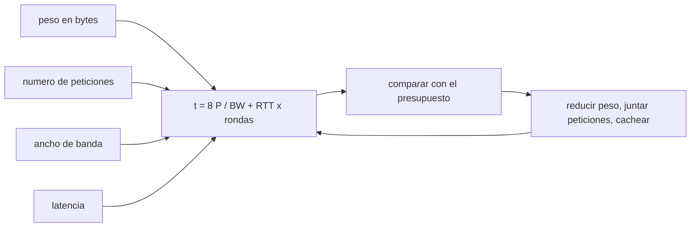

# B128-C10 — Acceso con baja conectividad

<!-- nav:top -->
[🏠 Programa](../../../../README.md) · [📚 Bloque B128](../../../tronco-comun/B128-accesibilidad-e-inclusion-en-la-ensenanza-de-la-astronomia.md) · [← Anterior: B128-C09 — Apoyo multilingüe y glosarios](../B128-C09-apoyo-multilingue-y-glosarios/CLASE.md) · [Siguiente: B128-C11 — Auditoría de accesibilidad de un recurso educativo →](../B128-C11-auditoria-de-accesibilidad-de-un-recurso-educativo/CLASE.md)
<!-- /nav -->

## 1. Ubicación, nivel y alcance

Clase 10 del bloque B128. Nivel N4. Una página de astronomía con imágenes de varios megabytes funciona en una red de fibra y fracasa en un teléfono con datos limitados, en un aula rural o en una conexión intermitente. Aquí estimas el tiempo de carga con un modelo de orden de magnitud (`t = 8·bytes/ancho de banda + RTT·⌈peticiones/6⌉`), lo contrastas con una simulación por rondas y fijas un presupuesto de peso. Los tres perfiles de red y los tamaños de página son inventados e ilustrativos; no son mediciones.

## 2. Por qué esta clase existe

Una persona sin conexión estable queda fuera de un curso aunque los contenidos sean excelentes. La decisión central: **¿cuánto puede pesar una página para cargar a tiempo en la peor conexión del grupo, y qué se puede guardar para no volver a descargarlo?**

## 3. Lo que podrás hacer al terminar

1. Calcular el tiempo de carga de una página según peso, peticiones, ancho de banda y latencia.
2. Comprobar el cálculo con una simulación por rondas.
3. Fijar un presupuesto de tiempo y obtener el peso máximo permitido.
4. Estimar el efecto de la caché en una segunda visita.
5. Proponer una versión de solo texto como alternativa.
6. Separar lo consultado (principios de funcionamiento sin red) de lo ilustrativo (cifras).

La evidencia es el **plan de entrega con baja conectividad** del ejercicio 12 (sección 20).

## 4. Con qué llegas y cómo comprobarlo

1. ¿Qué es un ancho de banda?
2. ¿Qué es una latencia (RTT)?
3. ¿Qué es una caché?
4. ¿Qué es un dato ilustrativo?
5. ¿Qué es una verificación por segunda vía?

<details>
<summary>Ver respuestas</summary>

1. La cantidad de datos por segundo que admite el enlace, en bit/s. 2. El tiempo de ida y vuelta de una petición, en segundos. 3. Un almacén local de lo ya descargado. 4. Un valor inventado para el ejemplo, no medido. 5. Calcular lo mismo con otro método y comparar.
</details>

Con cuatro o cinco aciertos, sigue; si no, repasa los prerrequisitos.

## 5. Un caso de contexto y casos de referencia

Una página «original» de 3 500 000 bytes en 42 peticiones tarda `564,2 s` en el perfil lento (50 kbit/s, RTT 600 ms), `38,7 s` en el medio y `1,6 s` en una conexión fija. La versión «optimizada» (350 000 bytes, 8 peticiones) tarda `57,2 s` en el perfil lento; la de solo texto (40 000 bytes, 2 peticiones), `7,0 s`. Con un presupuesto de 10 s en el perfil lento, solo la versión de texto cumple. Es el **ejemplo conductor**; todo es **ilustrativo**.

## 6. Vocabulario

El **ancho de banda** es la capacidad del enlace (bit/s). La **latencia (RTT)** es el tiempo de ida y vuelta. Una **petición** es una solicitud de un recurso. La **caché** guarda recursos ya descargados. Un **presupuesto de peso** es el peso máximo que se acepta. Un recurso **sin conexión** funciona tras una descarga inicial.

## 7. Modelo mental: un camión con un camino angosto



*Descripción textual:* el peso, las peticiones, el ancho de banda y la latencia dan el tiempo; se compara con el presupuesto y se reduce el peso, se agrupan las peticiones o se usa la caché.

Analogía: un camión grande por un camino angosto tarda más que varios pequeños bien repartidos, pero cada viaje tiene un costo fijo de ida y vuelta. Límite: el modelo ignora arranque lento de TCP, TLS y el trabajo del procesador.

## 8. La explicación, paso a paso

### 8.1 El modelo

`t = 8·bytes/BW + RTT·⌈n/6⌉`, con seis conexiones paralelas (aproximación didáctica). En el perfil lento (`BW = 50 000 bit/s`, `RTT = 0,6 s`), la página original da `8 × 3 500 000/50 000 = 560 s` más `0,6 × ⌈42/6⌉ = 4,2 s`: `564,2 s`.

### 8.2 Segunda vía

La simulación por rondas de 6 peticiones, con el peso repartido y una latencia por ronda, da el mismo tiempo con diferencia menor que `1 × 10⁻⁹ s`. Valida el código, no el modelo.

### 8.3 Presupuesto de peso

Para ≤ 10 s con 8 peticiones en el perfil lento: `(10 − 0,6 × 2) × 50 000/8 = 55 000 bytes`, es decir, `55,0 kB`. La página optimizada de 350 kB lo excede más de seis veces.

### 8.4 Caché y alternativa de texto

web.dev señala que las aplicaciones deben seguir funcionando con red lenta o sin ella, conservar lo visto recientemente y avisar de los fallos en vez de fallar en silencio. Si solo cambia un 10 % del peso en una petición, la segunda visita de la página optimizada baja de 57,2 s a 6,2 s en el modelo. La versión de solo texto, con la tabla de datos, es una alternativa válida para quien no puede descargar imágenes.

## 9. Magnitudes, símbolos y unidades

| Símbolo | Qué es | Unidad | Valor / nota |
|---|---|---|---|
| `P` | peso de la página | bytes | 3 500 000; 350 000; 40 000 |
| `n` | peticiones | conteo | 42; 8; 2 |
| `BW` | ancho de banda | bit/s | 50 000; 750 000; 20 000 000 |
| `RTT` | latencia | s | 0,6; 0,2; 0,03 |
| `t` | tiempo de carga | s | 564,2; 57,2; 7,0 |

## 10. Convenciones y referencias

Un byte son 8 bits; «kB» son 1000 bytes. Los perfiles de red y los pesos son inventados. El modelo supone seis conexiones paralelas, sin arranque lento ni cifrado. El presupuesto de 10 s es del curso.

## 11. De dónde sale lo que afirmamos

| ID | Fuente | Localizador | Respalda | Estado |
|---|---|---|---|---|
| S1 | web.dev, What are Progressive Web Apps? — https://web.dev/articles/what-are-pwas (consultada 2026-11-11) | sección sobre fiabilidad | las aplicaciones deben seguir funcionando con redes lentas o sin red, conservar lo visto recientemente y avisar de los fallos | Consultada |
| S2 | UNESCO, Inclusion in education — https://www.unesco.org/en/inclusion-education (consultada 2026-11-11) | página completa | identificar y quitar los obstáculos al aprendizaje | Consultada |
| — | Cifras de conectividad por país o región; mediciones de tiempos de carga reales | — | — | No consultada |

Límites: no se consultó ninguna cifra real de conectividad; los perfiles son inventados y no describen a ningún grupo de estudiantes.

## 12. Cómo ver el tiempo de carga

| Página | Lento | Medio | Fija |
|---|---|---|---|
| original | 564,2 s | 38,7 s | 1,6 s |
| optimizada | 57,2 s | 4,1 s | 0,2 s |
| solo texto | 7,0 s | 0,6 s | 0,0 s |

Descripción larga: el tiempo cae unas diez veces al pasar de la página original a la optimizada y otras ocho al pasar a texto; en la conexión fija, las tres son casi instantáneas.

## 13. Ejemplo trabajado: página de solo texto en el perfil lento

**Paso 1 · Transferencia.** `8 × 40 000/50 000 = 6,4 s`.

**Paso 2 · Latencia.** `0,6 × ⌈2/6⌉ = 0,6 s`.

**Paso 3 · Total.** `7,0 s`.

**Paso 4 · Decisión.** `7,0 ≤ 10`: cumple el presupuesto.

## 14. Distintas formas de describir el acceso

**Por peso:** bytes. **Por tiempo:** segundos en cada perfil. **Por peticiones:** número. **Por estrategia:** texto primero, imágenes opcionales, caché y descarga previa.

## 15. Práctica guiada

**Ejercicio 1 · con los pasos indicados.** Calcula el tiempo de transferencia de 100 000 bytes a 50 kbit/s. *Pasos:* `8 × bytes/BW`.

<details><summary>Solución comentada</summary>

`800 000/50 000 = 16 s`.
</details>

**Ejercicio 2 · con una pista.** ¿Cuántas rondas hacen falta para 14 peticiones? *Pista:* `⌈14/6⌉`.

<details><summary>Solución comentada</summary>

3.
</details>

**Ejercicio 3 · casi autónomo.** ¿Por qué el RTT pesa más en el perfil lento que en la conexión fija?

<details><summary>Solución comentada</summary>

Es 0,6 s frente a 0,03 s por ronda.
</details>

## 16. Práctica autónoma, transferencia e integrador

**Ejercicio 4 · autónomo.** Tiempo de la página optimizada en el perfil medio.

<details><summary>Solución comentada</summary>

`8 × 350 000/750 000 = 3,73 s` más `0,2 × 2 = 0,4 s`: `4,1 s`.
</details>

**Ejercicio 5 · autónomo.** Peso máximo con 2 peticiones y 10 s en el perfil lento.

<details><summary>Solución comentada</summary>

`(10 − 0,6) × 50 000/8 = 58 750 bytes`.
</details>

**Ejercicio 6 · autónomo.** ¿Qué pasa si las peticiones suben de 8 a 24 en la página optimizada (perfil lento)?

<details><summary>Solución comentada</summary>

Las rondas suben de 2 a 4: `+1,2 s`, es decir `58,4 s`.
</details>

**Ejercicio 7 · autónomo.** Convierte 750 kbit/s a kB/s.

<details><summary>Solución comentada</summary>

`750/8 = 93,75 kB/s`.
</details>

**Ejercicio 8 · autónomo.** Propón tres recortes para una página de 3,5 MB.

<details><summary>Solución comentada</summary>

Imágenes comprimidas con tamaño adecuado, carga diferida y alternativa de texto; sin recursos externos.
</details>

**Ejercicio 9 · transferencia.** **Transferencia.** Un colega afirma que «todos tienen fibra». ¿Qué respondes?

<details><summary>Solución comentada</summary>

No se consultó ninguna cifra real; hay que preguntar a cada grupo y medir su conexión.
</details>

**Ejercicio 10 · transferencia.** **Transferencia.** ¿Qué agrega la descarga previa (offline) además de la caché?

<details><summary>Solución comentada</summary>

Disponibilidad sin ninguna conexión; hay que avisar de lo que no está disponible (S1).
</details>

**Ejercicio 11 · transferencia.** **Transferencia.** ¿Qué no puede decir este modelo sobre una red real?

<details><summary>Solución comentada</summary>

No incluye pérdida de paquetes, arranque lento, cifrado ni procesamiento; es orden de magnitud.
</details>

**Ejercicio 12 · integrador.** **Integrador.** Elabora tu *plan de entrega con baja conectividad*: perfiles de tu grupo (medidos), peso y peticiones de tu recurso, tiempos por perfil, presupuesto, recortes, versión de texto y estrategia sin conexión.

<details><summary>Solución comentada</summary>

Secciones 8.1–8.4 y la salida del laboratorio.
</details>

## 17. Laboratorio: tiempo de carga

El script [conectividad.py](conectividad.py) calcula el tiempo de carga para tres páginas y tres perfiles, resuelve el peso máximo y estima la caché (**comprueba** la fórmula contra la simulación por rondas, tolerancia 1e-9 s).

**Datos:** perfiles y páginas **ilustrativos**; presupuesto **del curso**. **Predice antes de ejecutar:** ¿qué página cumple 10 s en el perfil lento? (solo la de texto.) **Ejecución del 2026-11-11 (Python 3.12.9):**

```text
Python 3.12.9 (biblioteca estandar)
Perfiles y paginas ILUSTRATIVOS (inventados). Modelo de orden de magnitud.
pagina                                 movil-lento   movil-medio          fija
original (imagenes pesadas)                 564.2s         38.7s          1.6s
optimizada (sin recursos externos)           57.2s          4.1s          0.2s
version texto (solo HTML + tabla)             7.0s          0.6s          0.0s
Presupuesto del curso: <= 10 s en el perfil lento
  original (imagenes pesadas)            564.2 s  NO cumple
  optimizada (sin recursos externos)      57.2 s  NO cumple
  version texto (solo HTML + tabla)        7.0 s  cumple
Peso maximo con 8 peticiones en el perfil lento: 55.0 kB
Segunda visita con cache, cambia 10 % del peso en 1 peticion: 6.2 s (frente a 57.2 s)
Pruebas superadas.
```

```bash
python programa/clases/B128/B128-C10-acceso-con-baja-conectividad/conectividad.py
```

**Límites:** orden de magnitud; cifras inventadas; no sustituye la medición con la red del grupo.

## 18. Errores frecuentes y cómo corregirlos

**Diseñar para la mejor conexión.** Se corrige con 8.3.

**Ignorar el número de peticiones.** Se corrige con el ejercicio 6.

**Fallar en silencio sin conexión.** Se corrige con 8.4.

**Tomar las cifras como mediciones.** Se corrige con la sección 10.

## 19. Cómo sabrás que vas bien

Tras la sección 8: ¿qué tiempo esperabas para el texto en el perfil lento y cuál obtuviste? Si dudas, repasa el ejemplo 13. Tras el laboratorio: ¿qué comprueba? (ver la sección 17).

## 20. Qué entregas y cómo se evalúa

El producto es tu **plan de entrega con baja conectividad** (ejercicio 12).

| Criterio | Inicial | En desarrollo | Logrado | Destacado |
|---|---|---|---|---|
| Conceptos | Los confunde | Parciales | Distingue ancho de banda y latencia | Explica los límites |
| Cálculo | Sin unidades | Con errores | Tiempos correctos | Calcula casos nuevos |
| Numérico | Sin comprobar | Un caso | Contraste con una segunda vía | Interpreta las diferencias |
| Fuentes | Sin fuente | Sin fecha | Fuentes con fecha y estado | Declara lo ilustrativo y lo no consultado |
| Límites | No los nombra | Uno | Tres | Plantea la medición real |

**Condiciones críticas (no se compensan con promedio):** rotular los perfiles como ilustrativos; ofrecer una versión de texto; citar solo lo consultado.

## 21. Ética, seguridad y límites

Clase educativa y respetuosa: la conectividad limitada es una barrera de infraestructura y de costo, no una carencia de las personas. Las cifras son inventadas y no describen a ninguna comunidad. Accesibilidad: tablas equivalentes a las gráficas, fórmulas en texto, ejercicios sin conexión.

## 22. Para cerrar y seguir

La página de 3,5 MB tarda 564,2 s en el perfil lento y la de texto, 7,0 s; el presupuesto de 10 s admite 55,0 kB con 8 peticiones. Queda una pregunta: ¿cómo se reúnen todos estos criterios en una auditoría de un recurso completo?

**Glosario español–inglés.** ancho de banda · *bandwidth*; latencia · *latency*; caché · *cache*; presupuesto de peso · *page weight budget*; sin conexión · *offline*.

**Continuidad.** [B128-C11](../B128-C11-auditoria-de-accesibilidad-de-un-recurso-educativo/CLASE.md) integra el bloque en una auditoría.

**Referencias:** ver sección 11.

<!-- nav:bottom -->
---

[← Anterior: B128-C09 — Apoyo multilingüe y glosarios](../B128-C09-apoyo-multilingue-y-glosarios/CLASE.md) · [📚 Bloque B128](../../../tronco-comun/B128-accesibilidad-e-inclusion-en-la-ensenanza-de-la-astronomia.md) · [Siguiente: B128-C11 — Auditoría de accesibilidad de un recurso educativo →](../B128-C11-auditoria-de-accesibilidad-de-un-recurso-educativo/CLASE.md)
<!-- /nav -->
