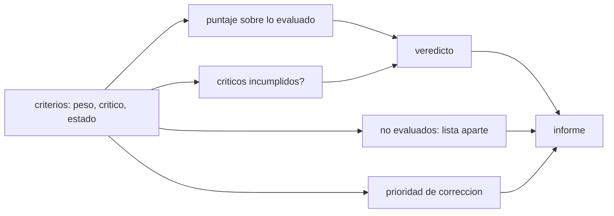

# B128-C11 — Auditoría de accesibilidad de un recurso educativo

<!-- nav:top -->
[🏠 Programa](../../../../README.md) · [📚 Bloque B128](../../../tronco-comun/B128-accesibilidad-e-inclusion-en-la-ensenanza-de-la-astronomia.md) · [← Anterior: B128-C10 — Acceso con baja conectividad](../B128-C10-acceso-con-baja-conectividad/CLASE.md) · [Siguiente: B129-C01 — Redes de observadores aficionados →](../../../tronco-comun/B129-ciencia-ciudadana-astronomica.md#b129-c01)
<!-- /nav -->

## 1. Ubicación, nivel y alcance

Clase 11 del bloque B128. Nivel N4. Esta clase integra las diez anteriores: auditas un recurso educativo con nueve criterios, distingues los criterios **críticos** (que bloquean el veredicto) de los demás, tratas «no evaluado» como lo que es (no como cumplido) y ordenas las correcciones por prioridad. El recurso («Guía de observación de las lunas de Júpiter»), sus resultados, el alcance y el esfuerzo son sintéticos. Es una auditoría del curso, **no** una evaluación de conformidad con WCAG.

## 2. Por qué esta clase existe

Un puntaje alto puede esconder una barrera grave: un video sin subtítulos con todo lo demás perfecto sigue siendo inaccesible para quien no oye. La decisión central: **¿cómo reporto el estado de un recurso sin que el promedio oculte un bloqueo y sin dar por cumplido lo que no se evaluó?**

## 3. Lo que podrás hacer al terminar

1. Definir criterios con peso, criticidad y estado.
2. Calcular un puntaje ponderado excluyendo lo no evaluado.
3. Emitir un veredicto que un criterio crítico fallido bloquea.
4. Priorizar correcciones por peso, personas afectadas y esfuerzo.
5. Comprobar el puntaje con aritmética exacta (fracciones).
6. Declarar lo que la auditoría no pudo evaluar y que falta la prueba con personas.

La evidencia es el **informe de auditoría priorizado** del ejercicio 12 (sección 20).

## 4. Con qué llegas y cómo comprobarlo

1. ¿Qué es un promedio ponderado?
2. ¿Qué es una condición crítica?
3. ¿Qué es una prioridad de corrección?
4. ¿Qué es un dato sintético?
5. ¿Qué es una verificación por segunda vía?

<details>
<summary>Ver respuestas</summary>

1. Un promedio en que cada valor pesa distinto. 2. Una condición que no se compensa con las demás. 3. Un orden de qué corregir primero. 4. Un dato inventado para el ejemplo. 5. Calcular lo mismo con otro método y comparar.
</details>

Con cuatro o cinco aciertos, sigue; si no, repasa los prerrequisitos.

## 5. Un caso de contexto y casos de referencia

El recurso tiene 9 criterios; 8 se evaluaron y 1 (glosario y apoyo en otro idioma) **no se evaluó**. El puntaje ponderado sobre lo evaluado es `50,0 %` (exacto `1/2`), y tres criterios críticos no cumplen del todo (C1, C3 y C5): veredicto **NO CONFORME**. La prioridad más alta es C3 (documento legible por lector de pantalla). Tras corregir C1, C3 y C5, el puntaje sube a `80,6 %` y no quedan críticos pendientes. Es el **ejemplo conductor**; todo es **sintético**.

## 6. Vocabulario

Un **criterio** es una condición comprobable. El **peso** mide su importancia. Un criterio **crítico** bloquea el veredicto si no se cumple. **No evaluado** es un estado que no cuenta como cumplido. La **prioridad** es `peso × (1 − valor) × personas afectadas / esfuerzo`. Una **auditoría** es una revisión sistemática contra criterios.

## 7. Modelo mental: un semáforo con candado



*Descripción textual:* de los criterios salen el puntaje, los críticos incumplidos, la lista de no evaluados y la prioridad; el veredicto combina puntaje y críticos y todo va al informe.

Analogía: un semáforo con un candado: no basta con que casi todas las luces estén verdes si una de las críticas está en rojo. Límite: pesos y prioridades son decisiones del equipo auditor y deben explicarse.

## 8. La explicación, paso a paso

### 8.1 Los criterios

C1 alternativa no visual de la observación; C2 plan con varias vías (DUA); C3 documento legible por lector de pantalla; C4 subtítulos y transcripción; C5 contraste ≥ 4,5:1 y color no único; C6 modelo táctil o sonificación con tabla; C7 lenguaje claro; C8 glosario y apoyo en otro idioma; C9 baja conectividad. Referencias: clases C01–C10 del bloque; los umbrales WCAG (1.1.1, 1.2.2, 1.4.1, 1.4.3) provienen de WCAG 2.2, los demás son del curso.

### 8.2 Estados y puntaje

Cumple = 1,0; parcial = 0,5; no cumple = 0,0; no evaluado = excluido. `puntaje = Σ(peso × valor)/Σ(peso)` sobre lo evaluado. Con los pesos 3, 2, 3, 3, 2, 2, 1, 2 (C8 excluido) y los estados del laboratorio, el resultado es `1/2`.

### 8.3 Veredicto con candado

Los criterios críticos son C1, C3, C4 y C5. C4 cumple; C1 y C5 son parciales y C3 no cumple: **NO CONFORME** aunque el puntaje sea 50 %, y lo seguiría siendo con un puntaje de 95 % si C3 no cumpliera. El criterio no evaluado (C8) se lista aparte: nunca cuenta como cumplido.

### 8.4 Prioridad

`prioridad = peso × (1 − valor) × afectadas/esfuerzo`. C3: `3 × 1 × 10/4 = 7,50`; C1: `3 × 0,5 × 12/6 = 3,00`; C5: `2 × 0,5 × 8/3 = 2,67`; C7 y C9: `2,50`; C6: `1,20`. Las personas afectadas y el esfuerzo son sintéticos; en una auditoría real se estiman con el equipo y con las personas usuarias. La auditoría no reemplaza la prueba con personas: sin ella no se sabe si las correcciones funcionan.

## 9. Magnitudes, símbolos y unidades

| Símbolo | Qué es | Unidad | Valor / nota |
|---|---|---|---|
| peso | importancia del criterio | — | 1 a 3 |
| valor | estado numérico | — | 1; 0,5; 0 |
| puntaje | ponderado sobre lo evaluado | % | 50,0 |
| afectadas | personas afectadas (sintético) | de 100 | 0 a 25 |
| esfuerzo | trabajo de corrección (sintético) | horas | 0 a 10 |

## 10. Convenciones y referencias

Pesos, criticidad, afectadas y esfuerzo son sintéticos. Los umbrales provienen de WCAG 2.2 donde se indica. La auditoría no equivale a una declaración de conformidad ni a una certificación.

## 11. De dónde sale lo que afirmamos

| ID | Fuente | Localizador | Respalda | Estado |
|---|---|---|---|---|
| S1 | W3C, WCAG 2.2 — https://www.w3.org/TR/WCAG22/ (consultada 2026-11-11; solo el primer tramo del documento) | criterios 1.1.1, 1.2.1, 1.2.2, 1.4.1, 1.4.3 y 1.4.11 | alternativas textuales, subtítulos, color no único y contraste de 4,5:1 y 3:1 | Consultada |
| S2 | CAST, UDL Guidelines 3.0 (2024) — https://udlguidelines.cast.org/ (consultada 2026-11-11) | página principal | tres principios y nueve pautas | Consultada |
| S3 | UNESCO, Inclusion in education — https://www.unesco.org/en/inclusion-education (consultada 2026-11-11) | página completa | identificar y quitar los obstáculos; no dejar a nadie atrás | Consultada |
| — | Metodología oficial de evaluación de conformidad WCAG; normas legales de accesibilidad | — | — | No consultada |

Límites: no se consultó la metodología oficial de evaluación; la auditoría es del curso y no certifica conformidad.

## 12. Cómo ver el informe

| Resultado | Valor |
|---|---|
| criterios evaluados | 8 de 9 |
| puntaje | 50,0 % (1/2) |
| críticos incumplidos | C1, C3, C5 |
| veredicto | NO CONFORME |
| mayor prioridad | C3 (7,50) |

Descripción larga: el recurso tiene tres bloqueos críticos y un criterio sin evaluar; la corrección de C3 es la más rentable.

## 13. Ejemplo trabajado: la prioridad de C3

**Paso 1 · Peso.** 3.

**Paso 2 · Brecha.** `1 − 0 = 1` (no cumple).

**Paso 3 · Alcance y esfuerzo.** 10 afectadas, 4 horas.

**Paso 4 · Prioridad.** `3 × 1 × 10/4 = 7,5`.

## 14. Distintas formas de describir una auditoría

**Por criterio:** estado y peso. **Por criticidad:** bloqueos. **Por prioridad:** orden de corrección. **Por cobertura:** lo evaluado y lo no evaluado. **Por prueba:** con personas.

## 15. Práctica guiada

**Ejercicio 1 · con los pasos indicados.** Suma los pesos de los criterios evaluados. *Pasos:* 3+2+3+3+2+2+1+2.

<details><summary>Solución comentada</summary>

18.
</details>

**Ejercicio 2 · con una pista.** Calcula el numerador del puntaje. *Pista:* `peso × valor`.

<details><summary>Solución comentada</summary>

C1 1,5; C2 2; C3 0; C4 3; C5 1; C6 0; C7 0,5; C9 1: suma 9. `9/18 = 1/2`.
</details>

**Ejercicio 3 · casi autónomo.** ¿Por qué C8 no entra en el puntaje?

<details><summary>Solución comentada</summary>

No se evaluó; no puede contar ni como cumplido ni como incumplido.
</details>

## 16. Práctica autónoma, transferencia e integrador

**Ejercicio 4 · autónomo.** Prioridad de C5.

<details><summary>Solución comentada</summary>

`2 × 0,5 × 8/3 = 2,67`.
</details>

**Ejercicio 5 · autónomo.** Si C3 pasa a «cumple», ¿cuál es el nuevo puntaje?

<details><summary>Solución comentada</summary>

`(9 + 3)/18 = 66,7 %`; siguen críticos pendientes (C1 y C5).
</details>

**Ejercicio 6 · autónomo.** ¿Qué corriges primero con el mismo esfuerzo y distinto alcance?

<details><summary>Solución comentada</summary>

El que afecta a más personas, según la fórmula, y siempre los críticos.
</details>

**Ejercicio 7 · autónomo.** Añade un criterio de «avisos de seguridad en la observación solar» y asígnale peso y criticidad.

<details><summary>Solución comentada</summary>

Peso 3 y crítico: la omisión puede causar daño; la decisión debe justificarse.
</details>

**Ejercicio 8 · autónomo.** Escribe la frase de veredicto para el informe.

<details><summary>Solución comentada</summary>

«NO CONFORME: tres criterios críticos incumplidos (C1, C3, C5); un criterio no evaluado (C8); puntaje de 50 % sobre lo evaluado».
</details>

**Ejercicio 9 · transferencia.** **Transferencia.** Un recurso saca 95 % pero C4 (subtítulos) no cumple. ¿Es conforme?

<details><summary>Solución comentada</summary>

No: un crítico incumplido bloquea el veredicto.
</details>

**Ejercicio 10 · transferencia.** **Transferencia.** ¿Qué le falta a esta auditoría para decir que el recurso «es accesible»?

<details><summary>Solución comentada</summary>

La prueba con personas usuarias, la evaluación del criterio no evaluado y una metodología de conformidad.
</details>

**Ejercicio 11 · transferencia.** **Transferencia.** Un equipo marca «cumple» un criterio que no pudo revisar. ¿Qué haces?

<details><summary>Solución comentada</summary>

Lo corriges a «no evaluado»: marcar como cumplido lo no comprobado es afirmar algo no verificado.
</details>

**Ejercicio 12 · integrador.** **Integrador.** Elabora tu *informe de auditoría priorizado* de un recurso tuyo: criterios, estados, puntaje, veredicto, no evaluados, prioridades y plan de prueba con personas.

<details><summary>Solución comentada</summary>

Secciones 8.1–8.4 y la salida del laboratorio.
</details>

## 17. Laboratorio: auditoría de un recurso

El script [auditoria.py](auditoria.py) calcula el puntaje, el veredicto, los no evaluados y la prioridad (**comprueba** el puntaje con fracciones exactas y la estabilidad del veredicto).

**Datos:** recurso, resultados, alcance y esfuerzo **sintéticos**. **Predice antes de ejecutar:** ¿cuál es el veredicto? (NO CONFORME.) **Ejecución del 2026-11-11 (Python 3.12.9):**

```text
Python 3.12.9 (biblioteca estandar)
Recurso y resultados SINTETICOS; criterios del bloque; NO es una evaluacion de conformidad WCAG.
Criterios: 9; evaluados: 8; no evaluados: ['C8'] (no cuentan como cumplidos)
Puntaje ponderado sobre lo evaluado: 50.0 % (exacto 1/2)
Criterios criticos que no cumplen del todo: ['C1', 'C3', 'C5'] -> NO CONFORME
Prioridad de correccion (peso*(1-valor)*afectadas/esfuerzo):
  C3    7.50  no cumple  Documento legible por lector de pantalla (C04)
  C1    3.00  parcial    Alternativa no visual de la observacion (C01,C03)
  C5    2.67  parcial    Contraste de texto >= 4.5:1 y color no unico (C06)
  C7    2.50  parcial    Lenguaje claro (C08)
  C9    2.50  parcial    Funciona con baja conectividad (C10)
  C6    1.20  no cumple  Modelo tactil o sonificacion con tabla de datos (C07)
Tras corregir C1, C3 y C5: puntaje 80.6 %, criticos pendientes []
Pruebas superadas.
```

```bash
python programa/clases/B128/B128-C11-auditoria-de-accesibilidad-de-un-recurso-educativo/auditoria.py
```

**Límites:** auditoría del curso; no certifica conformidad; las estimaciones son inventadas.

## 18. Errores frecuentes y cómo corregirlos

**Dejar que el promedio oculte un bloqueo.** Se corrige con 8.3.

**Contar «no evaluado» como cumplido.** Se corrige con el ejercicio 11.

**Presentar la auditoría como certificación.** Se corrige con la sección 10.

**Omitir la prueba con personas.** Se corrige con el ejercicio 10.

## 19. Cómo sabrás que vas bien

Tras la sección 8: ¿qué veredicto esperabas y cuál obtuviste? Si dudas, repasa el ejemplo 13. Tras el laboratorio: ¿qué comprueba? (ver la sección 17).

## 20. Qué entregas y cómo se evalúa

El producto es tu **informe de auditoría priorizado** (ejercicio 12).

| Criterio | Inicial | En desarrollo | Logrado | Destacado |
|---|---|---|---|---|
| Conceptos | Los confunde | Parciales | Distingue crítico, parcial y no evaluado | Explica los límites |
| Cálculo | Sin unidades | Con errores | Puntaje y prioridad correctos | Calcula casos nuevos |
| Numérico | Sin comprobar | Un caso | Contraste con una segunda vía | Interpreta las diferencias |
| Fuentes | Sin fuente | Sin fecha | Fuentes con fecha y estado | Declara lo del curso y lo no consultado |
| Límites | No los nombra | Uno | Tres | Plantea la prueba con personas |

**Condiciones críticas (no se compensan con promedio):** un crítico incumplido bloquea el veredicto; lo no evaluado no se cuenta como cumplido; citar solo lo consultado.

## 21. Ética, seguridad y límites

Clase educativa y respetuosa: la auditoría evalúa recursos, no personas, y las personas con discapacidad participan en la evaluación real. Los datos son sintéticos y el informe no certifica conformidad con ninguna norma. En las actividades de observación solar, el aviso de seguridad es un criterio crítico. Accesibilidad: tablas equivalentes a las gráficas, fórmulas en texto, ejercicios sin conexión.

## 22. Para cerrar y seguir

Ocho criterios evaluados dan 50,0 %, tres críticos bloquean el veredicto y un criterio sin evaluar queda a la vista; la corrección más rentable es C3 con prioridad 7,50. Con esta auditoría se cierra el bloque: lo que sigue es probar con las personas.

**Glosario español–inglés.** auditoría · *audit*; criterio crítico · *critical criterion*; no evaluado · *not evaluated*; prioridad · *priority*; conformidad · *conformance*.

**Continuidad.** Este es el cierre del bloque; ver la [guía de B128](../../../tronco-comun/B128-accesibilidad-e-inclusion-en-la-ensenanza-de-la-astronomia.md).

**Referencias:** ver sección 11.

<!-- nav:bottom -->
---

[← Anterior: B128-C10 — Acceso con baja conectividad](../B128-C10-acceso-con-baja-conectividad/CLASE.md) · [📚 Bloque B128](../../../tronco-comun/B128-accesibilidad-e-inclusion-en-la-ensenanza-de-la-astronomia.md) · [Siguiente: B129-C01 — Redes de observadores aficionados →](../../../tronco-comun/B129-ciencia-ciudadana-astronomica.md#b129-c01)
<!-- /nav -->
