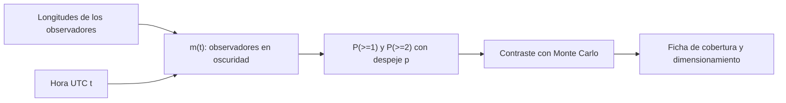

# B129-C01 — Redes de observadores aficionados

<!-- nav:top -->
<!-- /nav -->

## 1. Ubicación, nivel y alcance

Clase 1 del bloque B129. Nivel N3. Una red de observadores aficionados reúne a muchas personas con instrumentos modestos repartidas por el mundo. Aquí aprendes a medir lo que la red aporta como conjunto: **cuánto del día cubre** y **con qué redundancia**, sabiendo que cada observador solo ve de noche y cuando el cielo está despejado. Usas una red **sintética** de longitudes equiespaciadas; no representa a ninguna red real. B48-C19 menciona la ciencia ciudadana desde un observatorio profesional; aquí se trata la red de aficionados como tal. Todos los datos son **sintéticos** salvo los que se rotulan como consultados.

## 2. Por qué esta clase existe

Un fenómeno breve (un meteoro, una ocultación, una explosión de brillo) solo se registra si alguien está mirando en ese momento. La decisión central: **¿cuántos observadores hacen falta para que al menos uno, o al menos dos, estén observando cuando ocurre?**

## 3. Lo que podrás hacer al terminar

1. Calcular, para una red de longitudes dadas, cuántos observadores están en oscuridad en cada instante UTC.
2. Calcular la probabilidad de que al menos un observador registre un evento si el despeje es independiente.
3. Calcular la probabilidad de visión simultánea desde dos estaciones, necesaria para triangular.
4. Contrastar la fórmula analítica con una simulación de Monte Carlo y juzgar la diferencia en sigmas.
5. Dimensionar una red para una cobertura objetivo.
6. Separar lo sintético de lo consultado y nombrar los supuestos (independencia, ventana de oscuridad fija).

La evidencia es la **ficha de cobertura de una red sintética** del ejercicio 12 (sección 20).

## 4. Con qué llegas y cómo comprobarlo

1. ¿Qué es la hora solar media local y cómo se relaciona con la longitud?
2. ¿Qué es la probabilidad de un suceso independiente?
3. ¿Cuánto vale la probabilidad de que ninguno de `m` observadores tenga despeje, si cada uno tiene `p`?
4. ¿Qué es una simulación de Monte Carlo con semilla fija?
5. ¿Para qué sirve ver un meteoro desde dos estaciones?

<details>
<summary>Ver respuestas</summary>

1. El tiempo local avanza 1 h por cada 15° de longitud este respecto del UTC. 2. Si dos sucesos son independientes, la probabilidad de ambos es el producto. 3. `(1 − p)^m`. 4. Un experimento aleatorio repetido muchas veces con generador reproducible. 5. Para triangular su trayectoria y su órbita, no solo contarlo.
</details>

Con cuatro o cinco aciertos, sigue; si no, repasa los prerrequisitos.

## 5. Un caso de contexto y casos de referencia

La Red Global de Meteoros (*Global Meteor Network*) describe en su artículo de presentación más de 450 cámaras en 30 países y más de 220 000 órbitas entre diciembre de 2018 y junio de 2021; su sitio web indica que cualquiera puede unirse instalando una cámara de código abierto. Esas son cifras **publicadas y de esa fecha**. En esta clase no se usan para calcular nada: se construye una red **sintética** con `p = 0,40` de cielo despejado y ventana de oscuridad de 8 h, y se pregunta cuántos observadores hacen falta. Es un ejemplo escolar, no un resultado de ninguna red.

## 6. Vocabulario

La **cobertura** es la fracción del día con al menos un observador en oscuridad. La **redundancia** es el número de observadores que ven a la vez. La **visión estéreo** exige al menos dos. La **oscuridad local** se toma aquí fija entre las 21:00 y las 05:00 de hora solar media. Un **despeje independiente** significa que el estado del cielo de un observador no depende del de otro.

## 7. Modelo mental



*Descripción textual:* las longitudes y la hora UTC dan cuántos observadores están en oscuridad; con la probabilidad de despeje se obtienen `P(≥1)` y `P(≥2)`, que se contrastan con una simulación y terminan en una ficha de dimensionamiento.

Analogía: una red de aficionados es como una cadena de guardias que se relevan alrededor del planeta: cada uno vigila 8 h y la guardia solo sirve si el cielo no está nublado. Límite: las nubes reales de observadores cercanos están correlacionadas, y aquí se suponen independientes.

## 8. La explicación, paso a paso

### 8.1 Cuántos observadores están en oscuridad

Con `N` observadores equiespaciados en longitud y una ventana de 8 h, cada uno cubre un tercio del día. En el instante `t`, el observador de longitud `λ` está en oscuridad si `(t + λ/15) mod 24` cae en `[21, 29)`. Con `N = 3` hay exactamente `m = 1` en todo instante; con `N = 6`, `m = 2`; con `N = 12`, `m = 4`; con `N = 24`, `m = 8`. Con `N = 2` solo se cubren `16 h` de 24 (`0,6667`).

### 8.2 Probabilidad de que alguien vea

Si `m` están en oscuridad y cada uno tiene despeje `p`: `P(≥1) = 1 − (1 − p)^m` y `P(≥2) = 1 − (1 − p)^m − m p (1 − p)^(m−1)`. Con `p = 0,40` y `N = 12`: `1 − 0,6⁴ = 0,8704`; para dos estaciones, `0,5248`.

### 8.3 Contraste con Monte Carlo

Se sortea un instante UTC y el despeje de cada observador 40 000 veces. La diferencia con la fórmula, medida en desviaciones estándar binomiales, no pasa de `1,88 σ`: la simulación no contradice la fórmula, lo que valida el código y la independencia supuesta, no el realismo del modelo.

### 8.4 Dimensionar la red

Para `P(≥1) ≥ 0,95` y `P(≥2) ≥ 0,80` hacen falta `N = 20` observadores (`0,9658` y `0,8165`). La visión doble es la restricción que manda: la sencilla se alcanza con muchos menos observadores.

## 9. Magnitudes, símbolos y unidades

| Símbolo | Qué es | Unidad | Valor / nota |
|---|---|---|---|
| `N` | observadores de la red | — | 2 a 24 (sintético) |
| `λ` | longitud este | ° | equiespaciada |
| `t` | hora UTC | h | 0 a 24 |
| `m(t)` | observadores en oscuridad | — | 1, 2, 4, 8 |
| `p` | probabilidad de despeje | — | 0,40 (ilustrativa) |
| `P(≥k)` | probabilidad de al menos k observadores | — | ver 12 |

## 10. Convenciones y referencias

Tiempo UTC en horas; longitud en grados, este positivo; oscuridad fija 21:00–05:00 hora solar media local, sin estaciones ni latitud. Despeje independiente entre observadores y noches. Semilla 129 y 40 000 noches; tolerancia: diferencia analítico–Monte Carlo ≤ 4 sigmas binomiales y caso cerrado `N = 12` exacto a `10⁻¹²`. Todo es **sintético**.

## 11. De dónde sale lo que afirmamos

| ID | Fuente | Localizador | Respalda | Estado |
|---|---|---|---|---|
| S1 | D. Vida et al., «The Global Meteor Network — Methodology and First Results», arXiv:2107.12335, 2021 — https://arxiv.org/abs/2107.12335 (consultada 2026-11-11) | resumen | más de 450 cámaras en 30 países; más de 220 000 órbitas de meteoroides entre diciembre de 2018 y junio de 2021; precisión mediana del radiante de 0,47° | Consultada (solo el resumen) |
| S2 | Global Meteor Network, sitio web — https://globalmeteornetwork.org/ (consultada 2026-11-11) | página de inicio | red de cámaras con Raspberry Pi y programa de código abierto; datos y API públicos; cualquiera puede instalar una cámara; la página no indica cifras ni licencia de los datos | Consultada (solo la página) |
| S3 | ECSA (European Citizen Science Association), «Ten Principles of Citizen Science», Berlín, 2015 — https://doi.org/10.17605/OSF.IO/XPR2N ; PDF en https://zenodo.org/record/5127534/files/ECSA_Ten_Principles_of_CS_English.pdf (consultada 2026-11-11 con PyMuPDF) | texto completo (1 página) | los diez principios: participación real, resultado científico genuino, beneficio mutuo, participación en varias etapas, retroalimentación, límites y sesgos, datos abiertos salvo razones de seguridad o privacidad, reconocimiento, evaluación y cuestiones legales y éticas | Consultada (texto completo) |
| S4 | UNESCO, «Open Science» (Recomendación sobre Ciencia Abierta, 2021) — https://www.unesco.org/en/open-science/about (consultada 2026-11-11) | página; no se leyó el texto de la Recomendación | la ciencia abierta abre los procesos de creación, evaluación y comunicación del conocimiento a actores sociales más allá de la comunidad científica tradicional; principio de colaboración, participación e inclusión | Consultada (solo la página; la página no usa el término «ciencia ciudadana») |
| — | AAVSO (American Association of Variable Star Observers): manuales de observación visual y fotométrica, datos y políticas | — | — | No consultada (el sitio respondió 403) |
| — | Libros de texto y artículos de fotometría, estadística de supervivencia, privacidad y diseño de proyectos de ciencia ciudadana | — | — | No consultada |
| — | Relaciones y algoritmos estándar usados por el laboratorio (probabilidad binomial de despeje independiente y simulación de Monte Carlo) | — | los verifica el laboratorio con una segunda vía o con pruebas | No consultada en una fuente concreta |

Límites: las cifras de la Red Global de Meteoros son las del resumen de 2021 y no se usan en ningún cálculo; no se consultaron estadísticas actuales de ninguna red ni la AAVSO. La nubosidad real está correlacionada entre observadores cercanos. Lo simulado no se presenta como observación ni como medición.

## 12. Cómo ver los resultados

| `N` | cobertura `m ≥ 1` | `P(≥1)` | `P(≥2)` |
|---|---|---|---|
| 2 | 0,6667 | 0,2667 | 0,0000 |
| 3 | 1,0000 | 0,4000 | 0,0000 |
| 6 | 1,0000 | 0,6400 | 0,1600 |
| 12 | 1,0000 | 0,8704 | 0,5248 |
| 24 | 1,0000 | 0,9832 | 0,8936 |

Descripción larga: con 3 observadores ya se cubren las 24 h pero el despeje limita a 0,40; la visión doble no existe hasta tener 6 y solo se acerca a 0,9 con 24.

## 13. Ejemplo trabajado

**Paso 1 · Ocupación.** `N = 6`: cada instante lo cubren `6 × 8/24 = 2` observadores.

**Paso 2 · Un observador.** `P(≥1) = 1 − 0,6² = 0,64`.

**Paso 3 · Dos observadores.** Ambos deben tener despeje: `P(≥2) = 0,4² = 0,16`.

**Paso 4 · Lectura.** Con 6 observadores se registra un evento breve el 64 % de las veces, pero solo el 16 % queda en visión doble.

## 14. Distintas formas de describir el problema

**Por tabla:** `P(≥k)` frente a `N` (sección 12). **Por fórmula:** binomial con `m(t)`. **Por simulación:** Monte Carlo (laboratorio). Con `N = 12` la ocupación `m = 4` es constante y la fórmula se reduce a `1 − 0,6⁴`.

## 15. Práctica guiada

**Ejercicio 1 · con los pasos indicados.** Con `N = 6` y una ventana de 8 h, ¿cuántos observadores están en oscuridad en cada instante?

<details><summary>Solución comentada</summary>

`6 × 8/24 = 2`.
</details>

**Ejercicio 2 · con una pista.** Calcula `P(≥1)` para `N = 3` y `p = 0,40`.

<details><summary>Solución comentada</summary>

`m = 1`: `P = 0,40`.
</details>

**Ejercicio 3 · casi autónomo.** Calcula `P(≥2)` para `N = 6`.

<details><summary>Solución comentada</summary>

`m = 2`: `0,4² = 0,16`.
</details>

## 16. Práctica autónoma, transferencia e integrador

**Ejercicio 4 · autónomo.** Calcula `P(≥1)` para `N = 24` (`m = 8`).

<details><summary>Solución comentada</summary>

`1 − 0,6⁸ = 0,9832`.
</details>

**Ejercicio 5 · autónomo.** Calcula `P(≥2)` para `m = 4` y `p = 0,40`.

<details><summary>Solución comentada</summary>

`1 − 0,6⁴ − 4 × 0,4 × 0,6³ = 1 − 0,1296 − 0,3456 = 0,5248`.
</details>

**Ejercicio 6 · autónomo.** ¿Qué fracción del día cubren 2 observadores equiespaciados?

<details><summary>Solución comentada</summary>

`2 × 8/24 = 0,6667`.
</details>

**Ejercicio 7 · autónomo.** Si `p` sube a 0,60, ¿cuánto vale `P(≥1)` con `m = 2`?

<details><summary>Solución comentada</summary>

`1 − 0,4² = 0,84`.
</details>

**Ejercicio 8 · autónomo.** Si la oscuridad dura 10 h en lugar de 8, ¿cuántos observadores hacen falta para cubrir las 24 h?

<details><summary>Solución comentada</summary>

`24/10 = 2,4`: 3 observadores equiespaciados.
</details>

**Ejercicio 9 · transferencia.** **Transferencia.** Un coordinador dice que con 20 observadores «se vio el 100 %». ¿Qué le respondes?

<details><summary>Solución comentada</summary>

Con `N = 20` y `p = 0,40` el modelo da `P(≥1) = 0,9658` y `P(≥2) = 0,8165`: no es 100 %, y el modelo supone despeje independiente y ventana fija.
</details>

**Ejercicio 10 · transferencia.** **Transferencia.** Dos observadores vecinos comparten cielo nublado. ¿Qué pasa con `P(≥1)`?

<details><summary>Solución comentada</summary>

Baja respecto de la fórmula independiente: el despeje correlacionado reduce la ganancia de añadir un vecino; conviene repartir los sitios.
</details>

**Ejercicio 11 · transferencia.** **Transferencia.** La red tiene 12 observadores y se pierden 3 (sin elegirlos por longitud). ¿Qué miras?

<details><summary>Solución comentada</summary>

La ocupación `m(t)` ya no es constante: puede haber horas con `m = 0`; se recalcula la cobertura con las longitudes que quedan.
</details>

**Ejercicio 12 · integrador.** **Integrador.** Elabora tu *ficha de cobertura de una red sintética*: tabla de `N`, cobertura, `P(≥1)` y `P(≥2)`, el `N` mínimo para tu objetivo y la lista de supuestos y de qué es sintético.

<details><summary>Solución comentada</summary>

Secciones 8.1–8.4 y la salida del laboratorio.
</details>

## 17. Laboratorio: cobertura de una red sintética con nubosidad

El script [cobertura_red.py](cobertura_red.py) calcula `m(t)`, `P(≥1)` y `P(≥2)` para varias redes, las contrasta con Monte Carlo y busca el `N` mínimo para un objetivo (**comprueba** el caso cerrado `N = 12` y la diferencia ≤ 4 σ).

**Datos:** todo **sintético** (longitudes, ventana, `p`). **Predice antes de ejecutar:** ¿qué `P(≥1)` tendrá `N = 12`? (`1 − 0,6⁴ = 0,8704`.) **Ejecución del 2026-11-11 (Python 3.12.9):**

```text
Python 3.12.9 (biblioteca estandar); semilla 129
Red SINTETICA: p(despeje) = 0.4, oscuridad local 21:00-5:00 (8 h), longitudes equiespaciadas
  N  cobertura(m>=1)  P(>=1) anal  P(>=1) MC   P(>=2) anal  P(>=2) MC   dif/sigma
  2          0.6667       0.2667     0.2671       0.0000     0.0000      0.21
  3          1.0000       0.4000     0.4015       0.0000     0.0000      0.60
  6          1.0000       0.6400     0.6355       0.1600     0.1593      1.85
 12          1.0000       0.8704     0.8685       0.5248     0.5261      1.12
 24          1.0000       0.9832     0.9834       0.8936     0.8965      1.88
Caso cerrado N=12: m(t) = [4]; 1-(1-p)^4 = 0.8704; analitico = 0.8704
Minimo N con P(>=1) >= 0.95 y P(>=2) >= 0.80: N = 20 (P1 = 0.9658, P2 = 0.8165)
Maxima desviacion MC-analitico = 1.88 sigma. Pruebas superadas.
```

```bash
python programa/clases/B129/B129-C01-redes-de-observadores-aficionados/cobertura_red.py
```

**Límites:** despeje independiente, ventana de oscuridad fija sin estaciones, sin errores de los observadores ni fallas de equipo.

## 18. Errores frecuentes y cómo corregirlos

**Confundir cobertura temporal con probabilidad de registrar.** Estar en oscuridad no basta: hace falta despeje (8.2)

**Suponer que añadir observadores vecinos suma lo mismo que repartirlos.** Las nubes se correlacionan; reparte longitudes

**Dar una cifra publicada como resultado propio.** Las cifras de la Red Global de Meteoros son de 2021 y solo de contexto

## 19. Cómo sabrás que vas bien

Tras 8.2: ¿qué `P(≥1)` esperabas para `N = 6`? Si dudas, repasa el ejemplo 13. Tras el laboratorio: ¿qué comprueba? (ver sección 17).

## 20. Qué entregas y cómo se evalúa

El producto es tu **ficha de cobertura de una red sintética** (ejercicio 12).

| Criterio | Inicial | En desarrollo | Logrado | Destacado |
|---|---|---|---|---|
| Conceptos | Los confunde | Parciales | Explica el método y su dominio | Explica los límites y las alternativas |
| Cálculo | Sin unidades | Con errores | Resultados con unidades y comprobados | Resuelve casos nuevos |
| Numérico | Sin comprobar | Un caso | Verifica con una segunda vía en varios casos | Interpreta las diferencias y los fallos |
| Fuentes | Sin fuente | Sin fecha | Fuentes con fecha y estado | Declara lo sintético y lo no consultado |
| Límites | No los nombra | Uno | Tres | Discute qué falta del modelo |

**Condiciones críticas (no se compensan con promedio):** rotular los datos como sintéticos; comprobar cada resultado con una segunda vía; citar solo lo consultado.

## 21. Ética, seguridad y límites

Clase educativa: los modelos son simplificados y los datos son sintéticos; ningún resultado describe un proyecto real, una observación real ni sustituye los protocolos de una organización científica ni la asesoría jurídica sobre datos personales. Contenido educativo; el Sol solo se observa con filtros solares certificados. Las salidas de observación nocturna se hacen en grupo, con permiso del sitio y atención a la seguridad personal; el Sol solo se observa con filtros solares certificados. Accesibilidad: tablas equivalentes a las gráficas, fórmulas en texto, ejercicios sin conexión.

## 22. Para cerrar y seguir

Una red sintética de 12 observadores registra un evento breve el 87 % de las veces y lo ve desde dos estaciones el 52 %; hacen falta 20 para llegar a 0,95 y 0,80. Queda una pregunta: ¿qué precisión tiene la medida de cada voluntario?

**Glosario español–inglés.** red de observadores · *observer network*; cobertura · *coverage*; redundancia · *redundancy*; despeje · *clear sky*; ciencia ciudadana · *citizen science*.

**Continuidad.** [B129-C02](../B129-C02-fotometria-participativa/CLASE.md) trata la fotometría hecha por voluntarios.

**Referencias:** ver sección 11.

<!-- nav:bottom -->
<!-- /nav -->
