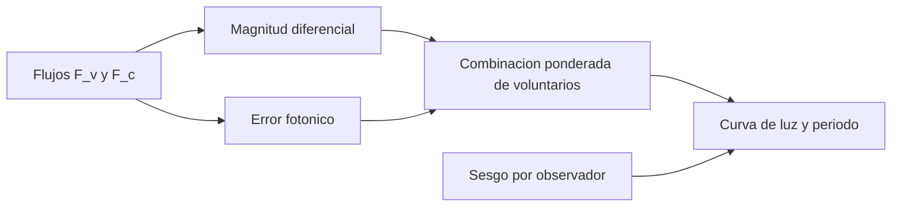

# B129-C02 — Fotometría participativa

<!-- nav:top -->
<!-- /nav -->

## 1. Ubicación, nivel y alcance

Clase 2 del bloque B129. Nivel N3. Medir el brillo de una estrella variable es una de las tareas más antiguas de los aficionados. Aquí aprendes a convertir flujos en una **magnitud diferencial** frente a una estrella de comparación, a saber cuánto error es inevitable (el ruido fotónico) y a combinar las estimaciones de varios voluntarios con pesos, sabiendo qué parte del error baja con más voluntarios y cuál no. La fotometría profesional se trata en B45; aquí interesa la parte participativa. La estrella, la comparación y los voluntarios son **sintéticos**. Todos los datos son **sintéticos** salvo los que se rotulan como consultados.

## 2. Por qué esta clase existe

Una curva de luz de una estrella variable se construye con medidas de muchas personas con instrumentos distintos. La decisión central: **¿cómo se combinan sus medidas para que la curva sea más precisa que cada una, y qué error no se puede promediar?**

## 3. Lo que podrás hacer al terminar

1. Calcular la magnitud diferencial a partir de flujos de la variable y de la comparación.
2. Calcular el error fotónico `σ = 1,0857·√(1/F_v + 1/F_c)` y contrastarlo con una simulación.
3. Combinar medidas con pesos `1/σ²` y calcular la varianza de la media ponderada.
4. Distinguir el ruido, que baja con `1/√N`, del sesgo, que no baja.
5. Recuperar el periodo y la amplitud de una variable sintética con un ajuste por mínimos cuadrados.
6. Separar lo sintético de lo consultado y declarar que la AAVSO no se pudo consultar.

La evidencia es la **ficha de curva de luz de voluntarios** del ejercicio 12 (sección 20).

## 4. Con qué llegas y cómo comprobarlo

1. ¿Qué es una magnitud astronómica y qué relación tiene con el flujo?
2. ¿Qué es el ruido de Poisson de un recuento de `N` electrones?
3. ¿Qué es una media ponderada?
4. ¿Qué distingue un error aleatorio de un sesgo?
5. ¿Qué es una estrella de comparación?

<details>
<summary>Ver respuestas</summary>

1. Una escala logarítmica inversa: `m = −2,5 log₁₀ F + cte`; más brillante es un número menor. 2. Una desviación estándar de `√N`. 3. Un promedio donde cada dato pesa según su fiabilidad, por ejemplo `1/σ²`. 4. El aleatorio varía de una medida a otra y se promedia; el sesgo es un desplazamiento constante. 5. Una estrella cercana de brillo conocido que sirve de referencia en la misma imagen.
</details>

Con cuatro o cinco aciertos, sigue; si no, repasa los prerrequisitos.

## 5. Un caso de contexto y casos de referencia

Una estrella variable **sintética** (VS-S) oscila con `m = 10,00 + 0,50 sen(2π t/37,0)` (`t` en días). Su comparación tiene magnitud `10,50` (valor **ilustrativo**, no de ningún catálogo). Ocho voluntarios sintéticos con `σ` entre 0,02 y 0,15 mag y sesgos entre −0,05 y +0,06 mag observan durante 60 noches, cada uno con probabilidad 0,5 por noche. No se midió nada real.

## 6. Vocabulario

La **magnitud diferencial** es `m_v = m_c − 2,5 log₁₀(F_v/F_c)`. El **error fotónico** viene del ruido de Poisson de los fotones. El **peso** de una medida es `w = 1/σ²`. La **media ponderada** es `Σ w m / Σ w` y su varianza es `1/Σ w`. El **sesgo** es un desplazamiento sistemático de un observador. La **curva de luz** es la magnitud en función del tiempo.

## 7. Modelo mental



*Descripción textual:* los flujos dan la magnitud diferencial y su error fotónico; con ellos se combinan los voluntarios con pesos y se obtiene la curva de luz y el periodo, afectados por el sesgo de cada observador.

Analogía: combinar voluntarios es como pesar una piedra con varias balanzas: promediar reduce el temblor de cada aguja, pero si todas están mal tareadas en el mismo sentido el promedio hereda el error. Límite: en fotometría el sesgo depende del color de la estrella y del filtro, no solo de un desplazamiento fijo.

## 8. La explicación, paso a paso

### 8.1 Magnitud diferencial y error fotónico

Si la variable da `F_v` y la comparación `F_c`, `m_v = m_c − 2,5 log₁₀(F_v/F_c)`. Con ruido de Poisson, `σ_m = 1,0857·√(1/F_v + 1/F_c)` (`1,0857 = 2,5/ln 10`). Con `F_v = 2×10⁴ e⁻` y `F_c = 4×10⁴ e⁻`, `σ_m = 0,00940 mag`. La simulación da `0,00938`, diferencia `0,25 %`. Se ignoran el cielo, la lectura y el centelleo, por eso es un piso.

### 8.2 Combinar voluntarios

Con pesos `1/σ²`, la media ponderada de las 246 observaciones de 60 noches tiene un RMS de `0,0306 mag` frente a la verdadera, mientras que la media simple da `0,0497` y la mediana `0,0475`. La varianza de la media de los 8 sin sesgo es `2,092×10⁻⁴ mag²` (analítica) y `2,088×10⁻⁴` (Monte Carlo).

### 8.3 Lo que no baja

El ruido baja como `1/√N`; el sesgo no. El sesgo medio ponderado del conjunto es `−0,0053 mag`: es un piso aunque se sumen más voluntarios. Con un solo observador de `σ = 0,10`, 16 voluntarios iguales darían `0,025`, pero si todos comparten un error de `0,05` por una comparación mal catalogada, el error nunca baja de `0,05`. Del conjunto solo se puede estimar el sesgo **relativo** a la mediana de los demás: el laboratorio recupera `V3: +0,041` frente a `+0,059` verdadero (centrado), con ruido.

### 8.4 Periodo y amplitud

Un barrido de periodos con ajuste lineal de `[1, sen, cos]` recupera `36,75 d` (verdadero `37,0`) y una amplitud de `0,481 mag` (verdadera `0,500`). El error en el periodo viene del muestreo de 60 noches con huecos.

## 9. Magnitudes, símbolos y unidades

| Símbolo | Qué es | Unidad | Valor / nota |
|---|---|---|---|
| `F_v, F_c` | flujos de la variable y de la comparación | e⁻ | 2×10³ a 4×10⁵ |
| `m_c` | magnitud de la comparación | mag | 10,50 (ilustrativa) |
| `m_v` | magnitud diferencial | mag | ver 13 |
| `σ_m` | error fotónico | mag | 0,0094 |
| `w` | peso `1/σ²` | mag⁻² | 2500 para σ = 0,02 |
| `P, A` | periodo y amplitud | d, mag | 37,0 y 0,50 (sintéticos) |

## 10. Convenciones y referencias

Tiempo en días; magnitudes en mag; flujos en electrones. Sin extinción, sin transformación de color y sin ruido de cielo ni de lectura. Semilla 129; 20 000 repeticiones. Tolerancias: error fotónico analítico–MC dentro del 3 %, varianza de la media ponderada dentro del 5 %, periodo dentro de 0,5 d y amplitud dentro de 0,05 mag. Todo es **sintético**.

## 11. De dónde sale lo que afirmamos

| ID | Fuente | Localizador | Respalda | Estado |
|---|---|---|---|---|
| S1 | ECSA (European Citizen Science Association), «Ten Principles of Citizen Science», Berlín, 2015 — https://doi.org/10.17605/OSF.IO/XPR2N ; PDF en https://zenodo.org/record/5127534/files/ECSA_Ten_Principles_of_CS_English.pdf (consultada 2026-11-11 con PyMuPDF) | texto completo (1 página) | los diez principios: participación real, resultado científico genuino, beneficio mutuo, participación en varias etapas, retroalimentación, límites y sesgos, datos abiertos salvo razones de seguridad o privacidad, reconocimiento, evaluación y cuestiones legales y éticas | Consultada (texto completo) |
| S2 | UNESCO, «Open Science» (Recomendación sobre Ciencia Abierta, 2021) — https://www.unesco.org/en/open-science/about (consultada 2026-11-11) | página; no se leyó el texto de la Recomendación | la ciencia abierta abre los procesos de creación, evaluación y comunicación del conocimiento a actores sociales más allá de la comunidad científica tradicional; principio de colaboración, participación e inclusión | Consultada (solo la página; la página no usa el término «ciencia ciudadana») |
| — | AAVSO (American Association of Variable Star Observers): manuales de observación visual y fotométrica, datos y políticas | — | — | No consultada (el sitio respondió 403) |
| — | Libros de texto y artículos de fotometría, estadística de supervivencia, privacidad y diseño de proyectos de ciencia ciudadana | — | — | No consultada |
| — | Relaciones y algoritmos estándar usados por el laboratorio (magnitud diferencial, ruido de Poisson, media ponderada y ajuste sinusoidal por mínimos cuadrados) | — | los verifica el laboratorio con una segunda vía o con pruebas | No consultada en una fuente concreta |

Límites: no se consultaron los protocolos de la AAVSO (acceso denegado) ni catálogos de estrellas de comparación; los sesgos y ruidos de los voluntarios son inventados. El sesgo con color y filtro real no se modela. Lo simulado no se presenta como observación ni como medición.

## 12. Cómo ver los resultados

| Estimador | RMS frente a la verdadera [mag] |
|---|---|
| Media simple | 0,0497 |
| Mediana | 0,0475 |
| Media ponderada `1/σ²` | 0,0306 |
| Ponderada con sesgo relativo corregido | 0,0278 |

Descripción larga: ponderar y corregir el sesgo relativo baja el error de 0,050 a 0,028 mag; el sesgo común no se puede corregir sin una referencia externa.

## 13. Ejemplo trabajado

**Paso 1 · Flujos.** `F_v/F_c = 0,5`.

**Paso 2 · Magnitud.** `m_v = 10,50 − 2,5 log₁₀ 0,5 = 10,50 + 0,7526 = 11,2526`.

**Paso 3 · Error.** Con `F_v = 10⁴` y `F_c = 2×10⁴`: `σ = 1,0857·√(10⁻⁴ + 0,5×10⁻⁴) = 0,0133 mag`.

**Paso 4 · Lectura.** La estrella es 0,75 mag más débil que la comparación y la medida tiene 0,013 mag de ruido fotónico.

## 14. Distintas formas de describir el problema

**Por tabla:** observaciones por noche y voluntario. **Por fórmula:** `σ_m` y media ponderada. **Por gráfica:** la curva de luz en fase con el periodo recuperado. **Por simulación:** el Monte Carlo del error fotónico y de la varianza de la media.

## 15. Práctica guiada

**Ejercicio 1 · con los pasos indicados.** Calcula `m_v` si `F_v/F_c = 0,5` y `m_c = 10,50`.

<details><summary>Solución comentada</summary>

`10,50 − 2,5 log₁₀ 0,5 = 11,2526`.
</details>

**Ejercicio 2 · con una pista.** Calcula `σ_m` con `F_v = F_c = 10⁴ e⁻`.

<details><summary>Solución comentada</summary>

`1,0857·√(2×10⁻⁴) = 0,01535 mag`.
</details>

**Ejercicio 3 · casi autónomo.** Calcula los pesos de `σ = 0,02` y `σ = 0,05`.

<details><summary>Solución comentada</summary>

`1/0,02² = 2500` y `1/0,05² = 400`.
</details>

## 16. Práctica autónoma, transferencia e integrador

**Ejercicio 4 · autónomo.** Combina `10,00` (σ = 0,02) y `10,10` (σ = 0,10).

<details><summary>Solución comentada</summary>

`w = 2500` y `100`: `(25000 + 1010)/2600 = 10,0038`.
</details>

**Ejercicio 5 · autónomo.** ¿Cuál es la desviación estándar de esa media?

<details><summary>Solución comentada</summary>

`1/√2600 = 0,0196 mag`.
</details>

**Ejercicio 6 · autónomo.** ¿Cuánto vale el error de 16 voluntarios iguales de `σ = 0,10`, sin sesgo?

<details><summary>Solución comentada</summary>

`0,10/√16 = 0,025 mag`.
</details>

**Ejercicio 7 · autónomo.** ¿Qué cociente de flujos corresponde a `Δm = 0,5`?

<details><summary>Solución comentada</summary>

`10^(0,5/2,5) = 1,585`.
</details>

**Ejercicio 8 · autónomo.** Si 100 voluntarios comparten un sesgo de 0,05 mag, ¿cuál es el error de su media?

<details><summary>Solución comentada</summary>

Al menos `0,05` mag: el sesgo común no baja con `N`.
</details>

**Ejercicio 9 · transferencia.** **Transferencia.** Todos los voluntarios usan una comparación cuya magnitud de catálogo está 0,10 mag equivocada. ¿Qué pasa con la curva?

<details><summary>Solución comentada</summary>

Se desplaza 0,10 mag completa; la forma y el periodo se conservan, el nivel absoluto no. Se detecta contrastando con otra comparación.
</details>

**Ejercicio 10 · transferencia.** **Transferencia.** Un voluntario usa una cámara sin filtro y la estrella es muy roja. ¿Qué error esperas?

<details><summary>Solución comentada</summary>

Un sesgo que depende del color: la respuesta de la cámara difiere de la del filtro estándar; se corrige con una transformación calibrada o se declara el filtro en la contribución.
</details>

**Ejercicio 11 · transferencia.** **Transferencia.** Se incorpora un voluntario con `σ = 0,20` a la media de σ = 0,0196. ¿Cuánto pesa?

<details><summary>Solución comentada</summary>

`w = 25` frente a `2600`: aproximadamente 1 %; casi no cambia la media, pero no se descarta.
</details>

**Ejercicio 12 · integrador.** **Integrador.** Elabora tu *ficha de curva de luz de voluntarios*: error fotónico, comparación de estimadores, sesgo relativo, periodo recuperado y lista de qué es sintético y qué no se consultó.

<details><summary>Solución comentada</summary>

Secciones 8.1–8.4 y la salida del laboratorio.
</details>

## 17. Laboratorio: curva de luz sintética con ocho voluntarios

El script [fotometria_voluntarios.py](fotometria_voluntarios.py) calcula el error fotónico (analítico y Monte Carlo), combina ocho voluntarios con distintos estimadores, estima su sesgo relativo y recupera el periodo (**comprueba** el error fotónico dentro del 3 %, la varianza dentro del 5 % y el periodo dentro de 0,5 d).

**Datos:** todo **sintético** (estrella, comparación, voluntarios). **Predice antes de ejecutar:** ¿qué estimador tendrá el menor RMS? (la media ponderada con sesgo relativo corregido, 0,0278 mag.) **Ejecución del 2026-11-11 (Python 3.12.9):**

```text
Python 3.12.9 (biblioteca estandar); semilla 129
DATOS SINTETICOS: variable VS-S (m0 = 10.00, A = 0.50 mag, P = 37.0 d); comparacion 10.50 (ilustrativo)
1) Error fotonico de la magnitud diferencial (analitico frente a Monte Carlo)
   F_v [e-]   F_c [e-]   sigma anal [mag]   sigma MC [mag]   dif [%]
       2000       4000          0.02973          0.02968     0.16
      20000      40000          0.00940          0.00938     0.25
     200000     400000          0.00297          0.00295     0.81
2) Combinacion de 8 voluntarios: 60 noches, cada uno observa con probabilidad 0.5
   noches con datos = 60, observaciones = 246
   RMS media simple = 0.0497 mag; mediana = 0.0475 mag; media ponderada = 0.0306 mag
   sesgo relativo estimado [mag]: V1:+0.007, V2:-0.018, V3:+0.041, V4:+0.002, V5:+0.015, V6:-0.017, V7:+0.009, V8:-0.039
   RMS ponderada con sesgo relativo corregido = 0.0278 mag
3) Varianza de la media ponderada de los 8 (sin sesgo): analitica = 2.092e-04 mag2; MC = 2.088e-04 mag2; dif = 0.19 %
   Sesgo medio ponderado (piso del error aunque N crezca) = -0.0053 mag
4) Periodo recuperado por minimos cuadrados = 36.75 d (sintetico 37.0 d); amplitud = 0.481 mag (0.500)
Pruebas superadas.
```

```bash
python programa/clases/B129/B129-C02-fotometria-participativa/fotometria_voluntarios.py
```

**Límites:** ruido gaussiano, sin cielo ni lectura, sesgo constante por observador, sin transformación de color; el sesgo común del conjunto no se puede estimar.

## 18. Errores frecuentes y cómo corregirlos

**Creer que más voluntarios siempre bajan el error.** El sesgo común no baja (8.3)

**Promediar sin pesos.** La media simple da 0,0497 frente a 0,0306 (8.2)

**Presentar la curva sintética como observación.** Revisa la sección 10 y la 11

## 19. Cómo sabrás que vas bien

Tras 8.3: ¿qué error esperas con 1000 voluntarios que comparten 0,05 mag de sesgo? Si dudas, repasa el ejemplo 13. Tras el laboratorio: ¿qué comprueba? (ver sección 17).

## 20. Qué entregas y cómo se evalúa

El producto es tu **ficha de curva de luz de voluntarios** (ejercicio 12).

| Criterio | Inicial | En desarrollo | Logrado | Destacado |
|---|---|---|---|---|
| Conceptos | Los confunde | Parciales | Explica el método y su dominio | Explica los límites y las alternativas |
| Cálculo | Sin unidades | Con errores | Resultados con unidades y comprobados | Resuelve casos nuevos |
| Numérico | Sin comprobar | Un caso | Verifica con una segunda vía en varios casos | Interpreta las diferencias y los fallos |
| Fuentes | Sin fuente | Sin fecha | Fuentes con fecha y estado | Declara lo sintético y lo no consultado |
| Límites | No los nombra | Uno | Tres | Discute qué falta del modelo |

**Condiciones críticas (no se compensan con promedio):** rotular los datos como sintéticos; comprobar cada resultado con una segunda vía; citar solo lo consultado.

## 21. Ética, seguridad y límites

Clase educativa: los modelos son simplificados y los datos son sintéticos; ningún resultado describe un proyecto real, una observación real ni sustituye los protocolos de una organización científica ni la asesoría jurídica sobre datos personales. Contenido educativo; el Sol solo se observa con filtros solares certificados.  Accesibilidad: tablas equivalentes a las gráficas, fórmulas en texto, ejercicios sin conexión.

## 22. Para cerrar y seguir

Ocho voluntarios sintéticos bajan el error de 0,050 a 0,031 mag con pesos y a 0,028 con el sesgo relativo corregido, y recuperan el periodo con un error de 0,25 d. Queda una pregunta: ¿cómo se cuentan fenómenos aleatorios, como los meteoros?

**Glosario español–inglés.** magnitud diferencial · *differential magnitude*; estrella de comparación · *comparison star*; curva de luz · *light curve*; sesgo · *bias*; media ponderada · *weighted mean*.

**Continuidad.** [B129-C03](../B129-C03-seguimiento-ciudadano-de-meteoros/CLASE.md) trata el seguimiento ciudadano de meteoros.

**Referencias:** ver sección 11.

<!-- nav:bottom -->
<!-- /nav -->
