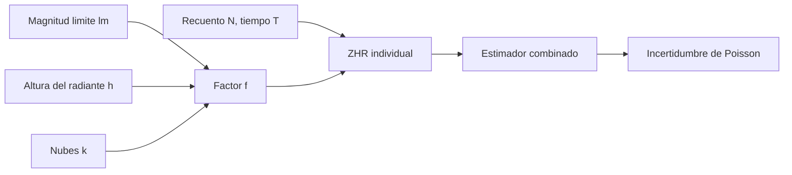

# B129-C03 — Seguimiento ciudadano de meteoros

<!-- nav:top -->
[🏠 Programa](../../../../README.md) · [📚 Bloque B129](../../../tronco-comun/B129-ciencia-ciudadana-astronomica.md) · [← Anterior: B129-C02 — Fotometría participativa](../B129-C02-fotometria-participativa/CLASE.md) · [Siguiente: B129-C04 — Contribución de medidas voluntarias con control de calidad →](../B129-C04-contribucion-de-medidas-voluntarias-con-control-de-calidad/CLASE.md)
<!-- /nav -->

## 1. Ubicación, nivel y alcance

Clase 3 del bloque B129. Nivel N3. Contar meteoros a simple vista es un proyecto clásico de aficionados. Un recuento crudo depende de quién mira, con qué cielo y con qué altura del radiante; para comparar observadores se convierte en una **tasa horaria cenital (ZHR)**, que es el recuento que vería un observador con cielo ideal y el radiante en el cenit. Aquí calculas la ZHR con su incertidumbre de Poisson y ves cuánto se equivoca el recuento sin corregir. B08-C18 solo introduce los meteoros. La lluvia, los 40 observadores y sus recuentos son **sintéticos**. Todos los datos son **sintéticos** salvo los que se rotulan como consultados.

## 2. Por qué esta clase existe

Cuarenta personas cuentan meteoros una noche: unos con un cielo más oscuro, otros bajo nubes, otros con el radiante bajo. La decisión central: **¿cómo se combinan sus recuentos en una sola tasa comparable, y con qué incertidumbre?**

## 3. Lo que podrás hacer al terminar

1. Calcular el factor de corrección de un observador por magnitud límite, altura del radiante, nubosidad y tiempo efectivo.
2. Convertir un recuento en una ZHR individual con su incertidumbre de Poisson.
3. Combinar observadores con el estimador de máxima verosimilitud y calcular su varianza.
4. Medir el sesgo del recuento sin corregir.
5. Planificar cuántos observadores hacen falta para una incertidumbre relativa objetivo.
6. Separar lo sintético de lo consultado y declarar que la fórmula de la IMO no se consultó.

La evidencia es la **ficha de ZHR con incertidumbre** del ejercicio 12 (sección 20).

## 4. Con qué llegas y cómo comprobarlo

1. ¿Qué es una distribución de Poisson y cuál es su desviación estándar?
2. ¿Qué es el radiante de una lluvia de meteoros?
3. ¿Qué es la magnitud límite estelar?
4. ¿Qué es una altura sobre el horizonte y su seno?
5. ¿Qué es un estimador de máxima verosimilitud?

<details>
<summary>Ver respuestas</summary>

1. La de los recuentos de sucesos independientes a tasa constante; su desviación es `√λ`. 2. El punto del cielo desde el que parecen divergir los meteoros de la lluvia. 3. La estrella más débil que se ve a simple vista en un cielo dado. 4. El ángulo sobre el horizonte; `sen 90° = 1` en el cenit. 5. El valor del parámetro que hace más probable lo observado.
</details>

Con cuatro o cinco aciertos, sigue; si no, repasa los prerrequisitos.

## 5. Un caso de contexto y casos de referencia

La Organización Internacional de Meteoros (IMO) coordina observaciones visuales, fotográficas, de vídeo, de radio y telescópicas y mantiene una base de datos de observaciones visuales; su página de inicio no explica la ZHR. La relación de esta clase es la estándar (**no consultada** en una fuente concreta). Aquí una lluvia **sintética** con `ZHR = 100 /h` e índice de población `r = 2,2` es contada por 40 observadores inventados; se estima la ZHR y se compara con la verdad conocida de la simulación. Ninguna cifra es una observación.

## 6. Vocabulario

La **ZHR** es la tasa horaria cenital: recuentos por hora bajo cielo ideal (`lm = 6,5`) y con el radiante en el cenit. El **índice de población** `r` es el cociente de meteoros que hay en cada magnitud respecto de la anterior más brillante. La **magnitud límite** `lm` mide la oscuridad del cielo. El **tiempo efectivo** `T` descuenta las pausas. La **fracción de nubes** `k` descuenta el cielo cubierto.

## 7. Modelo mental



*Descripción textual:* el recuento y las condiciones de observación dan un factor por observador; con él se obtiene la ZHR individual y, sumando observadores, un estimador combinado con su incertidumbre de Poisson.

Analogía: contar meteoros sin corregir es como comparar la cosecha de dos campos sin saber de qué tamaño son: el factor `f` expresa cuánto cielo útil «cultivó» cada observador. Límite: la dependencia exacta con la altura y con `r` es un modelo; no es una ley exacta.

## 8. La explicación, paso a paso

### 8.1 El factor de cada observador

`f = sen(h) · r^(lm−6,5) · (1 − k) · T`. Un observador con `lm = 6,5`, `h = 90°`, sin nubes y `T = 1 h` tiene `f = 1`. Si `lm = 5,5`, `r^(−1) = 0,4545` y con `h = 30°` queda `f = 0,5 × 0,4545 = 0,2273`.

### 8.2 ZHR individual y combinada

`ZHR_i = N_i/f_i`, con incertidumbre `√N_i/f_i`. Con 20 meteoros y `f = 0,2273`: `88,0 ± 19,7 /h`. El estimador combinado es `Σ N_i / Σ f_i` y su varianza `ZHR/Σ f_i`. Con los 40 observadores sintéticos: 1927 meteoros, `Σ f = 19,574 h` y `ZHR = 98,45 ± 2,24 /h` frente a la verdad `100`.

### 8.3 Qué pasa si no se corrige

El recuento por hora sin corregir da `44,8 /h`, menos de la mitad, porque casi nadie tiene cielo ideal ni el radiante en el cenit. Un error de 0,5 mag en la magnitud límite cambia el factor en `r^0,5 = 1,483` (48 %): la magnitud límite es el dato más delicado que reporta cada observador.

### 8.4 Comprobación y planificación

Con 4000 repeticiones de Monte Carlo la media es `100,063` y la desviación `2,277` (teórica `2,260`): el estimador no tiene sesgo. Para una incertidumbre relativa de 5 % hace falta `Σ f = 4,0 h`, es decir, unos 9 observadores como los del ejemplo.

## 9. Magnitudes, símbolos y unidades

| Símbolo | Qué es | Unidad | Valor / nota |
|---|---|---|---|
| `N` | recuento de meteoros | — | 18 a 30 por observador |
| `T` | tiempo efectivo | h | 0,5 a 2 |
| `lm` | magnitud límite estelar | mag | 5,0 a 6,5 |
| `h` | altura del radiante | ° | 25 a 75 |
| `k` | fracción de nubes | — | 0 a 0,25 |
| `r` | índice de población | — | 2,2 (sintético) |
| `ZHR` | tasa horaria cenital | 1/h | 100 (verdad sintética) |

## 10. Convenciones y referencias

Tiempo en horas; ángulos en grados; magnitudes en mag. Altura del radiante en grados sobre el horizonte. Semilla 129; 4000 repeticiones. Tolerancias: media MC dentro de 3 errores estándar de la verdad y desviación MC dentro del 5 % de la teórica. Fórmula de ZHR estándar, no consultada; datos **sintéticos**.

## 11. De dónde sale lo que afirmamos

| ID | Fuente | Localizador | Respalda | Estado |
|---|---|---|---|---|
| S1 | International Meteor Organization (IMO), sitio web — https://www.imo.net/ (consultada 2026-11-11) | página de inicio | lista las observaciones visuales, fotográficas, de vídeo, de radio y telescópicas, una base de datos de observaciones visuales (VMDB) y un formulario de bolas de fuego; la página no explica la ZHR ni su cálculo | Consultada (solo la página; sin fórmulas) |
| S2 | ECSA (European Citizen Science Association), «Ten Principles of Citizen Science», Berlín, 2015 — https://doi.org/10.17605/OSF.IO/XPR2N ; PDF en https://zenodo.org/record/5127534/files/ECSA_Ten_Principles_of_CS_English.pdf (consultada 2026-11-11 con PyMuPDF) | texto completo (1 página) | los diez principios: participación real, resultado científico genuino, beneficio mutuo, participación en varias etapas, retroalimentación, límites y sesgos, datos abiertos salvo razones de seguridad o privacidad, reconocimiento, evaluación y cuestiones legales y éticas | Consultada (texto completo) |
| — | Manuales y fórmulas de la IMO para el cálculo de la ZHR | — | — | No consultada |
| — | Libros de texto y artículos de fotometría, estadística de supervivencia, privacidad y diseño de proyectos de ciencia ciudadana | — | — | No consultada |
| — | Relaciones y algoritmos estándar usados por el laboratorio (recuentos de Poisson, corrección por magnitud límite, altura del radiante y nubes, y estimador de máxima verosimilitud) | — | los verifica el laboratorio con una segunda vía o con pruebas | No consultada en una fuente concreta |

Límites: la página de la IMO consultada no da la fórmula de la ZHR ni su tratamiento de la altura y de `r`, de modo que el factor es una relación estándar no verificada contra una fuente. El índice `r` real varía con la lluvia y no se usó ninguna lluvia real. Lo simulado no se presenta como observación ni como medición.

## 12. Cómo ver los resultados

| Observador | `lm` | `h` | `k` | `T` | `N` | `f` | ZHR_i |
|---|---|---|---|---|---|---|---|
| O01 | 6,0 | 27,3° | 0,25 | 1,0 h | 18 | 0,232 | 77,6 ± 18,3 |
| O02 | 6,0 | 68,3° | 0,00 | 0,5 h | 30 | 0,313 | 95,8 ± 17,5 |
| O03 | 5,5 | 31,8° | 0,10 | 1,0 h | 23 | 0,216 | 106,6 ± 22,2 |
| Combinado (40) | — | — | — | — | 1927 | 19,574 | 98,45 ± 2,24 |

Descripción larga: los observadores individuales varían de 78 a 107 con errores de ± 18 a 22; el conjunto estrecha la estimación a ± 2,2.

## 13. Ejemplo trabajado

**Paso 1 · Factor.** `lm = 5,5`, `h = 30°`, `k = 0`, `T = 1 h`: `f = 0,5 × 2,2⁻¹ = 0,2273`.

**Paso 2 · ZHR.** `N = 20`: `ZHR = 20/0,2273 = 88,0 /h`.

**Paso 3 · Incertidumbre.** `√20/0,2273 = 19,7 /h` (22 %).

**Paso 4 · Lectura.** Un observador solo da 88 ± 20: consistente con 100, pero poco preciso; se combina con otros.

## 14. Distintas formas de describir el problema

**Por tabla:** recuentos y factores por observador. **Por fórmula:** `ZHR = ΣN/Σf`. **Por simulación:** Monte Carlo de las 4000 realizaciones. **Por comparación:** el estimador de máxima verosimilitud frente al de mínimos cuadrados sin peso (`97,26`), que es peor por dar el mismo peso a observadores de factores distintos.

## 15. Práctica guiada

**Ejercicio 1 · con los pasos indicados.** Calcula `f` con `lm = 6,5`, `h = 90°`, `k = 0` y `T = 1 h`.

<details><summary>Solución comentada</summary>

`f = 1`.
</details>

**Ejercicio 2 · con una pista.** Calcula `f` con `lm = 5,5`, `h = 30°`, `k = 0`, `T = 1 h` y `r = 2,2`.

<details><summary>Solución comentada</summary>

`0,5 × 0,4545 = 0,2273`.
</details>

**Ejercicio 3 · casi autónomo.** Con `N = 20` y ese `f`, calcula la ZHR individual y su incertidumbre.

<details><summary>Solución comentada</summary>

`88,0 ± 19,7 /h`.
</details>

## 16. Práctica autónoma, transferencia e integrador

**Ejercicio 4 · autónomo.** Combina O01 (`N = 18`, `f = 0,232`) y O02 (`N = 30`, `f = 0,313`).

<details><summary>Solución comentada</summary>

`(18 + 30)/(0,232 + 0,313) = 88,1 /h`, con `√48/0,545 = 12,7`.
</details>

**Ejercicio 5 · autónomo.** ¿Cuántos meteoros se esperan en 1,5 h con `ZHR = 60`, `lm = 6,5`, `h = 45°`, `k = 0,2`?

<details><summary>Solución comentada</summary>

`60 × 0,7071 × 0,8 × 1,5 = 50,9`.
</details>

**Ejercicio 6 · autónomo.** Un observador declara `lm = 6,0` pero el cielo era de `5,5`. ¿Cómo sesga su ZHR?

<details><summary>Solución comentada</summary>

Sobrestima `f` por `r^0,5 = 1,483`, así que su ZHR sale 33 % menor (`1/1,483 = 0,674`).
</details>

**Ejercicio 7 · autónomo.** ¿Cuántos meteoros necesitas para una incertidumbre relativa de 10 %?

<details><summary>Solución comentada</summary>

`1/√N = 0,10` → `N = 100`.
</details>

**Ejercicio 8 · autónomo.** ¿Cuántos meteoros esperas en 2 h con `ZHR = 100`, `lm = 6,5`, `h = 15°`, sin nubes?

<details><summary>Solución comentada</summary>

`100 × 0,2588 × 2 = 51,8`: con el radiante bajo hay pocos meteoros y la ZHR sale muy incierta.
</details>

**Ejercicio 9 · transferencia.** **Transferencia.** Un compañero compara el recuento por hora de dos noches sin corregir y concluye que la lluvia «bajó a la mitad». ¿Qué falta?

<details><summary>Solución comentada</summary>

Corregir por `lm`, altura, nubes y tiempo efectivo: el conjunto sin corregir dio 44,8 frente a una verdad de 100; una diferencia así puede venir solo del cielo.
</details>

**Ejercicio 10 · transferencia.** **Transferencia.** Una cámara de la Red Global de Meteoros registra meteoros con su propia magnitud límite (≈ +6,0 según el resumen de 2021). ¿Se aplica el mismo `lm`?

<details><summary>Solución comentada</summary>

No directamente: no es un `lm` visual; una cámara tiene su área de colección y su sensibilidad, y el flujo requiere su propia calibración. Esa conversión no se trata aquí.
</details>

**Ejercicio 11 · transferencia.** **Transferencia.** Diseña qué debe reportar cada observador para que sus recuentos sean utilizables.

<details><summary>Solución comentada</summary>

Hora de inicio y fin, tiempo efectivo, fracción de nubes, magnitud límite medida con estrellas de referencia, campo observado, altura del radiante y recuento por lluvia; además identificar el sitio sin dar coordenadas exactas de la vivienda.
</details>

**Ejercicio 12 · integrador.** **Integrador.** Elabora tu *ficha de ZHR con incertidumbre*: factores, ZHR individual y combinada con su σ, el efecto de no corregir, el número de observadores para 5 % y la lista de qué es sintético y qué no se consultó.

<details><summary>Solución comentada</summary>

Secciones 8.1–8.4 y la salida del laboratorio.
</details>

## 17. Laboratorio: ZHR de una lluvia sintética con 40 observadores

El script [zhr_meteoros.py](zhr_meteoros.py) calcula el factor de cada observador, la ZHR individual y la combinada, el sesgo del recuento sin corregir y el número de observadores para un 5 % (**comprueba** media y desviación contra Monte Carlo).

**Datos:** todo **sintético** (lluvia, observadores, nubes). **Predice antes de ejecutar:** ¿qué ZHR dará el recuento sin corregir? (muy por debajo de 100: 44,8 /h.) **Ejecución del 2026-11-11 (Python 3.12.9):**

```text
Python 3.12.9 (biblioteca estandar); semilla 129
DATOS SINTETICOS: ZHR verdadera = 100 /h, r = 2.2; 40 observadores inventados
Una realizacion: recuentos totales = 1927, suma de factores = 19.574 h
  ZHR combinada = 98.45 +/- 2.24 /h (verdad 100; sigma teorica 2.26)
  ejemplos individuales (ZHR_i = N/f):
   O01: lm=6.0 h=27.3 k=0.25 T=1.0 h  N= 18  f= 0.232  ZHR_i=   77.6 +/-   18.3
   O02: lm=6.0 h=68.3 k=0.00 T=0.5 h  N= 30  f= 0.313  ZHR_i=   95.8 +/-   17.5
   O03: lm=5.5 h=31.8 k=0.10 T=1.0 h  N= 23  f= 0.216  ZHR_i=  106.6 +/-   22.2
   O04: lm=5.5 h=49.1 k=0.25 T=1.0 h  N= 27  f= 0.258  ZHR_i=  104.8 +/-   20.2
   O05: lm=5.0 h=38.0 k=0.10 T=0.5 h  N= 12  f= 0.085  ZHR_i=  141.5 +/-   40.8
  Estimador ingenuo (solo N/T, sin corregir lm, h ni nubes) = 44.8 /h (sesgado)
Monte Carlo (4000 repeticiones): media = 100.063, desviacion = 2.277; teorica 2.260
Sensibilidad: un error de +0.5 mag en lm cambia el factor en r^0.5 = 1.483 (48.3 %)
Para 5 % de incertidumbre relativa hacen falta sum(f) = 4.0 h; con f medio 0.489 h son 9 observadores
Segunda via (minimos cuadrados sin peso) = 97.26 /h (distinta de la de maxima verosimilitud, 98.45)
Pruebas superadas.
```

```bash
python programa/clases/B129/B129-C03-seguimiento-ciudadano-de-meteoros/zhr_meteoros.py
```

**Límites:** llegadas de Poisson, `r` constante, dependencia en `sen(h)` sin exponente de corrección, magnitud límite sin error; la fórmula no se consultó en una fuente.

## 18. Errores frecuentes y cómo corregirlos

**Comparar recuentos crudos de observadores distintos.** Corrige por `f` (8.1)

**Dar la misma importancia a observadores de factores muy distintos.** Usa `ΣN/Σf` (8.2)

**Ignorar el error de la magnitud límite.** Cada 0,5 mag mueve 48 % (8.3)

## 19. Cómo sabrás que vas bien

Tras 8.3: ¿qué ZHR esperabas sin corregir? Si dudas, repasa el ejemplo 13. Tras el laboratorio: ¿qué comprueba? (ver sección 17).

## 20. Qué entregas y cómo se evalúa

El producto es tu **ficha de ZHR con incertidumbre** (ejercicio 12).

| Criterio | Inicial | En desarrollo | Logrado | Destacado |
|---|---|---|---|---|
| Conceptos | Los confunde | Parciales | Explica el método y su dominio | Explica los límites y las alternativas |
| Cálculo | Sin unidades | Con errores | Resultados con unidades y comprobados | Resuelve casos nuevos |
| Numérico | Sin comprobar | Un caso | Verifica con una segunda vía en varios casos | Interpreta las diferencias y los fallos |
| Fuentes | Sin fuente | Sin fecha | Fuentes con fecha y estado | Declara lo sintético y lo no consultado |
| Límites | No los nombra | Uno | Tres | Discute qué falta del modelo |

**Condiciones críticas (no se compensan con promedio):** rotular los datos como sintéticos; comprobar cada resultado con una segunda vía; citar solo lo consultado.

## 21. Ética, seguridad y límites

Clase educativa: los modelos son simplificados y los datos son sintéticos; ningún resultado describe un proyecto real, una observación real ni sustituye los protocolos de una organización científica ni la asesoría jurídica sobre datos personales. Contenido educativo; el Sol solo se observa con filtros solares certificados. Las salidas se hacen en grupo, con permiso del sitio y atención a la seguridad personal; no se publican las coordenadas exactas de una vivienda. Accesibilidad: tablas equivalentes a las gráficas, fórmulas en texto, ejercicios sin conexión.

## 22. Para cerrar y seguir

Cuarenta observadores sintéticos estiman `98,45 ± 2,24 /h` frente a 100, mientras que el recuento sin corregir da 44,8: el factor de corrección decide el resultado. Queda una pregunta: ¿cómo se decide qué contribuciones son confiables?

**Glosario español–inglés.** tasa horaria cenital · *zenithal hourly rate (ZHR)*; radiante · *radiant*; magnitud límite · *limiting magnitude*; índice de población · *population index*; máxima verosimilitud · *maximum likelihood*.

**Continuidad.** [B129-C04](../B129-C04-contribucion-de-medidas-voluntarias-con-control-de-calidad/CLASE.md) trata el control de calidad de las medidas voluntarias.

**Referencias:** ver sección 11.

<!-- nav:bottom -->
---

[← Anterior: B129-C02 — Fotometría participativa](../B129-C02-fotometria-participativa/CLASE.md) · [📚 Bloque B129](../../../tronco-comun/B129-ciencia-ciudadana-astronomica.md) · [Siguiente: B129-C04 — Contribución de medidas voluntarias con control de calidad →](../B129-C04-contribucion-de-medidas-voluntarias-con-control-de-calidad/CLASE.md)
<!-- /nav -->
