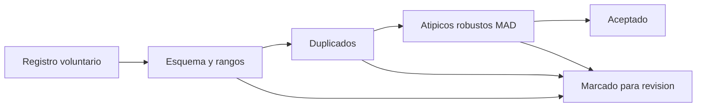

# B129-C04 — Contribución de medidas voluntarias con control de calidad

<!-- nav:top -->
<!-- /nav -->

## 1. Ubicación, nivel y alcance

Clase 4 del bloque B129. Nivel N3. Una medida de un voluntario solo sirve a la ciencia si pasa por un protocolo de contribución: un formato definido, comprobaciones automáticas y revisión de lo dudoso. Aquí construyes un filtro de tres etapas (esquema y rangos, duplicados y valores atípicos robustos) y lo **mides** sembrando errores conocidos en un lote **sintético**, de modo que puedas decir cuántos errores atrapa y cuántos datos buenos descarta. Sigue a C02, que produjo las medidas, y no sustituye la revisión humana ni los protocolos de ninguna organización. Todos los datos son **sintéticos** salvo los que se rotulan como consultados.

## 2. Por qué esta clase existe

Un lote de contribuciones trae errores de tecleo, duplicados, fechas imposibles y mediciones erróneas. La decisión central: **¿qué filtro aplicar para atrapar los errores sin tirar datos buenos, y cómo se sabe que funciona?**

## 3. Lo que podrás hacer al terminar

1. Definir un esquema de contribución con campos obligatorios y rangos físicos.
2. Detectar duplicados por clave (observador, día, filtro).
3. Detectar valores atípicos con la mediana de otros observadores y la MAD, con un piso de escala.
4. Calcular la precisión y la exhaustividad de un filtro con errores sembrados y compararlas con un conteo por segunda vía.
5. Medir la sensibilidad del filtro al tamaño del error y explicar sus límites.
6. Separar lo sintético de lo consultado y recordar que la AAVSO no se pudo consultar.

La evidencia es la **informe de calidad de un lote sintético** del ejercicio 12 (sección 20).

## 4. Con qué llegas y cómo comprobarlo

1. ¿Qué es la mediana y por qué resiste a los valores extremos?
2. ¿Qué es la MAD?
3. ¿Qué es un falso positivo y qué un falso negativo?
4. ¿Qué son la precisión y la exhaustividad?
5. ¿Por qué no basta con que un dato esté en el rango?

<details>
<summary>Ver respuestas</summary>

1. El valor central; un dato extremo la mueve poco, a diferencia de la media. 2. La mediana de las desviaciones absolutas respecto de la mediana; `1,4826·MAD` estima la desviación estándar de datos gaussianos. 3. Marcar un dato bueno como malo, y dejar pasar uno malo. 4. `TP/(TP+FP)` y `TP/(TP+FN)`. 5. Un valor puede ser posible y aun así equivocado.
</details>

Con cuatro o cinco aciertos, sigue; si no, repasa los prerrequisitos.

## 5. Un caso de contexto y casos de referencia

Un lote **sintético** de 400 registros de la variable VS-S (la de C02) lleva 48 errores sembrados, 8 de cada tipo: magnitud con el decimal desplazado, desplazada 0,8 a 2,5 mag, duplicado exacto, fecha futura, campo ausente y filtro no válido. Se sabe cuáles son, de modo que se pueden contar aciertos y fallos. No es el lote de ningún proyecto real.

## 6. Vocabulario

El **esquema** define los campos y sus rangos. Un **duplicado** repite una clave. Un **valor atípico** se aparta de lo esperable según otros datos. La **escala robusta** `1,4826·MAD` evita que un error infle la escala. El **piso de escala** (0,10 mag) impide dividir por una escala diminuta. **Marcar** no es borrar: el dato queda con una etiqueta para su revisión.

## 7. Modelo mental



*Descripción textual:* cada registro pasa por tres etapas; en cualquiera de ellas puede quedar marcado para revisión, y si las supera se acepta.

Analogía: el filtro es como el control de calidad de una panadería: se descartan primero las piezas imposibles (sin forma), luego las repetidas y al final las que no se parecen a las demás. Límite: a diferencia del pan, un dato raro puede ser el hallazgo, por eso se marca y no se borra.

## 8. La explicación, paso a paso

### 8.1 Esquema y rangos

Un registro debe tener magnitud (`0 < m < 25`), filtro en `{V, B, R, I}` y un día no posterior a la fecha de referencia. Atrapa los 8 campos ausentes, los 8 filtros inválidos, los 8 fechas futuras y los 8 desplazamientos decimales (`m ≈ 105`), pues salen del rango.

### 8.2 Duplicados

La clave `(observador, día, filtro)` identifica un registro repetido; se conserva el primero y se marca el resto. Se atrapan 7 de 8: el que no se marcó copiaba un registro que luego se alteró en la propia siembra (un artefacto de la simulación: ya no tenía un original que lo repitiera).

### 8.3 Atípicos robustos

Para cada registro se toma la mediana de las magnitudes de otros observadores a ±2 días; `z = |m − mediana|/max(1,4826·MAD, 0,10)`. Con `k = 4` se marcan los 8 desplazados. El resultado con `k = 4` es: 47 aciertos, 2 falsos positivos y 1 falso negativo (el duplicado artefacto): precisión `0,959`, exhaustividad `0,979`, y se retiene `0,994` de los registros limpios.

### 8.4 Qué no atrapa

Los errores sembrados son grandes. Si se desplazan 100 registros buenos una cantidad fija, el filtro (`k = 4`) detecta `0/100` con 0,1 y 0,2 mag, `3/100` con 0,3, `25/100` con 0,5, `39/100` con 0,8 y `46/100` con 1,2. Dos causas probables, no aisladas en el laboratorio: solo 276 de 350 registros limpios tienen al menos 3 vecinos de otros observadores, y al desplazar el 25 % del lote muchos vecinos quedan contaminados.

## 9. Magnitudes, símbolos y unidades

| Símbolo | Qué es | Unidad | Valor / nota |
|---|---|---|---|
| `m` | magnitud contribuida | mag | 0 a 25 (rango válido) |
| `k` | umbral de rechazo | — | 4 |
| `MAD` | mediana de desviaciones absolutas | mag | calculada por registro |
| `TP, FP, FN` | aciertos, falsos positivos, falsos negativos | registros | 47, 2, 1 |
| `P, R` | precisión y exhaustividad | — | 0,959 y 0,979 |

## 10. Convenciones y referencias

Tiempo en días (la «fecha de referencia» es el día 400 de la serie sintética, no la fecha real); magnitud en mag. Vecindad de ±2 días y otros observadores. Semilla 129 (la sensibilidad usa 1290). Tolerancias declaradas: exhaustividad ≥ 0,80 con `k = 4` y registros limpios retenidos ≥ 0,97; el conteo por conjuntos y por bucle coincide exactamente. Todo es **sintético**.

## 11. De dónde sale lo que afirmamos

| ID | Fuente | Localizador | Respalda | Estado |
|---|---|---|---|---|
| S1 | ECSA (European Citizen Science Association), «Ten Principles of Citizen Science», Berlín, 2015 — https://doi.org/10.17605/OSF.IO/XPR2N ; PDF en https://zenodo.org/record/5127534/files/ECSA_Ten_Principles_of_CS_English.pdf (consultada 2026-11-11 con PyMuPDF) | texto completo (1 página) | los diez principios: participación real, resultado científico genuino, beneficio mutuo, participación en varias etapas, retroalimentación, límites y sesgos, datos abiertos salvo razones de seguridad o privacidad, reconocimiento, evaluación y cuestiones legales y éticas | Consultada (texto completo) |
| S2 | UNESCO, «Open Science» (Recomendación sobre Ciencia Abierta, 2021) — https://www.unesco.org/en/open-science/about (consultada 2026-11-11) | página; no se leyó el texto de la Recomendación | la ciencia abierta abre los procesos de creación, evaluación y comunicación del conocimiento a actores sociales más allá de la comunidad científica tradicional; principio de colaboración, participación e inclusión | Consultada (solo la página; la página no usa el término «ciencia ciudadana») |
| — | AAVSO (American Association of Variable Star Observers): manuales de observación visual y fotométrica, datos y políticas | — | — | No consultada (el sitio respondió 403) |
| — | Libros de texto y artículos de fotometría, estadística de supervivencia, privacidad y diseño de proyectos de ciencia ciudadana | — | — | No consultada |
| — | Relaciones y algoritmos estándar usados por el laboratorio (mediana, MAD, precisión y exhaustividad) | — | los verifica el laboratorio con una segunda vía o con pruebas | No consultada en una fuente concreta |

Límites: no se consultó ningún protocolo de validación de la AAVSO ni de otra organización; los errores sembrados son una elección del laboratorio y no representan la distribución de errores reales. El filtro solo funciona donde hay vecinos de otros observadores. Lo simulado no se presenta como observación ni como medición.

## 12. Cómo ver los resultados

| `k` | marcados | TP | FP | FN | precisión | exhaustividad |
|---|---|---|---|---|---|---|
| 2 | 51 | 47 | 4 | 1 | 0,922 | 0,979 |
| 3 | 49 | 47 | 2 | 1 | 0,959 | 0,979 |
| 4 | 49 | 47 | 2 | 1 | 0,959 | 0,979 |
| 6 | 49 | 47 | 2 | 1 | 0,959 | 0,979 |

Descripción larga: de `k = 3` a `k = 6` el resultado no cambia porque los errores sembrados son grandes; con `k = 2` aparecen 2 falsos positivos más.

## 13. Ejemplo trabajado

**Paso 1 · Vecinos.** Otros observadores a ±2 días dan `10,1; 10,2; 10,3; 10,2; 10,4`: mediana `10,2`.

**Paso 2 · Escala.** Desviaciones `0,1; 0; 0,1; 0; 0,2`: MAD `0,1`, escala `max(0,1483; 0,10) = 0,1483`.

**Paso 3 · Candidato.** `m = 10,9`: `z = 0,7/0,1483 = 4,72 > 4`: se marca.

**Paso 4 · Lectura.** Se manda a revisión; no se borra.

## 14. Distintas formas de describir el problema

**Por tabla:** el conteo de `TP`, `FP`, `FN` por umbral. **Por fórmula:** `z` robusto. **Por simulación:** errores sembrados con etiqueta. **Por etapas:** qué tipo de error atrapa cada etapa (8.1 a 8.3).

## 15. Práctica guiada

**Ejercicio 1 · con los pasos indicados.** ¿Pasa el esquema un registro con `m = 112,0` y filtro `V`?

<details><summary>Solución comentada</summary>

No: `112 > 25` excede el rango.
</details>

**Ejercicio 2 · con una pista.** Calcula la mediana y la MAD de `10,1; 10,2; 10,3; 10,2; 10,4`.

<details><summary>Solución comentada</summary>

Mediana `10,2`; desviaciones `0,1; 0; 0,1; 0; 0,2`: MAD `0,1`.
</details>

**Ejercicio 3 · casi autónomo.** Calcula la escala robusta con piso 0,10.

<details><summary>Solución comentada</summary>

`max(1,4826 × 0,1; 0,10) = 0,1483`.
</details>

## 16. Práctica autónoma, transferencia e integrador

**Ejercicio 4 · autónomo.** ¿Se marca `m = 10,9` con `k = 4`?

<details><summary>Solución comentada</summary>

`0,7/0,1483 = 4,72 > 4`: sí.
</details>

**Ejercicio 5 · autónomo.** Calcula la precisión con `k = 4`.

<details><summary>Solución comentada</summary>

`47/(47 + 2) = 0,959`.
</details>

**Ejercicio 6 · autónomo.** Calcula la exhaustividad.

<details><summary>Solución comentada</summary>

`47/(47 + 1) = 0,979`.
</details>

**Ejercicio 7 · autónomo.** Calcula la fracción de registros limpios retenidos.

<details><summary>Solución comentada</summary>

Hay `400 − 48 = 352` limpios y 2 falsos positivos: `350/352 = 0,994`.
</details>

**Ejercicio 8 · autónomo.** ¿Cuánto vale la precisión con `k = 2`?

<details><summary>Solución comentada</summary>

`47/51 = 0,922`.
</details>

**Ejercicio 9 · transferencia.** **Transferencia.** ¿Para qué sirve el piso de 0,10 mag?

<details><summary>Solución comentada</summary>

Si los vecinos coinciden, la MAD tiende a 0 y cualquier diferencia diminuta se marcaría: el piso evita esos falsos positivos.
</details>

**Ejercicio 10 · transferencia.** **Transferencia.** Un brote real de 1 mag ocurre en una noche y solo lo ve un observador. ¿Qué hace el filtro y qué debe hacer el proyecto?

<details><summary>Solución comentada</summary>

El filtro lo marcará como atípico si tiene vecinos; el proyecto debe **revisarlo** y pedir confirmación de otro observador, no borrarlo.
</details>

**Ejercicio 11 · transferencia.** **Transferencia.** Un observador aporta el 40 % de los registros y tiene un sesgo de +0,05 mag. ¿Qué miras?

<details><summary>Solución comentada</summary>

Los residuos por observador frente a la mediana de los demás; el filtro por registro no ve un sesgo pequeño y constante.
</details>

**Ejercicio 12 · integrador.** **Integrador.** Elabora tu *informe de calidad de un lote sintético*: etapas, tabla de `TP/FP/FN` por umbral, precisión, exhaustividad, sensibilidad al tamaño del error, límites y lista de qué es sintético.

<details><summary>Solución comentada</summary>

Secciones 8.1–8.4 y la salida del laboratorio.
</details>

## 17. Laboratorio: filtro de calidad con errores sembrados

El script [control_calidad.py](control_calidad.py) genera un lote sintético con errores sembrados, aplica las tres etapas con varios umbrales, calcula precisión y exhaustividad por dos vías y mide la sensibilidad al tamaño del error (**comprueba** exhaustividad ≥ 0,80, retención ≥ 0,97 y coincidencia de los conteos).

**Datos:** todo **sintético** (lote, errores, fecha de referencia). **Predice antes de ejecutar:** ¿qué errores se escaparán? (los pequeños: con 0,3 mag o menos casi nada se detecta.) **Ejecución del 2026-11-11 (Python 3.12.9):**

```text
Python 3.12.9 (biblioteca estandar); semilla 129
DATOS SINTETICOS: 400 registros, 48 con error sembrado (12 %); fecha de referencia = dia 400
  errores sembrados: ausente=8, decimal=8, desplazado=8, duplicado=8, filtro=8, futuro=8
  k    marcados  TP  FP  FN  precision  exhaustividad  limpios retenidos
  2        51  47   4   1      0.922          0.979              0.989
  3        49  47   2   1      0.959          0.979              0.994
  4        49  47   2   1      0.959          0.979              0.994
  5        49  47   2   1      0.959          0.979              0.994
  6        49  47   2   1      0.959          0.979              0.994
Con k = 4, detectados por tipo sembrado:
   ausente     8/8
   decimal     8/8
   desplazado  8/8
   duplicado   7/8
   filtro      8/8
   futuro      8/8
   no detectados: id267(duplicado, m=10.45)
Sensibilidad (k = 4): fraccion detectada al desplazar 100 registros limpios una cantidad fija
   registros limpios con al menos 3 vecinos de otros observadores (evaluables): 276/350
   desplazamiento 0.1 mag -> detectados 0/100
   desplazamiento 0.2 mag -> detectados 0/100
   desplazamiento 0.3 mag -> detectados 3/100
   desplazamiento 0.5 mag -> detectados 25/100
   desplazamiento 0.8 mag -> detectados 39/100
   desplazamiento 1.2 mag -> detectados 46/100
Pruebas superadas.
```

```bash
python programa/clases/B129/B129-C04-contribucion-de-medidas-voluntarias-con-control-de-calidad/control_calidad.py
```

**Límites:** errores sembrados grandes y de tipo conocido; el filtro necesita vecinos de otros observadores; no detecta sesgos pequeños; sin revisión humana.

## 18. Errores frecuentes y cómo corregirlos

**Borrar lo marcado.** Marca y revisa (ejercicio 10)

**Medir la calidad solo con precisión.** Calcula también la exhaustividad (8.3)

**Creer que el filtro atrapa errores pequeños.** Mira la sensibilidad (8.4)

## 19. Cómo sabrás que vas bien

Tras 8.3: ¿qué `k` elegirías y por qué? Si dudas, repasa el ejemplo 13. Tras el laboratorio: ¿qué comprueba? (ver sección 17).

## 20. Qué entregas y cómo se evalúa

El producto es tu **informe de calidad de un lote sintético** (ejercicio 12).

| Criterio | Inicial | En desarrollo | Logrado | Destacado |
|---|---|---|---|---|
| Conceptos | Los confunde | Parciales | Explica el método y su dominio | Explica los límites y las alternativas |
| Cálculo | Sin unidades | Con errores | Resultados con unidades y comprobados | Resuelve casos nuevos |
| Numérico | Sin comprobar | Un caso | Verifica con una segunda vía en varios casos | Interpreta las diferencias y los fallos |
| Fuentes | Sin fuente | Sin fecha | Fuentes con fecha y estado | Declara lo sintético y lo no consultado |
| Límites | No los nombra | Uno | Tres | Discute qué falta del modelo |

**Condiciones críticas (no se compensan con promedio):** rotular los datos como sintéticos; comprobar cada resultado con una segunda vía; citar solo lo consultado.

## 21. Ética, seguridad y límites

Clase educativa: los modelos son simplificados y los datos son sintéticos; ningún resultado describe un proyecto real, una observación real ni sustituye los protocolos de una organización científica ni la asesoría jurídica sobre datos personales. Contenido educativo; el Sol solo se observa con filtros solares certificados.  Accesibilidad: tablas equivalentes a las gráficas, fórmulas en texto, ejercicios sin conexión.

## 22. Para cerrar y seguir

El filtro de tres etapas atrapa 47 de 48 errores sembrados y retiene el 99,4 % de los datos buenos, pero no ve errores de 0,3 mag o menos. Queda una pregunta: ¿qué se sabe de las personas que contribuyen y cómo se las protege?

**Glosario español–inglés.** control de calidad · *quality control*; valor atípico · *outlier*; precisión · *precision*; exhaustividad · *recall*; duplicado · *duplicate*.

**Continuidad.** [B129-C05](../B129-C05-consentimiento-y-privacidad-de-participantes/CLASE.md) trata el consentimiento y la privacidad de los participantes.

**Referencias:** ver sección 11.

<!-- nav:bottom -->
<!-- /nav -->
