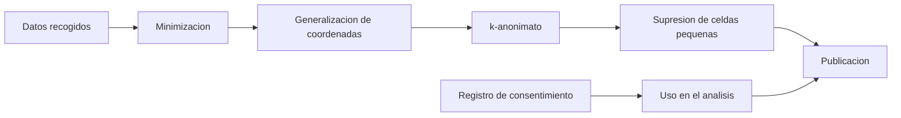

# B129-C05 — Consentimiento y privacidad de participantes

<!-- nav:top -->
[🏠 Programa](../../../../README.md) · [📚 Bloque B129](../../../tronco-comun/B129-ciencia-ciudadana-astronomica.md) · [← Anterior: B129-C04 — Contribución de medidas voluntarias con control de calidad](../B129-C04-contribucion-de-medidas-voluntarias-con-control-de-calidad/CLASE.md) · [Siguiente: B129-C06 — Motivación y permanencia de participantes →](../B129-C06-motivacion-y-permanencia-de-participantes/CLASE.md)
<!-- /nav -->

## 1. Ubicación, nivel y alcance

Clase 5 del bloque B129. Nivel N3. Un proyecto de ciencia ciudadana no recoge solo magnitudes: recoge datos de **personas** (su edad, su comuna, desde dónde observan, cómo se llaman en el foro). Aquí aprendes a recoger lo mínimo, a degradar las coordenadas de forma controlada, a medir cuándo un conjunto sigue siendo identificable con el `k`-anonimato y a llevar un registro de consentimiento que se pueda retirar. Los participantes son **sintéticos** y las coordenadas pertenecen a una región ficticia. Esto es educación técnica, **no asesoría jurídica**: un proyecto real debe consultar la normativa que le aplica. Todos los datos son **sintéticos** salvo los que se rotulan como consultados.

## 2. Por qué esta clase existe

Cuando un conjunto de datos se publica o se comparte, los datos de las personas pueden permitir reconocerlas aunque se quite el nombre. La decisión central: **¿qué recoger, con qué precisión publicarlo y cómo respetar que alguien retire su consentimiento?**

## 3. Lo que podrás hacer al terminar

1. Aplicar el principio de minimización: recoger solo lo necesario para el fin declarado.
2. Convertir grados de latitud y longitud en kilómetros y elegir un redondeo de coordenadas.
3. Calcular el `k`-anonimato de un conjunto con cuasi-identificadores y detectar los registros únicos.
4. Publicar recuentos por celda con supresión de celdas pequeñas.
5. Llevar un registro de consentimiento con estado por defecto «sin consentimiento» y retirada efectiva.
6. Separar lo sintético de lo consultado y recordar que no es asesoría jurídica.

La evidencia es la **ficha de privacidad de un conjunto sintético** del ejercicio 12 (sección 20).

## 4. Con qué llegas y cómo comprobarlo

1. ¿Qué es un dato personal?
2. ¿Qué es un cuasi-identificador?
3. ¿Cuántos kilómetros mide un grado de latitud?
4. ¿Qué es el consentimiento informado?
5. ¿Qué es una celda de una cuadrícula?

<details>
<summary>Ver respuestas</summary>

1. Información sobre una persona identificada o identificable. 2. Un atributo que por sí solo no identifica pero combinado con otros sí (edad, comuna, ubicación). 3. Unos 111 km. 4. Un acuerdo libre, específico y claro de la persona para un uso concreto de sus datos. 5. Un cuadrado de lado fijo que agrupa las coordenadas cercanas.
</details>

Con cuatro o cinco aciertos, sigue; si no, repasa los prerrequisitos.

## 5. Un caso de contexto y casos de referencia

Trescientos participantes **sintéticos** de un proyecto de observación tienen edad por tramo, comuna ficticia (A a H), tipo de equipo y las coordenadas de su sitio, dentro de una región ficticia de 0,4° × 0,4°. Se quiere compartir un conjunto con otros equipos. El laboratorio mide qué tan identificables son con distintos atributos y precisiones, y registra 200 consentimientos concedidos y 10 retirados. Las coordenadas no corresponden a ninguna vivienda real.

## 6. Vocabulario

La **minimización** es recoger solo lo necesario. La **generalización** reduce la precisión (redondear coordenadas). El **`k`-anonimato** es el tamaño mínimo de los grupos de personas con los mismos cuasi-identificadores. Un **registro único** (`k = 1`) es identificable. La **supresión** oculta lo que queda en grupos demasiado pequeños. La **retirada** del consentimiento detiene el uso posterior de los datos de esa persona.

## 7. Modelo mental



*Descripción textual:* se recoge lo mínimo, se generalizan las coordenadas, se mide el `k`-anonimato y se suprimen las celdas pequeñas; el registro de consentimiento decide qué personas entran en el análisis que se publica.

Analogía: publicar datos de personas es como compartir una foto de una multitud: si recortas la cara de cada uno todavía pueden reconocer a alguien por la camisa y el lugar. Límite: en datos, la combinación de rasgos corrientes puede ser única aunque cada uno sea común.

## 8. La explicación, paso a paso

### 8.1 Cuánto mide una coordenada

Un grado de latitud mide `π/180 × 6371,0 km = 111,195 km`; un grado de longitud mide eso por `cos(lat)`, `92,72 km` a `−33,5°`. Redondear a 2 decimales deja una celda de `1,112 km`; a 1 decimal, `11,12 km`; a 4 decimales, `11 m`. Con 5 decimales cada participante del conjunto sintético es único.

### 8.2 El `k`-anonimato se rompe rápido

Con edad, comuna, equipo y coordenadas, el mínimo es `k = 1` incluso con coordenadas a 0 decimales (`111 km`): hay 185 registros únicos de 300. Solo con la comuna (sin coordenadas) se logra `k = 31`. El error medio de posición sube de `0,000 km` (5 decimales) a `4,06 km` (1 decimal) y `57,7 km` (0 decimales).

### 8.3 Publicar recuentos en lugar de filas

Con 190 personas en el análisis y celdas de `0,1°`, hay 25 celdas: 18 con 5 o más personas se publican y 7 se suprimen (20 personas, 10,5 %). Así no se publica ninguna fila de persona y se evita el registro único.

### 8.4 Consentimiento

Por defecto nadie tiene consentimiento. Con 200 concedidos y 10 retirados quedan 190 en el análisis; los 100 sin respuesta no se usan. El Reglamento General de Protección de Datos de la UE, según los considerandos y artículos consultados (lectura parcial), pide un acto afirmativo claro (no casillas premarcadas), finalidad específica, datos limitados a lo necesario, y retirar el consentimiento «con la misma facilidad» con que se da. Esto es una referencia, no una guía jurídica.

## 9. Magnitudes, símbolos y unidades

| Símbolo | Qué es | Unidad | Valor / nota |
|---|---|---|---|
| `lat, lon` | coordenadas del sitio | ° | región ficticia de 0,4° |
| `1° de latitud` | longitud del arco | km | 111,195 |
| `1° de longitud` | arco a −33,5° | km | 92,72 |
| `k` | tamaño mínimo de grupo | personas | 1 a 35 |
| `celda` | lado de la cuadrícula | km | 0,001 a 111 |
| `e` | error medio de posición | km | 0 a 57,7 |

## 10. Convenciones y referencias

Coordenadas en grados decimales, latitud sur negativa. Radio medio terrestre 6371,0 km (esfera). Región ficticia centrada en (−33,50; −70,60) sin relación con ninguna vivienda. Semilla 129; `k` por dos vías (diccionario y ordenación) debe coincidir exactamente. Tolerancia de `k`: igualdad exacta; objetivo `k ≥ 5` ilustrativo. Todo es **sintético**.

## 11. De dónde sale lo que afirmamos

| ID | Fuente | Localizador | Respalda | Estado |
|---|---|---|---|---|
| S1 | Reglamento (UE) 2016/679 (RGPD), EUR-Lex — https://eur-lex.europa.eu/eli/reg/2016/679/oj (consultada 2026-11-11; lectura parcial: considerandos y artículos 4, 5 y 7) | considerandos 26, 32, 39 y 65; artículos 4(1), 5(1) y 7(3) | dato personal = información sobre una persona identificada o identificable; principios de licitud, limitación de la finalidad, minimización, exactitud y limitación del plazo; consentimiento por acto afirmativo claro y retirable con la misma facilidad con que se da | Consultada (lectura parcial; no es asesoría jurídica) |
| S2 | ECSA (European Citizen Science Association), «Ten Principles of Citizen Science», Berlín, 2015 — https://doi.org/10.17605/OSF.IO/XPR2N ; PDF en https://zenodo.org/record/5127534/files/ECSA_Ten_Principles_of_CS_English.pdf (consultada 2026-11-11 con PyMuPDF) | texto completo (1 página) | los diez principios: participación real, resultado científico genuino, beneficio mutuo, participación en varias etapas, retroalimentación, límites y sesgos, datos abiertos salvo razones de seguridad o privacidad, reconocimiento, evaluación y cuestiones legales y éticas | Consultada (texto completo) |
| S3 | M. J. Raddick et al., «Galaxy Zoo: Exploring the Motivations of Citizen Science Volunteers», arXiv:0909.2925, 16 sep 2009 — https://arxiv.org/abs/0909.2925 (consultada 2026-11-11 con PyMuPDF) | PDF completo, secciones de metodología y de categorías de motivación | a abril de 2009 más de 200 000 voluntarios y más de 100 millones de clasificaciones; 12 categorías de motivación obtenidas de entrevistas y foros; se excluyeron respuestas de menores de 18 años y se separaron las motivaciones de los nombres de usuario del foro | Consultada (texto completo; estudio exploratorio) |
| — | Zooniverse, política de privacidad y de uso de datos de voluntarios | — | — | No consultada (la página no devolvió texto) |
| — | Libros de texto y artículos de fotometría, estadística de supervivencia, privacidad y diseño de proyectos de ciencia ciudadana | — | — | No consultada |
| — | Relaciones y algoritmos estándar usados por el laboratorio (`k`-anonimato, generalización de coordenadas y longitud del arco de meridiano esférico) | — | los verifica el laboratorio con una segunda vía o con pruebas | No consultada en una fuente concreta |

Límites: el RGPD solo se leyó en parte (considerandos y artículos 4, 5 y 7, no el 89 ni los de investigación); la política de privacidad de Zooniverse no se pudo consultar; el `k`-anonimato no protege contra atacantes con información adicional ni contra la inferencia de atributos, y no se evaluó privacidad diferencial. No es asesoría jurídica. Lo simulado no se presenta como observación ni como medición.

## 12. Cómo ver los resultados

| Decimales | celda | `k` | únicos | error medio [km] |
|---|---|---|---|---|
| 5 | 0,001 km | 1 | 300 | 0,000 |
| 3 | 0,111 km | 1 | 300 | 0,039 |
| 2 | 1,112 km | 1 | 300 | 0,400 |
| 1 | 11,119 km | 1 | 282 | 4,057 |
| 0 | 111,195 km | 1 | 185 | 57,734 |

Descripción larga: redondear hasta 111 km no basta para dejar de tener registros únicos si se mantienen edad, comuna y equipo; la calidad de la posición se pierde mucho antes que el riesgo.

## 13. Ejemplo trabajado

**Paso 1 · Arco.** `0,01° × 111,195 = 1,112 km`.

**Paso 2 · Longitud.** `1° × 111,195 × cos(33,5°) = 92,72 km`.

**Paso 3 · Grupos.** Si las clases tienen `1, 3, 5, 7` personas, `k = 1`: hay un registro único.

**Paso 4 · Lectura.** Se agrupan o suprimen las clases pequeñas; se publica el recuento por celda.

## 14. Distintas formas de describir el problema

**Por tabla:** `k` y únicos por precisión. **Por fórmula:** arco de meridiano y `cos(lat)`. **Por recuentos:** celdas con supresión. **Por registro:** eventos de consentimiento concedido y retirado.

## 15. Práctica guiada

**Ejercicio 1 · con los pasos indicados.** ¿Cuántos kilómetros mide 0,01° de latitud?

<details><summary>Solución comentada</summary>

`0,01 × 111,195 = 1,112 km`.
</details>

**Ejercicio 2 · con una pista.** ¿Cuánto mide 1° de longitud a −33,5°?

<details><summary>Solución comentada</summary>

`111,195 × cos 33,5° = 92,72 km`.
</details>

**Ejercicio 3 · casi autónomo.** ¿Qué distancia equivale a 4 decimales de grado?

<details><summary>Solución comentada</summary>

`0,0001° × 111,195 km = 11,1 m`.
</details>

## 16. Práctica autónoma, transferencia e integrador

**Ejercicio 4 · autónomo.** Un conjunto tiene clases de `1, 3, 5, 7` personas. ¿Cuánto vale `k` y cuántos son únicos?

<details><summary>Solución comentada</summary>

`k = 1` y hay 1 registro único.
</details>

**Ejercicio 5 · autónomo.** Si de 200 consentimientos concedidos se retiran 10, ¿cuántos quedan?

<details><summary>Solución comentada</summary>

190.
</details>

**Ejercicio 6 · autónomo.** De 25 celdas, 7 se suprimen con 20 personas de 190. ¿Qué fracción se pierde?

<details><summary>Solución comentada</summary>

`20/190 = 10,5 %`.
</details>

**Ejercicio 7 · autónomo.** ¿Cuál es el recuento medio por celda si hay 190 personas en 25 celdas?

<details><summary>Solución comentada</summary>

`190/25 = 7,6`.
</details>

**Ejercicio 8 · autónomo.** ¿Por qué el estado por defecto es «sin consentimiento»?

<details><summary>Solución comentada</summary>

Porque el silencio o una casilla premarcada no es un acto afirmativo claro (considerando 32 del RGPD, lectura parcial).
</details>

**Ejercicio 9 · transferencia.** **Transferencia.** Un participante tiene 16 años. ¿Qué haces con sus datos?

<details><summary>Solución comentada</summary>

El proyecto debe decidir antes de recoger si admite menores y bajo qué condiciones; el estudio de Raddick et al. descartó dos respuestas de menores de 18 años. En esta clase no se recogen datos de menores.
</details>

**Ejercicio 10 · transferencia.** **Transferencia.** Publicas la ubicación exacta de observación de una persona que observa desde su casa. ¿Qué riesgo hay y qué alternativa?

<details><summary>Solución comentada</summary>

Revela su domicilio; se publica la celda de 0,1° o la región, o se pide una ubicación de un sitio público.
</details>

**Ejercicio 11 · transferencia.** **Transferencia.** Un foro público tiene mensajes de motivación con nombre de usuario. ¿Qué se hace al analizarlos?

<details><summary>Solución comentada</summary>

Separar la motivación del nombre de usuario en la tabla de análisis, como hicieron Raddick et al., y no citar frases que permitan buscar al autor.
</details>

**Ejercicio 12 · integrador.** **Integrador.** Elabora tu *ficha de privacidad de un conjunto sintético*: tabla de `k` y de error por precisión, atributos que recoges y por qué, regla de publicación, registro de consentimiento y lista de qué es sintético y qué no es asesoría jurídica.

<details><summary>Solución comentada</summary>

Secciones 8.1–8.4 y la salida del laboratorio.
</details>

## 17. Laboratorio: privacidad y consentimiento de 300 participantes sintéticos

El script [privacidad.py](privacidad.py) mide el `k`-anonimato por dos vías al redondear coordenadas, busca la menor generalización con `k ≥ 5`, aplica consentimiento concedido y retirado y publica recuentos por celda con supresión (**comprueba** que las dos vías de `k` coinciden y que ningún retirado queda en el análisis).

**Datos:** todo **sintético** (participantes, región, consentimientos). **Predice antes de ejecutar:** ¿bastará redondear las coordenadas para que `k ≥ 5`? (no: sigue `k = 1` incluso a 111 km con edad, comuna y equipo.) **Ejecución del 2026-11-11 (Python 3.12.9):**

```text
Python 3.12.9 (biblioteca estandar); semilla 129
DATOS SINTETICOS: 300 participantes inventados; region ficticia de 0.4 x 0.4 grados; 1 grado de latitud = 111.195 km
1) Efecto de redondear las coordenadas (cuasi-identificadores: edad, comuna, equipo, celda)
   decimales  celda aprox  k    unicos  clases  error medio de posicion [km]
           5      0.001 km   1     300     300       0.000
           4      0.011 km   1     300     300       0.004
           3      0.111 km   1     300     300       0.039
           2      1.112 km   1     300     300       0.400
           1     11.119 km   1     282     291       4.057
           0    111.195 km   1     185     238      57.734
   sin coordenadas (solo edad, comuna, equipo): k = 1, unicos = 60, clases = 146
   sin coordenadas ni edad (solo comuna, equipo): k = 4, unicos = 0, clases = 32
2) Busqueda de la menor generalizacion con k >= 5 (atributos sueltos; decimales de las coordenadas)
   atributos                 decimales   k   unicos
   edad+comuna+equipo        2           1     300
   edad+comuna+equipo        1           1     282
   edad+comuna+equipo        0           1     185
   edad+comuna+equipo        None        1      60
   edad+comuna               2           1     298
   edad+comuna               1           1     226
   edad+comuna               0           1      64
   edad+comuna               None        1       1
   comuna                    2           1     292
   comuna                    1           1      59
   comuna                    0           1       1
   comuna                    None       31       0
   (ninguno)                 2           1     249
   (ninguno)                 1           1       1
   (ninguno)                 0          35       0
   (ninguno)                 None      300       0
   Primera combinacion que cumple k >= 5: (('comuna',), None, 31)
3) Consentimiento: concedido a 200, retirado por 10 -> en el analisis quedan 190; sin respuesta (100) no se usan
4) Publicacion como recuentos por celda de 0.1 grado (sin usuario, edad ni equipo): 25 celdas, 18 publicables (n >= 5), 7 suprimidas con 20 personas
Pruebas superadas.
```

```bash
python programa/clases/B129/B129-C05-consentimiento-y-privacidad-de-participantes/privacidad.py
```

**Límites:** `k`-anonimato simple; no protege de un atacante con información externa; no es asesoría jurídica; el RGPD solo se leyó en parte.

## 18. Errores frecuentes y cómo corregirlos

**Creer que quitar el nombre anonimiza.** La combinación de rasgos puede ser única (8.2)

**Pedir más datos «por si acaso».** Minimiza según el fin declarado

**Publicar la ubicación exacta de una vivienda.** Publica la celda (8.3)

## 19. Cómo sabrás que vas bien

Tras 8.2: ¿esperabas `k = 1` a 111 km? Si dudas, repasa el ejemplo 13. Tras el laboratorio: ¿qué comprueba? (ver sección 17).

## 20. Qué entregas y cómo se evalúa

El producto es tu **ficha de privacidad de un conjunto sintético** (ejercicio 12).

| Criterio | Inicial | En desarrollo | Logrado | Destacado |
|---|---|---|---|---|
| Conceptos | Los confunde | Parciales | Explica el método y su dominio | Explica los límites y las alternativas |
| Cálculo | Sin unidades | Con errores | Resultados con unidades y comprobados | Resuelve casos nuevos |
| Numérico | Sin comprobar | Un caso | Verifica con una segunda vía en varios casos | Interpreta las diferencias y los fallos |
| Fuentes | Sin fuente | Sin fecha | Fuentes con fecha y estado | Declara lo sintético y lo no consultado |
| Límites | No los nombra | Uno | Tres | Discute qué falta del modelo |

**Condiciones críticas (no se compensan con promedio):** rotular los datos como sintéticos; comprobar cada resultado con una segunda vía; citar solo lo consultado.

## 21. Ética, seguridad y límites

Clase educativa: los modelos son simplificados y los datos son sintéticos; ningún resultado describe un proyecto real, una observación real ni sustituye los protocolos de una organización científica ni la asesoría jurídica sobre datos personales. Contenido educativo; el Sol solo se observa con filtros solares certificados. No se recogen ni publican datos de menores ni ubicaciones exactas de viviendas; los datos de personas reales requieren consentimiento, finalidad declarada y asesoría sobre la normativa aplicable. Accesibilidad: tablas equivalentes a las gráficas, fórmulas en texto, ejercicios sin conexión.

## 22. Para cerrar y seguir

Con edad, comuna, equipo y coordenadas, los 300 participantes sintéticos son identificables aun con coordenadas a 111 km; solo la comuna sola o los recuentos por celda con supresión protegen. Queda una pregunta: ¿por qué participa la gente y qué hace que se quede?

**Glosario español–inglés.** consentimiento · *consent*; minimización de datos · *data minimisation*; `k`-anonimato · *k-anonymity*; cuasi-identificador · *quasi-identifier*; supresión · *suppression*.

**Continuidad.** [B129-C06](../B129-C06-motivacion-y-permanencia-de-participantes/CLASE.md) trata la motivación y la permanencia de los participantes.

**Referencias:** ver sección 11.

<!-- nav:bottom -->
---

[← Anterior: B129-C04 — Contribución de medidas voluntarias con control de calidad](../B129-C04-contribucion-de-medidas-voluntarias-con-control-de-calidad/CLASE.md) · [📚 Bloque B129](../../../tronco-comun/B129-ciencia-ciudadana-astronomica.md) · [Siguiente: B129-C06 — Motivación y permanencia de participantes →](../B129-C06-motivacion-y-permanencia-de-participantes/CLASE.md)
<!-- /nav -->
