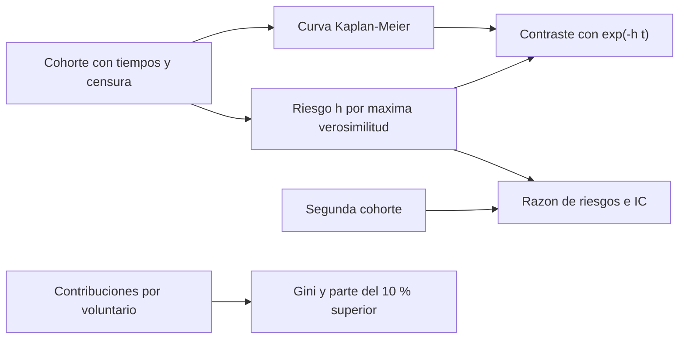

# B129-C06 — Motivación y permanencia de participantes

<!-- nav:top -->
<!-- /nav -->

## 1. Ubicación, nivel y alcance

Clase 6 del bloque B129. Nivel N3. Un proyecto ciudadano solo funciona si la gente se queda. Aquí aprendes dos cosas: **qué se sabe** de por qué participan los voluntarios de un proyecto astronómico (un estudio exploratorio de Galaxy Zoo con doce categorías de motivación) y **cómo se mide la permanencia** con el estimador de Kaplan–Meier, sin atribuir a un incentivo un efecto que no se midió. Los voluntarios y sus tiempos de abandono son **sintéticos**; ningún porcentaje del laboratorio describe a voluntarios reales. Sigue a C05: tratar a las personas con respeto incluye no manipularlas. Todos los datos son **sintéticos** salvo los que se rotulan como consultados.

## 2. Por qué esta clase existe

Los equipos de un proyecto quieren retener voluntarios y a menudo añaden insignias, rachas o clasificaciones sin medir si sirven. La decisión central: **¿cómo medir la permanencia y cuándo se puede decir que algo la mejoró?**

## 3. Lo que podrás hacer al terminar

1. Describir con la fuente consultada las categorías de motivación de los voluntarios de Galaxy Zoo y sus límites.
2. Estimar una curva de permanencia con Kaplan–Meier, con datos censurados.
3. Contrastar Kaplan–Meier con el modelo exponencial de riesgo constante.
4. Comparar dos cohortes con la razón de riesgos y su intervalo de confianza aproximado.
5. Medir la concentración de las contribuciones con el índice de Gini y la parte del 10 % superior.
6. Separar lo supuesto (un efecto de 0,80) de lo medido y no atribuir efectos a incentivos sin un grupo de comparación.

La evidencia es la **ficha de permanencia de una cohorte sintética** del ejercicio 12 (sección 20).

## 4. Con qué llegas y cómo comprobarlo

1. ¿Qué es el riesgo (tasa de abandono) constante?
2. ¿Qué es un dato censurado?
3. ¿Qué es una curva de supervivencia?
4. ¿Qué es un intervalo de confianza?
5. ¿Qué es un grupo de control?

<details>
<summary>Ver respuestas</summary>

1. Una probabilidad de abandonar por semana que no depende de cuánto tiempo lleva la persona. 2. Un caso cuyo evento (abandono) aún no ocurrió al terminar el seguimiento. 3. La fracción que sigue activa en función del tiempo. 4. Un rango plausible para un parámetro dado el ruido del muestreo. 5. Un grupo comparable que no recibe la intervención.
</details>

Con cuatro o cinco aciertos, sigue; si no, repasa los prerrequisitos.

## 5. Un caso de contexto y casos de referencia

Raddick et al. (2009) estudiaron con entrevistas y foros las motivaciones de voluntarios de Galaxy Zoo (a abril de 2009, más de 200 000 voluntarios y más de 100 millones de clasificaciones, según el resumen): de tres evaluadoras surgieron **doce categorías** (contribuir, aprender, descubrir, comunidad, enseñar, belleza, diversión, inmensidad, ayudar, interés por el proyecto, por la astronomía y por la ciencia); el estudio es exploratorio y no mide cuánta gente tiene cada motivación. Aquí se simula una cohorte **sintética** de 500 voluntarios con riesgo `0,08/semana`, sin ninguna motivación modelada.

## 6. Vocabulario

La **permanencia** es el tiempo hasta que una persona deja de contribuir. El **riesgo** `h` es la tasa de abandono. El **estimador de Kaplan–Meier** estima la curva de permanencia con datos censurados. La **razón de riesgos** `RR` compara dos cohortes. El **índice de Gini** mide la concentración (0 = reparto igual; cercano a 1 = unos pocos hacen casi todo).

## 7. Modelo mental



*Descripción textual:* de la cohorte se obtienen la curva de Kaplan–Meier y el riesgo, que se contrastan entre sí y entre dos cohortes; aparte, las contribuciones por voluntario dan el índice de Gini.

Analogía: la permanencia es como una fila en un cine que se vacía: la curva dice cuánta gente queda en cada minuto, no por qué se fue cada uno. Límite: una curva no explica motivos; para eso se necesitan preguntas, como las del estudio de Galaxy Zoo.

## 8. La explicación, paso a paso

### 8.1 Lo que sí se sabe de la motivación

El estudio de Raddick et al. (2009), con entrevistas y 826 mensajes de un foro de los cuales 215 contenían motivaciones, extrajo doce categorías (*Contribute, Learning, Discovery, Community, Teaching, Beauty, Fun, Vastness, Helping, Zoo, Astronomy, Science*). Describe motivaciones y no mide su frecuencia; es de un solo proyecto y de 2009, y no se generaliza a otros.

### 8.2 Kaplan–Meier

En la cohorte sintética A hay 435 abandonos y 65 censurados a las 26 semanas. La curva da `S(4) = 0,728`, `S(8) = 0,522`, `S(13) = 0,338` y `S(26) = 0,130`; el modelo exponencial con `h = 435/5372,9 = 0,0810/sem` da `0,723; 0,523; 0,349; 0,122`, con diferencias máximas de `0,011`. La mediana estimada es `8,43 sem` (teórica `8,66`).

### 8.3 ¿Mejoró un incentivo?

Con una segunda cohorte B cuyo riesgo se **supuso** `0,80` veces el de A, la razón de riesgos estimada es `0,768` con IC aproximado 95 % `[0,670; 0,879]`; con una cohorte C sin efecto se obtiene `1,045` `[0,915; 1,194]`. El IC de C incluye 1: no se concluye efecto. Hay que recordar que el efecto 0,80 es una suposición del laboratorio: en datos reales hace falta un grupo de comparación y comparación aleatoria, y aun así el resultado no se generaliza a otro proyecto.

### 8.4 Quién aporta qué

Con contribuciones lognormales ilustrativas, el Gini es `0,680` (dos fórmulas coinciden) y el 10 % superior aporta `54,3 %`. Un proyecto con esa concentración depende de pocas personas: su pérdida pesa más que la de muchas poco activas.

## 9. Magnitudes, símbolos y unidades

| Símbolo | Qué es | Unidad | Valor / nota |
|---|---|---|---|
| `h` | riesgo de abandono | 1/semana | 0,08 (ilustrativo) |
| `S(t)` | fracción activa | — | 0,728 a 0,130 |
| `RR` | razón de riesgos | — | 0,768 y 1,045 |
| `t` | tiempo desde la incorporación | semanas | 0 a 26 |
| `G` | índice de Gini | — | 0,680 |
| `d` | abandonos observados | personas | 435 |

## 10. Convenciones y referencias

Tiempo en semanas; censura administrativa a las 26 semanas. Riesgo exponencial constante, abandonos independientes. Razón de riesgos con IC de `log(RR) ± 1,96√(1/d₁ + 1/d₂)`. Semilla 129. Tolerancias: |KM − exponencial| ≤ 0,05 en las semanas 4, 8, 13 y 26 y Gini por dos fórmulas igual a `10⁻⁹`. Todo es **sintético**.

## 11. De dónde sale lo que afirmamos

| ID | Fuente | Localizador | Respalda | Estado |
|---|---|---|---|---|
| S1 | M. J. Raddick et al., «Galaxy Zoo: Exploring the Motivations of Citizen Science Volunteers», arXiv:0909.2925, 16 sep 2009 — https://arxiv.org/abs/0909.2925 (consultada 2026-11-11 con PyMuPDF) | PDF completo, secciones de metodología y de categorías de motivación | a abril de 2009 más de 200 000 voluntarios y más de 100 millones de clasificaciones; 12 categorías de motivación obtenidas de entrevistas y foros; se excluyeron respuestas de menores de 18 años y se separaron las motivaciones de los nombres de usuario del foro | Consultada (texto completo; estudio exploratorio) |
| S2 | ECSA (European Citizen Science Association), «Ten Principles of Citizen Science», Berlín, 2015 — https://doi.org/10.17605/OSF.IO/XPR2N ; PDF en https://zenodo.org/record/5127534/files/ECSA_Ten_Principles_of_CS_English.pdf (consultada 2026-11-11 con PyMuPDF) | texto completo (1 página) | los diez principios: participación real, resultado científico genuino, beneficio mutuo, participación en varias etapas, retroalimentación, límites y sesgos, datos abiertos salvo razones de seguridad o privacidad, reconocimiento, evaluación y cuestiones legales y éticas | Consultada (texto completo) |
| S3 | C. J. Lintott et al., «Galaxy Zoo: morphologies derived from visual inspection of galaxies from the Sloan Digital Sky Survey», MNRAS 389, 1179–1189 (2008), arXiv:0804.4483 — https://arxiv.org/abs/0804.4483 (consultada 2026-11-11) | resumen | cerca de un millón de galaxias, más de 40 millones de clasificaciones y unos 100 000 voluntarios; las clasificaciones del público concuerdan con las de astrónomos profesionales en los subconjuntos comparados | Consultada (solo el resumen) |
| S4 | Zooniverse, «About» — https://www.zooniverse.org/about (consultada 2026-11-11) | página | plataforma de investigación con voluntarios; las contribuciones de varias personas se combinan para obtener resultados fiables y estimar errores; la página no da cifras de voluntarios ni de proyectos | Consultada (solo la página) |
| — | Libros de texto y artículos de fotometría, estadística de supervivencia, privacidad y diseño de proyectos de ciencia ciudadana | — | — | No consultada |
| — | Relaciones y algoritmos estándar usados por el laboratorio (estimador de Kaplan–Meier, riesgo exponencial por máxima verosimilitud, razón de riesgos con IC log-normal e índice de Gini) | — | los verifica el laboratorio con una segunda vía o con pruebas | No consultada en una fuente concreta |

Límites: el estudio de Raddick et al. es exploratorio, de un solo proyecto y de 2009; no se consultó ninguna evaluación de insignias, rachas o incentivos en proyectos astronómicos, así que no se afirma que alguno funcione. El efecto 0,80 del laboratorio es una suposición. Lo simulado no se presenta como observación ni como medición.

## 12. Cómo ver los resultados

| Semana | KM | exponencial |
|---|---|---|
| 4 | 0,728 | 0,723 |
| 8 | 0,522 | 0,523 |
| 13 | 0,338 | 0,349 |
| 26 | 0,130 | 0,122 |

Descripción larga: las dos curvas coinciden con diferencias de 0,01 o menos porque los datos se generaron con riesgo constante; en datos reales el riesgo suele variar y la coincidencia no está garantizada.

## 13. Ejemplo trabajado

**Paso 1 · Mediana.** `ln 2/0,08 = 8,66` semanas.

**Paso 2 · Supervivencia.** `S(13) = e^(−0,08 × 13) = 0,353`.

**Paso 3 · Riesgo estimado.** `435/5372,9 = 0,0810`.

**Paso 4 · Lectura.** Con riesgo constante, 8,7 semanas es la mediana de permanencia; para afirmar que algo la cambió hace falta comparar con un grupo de control.

## 14. Distintas formas de describir el problema

**Por tabla:** abandonos, tiempo en riesgo y `h`. **Por gráfica:** la curva de Kaplan–Meier (escalera). **Por razón:** `RR` e IC. **Por concentración:** Gini y parte del 10 % superior.

## 15. Práctica guiada

**Ejercicio 1 · con los pasos indicados.** Calcula la mediana de permanencia con `h = 0,08/sem`.

<details><summary>Solución comentada</summary>

`ln 2/0,08 = 8,66` semanas.
</details>

**Ejercicio 2 · con una pista.** Calcula `S(13)` con el modelo exponencial.

<details><summary>Solución comentada</summary>

`e^(−1,04) = 0,353`.
</details>

**Ejercicio 3 · casi autónomo.** Calcula `h` si hubo 435 abandonos en 5372,9 semanas-persona.

<details><summary>Solución comentada</summary>

`0,0810/sem`.
</details>

## 16. Práctica autónoma, transferencia e integrador

**Ejercicio 4 · autónomo.** Calcula `RR` si `h_B = 0,0621` y `h_A = 0,0810`.

<details><summary>Solución comentada</summary>

`0,767` (0,768 con más decimales).
</details>

**Ejercicio 5 · autónomo.** El IC de `RR` es `[0,670; 0,879]`. ¿Se concluye efecto?

<details><summary>Solución comentada</summary>

Excluye 1: en el laboratorio hay efecto, pero porque se **supuso** 0,80; en datos reales requeriría grupo de comparación.
</details>

**Ejercicio 6 · autónomo.** El IC de `RR` es `[0,915; 1,194]`. ¿Qué concluyes?

<details><summary>Solución comentada</summary>

Incluye 1: no hay evidencia de efecto.
</details>

**Ejercicio 7 · autónomo.** Calcula el Gini de `[0, 0, 0, 4]`.

<details><summary>Solución comentada</summary>

`0,75`.
</details>

**Ejercicio 8 · autónomo.** Si el 10 % superior aporta 54,3 %, ¿cuánto aporta el 90 % restante?

<details><summary>Solución comentada</summary>

`45,7 %`.
</details>

**Ejercicio 9 · transferencia.** **Transferencia.** ¿Qué pasa si se ignoran los 65 censurados y se calcula el abandono como si todos hubieran terminado?

<details><summary>Solución comentada</summary>

Se subestima el tiempo de permanencia y se sesga la curva: los censurados siguen activos.
</details>

**Ejercicio 10 · transferencia.** **Transferencia.** Un equipo introduce insignias y «la participación subió 20 %» comparando con el mes anterior. ¿Basta?

<details><summary>Solución comentada</summary>

No: no hay control ni se descarta una tendencia, una campaña o una estación; hay que comparar con un grupo comparable.
</details>

**Ejercicio 11 · transferencia.** **Transferencia.** Diseña tres acciones de retención coherentes con las categorías de motivación y con los principios de la ECSA, sin presión.

<details><summary>Solución comentada</summary>

Retroalimentación de cómo se usan los datos (principio 5), reconocimiento en resultados y publicaciones (8) y ocasiones de comunidad y aprendizaje (categorías *Community* y *Learning*); sin rachas ni avisos que presionen.
</details>

**Ejercicio 12 · integrador.** **Integrador.** Elabora tu *ficha de permanencia de una cohorte sintética*: curva KM, riesgo, comparación con un grupo de control, concentración de contribuciones, límites y lista de qué es sintético y qué se supuso.

<details><summary>Solución comentada</summary>

Secciones 8.1–8.4 y la salida del laboratorio.
</details>

## 17. Laboratorio: permanencia y concentración en una cohorte sintética

El script [permanencia.py](permanencia.py) simula una cohorte con abandono y censura, estima Kaplan–Meier, lo contrasta con el modelo exponencial, compara dos cohortes con IC y calcula el Gini (**comprueba** |KM − exponencial| ≤ 0,05 y el Gini por dos fórmulas).

**Datos:** todo **sintético**; el efecto 0,80 es una **suposición**. **Predice antes de ejecutar:** ¿incluirá el IC de la cohorte sin efecto al valor 1? (sí: `[0,915; 1,194]`.) **Ejecución del 2026-11-11 (Python 3.12.9):**

```text
Python 3.12.9 (biblioteca estandar); semilla 129
DATOS SINTETICOS: 500 voluntarios; riesgo h0 = 0.08/semana (mediana 8.66 sem); censura a 26 sem
1) Cohorte A: abandonos = 435, censurados = 65; h estimado = 0.0810 /sem
   semana   KM      exp(-h_mle t)   exp(-h0 t)  |KM-exp|
       4   0.728   0.723          0.726       0.005
       8   0.522   0.523          0.527       0.001
      13   0.338   0.349          0.353       0.011
      26   0.130   0.122          0.125       0.008
   mediana de permanencia (KM) = 8.43 sem; teorica 8.66 sem
2) Comparacion con un incentivo SUPUESTO (riesgo x 0.80) y con un incentivo sin efecto (riesgo x 1.00)
   escenario        eventos   tiempo[sem]   h_mle    RR vs A    IC95 %
   A (control)          435        5372.9   0.0810
   B (x0.80)            402        6468.4   0.0621     0.768   [0.670, 0.879]
   C (x1.00)            436        5153.1   0.0846     1.045   [0.915, 1.194]
   Eventos por cohorte para que el IC95 % de log(RR) excluya 0 si el RR fuera 0.80: aprox. 155 (potencia ~50 %)
3) Concentracion (lognormal ilustrativa): Gini = 0.6798 (suma de diferencias) = 0.6798 (ordenada); top 10 % aporta 54.3 %, top 1 % aporta 17.6 %
   Gini teorico lognormal = erf(sigma/2) = 0.7112
4) Categorias de motivacion de Raddick et al. (2009), solo como lista: Contribute, Learning, Discovery, Community, Teaching, Beauty, Fun, Vastness, Helping, Zoo, Astronomy, Science
Pruebas superadas.
```

```bash
python programa/clases/B129/B129-C06-motivacion-y-permanencia-de-participantes/permanencia.py
```

**Límites:** riesgo constante, abandonos independientes, sin variables de los participantes; no modela ninguna motivación; los efectos son supuestos.

## 18. Errores frecuentes y cómo corregirlos

**Atribuir un efecto sin grupo de comparación.** Compara con un control (8.3)

**Ignorar los censurados.** Usa Kaplan–Meier (8.2)

**Generalizar el estudio de Galaxy Zoo a todo proyecto.** Es exploratorio y de 2009 (8.1)

## 19. Cómo sabrás que vas bien

Tras 8.3: ¿cuándo dirías que un incentivo funcionó? Si dudas, repasa el ejemplo 13. Tras el laboratorio: ¿qué comprueba? (ver sección 17).

## 20. Qué entregas y cómo se evalúa

El producto es tu **ficha de permanencia de una cohorte sintética** (ejercicio 12).

| Criterio | Inicial | En desarrollo | Logrado | Destacado |
|---|---|---|---|---|
| Conceptos | Los confunde | Parciales | Explica el método y su dominio | Explica los límites y las alternativas |
| Cálculo | Sin unidades | Con errores | Resultados con unidades y comprobados | Resuelve casos nuevos |
| Numérico | Sin comprobar | Un caso | Verifica con una segunda vía en varios casos | Interpreta las diferencias y los fallos |
| Fuentes | Sin fuente | Sin fecha | Fuentes con fecha y estado | Declara lo sintético y lo no consultado |
| Límites | No los nombra | Uno | Tres | Discute qué falta del modelo |

**Condiciones críticas (no se compensan con promedio):** rotular los datos como sintéticos; comprobar cada resultado con una segunda vía; citar solo lo consultado.

## 21. Ética, seguridad y límites

Clase educativa: los modelos son simplificados y los datos son sintéticos; ningún resultado describe un proyecto real, una observación real ni sustituye los protocolos de una organización científica ni la asesoría jurídica sobre datos personales. Contenido educativo; el Sol solo se observa con filtros solares certificados. La retención no justifica manipular a las personas: nada de presión, rachas coercitivas ni ocultar cómo se usan sus contribuciones. Accesibilidad: tablas equivalentes a las gráficas, fórmulas en texto, ejercicios sin conexión.

## 22. Para cerrar y seguir

La cohorte sintética tiene mediana de permanencia de 8,4 semanas; un efecto supuesto de 0,80 se ve en la razón de riesgos (0,768) y uno nulo no (1,045). Queda una pregunta: ¿cómo se junta todo en un proyecto que se pueda validar?

**Glosario español–inglés.** permanencia · *retention*; riesgo de abandono · *hazard*; censura · *censoring*; razón de riesgos · *hazard ratio*; índice de Gini · *Gini index*.

**Continuidad.** [B129-C07](../B129-C07-proyecto-de-ciencia-ciudadana-validable/CLASE.md) integra todo en un proyecto de ciencia ciudadana validable.

**Referencias:** ver sección 11.

<!-- nav:bottom -->
<!-- /nav -->
