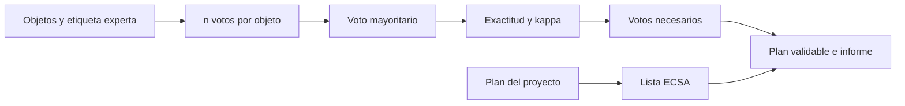

# B129-C07 — Proyecto de ciencia ciudadana validable

<!-- nav:top -->
[🏠 Programa](../../../../README.md) · [📚 Bloque B129](../../../tronco-comun/B129-ciencia-ciudadana-astronomica.md) · [← Anterior: B129-C06 — Motivación y permanencia de participantes](../B129-C06-motivacion-y-permanencia-de-participantes/CLASE.md) · [Siguiente: B130-C01 — Infografías con fuentes verificables →](../../../tronco-comun/B130-comunicacion-y-divulgacion-cientifica.md#b130-c01)
<!-- /nav -->

## 1. Ubicación, nivel y alcance

Clase 7 del bloque B129. Nivel N3. Es la clase integradora: diseñas un proyecto de clasificación ciudadana y lo **validas** contra una referencia experta. Usas el voto mayoritario, calculas cuántos votos por objeto hacen falta, mides el acuerdo con la `κ` de Cohen y revisas el plan contra los diez principios de la ECSA. Reúne lo de las seis clases anteriores: la red (C01), la medida (C02 y C03), la calidad (C04), las personas (C05 y C06). El proyecto, los objetos y los votos son **sintéticos**: se parece en la forma a los proyectos de clasificación de galaxias, pero no usa sus datos ni afirma sus resultados. Todos los datos son **sintéticos** salvo los que se rotulan como consultados.

## 2. Por qué esta clase existe

Un proyecto ciudadano que produce datos sin validar es una anécdota; con validación es evidencia. La decisión central: **¿cuántos votos por objeto hacen falta, cómo se sabe que el resultado coincide con el de los expertos y qué le falta al plan para ser una ciencia ciudadana bien hecha?**

## 3. Lo que podrás hacer al terminar

1. Calcular la exactitud del voto mayoritario con `n` votos independientes y la probabilidad de acierto `p`.
2. Hallar el número mínimo de votos para una exactitud objetivo.
3. Calcular la `κ` de Cohen entre el consenso ciudadano y la referencia experta.
4. Mostrar con una simulación cómo los objetos difíciles imponen un techo que más votos no superan.
5. Revisar un plan contra los diez principios de la ECSA y nombrar los pendientes.
6. Separar lo sintético de lo consultado y no atribuir a Galaxy Zoo resultados que no se consultaron.

La evidencia es la **plan de proyecto validable y su informe de validación** del ejercicio 12 (sección 20).

## 4. Con qué llegas y cómo comprobarlo

1. ¿Qué es un voto mayoritario?
2. ¿Qué es la distribución binomial?
3. ¿Qué es la `κ` de Cohen?
4. ¿Qué es una referencia experta («estándar de oro»)?
5. ¿Qué son los diez principios de la ECSA?

<details>
<summary>Ver respuestas</summary>

1. El resultado que obtiene más de la mitad de los votos. 2. La de los aciertos en `n` ensayos independientes con probabilidad `p`. 3. Una medida de acuerdo corregida por el azar: `(po − pe)/(1 − pe)`. 4. Un conjunto de etiquetas hechas por especialistas, contra el cual se compara. 5. Un decálogo de buenas prácticas de ciencia ciudadana (2015).
</details>

Con cuatro o cinco aciertos, sigue; si no, repasa los prerrequisitos.

## 5. Un caso de contexto y casos de referencia

Lintott et al. (2008) presentaron Galaxy Zoo: cerca de un millón de galaxias, más de 40 millones de clasificaciones y unos 100 000 voluntarios; el resumen indica que las clasificaciones del público concuerdan con las de astrónomos profesionales en los subconjuntos comparados. Eso es lo que se consultó, y es de **ese** proyecto. Aquí se simulan 1000 objetos **sintéticos** con etiqueta experta binaria (prevalencia nominal 0,30), votantes que aciertan con probabilidad `p = 0,80` y un 10 % de objetos difíciles que engañan a todos. No se usa ningún dato de Galaxy Zoo.

## 6. Vocabulario

El **voto mayoritario** con `n` impar decide por más de la mitad. La **exactitud** es la fracción de objetos con la etiqueta experta. La **`κ` de Cohen** es `(po − pe)/(1 − pe)`: 0 es acuerdo al azar y 1 es acuerdo total. Un **objeto difícil** es el que confunde a la mayoría. Una **referencia experta** es el conjunto de etiquetas contra el que se valida. Los **diez principios** son los de la ECSA (2015).

## 7. Modelo mental



*Descripción textual:* los objetos reciben `n` votos que se resumen por mayoría y se comparan con la referencia experta; la exactitud fija el número de votos y el plan se revisa contra la lista de la ECSA para armar el informe.

Analogía: el voto mayoritario es como consultar a varios testigos que ven bien pero a veces se equivocan: con más testigos independientes la verdad emerge, salvo que todos miren un objeto engañoso. Límite: si los testigos se influyen entre sí, ya no son independientes.

## 8. La explicación, paso a paso

### 8.1 Votos y exactitud

Con `p = 0,80`: `n = 1` da `0,8000`, `n = 3` da `0,8960`, `n = 5` da `0,9421`, `n = 7` da `0,9667`, `n = 11` da `0,9883`. La simulación de 1000 objetos coincide con la fórmula dentro de `1,09 σ`. El mínimo para `0,95` es `n = 7`.

### 8.2 Acuerdo con los expertos

Con `n = 5`, `po = 0,9421` y `pe = 0,5707` (de las marginales con prevalencia 0,30), `κ = 0,865`. La simulación da `κ = 0,849` con `po = 0,936`: la diferencia viene del muestreo (la prevalencia efectiva de la muestra fue `0,290`).

### 8.3 El techo de los objetos difíciles

Si el 10 % de los objetos engaña a todos (`p = 0,50`), la exactitud está limitada por `0,90 + 0,10 × 0,50 = 0,950` por muchos votos que se pidan; con 15 votos la simulación da `0,935`. Para esos objetos no sirve pedir más votos: hace falta otra información (revisión experta o más imágenes).

### 8.4 El plan contra la ECSA

El plan sintético declara cumplir 8 de los 10 principios; faltan el 4 (participación en varias etapas) y el 9 (evaluación del programa). Una validación de exactitud no cubre la evaluación de la experiencia de los participantes ni del impacto: la clase cubre dos cosas distintas.

## 9. Magnitudes, símbolos y unidades

| Símbolo | Qué es | Unidad | Valor / nota |
|---|---|---|---|
| `p` | probabilidad de acierto por voto | — | 0,80 (sintética) |
| `n` | votos por objeto | votos | 1 a 15, impar |
| `P` | exactitud del voto mayoritario | — | 0,8000 a 0,9958 |
| `po, pe` | acuerdo observado y esperado | — | 0,9421 y 0,5707 |
| `κ` | kappa de Cohen | — | 0,865 |
| `N` | objetos | — | 1000 |

## 10. Convenciones y referencias

Votos independientes e idénticamente distribuidos, objetos con etiqueta binaria. Prevalencia nominal 0,30 (muestra: 0,290). Semilla 129. Tolerancia analítico–Monte Carlo ≤ 4 sigmas binomiales. La lista ECSA es un estado declarado, no verificado automáticamente. Todo es **sintético**.

## 11. De dónde sale lo que afirmamos

| ID | Fuente | Localizador | Respalda | Estado |
|---|---|---|---|---|
| S1 | C. J. Lintott et al., «Galaxy Zoo: morphologies derived from visual inspection of galaxies from the Sloan Digital Sky Survey», MNRAS 389, 1179–1189 (2008), arXiv:0804.4483 — https://arxiv.org/abs/0804.4483 (consultada 2026-11-11) | resumen | cerca de un millón de galaxias, más de 40 millones de clasificaciones y unos 100 000 voluntarios; las clasificaciones del público concuerdan con las de astrónomos profesionales en los subconjuntos comparados | Consultada (solo el resumen) |
| S2 | ECSA (European Citizen Science Association), «Ten Principles of Citizen Science», Berlín, 2015 — https://doi.org/10.17605/OSF.IO/XPR2N ; PDF en https://zenodo.org/record/5127534/files/ECSA_Ten_Principles_of_CS_English.pdf (consultada 2026-11-11 con PyMuPDF) | texto completo (1 página) | los diez principios: participación real, resultado científico genuino, beneficio mutuo, participación en varias etapas, retroalimentación, límites y sesgos, datos abiertos salvo razones de seguridad o privacidad, reconocimiento, evaluación y cuestiones legales y éticas | Consultada (texto completo) |
| S3 | Zooniverse, «About» — https://www.zooniverse.org/about (consultada 2026-11-11) | página | plataforma de investigación con voluntarios; las contribuciones de varias personas se combinan para obtener resultados fiables y estimar errores; la página no da cifras de voluntarios ni de proyectos | Consultada (solo la página) |
| S4 | UNESCO, «Open Science» (Recomendación sobre Ciencia Abierta, 2021) — https://www.unesco.org/en/open-science/about (consultada 2026-11-11) | página; no se leyó el texto de la Recomendación | la ciencia abierta abre los procesos de creación, evaluación y comunicación del conocimiento a actores sociales más allá de la comunidad científica tradicional; principio de colaboración, participación e inclusión | Consultada (solo la página; la página no usa el término «ciencia ciudadana») |
| S5 | M. J. Raddick et al., «Galaxy Zoo: Exploring the Motivations of Citizen Science Volunteers», arXiv:0909.2925, 16 sep 2009 — https://arxiv.org/abs/0909.2925 (consultada 2026-11-11 con PyMuPDF) | PDF completo, secciones de metodología y de categorías de motivación | a abril de 2009 más de 200 000 voluntarios y más de 100 millones de clasificaciones; 12 categorías de motivación obtenidas de entrevistas y foros; se excluyeron respuestas de menores de 18 años y se separaron las motivaciones de los nombres de usuario del foro | Consultada (texto completo; estudio exploratorio) |
| — | Libros de texto y artículos de fotometría, estadística de supervivencia, privacidad y diseño de proyectos de ciencia ciudadana | — | — | No consultada |
| — | Relaciones y algoritmos estándar usados por el laboratorio (binomial del voto mayoritario, `κ` de Cohen y simulación de Monte Carlo) | — | los verifica el laboratorio con una segunda vía o con pruebas | No consultada en una fuente concreta |

Límites: del artículo de Galaxy Zoo solo se leyó el resumen: no se conocen sus métodos de ponderación ni su exactitud por objeto, y su acuerdo con los expertos no se extrapola a otro proyecto. La política de privacidad de Zooniverse no se pudo consultar. Los votos reales no son independientes ni idénticos. Lo simulado no se presenta como observación ni como medición.

## 12. Cómo ver los resultados

| n | exactitud (fórmula) | simulación | κ simulada | con 10 % difíciles |
|---|---|---|---|---|
| 1 | 0,8000 | 0,809 | 0,575 | 0,748 |
| 3 | 0,8960 | 0,888 | 0,739 | 0,853 |
| 5 | 0,9421 | 0,936 | 0,849 | 0,897 |
| 7 | 0,9667 | 0,968 | 0,923 | 0,938 |
| 11 | 0,9883 | 0,990 | 0,976 | 0,923 |

Descripción larga: sin objetos difíciles la exactitud sube con los votos hasta casi 1; con un 10 % de difíciles se queda cerca de 0,93 a 0,94 y no mejora.

## 13. Ejemplo trabajado

**Paso 1 · Fórmula.** `n = 3`, `p = 0,8`: `3 × 0,64 × 0,2 + 0,512 = 0,896`.

**Paso 2 · Objetivo.** Para `≥ 0,95` hace falta `n = 7` (`0,9667`); con `n = 5` queda `0,9421`.

**Paso 3 · Costo.** `7 × 1000 = 7000` clasificaciones.

**Paso 4 · Acuerdo.** `κ ≈ 0,92` con 7 votos.

## 14. Distintas formas de describir el problema

**Por tabla:** exactitud por `n`. **Por fórmula:** binomial. **Por simulación:** Monte Carlo con objetos difíciles. **Por lista:** estado de los diez principios.

## 15. Práctica guiada

**Ejercicio 1 · con los pasos indicados.** Calcula la exactitud con `n = 3` y `p = 0,8`.

<details><summary>Solución comentada</summary>

`3 × 0,8² × 0,2 + 0,8³ = 0,384 + 0,512 = 0,896`.
</details>

**Ejercicio 2 · con una pista.** Calcula la exactitud con `n = 5`.

<details><summary>Solución comentada</summary>

`10 × 0,8³ × 0,2² + 5 × 0,8⁴ × 0,2 + 0,8⁵ = 0,2048 + 0,4096 + 0,3277 = 0,9421`.
</details>

**Ejercicio 3 · casi autónomo.** ¿Cuál es el menor `n` impar para llegar a 0,95?

<details><summary>Solución comentada</summary>

`n = 7` (`0,9667`); `n = 5` da `0,9421`.
</details>

## 16. Práctica autónoma, transferencia e integrador

**Ejercicio 4 · autónomo.** Calcula la exactitud con `n = 3` y `p = 0,6`.

<details><summary>Solución comentada</summary>

`3 × 0,36 × 0,4 + 0,216 = 0,648`.
</details>

**Ejercicio 5 · autónomo.** Calcula `κ` con `po = 0,9421` y `pe = 0,5707`.

<details><summary>Solución comentada</summary>

`0,3714/0,4293 = 0,865`.
</details>

**Ejercicio 6 · autónomo.** Calcula `κ` con `po = 0,70` y `pe = 0,58`.

<details><summary>Solución comentada</summary>

`0,12/0,42 = 0,286`.
</details>

**Ejercicio 7 · autónomo.** Si hay 1000 objetos y se piden 7 votos cada uno, ¿cuántas clasificaciones son?

<details><summary>Solución comentada</summary>

7000.
</details>

**Ejercicio 8 · autónomo.** Con 10 % de objetos difíciles (`p = 0,5`) y los demás con `p = 0,8`, ¿cuál es la exactitud límite con muchos votos?

<details><summary>Solución comentada</summary>

`0,9 × 1 + 0,1 × 0,5 = 0,95`.
</details>

**Ejercicio 9 · transferencia.** **Transferencia.** El resumen de Galaxy Zoo informa acuerdo con expertos en subconjuntos. ¿Qué no te dice para tu propio proyecto?

<details><summary>Solución comentada</summary>

No dice nada de tu proyecto: se necesita tu propia referencia experta, y el acuerdo de otro proyecto no se transfiere.
</details>

**Ejercicio 10 · transferencia.** **Transferencia.** Los voluntarios ven los votos de los demás antes de votar. ¿Qué pasa con la fórmula binomial?

<details><summary>Solución comentada</summary>

Deja de valer: los votos no son independientes y la exactitud real puede ser menor que la calculada; hay que ocultar los votos o modelar la dependencia.
</details>

**Ejercicio 11 · transferencia.** **Transferencia.** El plan no cumple los principios 4 y 9 de la ECSA. Propón una acción para cada uno.

<details><summary>Solución comentada</summary>

Principio 4: invitar a proponer preguntas o a revisar casos dudosos; principio 9: medir exactitud, calidad de datos, experiencia de las personas y uso de los resultados, con un plan de evaluación.
</details>

**Ejercicio 12 · integrador.** **Integrador.** Elabora tu *plan de proyecto validable y su informe de validación*: pregunta científica, datos, votos por objeto, exactitud y `κ`, techo por objetos difíciles, lista ECSA con pendientes, ficha de privacidad (C05) y lista de qué es sintético y qué no se consultó.

<details><summary>Solución comentada</summary>

Secciones 8.1–8.4 y la salida del laboratorio.
</details>

## 17. Laboratorio: validación de un proyecto de clasificación sintético

El script [validacion_proyecto.py](validacion_proyecto.py) calcula la exactitud del voto mayoritario por fórmula y por simulación, la `κ`, el número de votos para 0,95, el techo con objetos difíciles y un estado declarado de la lista ECSA (**comprueba** la diferencia ≤ 4 σ y la monotonía).

**Datos:** todo **sintético**; la lista ECSA es un estado declarado. **Predice antes de ejecutar:** ¿cuántos votos hacen falta para 0,95 con `p = 0,80`? (7.) **Ejecución del 2026-11-11 (Python 3.12.9):**

```text
Python 3.12.9 (biblioteca estandar); semilla 129
DATOS SINTETICOS: 1000 objetos, prevalencia 0.290; votos independientes
1) Exactitud del voto mayoritario con p = 0.80 por voto
   n votos   P anal   P MC (homog)  dif/sigma   kappa MC   P MC (heterog)  P MC (10 % dificiles)
         1   0.8000   0.809           0.71     0.575     0.823           0.748
         3   0.8960   0.888           0.83     0.739     0.896           0.853
         5   0.9421   0.936           0.82     0.849     0.958           0.897
         7   0.9667   0.968           0.24     0.923     0.961           0.938
         9   0.9804   0.979           0.32     0.949     0.981           0.939
        11   0.9883   0.990           0.49     0.976     0.987           0.923
        15   0.9958   0.998           1.09     0.995     0.994           0.935
2) Menor n impar con P(correcto) >= 0.95 y p = 0.80: n = 7 (P = 0.9667)
   Con 10 % de objetos dificiles (p = 0.50) la exactitud no pasa de 0.950 por muchos votos que se pidan
3) kappa analitico con n = 5: po = 0.9421, pe = 0.5707, kappa = 0.8651
4) Lista de comprobacion ECSA (2015) del plan SINTETICO (estado declarado por quien disena, no verificado):
   [x] 1 participacion real
   [x] 2 resultado cientifico genuino
   [x] 3 beneficio para ambas partes
   [ ] 4 participacion en varias etapas
   [x] 5 retroalimentacion a los participantes
   [x] 6 limites y sesgos considerados
   [x] 7 datos y metadatos abiertos (salvo privacidad)
   [x] 8 reconocimiento de los participantes
   [ ] 9 evaluacion del programa
   [x] 10 cuestiones legales y eticas
   Cumplidos: 8/10; pendientes: 4 participacion en varias etapas, 9 evaluacion del programa
Maxima desviacion MC-analitico = 1.09 sigma. Pruebas superadas.
```

```bash
python programa/clases/B129/B129-C07-proyecto-de-ciencia-ciudadana-validable/validacion_proyecto.py
```

**Límites:** votos independientes e idénticos; etiqueta experta supuesta sin error; la lista ECSA no se verifica automáticamente; no usa datos de Galaxy Zoo.

## 18. Errores frecuentes y cómo corregirlos

**Pedir más votos a objetos difíciles.** Hay un techo (8.3)

**Medir acuerdo sin corregir por el azar.** Usa `κ` (8.2)

**Transferir el acuerdo de otro proyecto al propio.** Valida con tu referencia experta (caso de contexto)

## 19. Cómo sabrás que vas bien

Tras 8.1: ¿cuántos votos esperabas? Si dudas, repasa el ejemplo 13. Tras el laboratorio: ¿qué comprueba? (ver sección 17).

## 20. Qué entregas y cómo se evalúa

El producto es tu **plan de proyecto validable y su informe de validación** (ejercicio 12).

| Criterio | Inicial | En desarrollo | Logrado | Destacado |
|---|---|---|---|---|
| Conceptos | Los confunde | Parciales | Explica el método y su dominio | Explica los límites y las alternativas |
| Cálculo | Sin unidades | Con errores | Resultados con unidades y comprobados | Resuelve casos nuevos |
| Numérico | Sin comprobar | Un caso | Verifica con una segunda vía en varios casos | Interpreta las diferencias y los fallos |
| Fuentes | Sin fuente | Sin fecha | Fuentes con fecha y estado | Declara lo sintético y lo no consultado |
| Límites | No los nombra | Uno | Tres | Discute qué falta del modelo |

**Condiciones críticas (no se compensan con promedio):** rotular los datos como sintéticos; comprobar cada resultado con una segunda vía; citar solo lo consultado.

## 21. Ética, seguridad y límites

Clase educativa: los modelos son simplificados y los datos son sintéticos; ningún resultado describe un proyecto real, una observación real ni sustituye los protocolos de una organización científica ni la asesoría jurídica sobre datos personales. Contenido educativo; el Sol solo se observa con filtros solares certificados.  Accesibilidad: tablas equivalentes a las gráficas, fórmulas en texto, ejercicios sin conexión.

## 22. Para cerrar y seguir

Con 7 votos por objeto la exactitud sintética llega a 0,967 y la `κ` a 0,92, pero un 10 % de objetos difíciles la deja cerca de 0,94 y el plan solo cumple 8 de los 10 principios. Con esto termina el bloque: lo ciudadano es ciencia cuando se mide, se valida y se cuida a las personas. Queda abierto cómo comunicarlo.

**Glosario español–inglés.** voto mayoritario · *majority vote*; referencia experta · *expert reference*; kappa de Cohen · *Cohen's kappa*; objeto difícil · *hard object*; ciencia ciudadana · *citizen science*.

**Continuidad.** cierra el bloque; la comunicación de resultados se trata en [B130](../../../tronco-comun/B130-comunicacion-y-divulgacion-cientifica.md).

**Referencias:** ver sección 11.

<!-- nav:bottom -->
---

[← Anterior: B129-C06 — Motivación y permanencia de participantes](../B129-C06-motivacion-y-permanencia-de-participantes/CLASE.md) · [📚 Bloque B129](../../../tronco-comun/B129-ciencia-ciudadana-astronomica.md) · [Siguiente: B130-C01 — Infografías con fuentes verificables →](../../../tronco-comun/B130-comunicacion-y-divulgacion-cientifica.md#b130-c01)
<!-- /nav -->
