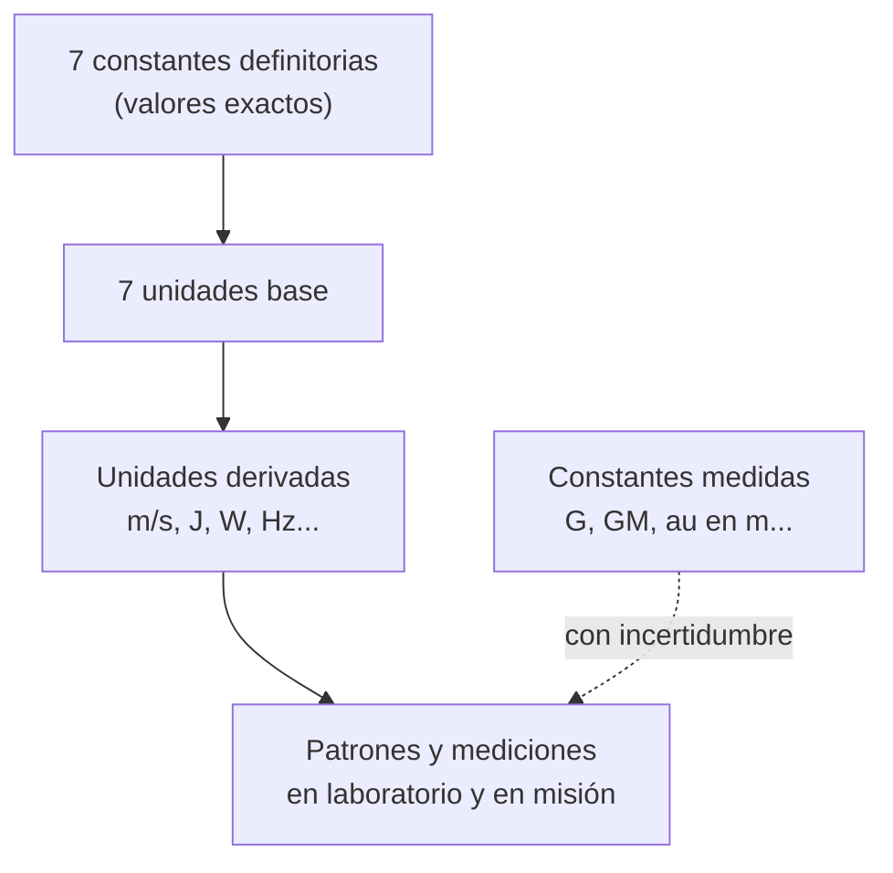

# B13-C01 — Sistema Internacional y constantes

<!-- nav:top -->
[🏠 Programa](../../../../README.md) · [📚 Bloque B13](../../../tronco-comun/B13-metrologia-tiempo-y-mediciones-cientificas.md) · [← Anterior: B12-C26 — Sesgos y potencia estadística en poblaciones pequeñas](../../B12/B12-C26-sesgos-y-potencia-estadistica-en-poblaciones-pequenas/CLASE.md) · [Siguiente: B13-C02 — Dimensiones y trazabilidad →](../B13-C02-dimensiones-y-trazabilidad/CLASE.md)
<!-- /nav -->

## 1. Ubicación, nivel y alcance

Primera clase del bloque B13, «Metrología, tiempo y mediciones científicas», dentro del área A02. Nivel N2. Aquí aprendes **qué es el Sistema Internacional de Unidades (SI)**, cuáles son las siete constantes que lo definen desde 2019 y cómo se usan esas constantes para convertir y comprobar cifras en ciencias espaciales. No verás todavía dimensiones ni trazabilidad (C02), ni incertidumbre (C03–C04 y C12–C13), ni escalas de tiempo (C08). La unidad astronómica y el parámetro gravitacional aparecen solo como ejemplos de conversión.

## 2. Por qué esta clase existe

Una señal de radio o de láser viaja a la Luna y regresa. Para decir «la Luna está a 384 400 km» hay que haber acordado qué es un kilómetro, qué es un segundo y a qué velocidad viaja la señal. Desde 2019 ese acuerdo no depende de una barra de metal ni de un cilindro guardado en una bóveda: depende de **siete números fijados por definición**. Quien no entienda cuáles son, y cuáles son medidos y cuáles fijados, mezclará cifras exactas con aproximadas y publicará conversiones con precisión inventada.

La decisión central: **¿qué valor es exacto por definición, cuál es una medición con incertidumbre y cómo convierto entre unidades sin perder ni inventar cifras?**

## 3. Lo que podrás hacer al terminar

1. Enumerar las siete constantes definitorias del SI y la unidad que fija cada una.
2. Distinguir una constante **exacta** de una **medida** (por ejemplo `c` frente a `G`).
3. Convertir entre unidades SI y no SI del dominio espacial (km³/s², au, minutos de luz) con factores exactos.
4. Calcular un tiempo de luz y la longitud de onda de la transición del cesio.
5. Escribir un valor con su unidad, su estado (exacto, medido, estimado) y su fuente.
6. Ejecutar un script que verifica identidades exactas con aritmética racional.

La evidencia es la **hoja de constantes y conversiones** del ejercicio 12 (sección 20).

## 4. Con qué llegas y cómo comprobarlo

Necesitas notación científica y potencias de diez ([B03](../../../tronco-comun/B03-matematica-elemental-para-ciencias-espaciales.md) y [B01-C08](../../B01/B01-C08-mediciones-y-unidades-astronomicas/CLASE.md)). Cinco preguntas:

1. Escribe `384 400 km` en metros y en notación científica.
2. ¿Cuánto es `3,0 × 10⁸ × 2,0 × 10⁻³`?
3. ¿Qué significa que `1 Hz` es «un ciclo por segundo»?
4. Si un objeto recorre 15 km en 5 s, ¿cuál es su velocidad en m/s?
5. ¿Qué diferencia hay entre «exacto» y «redondeado a tres cifras»?

<details>
<summary>Ver respuestas</summary>

1. `3,844 × 10⁸ m`. 2. `6,0 × 10⁵`. 3. Que una oscilación completa dura un segundo; `1 Hz = 1 s⁻¹`. 4. `3000 m/s`. 5. Un valor exacto no tiene error (es una definición); uno redondeado conserva solo algunas cifras de un valor que tiene más.
</details>

Con cuatro o cinco aciertos, sigue; si no, repasa B01-C08.

## 5. Un caso real: ¿cuánto tarda la luz en llegar a la Luna?

La distancia semieje mayor de la órbita lunar es `0,3844 × 10⁶ km` (S5, publicada con cuatro cifras). Si la luz viaja a `c = 299 792 458 m/s`, exacta por definición (S1, S2), el tiempo de ida es `3,844 × 10⁸ m / 299 792 458 m/s ≈ 1,2822 s`. La incertidumbre de ese tiempo **no viene de `c`** (que no tiene incertidumbre) sino de la distancia, que además cambia entre perigeo y apogeo. Este es el **ejemplo conductor** de la clase: qué cifras de la cuenta son definiciones y cuáles son datos.

## 6. Vocabulario

El **Sistema Internacional de Unidades (SI)** es el sistema de unidades acordado por la Conferencia General de Pesas y Medidas y custodiado por la Oficina Internacional de Pesas y Medidas (BIPM). Una **unidad base** es una de las siete unidades fundamentales: segundo (s), metro (m), kilogramo (kg), amperio (A), kelvin (K), mol (mol) y candela (cd). Una **constante definitoria** es una constante física a la que el SI asigna un valor numérico **exacto**; las unidades se definen fijándola (S2). Una **magnitud** es una propiedad medible (longitud, tiempo); una **unidad** es el patrón con que se expresa. Un valor **exacto** no tiene incertidumbre porque es una definición; un valor **medido** sí la tiene. Una **unidad derivada** es un producto de potencias de unidades base (m/s, J = kg m² s⁻²). La **frecuencia de la transición hiperfina del cesio-133**, `Δν_Cs`, es la frecuencia de una radiación atómica concreta que define el segundo.

## 7. Modelo mental: un edificio con siete pilares

Imagina el SI como un edificio cuyos siete pilares son números exactos. Todo lo demás (unidades derivadas, patrones, instrumentos) se apoya en ellos. Antes de 2019 algunos pilares eran objetos; ahora todos son números.



*Descripción textual:* arriba, las siete constantes exactas; debajo, las unidades base que definen; luego las derivadas; al final, mediciones reales. A un lado, con línea punteada, las constantes medidas, que entran con incertidumbre.

Analogía: el edificio y sus cimientos. Su límite: los cimientos de un edificio pueden moverse; los valores definitorios del SI no se mueven, pero **una definición no dice cómo realizarla con un instrumento**: eso exige patrones (C06) y trazabilidad (C02).

## 8. La explicación, paso a paso

### 8.1 Las siete constantes

Según la página del BIPM sobre las constantes definitorias (S2) y la tabla CODATA 2022 (S1), los valores exactos son: `Δν_Cs = 9 192 631 770 Hz`, `c = 299 792 458 m/s`, `h = 6,626 070 15 × 10⁻³⁴ J s`, `e = 1,602 176 634 × 10⁻¹⁹ C`, `k = 1,380 649 × 10⁻²³ J/K`, `N_A = 6,022 140 76 × 10²³ mol⁻¹` y `K_cd = 683 lm/W`. Cada una fija una unidad: `Δν_Cs` el segundo, `c` el metro (dado el segundo), `h` el kilogramo, `e` el amperio, `k` el kelvin, `N_A` el mol y `K_cd` la candela. El emparejamiento de cada constante con su unidad es la lectura estándar del SI; las páginas consultadas listan constantes y unidades, y el emparejamiento se apoya además en las unidades de cada constante.

### 8.2 El segundo y el metro

El segundo es la duración de `9 192 631 770` periodos de la radiación de esa transición del cesio. Por tanto, el periodo de un ciclo es `1/9 192 631 770 s ≈ 1,0878 × 10⁻¹⁰ s`. El metro es la distancia que recorre la luz en el vacío en `1/299 792 458 s`. Dos consecuencias: **no se mide `c`, se usa para definir el metro**; y medir una distancia por tiempo de vuelo equivale a medir un tiempo.

### 8.3 La longitud de onda del cesio

Una onda de frecuencia `ν` y velocidad `c` tiene longitud de onda `λ = c/ν`. Con `Δν_Cs`, `λ = 299 792 458/9 192 631 770 m = 3,2612 cm`: es una radiación de microondas. La energía de un fotón es `E = hν = 6,0911 × 10⁻²⁴ J`, muy pequeña, lo que explica por qué hacen falta millones de átomos y electrónica sensible.

### 8.4 Constantes exactas y constantes medidas

`G = 6,674 30 × 10⁻¹¹ m³ kg⁻¹ s⁻²` tiene incertidumbre típica `0,000 15 × 10⁻¹¹` (S1, CODATA 2022): se mide, y es una de las constantes menos precisas. Por eso en mecánica celeste se usa el producto `GM` (parámetro gravitacional; en S3 figura `GM_⊕ = 3,986 004 418 × 10¹⁴ m³/s²` con incertidumbre `8 × 10⁵ m³/s²`), que se conoce con mucha mayor precisión que `G` y `M` por separado. La unidad astronómica, `1 au = 149 597 870 700 m`, figura en las convenciones del IERS como `1,495 978 707 00 × 10¹¹ m` con una incertidumbre de 3 m asociada a un valor *TDB-compatible* (S3, Tabla 1.1). Esa nota importa: un valor «exacto» en una tabla puede serlo solo bajo una convención de tiempo (C08).

### 8.5 Conversiones sin perder cifras

Convertir es multiplicar por un factor. Si el factor es exacto (`1 km = 10³ m`), el resultado conserva todas las cifras del dato. Si el factor es medido, la incertidumbre se hereda. El parámetro gravitacional geocéntrico del IERS (S3, Tabla 1.1) `3,986 004 418 × 10¹⁴ m³/s²` equivale a `398 600,4418 km³/s²` porque `1 km³ = 10⁹ m³` exacto. Para el tiempo de luz de una unidad astronómica: `1 au / c = 499,004 784 s`, unos 8 min 19 s.

## 9. Magnitudes, símbolos y unidades

| Símbolo | Qué es | Unidad | Estado |
|---|---|---|---|
| `Δν_Cs` | frecuencia hiperfina del Cs-133 | Hz | exacta |
| `c` | velocidad de la luz en el vacío | m/s | exacta |
| `h` | constante de Planck | J s | exacta |
| `e` | carga elemental | C | exacta |
| `k` | constante de Boltzmann | J/K | exacta |
| `N_A` | constante de Avogadro | mol⁻¹ | exacta |
| `K_cd` | eficacia luminosa | lm/W | exacta |
| `G` | constante de gravitación | m³ kg⁻¹ s⁻² | medida (CODATA 2022) |
| `GM` | parámetro gravitacional | m³/s² | medido; la Tierra: IERS TN36 (S3) |
| `au` | unidad astronómica | m | convención (S3) |

## 10. Convenciones y referencias

Se usan unidades SI con prefijos decimales; la coma separa decimales y el espacio fino separa miles. Las constantes proceden de la tabla CODATA 2022 (S1); el tiempo se supone medido en un sistema inercial local, sin correcciones relativistas. Todo valor se rotula **exacto**, **medido** o **estimado**.

## 11. De dónde sale lo que afirmamos

| ID | Fuente | Localizador | Respalda | Estado |
|---|---|---|---|---|
| S1 | NIST, *CODATA Recommended Values of the Fundamental Physical Constants: 2022* (tabla ASCII) | https://physics.nist.gov/cuu/Constants/Table/allascii.txt | Valores exactos de `c`, `h`, `e`, `k`, `N_A`, `Δν_Cs`, `K_cd`; `G` con su incertidumbre | Consultada el 2026-11-05 mediante extracción automática |
| S2 | BIPM, *SI defining constants* | https://www.bipm.org/en/measurement-units/si-defining-constants | Lista de las siete constantes con sus valores exactos | Consultada el 2026-11-05 mediante extracción automática |
| S3 | IERS, *IERS Conventions (2010)*, TN36, §1.2, Tabla 1.1 | https://iers-conventions.obspm.fr/content/tn36.pdf | `1 au = 1,495 978 707 00 × 10¹¹ m` (TDB-compatible, ±3 m); `c` | Texto extraído del PDF el 2026-11-05 |
| S4 | NIST, *Kelvin: present realization* | https://www.nist.gov/si-redefinition/kelvin-present-realization | El kelvin se define fijando `k`; punto triple del agua 273,16 K | Consultada el 2026-11-05 mediante extracción automática |
| S5 | NASA/NSSDC, *Moon Fact Sheet* (actualizada 2024-01-11) | https://nssdc.gsfc.nasa.gov/planetary/factsheet/moonfact.html | Semieje mayor `0,3844 × 10⁶ km`; perigeo y apogeo medios | Consultada el 2026-11-05 mediante extracción automática |

Límites: el emparejamiento constante–unidad es la lectura estándar y no una cita textual; el tiempo de luz a la Luna es una **estimación** con una distancia de cuatro cifras.

## 12. Cómo ver las constantes

Equivalente accesible a un esquema de pilares:

| Constante | Valor exacto | Unidad que define |
|---|---|---|
| `Δν_Cs` | 9 192 631 770 Hz | segundo |
| `c` | 299 792 458 m/s | metro |
| `h` | 6,626 070 15 × 10⁻³⁴ J s | kilogramo |
| `e` | 1,602 176 634 × 10⁻¹⁹ C | amperio |
| `k` | 1,380 649 × 10⁻²³ J/K | kelvin |
| `N_A` | 6,022 140 76 × 10²³ mol⁻¹ | mol |
| `K_cd` | 683 lm/W | candela |

Descripción larga: siete filas, cada una con un número exacto y la unidad base que fija; ninguna fila tiene incertidumbre.

## 13. Ejemplo trabajado: tiempo de luz a la Luna

**Paso 1 · Datos.** `d = 3,844 × 10⁸ m` (estimado, S5); `c = 299 792 458 m/s` (exacto).

**Paso 2 · Modelo.** Propagación en el vacío en línea recta: `t = d/c`.

**Paso 3 · Cálculo.** `t = 3,844 × 10⁸/2,997 924 58 × 10⁸ = 1,2822 s`.

**Paso 4 · Ida y vuelta.** `2t = 2,5644 s`.

**Paso 5 · Cifras y sentido.** El dato tiene cuatro cifras, así que el resultado merece cuatro: «`1,282 s`». Entre perigeo (`3,633 × 10⁸ m`) y apogeo (`4,055 × 10⁸ m`) el tiempo va de `1,212 s` a `1,353 s`: la variación orbital (`±5,6 %`) pesa mucho más que cualquier cifra de `c`. Es un tiempo de luz idealizado: no incluye la atmósfera ni la geometría de reflexión.

## 14. Distintas formas de convertir

Con **factores exactos** (`1 km = 10³ m`): sin pérdida. Con **factores medidos** (`G`): la incertidumbre se hereda. Con **aritmética racional** en el laboratorio: las definiciones se comprueban sin redondeos y se reserva el coma flotante para los resultados finales. Si dos caminos dan resultados distintos más allá de las cifras justificadas, hay un error.

## 15. Práctica guiada

**Ejercicio 1 · con los pasos indicados.** Convierte `GM_E = 398 600,4418 km³/s²` a m³/s². *Pasos:* `1 km³ = (10³ m)³`.

<details><summary>Solución comentada</summary>

`1 km³ = 10⁹ m³`, luego `398 600,4418 × 10⁹ = 3,986 004 418 × 10¹⁴ m³/s²` (8.5). El factor es exacto: no cambia las cifras.
</details>

**Ejercicio 2 · con una pista.** Calcula el periodo de la radiación del cesio y su longitud de onda. *Pista:* periodo = inverso de la frecuencia; `λ = c/ν`.

<details><summary>Solución comentada</summary>

`T = 1/9 192 631 770 = 1,0878 × 10⁻¹⁰ s`; `λ = 299 792 458/9 192 631 770 = 0,032 612 m = 3,261 cm` (8.2–8.3).
</details>

**Ejercicio 3 · casi autónomo.** ¿Cuánto tarda la luz en recorrer 1 au? Exprésalo en segundos y en minutos.

<details><summary>Solución comentada</summary>

`149 597 870 700/299 792 458 = 499,005 s = 8,3167 min` (8.5). Coincide con el laboratorio.
</details>

## 16. Práctica autónoma, transferencia e integrador

**Ejercicio 4.** ¿Qué constante define el metro y cuál es su valor exacto?

<details><summary>Solución comentada</summary>

`c = 299 792 458 m/s` (8.1–8.2). Con el segundo ya definido, el metro es lo que recorre la luz en `1/299 792 458 s`.
</details>

**Ejercicio 5.** Clasifica como exacta, medida o convención: `h`, `G`, `1 au`, `K_cd`.

<details><summary>Solución comentada</summary>

`h`: exacta; `G`: medida (±`0,000 15 × 10⁻¹¹`); `1 au`: convención con valor tabulado (S3); `K_cd`: exacta (8.4).
</details>

**Ejercicio 6.** Calcula la energía de un fotón de `ν = 9 192 631 770 Hz`.

<details><summary>Solución comentada</summary>

`E = hν = 6,626 070 15 × 10⁻³⁴ × 9,192 631 77 × 10⁹ = 6,0911 × 10⁻²⁴ J` (8.3).
</details>

**Ejercicio 7.** Calcula el tiempo de luz Tierra–Luna en perigeo y apogeo (`3,633 × 10⁸ m` y `4,055 × 10⁸ m`).

<details><summary>Solución comentada</summary>

`1,2119 s` y `1,3526 s`; con cuatro cifras: `1,212 s` y `1,353 s` (paso 5 del ejemplo).
</details>

**Ejercicio 8.** Un compañero escribe `c = 3,00 × 10⁸ m/s` y calcula el tiempo de luz de 1 au como `499,0 s`. ¿Hay error? ¿Qué cifras son justas?

<details><summary>Solución comentada</summary>

Con `c = 3,00 × 10⁸` se obtiene `1,496 × 10¹¹/3,00 × 10⁸ = 498,7 s`, no `499,0 s`: usó un valor para `c` y otro distinto en la cuenta. Con tres cifras en `c` solo son justas tres cifras (`499 s`). Con el valor exacto se tiene `499,005 s`.
</details>

**Ejercicio 9 · transferencia.** Un enlace con una nave a `1,5 × 10⁹ km` tiene retardo de ida. ¿Cuánto es, en minutos y en horas? ¿Qué parte del cálculo es exacta?

<details><summary>Solución comentada</summary>

`1,5 × 10¹²/2,997 92 × 10⁸ = 5003 s ≈ 83,4 min = 1,39 h`. Exacto: `c` y el factor km→m; la distancia es el dato con incertidumbre.
</details>

**Ejercicio 10 · transferencia.** El valor `G = 6,674 30 × 10⁻¹¹` se publica con incertidumbre `0,000 15 × 10⁻¹¹`. ¿Cuál es la incertidumbre relativa y por qué los astrodinámicos prefieren `GM`?

<details><summary>Solución comentada</summary>

`0,000 15/6,674 30 = 2,2 × 10⁻⁵`. `GM` de un cuerpo se determina por su efecto en trayectorias con mucha mayor precisión que `G` o `M` separadas, así que usarlo evita heredar los `2,2 × 10⁻⁵` de `G` (8.4).
</details>

**Ejercicio 11 · transferencia.** Convierte `1,327 124 420 99 × 10²⁰ m³/s²` (GM heliocéntrico, IERS, S3) a km³/s² y explica cuántas cifras mantienes.

<details><summary>Solución comentada</summary>

`1,327 124 420 99 × 10¹¹ km³/s²`. El factor `10⁹` es exacto: se conservan las once cifras del dato (el propio IERS declara una incertidumbre de `1 × 10¹⁰ m³/s²`, es decir, solo las nueve primeras cifras son significativas).
</details>

**Ejercicio 12 · integrador.** Elabora tu *hoja de constantes y conversiones*: una tabla de las siete constantes con su estado, tres conversiones (GM terrestre, 1 au en segundos de luz, longitud de onda del Cs) y el tiempo de luz Tierra–Luna con su rango perigeo–apogeo, indicando qué cifras son exactas, medidas o estimadas y la fuente con fecha.

<details><summary>Solución modelo</summary>

Tabla de la sección 12; conversiones `3,986 004 418 × 10¹⁴ m³/s²`, `499,005 s`, `3,261 cm`; Tierra–Luna `1,282 s` (rango `1,212`–`1,353 s`, estimado); cada fila con S1–S5 y fecha 2026-11-05, rotulando exactas, medidas y estimadas.
</details>

## 17. Laboratorio: identidades exactas del SI

El script [constantes_si.py](constantes_si.py) usa fracciones de Python para comprobar sin redondeo que la luz recorre exactamente 1 m en `1/299 792 458 s`, que `9 192 631 770` periodos suman 1 s, que `c × (1 au/c) = 1 au` y que el factor km³→m³ es exacto; luego calcula las cifras derivadas.

**Datos:** constantes exactas del SI; `au` de IERS; distancia lunar publicada con cuatro cifras. **Predice antes de ejecutar:** ¿qué esperas para el tiempo de luz de 1 au? (cerca de 499 s.) **Ejecución del 2026-11-05 (Python 3.12.9):**

```text
periodo Cs = 1.087828e-10 s ; longitud de onda en vacio = 3.261226 cm
E = h*dnu_Cs = 6.091102e-24 J
1 au / c = 499.004784 s ; Tierra-Luna = 1.282220 s (estimado)
GM_E (IERS) = 3.986004418e+14 m3/s2 = 398600.4418 km3/s2
k*T(273.16 K) = 3.771381e-21 J
Pruebas superadas.
```

```bash
python programa/clases/B13/B13-C01-sistema-internacional-y-constantes/constantes_si.py
```

**Límites:** vacío, sin retardo atmosférico ni relativista; la distancia lunar es un dato con cuatro cifras.

## 18. Errores frecuentes y cómo corregirlos

**Tratar `c` como si tuviera incertidumbre.** Se corrige con el ejercicio 4.

**Redondear `c` a `3 × 10⁸` y luego exigir cifras de más.** Se corrige con el ejercicio 8.

**Confundir constante definitoria con constante medida.** Se corrige con el ejercicio 5.

**Olvidar que km³ = 10⁹ m³ (no 10³).** Se corrige con el ejercicio 1.

**Dar un tiempo de luz con más cifras que la distancia.** Se corrige en el paso 5 del ejemplo trabajado.

## 19. Cómo sabrás que vas bien

Tras 8.1: ¿nombras las siete constantes y su unidad? Si no, ejercicio 4. Tras 8.4: ¿distingues exacta de medida? Si no, ejercicio 5. Tras 8.5: ¿conviertes `GM` sin perder cifras? Si no, ejercicio 1 y 11. Tras el laboratorio: ¿por qué se usan fracciones para las definiciones y coma flotante para los resultados? (para que una definición no se contamine con redondeos).

## 20. Qué entregas y cómo se evalúa

El producto es tu **hoja de constantes y conversiones** (ejercicio 12).

| Criterio | Inicial | En desarrollo | Logrado | Destacado |
|---|---|---|---|---|
| Constantes | Lista incompleta | Lista sin unidad | Las siete con su unidad | Distingue exactas, medidas y convención |
| Conversión | Con errores de potencia | Correcta sin comprobar | Correcta con factor exacto | Verifica con dos caminos |
| Cifras | Sin criterio | Demasiadas cifras | Las que justifica el dato | Rotula exacto/medido/estimado |
| Interpretación | Sin sentido físico | Valor sin contexto | Tiempo de luz con rango | Discute qué domina la incertidumbre |
| Fuentes | Sin fuente | Sin fecha | Con localizador y fecha | Declara límites y estados |

**Condiciones críticas (no se compensan con promedio):** no tratar una estimación como exacta; declarar la unidad en cada valor; citar solo fuentes consultadas.

## 21. Ética, seguridad y límites

Una conversión mal hecha o una constante desactualizada puede inutilizar un enlace de comunicaciones o una maniobra; verifica siempre unidades y versión de la tabla. Este material es educativo: no sustituye los documentos oficiales del BIPM. Accesibilidad: fórmulas en texto, tablas equivalentes a los esquemas, ejercicios sin conexión.

## 22. Para cerrar y seguir

El SI se apoya en siete constantes exactas; las unidades derivadas y los patrones se construyen sobre ellas; las constantes medidas, como `G`, entran con incertidumbre; y convertir bien es conservar las cifras que el dato justifica. Queda una pregunta: ¿cómo se sabe que una ecuación o una cifra tiene las dimensiones correctas y que su origen puede rastrearse hasta un patrón?

**Glosario español–inglés.** Sistema Internacional · *International System of Units*; constante definitoria · *defining constant*; unidad base · *base unit*; unidad derivada · *derived unit*; valor exacto · *exact value*; parámetro gravitacional · *gravitational parameter*; unidad astronómica · *astronomical unit*.

**Continuidad.** B13-C02 reutiliza tu capacidad de **distinguir exacto, medido y estimado** para el análisis dimensional y la trazabilidad.

**Referencias:** ver sección 11.

<!-- nav:bottom -->
---

[← Anterior: B12-C26 — Sesgos y potencia estadística en poblaciones pequeñas](../../B12/B12-C26-sesgos-y-potencia-estadistica-en-poblaciones-pequenas/CLASE.md) · [📚 Bloque B13](../../../tronco-comun/B13-metrologia-tiempo-y-mediciones-cientificas.md) · [Siguiente: B13-C02 — Dimensiones y trazabilidad →](../B13-C02-dimensiones-y-trazabilidad/CLASE.md)
<!-- /nav -->
