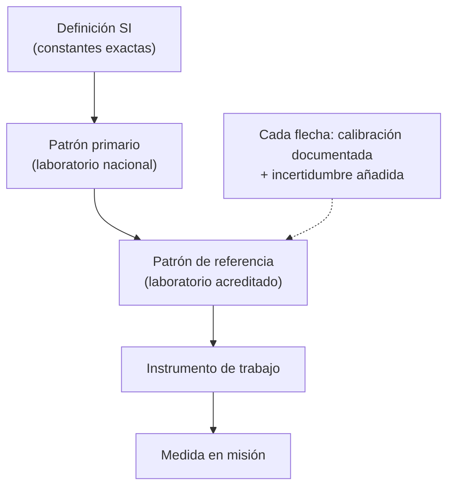

# B13-C02 — Dimensiones y trazabilidad

<!-- nav:top -->
[🏠 Programa](../../../../README.md) · [📚 Bloque B13](../../../tronco-comun/B13-metrologia-tiempo-y-mediciones-cientificas.md) · [← Anterior: B13-C01 — Sistema Internacional y constantes](../B13-C01-sistema-internacional-y-constantes/CLASE.md) · [Siguiente: B13-C03 — Exactitud frente a precisión →](../B13-C03-exactitud-frente-a-precision/CLASE.md)
<!-- /nav -->

## 1. Ubicación, nivel y alcance

Segunda clase del bloque B13. En la [clase anterior](../B13-C01-sistema-internacional-y-constantes/CLASE.md) viste las siete constantes del SI. Aquí aprendes dos hábitos de control que usa toda medición seria: el **análisis dimensional** (comprobar que una ecuación tiene sentido físico) y la **trazabilidad metrológica** (poder rastrear una medida hasta un patrón mediante una cadena documentada). Nivel N2. No calcularás incertidumbres completas (C12–C13) ni calibrarás un instrumento (C05).

## 2. Por qué esta clase existe

Un satélite recibe un comando con un tiempo de encendido de motor; el ingeniero de tierra usó una fórmula del periodo orbital copiada de una hoja de cálculo. Si la fórmula está mal dimensionada, el resultado sale en «segundos al cuadrado» o en «metros por segundo» sin que nadie lo note. Y si el reloj de a bordo se sincronizó con un patrón cuya cadena de comparaciones no está documentada, nadie sabe con qué confianza se fijó la hora de encendido.

La decisión central: **¿cómo compruebo, antes de calcular, que una ecuación es coherente, y cómo demuestro de dónde viene la confianza en una medida?**

## 3. Lo que podrás hacer al terminar

1. Asignar a cada magnitud sus dimensiones base (masa, longitud, tiempo).
2. Comprobar la consistencia dimensional de una ecuación y detectar una errónea.
3. Reconocer los límites de esa comprobación (no detecta factores numéricos).
4. Definir **trazabilidad metrológica** con sus tres requisitos.
5. Combinar incertidumbres de una cadena de calibración en cuadratura (caso simple).
6. Documentar la cadena de un instrumento con sus eslabones.

La evidencia es el **informe de consistencia y trazabilidad** del ejercicio 12 (sección 20).

## 4. Con qué llegas y cómo comprobarlo

Necesitas las unidades del SI ([C01](../B13-C01-sistema-internacional-y-constantes/CLASE.md)) y potencias con exponentes enteros y fraccionarios. Cinco preguntas:

1. ¿Qué unidad tiene la velocidad? ¿Y la aceleración?
2. Simplifica `m³ / m²`.
3. ¿Cuánto es `(s²)^(1/2)`?
4. ¿Qué unidad tiene `GM` según C01?
5. ¿Por qué no se pueden sumar metros y segundos?

<details>
<summary>Ver respuestas</summary>

1. m/s; m/s². 2. m. 3. s. 4. m³/s². 5. Porque son magnitudes de naturaleza distinta; la suma solo tiene sentido entre magnitudes de la misma dimensión.
</details>

Con cuatro o cinco aciertos, sigue; si no, repasa C01.

## 5. Un caso real: el periodo de un satélite

Un satélite en órbita circular de radio `a` alrededor de un cuerpo de parámetro gravitacional `GM` tiene un periodo `P = 2π √(a³/GM)`. Con el valor geocéntrico del IERS, `GM_⊕ = 3,986 004 418 × 10¹⁴ m³/s²` (S3), y `a = 4,2164 × 10⁷ m` (órbita geoestacionaria, valor de ejemplo), da `P = 86 164 s`, un día sidéreo (calculado, ver ejemplo trabajado). Antes de calcular, una pregunta: ¿tiene el lado derecho dimensión de tiempo? Ese chequeo es el **ejemplo conductor** de la clase.

## 6. Vocabulario

Una **dimensión** es la clase física de una magnitud; aquí usamos tres dimensiones base: **M** (masa), **L** (longitud) y **T** (tiempo). Un **vector de exponentes** `[M^a L^b T^c]` resume cuántas veces aparece cada dimensión: la velocidad es `L T⁻¹`. Una ecuación es **dimensionalmente consistente** si ambos miembros tienen el mismo vector y solo se suman términos de igual dimensión. Una cantidad **adimensional** tiene todos sus exponentes en cero (una razón, un ángulo en radianes). La **trazabilidad metrológica** es la propiedad de un resultado de medida por la cual puede relacionarse con una referencia mediante una cadena ininterrumpida y documentada de calibraciones, cada una de las cuales contribuye a la incertidumbre (S2, 2.41). Un **patrón** (*measurement standard*) es la realización de una unidad con un valor y una incertidumbre declarados.

## 7. Modelo mental: dos controles de calidad

El análisis dimensional es un **filtro de sentido** que se aplica en papel, antes de calcular. La trazabilidad es una **cadena de custodia** de la confianza: cada eslabón compara un instrumento con otro más preciso hasta llegar a la definición de la unidad.



*Descripción textual:* la definición del SI baja por patrón primario, patrón de referencia e instrumento de trabajo hasta la medida; cada paso añade incertidumbre y exige un documento de calibración.

Analogía: el filtro de agua que no sirve sin su cadena de mantenimiento. Su límite: en una cadena de calibración la incertidumbre **no puede disminuir** al bajar de nivel; solo puede aumentar o, como mucho, mantenerse.

## 8. La explicación, paso a paso

### 8.1 Dimensiones base y derivadas

Con M, L, T: velocidad `L T⁻¹`; aceleración `L T⁻²`; fuerza `M L T⁻²`; energía `M L² T⁻²`; frecuencia `T⁻¹`; parámetro gravitacional `GM`: `L³ T⁻²` (de `g = GM/r²`, con `g` de dimensión `L T⁻²`: `GM = g r²` → `L T⁻² L² = L³ T⁻²`). Esta dimensión es coherente con la unidad m³/s² de C01.

### 8.2 Cómo se chequea una ecuación

Se escribe el vector de cada factor, se suman exponentes al multiplicar y se multiplican al elevar a una potencia. Para `P = 2π √(a³/GM)`: `a³` tiene `L³`; `GM` tiene `L³ T⁻²`; el cociente tiene `T²`; la raíz cuadrada da `T`. El factor `2π` es adimensional. La ecuación es consistente: el periodo tiene dimensión de tiempo.

### 8.3 Una ecuación errónea

Un colega propone la velocidad circular como `v = GM/r`. Su dimensión es `L³ T⁻² / L = L² T⁻²`, que **no** es velocidad (`L T⁻¹`) sino velocidad al cuadrado. La corrección `v = √(GM/r)` produce `L T⁻¹`. Este tipo de error se ve antes de calcular.

### 8.4 Límites del análisis dimensional

Es una condición **necesaria, no suficiente**. Si escribes `P = π √(a³/GM)` en lugar de `2π √(a³/GM)`, la dimensión es correcta y el número está mal por un factor 2. Tampoco distingue magnitudes de igual dimensión (energía y trabajo) ni detecta ángulos en grados confundidos con radianes. Úsalo como filtro, no como demostración.

### 8.5 Trazabilidad: tres requisitos y una consecuencia

Según el vocabulario internacional de metrología (S2, 2.41), un resultado es trazable si: (1) está **referido** a un patrón o a la definición de la unidad; (2) la cadena es **ininterrumpida**: sin saltos; y (3) está **documentada**: cada calibración deja un certificado. Como consecuencia, cada eslabón **aporta una incertidumbre** declarada. Quien reclama trazabilidad debe poder mostrar la cadena completa.

### 8.6 Cómo se acumula la incertidumbre en la cadena

Si los eslabones aportan incertidumbres típicas independientes `u₁, u₂, …, u_n` (todas relativas, en las mismas unidades), la incertidumbre combinada es la raíz de la suma de cuadrados: `u_c = √(u₁² + u₂² + … + u_n²)` (S1, 5.1.2, caso en que la salida es la suma de las entradas con coeficientes de sensibilidad iguales a 1). Con una cadena sintética de `0,10`, `0,30`, `0,50` y `1,00 ppm` resulta `1,16 ppm`: el último eslabón domina. Esa observación dirige el esfuerzo: mejorar el eslabón mayor rinde más que pulir el menor.

## 9. Magnitudes, símbolos y unidades

| Símbolo | Qué es | Unidad | Dimensión |
|---|---|---|---|
| `a` | radio de la órbita circular | m | `L` |
| `GM` | parámetro gravitacional | m³/s² | `L³ T⁻²` |
| `P` | periodo orbital | s | `T` |
| `v` | velocidad circular | m/s | `L T⁻¹` |
| `u_i` | incertidumbre típica del eslabón i | ppm (relativa) | adimensional |
| `u_c` | incertidumbre combinada | ppm | adimensional |

## 10. Convenciones y referencias

Las dimensiones se escriben `[M^a L^b T^c]`; los exponentes pueden ser fraccionarios. Los ángulos en radianes se tratan como adimensionales. Las incertidumbres de la cadena se suponen **independientes** y se expresan como incertidumbres típicas relativas en partes por millón (ppm). Los datos de la cadena son **sintéticos**.

## 11. De dónde sale lo que afirmamos

| ID | Fuente | Localizador | Respalda | Estado |
|---|---|---|---|---|
| S1 | JCGM 100:2008, *Evaluation of measurement data — Guide to the expression of uncertainty in measurement* (GUM), §5.1.2 | https://www.bipm.org/documents/20126/2071204/JCGM_100_2008_E.pdf | Ley de propagación de varianzas; suma en cuadratura | Texto extraído del PDF el 2026-11-05 |
| S2 | JCGM 200:2012, *International vocabulary of metrology (VIM)*, 3.ª ed., términos 2.39 y 2.41 | https://www.bipm.org/documents/20126/2071204/JCGM_200_2012.pdf | Definiciones de calibración y trazabilidad metrológica | Texto extraído del PDF el 2026-11-05 |
| S3 | IERS, *IERS Conventions (2010)*, TN36, Tabla 1.1 | https://iers-conventions.obspm.fr/content/tn36.pdf | `GM_⊕ = 3,986 004 418 × 10¹⁴ m³/s²` (TCG-compatible) | Texto extraído del PDF el 2026-11-05 |

Límites: el radio geoestacionario es un valor de ejemplo; la fórmula del periodo es el resultado estándar de la órbita circular newtoniana, sin cita específica en esta clase; los datos de la cadena de trazabilidad son **sintéticos**.

## 12. Cómo ver la cadena

Equivalente accesible a un diagrama de escalera:

| Eslabón | Incertidumbre del eslabón (ppm) | Acumulada `u_c` (ppm) |
|---|---|---|
| Patrón primario | 0,10 | 0,10 |
| Patrón nacional | 0,30 | 0,32 |
| Laboratorio de referencia | 0,50 | 0,59 |
| Instrumento de trabajo | 1,00 | 1,16 |

Descripción larga: cuatro escalones; la columna acumulada crece de 0,10 a 1,16 ppm y nunca disminuye.

## 13. Ejemplo trabajado: chequeo del periodo orbital

**Paso 1 · Dimensiones.** `a³`: `L³`; `GM`: `L³ T⁻²`.

**Paso 2 · Cociente.** `a³/GM`: `L³/(L³ T⁻²) = T²`.

**Paso 3 · Raíz.** `√(T²) = T`. Consistente.

**Paso 4 · Número.** `a³ = (4,2164 × 10⁷)³ = 7,4959 × 10²² m³`; dividido por `3,986 004 418 × 10¹⁴` da `1,8806 × 10⁸ s²`; raíz: `13 713 s`; por `2π`: `86 164 s`.

**Paso 5 · Sentido.** `86 164 s ≈ 23 h 56 min 4 s`, un día sidéreo: la órbita geoestacionaria acompaña la rotación terrestre. Con `a` de cinco cifras el resultado merece cinco cifras. La consistencia dimensional no certifica el `2π`: eso se comprueba con este valor conocido.

## 14. Distintas formas de comprobar

**Análisis dimensional:** rápido, sin números, detecta errores de forma. **Prueba numérica con un caso conocido:** detecta factores numéricos (el día sidéreo para GEO). **Prueba por límites:** al aumentar `a`, `P` debe aumentar. Las tres se complementan; ninguna sola basta.

## 15. Práctica guiada

**Ejercicio 1 · con los pasos indicados.** Comprueba que `g = GM/r²` tiene dimensión de aceleración. *Pasos:* escribe `GM` y `r²` con vectores.

<details><summary>Solución comentada</summary>

`GM`: `L³ T⁻²`; `r²`: `L²`; cociente: `L T⁻²` ✓ (8.1).
</details>

**Ejercicio 2 · con una pista.** ¿Qué dimensión tiene `v²/r`? *Pista:* velocidad al cuadrado entre longitud.

<details><summary>Solución comentada</summary>

`(L T⁻¹)²/L = L T⁻²`: aceleración (la aceleración centrípeta) (8.1).
</details>

**Ejercicio 3 · casi autónomo.** Verifica `v = √(GM/r)` y compruébalo para la Tierra a `r = 6,7 × 10⁶ m`.

<details><summary>Solución comentada</summary>

`GM/r`: `L³T⁻²/L = L²T⁻²`; raíz: `L T⁻¹` ✓. Numérico: `√(3,986 × 10¹⁴/6,7 × 10⁶) = 7713 m/s` (≈ 7,7 km/s, orden de magnitud típico de una órbita baja).
</details>

## 16. Práctica autónoma, transferencia e integrador

**Ejercicio 4.** ¿Qué dimensión tiene la energía cinética `½ m v²`?

<details><summary>Solución comentada</summary>

`M (L T⁻¹)² = M L² T⁻²` (el factor `½` es adimensional) ✓ (8.1).
</details>

**Ejercicio 5.** Un compañero escribe la tercera ley como `P = √(a³ GM)`. Detecta el error dimensional.

<details><summary>Solución comentada</summary>

`a³ GM`: `L³ · L³T⁻² = L⁶T⁻²`; raíz: `L³ T⁻¹`: no es tiempo. Debe ser `a³/GM` (8.3).
</details>

**Ejercicio 6.** ¿Qué dimensión tiene la frecuencia de un reloj de cesio? ¿Y el cociente `Δν/ν` (diferencia relativa de frecuencia)?

<details><summary>Solución comentada</summary>

`T⁻¹` (Hz); el cociente `Δν/ν` es adimensional (se expresa en ppm o partes por `10¹⁵`).
</details>

**Ejercicio 7.** Calcula `P` para `a = 6,7 × 10⁶ m` (órbita baja) con la fórmula y comprueba que sale `≈ 5460 s`.

<details><summary>Solución comentada</summary>

`a³ = 3,0076 × 10²⁰`; `/GM = 7,545 × 10⁵ s²`; raíz `868,6`; por `2π`: `5458 s ≈ 91 min` ✓.
</details>

**Ejercicio 8.** Lista los tres requisitos de la trazabilidad y di cuál falta si un laboratorio calibra con un patrón «del que no se guardó certificado».

<details><summary>Solución comentada</summary>

Referencia a un patrón, cadena ininterrumpida y documentación (con la consecuencia de que cada eslabón aporta incertidumbre) (8.5). Falta la **documentación**: sin certificado, la cadena no es demostrable.
</details>

**Ejercicio 9 · transferencia.** Un factor de conversión equivocado de `0,9144` en lugar de `0,3048` (yarda en vez de pie) entra en la fórmula de un sensor. Explica por qué el análisis dimensional **no** lo detecta y qué control sí.

<details><summary>Solución comentada</summary>

Ambos factores convierten longitud: la dimensión es la misma (8.4). Lo detecta una **prueba numérica con un caso conocido** (14) o un control de unidades en la interfaz.
</details>

**Ejercicio 10 · transferencia.** Con la cadena sintética de la sección 12, ¿cuánto mejora `u_c` si el instrumento de trabajo baja de `1,00` a `0,50 ppm`?

<details><summary>Solución comentada</summary>

`√(0,01 + 0,09 + 0,25 + 0,25) = 0,775 ppm`, frente a `1,16`: mejora un 33 %. Si en cambio el patrón primario bajara de `0,10` a `0,05`, `u_c` casi no cambiaría (`1,159 ppm`): hay que mejorar el eslabón que domina (8.6).
</details>

**Ejercicio 11 · transferencia.** Un instrumento declara «trazable al NIST» pero su certificado no indica incertidumbre. ¿Es una trazabilidad válida según 8.5? ¿Qué le pedirías?

<details><summary>Solución comentada</summary>

No: falta la incertidumbre que cada calibración debe aportar. Pedir el certificado con el valor de incertidumbre, las condiciones de la calibración y su fecha.
</details>

**Ejercicio 12 · integrador.** Elabora tu *informe de consistencia y trazabilidad*: tres ecuaciones de mecánica orbital con su comprobación dimensional (una errónea corregida), una prueba numérica con un caso conocido y la cadena de trazabilidad de un reloj (sintética) con su `u_c` y el eslabón dominante.

<details><summary>Solución modelo</summary>

Tabla de ecuaciones con vector de dimensiones y veredicto; corrección de `GM/r → √(GM/r)`; `P_GEO = 86 164 s`; cadena de la sección 12 con `u_c = 1,16 ppm` y eslabón dominante: instrumento de trabajo; fuentes con fecha.
</details>

## 17. Laboratorio: dimensiones con exponentes racionales

El script [analisis_dimensional.py](analisis_dimensional.py) representa cada magnitud como un vector de exponentes racionales, comprueba la consistencia de cinco ecuaciones, muestra que `GM/r` **no** es velocidad y combina una cadena de incertidumbres.

**Datos:** fórmulas estándar y cadena **sintética**. **Predice antes de ejecutar:** ¿qué dimensión sale para `GM/r`? (`L² T⁻²`.) **Ejecución del 2026-11-05 (Python 3.12.9):**

```text
GM/r^2 -> L^1 T^-2 | sqrt(GM/r) -> L^1 T^-1
GM/r (mal) -> L^2 T^-2 | coincide con velocidad: False
cadena [0.1, 0.3, 0.5, 1.0] ppm -> u_c = 1.1619 ppm
acumulada por eslabon: [0.1, 0.3162, 0.5916, 1.1619]
Pruebas superadas.
```

```bash
python programa/clases/B13/B13-C02-dimensiones-y-trazabilidad/analisis_dimensional.py
```

**Límites:** solo tres dimensiones mecánicas; no detecta factores numéricos; incertidumbres independientes.

## 18. Errores frecuentes y cómo corregirlos

**Creer que una ecuación dimensionalmente correcta es correcta.** Se corrige con el ejercicio 9.

**Sumar magnitudes de dimensiones distintas.** Se corrige con el ejercicio 5.

**Confundir frecuencia con diferencia relativa de frecuencia.** Se corrige con el ejercicio 6.

**Reclamar trazabilidad sin documentos.** Se corrige con los ejercicios 8 y 11.

**Suponer que más eslabones mejoran la incertidumbre.** Se corrige con el ejercicio 10.

## 19. Cómo sabrás que vas bien

Tras 8.2: ¿comprobaste `P = 2π√(a³/GM)`? Si no, ejercicio 3. Tras 8.4: ¿sabes qué error no detecta el análisis dimensional? Si no, ejercicio 9. Tras 8.6: ¿qué eslabón mejorarías primero? Si dudas, ejercicio 10. Tras el laboratorio: ¿por qué la columna acumulada nunca decrece? (porque todos los términos de la suma en cuadratura son positivos).

## 20. Qué entregas y cómo se evalúa

El producto es tu **informe de consistencia y trazabilidad** (ejercicio 12).

| Criterio | Inicial | En desarrollo | Logrado | Destacado |
|---|---|---|---|---|
| Dimensiones | Sin vectores | Con errores | Correctas | Con exponentes fraccionarios |
| Detección de error | No detecta | Con ayuda | Detecta y corrige | Explica qué no detecta |
| Trazabilidad | Sin cadena | Cadena incompleta | Tres requisitos | Identifica el eslabón dominante |
| Cálculo | Sin unidades | Con unidades erróneas | Correcto | Con prueba numérica independiente |
| Fuentes | Sin fuente | Sin fecha | Con localizador y fecha | Rotula sintético y estimado |

**Condiciones críticas (no se compensan con promedio):** comprobar la dimensión antes de calcular; no afirmar trazabilidad sin cadena documentada; citar solo fuentes consultadas.

## 21. Ética, seguridad y límites

Una unidad mal convertida puede arruinar una maniobra o un experimento; documentar la cadena protege a quien usa el dato después. Esta clase no certifica laboratorios ni instrumentos. Accesibilidad: fórmulas en texto, tablas equivalentes a los diagramas, ejercicios sin conexión.

## 22. Para cerrar y seguir

Las dimensiones filtran ecuaciones con sentido; la trazabilidad une una medida con su definición mediante una cadena documentada cuya incertidumbre crece con cada eslabón. Queda una pregunta: cuando una medida es trazable, ¿cómo describimos si es **cercana a la verdad** o **repetible**, que no son lo mismo?

**Glosario español–inglés.** análisis dimensional · *dimensional analysis*; trazabilidad metrológica · *metrological traceability*; patrón · *measurement standard*; cadena de calibración · *calibration hierarchy*; consistencia dimensional · *dimensional homogeneity*; adimensional · *dimensionless*.

**Continuidad.** B13-C03 reutiliza tu capacidad de **distinguir una cifra de su incertidumbre** para separar exactitud y precisión.

**Referencias:** ver sección 11.

<!-- nav:bottom -->
---

[← Anterior: B13-C01 — Sistema Internacional y constantes](../B13-C01-sistema-internacional-y-constantes/CLASE.md) · [📚 Bloque B13](../../../tronco-comun/B13-metrologia-tiempo-y-mediciones-cientificas.md) · [Siguiente: B13-C03 — Exactitud frente a precisión →](../B13-C03-exactitud-frente-a-precision/CLASE.md)
<!-- /nav -->
