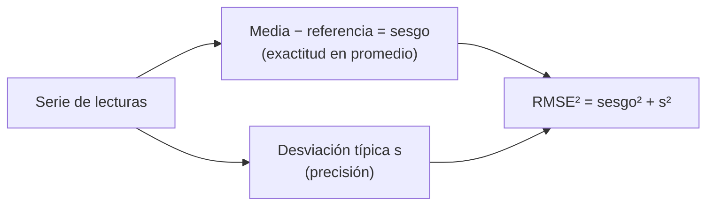

# B13-C03 — Exactitud frente a precisión

<!-- nav:top -->
[🏠 Programa](../../../../README.md) · [📚 Bloque B13](../../../tronco-comun/B13-metrologia-tiempo-y-mediciones-cientificas.md) · [← Anterior: B13-C02 — Dimensiones y trazabilidad](../B13-C02-dimensiones-y-trazabilidad/CLASE.md) · [Siguiente: B13-C04 — Errores sistemáticos y aleatorios →](../B13-C04-errores-sistematicos-y-aleatorios/CLASE.md)
<!-- /nav -->

## 1. Ubicación, nivel y alcance

Tercera clase del bloque B13. En [C02](../B13-C02-dimensiones-y-trazabilidad/CLASE.md) viste cómo se vincula una medida con un patrón. Ahora distingues dos cualidades que en el lenguaje cotidiano se confunden: **exactitud** y **precisión**. Nivel N2. Aprenderás sus definiciones metrológicas, sus medidas numéricas (sesgo, desviación típica, error cuadrático medio) y su relación exacta. No separas todavía las causas del error (C04) ni calculas incertidumbres combinadas (C12–C13).

## 2. Por qué esta clase existe

Un telémetro láser que mide la distancia a un reflector de prueba puede dar lecturas muy agrupadas pero todas desplazadas: es repetible y, aun así, está mal. Otro puede dar lecturas dispersas que, en promedio, caen sobre el valor correcto. Elegir uno de los dos, o decidir cómo mejorarlo, exige saber **qué cualidad** le falta.

La decisión central: **¿mi instrumento falla por estar desplazado, por estar disperso, o por ambas cosas, y cómo lo cuantifico?**

## 3. Lo que podrás hacer al terminar

1. Definir exactitud, veracidad (*trueness*) y precisión con el vocabulario internacional.
2. Calcular sesgo, desviación típica y error cuadrático medio de una serie.
3. Clasificar un instrumento en uno de cuatro casos (exacto y preciso, solo preciso, solo exacto en promedio, ni lo uno ni lo otro).
4. Aplicar la identidad `RMSE² = sesgo² + s²`.
5. Explicar por qué muchas lecturas no corrigen un sesgo.
6. Redactar una conclusión sobre un instrumento con sus cifras.

La evidencia es la **tabla de cuatro instrumentos** del ejercicio 12 (sección 20).

## 4. Con qué llegas y cómo comprobarlo

Necesitas media, desviación típica y raíz cuadrada ([B12-C01](../../../tronco-comun/B12-probabilidad-estadistica-e-incertidumbre.md) o [B01-C18](../../B01/B01-C18-incertidumbre-y-errores-elementales/CLASE.md)). Cinco preguntas:

1. Media de `9,8; 10,1; 10,0; 10,1`.
2. ¿Qué mide la desviación típica?
3. Calcula `√(0,3² + 0,4²)`.
4. Si el valor correcto es 10 y mides 10,3, ¿cuál es el error?
5. ¿Qué pasa con la media si todas las lecturas se desplazan 0,2?

<details>
<summary>Ver respuestas</summary>

1. `10,0`. 2. Cuánto se dispersan los datos alrededor de su media. 3. `0,5`. 4. `+0,3`. 5. La media también se desplaza 0,2.
</details>

Con cuatro o cinco aciertos, sigue; si no, repasa B01-C18.

## 5. Un caso real (con datos sintéticos): el telémetro y el reflector

Un reflector de prueba está a `1000,000 m` de un telémetro, una distancia de referencia conocida por construcción en este ejemplo. Cuatro instrumentos simulados miden esa distancia 2000 veces cada uno. Los datos son **sintéticos**: la verdad es conocida porque la fijamos nosotros, algo que en un caso real solo se logra con un patrón de referencia (C02). Este es el **ejemplo conductor**: con la verdad a la vista, se ve qué falla en cada aparato.

## 6. Vocabulario

La **exactitud de medida** es la cercanía entre un valor medido y un valor verdadero del mensurando (S1, 2.13); no es una cantidad, y una medida es «más exacta» cuando su error es menor. La **veracidad** es la cercanía entre el promedio de infinitas réplicas y un valor de referencia (S1, 2.14). La **precisión de medida** es la cercanía entre indicaciones obtenidas por mediciones repetidas bajo condiciones especificadas (S1, 2.15); se expresa con una desviación típica o una varianza. El **error de medida** es el valor medido menos un valor de referencia (S1, 2.16). El **sesgo** es la estimación de un error sistemático (S1, 2.18). La **desviación típica `s`** de `n` lecturas es `√[Σ(xᵢ − x̄)²/(n−1)]`. El **error cuadrático medio (RMSE)** es `√[Σ(xᵢ − x_ref)²/n]`.

## 7. Modelo mental: la diana

Una diana: el centro es el valor verdadero. Los disparos agrupados lejos del centro son **precisos y poco veraces**; los dispersos alrededor del centro son **veraces en promedio y poco precisos**; agrupados en el centro, ambas cosas; dispersos y desplazados, ninguna.



*Descripción textual:* de una serie salen dos cantidades independientes, el sesgo y la desviación típica; juntas componen el error cuadrático medio.

Analogía: la diana. Su límite: en una diana el centro se ve; en una medición real **no se conoce la verdad** y el sesgo solo se estima comparando con un patrón.

## 8. La explicación, paso a paso

### 8.1 Dos cantidades, dos preguntas

El **sesgo** responde «¿en promedio, dónde caigo respecto de la referencia?»; la **desviación típica** responde «¿cuánto se agrupan mis lecturas entre sí?». Son independientes: se puede tener una sin la otra.

### 8.2 Los cuatro casos

Con la verdad de 1000,000 m: **A**: sesgo `0`, dispersión `0,050 m` (veraz en promedio, poco preciso). **B**: sesgo `+0,200 m`, dispersión `0,005 m` (muy preciso, nada veraz). **C**: sesgo `+0,003 m`, dispersión `0,005 m` (ambas buenas). **D**: sesgo `+0,200 m`, dispersión `0,050 m` (ninguna).

### 8.3 Cómo se estima cada cosa

Con `n` lecturas: `x̄ = Σxᵢ/n`; sesgo estimado `= x̄ − x_ref`; `s` como arriba; RMSE como en 6. La estimación del sesgo tiene ella misma una incertidumbre de `s/√n`: con 2000 lecturas y `s = 0,05 m`, `0,001 m`.

### 8.4 La identidad del error cuadrático

Si en la fórmula de la desviación se usa divisor `n` (la llamamos `s_pob`), se cumple **exactamente**: `RMSE² = sesgo² + s_pob²`. Se demuestra desarrollando `(xᵢ − x_ref)² = (xᵢ − x̄)² + 2(xᵢ − x̄)(x̄ − x_ref) + (x̄ − x_ref)²` y observando que la suma del término cruzado es cero. Consecuencia: **el error total es la composición en cuadratura de un componente de sesgo y uno de dispersión**; si uno domina, mejorar el otro no ayuda.

### 8.5 Promediar no corrige un sesgo

Con más lecturas, `s/√n` disminuye, pero el sesgo permanece: `RMSE → |sesgo|`. En el instrumento B, el RMSE `0,2002 m` está dominado por el sesgo; lo correcto es **calibrar** (C05), no repetir más.

### 8.6 Qué decir de un instrumento

Se declaran ambas cantidades, la referencia y el número de lecturas. No se escribe «el instrumento tiene una exactitud de 0,05 m» como si la exactitud fuera un número (lo desaconseja la propia definición, S1, 2.13, nota 1); se escribe «sesgo `+0,200 m`, desviación típica `0,005 m` respecto a la referencia, n = 2000».

## 9. Magnitudes, símbolos y unidades

| Símbolo | Qué es | Unidad | Nota |
|---|---|---|---|
| `xᵢ` | lectura i | m | `i = 1…n` |
| `x_ref` | valor de referencia | m | 1000,000 (sintético) |
| `x̄` | media | m | |
| `sesgo` | `x̄ − x_ref` | m | puede ser negativo |
| `s` | desviación típica (divisor `n−1`) | m | |
| `RMSE` | error cuadrático medio | m | |
| `n` | número de lecturas | — | 2000 |

## 10. Convenciones y referencias

Se usa el signo `sesgo = media − referencia`. El ruido simulado es gaussiano e independiente, con semilla fija. En los resultados se citan los valores con la cifra que justifica el error de estimación (`s/√n`).

## 11. De dónde sale lo que afirmamos

| ID | Fuente | Localizador | Respalda | Estado |
|---|---|---|---|---|
| S1 | JCGM 200:2012, *International vocabulary of metrology (VIM)*, 3.ª ed., términos 2.13–2.18 | https://www.bipm.org/documents/20126/2071204/JCGM_200_2012.pdf | Definiciones de exactitud, veracidad, precisión, error y sesgo | Texto extraído del PDF el 2026-11-05 |
| S2 | JCGM 100:2008 (GUM), §4.2.3 | https://www.bipm.org/documents/20126/2071204/JCGM_100_2008_E.pdf | Varianza de la media `σ²/n` | Texto extraído del PDF el 2026-11-05 |

Límites: todos los datos de instrumentos son **sintéticos**; la identidad del RMSE es un resultado algebraico, no de una fuente; en S2 se usa únicamente la varianza de la media, `σ²/n`.

## 12. Cómo ver el sesgo y la dispersión

Equivalente accesible a una diana, con los resultados reales del laboratorio:

| Caso | Sesgo (m) | s (m) | RMSE (m) | Lectura |
|---|---|---|---|---|
| A | 0,0013 | 0,0504 | 0,0504 | veraz, poco preciso |
| B | 0,2002 | 0,0050 | 0,2002 | preciso, no veraz |
| C | 0,0029 | 0,0049 | 0,0057 | ambas |
| D | 0,1999 | 0,0516 | 0,2064 | ninguna |

Descripción larga: en A y D el RMSE está dominado por `s` o por el sesgo respectivamente; en B y C la dispersión es diez veces menor que en A, pero solo C tiene sesgo pequeño.

## 13. Ejemplo trabajado: caso D

**Paso 1 · Datos.** Sesgo verdadero `+0,200 m`, `σ = 0,050 m`, `n = 2000`.

**Paso 2 · Estimación.** Resultado del laboratorio: sesgo `0,1999 m`, `s = 0,0516 m`.

**Paso 3 · Identidad.** `RMSE² = 0,1999² + 0,0516² = 0,04262`, `RMSE = 0,2064 m` ✓ (usa `s_pob` ≈ `s` con n grande).

**Paso 4 · Incertidumbre de la estimación.** `s/√n = 0,0516/44,7 = 0,0012 m`: el sesgo estimado es `0,200 ± 0,001 m`.

**Paso 5 · Diagnóstico.** El sesgo (`0,20 m`) es cuatro veces mayor que la dispersión (`0,05 m`): corregir el sesgo con un patrón reduciría el RMSE de `0,206` a `≈ 0,05 m`. Medir más veces apenas ayudaría.

## 14. Distintas formas de evaluar un instrumento

**Sesgo y desviación típica por separado:** diagnostican qué mejorar. **RMSE:** un solo número para comparar instrumentos cuando importa el error total. **Gráfico de lecturas contra referencia:** detecta patrones que el resumen oculta. Las tres usan la misma serie y deben ser coherentes por la identidad de 8.4.

## 15. Práctica guiada

**Ejercicio 1 · con los pasos indicados.** Con `x = (1000,18; 1000,22; 1000,20; 1000,24; 1000,16)` y referencia `1000,000`, calcula la media, el sesgo y `s`. *Pasos:* 8.3.

<details><summary>Solución comentada</summary>

Media `1000,200`; sesgo `+0,200`; desviaciones `−0,02; +0,02; 0; +0,04; −0,04`; suma de cuadrados `0,004`; `s = √(0,004/4) = 0,0316 m`. Preciso, no veraz.
</details>

**Ejercicio 2 · con una pista.** Con los mismos datos calcula el RMSE y verifica la identidad. *Pista:* `s_pob` usa divisor `n`.

<details><summary>Solución comentada</summary>

Suma de `(xᵢ − x_ref)²`: `0,0324 + 0,0484 + 0,04 + 0,0576 + 0,0256 = 0,204`; `RMSE² = 0,204/5 = 0,0408`; `RMSE = 0,2020`. Identidad: `0,2² + 0,004/5 = 0,04 + 0,0008 = 0,0408` ✓ (8.4).
</details>

**Ejercicio 3 · casi autónomo.** Clasifica los cuatro casos A–D según sesgo y dispersión (sección 12) y di cuál recalibrarías.

<details><summary>Solución comentada</summary>

B y D (sesgo grande): recalibrar; A necesita más precisión (mejor detector o más promediado); C ya sirve (8.2, 8.5).
</details>

## 16. Práctica autónoma, transferencia e integrador

**Ejercicio 4.** ¿Cuántas lecturas harían falta para que `s/√n` del caso A sea `0,001 m`?

<details><summary>Solución comentada</summary>

`√n = 0,05/0,001 = 50`, `n = 2500` (8.3).
</details>

**Ejercicio 5.** En el caso B, ¿cuánto bajaría el RMSE con 10 000 lecturas en vez de 2000?

<details><summary>Solución comentada</summary>

Casi nada: seguiría `≈ 0,200 m` porque domina el sesgo (8.5).
</details>

**Ejercicio 6.** Un fabricante escribe «exactitud: 0,05 m». ¿Qué le objetas y qué le pedirías?

<details><summary>Solución comentada</summary>

La exactitud no es un número (S1, 2.13); pedir sesgo y desviación típica con su referencia y `n`, y sus condiciones (8.6).
</details>

**Ejercicio 7.** Si todas las lecturas se desplazan `+0,5 m`, ¿cómo cambian sesgo, `s` y RMSE?

<details><summary>Solución comentada</summary>

El sesgo aumenta `0,5 m`; `s` no cambia (la dispersión es invariante a un desplazamiento); el RMSE aumenta según la identidad.
</details>

**Ejercicio 8.** Dos instrumentos con RMSE iguales de `0,05 m`: uno con sesgo `0,05` y `s ≈ 0`; el otro con sesgo `0` y `s = 0,05`. ¿Cuál es más fácil de mejorar y por qué?

<details><summary>Solución comentada</summary>

El primero: un sesgo constante se corrige restándolo tras una calibración; la dispersión solo baja con mejor instrumento o promediando (8.5).
</details>

**Ejercicio 9 · transferencia.** Un altímetro sintético de una sonda mide `1000,0 m` sobre un terreno de referencia y da lecturas con sesgo `+3,0 m` y `s = 0,4 m`. Calcula el RMSE y decide si promediar 100 lecturas ayuda.

<details><summary>Solución comentada</summary>

`RMSE = √(3² + 0,4²) = 3,03 m`. Con `n = 100`, `s/√n = 0,04 m` pero el sesgo `3 m` sigue: no ayuda; hay que calibrar.
</details>

**Ejercicio 10 · transferencia.** Un reloj de a bordo se compara 50 veces con un patrón y da una diferencia media de `+12 ns` con `s = 3 ns`. ¿Qué sesgo estimas y con qué incertidumbre?

<details><summary>Solución comentada</summary>

Sesgo `+12 ns`; incertidumbre de la estimación `3/√50 = 0,42 ns`; informe: `+12,0 ± 0,4 ns` (n = 50). Dato **sintético**.
</details>

**Ejercicio 11 · transferencia.** Un compañero dice «mi instrumento es muy preciso porque da siempre 1000,20». ¿Qué falta para afirmar que es exacto?

<details><summary>Solución comentada</summary>

Comparar con una referencia: si la verdad es `1000,000`, el sesgo es `0,20 m`. Es preciso, no veraz. Sin referencia no se puede hablar de exactitud.
</details>

**Ejercicio 12 · integrador.** Elabora tu *tabla de cuatro instrumentos*: para cada caso sesgo, `s`, RMSE, verificación de la identidad con `s_pob`, diagnóstico (qué mejorar) y una frase de reporte correcta según 8.6; añade el cálculo de `n` necesario para fijar el sesgo a `±0,001 m`.

<details><summary>Solución modelo</summary>

Tabla de la sección 12 ampliada con la columna de identidad (`RMSE² − sesgo² − s_pob²` ≈ 0) y diagnósticos A «más precisión», B «calibrar», C «sin acción», D «calibrar y luego precisión»; para `±0,001 m` con `s = 0,05`: `n ≈ 2500`.
</details>

## 17. Laboratorio: sesgo y dispersión

El script [sesgo_y_dispersion.py](sesgo_y_dispersion.py) simula los cuatro instrumentos con semilla fija, calcula las cantidades de 8.3, **comprueba la identidad de 8.4 con tolerancia 10⁻⁹** y verifica que el sesgo estimado se acerca al verdadero con error típico `σ/√n`.

**Datos:** sintéticos (verdad 1000,000 m). **Predice antes de ejecutar:** ¿qué RMSE esperas en el caso D? (`√(0,2² + 0,05²) = 0,206`.) **Ejecución del 2026-11-05 (Python 3.12.9):**

```text
Python 3.12.9 (biblioteca estandar)
caso  sesgo_verd  sigma_verd | sesgo_est(m)  s(m)     RMSE(m)
  A       0.000      0.050   |    0.0013     0.0504    0.0504
  B       0.200      0.005   |    0.2002     0.0050    0.2002
  C       0.003      0.005   |    0.0029     0.0049    0.0057
  D       0.200      0.050   |    0.1999     0.0516    0.2064
Pruebas superadas.
```

```bash
python programa/clases/B13/B13-C03-exactitud-frente-a-precision/sesgo_y_dispersion.py
```

**Límites:** ruido gaussiano e independiente; verdad conocida por construcción.

## 18. Errores frecuentes y cómo corregirlos

**Usar «preciso» y «exacto» como sinónimos.** Se corrige con el ejercicio 11.

**Creer que más lecturas corrigen un sesgo.** Se corrige con los ejercicios 5 y 9.

**Dar la exactitud como un número único.** Se corrige con el ejercicio 6.

**Declarar sesgo sin indicar la referencia.** Se corrige con el ejercicio 10.

**Ignorar la incertidumbre de la propia estimación del sesgo.** Se corrige en el paso 4 del ejemplo trabajado.

## 19. Cómo sabrás que vas bien

Tras 8.2: ¿clasificas los casos A–D? Si no, ejercicio 3. Tras 8.4: ¿verificas la identidad con datos? Si no, ejercicio 2. Tras 8.5: ¿por qué promediar no corrige el sesgo? Si dudas, ejercicio 5. Tras el laboratorio: ¿por qué la identidad usa `s_pob` y no `s`? (porque la identidad algebraica exacta exige divisor `n`).

## 20. Qué entregas y cómo se evalúa

El producto es tu **tabla de cuatro instrumentos** (ejercicio 12).

| Criterio | Inicial | En desarrollo | Logrado | Destacado |
|---|---|---|---|---|
| Definiciones | Las confunde | Parciales | Exactitud, veracidad, precisión | Cita el vocabulario |
| Cálculo | Con errores | Sin identidad | Sesgo, `s` y RMSE correctos | Verifica la identidad |
| Diagnóstico | Ausente | Genérico | Qué mejorar y por qué | Estima `n` necesario |
| Reporte | Un solo número | Sin referencia | Sesgo y `s` con referencia y `n` | Con incertidumbre de la estimación |
| Fuentes | Sin fuente | Sin fecha | Con localizador y fecha | Rotula sintético |

**Condiciones críticas (no se compensan con promedio):** no decir que la media corrige el sesgo; indicar la referencia; rotular los datos sintéticos.

## 21. Ética, seguridad y límites

Declarar solo la precisión de un instrumento puede ocultar un sesgo que invalide una decisión (distancia, altitud, hora). Los instrumentos de esta clase son simulados: no representan ningún aparato real. Accesibilidad: tablas equivalentes a la diana, fórmulas en texto, ejercicios sin conexión.

## 22. Para cerrar y seguir

Exactitud es cercanía a la verdad; precisión es agrupamiento; el sesgo y la desviación típica los miden por separado y se componen en cuadratura en el RMSE; promediar reduce la dispersión pero no el sesgo. Queda una pregunta: ¿de dónde viene cada componente y cómo se separan en la práctica?

**Glosario español–inglés.** exactitud · *accuracy*; veracidad · *trueness*; precisión · *precision*; sesgo · *bias*; error cuadrático medio · *root-mean-square error*; desviación típica · *standard deviation*; réplica · *replicate*.

**Continuidad.** B13-C04 reutiliza tu capacidad de **separar sesgo y dispersión** para distinguir errores sistemáticos y aleatorios.

**Referencias:** ver sección 11.

<!-- nav:bottom -->
---

[← Anterior: B13-C02 — Dimensiones y trazabilidad](../B13-C02-dimensiones-y-trazabilidad/CLASE.md) · [📚 Bloque B13](../../../tronco-comun/B13-metrologia-tiempo-y-mediciones-cientificas.md) · [Siguiente: B13-C04 — Errores sistemáticos y aleatorios →](../B13-C04-errores-sistematicos-y-aleatorios/CLASE.md)
<!-- /nav -->
