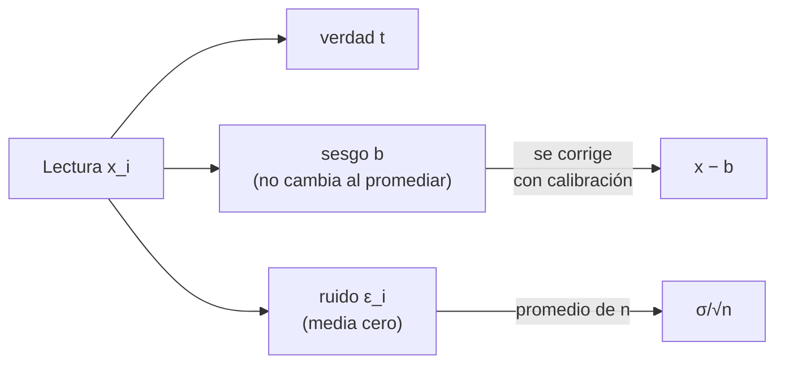

# B13-C04 — Errores sistemáticos y aleatorios

<!-- nav:top -->
[🏠 Programa](../../../../README.md) · [📚 Bloque B13](../../../tronco-comun/B13-metrologia-tiempo-y-mediciones-cientificas.md) · [← Anterior: B13-C03 — Exactitud frente a precisión](../B13-C03-exactitud-frente-a-precision/CLASE.md) · [Siguiente: B13-C05 — Calibración instrumental →](../../../tronco-comun/B13-metrologia-tiempo-y-mediciones-cientificas.md#b13-c05)
<!-- /nav -->

## 1. Ubicación, nivel y alcance

Cuarta clase del bloque B13. En [C03](../B13-C03-exactitud-frente-a-precision/CLASE.md) separaste sesgo y dispersión como cantidades de una serie. Aquí estudias **de dónde vienen**: los errores **sistemáticos** (que se repiten igual o varían de forma predecible) y los **aleatorios** (que cambian de lectura en lectura), cómo se comportan al promediar y qué se hace con cada uno. Nivel N2. No calculas presupuestos completos (C13) ni calibras (C05).

## 2. Por qué esta clase existe

Una estación mide el instante de llegada de un pulso de una baliza. Cada lectura fluctúa por ruido electrónico, y además hay un retardo constante del cable que nadie incluyó. El analista promedia mil lecturas y obtiene una cifra muy estable… y errónea. Entender la diferencia permite saber **cuándo promediar y cuándo calibrar**.

La decisión central: **¿este error se reduce tomando más datos o exige corregir el procedimiento?**

## 3. Lo que podrás hacer al terminar

1. Definir error aleatorio y error sistemático con el vocabulario internacional.
2. Explicar por qué el promedio de `n` lecturas reduce el ruido como `1/√n`.
3. Explicar por qué el promedio no reduce un sesgo constante.
4. Distinguir sesgo constante de deriva predecible.
5. Calcular el error total de un promedio con sesgo y ruido.
6. Decidir entre promediar, calibrar o rediseñar el procedimiento.

La evidencia es el **diagnóstico de una serie de medidas** del ejercicio 12 (sección 20).

## 4. Con qué llegas y cómo comprobarlo

Necesitas sesgo, desviación típica y RMSE ([C03](../B13-C03-exactitud-frente-a-precision/CLASE.md)). Cinco preguntas:

1. ¿Qué mide el sesgo?
2. Si `s = 0,04` y `n = 16`, ¿cuánto es `s/√n`?
3. ¿Es igual `RMSE` que desviación típica? ¿Cuándo coinciden?
4. ¿Qué es una referencia en una medición?
5. Calcula `√(0,015² + 0,01²)`.

<details>
<summary>Ver respuestas</summary>

1. La diferencia entre la media y la referencia. 2. `0,01`. 3. No; coinciden si el sesgo es cero. 4. Un valor aceptado con el que se compara. 5. `0,018`.
</details>

Con cuatro o cinco aciertos, sigue; si no, repasa C03.

## 5. Un caso real (con datos sintéticos): el pulso de la baliza

La verdad de la llegada del pulso es `12,500 000 ms`. Las lecturas tienen ruido gaussiano de `σ = 0,040 ms` y un retardo de cable `b = 0,015 ms`, desconocido para quien mide. Los datos son **sintéticos**, de modo que conocemos la verdad y podemos ver qué hace el promedio. Es el **ejemplo conductor**.

## 6. Vocabulario

El **error de medida** es el valor medido menos un valor de referencia (S1, 2.16). El **error sistemático** es el componente que en réplicas permanece constante o varía de forma predecible (S1, 2.17). El **error aleatorio** es el componente que varía de forma impredecible en réplicas (VIM 2.19; aquí se usa su sentido habitual). El **sesgo** es la estimación de un error sistemático (S1, 2.18). La **deriva** es una variación sistemática lenta, por ejemplo con el tiempo o la temperatura. La **desviación típica de la media** de `n` lecturas independientes es `σ/√n` (S2, 4.2.3). La **corrección** es el valor que se suma para compensar un sesgo conocido.

## 7. Modelo mental: la señal, la mancha y el decalaje

Cada lectura es `xᵢ = t + b + εᵢ`: la verdad `t`, un decalaje fijo `b` (sistemático) y una mancha aleatoria `εᵢ` de media cero. Promediar «lava la mancha» pero no el decalaje.



*Descripción textual:* una lectura se descompone en verdad, sesgo y ruido; el promedio solo reduce el ruido; el sesgo se elimina con una corrección obtenida de un patrón.

Analogía: una balanza con la tara mal puesta: pesar mil veces da un valor estable, pero siempre mal. Su límite: en una balanza la tara se ve; en una cadena electrónica el sesgo puede ser invisible hasta compararla con un patrón.

## 8. La explicación, paso a paso

### 8.1 Descomposición

`xᵢ = t + b + εᵢ`, con `E[εᵢ] = 0` y varianza `σ²`. La media de `n` lecturas es `x̄ = t + b + ε̄`. Su esperanza es `t + b` y su varianza `σ²/n` (S2, 4.2.3, para lecturas independientes).

### 8.2 Qué hace el promedio

La desviación típica de `x̄` baja como `σ/√n`: con `σ = 0,040 ms`: `n = 1 → 0,040`, `n = 4 → 0,020`, `n = 16 → 0,010`, `n = 64 → 0,005`, `n = 256 → 0,0025 ms`. Cuadruplicar las lecturas solo reduce el ruido a la mitad; cada mejora cuesta más que la anterior.

### 8.3 Qué no hace

La esperanza de `x̄` es `t + b`: el decalaje `b = 0,015 ms` permanece para cualquier `n`. El error total esperado es `√(b² + σ²/n)`. Con `n = 256` es `√(0,015² + 0,0025²) = 0,0152 ms`: casi todo es sesgo. Pasar de 256 a 10 000 lecturas no lo mejora de forma útil.

### 8.4 Sesgo constante y deriva

Un **sesgo constante** se corrige restando `b`. Una **deriva** (por ejemplo, el cable cambia con la temperatura) obliga a un modelo `b(T)` y a registrar la variable de influencia. Si no se registra, la deriva se confunde con ruido y se incrementa la dispersión aparente.

### 8.5 Cómo se descubre un sesgo

Un sesgo no se detecta con repeticiones bajo las mismas condiciones. Se descubre: (a) comparando con un **patrón** de valor conocido; (b) midiendo la misma magnitud con **otro método** o instrumento (C18); o (c) cambiando **condiciones** (otro cable, otro operador, otra temperatura). Si dos métodos independientes discrepan más que su dispersión, hay un sesgo en alguno.

### 8.6 Estimar y corregir

Con un patrón de verdad conocida y `m` lecturas, `b̂ = x̄ − t_patrón`, con incertidumbre `σ/√m`. La corrección resultante hereda esa incertidumbre; **no elimina la incertidumbre, la sustituye por una menor**. En el laboratorio, `b̂ = 0,0156 ms` con `m = 400`, frente al valor verdadero `0,015 ms`.

## 9. Magnitudes, símbolos y unidades

| Símbolo | Qué es | Unidad | Valor del ejemplo |
|---|---|---|---|
| `t` | instante verdadero | ms | 12,500 000 (sintético) |
| `b` | sesgo (retardo de cable) | ms | 0,015 |
| `εᵢ` | ruido de la lectura i | ms | media 0 |
| `σ` | desviación típica del ruido | ms | 0,040 |
| `n` | lecturas promediadas | — | 1…256 |
| `σ/√n` | desviación típica de la media | ms | según `n` |
| `b̂` | sesgo estimado con patrón | ms | 0,0156 |

## 10. Convenciones y referencias

Tiempos en milisegundos desde un origen declarado. El ruido es blanco, gaussiano e independiente entre lecturas; si no lo fuera, la ley `1/√n` no se cumple. Los datos son **sintéticos** y la semilla del script es fija.

## 11. De dónde sale lo que afirmamos

| ID | Fuente | Localizador | Respalda | Estado |
|---|---|---|---|---|
| S1 | JCGM 200:2012, *International vocabulary of metrology (VIM)*, 3.ª ed., términos 2.16, 2.17 y 2.18 | https://www.bipm.org/documents/20126/2071204/JCGM_200_2012.pdf | Definiciones de error, error sistemático y sesgo | Texto extraído del PDF el 2026-11-05 |
| S2 | JCGM 100:2008 (GUM), §4.2.3 | https://www.bipm.org/documents/20126/2071204/JCGM_100_2008_E.pdf | Varianza de la media `σ²/n` | Texto extraído del PDF el 2026-11-05 |

Límites: la definición de error aleatorio del VIM (2.19) no se transcribió en la sesión; se usa su sentido habitual. Los datos son **sintéticos**.

## 12. Cómo ver el efecto del promedio

Equivalente accesible a una gráfica de error contra `n` (resultados del laboratorio, 4000 repeticiones):

| `n` | `σ/√n` teórico (ms) | Dispersión simulada de la media (ms) | Media de medias − `t` (ms) |
|---|---|---|---|
| 1 | 0,04000 | 0,04017 | 0,01499 |
| 4 | 0,02000 | 0,01952 | 0,01523 |
| 16 | 0,01000 | 0,00994 | 0,01500 |
| 64 | 0,00500 | 0,00503 | 0,01510 |
| 256 | 0,00250 | 0,00247 | 0,01498 |

Descripción larga: la dispersión baja a la mitad cada vez que `n` se cuadruplica; la última columna se mantiene en `0,015 ms`: el sesgo no se mueve.

## 13. Ejemplo trabajado: el pulso con 256 lecturas

**Paso 1 · Datos.** `t = 12,500 ms`; `b = 0,015 ms`; `σ = 0,040 ms`; `n = 256`.

**Paso 2 · Ruido de la media.** `σ/√n = 0,040/16 = 0,0025 ms`.

**Paso 3 · Error total esperado.** `√(0,015² + 0,0025²) = 0,01521 ms`.

**Paso 4 · Con patrón.** Con `m = 400` lecturas de un pulso de verdad conocida, `b̂ = 0,0156 ms`, con incertidumbre `0,040/20 = 0,002 ms`. Restar `b̂` deja un sesgo residual con incertidumbre `0,002 ms` y un ruido de la media de `0,0025 ms`; en cuadratura, `√(0,002² + 0,0025²) = 0,0032 ms` en vez de `0,0152`.

**Paso 5 · Sentido.** La calibración mejora casi cinco veces el resultado; seguir promediando no. Con cuatro cifras de `σ`, el resultado merece dos o tres.

## 14. Distintas formas de reducir el error

**Promediar:** reduce el error aleatorio, cuesta tiempo. **Calibrar con un patrón:** reduce el sistemático, exige un patrón trazable (C02). **Cambiar de método:** revela sesgos ocultos (C18). **Mejorar el instrumento:** reduce `σ` de raíz. Se elige según qué componente domina (8.3).

## 15. Práctica guiada

**Ejercicio 1 · con los pasos indicados.** Con `σ = 0,040 ms`, calcula `σ/√n` para `n = 100` y `n = 400`. *Pasos:* 8.2.

<details><summary>Solución comentada</summary>

`0,040/10 = 0,0040 ms`; `0,040/20 = 0,0020 ms`. Cuatro veces más lecturas: la mitad del ruido.
</details>

**Ejercicio 2 · con una pista.** Con `b = 0,015` y `σ = 0,040`, ¿a partir de qué `n` el ruido de la media baja de `b`? *Pista:* iguala `σ/√n = b`.

<details><summary>Solución comentada</summary>

`√n = 0,040/0,015 = 2,667`; `n = 7,1`. A partir de unas 8 lecturas el sesgo supera al ruido de la media (8.3).
</details>

**Ejercicio 3 · casi autónomo.** Calcula el error total esperado para `n = 16`.

<details><summary>Solución comentada</summary>

`√(0,015² + 0,010²) = √(0,000225 + 0,0001) = 0,01803 ms` (8.3).
</details>

## 16. Práctica autónoma, transferencia e integrador

**Ejercicio 4.** Clasifica como sistemático o aleatorio: (a) el cable añade siempre 0,015 ms; (b) el ruido térmico del amplificador; (c) el reloj se adelanta 2 ns cada hora; (d) la temperatura del cable sube y cambia su retardo.

<details><summary>Solución comentada</summary>

(a) sistemático constante; (b) aleatorio; (c) sistemático con deriva predecible; (d) sistemático dependiente de una variable de influencia (8.4).
</details>

**Ejercicio 5.** ¿Cuántas lecturas se necesitan para que `σ/√n = 0,001 ms`?

<details><summary>Solución comentada</summary>

`√n = 40`, `n = 1600`.
</details>

**Ejercicio 6.** Tras restar `b̂ = 0,0156 ms`, ¿cuál es el sesgo residual esperado y su incertidumbre?

<details><summary>Solución comentada</summary>

Residual `0,015 − 0,0156 = −0,0006 ms`, con incertidumbre `0,040/√400 = 0,002 ms`: es compatible con cero (8.6).
</details>

**Ejercicio 7.** Un reloj se adelanta `2 ns/h`. ¿Qué error acumula en 24 h y cómo lo corriges?

<details><summary>Solución comentada</summary>

`48 ns` si la deriva es lineal. Se corrige con un modelo `b(t) = 2 ns/h · t` determinado por comparación con un patrón, y se vuelve a verificar periódicamente (8.4).
</details>

**Ejercicio 8.** Dos métodos independientes miden el mismo pulso: `12,515 ± 0,003 ms` y `12,500 ± 0,003 ms` (±: desviación típica de la media). ¿Hay un sesgo?

<details><summary>Solución comentada</summary>

La diferencia `0,015` es `0,015/√(0,003²+0,003²) = 3,5` veces su dispersión: improbable por azar; hay un sesgo en al menos uno (8.5).
</details>

**Ejercicio 9 · transferencia.** Un sensor de actitud sintético da la dirección del Sol con ruido `σ = 0,05°` y un sesgo de montaje de `0,20°`. Calcula el error total tras promediar 100 lecturas y qué haría falta para bajarlo.

<details><summary>Solución comentada</summary>

`σ/√100 = 0,005°`; total `√(0,20² + 0,005²) = 0,2006°`. Promediar no sirve: hay que calibrar el montaje contra una referencia.
</details>

**Ejercicio 10 · transferencia.** Un compañero dice «con 10⁶ lecturas mi error es 10⁻³ del ruido, así que mi dato es exacto». Responde con 8.3.

<details><summary>Solución comentada</summary>

Reduce el ruido de la media a `σ/1000`, pero no el sesgo; el dato puede seguir desplazado. La exactitud exige comprobar el sesgo con un patrón.
</details>

**Ejercicio 11 · transferencia.** Propón un procedimiento para detectar un sesgo de cable en la estación sin patrón externo.

<details><summary>Solución comentada</summary>

Medir el mismo pulso con dos cables de longitud distinta (o con otro instrumento) y comparar: si la diferencia excede la dispersión conjunta, hay sesgo; la diferencia de longitudes conocida permite estimar el retardo por metro (8.5).
</details>

**Ejercicio 12 · integrador.** Elabora tu *diagnóstico de una serie de medidas*: con la tabla de la sección 12, el error total para cada `n`, el `n` a partir del cual domina el sesgo, el sesgo estimado con un patrón y la decisión (promediar, calibrar o rediseñar), con datos rotulados como sintéticos.

<details><summary>Solución modelo</summary>

Tabla de error total (`0,0427`, `0,0250`, `0,0180`, `0,0163`, `0,0152` ms para `n` = 1, 4, 16, 64, 256); el sesgo domina desde `n ≈ 8`; `b̂ = 0,0156 ± 0,002 ms`; decisión: calibrar con patrón y luego, si hace falta, promediar.
</details>

## 17. Laboratorio: el promedio y el sesgo

El script [promedio_y_sesgo.py](promedio_y_sesgo.py) repite 4000 veces el experimento para cada `n`, comprueba que la dispersión de la media coincide con `σ/√n` (tolerancia 8 %) y que la media de las medias coincide con `t + b`, y estima el sesgo con un patrón.

**Datos:** sintéticos. **Predice antes de ejecutar:** ¿qué valor tendrá «media de medias − t» para `n = 256`? (`0,015`.) **Ejecución del 2026-11-05 (Python 3.12.9):**

```text
Python 3.12.9 (biblioteca estandar)
   n | sd de la media (sim) | sigma/sqrt(n) | media de medias - t (ms)
   1 |              0.04017 |       0.04000 |    0.01499
   4 |              0.01952 |       0.02000 |    0.01523
  16 |              0.00994 |       0.01000 |    0.01500
  64 |              0.00503 |       0.00500 |    0.01510
 256 |              0.00247 |       0.00250 |    0.01498
n=256: error total esperado = 0.01521 ms (sesgo 0.015 ms)
sesgo estimado con patron (n=400) = 0.01557 ms (verdadero 0.015)
Pruebas superadas.
```

```bash
python programa/clases/B13/B13-C04-errores-sistematicos-y-aleatorios/promedio_y_sesgo.py
```

**Límites:** ruido blanco e independiente; sesgo constante; resultados para esta semilla.

## 18. Errores frecuentes y cómo corregirlos

**Pensar que más lecturas siempre mejoran el resultado.** Se corrige con los ejercicios 2 y 10.

**Confundir deriva con ruido.** Se corrige con los ejercicios 4 y 7.

**Corregir un sesgo y declarar incertidumbre cero.** Se corrige en 8.6 y el ejercicio 6.

**Buscar el sesgo repitiendo en las mismas condiciones.** Se corrige con los ejercicios 8 y 11.

**Aplicar `1/√n` a lecturas correlacionadas.** Se corrige en la sección 10 y en C07, donde el ruido no siempre es blanco.

## 19. Cómo sabrás que vas bien

Tras 8.2: ¿calculas `σ/√n`? Si no, ejercicio 1. Tras 8.3: ¿encuentras cuándo el sesgo domina? Si no, ejercicio 2. Tras 8.5: ¿cómo detectarías un sesgo sin patrón? Si dudas, ejercicio 11. Tras el laboratorio: ¿qué columna de la tabla no cambia con `n` y qué significa? (la media de medias menos `t`: el sesgo).

## 20. Qué entregas y cómo se evalúa

El producto es tu **diagnóstico de una serie de medidas** (ejercicio 12).

| Criterio | Inicial | En desarrollo | Logrado | Destacado |
|---|---|---|---|---|
| Clasificación | Sin criterio | Parcial | Sistemático/aleatorio correcto | Incluye deriva y variable de influencia |
| Cálculo | Con errores | Sin error total | `σ/√n` y error total | Encuentra el `n` crítico |
| Decisión | Promediar siempre | Genérica | Calibrar o promediar con razón | Propone verificación independiente |
| Corrección | Sin incertidumbre | Con incertidumbre mal | `b̂ ± σ/√m` | Residual contrastado |
| Fuentes | Sin fuente | Sin fecha | Con localizador y fecha | Rotula sintético |

**Condiciones críticas (no se compensan con promedio):** no afirmar que promediar corrige un sesgo; declarar la incertidumbre de la corrección; rotular lo sintético.

## 21. Ética, seguridad y límites

Un sesgo oculto en una medida de tiempo o de actitud puede propagarse a una decisión de navegación; por eso se exige comparación independiente. Los datos de esta clase son simulados y no describen ninguna estación real. Accesibilidad: tablas equivalentes a gráficas, fórmulas en texto, ejercicios sin conexión.

## 22. Para cerrar y seguir

El ruido se reduce promediando como `1/√n`; el sesgo no, y se revela solo comparando con un patrón u otro método; la corrección de un sesgo sustituye una incertidumbre por otra menor. Queda una pregunta: ¿cómo se construye de forma ordenada esa corrección, es decir, cómo se **calibra** un instrumento?

**Glosario español–inglés.** error sistemático · *systematic error*; error aleatorio · *random error*; sesgo · *bias*; deriva · *drift*; corrección · *correction*; desviación típica de la media · *standard deviation of the mean*; variable de influencia · *influence quantity*.

**Continuidad.** B13-C05 reutiliza tu capacidad de **estimar un sesgo con un patrón** para construir una curva de calibración.

**Referencias:** ver sección 11.

<!-- nav:bottom -->
---

[← Anterior: B13-C03 — Exactitud frente a precisión](../B13-C03-exactitud-frente-a-precision/CLASE.md) · [📚 Bloque B13](../../../tronco-comun/B13-metrologia-tiempo-y-mediciones-cientificas.md) · [Siguiente: B13-C05 — Calibración instrumental →](../../../tronco-comun/B13-metrologia-tiempo-y-mediciones-cientificas.md#b13-c05)
<!-- /nav -->
