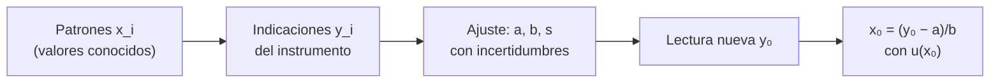

# B13-C05 — Calibración instrumental

<!-- nav:top -->
[🏠 Programa](../../../../README.md) · [📚 Bloque B13](../../../tronco-comun/B13-metrologia-tiempo-y-mediciones-cientificas.md) · [← Anterior: B13-C04 — Errores sistemáticos y aleatorios](../B13-C04-errores-sistematicos-y-aleatorios/CLASE.md) · [Siguiente: B13-C06 — Patrones de longitud y tiempo →](../B13-C06-patrones-de-longitud-y-tiempo/CLASE.md)
<!-- /nav -->

## 1. Ubicación, nivel y alcance

Quinta clase del bloque B13. En [C04](../B13-C04-errores-sistematicos-y-aleatorios/CLASE.md) viste que un sesgo se descubre y se corrige comparando con un patrón. Aquí lo formalizas: la **calibración** como procedimiento en dos pasos, la **curva de calibración lineal** ajustada por mínimos cuadrados, su incertidumbre y su **inversión** para convertir indicaciones del instrumento en valores de la magnitud. Nivel N2. Usas álgebra y estadística elementales; no tratas calibraciones no lineales ni la propagación completa (C13).

## 2. Por qué esta clase existe

Un sensor solar de una nave devuelve cuentas digitales (DN), no vatios por metro cuadrado. Para saber cuánta luz recibe hay que haberlo expuesto antes a fuentes de irradiancia conocida y haber establecido la relación entre ambas. Esa relación —con su incertidumbre— es lo que convierte un número de un convertidor en una medida física.

La decisión central: **¿qué recta describe al instrumento, con qué incertidumbre, y cuánta confianza tengo en una lectura convertida con ella?**

## 3. Lo que podrás hacer al terminar

1. Definir calibración y distinguir sus dos pasos.
2. Ajustar una recta de calibración por mínimos cuadrados.
3. Calcular la desviación residual y las incertidumbres de pendiente y ordenada.
4. Invertir la curva para estimar una magnitud desde una indicación, con su incertidumbre.
5. Explicar por qué la incertidumbre crece lejos del centro de calibración.
6. Respetar el intervalo de validez (no extrapolar).

La evidencia es la **curva de calibración con su incertidumbre** del ejercicio 12 (sección 20).

## 4. Con qué llegas y cómo comprobarlo

Necesitas la ecuación de una recta, media y desviación típica ([C04](../B13-C04-errores-sistematicos-y-aleatorios/CLASE.md)). Cinco preguntas:

1. Si `y = 50 + 2,5 x`, ¿cuánto vale `y` para `x = 100`?
2. Despeja `x` de `y = 50 + 2,5 x`.
3. Media de `100, 400, 700`.
4. ¿Qué significa un residuo?
5. Si `s = 8` y `√Sxx = 800`, ¿cuánto es `s/√Sxx`?

<details>
<summary>Ver respuestas</summary>

1. `300`. 2. `x = (y − 50)/2,5`. 3. `400`. 4. La diferencia entre el valor medido y el valor que da la recta. 5. `0,01`.
</details>

Con cuatro o cinco aciertos, sigue; si no, repasa C04.

## 5. Un caso real (con datos sintéticos): el fotodiodo del sensor solar

Un fotodiodo se expone a una lámpara patrón con siete irradiancias conocidas: `100, 250, 400, 550, 700, 850` y `1000 W/m²`. En la simulación, la respuesta verdadera es `y = 50 + 2,50 x` (DN) con ruido gaussiano de `8 DN`. Los datos son **sintéticos**. Con ellos ajustarás la recta y la usarás para convertir una lectura en irradiancia. Es el **ejemplo conductor**.

## 6. Vocabulario

La **calibración** es la operación que, bajo condiciones especificadas, establece primero una relación entre los valores de los patrones (con sus incertidumbres) y las indicaciones correspondientes (con las suyas) y luego usa esa relación para obtener un resultado de medida a partir de una indicación (S1, 2.39). La **indicación** es el valor que da el instrumento (aquí DN). La **curva de calibración** es la relación entre indicación y valor de la magnitud. Los **mínimos cuadrados ordinarios** son el método que elige la recta que minimiza la suma de los residuos al cuadrado. El **residuo** es `yᵢ − (a + b xᵢ)`. La **desviación residual** `s` estima el ruido a partir de los residuos. Un **intervalo de validez** es el rango de `x` cubierto por los patrones.

## 7. Modelo mental: una regla de dos pasos

La calibración tiene dos pasos que se invierten: **directo** (patrón → indicación: se ajusta la recta) e **inverso** (indicación → magnitud: se despeja `x`). Es como fabricar una regla a partir de marcas conocidas y luego medir con ella.



*Descripción textual:* se miden patrones y se ajusta una recta con sus incertidumbres; después, una lectura nueva se convierte en magnitud despejando la recta y se calcula la incertidumbre de ese valor.

Analogía: fabricar una regla con marcas de referencia. Su límite: una regla no cambia con el tiempo; un instrumento deriva, por lo que la calibración tiene fecha de validez (C19).

## 8. La explicación, paso a paso

### 8.1 El modelo

Se supone `y = a + b x + ε`, con `ε` de media cero y desviación `σ` constante (homocedástica), independiente entre lecturas y patrones sin error apreciable frente al ruido. Con `n` patrones se estiman `a` (ordenada: indicación cuando `x = 0`) y `b` (pendiente: sensibilidad, DN por W/m²).

### 8.2 Mínimos cuadrados

Sean `x̄` y `ȳ` las medias, `Sxx = Σ(xᵢ − x̄)²` y `Sxy = Σ(xᵢ − x̄)(yᵢ − ȳ)`. Entonces `b̂ = Sxy/Sxx` y `â = ȳ − b̂ x̄`. Es el estimador clásico de la recta de regresión; su deducción por derivación (B09) iguala a cero la derivada de la suma de residuos al cuadrado respecto de `a` y `b`.

### 8.3 Ruido e incertidumbres de los parámetros

La desviación residual es `s = √[Σrᵢ²/(n − 2)]` (se pierden dos grados de libertad por estimar `a` y `b`). Las incertidumbres típicas son `u(b̂) = s/√Sxx` y `u(â) = s √(1/n + x̄²/Sxx)`. Con los siete patrones del caso, `x̄ = 550 W/m²` y `Sxx = 630 000 (W/m²)²`. El laboratorio obtiene `â = 46,55 ± 6,01 DN`, `b̂ = 2,5036 ± 0,0096 DN/(W/m²)` y `s = 7,62 DN`. Los valores verdaderos (`50` y `2,50`) caen dentro de una desviación típica.

### 8.4 Inversión: de DN a W/m²

Para una indicación media `y₀` de `m` lecturas de una fuente desconocida: `x̂₀ = (y₀ − â)/b̂`, con `u(x̂₀) = (s/|b̂|) √(1/m + 1/n + (x̂₀ − x̄)²/Sxx)` (fórmula clásica de la calibración lineal inversa; no se consultó una fuente específica en esta clase). Se interpreta así: el primer término es el ruido de las `m` lecturas nuevas, el segundo es la incertidumbre de la recta en su centro, y el tercero crece cuando `x̂₀` se aleja del centro de calibración.

### 8.5 Lejos del centro, más incertidumbre

Con `y₀ = 1400 DN` y `m = 5`: `x̂₀ = 540,6 W/m²` con `u = 1,78 W/m²` (cerca del centro). En el extremo (`x̂₀ = 1000 W/m²`) la incertidumbre sube a `2,48 W/m²`. Por eso se eligen los patrones para cubrir el intervalo de uso, con puntos en los extremos y en el centro.

### 8.6 No extrapolar

Fuera de `[100, 1000] W/m²` no hay patrones: la relación podría ser no lineal (saturación) y la fórmula de `u` deja de ser válida. Una lectura que cae fuera se anota como «fuera de calibración» o se vuelve a calibrar con patrones que la cubran.

## 9. Magnitudes, símbolos y unidades

| Símbolo | Qué es | Unidad | Valor del ejemplo |
|---|---|---|---|
| `x` | irradiancia patrón | W/m² | 100…1000 |
| `y` | indicación | DN | |
| `a`, `b` | ordenada, pendiente | DN; DN/(W/m²) | 46,55; 2,5036 (estimados) |
| `s` | desviación residual | DN | 7,62 |
| `n`, `m` | patrones; lecturas nuevas | — | 7; 5 |
| `x̄`, `Sxx` | media y suma de cuadrados | W/m²; (W/m²)² | 550; 630 000 |
| `u(·)` | incertidumbre típica | unidad del parámetro | ver 8.3 |

## 10. Convenciones y referencias

Las indicaciones se dan en cuentas digitales (DN). Los patrones se suponen sin incertidumbre frente al ruido (hipótesis a revisar en C13). Todo resultado calibrado lleva fecha, intervalo de validez y condiciones; la calibración es un registro, no una constante universal. Los datos son **sintéticos**.

## 11. De dónde sale lo que afirmamos

| ID | Fuente | Localizador | Respalda | Estado |
|---|---|---|---|---|
| S1 | JCGM 200:2012, *International vocabulary of metrology (VIM)*, 3.ª ed., término 2.39 | https://www.bipm.org/documents/20126/2071204/JCGM_200_2012.pdf | Definición de calibración en dos pasos | Texto extraído del PDF el 2026-11-05 |
| S2 | JCGM 100:2008 (GUM), §5.1.2 | https://www.bipm.org/documents/20126/2071204/JCGM_100_2008_E.pdf | Ley de propagación de varianzas, base de las fórmulas de `u` | Texto extraído del PDF el 2026-11-05 (ecuación localizada; fórmulas de regresión no están en la GUM) |

Límites: las fórmulas de mínimos cuadrados e inversión son resultados estadísticos clásicos sin cita en esta clase; los datos son **sintéticos**.

## 12. Cómo ver la calibración

Equivalente accesible a una gráfica de dispersión con recta:

| `x` (W/m²) | `y` ideal (DN) = 50 + 2,5 x |
|---|---|
| 100 | 300 |
| 250 | 675 |
| 400 | 1050 |
| 550 | 1425 |
| 700 | 1800 |
| 850 | 2175 |
| 1000 | 2550 |

Descripción larga: puntos alineados con pendiente 2,5 DN por W/m², con una dispersión vertical de unos 8 DN; la recta ajustada pasa por el centro de los puntos `(550, ȳ)`.

## 13. Ejemplo trabajado: invertir una lectura

**Paso 1 · Datos.** `â = 46,55 DN`, `b̂ = 2,5036 DN/(W/m²)`, `s = 7,62 DN`, `n = 7`, `x̄ = 550`, `Sxx = 630 000`; lectura media `y₀ = 1400 DN` de `m = 5`.

**Paso 2 · Magnitud.** `x̂₀ = (1400 − 46,55)/2,5036 = 540,6 W/m²`.

**Paso 3 · Incertidumbre.** `u = (7,62/2,5036) √(1/5 + 1/7 + (540,6 − 550)²/630 000) = 3,0436 × √0,34314 = 1,78 W/m²`.

**Paso 4 · Efecto de `m`.** Con `m = 1`, `u = 3,25`; con `m = 25`, `u = 1,30 W/m²`: más lecturas nuevas ayudan hasta que domina la incertidumbre de la recta (`1/n + …`).

**Paso 5 · Sentido.** Resultado: `540,6 ± 1,8 W/m²` (cifras justificadas por la incertidumbre). Es una incertidumbre típica, no un intervalo de confianza (C12). Y es solo válida dentro de `[100, 1000] W/m²`.

## 14. Distintas formas de calibrar

**Un punto** (corrige solo un sesgo; sirve si la pendiente es conocida). **Dos puntos** (recta exacta sin información sobre el ruido). **Varios puntos con mínimos cuadrados** (recta con incertidumbre y control de linealidad). **Calibración por comparación** con otro instrumento (C18). Más puntos dan más información, pero el patrón debe ser trazable (C02).

## 15. Práctica guiada

**Ejercicio 1 · con los pasos indicados.** Con `x = (1, 2, 3, 4, 5)` e `y = (3,1; 4,9; 7,2; 8,8; 11,0)`, calcula `b̂` y `â`. *Pasos:* `x̄`, `ȳ`, `Sxx`, `Sxy` (8.2).

<details><summary>Solución comentada</summary>

`x̄ = 3`, `ȳ = 7,0`, `Sxx = 10`; `Sxy = (−2)(−3,9) + (−1)(−2,1) + 0 + (1)(1,8) + (2)(4,0) = 19,7`. `b̂ = 1,97`; `â = 7,0 − 1,97 × 3 = 1,09`.
</details>

**Ejercicio 2 · con una pista.** Con los mismos datos, calcula `s`. *Pista:* ajustados `3,06; 5,03; 7,00; 8,97; 10,94`.

<details><summary>Solución comentada</summary>

Residuos `0,04; −0,13; 0,20; −0,17; 0,06`; suma de cuadrados `0,0910`; `s = √(0,0910/3) = 0,174` (8.3).
</details>

**Ejercicio 3 · casi autónomo.** Calcula `u(b̂)` y `u(â)` de esos datos.

<details><summary>Solución comentada</summary>

`u(b̂) = 0,174/√10 = 0,0551`; `u(â) = 0,174 √(1/5 + 9/10) = 0,174 × 1,0488 = 0,183` (8.3).
</details>

## 16. Práctica autónoma, transferencia e integrador

**Ejercicio 4.** Con la recta del ejercicio 1, ¿qué `x` corresponde a `y₀ = 6,0`?

<details><summary>Solución comentada</summary>

`x̂₀ = (6,0 − 1,09)/1,97 = 2,49` (8.4).
</details>

**Ejercicio 5.** Calcula `u(x̂₀)` del ejercicio 4 con `m = 1` y con `m = 4`.

<details><summary>Solución comentada</summary>

`(0,174/1,97) √(1/m + 1/5 + (2,49 − 3)²/10)`: con `m = 1`, `0,0883 × √1,2260 = 0,098`; con `m = 4`, `0,0883 × √0,4760 = 0,061`. Más lecturas reducen la incertidumbre.
</details>

**Ejercicio 6.** Con los datos del fotodiodo, convierte `y₀ = 2550 DN` (`m = 5`). ¿Qué observas en `u`?

<details><summary>Solución comentada</summary>

`x̂₀ = (2550 − 46,55)/2,5036 = 999,9 W/m²`, `u = 2,48 W/m²`: mayor que en el centro (`1,78`) porque `(x̂₀ − x̄)²/Sxx` crece (8.5).
</details>

**Ejercicio 7.** Con los siete patrones del caso, calcula `Sxx` e interpreta qué ocurre si los patrones se concentran en el centro.

<details><summary>Solución comentada</summary>

`Sxx = 2(450² + 300² + 150²) = 630 000`. Si los patrones se agrupan, `Sxx` baja, `u(b̂) = s/√Sxx` sube y la pendiente queda peor determinada.
</details>

**Ejercicio 8.** ¿Por qué `s` usa `n − 2` y no `n − 1`?

<details><summary>Solución comentada</summary>

Porque se estimaron dos parámetros (`a` y `b`) con los mismos datos; quedan `n − 2` grados de libertad para estimar el ruido (8.3).
</details>

**Ejercicio 9 · transferencia.** Un instrumento calibrado entre `100` y `1000 W/m²` entrega `y₀ = 3600 DN`. ¿Qué haces?

<details><summary>Solución comentada</summary>

Daría `x̂₀ ≈ 1419 W/m²`, fuera del intervalo: no se informa como valor calibrado (8.6); se marca fuera de calibración o se recalibra con patrones hasta 1500 W/m² y se comprueba la linealidad (puede saturar).
</details>

**Ejercicio 10 · transferencia.** Un compañero calibra con dos patrones (`100` y `1000`) y afirma que su recta «no tiene incertidumbre». Critica.

<details><summary>Solución comentada</summary>

Con dos puntos la recta pasa por ambos y los residuos son cero: no hay información sobre el ruido ni sobre la linealidad (grados de libertad `n − 2 = 0`, `s` indefinida). La incertidumbre existe, pero no se puede estimar con ese diseño (14).
</details>

**Ejercicio 11 · transferencia.** La temperatura del laboratorio cambió de 20 a 30 °C entre calibración y uso y la pendiente real cambió `+1 %`. ¿Qué error en `x̂₀` produce para `y₀ = 1400 DN`?

<details><summary>Solución comentada</summary>

`b` real = `2,5036 × 1,01 = 2,5286`; `x₀ real = (1400 − 46,55)/2,5286 = 535,3` frente a `540,6`: `−5,3 W/m²` (≈ 1 %), tres veces mayor que `u = 1,78`. La deriva térmica no estaba en la `u`: hay que incluirla (C13) o calibrar a la temperatura de uso.
</details>

**Ejercicio 12 · integrador.** Elabora tu *curva de calibración con su incertidumbre*: con siete patrones (tus propios datos o los de la sección 5), la recta con `â, b̂, s`, sus incertidumbres, la inversión de dos lecturas (una central y una cerca del extremo), su `u` y una frase de reporte con intervalo de validez, fecha y rotulado de datos sintéticos.

<details><summary>Solución modelo</summary>

Tabla de patrones; `â = 46,55 ± 6,01`, `b̂ = 2,5036 ± 0,0096`, `s = 7,62`; inversión `540,6 ± 1,8` y `999,9 ± 2,5 W/m²`; intervalo `[100, 1000] W/m²`, fecha 2026-11-05, datos sintéticos.
</details>

## 17. Laboratorio: ajuste, incertidumbre e inversión

El script [curva_de_calibracion.py](curva_de_calibracion.py) implementa los mínimos cuadrados de 8.2–8.4, **comprueba que una recta sin ruido se recupera exactamente (1e-9)**, que la dispersión simulada de la pendiente en 3000 repeticiones coincide con la teórica (10 %) y que `u(x̂₀)` crece hacia los extremos.

**Datos:** sintéticos. **Predice antes de ejecutar:** ¿qué incertidumbre esperas para `b̂`? (`σ/√Sxx = 8/794 ≈ 0,010`.) **Ejecución del 2026-11-05 (Python 3.12.9):**

```text
Python 3.12.9 (biblioteca estandar)
a = 46.55 +/- 6.01 DN ; b = 2.5036 +/- 0.0096 DN/(W/m2) ; s = 7.62 DN
u(b) simulada = 0.00982 ; teorica = 0.01008
x0 = 620.5 W/m2 +/- 1.8 (verdadero 620.0)
u(x0) en el centro = 1.78 ; en el extremo (1000) = 2.48 W/m2
Pruebas superadas.
```

```bash
python programa/clases/B13/B13-C05-calibracion-instrumental/curva_de_calibracion.py
```

**Límites:** relación lineal, ruido homocedástico, patrones sin error; en la inversión del script la lectura es una fuente de 620 W/m² sin ruido (para ver solo el efecto de la recta).

## 18. Errores frecuentes y cómo corregirlos

**Extrapolar fuera del intervalo de calibración.** Se corrige con el ejercicio 9.

**Calibrar con dos puntos y afirmar que no hay incertidumbre.** Se corrige con el ejercicio 10.

**Usar `n − 1` en lugar de `n − 2`.** Se corrige con el ejercicio 8.

**Ignorar variables de influencia entre calibración y uso.** Se corrige con el ejercicio 11.

**Confundir la incertidumbre de la recta con la de una lectura.** Se corrige en el paso 3 del ejemplo trabajado.

## 19. Cómo sabrás que vas bien

Tras 8.2: ¿obtienes `b̂` de los datos del ejercicio 1? Si no, repásalo. Tras 8.4: ¿sabes por qué `u(x̂₀)` tiene tres términos? Si no, ejercicio 5. Tras 8.6: ¿qué haces con una lectura fuera de rango? Si dudas, ejercicio 9. Tras el laboratorio: ¿por qué la incertidumbre es mínima en `x̄`? (porque el último término se anula allí).

## 20. Qué entregas y cómo se evalúa

El producto es tu **curva de calibración con su incertidumbre** (ejercicio 12).

| Criterio | Inicial | En desarrollo | Logrado | Destacado |
|---|---|---|---|---|
| Ajuste | Sin método | Con errores | `â, b̂` correctos | Verifica con una recta exacta |
| Incertidumbre | Ausente | Solo de `s` | `u(b̂)` y `u(â)` | Calcula `u(x̂₀)` con sus tres términos |
| Inversión | Sin ella | Sin `u` | Con `u` | Discute `m` y el centro |
| Validez | Sin intervalo | Intervalo implícito | Intervalo declarado | Marca lecturas fuera de rango |
| Fuentes | Sin fuente | Sin fecha | Con localizador y fecha | Rotula sintético |

**Condiciones críticas (no se compensan con promedio):** no extrapolar sin declararlo; informar la incertidumbre de la lectura convertida; rotular los datos sintéticos.

## 21. Ética, seguridad y límites

Una calibración vencida o mal documentada convierte a un instrumento en una fuente de datos que parece fiable y no lo es. Este laboratorio es didáctico y no sustituye un certificado de calibración. Accesibilidad: tabla equivalente a la gráfica, fórmulas en texto, ejercicios sin conexión.

## 22. Para cerrar y seguir

La calibración establece una relación entre patrones e indicaciones y la usa para convertir lecturas; la recta de mínimos cuadrados tiene incertidumbres de pendiente y ordenada; invertirla añade el ruido de la lectura nueva y crece lejos del centro; y no se extrapola. Queda una pregunta: ¿cómo se realizan los patrones de longitud y de tiempo de los que depende toda calibración?

**Glosario español–inglés.** calibración · *calibration*; curva de calibración · *calibration curve*; indicación · *indication*; mínimos cuadrados · *least squares*; residuo · *residual*; pendiente · *slope*; sensibilidad · *sensitivity*.

**Continuidad.** B13-C06 reutiliza tu capacidad de **trazar una calibración a un patrón** para estudiar cómo se realizan el metro y el segundo.

**Referencias:** ver sección 11.

<!-- nav:bottom -->
---

[← Anterior: B13-C04 — Errores sistemáticos y aleatorios](../B13-C04-errores-sistematicos-y-aleatorios/CLASE.md) · [📚 Bloque B13](../../../tronco-comun/B13-metrologia-tiempo-y-mediciones-cientificas.md) · [Siguiente: B13-C06 — Patrones de longitud y tiempo →](../B13-C06-patrones-de-longitud-y-tiempo/CLASE.md)
<!-- /nav -->
