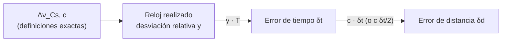

# B13-C06 — Patrones de longitud y tiempo

<!-- nav:top -->
[🏠 Programa](../../../../README.md) · [📚 Bloque B13](../../../tronco-comun/B13-metrologia-tiempo-y-mediciones-cientificas.md) · [← Anterior: B13-C05 — Calibración instrumental](../B13-C05-calibracion-instrumental/CLASE.md) · [Siguiente: B13-C07 — Relojes atómicos y frecuencia →](../B13-C07-relojes-atomicos-y-frecuencia/CLASE.md)
<!-- /nav -->

## 1. Ubicación, nivel y alcance

Sexta clase del bloque B13. En [C05](../B13-C05-calibracion-instrumental/CLASE.md) calibraste un instrumento contra patrones; aquí estudias los patrones más básicos de las ciencias espaciales, los de **tiempo** y **longitud**, y cómo están ligados entre sí: medir una distancia por tiempo de vuelo es medir un tiempo. Nivel N2. Verás la lógica de la definición, la conversión de errores de frecuencia en errores de tiempo y de distancia, y los requisitos de temporización de un telémetro láser. No entras en el funcionamiento interno de los relojes (C07) ni en las escalas de tiempo (C08).

## 2. Por qué esta clase existe

Cuando un telémetro láser mide la distancia a la Luna, lo que mide es el tiempo que tarda un pulso en ir y volver. Un error de un nanosegundo en ese tiempo equivale a 15 centímetros de distancia. Para saber qué reloj necesitas, o cuánto puede derivar entre dos sincronizaciones, hay que saber convertir entre frecuencia, tiempo y longitud sin perder de vista cuál es la definición y cuál la realización práctica.

La decisión central: **¿qué estabilidad de reloj necesito para que el error de distancia quede por debajo de un valor dado?**

## 3. Lo que podrás hacer al terminar

1. Explicar cómo el segundo y el metro se definen con constantes exactas y por qué eso los enlaza.
2. Convertir una desviación relativa de frecuencia en error de tiempo acumulado.
3. Convertir un error de tiempo en error de distancia y viceversa.
4. Calcular la resolución de frecuencia que exige realizar el segundo con una exactitud dada.
5. Distinguir definición de unidad y realización práctica.
6. Verificar conversiones con aritmética exacta.

La evidencia es el **cuaderno de equivalencias tiempo–distancia** del ejercicio 12 (sección 20).

## 4. Con qué llegas y cómo comprobarlo

Necesitas las constantes del SI ([C01](../B13-C01-sistema-internacional-y-constantes/CLASE.md)) y notación científica. Cinco preguntas:

1. ¿Cuántos metros recorre la luz en 1 ns?
2. Si un reloj adelanta `1 × 10⁻⁹` s cada segundo, ¿cuánto adelanta en 1000 s?
3. ¿Cuántos segundos tiene un día?
4. ¿Qué es una desviación relativa de frecuencia?
5. ¿Qué tiempo tarda la luz en recorrer 3 m?

<details>
<summary>Ver respuestas</summary>

1. `0,2998 m`. 2. `10⁻⁶ s = 1 µs`. 3. `86 400 s`. 4. La diferencia entre la frecuencia real y la nominal, dividida entre la nominal. 5. `10 ns`.
</details>

Con cuatro o cinco aciertos, sigue; si no, repasa C01.

## 5. Un caso real: el telémetro láser a la Luna

La ida y vuelta de un pulso a la Luna (distancia media `3,844 × 10⁸ m`, valor publicado por la NASA, S3, cuatro cifras) dura `2,5644 s`. Para localizar un reflector con precisión de un centímetro hay que medir ese intervalo con una resolución de unos `67 ps` (calculado). Y el reloj que cronometra el viaje debe mantener su frecuencia con una desviación relativa suficientemente pequeña durante el tiempo entre las calibraciones. Este es el **ejemplo conductor**.

## 6. Vocabulario

El **segundo** es la duración de `9 192 631 770` periodos de la radiación de la transición hiperfina del cesio-133 (S1, S2). El **metro** es la distancia que recorre la luz en el vacío en `1/299 792 458 s`. Una **realización** es la forma práctica de reproducir una unidad con un instrumento (por ejemplo, un reloj de cesio); no es la definición. La **desviación relativa de frecuencia** `y = (ν − ν₀)/ν₀` es adimensional. El **tiempo de vuelo** es el intervalo que tarda una señal en recorrer una distancia. La **medida por ida y vuelta** divide entre dos: `d = c t/2`. El **intervalo juliano** `365,25 d = 31 557 600 s` es la convención usada para el año en esta clase.

## 7. Modelo mental: una cuerda de dos extremos

Piensa en una distancia como una cuerda que se mide con el tiempo que una señal tarda en recorrerla. Si el cronómetro tiene un error, la «cuerda» se alarga o se acorta en `c` veces ese error.



*Descripción textual:* las constantes exactas definen la unidad; un reloj realizado tiene una desviación relativa `y`; tras un tiempo `T` acumula `δt = y T`; ese error de tiempo se traduce en una distancia multiplicando por `c` (o por `c/2` si es de ida y vuelta).

Analogía: una cuerda cuya longitud depende del cronómetro. Su límite: la conversión es lineal solo si `y` es constante; en la práctica un reloj real tiene ruido y deriva (C07).

## 8. La explicación, paso a paso

### 8.1 Definición y realización

La **definición** del segundo y del metro es exacta (S1, S2). La **realización** es cómo se reproduce la unidad en un laboratorio y siempre tiene incertidumbre. Los laboratorios nacionales realizan el segundo con relojes de átomos de cesio; las realizaciones específicas y sus incertidumbres actuales no se consultaron en esta sesión, por lo que aquí solo se usan **valores de ejemplo** para las desviaciones de frecuencia.

### 8.2 Resolución de frecuencia necesaria

Para realizar el segundo con una exactitud relativa de `10⁻¹⁵` hay que determinar la frecuencia del cesio con una resolución absoluta de `9 192 631 770 × 10⁻¹⁵ = 9,19 × 10⁻⁶ Hz`: menos de diez microhertzios sobre nueve mil millones de hercios. Eso explica por qué la técnica exige un tiempo de interrogación largo y mucho promediado.

### 8.3 De frecuencia a tiempo

Si un reloj tiene desviación relativa constante `y` respecto del patrón, tras un intervalo `T` ha contado de más o de menos `δt = y T`. Con `y = 10⁻¹⁵` y `T = 1 año = 3,15576 × 10⁷ s`: `δt = 31,56 ns`. Con `y = 10⁻¹³`: `3,156 µs` al año, y `8,64 ns` al día.

### 8.4 De tiempo a distancia

Una señal que viaja a `c` recorre `δd = c δt` en el tiempo `δt`: `1 ns` de luz son `0,299 792 458 m` exactos. Con `y = 10⁻¹³` durante un día: `8,64 ns × c = 2,59 m`. Con `y = 10⁻¹⁵`: `2,59 cm` al día y `9,46 m` al año. Esto convierte un requisito de frecuencia en un requisito de distancia.

### 8.5 Ida y vuelta

En un telémetro, `t` es el tiempo de ida y vuelta y `d = c t/2`. Para `d = 1 cm`, `t = 2 × 0,01/c = 66,7 ps`. A la inversa, la ida y vuelta de `3,844 × 10⁸ m` es `2,5644 s`. Obsérvese que el factor `1/2` hace que un error de tiempo cuente la mitad en la distancia: `1 ns` de error de ida y vuelta son `15 cm` de distancia.

### 8.6 Qué clase de reloj necesitas

Si quieres que el error de distancia sea menor de `δd` entre dos sincronizaciones separadas `T`, necesitas `y ≤ δd/(c T)`. Para `δd = 1 cm` y `T = 1 día`: `y ≤ 0,01/(2,998 × 10⁸ × 86 400) = 3,9 × 10⁻¹⁶`. Un reloj de `y = 10⁻¹⁶` basta; uno de `10⁻¹⁵` acumula 2,6 cm al día y no; con uno de `10⁻¹¹` hay que sincronizar cada pocos segundos (ejercicio 5).

## 9. Magnitudes, símbolos y unidades

| Símbolo | Qué es | Unidad | Valor o nota |
|---|---|---|---|
| `Δν_Cs` | frecuencia de la transición del Cs | Hz | 9 192 631 770 (exacta) |
| `c` | velocidad de la luz | m/s | 299 792 458 (exacta) |
| `y` | desviación relativa de frecuencia | — | ejemplos `10⁻¹³`, `10⁻¹⁵`, `10⁻¹⁶` |
| `T` | intervalo entre sincronizaciones | s | 86 400; 31 557 600 |
| `δt` | error de tiempo acumulado | s, ns | `y T` |
| `δd` | error de distancia | m | `c δt` o `c δt/2` |
| `d` | distancia al reflector | m | 3,844 × 10⁸ (Luna, estimada) |

## 10. Convenciones y referencias

La distancia por tiempo de vuelo se calcula en el vacío; no incluye el retardo atmosférico ni correcciones relativistas. Los números `10⁻¹³`, `10⁻¹⁵` y `10⁻¹⁶` son **valores de ejemplo sintéticos**, no especificaciones de un reloj concreto. El año es el juliano de `31 557 600 s`.

## 11. De dónde sale lo que afirmamos

| ID | Fuente | Localizador | Respalda | Estado |
|---|---|---|---|---|
| S1 | BIPM, *SI defining constants* | https://www.bipm.org/en/measurement-units/si-defining-constants | `Δν_Cs` y `c` exactos | Consultada el 2026-11-05 mediante extracción automática |
| S2 | NIST, *CODATA 2022* (tabla ASCII) | https://physics.nist.gov/cuu/Constants/Table/allascii.txt | Mismos valores exactos | Consultada el 2026-11-05 mediante extracción automática |
| S3 | NASA/NSSDC, *Moon Fact Sheet* (actualizada 2024-01-11) | https://nssdc.gsfc.nasa.gov/planetary/factsheet/moonfact.html | Semieje mayor `0,3844 × 10⁶ km` | Consultada el 2026-11-05 mediante extracción automática |

Límites: la definición literal del metro y del segundo (en palabras) se explica a partir de las constantes y de su lectura estándar; las realizaciones de laboratorios y sus incertidumbres no se consultaron; las desviaciones de frecuencia son **sintéticas**.

## 12. Cómo ver la conversión

Equivalente accesible a una gráfica de error de distancia contra tiempo (resultados del laboratorio):

| `y` | `T` | `δt` (ns) | `c δt` (m) |
|---|---|---|---|
| `10⁻¹³` | 1 día | 8,640 | 2,590 |
| `10⁻¹³` | 1 año | 3155,760 | 946,073 |
| `10⁻¹⁵` | 1 día | 0,0864 | 0,0259 |
| `10⁻¹⁵` | 1 año | 31,558 | 9,461 |
| `10⁻¹⁶` | 1 día | 0,00864 | 0,00259 |
| `10⁻¹⁶` | 1 año | 3,156 | 0,946 |

Descripción larga: las columnas son proporcionales a `y T`; cada fila es la anterior dividida entre cien al bajar `y` de `10⁻¹³` a `10⁻¹⁵`.

## 13. Ejemplo trabajado: reloj para 1 cm en un día

**Paso 1 · Requisito.** Error de distancia `≤ 1 cm` en `T = 86 400 s`, medida de una vía (el error de tiempo se traduce con `c`).

**Paso 2 · Error de tiempo admisible.** `δt = 0,01/299 792 458 = 33,36 ps`.

**Paso 3 · Desviación relativa admisible.** `y ≤ 33,36 × 10⁻¹² /86 400 = 3,86 × 10⁻¹⁶`.

**Paso 4 · Con el factor 1/2 (ida y vuelta).** Al medir `d = c t/2`, `δd = c δt/2` y se admite `δt = 66,7 ps`, lo que da `y ≤ 7,7 × 10⁻¹⁶` para `δd = 1 cm`.

**Paso 5 · Sentido.** Un reloj de `10⁻¹⁶` cumple (0,26 cm al día); uno de `10⁻¹⁵` no (2,6 cm); uno de `10⁻¹³` queda lejos (2,6 m al día). Con tres cifras en los requisitos, el resultado merece dos: `y ≲ 4 × 10⁻¹⁶` (una vía) o `8 × 10⁻¹⁶` (ida y vuelta).

## 14. Distintas formas de convertir

**Aritmética exacta con fracciones** para las definiciones. **Coma flotante** para los resultados finales. **Cálculo por órdenes de magnitud** para dimensionar un requisito. Los tres deben coincidir; si no, hay un error de potencia de diez.

## 15. Práctica guiada

**Ejercicio 1 · con los pasos indicados.** ¿Cuántos nanosegundos acumula un reloj con `y = 10⁻¹⁴` en un día? *Pasos:* 8.3.

<details><summary>Solución comentada</summary>

`δt = 10⁻¹⁴ × 86 400 = 8,64 × 10⁻¹⁰ s = 0,864 ns`.
</details>

**Ejercicio 2 · con una pista.** ¿A cuántos metros equivale ese error si es una medida de una vía? *Pista:* `c δt`.

<details><summary>Solución comentada</summary>

`0,864 × 10⁻⁹ × 299 792 458 = 0,259 m` (8.4).
</details>

**Ejercicio 3 · casi autónomo.** Calcula el tiempo de ida y vuelta a un satélite a `3,6 × 10⁷ m` y la resolución temporal para `δd = 1 m`.

<details><summary>Solución comentada</summary>

`t = 2 × 3,6 × 10⁷/2,998 × 10⁸ = 0,2402 s`; para `1 m`: `δt = 2/c = 6,67 ns` (8.5).
</details>

## 16. Práctica autónoma, transferencia e integrador

**Ejercicio 4.** ¿Qué diferencia hay entre definir y realizar el segundo?

<details><summary>Solución comentada</summary>

La definición fija el valor exacto de `Δν_Cs`; la realización es el reloj concreto que lo reproduce, con incertidumbre (8.1).
</details>

**Ejercicio 5.** Un reloj con `y = 10⁻¹¹` se usa para ranging a 1 cm de exactitud (una vía). ¿Cada cuánto debe sincronizarse?

<details><summary>Solución comentada</summary>

`T ≤ δd/(c y) = 0,01/(2,998 × 10⁸ × 10⁻¹¹) = 3,3 s` (8.6): sincronización cada pocos segundos.
</details>

**Ejercicio 6.** Calcula cuántos hercios de resolución necesitas para `10⁻¹⁶` de exactitud del Cs.

<details><summary>Solución comentada</summary>

`9 192 631 770 × 10⁻¹⁶ = 9,19 × 10⁻⁷ Hz` (8.2).
</details>

**Ejercicio 7.** Un error de `1 ns` en el tiempo de ida y vuelta, ¿cuántos centímetros son en la distancia?

<details><summary>Solución comentada</summary>

`c × 1 ns/2 = 0,1499 m ≈ 15 cm` (8.5).
</details>

**Ejercicio 8.** Convierte un error de `2,59 m` en tiempo.

<details><summary>Solución comentada</summary>

`2,59/299 792 458 = 8,64 ns` (coincide con la fila `10⁻¹³`/día).
</details>

**Ejercicio 9 · transferencia.** Un satélite sincroniza su reloj con tierra una vez al día. Su reloj tiene `y = 10⁻¹²`. ¿Qué error de posición por ranging de una vía acumula en el peor momento (justo antes de sincronizar)?

<details><summary>Solución comentada</summary>

`δt = 10⁻¹² × 86 400 = 86,4 ns`; `δd = c δt = 25,9 m`. Si la exigencia es de metros, hace falta un reloj mejor o sincronizar más seguido (8.6). Valores sintéticos.
</details>

**Ejercicio 10 · transferencia.** El mismo reloj, ¿qué error de distancia acumula en 1 h sin sincronizar? ¿Y si la medida es de ida y vuelta?

<details><summary>Solución comentada</summary>

`δt = 10⁻¹² × 3600 = 3,6 ns`; una vía: `1,08 m`; ida y vuelta: `0,54 m` (8.5).
</details>

**Ejercicio 11 · transferencia.** Un compañero afirma que «el metro se mide con regla porque es una longitud, no un tiempo». Responde con la definición.

<details><summary>Solución comentada</summary>

La definición del metro se apoya en `c` y en el segundo: es lo que recorre la luz en `1/299 792 458 s`. Una regla es una **realización** (ver 8.1), calibrada contra patrones trazables a esa definición (C02).
</details>

**Ejercicio 12 · integrador.** Elabora tu *cuaderno de equivalencias tiempo–distancia*: la tabla de la sección 12 reconstruida con tus cálculos, el reloj necesario para `δd = 1 cm` y para `δd = 1 m` en un día, el tiempo de ida y vuelta a la Luna y la resolución temporal para 1 cm, con fuentes y rotulado de lo sintético.

<details><summary>Solución modelo</summary>

Tabla de 6 filas; `y ≲ 4 × 10⁻¹⁶` para 1 cm y `4 × 10⁻¹⁴` para 1 m (una vía, un día); ida y vuelta Luna `2,5644 s` (estimado); `66,7 ps` para 1 cm; S1–S3 con fecha.
</details>

## 17. Laboratorio: equivalencias exactas tiempo–distancia

El script [tiempo_y_distancia.py](tiempo_y_distancia.py) usa fracciones para calcular las conversiones de las secciones 8.2–8.5 sin redondeo y comprueba que `31 557 600 × 10⁻¹⁵ = 31,5576 ns` exactos y que `c × (t de ida y vuelta)/2` devuelve la distancia.

**Datos:** constantes exactas; año juliano; desviaciones de ejemplo. **Predice antes de ejecutar:** ¿qué error de distancia da `y = 10⁻¹⁵` en un año? (`≈ 9,5 m`.) **Ejecución del 2026-11-05 (Python 3.12.9):**

```text
Python 3.12.9 (sin bibliotecas externas)
c * 1 ns = 0.299792458 m
1e-15 de la frecuencia del Cs = 9.193e-06 Hz
   y        T      dt (ns)        c*dt (m)
   1e-13   1 dia      8.64000      2.59021
   1e-13  1 anio   3155.76000    946.07305
   1e-15   1 dia      0.08640      0.02590
   1e-15  1 anio     31.55760      9.46073
   1e-16   1 dia      0.00864      0.00259
   1e-16  1 anio      3.15576      0.94607
ida y vuelta Luna = 2.564441 s
1 cm de distancia = 66.71 ps de ida y vuelta
Pruebas superadas.
```

```bash
python programa/clases/B13/B13-C06-patrones-de-longitud-y-tiempo/tiempo_y_distancia.py
```

**Límites:** vacío; `y` constante; sin atmósfera ni relatividad; desviaciones de ejemplo.

## 18. Errores frecuentes y cómo corregirlos

**Olvidar el factor 1/2 de la ida y vuelta.** Se corrige con los ejercicios 3 y 7.

**Confundir `y` (adimensional) con una frecuencia en Hz.** Se corrige con el ejercicio 6.

**Pensar que la definición del metro es una regla.** Se corrige con el ejercicio 11.

**Mezclar año civil y año juliano.** Se corrige en la sección 10.

**Olvidar que `y` real no es constante.** Se corrige en C07.

## 19. Cómo sabrás que vas bien

Tras 8.3: ¿calculas `δt` para `y = 10⁻¹⁴` en un día? Si no, ejercicio 1. Tras 8.5: ¿cuenta el factor 1/2? Si no, ejercicio 7. Tras 8.6: ¿sabes pedir un reloj para un requisito de distancia? Si dudas, ejercicio 5. Tras el laboratorio: ¿por qué se usan fracciones? (para que las definiciones queden exactas y el redondeo solo aparezca al final).

## 20. Qué entregas y cómo se evalúa

El producto es tu **cuaderno de equivalencias tiempo–distancia** (ejercicio 12).

| Criterio | Inicial | En desarrollo | Logrado | Destacado |
|---|---|---|---|---|
| Definiciones | Las confunde | Parciales | Segundo y metro con constantes | Distingue realización |
| Conversión | Con errores | Sin el factor 1/2 | Correcta con unidades | Verifica con aritmética exacta |
| Dimensionado | Sin requisito | Parcial | Reloj para un `δd` dado | Considera sincronización |
| Cifras | Sin criterio | Demasiadas | Las justificadas | Rotula ejemplos sintéticos |
| Fuentes | Sin fuente | Sin fecha | Con localizador y fecha | Declara lo no consultado |

**Condiciones críticas (no se compensan con promedio):** no presentar un ejemplo sintético como especificación de un reloj real; declarar el factor de ida y vuelta; citar solo fuentes consultadas.

## 21. Ética, seguridad y límites

Un reloj mal dimensionado produce errores de distancia que pueden pasar inadvertidos y propagarse a una decisión de navegación. Esta clase no especifica relojes reales. Accesibilidad: tablas equivalentes a las gráficas, fórmulas en texto, ejercicios sin conexión.

## 22. Para cerrar y seguir

El segundo y el metro se definen con constantes exactas y están ligados por `c`; un error de frecuencia se acumula como error de tiempo y se convierte en distancia; el requisito sobre un reloj se obtiene invirtiendo esa cadena. Queda una pregunta: ¿cómo se describe la calidad real de un reloj, cuyo ruido no es constante ni blanco?

**Glosario español–inglés.** segundo · *second*; metro · *metre*; realización · *realization*; desviación relativa de frecuencia · *fractional frequency offset*; tiempo de vuelo · *time of flight*; telémetro láser · *laser rangefinder*; ida y vuelta · *round trip*.

**Continuidad.** B13-C07 reutiliza tu capacidad de **convertir error de frecuencia en error de tiempo** para describir la estabilidad de un reloj real.

**Referencias:** ver sección 11.

<!-- nav:bottom -->
---

[← Anterior: B13-C05 — Calibración instrumental](../B13-C05-calibracion-instrumental/CLASE.md) · [📚 Bloque B13](../../../tronco-comun/B13-metrologia-tiempo-y-mediciones-cientificas.md) · [Siguiente: B13-C07 — Relojes atómicos y frecuencia →](../B13-C07-relojes-atomicos-y-frecuencia/CLASE.md)
<!-- /nav -->
