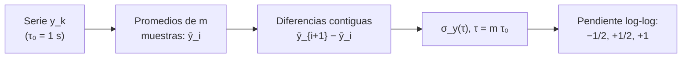

# B13-C07 — Relojes atómicos y frecuencia

<!-- nav:top -->
[🏠 Programa](../../../../README.md) · [📚 Bloque B13](../../../tronco-comun/B13-metrologia-tiempo-y-mediciones-cientificas.md) · [← Anterior: B13-C06 — Patrones de longitud y tiempo](../B13-C06-patrones-de-longitud-y-tiempo/CLASE.md) · [Siguiente: B13-C08 — Escalas UTC, TAI, TT y TDB →](../B13-C08-escalas-utc-tai-tt-y-tdb/CLASE.md)
<!-- /nav -->

## 1. Ubicación, nivel y alcance

Séptima clase del bloque B13. En [C06](../B13-C06-patrones-de-longitud-y-tiempo/CLASE.md) supusiste que un reloj tiene una desviación de frecuencia constante. Un reloj real tiene ruido y deriva. Aquí aprendes a **describir la estabilidad de frecuencia** con la **desviación de Allan** y a leer en su pendiente qué tipo de ruido domina. Nivel N2. No estudias la física interna de los átomos ni los relojes de una misión concreta.

## 2. Por qué esta clase existe

Dos relojes pueden tener la misma desviación de frecuencia media y comportarse de forma muy distinta: uno oscila alrededor de su valor y otro se aleja de él con el tiempo. La desviación típica ordinaria no sirve para describirlo, porque en un reloj con deriva no converge. Para elegir un reloj de a bordo, o decidir cada cuánto sincronizarlo, necesitas una medida de estabilidad que dependa del tiempo de promediado.

La decisión central: **¿cuánto tiempo promedio conviene y qué ruido limita a este reloj?**

## 3. Lo que podrás hacer al terminar

1. Definir la desviación relativa de frecuencia `y` y su promedio sobre `τ`.
2. Calcular la desviación de Allan de una serie corta a mano.
3. Reconocer la pendiente de la curva para ruido blanco de frecuencia (`−1/2`), paseo aleatorio (`+1/2`) y deriva lineal (`+1`).
4. Calcular la desviación de Allan exacta de una rampa de frecuencia.
5. Elegir el tiempo de promediado que minimiza la inestabilidad.
6. Verificar un cálculo con una solución analítica.

La evidencia es la **curva de estabilidad con su interpretación** del ejercicio 12 (sección 20).

## 4. Con qué llegas y cómo comprobarlo

Necesitas `y` y su relación con el error de tiempo ([C06](../B13-C06-patrones-de-longitud-y-tiempo/CLASE.md)), la ley `1/√n` ([C04](../B13-C04-errores-sistematicos-y-aleatorios/CLASE.md)) y logaritmos. Cinco preguntas:

1. Si `y = 10⁻¹³` durante 1000 s, ¿qué error de tiempo se acumula?
2. ¿Cuánto es `σ/√n` con `σ = 10⁻¹²`, `n = 100`?
3. ¿Cuál es la pendiente de `y = 3/√x` en escala log-log?
4. Calcula `(4 − 2)²/2`.
5. ¿Qué es el promedio de 1, 3, 2?

<details>
<summary>Ver respuestas</summary>

1. `10⁻¹⁰ s = 0,1 ns`. 2. `10⁻¹³`. 3. `−1/2`. 4. `2`. 5. `2`.
</details>

Con cuatro o cinco aciertos, sigue; si no, repasa C04 y C06.

## 5. Un caso real (con datos sintéticos): el reloj de a bordo

Un reloj de a bordo entrega la desviación relativa de frecuencia `y_k` promediada cada `τ₀ = 1 s`, medida contra un patrón de tierra. Tres relojes simulados tienen un ruido blanco de frecuencia (`σ = 10⁻¹²`), un paseo aleatorio de frecuencia y una deriva lineal. Los datos son **sintéticos**. Verás cómo la curva de Allan distingue los tres. Es el **ejemplo conductor**.

## 6. Vocabulario

La **estabilidad de frecuencia** describe cómo fluctúa `y` en el tiempo. El **promedio** `ȳᵢ(τ)` es el promedio de `y` en un intervalo `τ = m τ₀`. La **varianza de Allan** (o varianza de dos muestras) es `σ_y²(τ) = ½ ⟨(ȳ_{i+1} − ȳ_i)²⟩`, el promedio sobre la serie de la diferencia al cuadrado entre dos promedios contiguos, dividido entre dos; es la medida de estabilidad en el dominio del tiempo más habitual para relojes, y converge para la mayoría de los ruidos de reloj (S1). La **desviación de Allan** (ADEV) es su raíz. El **ruido blanco de frecuencia** tiene muestras independientes de `y`. El **paseo aleatorio de frecuencia** es la suma acumulada de pasos aleatorios en `y`. La **deriva lineal** es `y` creciendo de forma lineal con el tiempo.

## 7. Modelo mental: la lupa del tiempo de promediado

La desviación de Allan es una lupa con la que miras la serie a distintas escalas de tiempo. A escalas cortas domina el ruido rápido; a largas, la deriva. La curva ADEV frente a `τ` suele tener forma de «V»: baja mientras el promedio reduce el ruido y sube cuando la deriva empieza a pesar.



*Descripción textual:* de la serie se forman promedios de `m` muestras, se toman diferencias contiguas, se calcula la raíz de su promedio cuadrático dividido entre dos y se lee la pendiente de la curva en escala logarítmica.

Analogía: una lupa que cambia de aumento. Su límite: la curva de Allan no distingue todos los tipos de ruido entre sí con certeza (existen otras varianzas para eso, S1).

## 8. La explicación, paso a paso

### 8.1 La serie `y_k`

La fase del reloj (su error de tiempo) `x(t)` crece como la integral de `y`. La serie `y_k` es el promedio de `y` en cada intervalo de `τ₀`. Una ventaja de usar `y` es que un sesgo constante de frecuencia no cambia las diferencias entre promedios contiguos: la desviación de Allan **no ve** la desviación media, solo su variabilidad.

### 8.2 Cálculo de la desviación de Allan

Para `τ = m τ₀`: se forman `k = ⌊N/m⌋` promedios `ȳᵢ`; se calculan las diferencias `d_i = ȳ_{i+1} − ȳ_i`; entonces `σ_y²(τ) = ½ · (Σ d_i²)/(k − 1)`. Con la serie `y = (1, 3, 2, 4) × 10⁻¹²` y `m = 1`: diferencias `2, −1, 2`; cuadrados `4, 1, 4`; promedio `3`; `σ_y² = 1,5 × 10⁻²⁴`; `σ_y(1 s) = 1,225 × 10⁻¹²`.

### 8.3 Ruido blanco de frecuencia

Si las `y_k` son independientes con desviación `s`, el promedio de `m` muestras tiene desviación `s/√m` (C04) y la diferencia de dos promedios independientes tiene varianza `2s²/m`; con el `½`, `σ_y²(τ) = s²/m`. Luego `σ_y(τ) = s/√(τ/τ₀)`: **pendiente −1/2**. En el laboratorio, `s = 10⁻¹²`: `σ_y(1 s) = 1,002 × 10⁻¹²` y `σ_y(256 s) = 6,22 × 10⁻¹⁴`, frente a la teoría `10⁻¹²` y `6,25 × 10⁻¹⁴`.

### 8.4 Deriva lineal: una solución exacta

Si `y_k = D k τ₀` (deriva lineal de `D` por segundo, `τ₀ = 1 s`), los promedios contiguos de `m` muestras difieren siempre en `D m τ₀ = D τ`. Entonces `σ_y(τ) = D τ/√2`, **pendiente +1**, de forma **exacta**. Con `D = 10⁻¹⁷ s⁻¹` y `τ = 100 s`: `7,071 × 10⁻¹⁶`. Esta solución se usa como prueba del código.

### 8.5 Paseo aleatorio de frecuencia

Si `y` acumula pasos aleatorios, los promedios contiguos se alejan como una difusión: la pendiente es `+1/2`. En el laboratorio se obtiene `0,466`, con una serie de `65 536` muestras (la teoría es `0,5`; la pequeña diferencia es estadística).

### 8.6 El punto mínimo y cómo se usa

Un reloj real combina ruidos: pendiente negativa a `τ` cortos, un mínimo (el piso de estabilidad) y una pendiente positiva a `τ` largos. El `τ` del mínimo es el tiempo de promediado óptimo y marca cada cuánto conviene sincronizar. Si el reloj es ruido blanco puro, promediar más siempre ayuda; si hay deriva, sobrepasar el mínimo empeora.

## 9. Magnitudes, símbolos y unidades

| Símbolo | Qué es | Unidad | Nota |
|---|---|---|---|
| `y` | desviación relativa de frecuencia | — | adimensional |
| `τ₀`, `τ` | intervalo de muestreo; tiempo de promediado | s | `τ = m τ₀` |
| `m` | muestras por promedio | — | 1…256 |
| `ȳᵢ` | promedio de `y` en `τ` | — | |
| `σ_y(τ)` | desviación de Allan | — | adimensional |
| `s` | desviación del ruido blanco | — | `10⁻¹²` (sintético) |
| `D` | deriva lineal de frecuencia | s⁻¹ | `10⁻¹⁷` (sintético) |

## 10. Convenciones y referencias

Se usa la desviación de Allan **no solapada** (promedios que no se repiten). Hay variantes solapadas y modificadas con mejor confianza estadística, que no se usan aquí. La serie es **sintética** con semilla fija; las pendientes `−1/2`, `+1/2` y `+1` son resultados clásicos que el laboratorio comprueba.

## 11. De dónde sale lo que afirmamos

| ID | Fuente | Localizador | Respalda | Estado |
|---|---|---|---|---|
| S1 | NIST, W. J. Riley, *Handbook of Frequency Stability Analysis*, Special Publication 1065 | https://nvlpubs.nist.gov/nistpubs/Legacy/SP/nistspecialpublication1065.pdf | La varianza de Allan (o de dos muestras) es la medida estándar en el dominio del tiempo y converge para la mayoría de los ruidos; existen variantes solapadas y modificadas | Texto extraído del PDF el 2026-11-05 (introducción y resumen de variantes; no se transcribió su ecuación) |
| S2 | NIST, *CODATA 2022* (tabla ASCII) | https://physics.nist.gov/cuu/Constants/Table/allascii.txt | `Δν_Cs` exacta | Consultada el 2026-11-05 mediante extracción automática |

Límites: la fórmula `½⟨(ȳ_{i+1} − ȳ_i)²⟩` es la definición habitual y se verifica en el laboratorio con una solución exacta; el handbook se usó para confirmar el papel de la medida, no se extrajo su ecuación; las pendientes por tipo de ruido son resultados clásicos comprobados con simulación; los datos son **sintéticos**.

## 12. Cómo ver la curva de estabilidad

Equivalente accesible a una gráfica log-log (ruido blanco, `s = 10⁻¹²`):

| `τ` (s) | ADEV simulada | `s/√τ` teórica |
|---|---|---|
| 1 | 1,0024 × 10⁻¹² | 1,0000 × 10⁻¹² |
| 4 | 5,0526 × 10⁻¹³ | 5,0000 × 10⁻¹³ |
| 16 | 2,5354 × 10⁻¹³ | 2,5000 × 10⁻¹³ |
| 64 | 1,2292 × 10⁻¹³ | 1,2500 × 10⁻¹³ |
| 256 | 6,2225 × 10⁻¹⁴ | 6,2500 × 10⁻¹⁴ |

Descripción larga: la curva baja con pendiente `−1/2` (cada cuadruplicación de `τ` reduce la ADEV a la mitad); la simulación acompaña a la teoría con desviaciones del 1 al 2 %.

## 13. Ejemplo trabajado: elegir el tiempo de promediado

**Paso 1 · Reloj.** Ruido blanco `s = 10⁻¹²` más deriva `D = 10⁻¹⁷ s⁻¹` (aproximación: componentes en cuadratura).

**Paso 2 · Curva compuesta.** `σ_y² ≈ s² τ₀/τ + D² τ²/2`.

**Paso 3 · Mínimo.** Derivando respecto a `τ` (B09): `−s² τ₀/τ² + D² τ = 0`, `τ = (s² τ₀/D²)^{1/3} = (10⁻²⁴/10⁻³⁴)^{1/3} = (10¹⁰)^{1/3} = 2154 s`.

**Paso 4 · Valor en el mínimo.** `σ_y² = 10⁻²⁴/2154 + 10⁻³⁴ × 2154²/2 = 4,64 × 10⁻²⁸ + 2,32 × 10⁻²⁸ = 6,96 × 10⁻²⁸`; `σ_y ≈ 2,6 × 10⁻¹⁴`.

**Paso 5 · Sentido.** Conviene promediar unos 2000 s (cerca de 36 min); más allá, la deriva empeora el resultado; con tres cifras en `s` y `D`, el resultado merece dos: `τ ≈ 2,2 × 10³ s`, `σ_y ≈ 2,6 × 10⁻¹⁴`. Modelo de dos componentes **sintético**.

## 14. Distintas formas de describir un reloj

**Desviación típica ordinaria:** sencilla pero no converge con deriva o paseo aleatorio. **Desviación de Allan:** converge para la mayoría de los ruidos de reloj y depende de `τ`. **Variantes solapadas y modificadas** (S1): más confianza estadística o distinción entre ruidos de fase. **Error de tiempo acumulado** (C06): directo, pero no resume la estabilidad. Se complementan.

## 15. Práctica guiada

**Ejercicio 1 · con los pasos indicados.** Calcula la desviación de Allan con `m = 1` de `y = (1, 3, 2, 4) × 10⁻¹²`. *Pasos:* 8.2.

<details><summary>Solución comentada</summary>

Diferencias `2, −1, 2`; cuadrados `4, 1, 4`; suma `9`; `σ² = ½ × 9/3 = 1,5`; `σ = 1,225 × 10⁻¹²`.
</details>

**Ejercicio 2 · con una pista.** Con la misma serie y `m = 2`. *Pista:* promedios `2` y `3`.

<details><summary>Solución comentada</summary>

Promedios `(1+3)/2 = 2`, `(2+4)/2 = 3`; diferencia `1`; `σ² = ½ × 1/1 = 0,5`; `σ = 0,707 × 10⁻¹²`. Con más promediado la ADEV baja.
</details>

**Ejercicio 3 · casi autónomo.** Calcula la ADEV exacta de una rampa `D = 10⁻¹⁷ s⁻¹` para `τ = 10`, `100` y `1000 s`.

<details><summary>Solución comentada</summary>

`D τ/√2 = 7,07 × 10⁻¹⁷; 7,07 × 10⁻¹⁶; 7,07 × 10⁻¹⁵` (8.4): pendiente `+1`.
</details>

## 16. Práctica autónoma, transferencia e integrador

**Ejercicio 4.** Para ruido blanco `s = 10⁻¹²`, ¿qué ADEV esperas a `τ = 100 s` y a `10⁴ s`?

<details><summary>Solución comentada</summary>

`s/√τ = 10⁻¹³` y `10⁻¹⁴` (8.3).
</details>

**Ejercicio 5.** ¿A qué `τ` baja la ADEV a `10⁻¹⁵` si fuera ruido blanco puro?

<details><summary>Solución comentada</summary>

`√τ = 10⁻¹²/10⁻¹⁵ = 1000`, `τ = 10⁶ s ≈ 11,6 días`; en la práctica la deriva lo impide (8.6).
</details>

**Ejercicio 6.** Un reloj muestra una pendiente `+1` a partir de `τ = 1000 s`. ¿Qué indica?

<details><summary>Solución comentada</summary>

Una deriva lineal de frecuencia domina a escalas largas: se debe modelar y restar, o limitar `τ` (8.4, 8.6).
</details>

**Ejercicio 7.** Con `D = 10⁻¹⁶ s⁻¹` y `s = 10⁻¹²`, calcula el `τ` óptimo.

<details><summary>Solución comentada</summary>

`τ = (s²/D²)^{1/3} = (10⁻²⁴/10⁻³²)^{1/3} = (10⁸)^{1/3} = 464 s` (8.6; modelo del paso 3).
</details>

**Ejercicio 8.** Explica por qué un sesgo constante de frecuencia no cambia la ADEV.

<details><summary>Solución comentada</summary>

La ADEV usa diferencias entre promedios contiguos; una constante se cancela al restar (8.1).
</details>

**Ejercicio 9 · transferencia.** Un reloj con ADEV mínima `3 × 10⁻¹⁴` a `2000 s`. ¿Qué error de tiempo típico acumula en `2000 s` si solo existiera ese ruido, y cuántos metros son?

<details><summary>Solución comentada</summary>

`δt ≈ σ_y τ = 3 × 10⁻¹⁴ × 2000 = 6 × 10⁻¹¹ s = 0,06 ns`; `c δt = 1,8 cm` (C06; orden de magnitud, no incluye los otros ruidos).
</details>

**Ejercicio 10 · transferencia.** Un compañero calcula la desviación típica ordinaria de la serie de un reloj con deriva y concluye que es «estable». ¿Qué le objetas?

<details><summary>Solución comentada</summary>

Con deriva, la desviación típica depende de la longitud de la serie y no converge: crece al alargarla. La ADEV, calculada a un `τ` dado, sí es comparable.
</details>

**Ejercicio 11 · transferencia.** Compara dos relojes: A con ADEV `10⁻¹³` a `1 s` (blanco) y B con ADEV `10⁻¹⁴` a `10⁴ s` (mínimo). ¿Cuál elegirías para una sincronización cada 10⁴ s? ¿Y cada segundo?

<details><summary>Solución comentada</summary>

A a `10⁴ s` (si fuera blanco): `10⁻¹³/√10⁴ = 10⁻¹⁵` — mejor que B si no hay deriva; pero un reloj A real tendrá deriva a `τ` largos que habría que conocer. Para `1 s` ambos requieren su ADEV a ese `τ`: A da `10⁻¹³`; de B se conoce solo `10⁻¹⁴` en `10⁴ s`: no basta para decidir. Lección: compara siempre al `τ` que usarás (datos sintéticos).
</details>

**Ejercicio 12 · integrador.** Elabora tu *curva de estabilidad con su interpretación*: la ADEV para `m = 1, 4, 16, 64, 256` de una serie simulada de ruido blanco (o la tabla de 12), el ajuste de pendiente log-log, la rampa exacta como prueba, y el `τ` óptimo para un modelo compuesto `s`, `D`, con rotulado de sintético.

<details><summary>Solución modelo</summary>

Tabla de la sección 12; pendiente `−0,502`; rampa `7,071 × 10⁻¹⁶` (exacta); `τ_opt = 2154 s`, `σ_y ≈ 2,6 × 10⁻¹⁴` para `s = 10⁻¹²`, `D = 10⁻¹⁷ s⁻¹`.
</details>

## 17. Laboratorio: desviación de Allan

El script [desviacion_de_allan.py](desviacion_de_allan.py) calcula la ADEV no solapada, **comprueba que la rampa lineal da exactamente `D τ/√2` (1e-12)**, que el ruido blanco da pendiente `−0,5 ± 0,08` y el paseo aleatorio `+0,5 ± 0,12`.

**Datos:** sintéticos (semilla fija, `N = 65 536`). **Predice antes de ejecutar:** ¿qué pendiente esperas para el ruido blanco? (`−0,5`.) **Ejecución del 2026-11-05 (Python 3.12.9):**

```text
Python 3.12.9 (biblioteca estandar)
tau (s)   ADEV (blanco)   s/sqrt(tau)
     1   1.0024e-12     1.0000e-12
     2   7.0635e-13     7.0711e-13
     4   5.0526e-13     5.0000e-13
     8   3.5538e-13     3.5355e-13
    16   2.5354e-13     2.5000e-13
    32   1.8081e-13     1.7678e-13
    64   1.2292e-13     1.2500e-13
   128   8.8160e-14     8.8388e-14
   256   6.2225e-14     6.2500e-14
pendiente log-log (blanco) = -0.502 (teorica -0.5)
pendiente log-log (paseo aleatorio) = 0.466 (teorica +0.5)
rampa: ADEV(tau=100 s) = 7.0711e-16 (exacta 7.0711e-16)
Pruebas superadas.
```

```bash
python programa/clases/B13/B13-C07-relojes-atomicos-y-frecuencia/desviacion_de_allan.py
```

**Límites:** ADEV no solapada; sin tiempo muerto; ruidos idealizados.

## 18. Errores frecuentes y cómo corregirlos

**Usar la desviación típica ordinaria en un reloj con deriva.** Se corrige con el ejercicio 10.

**Comparar relojes a `τ` distintos.** Se corrige con el ejercicio 11.

**Creer que promediar siempre mejora.** Se corrige con los ejercicios 5 y 7.

**Olvidar el `½` en la definición.** Se corrige con el ejercicio 1.

**Creer que la ADEV detecta un sesgo constante.** Se corrige con el ejercicio 8.

## 19. Cómo sabrás que vas bien

Tras 8.2: ¿calculas la ADEV de cuatro valores? Si no, ejercicios 1 y 2. Tras 8.4: ¿obtienes la ADEV de la rampa sin simular? Si no, ejercicio 3. Tras 8.6: ¿sabes qué `τ` elegir? Si dudas, ejercicio 7. Tras el laboratorio: ¿por qué la rampa sirve de prueba? (porque su resultado es exacto y no depende del azar).

## 20. Qué entregas y cómo se evalúa

El producto es tu **curva de estabilidad con su interpretación** (ejercicio 12).

| Criterio | Inicial | En desarrollo | Logrado | Destacado |
|---|---|---|---|---|
| Cálculo | Sin método | Con errores | ADEV correcta | Verifica con la rampa exacta |
| Pendiente | No la lee | Un tipo | Identifica blanco, paseo y deriva | Ajusta y compara con la teoría |
| Decisión | Sin criterio | Genérica | `τ` óptimo razonado | Con modelo compuesto |
| Interpretación | Sin unidades | Parcial | Error de tiempo asociado | Discute límites |
| Fuentes | Sin fuente | Sin fecha | Con localizador y fecha | Rotula sintético |

**Condiciones críticas (no se compensan con promedio):** comparar relojes al mismo `τ`; rotular los datos como sintéticos; no presentar la serie como de un reloj real.

## 21. Ética, seguridad y límites

Elegir un reloj por una cifra a un solo `τ` puede llevar a un diseño que falla a otra escala. Los relojes y datos de esta clase son simulados y no describen ningún aparato real. Accesibilidad: tablas equivalentes a la gráfica, fórmulas en texto, ejercicios sin conexión.

## 22. Para cerrar y seguir

La desviación de Allan mide la estabilidad de un reloj en función del tiempo de promediado; su pendiente revela el ruido (`−1/2` blanco, `+1/2` paseo, `+1` deriva); el mínimo da el tiempo óptimo. Queda una pregunta: cuando varios relojes se combinan en una escala común, ¿qué es UTC, qué es TAI y qué usan las efemérides?

**Glosario español–inglés.** desviación de Allan · *Allan deviation*; varianza de dos muestras · *two-sample variance*; estabilidad de frecuencia · *frequency stability*; ruido blanco de frecuencia · *white frequency noise*; paseo aleatorio · *random walk*; deriva · *drift*; reloj atómico · *atomic clock*.

**Continuidad.** B13-C08 reutiliza tu capacidad de **pasar de frecuencia a tiempo acumulado** para entender cómo se combinan relojes en escalas de tiempo.

**Referencias:** ver sección 11.

<!-- nav:bottom -->
---

[← Anterior: B13-C06 — Patrones de longitud y tiempo](../B13-C06-patrones-de-longitud-y-tiempo/CLASE.md) · [📚 Bloque B13](../../../tronco-comun/B13-metrologia-tiempo-y-mediciones-cientificas.md) · [Siguiente: B13-C08 — Escalas UTC, TAI, TT y TDB →](../B13-C08-escalas-utc-tai-tt-y-tdb/CLASE.md)
<!-- /nav -->
