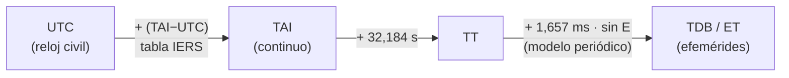

# B13-C08 — Escalas UTC, TAI, TT y TDB

<!-- nav:top -->
[🏠 Programa](../../../../README.md) · [📚 Bloque B13](../../../tronco-comun/B13-metrologia-tiempo-y-mediciones-cientificas.md) · [← Anterior: B13-C07 — Relojes atómicos y frecuencia](../B13-C07-relojes-atomicos-y-frecuencia/CLASE.md) · [Siguiente: B13-C09 — Segundos intercalares y cronología →](../../../tronco-comun/B13-metrologia-tiempo-y-mediciones-cientificas.md#b13-c09)
<!-- /nav -->

## 1. Ubicación, nivel y alcance

Octava clase del bloque B13. Los relojes de C07 se combinan en **escalas de tiempo**. Aquí aprendes qué mide cada una de las cuatro que usa la astronáutica —UTC, TAI, TT y TDB—, cómo se pasa de una a otra y cuál se usa para qué. Nivel N2. Haces una conversión completa con un script verificado. No tratas todavía los segundos intercalares en detalle ni el calendario (C09) ni el ángulo de rotación terrestre (C10).

## 2. Por qué esta clase existe

Una efeméride planetaria se tabula en una escala de tiempo; el reloj civil usa otra; y la hora de una nave, otra distinta. Si usas la escala equivocada, una posición calculada para la Luna se desplaza: un segundo de diferencia son unos mil metros de movimiento orbital lunar. Y si olvidas que UTC tiene saltos, una resta de dos fechas puede errar un segundo.

La decisión central: **¿en qué escala está este instante y cómo lo paso a la que necesita mi cálculo?**

## 3. Lo que podrás hacer al terminar

1. Describir qué es cada escala: UTC, TAI, TT y TDB.
2. Pasar de UTC a TAI con la tabla de segundos intercalares.
3. Pasar de TAI a TT con el desfase constante de `32,184 s`.
4. Estimar `TDB − TT` con el modelo periódico simple y reconocer su amplitud de `1,7 ms`.
5. Explicar por qué `TDB − UTC` valía `69,184 s` a fines de 2020.
6. Verificar una conversión con casos de control.

La evidencia es la **conversión verificada entre cuatro escalas** del ejercicio 12 (sección 20).

## 4. Con qué llegas y cómo comprobarlo

Necesitas relojes y frecuencia ([C07](../B13-C07-relojes-atomicos-y-frecuencia/CLASE.md)), el segundo del SI ([C01](../B13-C01-sistema-internacional-y-constantes/CLASE.md)) y fechas del calendario. Cinco preguntas:

1. ¿Cuántos segundos tiene un día de 24 h?
2. ¿Qué es una hora del día en segundos: las `12:00:00`?
3. Calcula `37 + 32,184`.
4. ¿Qué es un periodo y una amplitud en una oscilación?
5. ¿Qué diferencia hay entre «duración» e «instante»?

<details>
<summary>Ver respuestas</summary>

1. `86 400`. 2. `43 200 s` desde la medianoche. 3. `69,184`. 4. El tiempo de un ciclo y el valor máximo de la oscilación. 5. Una duración es un intervalo; un instante es un punto en una escala de tiempo.
</details>

Con cuatro o cinco aciertos, sigue; si no, repasa C06.

## 5. Un caso real: el 1 de diciembre de 2020

Un documento de NAIF/JPL sobre tiempos en SPICE (S3) indica que el desfase entre TDB y UTC era de `69,184 s` a fecha del 1 de diciembre de 2020. En esta clase reconstruirás ese número a partir de la tabla de segundos intercalares del IERS (S1) y del desfase fijo `TT − TAI` (S2, S3). Es el **ejemplo conductor**: un valor publicado que podrás reproducir con las piezas de la clase.

## 6. Vocabulario

El **Tiempo Universal Coordinado (UTC)** es una forma de nombrar instantes con fecha y hora civil que sigue a TAI con saltos de un segundo para mantenerse a menos de `0,9 s` de UT1 (S3); no es una escala continua. El **Tiempo Atómico Internacional (TAI)** es una cuenta continua de segundos del SI desde un origen (medianoche del 1 de enero de 1958 según S3). El **Tiempo Terrestre (TT)** avanza al mismo ritmo que TAI con un desfase fijo `TT = TAI + 32,184 s` (S2, S3). El **Tiempo Dinámico Baricéntrico (TDB)** es la escala uniforme de las efemérides del sistema solar; en SPICE, `ET` significa TDB (S3). Un **segundo intercalar** es el segundo que se añade o quita a UTC para mantenerlo cerca de UT1. `TAI − UTC` es el número entero de segundos de ese desfase. Un **núcleo de segundos intercalares (LSK)** es el archivo de SPICE con esa tabla (S3). La **época J2000** es el mediodía del 1 de enero de 2000 (TDB en SPICE).

## 7. Modelo mental: una cadena de relojes

TAI es el reloj continuo. UTC es TAI menos un entero de segundos (con saltos). TT es TAI más una constante. TDB es TT más un pequeño término oscilante anual. Se pasa de una a otra sumando desfases.



*Descripción textual:* de UTC a TAI se suma un entero de segundos que sale de una tabla; de TAI a TT, una constante de `32,184 s`; de TT a TDB, un término oscilante de amplitud `1,7 ms` y periodo de un año.

Analogía: una cadena de engranajes de distinto módulo que giran al mismo ritmo salvo pequeñas correcciones. Su límite: TDB no gira exactamente al mismo ritmo que TT por razones relativistas (apartado 8.5); solo difieren por un término periódico.

## 8. La explicación, paso a paso

### 8.1 UTC a TAI

`TAI = UTC + (TAI − UTC)(fecha)`, con `TAI − UTC` entero. La tabla del IERS (S1) tiene 28 entradas de `10 s` (1 de enero de 1972) a `37 s` (1 de enero de 2017) y, según su cabecera consultada el 2026-11-05, está actualizada hasta el Boletín 72 de julio de 2026, con expiración el 28 de junio de 2027 y su última entrada es la de 2017: la tabla no lista ninguno posterior. Para una fecha de 2020, `TAI − UTC = 37 s`.

### 8.2 TAI a TT

`TT = TAI + 32,184 s` (S2, S3). La constante es de origen histórico: asegura la continuidad con una escala anterior (el Tiempo de Efemérides). Así, `TT − UTC = (TAI − UTC) + 32,184 s`: en 2020, `69,184 s`.

### 8.3 TT a TDB

La diferencia es periódica. SPICE la modela como `TDB − TT = K sin E`, con `E = M + EB sin M` y `M = M0 + M1 t`, donde `t` son los segundos desde J2000, `K = 1,657 × 10⁻³ s`, `EB = 1,671 × 10⁻²`, `M0 = 6,239 996 rad` y `M1 = 1,990 968 71 × 10⁻⁷ rad/s` (S3). NAIF declara una precisión de unos `3 × 10⁻⁵ s` y una amplitud de unos `1,658 ms` con periodo de un año sidéreo. El IERS dice lo mismo: `TDB − TT` tiene por término principal `1,7 ms × sin l′` (S2), con `l′` la anomalía media del Sol vista desde la Tierra.

### 8.4 Reconstruir el valor de NAIF

`TDB − UTC = (TAI − UTC) + 32,184 + (TDB − TT) = 37 + 32,184 + (TDB − TT) = 69,184 + (TDB − TT)`. El laboratorio da, para `2020-12-01 00:00:00 UTC`, `TDB − UTC = 69,183 085 s`: coincide con `69,184` dentro de `1 ms`, que es la amplitud del término periódico. NAIF da el valor redondeado `69,184`.

### 8.5 Por qué hay varias escalas

TT es la escala natural para un observador en la Tierra: sigue el ritmo del segundo del SI sobre el geoide. TDB es la escala de coordenadas del baricentro del sistema solar, que difiere de TT por el efecto relativista (potencial gravitatorio y velocidad de la Tierra), de ahí el término periódico. El IERS (S2) define además las escalas TCG (geocéntrica) y TCB (baricéntrica) y las constantes `L_G = 6,969 290 134 × 10⁻¹⁰` y `L_B = 1,550 519 768 × 10⁻⁸`, que son la diferencia fraccionaria de ritmo entre TT y TCG y entre TDB y TCB. Con ellas, TCG se adelanta a TT unos `22 ms` al año.

### 8.6 Un caso de control: J2000 y un día con segundo intercalar

El 1 de enero de 2000 a las `12:00:00 UTC`, `TAI − UTC = 32 s`, de modo que `TT = UTC + 64,184 s`: a las `12:00:00 TT` de J2000 el reloj UTC marcaba `11:58:55,816`. El día `2016-12-31` en UTC fue seguido de un segundo intercalar: entre `2016-12-31 00:00:00` y `2017-01-01 00:00:00` UTC transcurrieron `86 401 s` de TT, no `86 400`.

## 9. Magnitudes, símbolos y unidades

| Símbolo | Qué es | Unidad | Valor |
|---|---|---|---|
| `TAI − UTC` | segundos intercalares acumulados | s | 10…37 (S1) |
| `TT − TAI` | desfase fijo | s | `32,184` (S2, S3) |
| `TDB − TT` | término periódico | s | amplitud `1,657 × 10⁻³` |
| `K, EB` | constantes del modelo | s; — | `1,657 × 10⁻³`; `1,671 × 10⁻²` |
| `M0, M1` | anomalía media inicial y tasa | rad; rad/s | `6,239 996`; `1,990 968 71 × 10⁻⁷` |
| `MJD` | día juliano modificado | d | `JD − 2 400 000,5` |
| `L_G, L_B` | diferencias de ritmo TT/TCG y TDB/TCB | — | ver 8.5 |

## 10. Convenciones y referencias

Los instantes se expresan como año, mes, día y segundos del día en la escala indicada. El día juliano modificado `MJD = JD − 2 400 000,5` (el JD de J2000 es `2 451 545,0`, es decir `MJD 51 544,5`). Se supone UTC posterior a 1972 con segundos enteros. No se trata el interior de un segundo intercalar (C09). El modelo de `TDB − TT` es el de SPICE; precisa a `30 µs`, no a nivel de nanosegundos.

## 11. De dónde sale lo que afirmamos

| ID | Fuente | Localizador | Respalda | Estado |
|---|---|---|---|---|
| S1 | IERS, *Leap_Second.dat* | https://hpiers.obspm.fr/iers/bul/bulc/Leap_Second.dat | Tabla `TAI − UTC` de 1972 a 2017 (28 entradas); vigencia en la cabecera | Consultada el 2026-11-05 mediante extracción automática |
| S2 | IERS, *IERS Conventions (2010)*, TN36 (§1.2, Tabla 1.1; cap. sobre tiempos) | https://iers-conventions.obspm.fr/content/tn36.pdf | `TT = TAI + 32,184 s`; `TDB − TT` con término `1,7 ms sin l′`; `L_G`, `L_B` | Texto extraído del PDF el 2026-11-05 |
| S3 | NASA/JPL NAIF, *Required Reading: Time* | https://naif.jpl.nasa.gov/pub/naif/toolkit_docs/C/req/time.html | UTC, TAI, TT, TDB/ET; constantes `K`, `EB`, `M0`, `M1`; `TDB − UTC = 69,184 s` en 2020-12-01 | Consultada el 2026-11-05 mediante extracción automática (se leyeron los primeros 100 000 de 104 270 caracteres) |

Límites: el modelo `TDB − TT` es el de SPICE y tiene una precisión declarada de `3 × 10⁻⁵ s`; la tabla S1 expira el 2027-06-28; las fechas del laboratorio son **de ejemplo**, no datos observados.

## 12. Cómo ver las escalas

Equivalente accesible a un esquema de relojes (resultados del laboratorio):

| Instante (UTC) | `TAI − UTC` (s) | `TT − UTC` (s) | `TDB − TT` (ms) |
|---|---|---|---|
| 2000-01-01 12:00:00 | 32 | 64,184 | −0,0727 |
| 2020-12-01 00:00:00 | 37 | 69,184 | −0,915 (da `TDB − UTC = 69,183 085 s`) |

Descripción larga: entre 2000 y 2020 el desfase UTC–TT sube de `64,184` a `69,184 s` por cinco segundos intercalares (efectivos el 1 de enero de 2006 y de 2009, el 1 de julio de 2012 y de 2015 y el 1 de enero de 2017); el término `TDB − TT` oscila entre `±1,657 ms`.

## 13. Ejemplo trabajado: reconstruir `69,184 s`

**Paso 1 · Fecha.** `2020-12-01 00:00:00 UTC`, MJD `59 184`.

**Paso 2 · TAI − UTC.** La última entrada de S1 (1 de enero de 2017) vale `37 s` y no hay ninguna posterior: `37 s`.

**Paso 3 · TT.** `TT − UTC = 37 + 32,184 = 69,184 s`.

**Paso 4 · TDB.** `TDB − TT = K sin E` con `t = (MJD_TT − 51 544,5) × 86 400`; el laboratorio da `−0,000 915 s` (es decir, `−0,915 ms`), así que `TDB − UTC = 69,183 085 s`.

**Paso 5 · Sentido.** El valor publicado `69,184 s` difiere del calculado en menos que la amplitud del término oscilante (`1,7 ms`); coinciden dentro de ese margen. Con tres decimales en los desfases se ve la diferencia; con cinco cifras totales, no. Fecha de ejemplo: no es una observación.

## 14. Distintas formas de convertir

**Tabla más constante más modelo periódico** (esta clase): simple y transparente, precisión `~30 µs` en `TDB − TT`. **Biblioteca de tiempo** (SPICE, ERFA): maneja segundos intercalares, fechas límite y precisión de nanosegundos. **Series largas de `TDB − TT`**: con cientos de términos para precisión de ns. Se usa la más sencilla suficiente para el requisito.

## 15. Práctica guiada

**Ejercicio 1 · con los pasos indicados.** Calcula `TT − UTC` para el 1 de julio de 2012. *Pasos:* tabla S1 (`35 s` desde esa fecha).

<details><summary>Solución comentada</summary>

`35 + 32,184 = 67,184 s`.
</details>

**Ejercicio 2 · con una pista.** ¿Qué valor de `TT − UTC` había el 30 de junio de 2012? *Pista:* la entrada de `35 s` empieza el 1 de julio.

<details><summary>Solución comentada</summary>

Antes valía `34 s` (desde 1 de enero de 2009): `34 + 32,184 = 66,184 s`.
</details>

**Ejercicio 3 · casi autónomo.** ¿A qué hora UTC corresponde el mediodía TT de J2000?

<details><summary>Solución comentada</summary>

`TAI − UTC = 32 s`: `TT − UTC = 64,184 s`; `12:00:00 TT = 12:00:00 − 64,184 s = 11:58:55,816 UTC` (8.6).
</details>

## 16. Práctica autónoma, transferencia e integrador

**Ejercicio 4.** ¿Cuántos segundos intercalares ha habido entre 1972 y 2017 según S1?

<details><summary>Solución comentada</summary>

`37 − 10 = 27` segundos añadidos (la tabla tiene 28 entradas, la primera es el valor inicial de 10 s).
</details>

**Ejercicio 5.** Si `TDB − TT` tiene amplitud `1,657 ms`, ¿qué desplazamiento orbital lunar equivale (velocidad orbital lunar `≈ 1,02 km/s`, valor de ejemplo)?

<details><summary>Solución comentada</summary>

`1,657 × 10⁻³ s × 1020 m/s = 1,7 m` (orden de magnitud).
</details>

**Ejercicio 6.** Con `L_G = 6,969 290 134 × 10⁻¹⁰`, ¿cuántos milisegundos al año se adelanta TCG respecto de TT?

<details><summary>Solución comentada</summary>

`6,969 × 10⁻¹⁰ × 3,15576 × 10⁷ s = 0,02199 s ≈ 22 ms` (8.5).
</details>

**Ejercicio 7.** Con `L_B = 1,550 519 768 × 10⁻⁸`, ¿cuántos segundos al año se separan TDB y TCB?

<details><summary>Solución comentada</summary>

`1,5505 × 10⁻⁸ × 3,15576 × 10⁷ = 0,489 s` (8.5).
</details>

**Ejercicio 8.** ¿Por qué `TT − TAI` es constante pero `TAI − UTC` no?

<details><summary>Solución comentada</summary>

TT y TAI avanzan al mismo ritmo (ambas son cuentas continuas de segundos SI) y difieren por una constante de origen histórico; UTC se mantiene cerca de UT1 con saltos de un segundo, que cambian el desfase (8.1–8.2).
</details>

**Ejercicio 9 · transferencia.** Una sonda registra un evento a `2016-12-31 23:59:59 UTC` y otro a `2017-01-01 00:00:00 UTC`. ¿Cuántos segundos TAI hay entre ellos?

<details><summary>Solución comentada</summary>

`TAI − UTC` cambia de `36` a `37 s`: `1 + (37 − 36) = 2 s`, porque entre medias hubo un segundo intercalar (`23:59:60`). Restar fechas UTC con aritmética común da `1 s`: error de un segundo.
</details>

**Ejercicio 10 · transferencia.** Una efeméride en TDB se usa por error con un reloj UTC de 2020. ¿Qué error de tiempo cometes y cuánto se mueve la Luna?

<details><summary>Solución comentada</summary>

`≈ 69,184 s`; con `1,02 km/s`, `≈ 70 km` de arco orbital lunar (orden de magnitud, valor de ejemplo). Se evita convirtiendo siempre la escala (8.4).
</details>

**Ejercicio 11 · transferencia.** Un compañero dice que «TT es lo mismo que UTC pero con 69 s de adelanto». Corrige.

<details><summary>Solución comentada</summary>

El desfase no es fijo: depende de los segundos intercalares (`TAI − UTC` cambia) y vale `69,184 s` solo desde 2017. Lo fijo es `TT − TAI = 32,184 s` (8.2).
</details>

**Ejercicio 12 · integrador.** Elabora tu *conversión verificada entre cuatro escalas*: para dos fechas (una de 2000 y una de 2020) el desfase UTC→TAI→TT→TDB con su tabla, el caso de control de J2000, el día `2016-12-31` con `86 401 s`, y un párrafo con fuentes, vigencia de la tabla y límites.

<details><summary>Solución modelo</summary>

Tabla de la sección 12; control `11:58:55,816 UTC` ↔ `12:00:00 TT`; `86 401 s`; amplitud `1,657 ms`; S1 vence el 2027-06-28; modelo con precisión `30 µs`.
</details>

## 17. Laboratorio: de UTC a TDB

El script [escalas_de_tiempo.py](escalas_de_tiempo.py) implementa el calendario → MJD, la tabla S1, `TT = TAI + 32,184` y el modelo `TDB − TT` de SPICE, y **comprueba** `MJD(1972-01-01) = 41 317`, `TAI − UTC` en los cambios de la tabla, `TT − UTC = 64,184 s` en J2000, `|TDB − UTC − 69,184| < 2 ms` en 2020, la amplitud máxima `< 1,7 ms` y que el día del segundo intercalar de 2016 dura `86 401 s`.

**Datos:** tabla IERS y constantes de SPICE (fuentes S1–S3). **Predice antes de ejecutar:** ¿cuánto vale `TT − UTC` en 2020? (`69,184 s`.) **Ejecución del 2026-11-05 (Python 3.12.9):**

```text
Python 3.12.9 (biblioteca estandar)
2000-01-01 12:00:00 UTC: TAI-UTC=32 s, TT-UTC=64.184 s, TT desde J2000 = 64.184 s, TDB-TT = -0.0727 ms
2020-12-01 00:00:00 UTC: TT-UTC=69.184 s, TDB-UTC=69.183085 s
max |TDB-TT| en 5 anios = 1.6570 ms
2016-12-31 -> 2017-01-01: 86401.000 s de TT
Pruebas superadas.
```

```bash
python programa/clases/B13/B13-C08-escalas-utc-tai-tt-y-tdb/escalas_de_tiempo.py
```

**Límites:** UTC posterior a 1972 con segundos enteros; sin el interior de un segundo intercalar; tabla vigente hasta 2027-06-28; modelo periódico con precisión de `30 µs`.

## 18. Errores frecuentes y cómo corregirlos

**Restar fechas UTC como si fueran continuas.** Se corrige con el ejercicio 9.

**Usar UTC donde la efeméride exige TDB.** Se corrige con el ejercicio 10.

**Creer que `TT − UTC` es constante.** Se corrige con el ejercicio 11.

**Confundir TT con TDB.** Se corrige en 8.3 y 8.5.

**Usar una tabla de segundos intercalares sin mirar su vigencia.** Se corrige con la sección 11 y C19.

## 19. Cómo sabrás que vas bien

Tras 8.1–8.2: ¿calculas `TT − UTC` para una fecha? Si no, ejercicios 1 y 2. Tras 8.3: ¿cuál es la amplitud de `TDB − TT`? Si dudas, repasa 8.3. Tras 8.6: ¿conviertes J2000 a UTC? Si no, ejercicio 3. Tras el laboratorio: ¿qué significan los `86 401 s`? (que un día UTC con segundo intercalar dura un segundo más).

## 20. Qué entregas y cómo se evalúa

El producto es tu **conversión verificada entre cuatro escalas** (ejercicio 12).

| Criterio | Inicial | En desarrollo | Logrado | Destacado |
|---|---|---|---|---|
| Definiciones | Las confunde | Parciales | Las cuatro escalas | Incluye TCG/TCB |
| Conversión | Con errores | Sin tabla | UTC→TAI→TT→TDB correcta | Con casos de control |
| Vigencia | Ignora | Menciona | Declara la expiración | Prevé el mantenimiento |
| Interpretación | Sin unidades | Parcial | Orden de magnitud del error | Relaciona con la órbita |
| Fuentes | Sin fuente | Sin fecha | Con localizador y fecha | Rotula ejemplos |

**Condiciones críticas (no se compensan con promedio):** declarar la escala de cada instante; citar la vigencia de la tabla; no restar fechas UTC en intervalos con segundo intercalar.

## 21. Ética, seguridad y límites

Una escala de tiempo equivocada puede situar un objeto a cientos de kilómetros de su posición real; para operaciones se usan los productos oficiales vigentes del IERS y bibliotecas validadas. La tabla de segundos intercalares tiene fecha de caducidad y debe actualizarse. Accesibilidad: tablas equivalentes a los esquemas, fórmulas en texto, ejercicios sin conexión.

## 22. Para cerrar y seguir

UTC es la hora civil con saltos; TAI es continua; TT es TAI más `32,184 s`; TDB es TT más un término periódico de `1,7 ms` y es la escala de las efemérides; las cuatro se convierten sumando desfases con una tabla vigente. Queda una pregunta: ¿qué ocurre exactamente con un segundo intercalar y cómo se pasa de fecha civil a fecha juliana con rigor?

**Glosario español–inglés.** Tiempo Universal Coordinado · *Coordinated Universal Time*; Tiempo Atómico Internacional · *International Atomic Time*; Tiempo Terrestre · *Terrestrial Time*; Tiempo Dinámico Baricéntrico · *Barycentric Dynamical Time*; segundo intercalar · *leap second*; época · *epoch*; núcleo de segundos intercalares · *leapseconds kernel*.

**Continuidad.** B13-C09 reutiliza tu capacidad de **pasar entre escalas con una tabla vigente** para tratar fechas y segundos intercalares con rigor.

**Referencias:** ver sección 11.

<!-- nav:bottom -->
---

[← Anterior: B13-C07 — Relojes atómicos y frecuencia](../B13-C07-relojes-atomicos-y-frecuencia/CLASE.md) · [📚 Bloque B13](../../../tronco-comun/B13-metrologia-tiempo-y-mediciones-cientificas.md) · [Siguiente: B13-C09 — Segundos intercalares y cronología →](../../../tronco-comun/B13-metrologia-tiempo-y-mediciones-cientificas.md#b13-c09)
<!-- /nav -->
