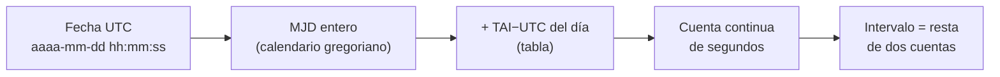

# B13-C09 — Segundos intercalares y cronología

<!-- nav:top -->
[🏠 Programa](../../../../README.md) · [📚 Bloque B13](../../../tronco-comun/B13-metrologia-tiempo-y-mediciones-cientificas.md) · [← Anterior: B13-C08 — Escalas UTC, TAI, TT y TDB](../B13-C08-escalas-utc-tai-tt-y-tdb/CLASE.md) · [Siguiente: B13-C10 — Tiempo sidéreo local y terrestre →](../B13-C10-tiempo-sidereo-local-y-terrestre/CLASE.md)
<!-- /nav -->

## 1. Ubicación, nivel y alcance

Novena clase del bloque B13. En [C08](../B13-C08-escalas-utc-tai-tt-y-tdb/CLASE.md) pasaste de UTC a otras escalas con una tabla. Aquí tratas el **segundo intercalar** con rigor y construyes la **cronología** que lo sostiene: del calendario gregoriano al **día juliano**, y de una fecha UTC a una cuenta continua de segundos. Nivel N2. Escribes un conversor de fechas con prueba de segundo intercalar. No tratas UT1 en detalle (C10) ni escalas de tiempo de otras épocas.

## 2. Por qué esta clase existe

Una nave graba un evento a las `23:59:59` del 31 de diciembre de 2016 y otro a las `00:00:00` del 1 de enero de 2017. ¿Cuánto tiempo pasó? La resta ingenua del calendario da un segundo. La respuesta correcta es dos, porque entre ambos hubo un segundo `23:59:60`. Un software que ignore ese segundo desordena registros, rompe una sincronización o desplaza una posición calculada.

La decisión central: **¿cómo cuento un intervalo exacto entre dos instantes UTC y cómo guardo una fecha de forma que no dependa de las irregularidades del calendario?**

## 3. Lo que podrás hacer al terminar

1. Convertir una fecha gregoriana en día juliano modificado (MJD) y viceversa.
2. Explicar qué es un segundo intercalar y por qué existe.
3. Contar los segundos transcurridos entre dos instantes UTC, incluyendo un `23:59:60`.
4. Distinguir una fecha válida de una inválida (por ejemplo, un `23:59:60` donde no hubo segundo intercalar).
5. Reconocer los años bisiestos del calendario gregoriano.
6. Verificar un conversor con casos de control.

La evidencia es el **conversor de fechas con prueba de segundo intercalar** del ejercicio 12 (sección 20).

## 4. Con qué llegas y cómo comprobarlo

Necesitas las escalas de [C08](../B13-C08-escalas-utc-tai-tt-y-tdb/CLASE.md), división entera y resto. Cinco preguntas:

1. ¿Cuántos días tiene febrero de un año bisiesto?
2. ¿Cuánto es `17 // 5` y `17 % 5`?
3. ¿Qué es `TAI − UTC` en 2020?
4. ¿Qué diferencia hay entre «instante» e «intervalo»?
5. ¿Cuánto es `37 + 32,184`?

<details>
<summary>Ver respuestas</summary>

1. `29`. 2. `3` y `2`. 3. `37 s`. 4. Un instante es un punto en una escala; un intervalo es la diferencia entre dos. 5. `69,184`.
</details>

Con cuatro o cinco aciertos, sigue; si no, repasa C08.

## 5. Un caso real: el segundo intercalar de fin de 2016

La tabla del IERS (S1) muestra que `TAI − UTC` pasó de `36 s` a `37 s` el 1 de enero de 2017. Para que UTC se retrasara un segundo respecto de TAI, el último minuto de 2016 tuvo 61 segundos: existió el instante `2016-12-31 23:59:60`. Es el **ejemplo conductor**: un caso real que hay que tratar sin errores.

## 6. Vocabulario

Un **segundo intercalar** es un segundo que se inserta (o, en principio, se quita) al final de un día UTC para mantener a UTC dentro de `0,9 s` de UT1 (S3). El **calendario gregoriano** es el calendario civil actual; un año es bisiesto si es divisible por 4, salvo los divisibles por 100 que no lo sean por 400 (así, 1900 no lo fue y 2000 sí). El **día juliano (JD)** es el número de días, con fracción, desde el mediodía de un origen remoto; el JD de J2000 es `2 451 545,0` (S2). El **día juliano modificado (MJD)** es `JD − 2 400 000,5` y empieza a medianoche. La **cuenta continua** es una numeración de segundos sin saltos (aquí desde 1972-01-01 00:00:00 UTC, basada en TAI). Un **instante inválido** es una fecha que no existe, como `23:59:60` donde no se insertó un segundo.

## 7. Modelo mental: calendario irregular, reloj continuo

El calendario es una etiqueta irregular (meses desiguales, años bisiestos, segundos intercalares). La cuenta continua es la regla uniforme. El conversor traduce de etiqueta a regla, midiendo siempre sobre la regla.



*Descripción textual:* una fecha UTC se convierte en MJD entero con enteros, se le suma la diferencia `TAI − UTC` de ese día y los segundos del día, y se obtiene una cuenta continua; el intervalo entre dos instantes es la resta de sus cuentas.

Analogía: transformar nombres de estación de tren en kilómetros de vía para calcular distancias. Su límite: los nombres son irregulares, pero a diferencia del tren, aquí hay un día con un segundo de más en que la etiqueta `23:59:60` aparece.

## 8. La explicación, paso a paso

### 8.1 De fecha a MJD con enteros

El algoritmo de Fliegel–Van Flandern usa solo aritmética entera: con `a = (14 − mes)//12`, `y' = año + 4800 − a`, `m' = mes + 12a − 3`, `JDN = día + (153 m' + 2)//5 + 365 y' + y'//4 − y'//100 + y'//400 − 32 045` y `MJD = JDN − 2 400 001` (a las 0 h). Con enteros no hay error de redondeo. Casos de control: `1972-01-01 → 41 317`, `2000-01-01 → 51 544` (y J2000 es `51 544,5`) y `2017-01-01 → 57 754`, que coinciden con la tabla de S1.

### 8.2 De MJD a fecha

El algoritmo inverso también es entero y se verifica con una **ida y vuelta**: para cada MJD entre `41 317` y `62 000`, `mjd(fecha(m)) = m`. Es la prueba que detecta un error de un día en meses de 30/31 días o en años bisiestos.

### 8.3 Años bisiestos

La regla gregoriana da que `1900` no es bisiesto y `2000` sí: `mjd(1900-03-01) − mjd(1900-02-28) = 1` y `mjd(2000-03-01) − mjd(2000-02-28) = 2`.

### 8.4 La cuenta continua

Con la tabla de S1 se define `cuenta = (MJD − 41 317) × 86 400 + segundos_del_día + (TAI − UTC)(fecha) − 10`. El `−10` ajusta el origen al 1 de enero de 1972 a las 00:00:00 UTC. La diferencia de dos cuentas es el intervalo exacto en segundos del SI.

### 8.5 El segundo `23:59:60`

El instante `23:59:60` solo es válido el último día en que `TAI − UTC` aumenta en una unidad al día siguiente. Con la cuenta de 8.4: `23:59:59`, `23:59:60` y `00:00:00` del día siguiente quedan separados por `1 s` cada uno. El día `2016-12-31` dura `86 401 s`.

### 8.6 Cuántos hubo y qué pasa en el futuro

Entre 1972-01-01 y 2017-01-01 hubo `27` segundos intercalares (S1: de 10 a 37). La tabla consultada (S1) indica que su última entrada es la de 2017 y que expira el 2027-06-28; el uso de segundos intercalares futuros depende de decisiones internacionales que esta clase no consultó, por eso un software debe leer una tabla actualizada y no fijarla en el código.

## 9. Magnitudes, símbolos y unidades

| Símbolo | Qué es | Unidad | Nota |
|---|---|---|---|
| `JD` | día juliano | d | J2000 = 2 451 545,0 |
| `MJD` | `JD − 2 400 000,5` | d | empieza a las 0 h |
| `TAI − UTC` | segundos intercalares acumulados | s | 10…37 |
| `cuenta` | segundos continuos desde 1972-01-01 | s | entero en este laboratorio |
| `h, mi, s` | hora, minuto, segundo | — | `s ∈ {0…59, 60}` |

## 10. Convenciones y referencias

Fechas escritas `aaaa-mm-dd` (ISO) y horas en 24 h. El MJD de una fecha corresponde a las 0 h UTC de ese día. Se trabaja con UTC desde 1972 y segundos enteros. No se tratan las fracciones de segundo dentro del segundo intercalar. Las fechas de los ejemplos son **fechas de calendario**, no mediciones.

## 11. De dónde sale lo que afirmamos

| ID | Fuente | Localizador | Respalda | Estado |
|---|---|---|---|---|
| S1 | IERS, *Leap_Second.dat* | https://hpiers.obspm.fr/iers/bul/bulc/Leap_Second.dat | Tabla `TAI − UTC` (28 entradas, de 10 s en 1972 a 37 s en 2017); expiración en cabecera | Consultada el 2026-11-05 mediante extracción automática |
| S2 | IERS, *IERS Conventions (2010)*, TN36 | https://iers-conventions.obspm.fr/content/tn36.pdf | `TT = TAI + 32,184 s`; J2000 | Texto extraído del PDF el 2026-11-05 |
| S3 | NASA/JPL NAIF, *Required Reading: Time* | https://naif.jpl.nasa.gov/pub/naif/toolkit_docs/C/req/time.html | UTC mantenida a menos de 0,9 s de UT1 con segundos intercalares | Consultada el 2026-11-05 mediante extracción automática |

Límites: las reglas del calendario gregoriano y el algoritmo de Fliegel–Van Flandern son resultados estándar sin cita en esta clase; la tabla vence el 2027-06-28.

## 12. Cómo ver el segundo intercalar

Equivalente accesible a una línea de tiempo (resultados del laboratorio):

| Instante UTC | Cuenta relativa (s) |
|---|---|
| 2016-12-31 23:59:59 | 0 |
| 2016-12-31 23:59:60 | 1 |
| 2017-01-01 00:00:00 | 2 |

Descripción larga: tres marcas consecutivas separadas por un segundo cada una; la resta ingenua de calendario ve solo dos marcas y da un segundo entre la primera y la última.

## 13. Ejemplo trabajado: el intervalo de fin de 2016

**Paso 1 · Datos.** Instantes `A = 2016-12-31 23:59:59` y `B = 2017-01-01 00:00:00` UTC.

**Paso 2 · MJD.** `MJD(A) = 57 753`, `MJD(B) = 57 754`; `TAI − UTC` vale `36` para A y `37` para B (S1).

**Paso 3 · Cuentas.** `cuenta(A) = (57 753 − 41 317) × 86 400 + 86 399 + 36 − 10`; `cuenta(B) = (57 754 − 41 317) × 86 400 + 0 + 37 − 10`.

**Paso 4 · Resta.** `cuenta(B) − cuenta(A) = 86 400 − 86 399 + 1 = 2 s`.

**Paso 5 · Sentido.** El intervalo real es de `2 s`, no `1 s`. Y el día completo `2016-12-31` dura `86 401 s`. Una resta ingenua de fechas devuelve `86 400 s`: el error de un segundo, intrascendente para una cita, equivale a unos `300 000 km` de luz y a unos `7,7 km` de recorrido de un satélite en órbita baja (velocidad `≈ 7,7 km/s`, valor de ejemplo).

## 14. Distintas formas de guardar un instante

**Fecha civil UTC** (legible, con saltos). **MJD con fracción** (compacta, pero ambigua en un día con segundo intercalar). **Cuenta continua TAI o TT** (sin saltos, ideal para cálculos). **Tiempo Unix** (ignora los segundos intercalares: no apto para intervalos exactos). Se almacena en una escala continua con su escala declarada y se muestra UTC solo al final.

## 15. Práctica guiada

**Ejercicio 1 · con los pasos indicados.** Calcula el MJD de `2020-12-01`. *Pasos:* 8.1.

<details><summary>Solución comentada</summary>

`a = 0`, `y' = 6820`, `m' = 9`; `JDN = 1 + (153 × 9 + 2)//5 + 365 × 6820 + 6820//4 − 6820//100 + 6820//400 − 32 045 = 1 + 275 + 2 489 300 + 1705 − 68 + 17 − 32 045 = 2 459 185`; `MJD = 2 459 185 − 2 400 001 = 59 184`.
</details>

**Ejercicio 2 · con una pista.** ¿Cuántos días hay entre `2000-01-01` y `2026-11-05`? *Pista:* usa MJD `51 544` y `61 349`.

<details><summary>Solución comentada</summary>

`61 349 − 51 544 = 9805` días (laboratorio).
</details>

**Ejercicio 3 · casi autónomo.** ¿Cuánto dura el día `2012-06-30`? *Pista:* hubo un segundo intercalar el 1 de julio de 2012 (S1).

<details><summary>Solución comentada</summary>

`TAI − UTC` pasó de `34` a `35` el MJD `56 109` (1 de julio de 2012): el 30 de junio tuvo `23:59:60`; dura `86 401 s` (8.5).
</details>

## 16. Práctica autónoma, transferencia e integrador

**Ejercicio 4.** ¿Es válido `2016-06-30 23:59:60`?

<details><summary>Solución comentada</summary>

No: `TAI − UTC` no cambió el 1 de julio de 2016 (valía `36` desde 2015); el laboratorio lo rechaza (8.5).
</details>

**Ejercicio 5.** ¿Cuántos días tiene febrero de 1900 y de 2000?

<details><summary>Solución comentada</summary>

`28` y `29` (8.3).
</details>

**Ejercicio 6.** Convierte `MJD 60 000` a fecha. *Ayuda:* usa el conteo desde `51 544`.

<details><summary>Solución comentada</summary>

`60 000 − 51 544 = 8456` días después del 2000-01-01: `2023-02-25` (laboratorio).
</details>

**Ejercicio 7.** ¿Cuántos segundos hay entre `2020-12-01 00:00:00` y `2000-01-01 00:00:00` UTC (resta de cuentas)?

<details><summary>Solución comentada</summary>

Días `7640`: `660 096 000 s` de calendario más `5` segundos intercalares: `660 096 005 s` (laboratorio).
</details>

**Ejercicio 8.** Si guardas fechas como «segundos Unix», ¿qué pierdes?

<details><summary>Solución comentada</summary>

La información de los segundos intercalares: el segundo `23:59:60` no existe en esa cuenta y los intervalos que lo cruzan quedan en un segundo menos (14).
</details>

**Ejercicio 9 · transferencia.** Una sonda registra telemetría cada segundo en UTC. Tras el segundo intercalar del 30 de junio de 2015 aparece una marca repetida. ¿Qué ocurrió y cómo se corrige?

<details><summary>Solución comentada</summary>

Algunos sistemas repiten `23:59:59` en vez de usar `23:59:60`. Se corrige almacenando en una escala continua (TAI/TT) y reconstruyendo UTC con la tabla; así las marcas quedan estrictamente crecientes.
</details>

**Ejercicio 10 · transferencia.** Un compañero calcula una duración en segundos como `(MJD₂ − MJD₁) × 86 400`. ¿Cuándo es incorrecta y en cuánto?

<details><summary>Solución comentada</summary>

Cuando el intervalo cruza uno o más segundos intercalares: faltan `[TAI − UTC](f₂) − [TAI − UTC](f₁)` segundos. Entre 2000 y 2020 son `5 s`.
</details>

**Ejercicio 11 · transferencia.** La tabla de S1 vence el 2027-06-28. ¿Qué debe hacer un programa que la use después de esa fecha?

<details><summary>Solución comentada</summary>

Detectar que está vencida, emitir un aviso y exigir la tabla vigente; no asumir silenciosamente que no hubo cambios (C19).
</details>

**Ejercicio 12 · integrador.** Elabora tu *conversor de fechas con prueba de segundo intercalar*: funciones calendario ↔ MJD con ida y vuelta, cuenta continua, rechazo de `23:59:60` inválidos, el caso de control `2016-12-31` (`86 401 s`) y el total de 27 segundos, con fuentes y vigencia de la tabla.

<details><summary>Solución modelo</summary>

Código y tabla de pruebas de la sección 17; casos `41 317`, `51 544`, `57 754`; `2 s` de intervalo; `86 401 s`; 27 intercalares; S1 vence 2027-06-28.
</details>

## 17. Laboratorio: calendario y segundos intercalares

El script [cronologia.py](cronologia.py) implementa las conversiones de 8.1–8.2 con enteros, la cuenta de 8.4 y el rechazo de `23:59:60` inválidos; **comprueba** 41 317 / 51 544 / 57 754, la ida y vuelta de 3 000 fechas, los bisiestos de 1900 y 2000, el día de la semana contra el módulo `datetime`, el intervalo de `2 s`, los `86 401 s` y los `27` intercalares.

**Datos:** tabla IERS (S1). **Predice antes de ejecutar:** ¿cuántos segundos hay entre `23:59:59` y `00:00:00` de fin de 2016? (dos.) **Ejecución del 2026-11-05 (Python 3.12.9):**

```text
Python 3.12.9 (biblioteca estandar)
(2000, 1, 1): MJD 51544 dia de la semana (0=lun) = 5 (sabado)
(2026, 11, 5): MJD 61349 dia de la semana (0=lun) = 3 (jueves)
23:59:59 -> 23:59:60 = 1 s ; 23:59:60 -> 00:00:00 = 1 s ; total 2 s
duracion del dia 2016-12-31 = 86401 s
segundos intercalares 1972-01-01 .. 2017-01-01 = 27
resta ingenua = 86400 s ; correcta = 86401 s
Pruebas superadas.
```

```bash
python programa/clases/B13/B13-C09-segundos-intercalares-y-cronologia/cronologia.py
```

**Límites:** UTC desde 1972; segundos enteros; tabla vigente hasta 2027-06-28.

## 18. Errores frecuentes y cómo corregirlos

**Restar fechas con aritmética de calendario.** Se corrige con los ejercicios 3 y 10.

**Aceptar un `23:59:60` donde no existió.** Se corrige con el ejercicio 4.

**Guardar instantes en tiempo Unix para cálculos exactos.** Se corrige con los ejercicios 8 y 9.

**Olvidar que 1900 no fue bisiesto.** Se corrige con el ejercicio 5.

**Usar una tabla vencida sin aviso.** Se corrige con el ejercicio 11.

## 19. Cómo sabrás que vas bien

Tras 8.1: ¿calculas el MJD de una fecha a mano? Si no, ejercicio 1. Tras 8.4: ¿cuenta continua de dos instantes? Si no, ejercicio 3. Tras 8.5: ¿rechazas un `23:59:60` inválido? Si dudas, ejercicio 4. Tras el laboratorio: ¿por qué la ida y vuelta detecta errores? (porque un error de calendario rompe la identidad `mjd(fecha(m)) = m`).

## 20. Qué entregas y cómo se evalúa

El producto es tu **conversor de fechas con prueba de segundo intercalar** (ejercicio 12).

| Criterio | Inicial | En desarrollo | Logrado | Destacado |
|---|---|---|---|---|
| Calendario | Con errores | Sin bisiestos | MJD correcto con ida y vuelta | Verifica contra otra biblioteca |
| Segundo intercalar | Lo ignora | Lo acepta siempre | Lo valida con la tabla | Cubre día y total |
| Intervalos | Resta ingenua | Parcial | Cuenta continua | Explica el error de la resta |
| Vigencia | Sin aviso | Menciona | Detecta tabla vencida | Propone actualización |
| Fuentes | Sin fuente | Sin fecha | Con localizador y fecha | Declara lo no consultado |

**Condiciones críticas (no se compensan con promedio):** no restar fechas UTC con aritmética de calendario; declarar la vigencia de la tabla; citar solo fuentes consultadas.

## 21. Ética, seguridad y límites

Un registro mal ordenado por un segundo intercalar puede invalidar un análisis de telemetría o una sincronización; en operaciones se usan bibliotecas validadas y tablas vigentes. Esta clase es educativa. Accesibilidad: tablas equivalentes a las líneas de tiempo, fórmulas en texto, ejercicios sin conexión.

## 22. Para cerrar y seguir

El calendario es una etiqueta irregular; el MJD y la cuenta continua son reglas uniformes; el segundo `23:59:60` existe solo donde la tabla lo dice; y un intervalo exacto se obtiene restando cuentas continuas. Queda una pregunta: el reloj civil sigue a la rotación de la Tierra, que es lo que mide el telescopio, ¿cómo se pasa de la hora al ángulo de rotación?

**Glosario español–inglés.** segundo intercalar · *leap second*; día juliano · *Julian date*; día juliano modificado · *modified Julian date*; año bisiesto · *leap year*; cuenta continua · *continuous count*; cronología · *chronology*; instante inválido · *invalid instant*.

**Continuidad.** B13-C10 reutiliza tu capacidad de **pasar de UTC a una cuenta de tiempo uniforme** para calcular el ángulo de rotación terrestre.

**Referencias:** ver sección 11.

<!-- nav:bottom -->
---

[← Anterior: B13-C08 — Escalas UTC, TAI, TT y TDB](../B13-C08-escalas-utc-tai-tt-y-tdb/CLASE.md) · [📚 Bloque B13](../../../tronco-comun/B13-metrologia-tiempo-y-mediciones-cientificas.md) · [Siguiente: B13-C10 — Tiempo sidéreo local y terrestre →](../B13-C10-tiempo-sidereo-local-y-terrestre/CLASE.md)
<!-- /nav -->
