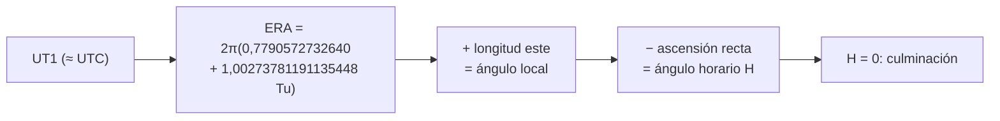

# B13-C10 — Tiempo sidéreo local y terrestre

<!-- nav:top -->
[🏠 Programa](../../../../README.md) · [📚 Bloque B13](../../../tronco-comun/B13-metrologia-tiempo-y-mediciones-cientificas.md) · [← Anterior: B13-C09 — Segundos intercalares y cronología](../B13-C09-segundos-intercalares-y-cronologia/CLASE.md) · [Siguiente: B13-C11 — Sistemas de referencia terrestres →](../B13-C11-sistemas-de-referencia-terrestres/CLASE.md)
<!-- /nav -->

## 1. Ubicación, nivel y alcance

Décima clase del bloque B13. Tras fijar cómo se cuenta el tiempo (C06–C09), ahora relacionas el tiempo con la **orientación de la Tierra**: el ángulo que ha girado, el **día sidéreo** y el **ángulo horario local** de una dirección celeste. Nivel N2. Usas el **ángulo de rotación terrestre (ERA)** que define la convención del IERS como medida del ángulo de la Tierra respecto de un origen celeste. No calculas precesión ni nutación, ni conviertes catálogos; y no usas la fórmula clásica del tiempo sidéreo medio de Greenwich, que esta clase no consultó.

## 2. Por qué esta clase existe

Un telescopio en el desierto debe saber cuándo un objeto pasa por su meridiano, que es cuando está más alto y se observa mejor. Esa hora no es la del reloj civil: el cielo se adelanta casi cuatro minutos cada día. Y una antena de seguimiento debe orientarse sabiendo cuánto ha girado la Tierra desde un instante de referencia.

La decisión central: **¿en qué instante culmina esta dirección en mi longitud, y qué error de orientación produce un error de tiempo dado?**

## 3. Lo que podrás hacer al terminar

1. Definir el ángulo de rotación terrestre (ERA) y su fórmula convencional.
2. Calcular el día sidéreo a partir de la tasa de rotación.
3. Obtener el ángulo local sumando la longitud este.
4. Calcular el ángulo horario de una dirección y el instante de su culminación.
5. Traducir un error de UT1 en un error angular.
6. Verificar los cálculos con identidades exactas.

La evidencia es la **tabla de ángulo de rotación y culminación** del ejercicio 12 (sección 20).

## 4. Con qué llegas y cómo comprobarlo

Necesitas escalas de tiempo y días julianos ([C08](../B13-C08-escalas-utc-tai-tt-y-tdb/CLASE.md), [C09](../B13-C09-segundos-intercalares-y-cronologia/CLASE.md)), ángulos y módulo. Cinco preguntas:

1. ¿Cuántos grados son `0,25` de vuelta?
2. ¿Cuánto es `1,3 mod 1`?
3. ¿Cuántos grados por hora gira algo que da una vuelta cada 24 h?
4. Convierte `−70,4°` a horas (`15° = 1 h`).
5. ¿Cuál es el JD de J2000?

<details>
<summary>Ver respuestas</summary>

1. `90°`. 2. `0,3`. 3. `15°/h`. 4. `−4,693 h`. 5. `2 451 545,0`.
</details>

Con cuatro o cinco aciertos, sigue; si no, repasa C09.

## 5. Un caso real: culminación de una fuente en Atacama

Un observatorio de ejemplo (longitud `−70,4°`, valor sintético aproximado de un sitio del desierto de Atacama) quiere observar una fuente de ascensión recta `12 h` en la noche del 5 de noviembre de 2026. La ascensión recta se mide aquí desde el origen celeste del IERS (el origen no rotante, CIO). La clase calcula a qué hora UTC culmina. Es el **ejemplo conductor**.

## 6. Vocabulario

El **ángulo de rotación terrestre (ERA)** es el ángulo entre un origen celeste de referencia y un origen terrestre, que describe la rotación de la Tierra en torno a su eje; la convención IERS lo define como una función lineal de `UT1` (S1, ec. 5.14). **UT1** es la escala de tiempo ligada a la rotación de la Tierra; UTC se mantiene a menos de `0,9 s` de UT1 (S1; S2). Un **día sidéreo** (aquí, el periodo de rotación respecto del origen celeste) es el tiempo en que el ERA avanza una vuelta. La **longitud este** de un lugar se suma al ERA para obtener el ángulo local. El **ángulo horario** `H` de una dirección es el ángulo local menos su ascensión recta: `H = 0` en la culminación. `Tu` es el número de días de UT1 desde J2000.0.

## 7. Modelo mental: la Tierra como plato giratorio

La Tierra es un plato que gira. El ERA es el ángulo del plato respecto de un punto fijo del cielo. Cada lugar está en un punto del borde, desplazado por su longitud. Cuando ese punto pasa frente a una dirección celeste, esa dirección culmina.



*Descripción textual:* desde UT1 se obtiene el ERA con la fórmula convencional; se suma la longitud este para el ángulo local; se resta la ascensión recta del objeto para tener el ángulo horario; la culminación ocurre cuando `H = 0`.

Analogía: el plato giratorio con un punto fijo en el techo. Su límite: el plato real no gira del todo uniforme (varía con la atmósfera y las mareas, lo cual mide el IERS), y el eje se mueve (precesión, nutación, movimiento polar).

## 8. La explicación, paso a paso

### 8.1 La fórmula convencional

Según las Convenciones IERS 2010 (S1, ec. 5.14), `ERA(Tu) = 2π (0,779 057 273 264 0 + 1,002 737 811 911 354 48 Tu)` radianes, con `Tu = JD(UT1) − 2 451 545,0`. Las dos constantes (`0,7790572732640` vueltas en J2000.0 y `1,00273781191135448` vueltas por día de UT1) son **definiciones** (S1, Tabla 1.1). En J2000.0 el ERA vale `0,7790572732640 × 360° = 280,4606°`.

### 8.2 Una forma numéricamente estable

Para reducir el error de redondeo con `Tu` grande, el IERS da una forma equivalente módulo vuelta (S1, ec. 5.15): `ERA = 2π(fracción del JD de UT1 + 0,7790572732640 + 0,00273781191135448 Tu)`. El laboratorio comprueba que ambas coinciden mejor que `10⁻⁹` de vuelta.

### 8.3 El día sidéreo

El ERA avanza `1,00273781191135448` vueltas por día de UT1, de modo que una vuelta completa tarda `86 400/1,00273781191135448 = 86 164,0989 s = 23,934 472 h`: unos `235,9 s` menos que un día solar medio. Equivale a `0,985 612°` de giro «extra» por día solar, o `236,5 s` si se mide en segundos sidéreos: `236,5 × 0,997 27 = 235,9 s`.

### 8.4 Ángulo local y ángulo horario

El ángulo local es `θ = ERA + λ`, con `λ` la longitud este. El ángulo horario de una dirección de ascensión recta `α` es `H = θ − α`. Con `λ = −70,4°` y `α = 180°` (12 h), la culminación ocurre cuando `ERA = α − λ = 250,4°`.

### 8.5 Instante de la culminación

El 5 de noviembre de 2026 a las `00:00:00` UTC, el ERA vale `43,896 297°`. Como el ERA crece `360,986°` por día, el tiempo hasta alcanzar `250,4°` es `(250,4 − 43,896)/360,986 d = 0,572 d = 13,73 h`. El laboratorio da `13:43:45,6 UTC` (usando UTC en lugar de UT1).

### 8.6 Error de UT1 y su efecto

El ERA avanza `15,04107°/h = 15,04107″/s` (segundos de arco por segundo de tiempo). Como `|UT1 − UTC| < 0,9 s`, usar UTC como UT1 introduce un error de ERA de hasta `0,9 × 15,04 = 13,5″` (segundos de arco), lo que equivale a unos `0,4 m` en la superficie sobre el ecuador (a `465 m/s`, C11). Para antenas pequeñas es irrelevante; para geodesia, no.

## 9. Magnitudes, símbolos y unidades

| Símbolo | Qué es | Unidad | Valor |
|---|---|---|---|
| `Tu` | `JD(UT1) − 2 451 545,0` | d | — |
| `θ₀` | ERA en J2000.0 | vuelta | `0,7790572732640` (definida) |
| `ω_v` | tasa del ERA | vuelta/día UT1 | `1,00273781191135448` (definida) |
| `ERA` | ángulo de rotación terrestre | vuelta o grados | — |
| `λ` | longitud este | grados | `−70,4` (ejemplo) |
| `α` | ascensión recta (desde el CIO) | grados | 180 (ejemplo) |
| `H` | ángulo horario | grados | `θ − α` |

## 10. Convenciones y referencias

Ángulos en grados y fracciones de vuelta; el este es positivo; `15° = 1 h` de ángulo horario. Se usa UTC como aproximación de UT1 (error ≤ `0,9 s`). Las ascensiones rectas se toman respecto del origen celeste, sin convertir desde un catálogo. La latitud, la refracción y el movimiento polar no intervienen. El observatorio y la fuente son **ejemplos sintéticos**.

## 11. De dónde sale lo que afirmamos

| ID | Fuente | Localizador | Respalda | Estado |
|---|---|---|---|---|
| S1 | IERS, *IERS Conventions (2010)*, TN36, Tabla 1.1 y §5.5.3 (ecs. 5.14–5.15) | https://iers-conventions.obspm.fr/content/tn36.pdf | Fórmula del ERA y sus constantes; `|UT1 − UTC| < 0,9 s` (glosario) | Texto extraído del PDF el 2026-11-05 |
| S2 | NASA/JPL NAIF, *Required Reading: Time* | https://naif.jpl.nasa.gov/pub/naif/toolkit_docs/C/req/time.html | UTC mantenida a menos de 0,9 s de UT1 | Consultada el 2026-11-05 mediante extracción automática |

Límites: no se consultó la relación entre el ERA y el tiempo sidéreo medio de Greenwich (que difieren por un término lento, por lo que esta clase no los intercambia); el observatorio y la fuente son **sintéticos**; la conversión de coordenadas de catálogo no se trata.

## 12. Cómo ver el ángulo de rotación

Equivalente accesible a un reloj de ángulo (resultados del laboratorio, longitud −70,4°):

| Ascensión recta | Hora UTC de culminación el 2026-11-05 |
|---|---|
| 0 h | 01:45:43,5 |
| 6 h | 07:44:44,5 |
| 12 h | 13:43:45,6 |
| 18 h | 19:42:46,6 |

Descripción larga: cada 6 h de ascensión recta se adelantan `6/1,00274 h = 5 h 59 min 1 s` de tiempo civil: la culminación se adelanta cada día unos `235,9 s` (3 min 56 s) de tiempo civil.

## 13. Ejemplo trabajado: culminación de la fuente de 12 h

**Paso 1 · Datos.** `λ = −70,4°`, `α = 180°`; fecha `2026-11-05`.

**Paso 2 · ERA necesario.** `ERA = α − λ = 250,4°`.

**Paso 3 · ERA a las 0 h UTC.** `JD = 2 461 349,5`; `Tu = 9804,5 d`; `ERA = 0,7790572732640 + 1,00273781191135448 × 9804,5 (mod 1) = 0,12193 vueltas = 43,896°`.

**Paso 4 · Tiempo hasta culminar.** `(250,4 − 43,896)/360,98565 = 0,57206 d = 13,729 h = 13 h 43 min 45 s`.

**Paso 5 · Sentido.** `13:43:45,6 UTC` es el instante calculado con UTC≈UT1; el resultado merece segundos, no décimas, porque `UT1 − UTC` puede ser de hasta `0,9 s`. Al día siguiente la culminación ocurrirá `235,9 s` antes en hora civil.

## 14. Distintas formas de obtener la orientación

**ERA con fórmula convencional** (esta clase): simple y exacta como definición. **Tiempo sidéreo medio y aparente** (convenciones históricas): usan términos adicionales y no se trabajaron aquí. **Productos del IERS** (UT1−UTC y movimiento polar publicados): necesarios para precisión de milisegundos de arco. **Bibliotecas validadas** (SOFA/ERFA, SPICE) para operaciones. Se elige según la exactitud requerida.

## 15. Práctica guiada

**Ejercicio 1 · con los pasos indicados.** ¿Cuánto vale el ERA en J2000.0 en grados? *Pasos:* 8.1.

<details><summary>Solución comentada</summary>

`0,7790572732640 × 360 = 280,4606°`.
</details>

**Ejercicio 2 · con una pista.** ¿Cuánto vale el ERA medio día de UT1 después de J2000.0? *Pista:* `Tu = 0,5`.

<details><summary>Solución comentada</summary>

`0,7790573 + 1,0027378 × 0,5 = 1,2804262 → 0,2804262` vueltas `= 100,95°`.
</details>

**Ejercicio 3 · casi autónomo.** Convierte la longitud `−70,4°` en horas y en minutos de tiempo.

<details><summary>Solución comentada</summary>

`−70,4/15 = −4,693 h = −4 h 41,6 min`.
</details>

## 16. Práctica autónoma, transferencia e integrador

**Ejercicio 4.** Calcula el día sidéreo en segundos y en horas.

<details><summary>Solución comentada</summary>

`86 400/1,00273781191135448 = 86 164,0989 s = 23,9345 h` (8.3).
</details>

**Ejercicio 5.** Si `ERA = 200°`, `λ = −70°` y `α = 100°`, ¿cuánto vale el ángulo horario y en horas?

<details><summary>Solución comentada</summary>

`H = 200 − 70 − 100 = 30° = 2 h` (8.4): el objeto ya culminó hace 2 h.
</details>

**Ejercicio 6.** ¿Cuántos grados avanza el ERA en 6 h de tiempo civil?

<details><summary>Solución comentada</summary>

`6 × 15,04107 = 90,2464°` (8.6).
</details>

**Ejercicio 7.** Dos estaciones están a `10°` de longitud de diferencia. ¿Cuánto tiempo separa la culminación de un mismo objeto?

<details><summary>Solución comentada</summary>

`10°/15 = 40 min` de ángulo horario, o `39,9 min` de tiempo civil (`40/1,00274`).
</details>

**Ejercicio 8.** ¿Qué error de ERA produce `UT1 − UTC = 0,4 s`?

<details><summary>Solución comentada</summary>

`0,4 × 15,04107 = 6,02″` (8.6).
</details>

**Ejercicio 9 · transferencia.** La fuente de 12 h culmina el 5 de noviembre a las `13:43:45,6`. ¿A qué hora lo hará el 6 de noviembre?

<details><summary>Solución comentada</summary>

`13:43:45,6 − 235,9 s ≈ 13:39:49,7 UTC`. (Se adelanta cerca de 4 min por día.)
</details>

**Ejercicio 10 · transferencia.** Un compañero afirma que «el día sidéreo dura 24 h». Refútalo con 8.3 y calcula el error acumulado en 30 días si lo usara.

<details><summary>Solución comentada</summary>

Dura `23,9345 h`; en 30 días, `30 × 235,9 s = 7077 s ≈ 1,97 h`: un objeto culminaría casi 2 h antes de lo previsto.
</details>

**Ejercicio 11 · transferencia.** Una antena de apuntamiento usa UTC en lugar de UT1. ¿Qué error angular máximo introduce y qué desplazamiento sobre el ecuador es (radio `6 378 137 m`)?

<details><summary>Solución comentada</summary>

`13,5″ = 6,56 × 10⁻⁵ rad`; `× 6 378 137 m = 0,42 m` (8.6).
</details>

**Ejercicio 12 · integrador.** Elabora tu *tabla de ángulo de rotación y culminación*: el ERA a las `00:00 UTC` de una fecha tuya, las horas de culminación para `α = 0, 6, 12, 18 h` en una longitud elegida, la comprobación `ERA + λ − α = 0` y el error por usar UTC en lugar de UT1, con fuentes y rotulado de ejemplos.

<details><summary>Solución modelo</summary>

Para `λ = −70,4°`, `2026-11-05`: ERA `43,896°`; culminaciones `01:45:43,5`, `07:44:44,5`, `13:43:45,6`, `19:42:46,6` UTC; residuo `< 10⁻⁶°`; error `≤ 13,5″`.
</details>

## 17. Laboratorio: ERA y culminación

El script [angulo_de_rotacion.py](angulo_de_rotacion.py) implementa las ecuaciones 5.14 y 5.15 de S1, **comprueba** `ERA(J2000) = 0,7790572732640`, que tras un día sidéreo el ángulo vuelve al mismo valor y que ambas formas coinciden (`< 10⁻⁹` vueltas), y localiza por bisección la culminación comprobando `ERA + λ − α = 0`.

**Datos:** constantes definidas del IERS; observatorio de ejemplo. **Predice antes de ejecutar:** ¿cuánto dura el día sidéreo? (`≈ 23,934 h`.) **Ejecución del 2026-11-05 (Python 3.12.9):**

```text
Python 3.12.9 (biblioteca estandar)
dia sidereo = 86164.0989 s = 23.934472 h ; acortamiento 235.9011 s/dia
ERA(J2000) = 280.460618 grados
giro extra por dia solar = 0.985612 grados = 236.547 s de tiempo (el dia sidereo es mas corto)
culminacion (RA=12h, lon=-70.4) el 2026-11-05 a las 13:43:45.6 UTC (aprox UT1)
0.9 s de UT1-UTC = 13.54 segundos de arco
Pruebas superadas.
```

```bash
python programa/clases/B13/B13-C10-tiempo-sidereo-local-y-terrestre/angulo_de_rotacion.py
```

**Límites:** UTC ≈ UT1; sin movimiento polar ni nutación; ascensión recta respecto del CIO; los `236,5 s` están en segundos sidéreos, por eso no coinciden con los `235,9 s` de acortamiento del día.

## 18. Errores frecuentes y cómo corregirlos

**Pensar que el día sidéreo dura 24 h.** Se corrige con los ejercicios 4 y 10.

**Olvidar el signo de la longitud (este positivo).** Se corrige con el ejercicio 3.

**Mezclar el ERA con el tiempo sidéreo medio de Greenwich.** Se aclara en las secciones 1 y 11.

**Usar UTC como UT1 sin cuantificar el error.** Se corrige con los ejercicios 8 y 11.

**Confundir ángulo horario con ascensión recta.** Se corrige con el ejercicio 5.

## 19. Cómo sabrás que vas bien

Tras 8.1: ¿calculas el ERA en J2000.0? Si no, ejercicio 1. Tras 8.4: ¿calculas el ángulo horario? Si no, ejercicio 5. Tras 8.5: ¿calculas la hora de culminación? Si dudas, repasa el ejemplo trabajado. Tras el laboratorio: ¿por qué hay dos formas de la misma fórmula? (para reducir el error de redondeo con `Tu` grande).

## 20. Qué entregas y cómo se evalúa

El producto es tu **tabla de ángulo de rotación y culminación** (ejercicio 12).

| Criterio | Inicial | En desarrollo | Logrado | Destacado |
|---|---|---|---|---|
| ERA | Sin fórmula | Con errores | Correcto con la ecuación | Comprueba las dos formas |
| Día sidéreo | `24 h` | Aproximado | `86 164,0989 s` | Explica el acortamiento |
| Culminación | Sin método | Sin verificar | Instante con `H = 0` | Cuantifica el error UT1 |
| Convenciones | Sin signos | Parciales | Longitud este positiva, CIO | Declara lo no tratado |
| Fuentes | Sin fuente | Sin fecha | Con localizador y fecha | Rotula ejemplos |

**Condiciones críticas (no se compensan con promedio):** declarar la aproximación UTC ≈ UT1; no mezclar ERA con el tiempo sidéreo clásico; citar solo fuentes consultadas.

## 21. Ética, seguridad y límites

Una hora de culminación equivocada hace perder una ventana de observación o desorienta una antena; para operaciones se usan los productos oficiales del IERS y bibliotecas validadas. Observar el Sol exige filtros certificados (B01). Accesibilidad: tablas equivalentes al reloj de ángulo, fórmulas en texto, ejercicios sin conexión.

## 22. Para cerrar y seguir

El ERA es una función lineal de UT1; el día sidéreo dura `23,9345 h`; el ángulo local suma la longitud este; la culminación ocurre con `H = 0`; y un error de UT1 se convierte en un error angular de `15″` por segundo. Queda una pregunta: ¿cómo se fija un punto sobre la Tierra de forma que dos usuarios obtengan las mismas coordenadas?

**Glosario español–inglés.** ángulo de rotación terrestre · *Earth Rotation Angle*; día sidéreo · *sidereal day*; ángulo horario · *hour angle*; ascensión recta · *right ascension*; culminación · *culmination (transit)*; UT1 · *UT1*; longitud este · *east longitude*.

**Continuidad.** B13-C11 reutiliza tu capacidad de **referir una orientación a un origen y una convención** para definir sistemas de referencia terrestres.

**Referencias:** ver sección 11.

<!-- nav:bottom -->
---

[← Anterior: B13-C09 — Segundos intercalares y cronología](../B13-C09-segundos-intercalares-y-cronologia/CLASE.md) · [📚 Bloque B13](../../../tronco-comun/B13-metrologia-tiempo-y-mediciones-cientificas.md) · [Siguiente: B13-C11 — Sistemas de referencia terrestres →](../B13-C11-sistemas-de-referencia-terrestres/CLASE.md)
<!-- /nav -->
