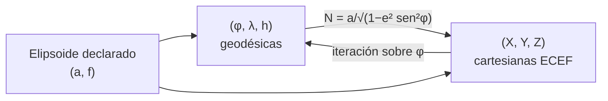

# B13-C11 — Sistemas de referencia terrestres

<!-- nav:top -->
[🏠 Programa](../../../../README.md) · [📚 Bloque B13](../../../tronco-comun/B13-metrologia-tiempo-y-mediciones-cientificas.md) · [← Anterior: B13-C10 — Tiempo sidéreo local y terrestre](../B13-C10-tiempo-sidereo-local-y-terrestre/CLASE.md) · [Siguiente: B13-C12 — Incertidumbre expandida →](../B13-C12-incertidumbre-expandida/CLASE.md)
<!-- /nav -->

## 1. Ubicación, nivel y alcance

Undécima clase del bloque B13. En [C10](../B13-C10-tiempo-sidereo-local-y-terrestre/CLASE.md) relacionaste el tiempo con el giro de la Tierra. Ahora fijas **dónde está un punto sobre la Tierra**: qué es un sistema de referencia terrestre, cómo lo define el IERS, y cómo se pasa de **coordenadas geodésicas** (latitud, longitud, altura) a **coordenadas cartesianas terrestres** (X, Y, Z) con un elipsoide declarado. Nivel N2. No tratas la determinación de marcos por técnicas espaciales ni el geoide.

## 2. Por qué esta clase existe

Una estación terrestre transmite a un satélite; el software de seguimiento necesita su posición en X, Y, Z. El técnico de campo tiene su posición en latitud, longitud y altura. Si ambos usan elipsoides o alturas distintas sin declararlo, la antena apunta con un error de metros que el seguimiento no corrige.

La decisión central: **¿qué sistema y qué elipsoide usa cada dato, y cómo convierto sin perder metros?**

## 3. Lo que podrás hacer al terminar

1. Explicar qué es el ITRS y qué es una realización (ITRF).
2. Enunciar las condiciones que fijan el ITRS: origen, escala, orientación y su evolución.
3. Convertir latitud, longitud y altura geodésicas a X, Y, Z con GRS80.
4. Invertir la conversión por iteración y verificar la ida y vuelta.
5. Distinguir latitud geodésica y geocéntrica.
6. Calcular la velocidad de un punto por la rotación terrestre.

La evidencia es el **conversor de coordenadas con ida y vuelta** del ejercicio 12 (sección 20).

## 4. Con qué llegas y cómo comprobarlo

Necesitas trigonometría ([B04](../../../tronco-comun/B04-algebra-trigonometria-y-geometria-espacial.md)) y el ángulo de rotación ([C10](../B13-C10-tiempo-sidereo-local-y-terrestre/CLASE.md)). Cinco preguntas:

1. ¿Cuánto es `sen 90°` y `cos 0°`?
2. ¿Qué es un elipsoide de revolución?
3. Si `a = 6378137` y `f = 1/298,257`, ¿cuánto es `a(1 − f)`?
4. ¿Qué mide la latitud?
5. ¿Qué unidad tiene `ω = 7,292 115 × 10⁻⁵`?

<details>
<summary>Ver respuestas</summary>

1. `1` y `1`. 2. Una superficie que se obtiene al girar una elipse sobre uno de sus ejes. 3. `≈ 6 356 752 m`. 4. El ángulo entre la vertical (normal al elipsoide) y el plano ecuatorial. 5. rad/s.
</details>

Con cuatro o cinco aciertos, sigue; si no, repasa B04.

## 5. Un caso real: una estación de seguimiento en Atacama

Una estación de ejemplo está a latitud `−24,6°`, longitud `−70,4°` y altura elipsoidal `2500 m` (valores sintéticos aproximados de un sitio del desierto de Atacama, no de un instrumento concreto). Hay que darla en X, Y, Z del sistema terrestre para el software de seguimiento. Es el **ejemplo conductor**.

## 6. Vocabulario

Un **sistema de referencia terrestre geocéntrico (GTRS)** tiene su origen en el centro de masas de toda la Tierra, incluidos océanos y atmósfera, y gira con ella (S1, §4.1.4). El **Sistema Internacional de Referencia Terrestre (ITRS)** es el GTRS específico definido por el IERS con cuatro condiciones: es geocéntrico; su unidad de longitud es el metro SI y su escala es coherente con TCG; su orientación inicial es la del BIH en 1984,0; y su evolución temporal no tiene rotación neta respecto de los movimientos tectónicos horizontales (S1, §4.1.4). Una **realización** del ITRS se llama **ITRF** (*International Terrestrial Reference Frame*): coordenadas y velocidades de estaciones que materializan el sistema (S1, §4.1.5). Un **elipsoide** es una figura matemática de la Tierra con semieje mayor `a` y aplanamiento `f`. **GRS80** es el elipsoide con `a = 6 378 137 m` y `1/f = 298,257 222 101` (S1, Tabla 1.2). La **latitud geodésica** `φ` es el ángulo de la normal al elipsoide con el plano ecuatorial; la **longitud** `λ`, el ángulo desde el meridiano origen; la **altura elipsoidal** `h`, la distancia a lo largo de la normal. **ECEF** (*Earth-centered, Earth-fixed*) designa coordenadas cartesianas terrestres.

## 7. Modelo mental: tres coordenadas, un punto

Un punto se puede nombrar de dos modos equivalentes: por **dónde está sobre el elipsoide y a qué altura** (φ, λ, h) o por **tres distancias** a lo largo de ejes fijados a la Tierra (X, Y, Z). La conversión es una función exacta entre ambos modos, una vez fijado el elipsoide.



*Descripción textual:* con un elipsoide declarado, las coordenadas geodésicas se convierten a cartesianas con una fórmula cerrada y se recuperan por iteración; ambas son versiones del mismo punto.

Analogía: dirección postal frente a coordenadas del plano. Su límite: la dirección postal es un convenio local; aquí la «altura» es sobre un elipsoide y no sobre el nivel del mar (geoide), lo que exige declarar cuál se usa.

## 8. La explicación, paso a paso

### 8.1 El elipsoide

GRS80 fija `a` y `1/f`. De ahí salen el semieje menor `b = a(1 − f) = 6 356 752,3141 m` y la excentricidad al cuadrado `e² = f(2 − f) = 0,006 694 380 023`. En el ecuador el radio es `a`; en el polo, `b`: la Tierra es ligeramente achatada (`a − b = 21,4 km`).

### 8.2 De geodésicas a cartesianas

Se define el **radio de curvatura vertical** `N = a/√(1 − e² sen²φ)`. Entonces `X = (N + h) cos φ cos λ`, `Y = (N + h) cos φ sen λ` y `Z = (N(1 − e²) + h) sen φ`. Casos de control: `(0°, 0°, 0)` da `(a, 0, 0)`; `(90°, ·, 0)` da `Z = b`; y todo punto de superficie (`h = 0`) cumple `(X² + Y²)/a² + Z²/b² = 1`.

### 8.3 La inversa

Dados X, Y, Z: `λ = atan2(Y, X)`, `p = √(X² + Y²)`; se inicializa `φ = atan2(Z, p(1 − e²))` y se itera `h = p/cos φ − N`, `φ = atan2(Z, p(1 − e² N/(N + h)))` hasta que `φ` deje de cambiar. Converge en pocas iteraciones. En una malla de 2600 puntos (latitud −89° a 89°, longitud −180° a 180°, alturas de −400 m a 700 km) el peor error de ida y vuelta es `2,8 × 10⁻⁹ m`.

### 8.4 La estación de ejemplo

Con `(−24,6°, −70,4°, 2500 m)`: `X = 1 947 253,504 m`, `Y = −5 468 523,154 m`, `Z = −2 639 893,472 m`. La inversa recupera `φ = −24,600 000 000°`, `λ = −70,400 000 000°`, `h = 2500,0000 m`.

### 8.5 Latitud geodésica y geocéntrica

La latitud geocéntrica es el ángulo entre el plano ecuatorial y la línea al centro; difiere de la geodésica porque la normal al elipsoide no pasa por el centro. A `45°` geodésicos, la geocéntrica es `44,8076°`: una diferencia de `0,192°` (unos `21 km` a lo largo de un meridiano). Usar una en lugar de la otra produce errores de kilómetros.

### 8.6 Velocidad por la rotación

Un punto fijo en el sistema terrestre se mueve respecto del cielo con `v = ω √(X² + Y²)`, con `ω = 7,292 115 × 10⁻⁵ rad/s` (valor nominal de GRS80, S1 Tabla 1.2). En el ecuador, `465,10 m/s`; en la estación de ejemplo, `423,30 m/s`; a `60°` de latitud, `233,1 m/s`. Esta velocidad importa al lanzar o al apuntar a un satélite.

## 9. Magnitudes, símbolos y unidades

| Símbolo | Qué es | Unidad | Valor |
|---|---|---|---|
| `a` | semieje mayor | m | `6 378 137` (GRS80) |
| `1/f` | inverso del aplanamiento | — | `298,257 222 101` |
| `b`, `e²` | semieje menor, excentricidad² | m; — | `6 356 752,3141`; `0,006 694 380 023` |
| `φ, λ, h` | latitud, longitud (este +), altura elipsoidal | °; °; m | ejemplos |
| `N` | radio de curvatura vertical | m | `a/√(1 − e² sen²φ)` |
| `X, Y, Z` | coordenadas ECEF | m | — |
| `ω` | velocidad angular de la Tierra | rad/s | `7,292 115 × 10⁻⁵` |

## 10. Convenciones y referencias

Longitud este positiva; latitud norte positiva; alturas **elipsoidales** (no sobre el nivel del mar). Eje `Z` hacia el polo, `X` hacia el meridiano origen en el ecuador. No se consideran movimiento de placas, mareas ni la época de las coordenadas. TN36 usa valores distintos de `a` para su propio sistema (`6 378 136,6 m`, valor de «marea cero»; S1 Tabla 1.1) y GRS80 para el elipsoide convencional: `a` difiere `0,4 m` y hay que declarar cuál se usa. La estación es un **ejemplo sintético**.

## 11. De dónde sale lo que afirmamos

| ID | Fuente | Localizador | Respalda | Estado |
|---|---|---|---|---|
| S1 | IERS, *IERS Conventions (2010)*, TN36, Tabla 1.1, Tabla 1.2 (GRS80), §4.1.4–4.1.5 | https://iers-conventions.obspm.fr/content/tn36.pdf | Condiciones del ITRS; ITRF como realización; `a`, `1/f`, `ω` de GRS80; `a_E` de la Tabla 1.1 | Texto extraído del PDF el 2026-11-05 |

Límites: las fórmulas de conversión son resultados geodésicos estándar sin cita en esta clase; no se consultó la web del servicio ITRS (no abrió una de las páginas), por lo que no se describe ITRF2020 ni sus parámetros; la estación es **sintética**.

## 12. Cómo ver la conversión

Equivalente accesible a un esquema de ejes:

| Punto | φ, λ, h | X (m) | Y (m) | Z (m) |
|---|---|---|---|---|
| Ecuador | 0°, 0°, 0 | 6 378 137,000 | 0 | 0 |
| Polo norte | 90°, 0°, 0 | ≈ 0 | 0 | 6 356 752,314 |
| 45° N | 45°, 0°, 0 | 4 517 590,879 | 0 | 4 487 348,409 |
| Estación (ejemplo) | −24,6°, −70,4°, 2500 | 1 947 253,504 | −5 468 523,154 | −2 639 893,472 |

Descripción larga: el ecuador está a `a` sobre el eje X; el polo, a `b` sobre el eje Z; a 45° N, X y Z son casi iguales; la estación tiene Y y Z negativas por estar al oeste y al sur.

## 13. Ejemplo trabajado: la estación en cartesianas

**Paso 1 · Datos.** `φ = −24,6°`, `λ = −70,4°`, `h = 2500 m`; GRS80.

**Paso 2 · Radio vertical.** `sen²φ = 0,17325`; `N = 6 378 137/√(1 − 0,006 694 38 × 0,17325) = 6 378 137/0,999 420 = 6 381 838 m` (con redondeo a 6 cifras; el script usa precisión completa).

**Paso 3 · Componentes.** `X = (N + h) cos φ cos λ`, `Y = (N + h) cos φ sen λ`, `Z = (N(1 − e²) + h) sen φ`; el laboratorio da `(1 947 253,504; −5 468 523,154; −2 639 893,472) m`.

**Paso 4 · Comprobación.** La inversa devuelve `h = 2500,0000 m` y `φ`, `λ` iguales hasta `10⁻⁹°`; el módulo del vector es `6 376 956,9 m`, entre `b` y `a` más `h`, como corresponde.

**Paso 5 · Sentido.** Con `a` y `1/f` dados, el resultado merece milímetros (la conversión es exacta; la incertidumbre real viene de cómo se midieron φ, λ, h y de la época del marco). La velocidad por rotación es `423,3 m/s`. Datos de ejemplo, no de una estación real.

## 14. Distintas formas de convertir

**Fórmula cerrada** para geodésicas → cartesianas. **Iteración de punto fijo** (esta clase) para la inversa: simple y de precisión sobrada. **Fórmulas cerradas de la inversa** (de Bowring u otras): más rápidas, con algo más de álgebra. **Bibliotecas geodésicas validadas** para producción. Todas deben coincidir al milímetro; si no, hay un error de elipsoide o de signo.

## 15. Práctica guiada

**Ejercicio 1 · con los pasos indicados.** Calcula `(X, Y, Z)` de `(0°, 90°, 1000 m)`. *Pasos:* 8.2.

<details><summary>Solución comentada</summary>

`N = a`; `cos 0 = 1`, `cos 90° = 0`, `sen 90° = 1`: `X = 0`, `Y = a + 1000 = 6 379 137 m`, `Z = 0`.
</details>

**Ejercicio 2 · con una pista.** Calcula `b` y `a − b`. *Pista:* `b = a(1 − f)`.

<details><summary>Solución comentada</summary>

`f = 1/298,257 222 101 = 0,003 352 810 681`; `b = 6 356 752,314 m`; `a − b = 21 384,69 m` (8.1).
</details>

**Ejercicio 3 · casi autónomo.** Comprueba que el punto `(45°, 0°, 0)` está sobre el elipsoide con `X = 4 517 590,879` y `Z = 4 487 348,409`.

<details><summary>Solución comentada</summary>

`X²/a² = 0,501 669…`, `Z²/b² = 0,498 331…`; suma `= 1,0000` (8.2; el laboratorio lo verifica a `10⁻¹²`).
</details>

## 16. Práctica autónoma, transferencia e integrador

**Ejercicio 4.** Calcula `e²`.

<details><summary>Solución comentada</summary>

`f(2 − f) = 0,003 352 810 681 × 1,996 647 189 = 0,006 694 380` (8.1).
</details>

**Ejercicio 5.** ¿Qué velocidad por rotación tiene un punto del ecuador a nivel del elipsoide?

<details><summary>Solución comentada</summary>

`7,292 115 × 10⁻⁵ × 6 378 137 = 465,10 m/s` (8.6).
</details>

**Ejercicio 6.** Calcula esa velocidad a `60°` de latitud (`h = 0`, `N = 6 394 209 m`).

<details><summary>Solución comentada</summary>

`p = N cos 60° = 3 197 105 m`; `v = ω p = 233,14 m/s` (8.6).
</details>

**Ejercicio 7.** ¿Qué error se comete al confundir latitud geodésica y geocéntrica a 45°?

<details><summary>Solución comentada</summary>

`0,192°`, unos `21 km` a lo largo del meridiano (8.5).
</details>

**Ejercicio 8.** Una estación cambia su altura elipsoidal en `+1 m` sobre el ecuador (λ = 0). ¿Cómo cambian X, Y, Z?

<details><summary>Solución comentada</summary>

`X` aumenta `1 m`; `Y` y `Z` no cambian (en `λ = 0` y `φ = 0` la normal apunta a lo largo de X).
</details>

**Ejercicio 9 · transferencia.** Un compañero usa `a = 6 378 136,6 m` (TN36 «marea cero») y otro `a = 6 378 137 m` (GRS80). ¿Qué diferencia de X hay en el ecuador?

<details><summary>Solución comentada</summary>

`0,4 m`. Hay que declarar el elipsoide y la convención; la diferencia es mayor que la incertidumbre de una medida geodésica moderna (8.6, sección 10).
</details>

**Ejercicio 10 · transferencia.** Un receptor entrega alturas «sobre el nivel del mar» y las usas como alturas elipsoidales. ¿Qué error conceptual cometes?

<details><summary>Solución comentada</summary>

Confundes la altura ortométrica (respecto del geoide) con la elipsoidal (respecto del elipsoide): difieren por la ondulación del geoide, que no se trató aquí y puede ser de decenas de metros según el lugar. Hay que declarar y convertir.
</details>

**Ejercicio 11 · transferencia.** Con la estación de ejemplo, calcula el radio geocéntrico `√(X²+Y²+Z²)` y comprueba que está entre `b` y `a` más `h`.

<details><summary>Solución comentada</summary>

`6 376 956,9 m`; `b + h = 6 359 252` y `a + h = 6 380 637`: entre ambos ✓.
</details>

**Ejercicio 12 · integrador.** Elabora tu *conversor de coordenadas con ida y vuelta*: funciones geodésicas ↔ cartesianas con GRS80, casos de control (ecuador, polo, elipsoide), una malla de ida y vuelta con el peor error, una estación tuya (declarada ejemplo), la velocidad por rotación y las convenciones usadas, con fuente y fecha.

<details><summary>Solución modelo</summary>

Código y tabla de la sección 17; peor error `2,8 × 10⁻⁹ m`; estación `(1 947 253,504; −5 468 523,154; −2 639 893,472)`; `423,3 m/s`; convenciones: GRS80, altura elipsoidal, longitud este positiva.
</details>

## 17. Laboratorio: geodésicas y ECEF

El script [geodesicas_ecef.py](geodesicas_ecef.py) implementa 8.2 y 8.3 con GRS80, **comprueba** `(0,0,0) → (a,0,0)`, `Z = b` en el polo, la ecuación del elipsoide en seis latitudes, la ida y vuelta en una malla de 2600 puntos (tolerancia `10⁻⁶ m`) y la estación de ejemplo.

**Datos:** GRS80 (IERS, S1); estación sintética. **Predice antes de ejecutar:** ¿cuánto vale `a − b`? (`≈ 21,4 km`.) **Ejecución del 2026-11-05 (Python 3.12.9):**

```text
Python 3.12.9 (biblioteca estandar)
b = a(1-f) = 6356752.3141 m ; e2 = 0.006694380023
peor error de ida y vuelta (malla) = 2.79e-09 m
estacion: X = 1947253.504 m, Y = -5468523.154 m, Z = -2639893.472 m
inversa: lat = -24.600000000, lon = -70.400000000, h = 2500.0000 m
lat geodesica 45 -> geocentrica 44.807577 (diferencia 0.1924 grados)
velocidad por rotacion: ecuador 465.101 m/s ; estacion 423.298 m/s
cuerda entre dos puntos de Chile (ejemplo) = 980.521 km
Pruebas superadas.
```

```bash
python programa/clases/B13/B13-C11-sistemas-de-referencia-terrestres/geodesicas_ecef.py
```

**Límites:** marco único sin época ni movimiento de placas; alturas elipsoidales; iteración válida lejos del centro de la Tierra.

## 18. Errores frecuentes y cómo corregirlos

**No declarar el elipsoide o el marco.** Se corrige con el ejercicio 9.

**Confundir latitud geodésica y geocéntrica.** Se corrige con el ejercicio 7.

**Mezclar altura elipsoidal y ortométrica.** Se corrige con el ejercicio 10.

**Usar longitud oeste como positiva sin avisar.** Se corrige en la sección 10.

**Dar más cifras de las que justifica la medida de campo.** Se corrige en el paso 5 del ejemplo trabajado.

## 19. Cómo sabrás que vas bien

Tras 8.2: ¿conviertes un punto del ecuador y del polo? Si no, ejercicios 1 y 2. Tras 8.3: ¿qué comprueba la ida y vuelta? Si dudas, ejercicio 11. Tras 8.5: ¿cuánto vale la diferencia de latitudes? Si no, ejercicio 7. Tras el laboratorio: ¿por qué se comprueba la ecuación del elipsoide? (es un criterio independiente de la fórmula de conversión).

## 20. Qué entregas y cómo se evalúa

El producto es tu **conversor de coordenadas con ida y vuelta** (ejercicio 12).

| Criterio | Inicial | En desarrollo | Logrado | Destacado |
|---|---|---|---|---|
| Sistema | No lo declara | Parcial | ITRS, elipsoide y convenciones | Distingue marco y época |
| Conversión | Con errores | Sin inversa | Directa e inversa correctas | Ida y vuelta en malla |
| Verificación | Ausente | Un caso | Ecuador, polo y elipsoide | Compara con otra implementación |
| Interpretación | Sin unidades | Parcial | Velocidad y latitudes | Discute alturas y marcos |
| Fuentes | Sin fuente | Sin fecha | Con localizador y fecha | Declara lo no consultado |

**Condiciones críticas (no se compensan con promedio):** declarar elipsoide, marco y tipo de altura; verificar con una ida y vuelta; citar solo fuentes consultadas.

## 21. Ética, seguridad y límites

Coordenadas mal referidas pueden desviar un seguimiento o una maniobra; para precisión de centímetros hay que usar la realización vigente y su época. Las posiciones de instalaciones reales pueden ser sensibles: esta clase usa ejemplos sintéticos. Accesibilidad: tablas equivalentes a los ejes, fórmulas en texto, ejercicios sin conexión.

## 22. Para cerrar y seguir

El ITRS fija origen, escala, orientación y su evolución; el ITRF lo materializa; con GRS80 se pasa de (φ, λ, h) a (X, Y, Z) con fórmulas exactas y se recupera por iteración; hay que declarar el marco, el elipsoide y el tipo de altura. Queda una pregunta: ¿con qué incertidumbre conocemos cada una de estas cantidades, y cómo se resume en un solo intervalo?

**Glosario español–inglés.** sistema de referencia terrestre · *terrestrial reference system*; elipsoide · *ellipsoid*; latitud geodésica · *geodetic latitude*; altura elipsoidal · *ellipsoidal height*; coordenadas cartesianas terrestres · *Earth-centered, Earth-fixed coordinates*; marco de referencia · *reference frame*; aplanamiento · *flattening*.

**Continuidad.** B13-C12 reutiliza tu capacidad de **declarar convenciones y marcos** para expresar una incertidumbre expandida con su cobertura.

**Referencias:** ver sección 11.

<!-- nav:bottom -->
---

[← Anterior: B13-C10 — Tiempo sidéreo local y terrestre](../B13-C10-tiempo-sidereo-local-y-terrestre/CLASE.md) · [📚 Bloque B13](../../../tronco-comun/B13-metrologia-tiempo-y-mediciones-cientificas.md) · [Siguiente: B13-C12 — Incertidumbre expandida →](../B13-C12-incertidumbre-expandida/CLASE.md)
<!-- /nav -->
