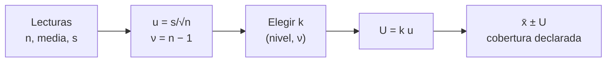

# B13-C12 — Incertidumbre expandida

<!-- nav:top -->
[🏠 Programa](../../../../README.md) · [📚 Bloque B13](../../../tronco-comun/B13-metrologia-tiempo-y-mediciones-cientificas.md) · [← Anterior: B13-C11 — Sistemas de referencia terrestres](../B13-C11-sistemas-de-referencia-terrestres/CLASE.md) · [Siguiente: B13-C13 — Presupuestos de incertidumbre →](../../../tronco-comun/B13-metrologia-tiempo-y-mediciones-cientificas.md#b13-c13)
<!-- /nav -->

## 1. Ubicación, nivel y alcance

Duodécima clase del bloque B13. Hasta aquí hablaste de sesgo, dispersión y de la incertidumbre típica `s/√n`. Ahora das el paso que exige un reporte científico: expresar la incertidumbre como un **intervalo con una probabilidad asociada**. Estudias la **incertidumbre típica**, el **factor de cobertura** `k` y la **incertidumbre expandida** `U = k u`, y qué supone realmente decir «`k = 2` ≈ 95 %». Nivel N2. No calculas la combinación de varias fuentes (C13) ni estudios entre laboratorios (C14).

## 2. Por qué esta clase existe

Un telémetro da `1000,004 m` con una incertidumbre típica de `0,017 m`. ¿Cuál es el intervalo dentro del cual el valor verdadero cae «casi seguro»? Si multiplicas por 2 y dices «95 %», puedes estar equivocado: con pocas lecturas esa cobertura es mucho menor. Un diseñador que fije un margen de seguridad con la incertidumbre equivocada pone en riesgo la misión.

La decisión central: **¿qué factor `k` uso para que el intervalo tenga la cobertura que declaro?**

## 3. Lo que podrás hacer al terminar

1. Definir incertidumbre típica, combinada, expandida y factor de cobertura.
2. Calcular `U = k u` y escribir un resultado completo con `U`, `k` y el nivel de confianza.
3. Calcular la cobertura de `k = 1, 2, 3` bajo una distribución normal.
4. Explicar por qué con pocas lecturas `k = 2` cubre menos de 95 %.
5. Calcular el `k` necesario para 95 % con `ν = 2` grados de libertad.
6. Verificar una cobertura con una simulación y con una solución exacta.

La evidencia es el **reporte con `U` y cobertura simulada** del ejercicio 12 (sección 20).

## 4. Con qué llegas y cómo comprobarlo

Necesitas la media, `s`, `s/√n` ([C04](../B13-C04-errores-sistematicos-y-aleatorios/CLASE.md)) y la idea de probabilidad ([B12](../../../tronco-comun/B12-probabilidad-estadistica-e-incertidumbre.md)). Cinco preguntas:

1. ¿Qué es la desviación típica de una media de `n` datos?
2. ¿Cuál es la probabilidad de que una variable normal esté a menos de una desviación de su media (aprox.)?
3. Calcula `2 × 0,017`.
4. ¿Qué es un grado de libertad en una media de `n` lecturas?
5. ¿Para qué sirve una simulación con semilla fija?

<details>
<summary>Ver respuestas</summary>

1. `s/√n`. 2. Cerca de `68 %`. 3. `0,034`. 4. `n − 1`: lecturas independientes que quedan al estimar la media. 5. Para reproducir el mismo resultado.
</details>

Con cuatro o cinco aciertos, sigue; si no, repasa C04.

## 5. Un caso real (con datos sintéticos): el telémetro y su intervalo

Un telémetro mide una distancia verdadera de `1000,000 m` con ruido gaussiano de `σ = 0,050 m` (sintético). Con diez lecturas, el laboratorio obtiene `x̄ = 1000,0042 m` y `u = s/√10 = 0,0168 m`; luego `U(k = 2) = 0,0335 m`. La pregunta es qué cobertura real tiene ese intervalo. Es el **ejemplo conductor**.

## 6. Vocabulario

La **incertidumbre típica** es la incertidumbre de un resultado expresada como una desviación típica (S1, 2.3.1). La **incertidumbre típica combinada `u_c`** es la de un resultado obtenido a partir de otras magnitudes, raíz de una suma de varianzas ponderadas (S1, 2.3.4; C13). La **incertidumbre expandida `U`** define un intervalo en torno al resultado que se espera abarque una fracción grande de los valores razonablemente atribuibles al mensurando (S1, 2.3.5). El **factor de cobertura `k`** es el multiplicador de `u_c` que da `U`; suele estar entre 2 y 3 (S1, 2.3.6). El **nivel de confianza** (o probabilidad de cobertura) es la fracción que se atribuye al intervalo; asociarlo a `U` exige suposiciones sobre la distribución (S1, 2.3.5, nota 2). Los **grados de libertad `ν`** de una media de `n` lecturas son `n − 1`. La **distribución t de Student** describe la media estandarizada con `s` estimada.

## 7. Modelo mental: una red con malla ajustable

Piensa en `U` como una red cuya abertura es `k u`: cuanto mayor es `k`, más probable es que el valor verdadero quede dentro, pero más ancha es la red y menos informativa. Con `σ` conocida, la malla se calibra exactamente; con `s` estimada de pocos datos, hay que agrandarla porque `s` también fluctúa.



*Descripción textual:* de las lecturas salen la media, `u` y los grados de libertad; con ellos y el nivel de confianza deseado se elige `k`; de `U = k u` sale el intervalo con su cobertura.

Analogía: una red de pesca: más malla ancha, más peces, menos precisión sobre cuál. Su límite: la red no cambia con el tamaño de los peces; en cambio, la cobertura real de `k` depende de `ν` y de la distribución de los errores.

## 8. La explicación, paso a paso

### 8.1 De `u` a `U`

`U = k u_c` (S1, 2.3.5–2.3.6). Un resultado se reporta como `y ± U` junto con `k` y el nivel de confianza, por ejemplo: «`1000,004 m ± 0,034 m (k = 2; cobertura aproximada 95 %)`». El factor `k` suele estar entre 2 y 3.

### 8.2 Cobertura con σ conocida

Si los errores son normales con `σ` conocida, `x̄ ± kσ/√n` cubre `erf(k/√2)`: `k = 1 → 68,27 %`, `k = 2 → 95,45 %`, `k = 3 → 99,73 %`. En el laboratorio, 20 000 repeticiones con `k = 2` dieron `95,30 %`, compatible con `95,45 %` dentro de cinco errores binomiales.

### 8.3 Qué asume «`k = 2` ≈ 95 %»

La GUM (S1, G.6) indica que, cuando se adopta `k = 2` y se supone `U = 2 u_c`, el intervalo tiene aproximadamente 95 % de confianza si la distribución es aproximadamente normal y `u_c` es fiable, lo que la GUM concreta pidiendo grados de libertad efectivos mayores que 10 (y, para aplicaciones más críticas, `k = 3`, ≈ 99 %). La definición de `U` advierte además que el nivel solo se conoce en la medida en que esas suposiciones se justifiquen (S1, 2.3.5, nota 2).

### 8.4 Pocas lecturas: `s` también fluctúa

Con `u = s/√n` estimada, la media estandarizada sigue una `t` de Student con `ν = n − 1`. Para `ν = 2` hay una solución exacta: `P(|t| < x) = x/√(2 + x²)`. Con `x = 2`, `P = 2/√6 = 0,8165`: **solo 81,65 %**, no 95 %. El laboratorio, con 40 000 repeticiones de `n = 3`, da `0,8165`. Para `P = 0,95` hace falta `x = 4,303`; para `P = 0,99`, `x = 9,925`.

### 8.5 Muestras mayores

Con `n = 30` (`ν = 29`) y `k = 2`, el laboratorio da `94,56 %`, ya cerca del límite normal. La GUM (S1, 7.2.4) ilustra con un ejemplo que, para `ν = 9`, el factor de cobertura para 95 % es `k = 2,26`, basado en la distribución t. Por tanto, con diez lecturas, `U = 2,26 u` en lugar de `2 u` si se quiere declarar 95 %.

### 8.6 Cómo reportar

Se reporta `y`, `U`, `k`, la distribución supuesta y el nivel de confianza o los grados de libertad. Con la serie del caso (`n = 10`): `U(k = 2,26) = 0,0379 m`, que da `1000,004 ± 0,038 m` (nivel aprox. 95 %, `ν = 9`). Un lector sabe así qué margen de seguridad puede usar.

## 9. Magnitudes, símbolos y unidades

| Símbolo | Qué es | Unidad | Valor del ejemplo |
|---|---|---|---|
| `x̄` | media de las lecturas | m | 1000,0042 |
| `s`, `u` | desviación típica y su media `s/√n` | m | `u = 0,0168` |
| `n`, `ν` | lecturas; grados de libertad | — | 10; 9 |
| `k` | factor de cobertura | — | 2; 2,26 |
| `U` | incertidumbre expandida | m | `0,0335`; `0,0379` |
| `P` | cobertura (nivel de confianza) | — | 0,9545; 0,8165 |

## 10. Convenciones y referencias

Se usa el esquema de la GUM: incertidumbres típicas, factor de cobertura y reporte con `k`. Los errores simulados son gaussianos e independientes (semilla fija). Los datos son **sintéticos**. La distribución t con `ν = 2` tiene la fórmula cerrada de 8.4; para otros `ν` no se usan tablas aquí (la GUM da `k = 2,26` para `ν = 9`).

## 11. De dónde sale lo que afirmamos

| ID | Fuente | Localizador | Respalda | Estado |
|---|---|---|---|---|
| S1 | JCGM 100:2008 (GUM), 2.3.1–2.3.6 y Anexo G (G.6) y 7.2.4 (ejemplo con `ν = 9`, `k = 2,26`) | https://www.bipm.org/documents/20126/2071204/JCGM_100_2008_E.pdf | Definiciones de incertidumbre típica, combinada, expandida y factor de cobertura (2 a 3); `k = 2` ≈ 95 % bajo suposiciones; `k = 2,26` para `ν = 9` | Texto extraído del PDF el 2026-11-05 |

Límites: las coberturas de la normal y la solución exacta para `ν = 2` son resultados estadísticos estándar comprobados por simulación; no se consultaron tablas de la distribución t para otros `ν`; los datos son **sintéticos**.

## 12. Cómo ver la cobertura

Equivalente accesible a una gráfica de cobertura contra `k`:

| Caso | `k` | Cobertura (teórica) | Cobertura simulada |
|---|---|---|---|
| `σ` conocida | 1 | 0,6827 | — |
| `σ` conocida | 2 | 0,9545 | 0,9530 |
| `σ` conocida | 3 | 0,9973 | — |
| `n = 3` (`ν = 2`) | 2 | 0,8165 | 0,8165 |
| `n = 30` (`ν = 29`) | 2 | ≈ 0,945 | 0,9456 |
| `n = 3` | 4,303 | 0,9500 | — |

Descripción larga: con `σ` conocida, `k = 2` cubre `95,45 %`; con tres lecturas la misma `k = 2` baja a `81,65 %`; con treinta, vuelve a ≈ `94,6 %`.

## 13. Ejemplo trabajado: reporte con diez lecturas

**Paso 1 · Datos.** `n = 10`, `x̄ = 1000,0042 m`, `s = 0,0531 m` (resulta de `u = 0,0168 × √10`).

**Paso 2 · Incertidumbre típica.** `u = s/√n = 0,0168 m`; `ν = 9`.

**Paso 3 · Factor.** Para 95 % con `ν = 9`, `k = 2,26` (S1, 7.2.4).

**Paso 4 · Expandida.** `U = 2,26 × 0,0168 = 0,0379 m`.

**Paso 5 · Reporte y sentido.** `1000,004 ± 0,038 m (k = 2,26; ν = 9; 95 %)`. Con `k = 2` se habría escrito `± 0,034 m`, intervalo ligeramente menor y con cobertura ≈ `92 %`: más optimista que la realidad. Con dos cifras significativas en `U`, el resultado se redondea a la tercera cifra decimal. Datos sintéticos; la verdad (`1000,000 m`) cae dentro: `|1000,004 − 1000,000| = 0,004 < 0,038`.

## 14. Distintas formas de expresar la dispersión

**Desviación típica `u`:** sin probabilidad asociada. **Intervalo `x ± U` con `k` explícito:** el estándar de la GUM. **Intervalo de confianza con `t`:** exacto bajo normalidad con `ν` dado. **Simulación de Monte Carlo (S1 en suplementos):** cuando la distribución no es normal; no se consultó aquí. Las tres primeras coinciden cuando se declara el `k` de la `t`.

## 15. Práctica guiada

**Ejercicio 1 · con los pasos indicados.** Con `u = 0,0168 m` y `k = 2`, calcula `U` y escribe el resultado para `x̄ = 1000,0042`. *Pasos:* 8.1.

<details><summary>Solución comentada</summary>

`U = 0,0336 m`; resultado: `1000,004 ± 0,034 m (k = 2)`. (El laboratorio da `0,0335` por usar más cifras en `u`.)
</details>

**Ejercicio 2 · con una pista.** ¿Qué cobertura tiene `k = 3` con σ conocida? *Pista:* `erf(3/√2)`.

<details><summary>Solución comentada</summary>

`0,9973` (8.2).
</details>

**Ejercicio 3 · casi autónomo.** Calcula la cobertura de `k = 2` con `ν = 2` y compárala con la normal.

<details><summary>Solución comentada</summary>

`2/√6 = 0,8165` frente a `0,9545`: faltan casi 14 puntos de cobertura (8.4).
</details>

## 16. Práctica autónoma, transferencia e integrador

**Ejercicio 4.** ¿Qué `k` da 99 % con `ν = 2`?

<details><summary>Solución comentada</summary>

`x²/(2 + x²) = 0,9801` → `x² = 2 × 0,9801/0,0199 = 98,5`; `x = 9,925` (8.4).
</details>

**Ejercicio 5.** Con `n = 3` y `u = 0,029 m`, escribe `U` para el 95 %.

<details><summary>Solución comentada</summary>

`k = 4,303`; `U = 4,303 × 0,029 = 0,125 m`.
</details>

**Ejercicio 6.** Con `ν = 9` y `u = 0,0168 m`, ¿cuánto cambia `U` entre `k = 2` y `k = 2,26`?

<details><summary>Solución comentada</summary>

`0,0336` frente a `0,0380`: sube `13 %` (8.5).
</details>

**Ejercicio 7.** Un reporte dice «`U = 0,03 m`» sin más. ¿Qué falta?

<details><summary>Solución comentada</summary>

El factor `k`, la distribución o el nivel de confianza y los grados de libertad (8.6).
</details>

**Ejercicio 8.** ¿Por qué aumenta `k` cuando baja `ν`?

<details><summary>Solución comentada</summary>

Porque `s` se estima con pocos datos y fluctúa; las colas de la distribución t son más pesadas que las de la normal (8.4).
</details>

**Ejercicio 9 · transferencia.** Una nave debe pasar a `≥ 100 m` de un objeto; la incertidumbre típica de la distancia es `40 m`. ¿Qué margen declarás con `k = 2` y con `k = 3`?

<details><summary>Solución comentada</summary>

`U = 80 m` (95 %) y `120 m` (99,7 %, bajo normalidad). Con `k = 2` queda `100 − 80 = 20 m` de holgura aparente; con `k = 3` la distancia mínima ya no se garantiza. La elección de `k` es una decisión de riesgo (datos de ejemplo).
</details>

**Ejercicio 10 · transferencia.** Un compañero da `U = 0,034 m (k = 2)` con 3 lecturas y afirma «95 %». ¿Qué le objetas?

<details><summary>Solución comentada</summary>

Con `ν = 2`, `k = 2` cubre `81,65 %`; para 95 % necesita `k = 4,30` y `U` sería `0,073 m` si `u` fuese la misma (8.4).
</details>

**Ejercicio 11 · transferencia.** Dos laboratorios dan `1000,004 ± 0,038 m` y `1000,030 ± 0,038 m` (`k = 2,26`). ¿Son compatibles?

<details><summary>Solución comentada</summary>

Diferencia `0,026 m`; incertidumbres típicas `0,0168` cada una: `√(0,0168² + 0,0168²) = 0,0238`; la diferencia es `1,09` veces eso: compatible (C18).
</details>

**Ejercicio 12 · integrador.** Elabora tu *reporte con `U` y cobertura simulada*: una serie de `n = 10` lecturas simuladas, `x̄`, `u`, `U` con `k = 2` y con el `k` de la t, la cobertura simulada de ambos para `n = 3, 10, 30` y un párrafo sobre qué suposiciones sostienen «95 %», con S1.

<details><summary>Solución modelo</summary>

Tabla con `n = 3, 10, 30`, `k = 2` frente a `k_t` y coberturas ≈ `0,8165`, `0,92`, `0,945`; reporte `1000,004 ± 0,038 m (k = 2,26)`; suposiciones: errores normales, independientes, `u` fiable.
</details>

## 17. Laboratorio: cobertura real de `k`

El script [cobertura.py](cobertura.py) calcula la cobertura exacta de la normal (`erf`), **la compara con una simulación de 20 000 repeticiones**, **la cobertura exacta de la t con `ν = 2` (`x/√(2 + x²)`) con 40 000 repeticiones**, verifica `k = 4,303` para 95 % y simula `n = 30`.

**Datos:** sintéticos (semilla fija). **Predice antes de ejecutar:** ¿qué cobertura esperas para `k = 2` con tres lecturas? (`0,8165`.) **Ejecución del 2026-11-05 (Python 3.12.9):**

```text
Python 3.12.9 (biblioteca estandar)
k   cobertura normal (exacta)
1   0.6827
2   0.9545
3   0.9973
sigma conocida, k = 2: simulada 0.9530
n = 3, k = 2: teorica t(nu=2) = 0.8165 ; simulada = 0.8165
k para 95 % con nu = 2: 4.303
n = 30, k = 2: simulada = 0.9456 (limite normal 0.9545)
serie n = 10: media = 1000.0042 m, u = 0.0168 m, U(k=2) = 0.0335 m
Pruebas superadas.
```

```bash
python programa/clases/B13/B13-C12-incertidumbre-expandida/cobertura.py
```

**Límites:** errores gaussianos independientes; solo `ν = 2` tiene solución cerrada trivial; sin errores sistemáticos residuales.

## 18. Errores frecuentes y cómo corregirlos

**Dar `U` sin `k` ni nivel de confianza.** Se corrige con el ejercicio 7.

**Usar `k = 2` con pocas lecturas y llamarlo 95 %.** Se corrige con los ejercicios 3 y 10.

**Confundir `u` con `U`.** Se corrige con el ejercicio 1.

**Ignorar que el nivel depende de la distribución.** Se corrige en 8.3.

**Usar el intervalo como margen de seguridad sin elegir `k` según el riesgo.** Se corrige con el ejercicio 9.

## 19. Cómo sabrás que vas bien

Tras 8.1: ¿escribes un resultado completo? Si no, ejercicio 1. Tras 8.4: ¿por qué `k = 2` falla con 3 lecturas? Si dudas, ejercicio 3. Tras 8.5: ¿qué `k` usas con 10 lecturas? Si no, repasa 8.5. Tras el laboratorio: ¿por qué la solución `x/√(2 + x²)` sirve como prueba? (porque es exacta y se contrasta con el azar).

## 20. Qué entregas y cómo se evalúa

El producto es tu **reporte con `U` y cobertura simulada** (ejercicio 12).

| Criterio | Inicial | En desarrollo | Logrado | Destacado |
|---|---|---|---|---|
| Definiciones | Las confunde | Parciales | `u`, `U`, `k` | Distingue combinada y expandida |
| Cálculo | Con errores | Solo `k = 2` | `U` con `k` justificado | `k` de la t con `ν` |
| Cobertura | No la verifica | Teórica | Simulada y comparada | Con solución exacta |
| Reporte | Solo `±` | Sin `k` | `y ± U (k, ν, nivel)` | Con suposiciones declaradas |
| Fuentes | Sin fuente | Sin fecha | Con localizador y fecha | Rotula sintético |

**Condiciones críticas (no se compensan con promedio):** declarar `k` y el nivel de confianza; no llamar 95 % a `k = 2` con pocas lecturas; rotular sintéticos.

## 21. Ética, seguridad y límites

Una incertidumbre expandida optimista da una falsa sensación de seguridad; en decisiones de riesgo (distancias de paso, ventanas de lanzamiento) conviene declarar `k` y las suposiciones. Los datos son simulados. Accesibilidad: tablas equivalentes a las gráficas, fórmulas en texto, ejercicios sin conexión.

## 22. Para cerrar y seguir

La incertidumbre expandida es `U = k u`; su cobertura real depende de `k`, de los grados de libertad y de la distribución; `k = 2` da 95,45 % solo con `σ` conocida y normalidad, y con tres lecturas da `81,65 %`; hay que reportar `k` y el nivel. Queda una pregunta: cuando una medida depende de varias magnitudes inciertas, ¿cómo se combinan sus incertidumbres antes de expandir?

**Glosario español–inglés.** incertidumbre típica · *standard uncertainty*; incertidumbre expandida · *expanded uncertainty*; factor de cobertura · *coverage factor*; nivel de confianza · *level of confidence*; grados de libertad · *degrees of freedom*; distribución t · *Student's t distribution*; cobertura · *coverage*.

**Continuidad.** B13-C13 reutiliza tu capacidad de **expresar una incertidumbre con `k`** para construir presupuestos con varias fuentes.

**Referencias:** ver sección 11.

<!-- nav:bottom -->
---

[← Anterior: B13-C11 — Sistemas de referencia terrestres](../B13-C11-sistemas-de-referencia-terrestres/CLASE.md) · [📚 Bloque B13](../../../tronco-comun/B13-metrologia-tiempo-y-mediciones-cientificas.md) · [Siguiente: B13-C13 — Presupuestos de incertidumbre →](../../../tronco-comun/B13-metrologia-tiempo-y-mediciones-cientificas.md#b13-c13)
<!-- /nav -->
