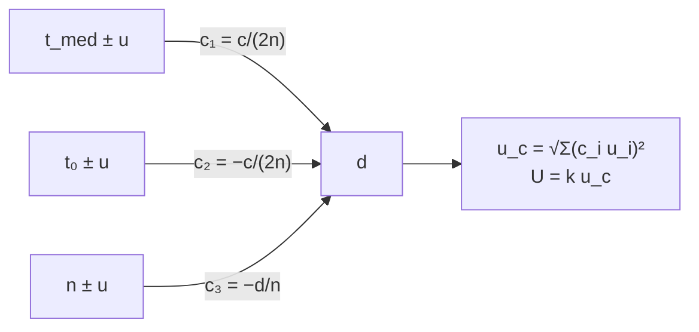

# B13-C13 — Presupuestos de incertidumbre

<!-- nav:top -->
[🏠 Programa](../../../../README.md) · [📚 Bloque B13](../../../tronco-comun/B13-metrologia-tiempo-y-mediciones-cientificas.md) · [← Anterior: B13-C12 — Incertidumbre expandida](../B13-C12-incertidumbre-expandida/CLASE.md) · [Siguiente: B13-C14 — Repetibilidad y reproducibilidad →](../B13-C14-repetibilidad-y-reproducibilidad/CLASE.md)
<!-- /nav -->

## 1. Ubicación, nivel y alcance

Decimotercera clase del bloque B13. En [C12](../B13-C12-incertidumbre-expandida/CLASE.md) expresaste la incertidumbre de una sola cantidad. Casi ninguna medida es directa: una distancia sale de un tiempo, de un retardo electrónico y de un índice del aire. Aquí aprendes a construir un **presupuesto de incertidumbre**: listar las fuentes, propagarlas con la **ley de propagación de varianzas** de la GUM, ver cuál domina y expandir el resultado. Nivel N2. Supones entradas independientes; no tratas correlaciones ni estudios entre laboratorios.

## 2. Por qué esta clase existe

Un telémetro láser mide la distancia a un reflector a unos 10 km. Una mejora costosa del cronómetro podría no servir si la mayor parte de la incertidumbre viene del retardo electrónico o del aire. Un presupuesto responde antes de gastar: **qué fuente pesa más y cuánto ganarías al mejorarla**.

La decisión central: **¿en qué fuente de incertidumbre invierto para reducir la incertidumbre total?**

## 3. Lo que podrás hacer al terminar

1. Escribir un modelo de medida `y = f(x₁, x₂, …)`.
2. Calcular los coeficientes de sensibilidad `c_i = ∂f/∂x_i`.
3. Combinar las contribuciones en cuadratura bajo independencia.
4. Construir una tabla de presupuesto con la contribución porcentual de cada fuente.
5. Verificar la propagación con derivadas numéricas y con Monte Carlo.
6. Expandir el resultado con `k` y reportarlo.

La evidencia es el **presupuesto de una medida indirecta** del ejercicio 12 (sección 20).

## 4. Con qué llegas y cómo comprobarlo

Necesitas derivadas ([B09](../../../tronco-comun/B09-calculo-diferencial-e-integral.md)) y la incertidumbre expandida ([C12](../B13-C12-incertidumbre-expandida/CLASE.md)). Cinco preguntas:

1. ¿Cuánto es `∂(c t/2)/∂t`?
2. Calcula `√(0,03² + 0,04²)`.
3. ¿Qué es una incertidumbre típica?
4. Si `y = a/b`, ¿cuánto es `∂y/∂b`?
5. ¿Cuál es el factor de cobertura habitual para ≈ 95 %?

<details>
<summary>Ver respuestas</summary>

1. `c/2`. 2. `0,05`. 3. Una incertidumbre expresada como desviación típica. 4. `−a/b²`. 5. `k = 2`.
</details>

Con cuatro o cinco aciertos, sigue; si no, repasa C12 y B09-C04.

## 5. Un caso real (con datos sintéticos): distancia a 10 km por tiempo de vuelo

La distancia es `d = c (t_med − t₀)/(2n)`: `c` exacta (C01), `t_med` el tiempo de ida y vuelta, `t₀` el retardo electrónico calibrado y `n` el índice de grupo del aire. Valores de ejemplo (**sintéticos**): `n = 1,000 300` con `u(n) = 3 × 10⁻⁶`; `u(t_med) = 0,50 ns`; `u(t₀) = 0,30 ns`. El reflector está a `10 000 m`. Es el **ejemplo conductor**.

## 6. Vocabulario

El **mensurando** es la magnitud que se quiere medir (aquí `d`). El **modelo de medida** expresa el mensurando en función de las magnitudes de entrada. Un **coeficiente de sensibilidad** `c_i = ∂f/∂x_i` mide cuánto cambia el resultado por cambio unitario de la entrada `i`. La **incertidumbre combinada** `u_c(y)` es la raíz cuadrada de `Σ c_i² u²(x_i)` cuando las entradas son independientes (S1, 2.3.4 y 5.1.2). Una **contribución** es el término `|c_i| u(x_i)`, en unidades del mensurando. El **presupuesto** es la tabla de todas las contribuciones. El **método de Monte Carlo** propaga distribuciones por muestreo.

## 7. Modelo mental: palancas con distinta longitud

Cada entrada incierta mueve el resultado a través de una palanca de longitud `c_i`. Una entrada con poca incertidumbre pero palanca larga puede pesar más que una con mucha incertidumbre y palanca corta. El presupuesto mide el movimiento total de cada palanca y los suma en cuadratura.



*Descripción textual:* tres entradas inciertas llegan al resultado `d` con sus coeficientes de sensibilidad; las contribuciones se suman en cuadratura para dar `u_c`, que se expande con `k`.

Analogía: palancas en una balanza. Su límite: la suma en cuadratura vale solo si las entradas son independientes; si están correlacionadas, hay que añadir términos de covarianza (no tratados aquí).

## 8. La explicación, paso a paso

### 8.1 El modelo y su valor central

`d = c (t_med − t₀)/(2n)`. Con los valores de ejemplo (`t_med = 2n d/c + t₀`, `t₀ = 30 ns`) resulta `d = 10 000,0000 m`.

### 8.2 Coeficientes de sensibilidad

`∂d/∂t_med = c/(2n) = 1,4985 × 10⁸ m/s` (equivale a `0,14985 m/ns`); `∂d/∂t₀ = −c/(2n)`; `∂d/∂n = −d/n = −9997,0 m`. El signo no importa en la suma de cuadrados, pero sí cuando hay correlación.

### 8.3 Contribuciones

`|c₁| u(t_med) = 0,14985 × 0,50 = 0,07493 m`; `|c₂| u(t₀) = 0,14985 × 0,30 = 0,04496 m`; `|c₃| u(n) = 9997 × 3 × 10⁻⁶ = 0,02999 m`.

### 8.4 Combinación

`u_c² = 0,07493² + 0,04496² + 0,02999² = 0,008535 m²`, `u_c = 0,0924 m`. Reparto: `t_med` `65,8 %`, `t₀` `23,7 %`, `n` `10,5 %` de `u_c²`. La suma en cuadratura hace que las contribuciones pequeñas se «esfumen»: el índice del aire pesa 10 % aunque su palanca es larga.

### 8.5 Expandir y reportar

`U = 2 u_c = 0,185 m` (`k = 2`, con suposición de normalidad y `ν` grande, C12). Reporte: `d = 10 000,00 m ± 0,18 m (k = 2)`. La GUM exige indicar `u_c`, `k` y cómo se obtuvo (S1, 7.2.3 y 7.2.4).

### 8.6 Verificar con Monte Carlo

Se sortean `t_med`, `t₀` y `n` con sus incertidumbres y se calcula `d` 200 000 veces. El laboratorio da desviación `0,09251 m` frente al valor analítico `0,09238 m` (diferencia `0,14 %`) y un sesgo de `+0,00004 m` por la no linealidad de `1/n`. La concordancia confirma que la linealización es válida aquí.

## 9. Magnitudes, símbolos y unidades

| Símbolo | Qué es | Unidad | Valor de ejemplo |
|---|---|---|---|
| `d` | distancia (mensurando) | m | 10 000,0000 |
| `c` | velocidad de la luz | m/s | 299 792 458 (exacta) |
| `t_med`, `t₀` | tiempo de ida y vuelta; retardo electrónico | s | `u = 0,50 ns`; `0,30 ns` |
| `n` | índice de grupo del aire | — | `1,000 300 ± 3 × 10⁻⁶` |
| `c_i` | coeficiente de sensibilidad | m/s; m/s; m | 1,4985 × 10⁸; −1,4985 × 10⁸; −9997 |
| `u_c`, `U` | combinada, expandida | m | 0,0924; 0,185 |

## 10. Convenciones y referencias

Entradas independientes y gaussianas; modelo localmente lineal. Los valores de entrada son **sintéticos**; `c` es exacta y no contribuye. La contribución se da en metros. El presupuesto se presenta en tabla (referencia) y se explica en prosa.

## 11. De dónde sale lo que afirmamos

| ID | Fuente | Localizador | Respalda | Estado |
|---|---|---|---|---|
| S1 | JCGM 100:2008 (GUM), 2.3.4, 5.1.2, 7.2.3–7.2.4 | https://www.bipm.org/documents/20126/2071204/JCGM_100_2008_E.pdf | Ley de propagación de varianzas para entradas independientes; contenido del reporte | Texto extraído del PDF el 2026-11-05 |
| S2 | BIPM/NIST, constantes del SI | https://www.bipm.org/en/measurement-units/si-defining-constants | `c` exacta | Consultada el 2026-11-05 mediante extracción automática |

Límites: no se consultó el tratamiento de correlaciones ni los suplementos de Monte Carlo del JCGM; el caso de correlación total del ejercicio 7 se resuelve por álgebra elemental; los datos son **sintéticos**.

## 12. Cómo ver el presupuesto

Equivalente accesible a un diagrama de barras (resultados del laboratorio):

| Fuente | `u_i` | `c_i` | `|c_i| u_i` (m) | % de `u_c²` |
|---|---|---|---|---|
| `t_med` | 0,50 ns | 1,4985 × 10⁸ m/s | 0,07493 | 65,8 |
| `t₀` | 0,30 ns | −1,4985 × 10⁸ m/s | 0,04496 | 23,7 |
| `n` | 3 × 10⁻⁶ | −9997 m | 0,02999 | 10,5 |
| **`u_c`** | | | **0,09238** | 100 |

Descripción larga: tres barras de longitud 0,075, 0,045 y 0,030 m; la barra total (`0,092 m`) es la hipotenusa de sus cuadraturas y es menor que la suma aritmética (`0,150 m`).

## 13. Ejemplo trabajado: mejorar un cronómetro

**Paso 1 · Base.** `u_c = 0,0924 m` (8.4).

**Paso 2 · Propuesta.** Un cronómetro con `u(t_med) = 0,25 ns`: contribución `0,03747 m`.

**Paso 3 · Nuevo total.** `u_c² = 0,03747² + 0,04496² + 0,02999² = 0,001404 + 0,002021 + 0,000900 = 0,004325`, `u_c = 0,0658 m`.

**Paso 4 · Ganancia.** `−29 %`. Si en cambio se eliminara toda la incertidumbre de `n`, `u_c = √(0,005614 + 0,002021) = 0,0874 m`: solo `−5 %`.

**Paso 5 · Sentido.** Mejorar el cronómetro rinde seis veces más que perfeccionar el índice del aire. Con dos cifras significativas: `U = 2 × 0,066 = 0,13 m`. Datos sintéticos.

## 14. Distintas formas de propagar

**Ley de propagación (GUM):** analítica, rápida, exige derivadas y linealidad local. **Derivadas numéricas:** evitan el álgebra, se usan para comprobar los `c_i`. **Monte Carlo:** sirve con no linealidad o distribuciones no normales; cuesta cómputo. Las tres deben coincidir en un caso lineal (8.6).

## 15. Práctica guiada

**Ejercicio 1 · con los pasos indicados.** Una longitud `L = L₁ + L₂` con `u(L₁) = 0,03 m` y `u(L₂) = 0,04 m`. Calcula `u(L)`. *Pasos:* `c₁ = c₂ = 1`.

<details><summary>Solución comentada</summary>

`√(0,03² + 0,04²) = 0,05 m` (8.4): no es `0,07`.
</details>

**Ejercicio 2 · con una pista.** Calcula la contribución de `t_med` con `u = 0,50 ns`. *Pista:* `c/(2n)`.

<details><summary>Solución comentada</summary>

`1,4985 × 10⁸ × 0,50 × 10⁻⁹ = 0,07493 m` (8.3).
</details>

**Ejercicio 3 · casi autónomo.** Calcula `u_c` si solo existieran `t_med` y `t₀`.

<details><summary>Solución comentada</summary>

`√(0,07493² + 0,04496²) = 0,0874 m` (8.4).
</details>

## 16. Práctica autónoma, transferencia e integrador

**Ejercicio 4.** ¿Cuál es la fuente dominante y qué porcentaje de la varianza aporta?

<details><summary>Solución comentada</summary>

`t_med`: `0,07493²/0,008535 = 65,8 %` (8.4).
</details>

**Ejercicio 5.** Calcula `u_c` con `u(t_med) = 0,25 ns`.

<details><summary>Solución comentada</summary>

`0,0658 m` (ejemplo trabajado).
</details>

**Ejercicio 6.** Si el reflector estuviera a `20 000 m`, ¿qué contribución tendría `n`? ¿Y `u_c`?

<details><summary>Solución comentada</summary>

`c₃ = −d/n`: `19 994 × 3 × 10⁻⁶ = 0,05998 m`; `u_c = √(0,005614 + 0,002021 + 0,003598) = 0,106 m`. Las contribuciones temporales no dependen de `d`; la del aire crece con ella.
</details>

**Ejercicio 7.** Si los errores de `t_med` y `t₀` estuvieran perfectamente correlacionados (misma causa, mismo signo), ¿qué ocurriría con la suma de esas dos contribuciones? *Pista:* `δd = c/(2n)(δt − δt₀)`.

<details><summary>Solución comentada</summary>

Con correlación total los errores se restan: `0,14985 × |0,50 − 0,30| = 0,02997 m`, menos que en cuadratura (`0,0874`). Ignorar una correlación puede sobreestimar o subestimar la incertidumbre; este caso se trata con covarianzas (no consultado aquí).
</details>

**Ejercicio 8.** Calcula `U` con `k = 2` para la base.

<details><summary>Solución comentada</summary>

`2 × 0,09238 = 0,1848 m ≈ 0,18 m`.
</details>

**Ejercicio 9 · transferencia.** Un telémetro lunar mide `d = c t/2` con `u(t) = 100 ps` (vacío, sin `n`). ¿Qué `u(d)` tiene?

<details><summary>Solución comentada</summary>

`c/2 × 10⁻¹⁰ = 0,0150 m` (1,5 cm); la incertidumbre de `d` no depende de la distancia (a diferencia de la del aire).
</details>

**Ejercicio 10 · transferencia.** Escribe el reporte completo de la medida base.

<details><summary>Solución comentada</summary>

`d = 10 000,00 m ± 0,18 m; k = 2 (≈ 95 %, errores normales e independientes; u_c = 0,092 m)`; fuentes principales: cronómetro (66 %), retardo (24 %), índice del aire (10 %).
</details>

**Ejercicio 11 · transferencia.** Un compañero suma las contribuciones aritméticamente (`0,075 + 0,045 + 0,030 = 0,150 m`). ¿Qué error comete y cuándo sería correcto?

<details><summary>Solución comentada</summary>

Sobrestima la incertidumbre (`0,150` frente a `0,092`). La suma lineal solo corresponde a correlación total del mismo signo y mismo reparto; para entradas independientes es cuadratura (8.4).
</details>

**Ejercicio 12 · integrador.** Elabora tu *presupuesto de una medida indirecta*: modelo, coeficientes (analíticos y numéricos), tabla de contribuciones, `u_c`, `U`, la comprobación con Monte Carlo, un estudio de «qué mejorar» con dos escenarios y el reporte final con fuentes y rotulado de sintético.

<details><summary>Solución modelo</summary>

Tabla de la sección 12; `u_c = 0,0924 m`, `U = 0,185 m`; Monte Carlo `0,0925 m`; escenarios: cronómetro `0,25 ns` (`0,0658 m`) y `n` sin incertidumbre (`0,0874 m`); reporte del ejercicio 10.
</details>

## 17. Laboratorio: propagación analítica y Monte Carlo

El script [presupuesto.py](presupuesto.py) calcula los coeficientes analíticos, los **verifica con derivadas numéricas (1e-5)**, construye la tabla, calcula `u_c` y **lo compara con una simulación de Monte Carlo (200 000 muestras, 1 %)**.

**Datos:** sintéticos. **Predice antes de ejecutar:** ¿qué fuente domina? (`t_med`.) **Ejecución del 2026-11-05 (Python 3.12.9):**

```text
Python 3.12.9 (biblioteca estandar)
d = 10000.0000 m
fuente    u_i          c_i              |c_i| u_i (m)   % de u_c^2
t_med    5.000e-10     1.498513e+08      0.07493     65.8
t_0      3.000e-10    -1.498513e+08      0.04496     23.7
n        3.000e-06    -9.997001e+03      0.02999     10.5
u_c = 0.09238 m ; U(k=2) = 0.18476 m
Monte Carlo: sd = 0.09251 m (analitico 0.09238); sesgo = +0.00004 m
Pruebas superadas.
```

```bash
python programa/clases/B13/B13-C13-presupuestos-de-incertidumbre/presupuesto.py
```

**Límites:** entradas independientes y gaussianas; sin correlaciones; modelo sintético.

## 18. Errores frecuentes y cómo corregirlos

**Sumar contribuciones aritméticamente.** Se corrige con el ejercicio 11.

**Olvidar el coeficiente de sensibilidad.** Se corrige con los ejercicios 2 y 6.

**Mejorar la fuente equivocada.** Se corrige en el ejemplo trabajado.

**Ignorar correlaciones.** Se aborda en el ejercicio 7.

**Reportar `u_c` sin `k` ni modelo.** Se corrige con el ejercicio 10.

## 19. Cómo sabrás que vas bien

Tras 8.2: ¿calculas `c_i`? Si no, ejercicio 2. Tras 8.4: ¿combinas en cuadratura? Si no, ejercicio 1. Tras 8.6: ¿qué prueba la concordancia con Monte Carlo? (que la linealización es válida). Tras el laboratorio: ¿por qué se comprueban los `c_i` con derivadas numéricas? (para detectar errores de álgebra).

## 20. Qué entregas y cómo se evalúa

El producto es tu **presupuesto de una medida indirecta** (ejercicio 12).

| Criterio | Inicial | En desarrollo | Logrado | Destacado |
|---|---|---|---|---|
| Modelo | Sin modelo | Incompleto | Modelo completo | Con unidades y dominio |
| Sensibilidad | Sin `c_i` | Con errores | `c_i` correctos | Verificados numéricamente |
| Combinación | Suma lineal | Sin porcentajes | Cuadratura con tabla | Con Monte Carlo |
| Decisión | Sin análisis | Genérica | Fuente dominante | Escenarios de mejora |
| Fuentes | Sin fuente | Sin fecha | Con localizador y fecha | Rotula sintético |

**Condiciones críticas (no se compensan con promedio):** declarar la independencia o la correlación; indicar `k`; rotular lo sintético.

## 21. Ética, seguridad y límites

Un presupuesto incompleto da una confianza que no existe; en operaciones espaciales alimenta márgenes de seguridad. Los valores de este ejemplo son simulados y no corresponden a un instrumento real. Accesibilidad: tablas equivalentes al diagrama, fórmulas en texto, ejercicios sin conexión.

## 22. Para cerrar y seguir

El presupuesto lista las fuentes, las multiplica por su sensibilidad y las combina en cuadratura; muestra qué fuente domina y qué mejora rinde más; se verifica con derivadas numéricas y con Monte Carlo. Queda una pregunta: ¿de dónde sale la incertidumbre de una fuente como el cronómetro cuando varias estaciones o laboratorios miden lo mismo?

**Glosario español–inglés.** presupuesto de incertidumbre · *uncertainty budget*; coeficiente de sensibilidad · *sensitivity coefficient*; mensurando · *measurand*; modelo de medida · *measurement model*; propagación · *propagation*; contribución · *contribution*; Monte Carlo · *Monte Carlo*.

**Continuidad.** B13-C14 reutiliza tu capacidad de **cuantificar una fuente de incertidumbre** para estimar la repetibilidad y la reproducibilidad.

**Referencias:** ver sección 11.

<!-- nav:bottom -->
---

[← Anterior: B13-C12 — Incertidumbre expandida](../B13-C12-incertidumbre-expandida/CLASE.md) · [📚 Bloque B13](../../../tronco-comun/B13-metrologia-tiempo-y-mediciones-cientificas.md) · [Siguiente: B13-C14 — Repetibilidad y reproducibilidad →](../B13-C14-repetibilidad-y-reproducibilidad/CLASE.md)
<!-- /nav -->
