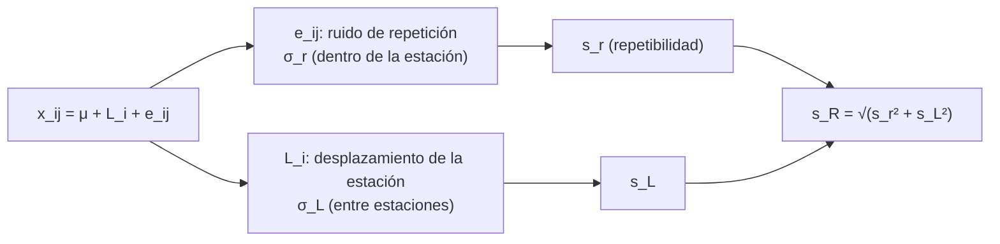

# B13-C14 — Repetibilidad y reproducibilidad

<!-- nav:top -->
[🏠 Programa](../../../../README.md) · [📚 Bloque B13](../../../tronco-comun/B13-metrologia-tiempo-y-mediciones-cientificas.md) · [← Anterior: B13-C13 — Presupuestos de incertidumbre](../B13-C13-presupuestos-de-incertidumbre/CLASE.md) · [Siguiente: B13-C15 — Sensibilidad de detectores →](../B13-C15-sensibilidad-de-detectores/CLASE.md)
<!-- /nav -->

## 1. Ubicación, nivel y alcance

Decimocuarta clase del bloque B13. En [C13](../B13-C13-presupuestos-de-incertidumbre/CLASE.md) cuantificaste fuentes de incertidumbre; ahora aprendes a **estimarlas a partir de datos de varias estaciones o laboratorios**: la **repetibilidad** (la misma estación, repetida) y la **reproducibilidad** (distintas estaciones). Usas un análisis de varianza de un factor. Nivel N2. No tratas diseños con más factores ni pruebas formales de hipótesis.

## 2. Por qué esta clase existe

Ocho estaciones de seguimiento miden el mismo desfase de un reloj de referencia. Cada una repite su medida cinco veces y obtiene resultados muy parecidos entre sí, pero las estaciones discrepan entre ellas. ¿Cuánta de la variación es ruido de repetición y cuánta es un sesgo propio de cada estación? De la respuesta depende si conviene repetir más o corregir cada estación.

La decisión central: **¿qué parte de la variabilidad se reduce repitiendo y qué parte exige armonizar los instrumentos?**

## 3. Lo que podrás hacer al terminar

1. Definir condiciones de repetibilidad, de precisión intermedia y de reproducibilidad.
2. Separar la desviación de repetición `s_r` de la desviación entre estaciones `s_L`.
3. Calcular la reproducibilidad `s_R = √(s_r² + s_L²)`.
4. Realizar un análisis de varianza de un factor con diseño equilibrado.
5. Verificar la descomposición de sumas de cuadrados.
6. Interpretar el cociente `s_R/s_r` para decidir una acción.

La evidencia es el **estudio de varias estaciones** del ejercicio 12 (sección 20).

## 4. Con qué llegas y cómo comprobarlo

Necesitas media, varianza y la ley `1/√n` ([C04](../B13-C04-errores-sistematicos-y-aleatorios/CLASE.md)). Cinco preguntas:

1. ¿Qué es la varianza de una lista de datos?
2. Si tres grupos tienen medias `11, 12, 13`, ¿cuál es la media global?
3. Calcula `√(0,3² + 0,4²)`.
4. ¿Qué es una suma de cuadrados respecto de la media?
5. ¿Cuántos datos hay en `8` estaciones con `5` medidas cada una?

<details>
<summary>Ver respuestas</summary>

1. El promedio de los cuadrados de las desviaciones respecto de la media (con divisor `n` o `n − 1`). 2. `12`. 3. `0,5`. 4. `Σ(xᵢ − x̄)²`. 5. `40`.
</details>

Con cuatro o cinco aciertos, sigue; si no, repasa C04.

## 5. Un caso real (con datos sintéticos): ocho estaciones, un desfase

Ocho estaciones miden cinco veces el mismo desfase de reloj (valor verdadero `12,00 ns`). En la simulación cada estación tiene un sesgo propio (desviación `0,40 ns` entre estaciones) y un ruido de repetición de `0,30 ns`. Los datos son **sintéticos**: conocemos la verdad y podemos comprobar si el análisis la recupera. Es el **ejemplo conductor**.

## 6. Vocabulario

Una **condición de repetibilidad** incluye el mismo procedimiento, los mismos operadores, el mismo sistema de medida, las mismas condiciones y el mismo lugar, con medidas repetidas sobre el mismo objeto en un periodo corto (S1, 2.20). Una **condición de precisión intermedia** mantiene el procedimiento y el lugar pero permite cambios durante un periodo largo, como nuevas calibraciones u operadores (S1, 2.22). Una **condición de reproducibilidad** incluye lugares, operadores y sistemas de medida distintos (S1, 2.24). La **desviación de repetibilidad `s_r`** y la **desviación de reproducibilidad `s_R`** son las desviaciones típicas bajo cada condición. Un **análisis de varianza (ANOVA) de un factor** descompone la variación total en una parte entre grupos y una parte dentro de los grupos. Un **diseño equilibrado** tiene el mismo número de medidas por grupo.

## 7. Modelo mental: dos escalas de variación

Cada medida es el valor común, más un desplazamiento propio de su estación, más un ruido de repetición. Repetir en una estación promedia el ruido pero **no** el desplazamiento; cambiar de estación revela el desplazamiento.



*Descripción textual:* cada medida suma un valor común, un desplazamiento propio de la estación y un ruido de repetición; el ANOVA estima `s_r` (dentro) y `s_L` (entre) y su composición en cuadratura da la reproducibilidad.

Analogía: notas de varias clases: dentro de cada clase hay dispersión, y además las clases difieren entre sí. Su límite: en un estudio metrológico los «grupos» deberían medir el mismo objeto; si miden objetos distintos, la variación entre grupos incluye diferencias reales.

## 8. La explicación, paso a paso

### 8.1 Modelo

`x_ij = μ + L_i + e_ij`, con `i = 1…p` estaciones y `j = 1…n` medidas, `L_i` de media cero y varianza `σ_L²`, `e_ij` de media cero y varianza `σ_r²`, todos independientes.

### 8.2 Sumas de cuadrados

Con `x̄_i` la media de la estación `i` y `x̄` la media global: `SSW = Σ_i Σ_j (x_ij − x̄_i)²` (dentro), `SSB = n Σ_i (x̄_i − x̄)²` (entre) y `SST = Σ_i Σ_j (x_ij − x̄)²`. La identidad exacta es `SST = SSB + SSW` (se comprueba en el laboratorio).

### 8.3 Cuadrados medios y estimadores

`MSW = SSW/[p(n − 1)]` estima `σ_r²`. `MSB = SSB/(p − 1)` estima `σ_r² + n σ_L²`. De ahí `s_r² = MSW`, `s_L² = (MSB − MSW)/n` (se toma `0` si sale negativo) y `s_R² = s_r² + s_L²`. Son los estimadores clásicos del ANOVA de efectos aleatorios con diseño equilibrado (no se consultó una fuente específica en esta clase).

### 8.4 Un cálculo a mano

Tres estaciones, tres medidas: A `12,1; 12,3; 12,2` (media `12,2`); B `11,8; 11,9; 12,0` (`11,9`); C `12,4; 12,5; 12,6` (`12,5`). `SSW = 0,02 + 0,02 + 0,02 = 0,06`; `MSW = 0,06/6 = 0,010` → `s_r = 0,100`. Media global `12,2`; `SSB = 3(0 + 0,09 + 0,09) = 0,54`; `MSB = 0,54/2 = 0,27`; `s_L² = (0,27 − 0,010)/3 = 0,0867` → `s_L = 0,294`; `s_R = √(0,010 + 0,0867) = 0,311`.

### 8.5 Resultados del estudio de ocho estaciones

Con ocho estaciones y cinco medidas, el laboratorio obtiene `s_r = 0,288 ns`, `s_L = 0,304 ns` y `s_R = 0,418 ns` (verdaderos: `0,30`, `0,40` y `0,50`). Con solo ocho grupos las estimaciones fluctúan (`s_L` sale 24 % bajo la verdad). Con 400 estaciones se recuperan: `0,288`, `0,432` y `0,519` (dentro de 10 %).

### 8.6 Qué hacer con el cociente

`s_R/s_r` mide cuánto empeora la variación al cambiar de estación. En el estudio grande: `0,519/0,288 = 1,8`. Si `s_R ≈ s_r`, repetir en una estación basta; si `s_R ≫ s_r`, hay sesgos entre estaciones y conviene calibrarlas o compararlas (C05, C18); promediar `n` medidas en una estación deja `√(s_r²/n + s_L²)`, que con `n → ∞` tiende a `s_L`.

## 9. Magnitudes, símbolos y unidades

| Símbolo | Qué es | Unidad | Valor de ejemplo |
|---|---|---|---|
| `p`, `n` | estaciones; medidas por estación | — | 8; 5 |
| `x_ij` | medida `j` de la estación `i` | ns | — |
| `μ` | valor verdadero | ns | 12,00 (sintético) |
| `σ_r`, `σ_L` | ruido de repetición; desviación entre estaciones | ns | 0,30; 0,40 |
| `s_r`, `s_L`, `s_R` | estimaciones | ns | ver 8.5 |
| `SSW`, `SSB`, `SST` | sumas de cuadrados | ns² | — |
| `MSW`, `MSB` | cuadrados medios | ns² | — |

## 10. Convenciones y referencias

Diseño equilibrado, errores normales independientes, estaciones como efecto aleatorio. Las desviaciones se dan en nanosegundos. Los datos son **sintéticos** con semilla fija. «Reproducibilidad» sigue la condición de S1 (lugares, operadores y sistemas distintos).

## 11. De dónde sale lo que afirmamos

| ID | Fuente | Localizador | Respalda | Estado |
|---|---|---|---|---|
| S1 | JCGM 200:2012, *International vocabulary of metrology (VIM)*, 3.ª ed., términos 2.20, 2.22–2.24 | https://www.bipm.org/documents/20126/2071204/JCGM_200_2012.pdf | Definiciones de condiciones de repetibilidad, precisión intermedia y reproducibilidad | Texto extraído del PDF el 2026-11-05 |

Límites: las fórmulas del ANOVA son resultados estadísticos clásicos sin cita en esta clase y se verifican con una identidad exacta, un caso determinista y una simulación; los datos son **sintéticos**; no se consultó la norma de precisión de métodos de medida (ISO 5725), que el VIM menciona.

## 12. Cómo ver la variación

Equivalente accesible a un gráfico de puntos por estación:

| Estudio | `s_r` (ns) | `s_L` (ns) | `s_R` (ns) | Verdad `σ_r`, `σ_L`, `σ_R` |
|---|---|---|---|---|
| 8 estaciones × 5 | 0,288 | 0,304 | 0,418 | 0,30; 0,40; 0,50 |
| 400 estaciones × 5 | 0,288 | 0,432 | 0,519 | 0,30; 0,40; 0,50 |
| Caso determinista (medias 11, 12, 13) | 0 | 1 | 1 | — |

Descripción larga: en el estudio pequeño las estimaciones de `s_L` y `s_R` se quedan por debajo de la verdad; en el grande se acercan; en el determinista no hay ruido de repetición y toda la variación es entre grupos.

## 13. Ejemplo trabajado: tres estaciones a mano

**Paso 1 · Datos.** Los de 8.4.

**Paso 2 · Dentro.** `SSW = 0,06`; `MSW = 0,06/(3 × 2) = 0,010`; `s_r = 0,100 ns`.

**Paso 3 · Entre.** `SSB = 0,54`; `MSB = 0,54/2 = 0,270`.

**Paso 4 · Componentes.** `s_L² = (0,270 − 0,010)/3 = 0,0867`, `s_L = 0,294 ns`; `s_R = 0,311 ns`.

**Paso 5 · Sentido.** La variación entre estaciones (`0,29`) es tres veces la de repetición (`0,10`): repetir en cada estación no ayuda; hay que armonizar. Con solo tres estaciones, `s_L` es muy incierto: se informa con dos cifras. Verificación: `SST = SSB + SSW = 0,60`.

## 14. Distintas formas de estudiar la variación

**ANOVA de un factor** (esta clase): separa dentro y entre. **Estudios con más factores** (operador, día, equipo): más información, más datos. **Comparaciones por pares** (C18): útiles con pocas estaciones. **Cartas de control**: vigilan la repetibilidad en el tiempo. Se elige según cuántas fuentes se quieran separar.

## 15. Práctica guiada

**Ejercicio 1 · con los pasos indicados.** Con los datos de 8.4, calcula `MSW` y `s_r`. *Pasos:* 8.2–8.3.

<details><summary>Solución comentada</summary>

`SSW = 0,06`; `MSW = 0,06/6 = 0,010`; `s_r = 0,100`.
</details>

**Ejercicio 2 · con una pista.** Calcula `SSB` y `MSB`. *Pista:* medias `12,2; 11,9; 12,5`, global `12,2`.

<details><summary>Solución comentada</summary>

`SSB = 3[(0)² + (−0,3)² + (0,3)²] = 0,54`; `MSB = 0,54/(3 − 1) = 0,27`.
</details>

**Ejercicio 3 · casi autónomo.** Calcula `s_L` y `s_R`.

<details><summary>Solución comentada</summary>

`s_L² = (0,27 − 0,01)/3 = 0,0867`; `s_L = 0,294`; `s_R = √(0,01 + 0,0867) = 0,311` (8.3).
</details>

## 16. Práctica autónoma, transferencia e integrador

**Ejercicio 4.** Verifica `SST = SSB + SSW` con los datos de 8.4 (`SST = Σ(x − 12,2)²`).

<details><summary>Solución comentada</summary>

`SST`: A `(−0,1)² + 0,1² + 0 = 0,02`; B `(−0,4)² + (−0,3)² + (−0,2)² = 0,29`; C `0,2² + 0,3² + 0,4² = 0,29`; total `0,60 = 0,54 + 0,06` ✓.
</details>

**Ejercicio 5.** Tres grupos sin ruido con medias `11, 12, 13` y 4 datos cada uno. ¿Cuánto valen `s_r` y `s_L`?

<details><summary>Solución comentada</summary>

`SSW = 0` → `s_r = 0`; `SSB = 4(1 + 0 + 1) = 8`, `MSB = 4`, `s_L² = 4/4 = 1`, `s_L = 1` (coincide con el laboratorio).
</details>

**Ejercicio 6.** Con `s_r = 0,288` y `s_L = 0,432`, calcula `s_R` y el cociente `s_R/s_r`.

<details><summary>Solución comentada</summary>

`s_R = √(0,0829 + 0,1866) = 0,519`; cociente `1,80` (8.6).
</details>

**Ejercicio 7.** Con esos valores, ¿cuál es la dispersión de la media de `n = 5` medidas de una sola estación (respecto de la verdad)?

<details><summary>Solución comentada</summary>

`√(s_r²/5 + s_L²) = √(0,01658 + 0,1866) = 0,451 ns`: el término entre estaciones domina.
</details>

**Ejercicio 8.** ¿Y con `n = 100` medidas?

<details><summary>Solución comentada</summary>

`√(0,0829/100 + 0,1866) = 0,433 ns`: casi `s_L`. Repetir más no ayuda (8.6).
</details>

**Ejercicio 9 · transferencia.** Ocho estaciones reales, cada una con `s_r = 0,05 ns`, discrepan entre sí con `s_L = 0,50 ns`. ¿Qué acción propones?

<details><summary>Solución comentada</summary>

Cada estación es muy repetible pero hay sesgos entre ellas (`s_R/s_r ≈ 10`): hay que calibrar o comparar las estaciones con un patrón común (C05, C18); repetir más no sirve. Datos de ejemplo.
</details>

**Ejercicio 10 · transferencia.** Si el ANOVA da `MSB < MSW`, ¿qué significa y qué valor se informa para `s_L`?

<details><summary>Solución comentada</summary>

La estimación de `s_L²` sale negativa por fluctuación estadística; se informa `s_L = 0` (8.3), indicando que no se detecta variación entre estaciones con estos datos.
</details>

**Ejercicio 11 · transferencia.** Un estudio hecho por un solo operador, en un día, con un solo instrumento, ¿en qué condición está? ¿Qué subestima?

<details><summary>Solución comentada</summary>

En condiciones de repetibilidad (S1, 2.20). Subestima la variación que aparece al cambiar de día, operador o equipo (precisión intermedia, reproducibilidad).
</details>

**Ejercicio 12 · integrador.** Elabora tu *estudio de varias estaciones*: simula (o toma) datos de `p ≥ 6` estaciones y `n ≥ 4` medidas, calcula `SSW`, `SSB`, `SST` (comprueba la identidad), `s_r`, `s_L`, `s_R`, el cociente y una decisión; compara con una simulación de `p = 400`, con fuentes y rotulado de sintético.

<details><summary>Solución modelo</summary>

Tabla como la de la sección 12; identidad `|SST − SSB − SSW| < 10⁻⁹`; decisión según el cociente (`≈ 1,4` para ocho estaciones: armonizar y seguir vigilando).
</details>

## 17. Laboratorio: ANOVA de repetibilidad y reproducibilidad

El script [repetibilidad_reproducibilidad.py](repetibilidad_reproducibilidad.py) calcula `SSW`, `SSB`, `SST`, **comprueba su identidad (1e-9)**, estima `s_r`, `s_L` y `s_R`, **recupera los valores verdaderos con 400 estaciones (10 %)** y resuelve un caso determinista con respuesta exacta.

**Datos:** sintéticos (semilla fija). **Predice antes de ejecutar:** ¿qué esperas para `s_R` en el estudio grande? (`√(0,30² + 0,40²) = 0,50`.) **Ejecución del 2026-11-05 (Python 3.12.9):**

```text
Python 3.12.9 (biblioteca estandar)
8x5: s_r = 0.288 ns ; s_L = 0.304 ns ; s_R = 0.418 ns ; media = 12.113 ns
400x5: s_r = 0.288 (verd 0.3) ; s_L = 0.432 (verd 0.4) ; s_R = 0.519 (verd 0.500)
determinista: s_r = 0.000 ; s_L = 1.000
Pruebas superadas.
```

```bash
python programa/clases/B13/B13-C14-repetibilidad-y-reproducibilidad/repetibilidad_reproducibilidad.py
```

**Límites:** diseño equilibrado, normalidad e independencia; estaciones como efecto aleatorio; pocos grupos dan estimaciones inestables.

## 18. Errores frecuentes y cómo corregirlos

**Confundir repetibilidad con reproducibilidad.** Se corrige con el ejercicio 11.

**Creer que repetir más reduce la variación entre estaciones.** Se corrige con los ejercicios 7–9.

**Sacar conclusiones con pocos grupos.** Se corrige en 8.5.

**Informar una varianza negativa.** Se corrige con el ejercicio 10.

**Dividir por `n − 1` en lugar de `p(n − 1)` en `MSW`.** Se corrige con el ejercicio 1.

## 19. Cómo sabrás que vas bien

Tras 8.2: ¿verificas `SST = SSB + SSW`? Si no, ejercicio 4. Tras 8.4: ¿obtienes `s_L` a mano? Si no, ejercicios 1–3. Tras 8.6: ¿qué decides si `s_R ≫ s_r`? Si dudas, ejercicio 9. Tras el laboratorio: ¿por qué sirve el caso determinista? (porque su respuesta es exacta).

## 20. Qué entregas y cómo se evalúa

El producto es tu **estudio de varias estaciones** (ejercicio 12).

| Criterio | Inicial | En desarrollo | Logrado | Destacado |
|---|---|---|---|---|
| Conceptos | Los confunde | Parciales | Repetibilidad y reproducibilidad | Incluye precisión intermedia |
| Cálculo | Con errores | Sin identidad | `s_r`, `s_L`, `s_R` con identidad | Con caso determinista |
| Decisión | Sin criterio | Genérica | Según `s_R/s_r` | Calcula el efecto de `n` |
| Límites | Sin ellos | Parciales | Pocos grupos, diseño | Estima fluctuación con simulación |
| Fuentes | Sin fuente | Sin fecha | Con localizador y fecha | Rotula sintético |

**Condiciones críticas (no se compensan con promedio):** indicar las condiciones del estudio; no concluir con pocos grupos sin advertirlo; rotular lo sintético.

## 21. Ética, seguridad y límites

Un estudio con pocas estaciones puede declarar «reproducible» un sistema que no lo es. Los datos son simulados y no describen ninguna red real. Accesibilidad: tablas equivalentes al gráfico, fórmulas en texto, ejercicios sin conexión.

## 22. Para cerrar y seguir

La repetibilidad mide la variación dentro de una estación; la reproducibilidad añade la variación entre estaciones, en cuadratura; el ANOVA las separa; repetir más no reduce la parte entre estaciones. Queda una pregunta: cuando la variación viene del propio detector (su ruido), ¿qué señal mínima puede distinguir?

**Glosario español–inglés.** repetibilidad · *repeatability*; reproducibilidad · *reproducibility*; precisión intermedia · *intermediate precision*; análisis de varianza · *analysis of variance*; diseño equilibrado · *balanced design*; cuadrado medio · *mean square*; suma de cuadrados · *sum of squares*.

**Continuidad.** B13-C15 reutiliza tu capacidad de **separar ruido y sesgo entre instrumentos** para analizar la sensibilidad de un detector.

**Referencias:** ver sección 11.

<!-- nav:bottom -->
---

[← Anterior: B13-C13 — Presupuestos de incertidumbre](../B13-C13-presupuestos-de-incertidumbre/CLASE.md) · [📚 Bloque B13](../../../tronco-comun/B13-metrologia-tiempo-y-mediciones-cientificas.md) · [Siguiente: B13-C15 — Sensibilidad de detectores →](../B13-C15-sensibilidad-de-detectores/CLASE.md)
<!-- /nav -->
