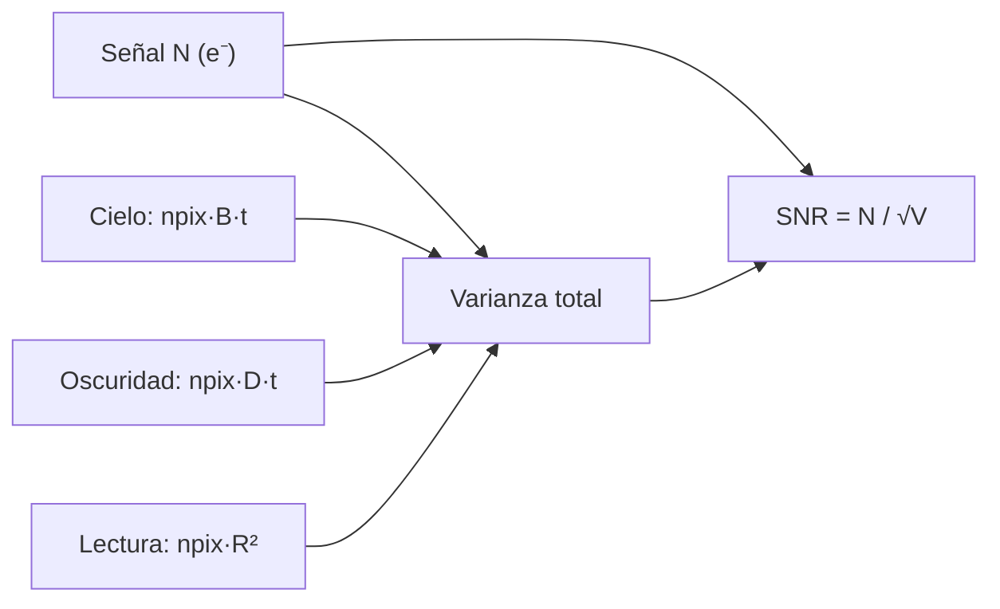

# B13-C15 — Sensibilidad de detectores

<!-- nav:top -->
[🏠 Programa](../../../../README.md) · [📚 Bloque B13](../../../tronco-comun/B13-metrologia-tiempo-y-mediciones-cientificas.md) · [← Anterior: B13-C14 — Repetibilidad y reproducibilidad](../B13-C14-repetibilidad-y-reproducibilidad/CLASE.md) · [Siguiente: B13-C16 — Calibración térmica →](../B13-C16-calibracion-termica/CLASE.md)
<!-- /nav -->

## 1. Ubicación, nivel y alcance

Decimoquinta clase del bloque B13. Hasta aquí mediste tiempos y distancias; ahora mides **luz con un detector**. Estudias qué limita la sensibilidad de un detector CCD —el **ruido de disparo**, el **fondo de cielo**, la **corriente de oscuridad** y el **ruido de lectura**— y cómo se combinan en la **ecuación de la relación señal-ruido**. Nivel N2. No estudias la física del semiconductor, la eficiencia cuántica ni la reducción completa de imágenes.

## 2. Por qué esta clase existe

Una cámara espacial debe decidir cuánto tiempo exponer para detectar una fuente débil con una relación señal-ruido (SNR) dada. Exponer poco no la detecta; exponer demasiado satura los píxeles brillantes o desperdicia tiempo de misión. La respuesta depende de qué ruido domina: a exposiciones cortas, el de lectura; a largas, el del fondo.

La decisión central: **¿cuánta señal necesito para alcanzar una SNR dada y cuánto tiempo de exposición implica?**

## 3. Lo que podrás hacer al terminar

1. Identificar las cuatro contribuciones a la varianza de una medida con un CCD.
2. Calcular la SNR de una fuente con la ecuación del CCD.
3. Invertir la ecuación para obtener la señal mínima de una SNR objetivo.
4. Reconocer los límites de disparo y de lectura.
5. Convertir entre electrones y cuentas digitales con la ganancia.
6. Estimar el tiempo hasta la saturación y verificar la SNR con Monte Carlo.

La evidencia es la **señal mínima para una relación dada** del ejercicio 12 (sección 20).

## 4. Con qué llegas y cómo comprobarlo

Necesitas varianza, suma en cuadratura ([C13](../B13-C13-presupuestos-de-incertidumbre/CLASE.md)) y ecuaciones cuadráticas. Cinco preguntas:

1. ¿Qué es la varianza de una suma de variables independientes?
2. Resuelve `x² − 5x − 50 = 0`.
3. Si la señal es `100` y su ruido de disparo es `√100`, ¿cuánto es la SNR?
4. Convierte `800 e⁻` a DN con ganancia `1,6 e⁻/DN`.
5. ¿Qué pasa con la raíz de un número cuando se cuadruplica?

<details>
<summary>Ver respuestas</summary>

1. La suma de las varianzas. 2. `x = 10` o `x = −5`. 3. `10`. 4. `500 DN`. 5. Se duplica.
</details>

Con cuatro o cinco aciertos, sigue; si no, repasa C13.

## 5. Un caso real: la cámara de un telescopio espacial

El canal UVIS de la cámara WFC3 del telescopio espacial Hubble tiene un ruido de lectura de `2,90 a 3,01 e⁻` por amplificador (medidas de 2009 en el manual del instrumento, S1) y una ganancia de `1,584 a 1,615 e⁻/DN` (septiembre de 2025, S1); el pozo de carga llega como máximo a unos `72 400 e⁻` (S1). Con estos órdenes de magnitud (`R = 3,0 e⁻`, `1,6 e⁻/DN`) y un cielo, una corriente de oscuridad y una apertura **sintéticos**, se analiza una fuente débil. Es el **ejemplo conductor**.

## 6. Vocabulario

El **ruido de disparo** (de Poisson) de `N` electrones tiene varianza `N`. El **fondo de cielo `B`** es la luz de fondo, en `e⁻/s/píxel`. La **corriente de oscuridad `D`** es la carga generada térmicamente, en `e⁻/s/píxel`. El **ruido de lectura `R`** es el ruido del electrónico al leer cada píxel, en `e⁻` rms, independiente del tiempo. La **ganancia** convierte electrones en cuentas digitales (`e⁻/DN`). La **apertura** es el conjunto de `npix` píxeles que integran la fuente. La **relación señal-ruido (SNR)** es la señal dividida por su incertidumbre típica. El **pozo de carga** es el máximo de electrones que un píxel puede acumular antes de saturar.

## 7. Modelo mental: cuatro grifos y una cubeta

La señal llena una cubeta (el pozo); el fondo, la oscuridad y el ruido de lectura son cuatro «grifos» que añaden incertidumbre. A exposiciones cortas, el grifo del ruido de lectura (fijo) domina; a largas, el del cielo (crece con el tiempo) y, si lo hay, el de oscuridad.



*Descripción textual:* la varianza total suma el ruido de disparo de la señal (`N`), el del cielo, el de la oscuridad y el de lectura; la SNR es la señal dividida por la raíz de esa suma.

Analogía: cuatro fuentes de ruido en una sala: unas crecen con el tiempo (cielo, oscuridad) y otra no (lectura). Su límite: la ecuación supone ruido de disparo de Poisson y lectura gaussiana, sin ruido de patrón fijo ni errores de aplanado.

## 8. La explicación, paso a paso

### 8.1 La ecuación del CCD

Con `N` electrones de señal en la apertura de `npix` píxeles y un tiempo de exposición `t`: `SNR = N / √(N + npix (B + D) t + npix R²)`. La señal y el fondo siguen estadística de Poisson (varianza igual a su valor medio, ya restado el fondo medio); la lectura aporta `R²` por píxel. La resta del fondo medio no añade varianza adicional en este modelo simplificado (en la práctica el fondo se estima con su propia incertidumbre).

### 8.2 Los límites

Si `B = D = R = 0`, `SNR = √N` (límite de disparo): con `N = 10 000`, `SNR = 100`. Si la señal es pequeña y el fondo despreciable, `SNR ≈ N/(√npix R)` (límite de lectura): mejora linealmente con la señal. Si domina el fondo, `SNR ≈ N/√(npix B t)` (límite de fondo): mejora como `√t` si la tasa de la señal es constante.

### 8.3 Señal mínima para una SNR objetivo

La SNR objetivo `q` implica `N² = q²(N + V)` con `V = npix[(B + D)t + R²]`. Es una ecuación cuadrática cuya raíz positiva es `N = [q² + √(q⁴ + 4q²V)]/2`. Con `npix = 25`, `B = 0,50`, `D = 0,002` e⁻/s/píxel, `t = 600 s` y `R = 3,0 e⁻`: `V = 25(0,502 × 600 + 9) = 7755 e⁻²`. Resultados: `q = 3 → N = 268,7 e⁻`; `q = 5 → 453,0`; `q = 10 → 932,0`; `q = 50 → 5827 e⁻`.

### 8.4 Reparto de la varianza

Con `N = 1000 e⁻`: disparo `1000`, cielo `25 × 0,5 × 600 = 7500`, oscuridad `25 × 0,002 × 600 = 30`, lectura `25 × 9 = 225`. Total `8755 e⁻²`; `SNR = 1000/√8755 = 10,69`. El cielo aporta `86 %` de la varianza: aquí el detector está limitado por el fondo, no por la lectura.

### 8.5 De electrones a cuentas

`N/g`: `1000 e⁻/1,6 e⁻/DN = 625 DN`. La cuantización a cuentas añade un ruido `g/√12 = 0,46 e⁻`, pequeño frente a `R = 3,0 e⁻`.

### 8.6 Saturación y verificación

Si el píxel central de la fuente acumula `80 e⁻/s` (sintético), llena `72 400 e⁻` en `72 400/(80 + 0,502) = 899 s`: una exposición de `600 s` queda por debajo. Para verificar la fórmula, se simulan `2 × 10⁵` medidas con Poisson (señal y fondo) y ruido de lectura gaussiano: `SNR = 10,674` frente a `10,687` de la ecuación (`0,1 %` de diferencia).

## 9. Magnitudes, símbolos y unidades

| Símbolo | Qué es | Unidad | Valor |
|---|---|---|---|
| `N` | señal en la apertura | e⁻ | — |
| `B` | cielo | e⁻/s/píxel | 0,50 (sintético) |
| `D` | oscuridad | e⁻/s/píxel | 0,002 (sintético) |
| `R` | ruido de lectura | e⁻ rms | 3,0 (S1: 2,90–3,01) |
| `g` | ganancia | e⁻/DN | 1,6 (S1: 1,584–1,615) |
| `npix`, `t` | píxeles de la apertura; exposición | —; s | 25; 600 |
| `q` | SNR objetivo | — | 3, 5, 10, 50 |

## 10. Convenciones y referencias

La señal `N` se mide en electrones, en toda la apertura. El fondo medio se resta. No hay ruido de patrón fijo ni de aplanado. La ganancia y la lectura son valores de orden de magnitud tomados del manual del instrumento; el cielo, la oscuridad, la apertura y la exposición son **sintéticos**.

## 11. De dónde sale lo que afirmamos

| ID | Fuente | Localizador | Respalda | Estado |
|---|---|---|---|---|
| S1 | STScI, *WFC3 Instrument Handbook*, §5.4 «WFC3 CCD Characteristics and Performance» | https://hst-docs.stsci.edu/wfc3ihb/chapter-5-wfc3-detector-characteristics-and-performance/5-4-wfc3-ccd-characteristics-and-performance | Lectura `2,91; 2,99; 2,90; 3,01 e⁻` (2009, 1×1); ganancia `1,593; 1,584; 1,615; 1,599 e⁻/DN` (sept. 2025); pozo máximo `≈ 72 400 e⁻`; umbral de píxel caliente `54 e⁻/h` | Consultada el 2026-11-05 mediante extracción automática (se leyeron los primeros 100 000 de 114 338 caracteres) |

Límites: la ecuación del CCD es el resultado estándar de la teoría del ruido de detectores, sin cita específica en esta clase; no se usan valores de corriente de oscuridad del instrumento (el manual da el umbral de píxeles calientes, `54 e⁻/h`, pero no una mediana numérica en el texto leído); cielo, oscuridad, apertura y exposición son **sintéticos**.

## 12. Cómo ver la señal mínima

Equivalente accesible a una curva SNR contra señal (resultados del laboratorio):

| SNR objetivo | Señal `N` (e⁻) | Cuentas (DN) | Tasa (e⁻/s) |
|---|---|---|---|
| 3 | 268,7 | 168,0 | 0,448 |
| 5 | 453,0 | 283,1 | 0,755 |
| 10 | 932,0 | 582,5 | 1,553 |
| 50 | 5827,1 | 3641,9 | 9,712 |

Descripción larga: la señal necesaria crece algo más que linealmente con la SNR: de 3 a 50 (×16,7) pasa de 269 a 5827 e⁻ (×21,7), porque el ruido de disparo de la propia señal también crece.

## 13. Ejemplo trabajado: tiempo para SNR = 5

**Paso 1 · Datos.** Fuente de `1,0 e⁻/s` en la apertura; cielo `B = 0,50`, oscuridad `D = 0,002`, `npix = 25`, `R = 3,0`.

**Paso 2 · Ecuación.** `N = t` y `V = 25(0,502 t + 9) = 12,55 t + 225`; la condición `N² = 25(N + V)` da `t² = 25(t + 12,55 t + 225)` → `t² − 338,75 t − 5625 = 0`.

**Paso 3 · Solución.** `t = [338,75 + √(338,75² + 4 × 5625)]/2 = (338,75 + 370,5)/2 = 354,6 s`.

**Paso 4 · Comprobación.** `SNR(354,6) = 354,6/√(354,6 + 25 × 0,502 × 354,6 + 225) = 354,6/√5030 = 5,00` ✓.

**Paso 5 · Sentido.** Bastan unos 6 minutos; con `t = 600 s`, `N = 600` da `SNR = 600/√(600 + 7530 + 225) = 6,6`. Como el cielo domina (`≈ 86 %` de la varianza), exponer el doble solo mejora la SNR en `√2`. Datos sintéticos, con dos cifras significativas: `t ≈ 3,5 × 10² s`.

## 14. Distintas formas de mejorar la sensibilidad

**Exponer más:** ayuda con fondo bajo (SNR ∝ √t); no ayuda si se satura. **Reducir `R`** (mejor electrónica): crítico a exposiciones cortas. **Reducir `D`** (enfriar el detector): crítico a exposiciones largas con fuentes débiles. **Reducir `npix`** (apertura optimizada o mejor resolución espacial): baja el fondo integrado. **Combinar exposiciones:** el ruido de lectura se paga una vez por exposición. Se elige según el término dominante.

## 15. Práctica guiada

**Ejercicio 1 · con los pasos indicados.** Calcula la SNR de `N = 10 000 e⁻` en el límite de disparo. *Pasos:* 8.2.

<details><summary>Solución comentada</summary>

`SNR = √10 000 = 100`.
</details>

**Ejercicio 2 · con una pista.** Calcula el término del cielo para `npix = 25`, `B = 0,50`, `t = 600 s`. *Pista:* `npix B t`.

<details><summary>Solución comentada</summary>

`25 × 0,50 × 600 = 7500 e⁻²` (8.4).
</details>

**Ejercicio 3 · casi autónomo.** Calcula la SNR para `N = 1000 e⁻` con los demás términos del ejemplo.

<details><summary>Solución comentada</summary>

`1000/√(1000 + 7500 + 30 + 225) = 1000/93,6 = 10,69` (8.4).
</details>

## 16. Práctica autónoma, transferencia e integrador

**Ejercicio 4.** Convierte `N = 1000 e⁻` a DN con `g = 1,6 e⁻/DN`.

<details><summary>Solución comentada</summary>

`625 DN` (8.5).
</details>

**Ejercicio 5.** Calcula el ruido de cuantización `g/√12` y compáralo con `R = 3,0 e⁻`.

<details><summary>Solución comentada</summary>

`1,6/3,464 = 0,462 e⁻`: unas 6 veces menor que `R`; en cuadratura sumaría `0,2 e⁻²` frente a `9 e⁻²`.
</details>

**Ejercicio 6.** ¿Qué fracción de la varianza total (`8755 e⁻²`) aporta el ruido de lectura?

<details><summary>Solución comentada</summary>

`225/8755 = 2,6 %` (8.4).
</details>

**Ejercicio 7.** Con `npix = 1`, sin cielo ni oscuridad, `R = 30 e⁻` y `N = 5 e⁻`, ¿qué SNR da la ecuación y qué da el límite de lectura `N/R`?

<details><summary>Solución comentada</summary>

Ecuación: `5/√(5 + 900) = 0,1662`; límite: `5/30 = 0,1667`: coinciden al `0,3 %` (8.2).
</details>

**Ejercicio 8.** Si el ruido de lectura empeora de `3` a `10 e⁻`, ¿cuánto baja la SNR de `N = 1000 e⁻`?

<details><summary>Solución comentada</summary>

`V` pasa a `1000 + 7500 + 30 + 25 × 100 = 11 030`; `SNR = 9,52` (frente a `10,69`: `−11 %`). Con el cielo dominante, la lectura importa poco.
</details>

**Ejercicio 9 · transferencia.** Duplicas la exposición de la fuente de `1,667 e⁻/s` de 600 s a 1200 s. ¿Cuánto mejora la SNR?

<details><summary>Solución comentada</summary>

`t = 600`: `N = 1000`, `SNR = 10,69`. `t = 1200`: `N = 2000`; varianza `2000 + 15 000 + 60 + 225 = 17 285`; `SNR = 15,21`: mejora `1,42 ≈ √2` (límite de fondo).
</details>

**Ejercicio 10 · transferencia.** Un compañero afirma que «con más lecturas cortas el ruido de lectura desaparece». Refútalo.

<details><summary>Solución comentada</summary>

Cada lectura aporta `npix R²`; `m` exposiciones cortas suman `m npix R²` de varianza. La lectura se paga por exposición; solo se reduce con menos lecturas o mejor electrónica (14).
</details>

**Ejercicio 11 · transferencia.** Con la fuente del ejercicio 9 y `t = 900 s`, ¿se satura el píxel central si su tasa pico es de `80 e⁻/s`?

<details><summary>Solución comentada</summary>

`80,5 × 900 = 72 450 e⁻`: justo en el límite del pozo máximo (`≈ 72 400 e⁻`, S1): se satura al final; usar `t ≤ 850 s` o varias exposiciones (8.6).
</details>

**Ejercicio 12 · integrador.** Elabora tu *señal mínima para una relación dada*: la tabla de la sección 12 con tus propios `B`, `D`, `R`, `npix` y `t` (declarados como supuestos), el tiempo para `SNR = 5` de una fuente de tasa conocida, el reparto de la varianza, la verificación con Monte Carlo y la comprobación de saturación.

<details><summary>Solución modelo</summary>

Tabla de 4 filas (`q = 3, 5, 10, 50`); `t(SNR = 5) = 354,6 s`; reparto `disparo 11 %`, `cielo 86 %`, `oscuridad 0,3 %`, `lectura 2,6 %`; Monte Carlo `10,674` frente a `10,687`; saturación `899 s`.
</details>

## 17. Laboratorio: ecuación del CCD

El script [snr_detector.py](snr_detector.py) implementa la ecuación y su inversión cerrada, **comprueba los límites de disparo y de lectura**, que `SNR(N_req) = q` a `10⁻⁹`, y **verifica la fórmula con Monte Carlo (200 000 ensayos, 1,5 %)**.

**Datos:** `R` y ganancia de orden WFC3 (S1); el resto, sintéticos. **Predice antes de ejecutar:** ¿qué término domina la varianza para `N = 1000 e⁻`? (el cielo.) **Ejecución del 2026-11-05 (Python 3.12.9, numpy 2.4.4):**

```text
Python 3.12.9, numpy 2.4.4
SNR =   3.0: N =     268.7 e- =    168.0 DN =   0.448 e-/s
SNR =   5.0: N =     453.0 e- =    283.1 DN =   0.755 e-/s
SNR =  10.0: N =     932.0 e- =    582.5 DN =   1.553 e-/s
SNR =  50.0: N =    5827.1 e- =   3641.9 DN =   9.712 e-/s
N = 1000 e-: varianza total 8755 e-^2 = disparo 1000 + cielo 7500 + oscuro 30 + lectura 225
SNR = 10.687
ruido de cuantizacion = 0.462 e- (frente a R = 3.0 e-)
Monte Carlo: SNR = 10.674 (formula 10.687)
tiempo hasta saturar 72 400 e-: 899 s (tasa pico 80.0 e-/s)
Pruebas superadas.
```

```bash
python programa/clases/B13/B13-C15-sensibilidad-de-detectores/snr_detector.py
```

**Límites:** ruido de Poisson y lectura gaussiana; sin ruido de patrón fijo; el script requiere numpy.

## 18. Errores frecuentes y cómo corregirlos

**Olvidar el ruido de disparo de la propia señal.** Se corrige con los ejercicios 1 y 3.

**Creer que la lectura domina siempre.** Se corrige con los ejercicios 6 y 8.

**Confundir electrones con cuentas.** Se corrige con el ejercicio 4.

**Pensar que muchas lecturas cortas eliminan el ruido de lectura.** Se corrige con el ejercicio 10.

**Ignorar la saturación.** Se corrige con el ejercicio 11.

## 19. Cómo sabrás que vas bien

Tras 8.1: ¿calculas la SNR de un caso? Si no, ejercicio 3. Tras 8.3: ¿inviertes la ecuación? Si no, repasa el ejemplo trabajado. Tras 8.4: ¿qué término domina? Si dudas, ejercicio 6. Tras el laboratorio: ¿por qué se verifica con Monte Carlo? (porque es una comprobación independiente de la fórmula).

## 20. Qué entregas y cómo se evalúa

El producto es tu **señal mínima para una relación dada** (ejercicio 12).

| Criterio | Inicial | En desarrollo | Logrado | Destacado |
|---|---|---|---|---|
| Ecuación | Sin términos | Incompleta | Cuatro términos | Con límites identificados |
| Inversión | Sin ella | Aproximada | Cerrada y verificada | Con tiempo de exposición |
| Dominio | Sin análisis | Genérico | Fracción de varianza | Compara estrategias |
| Verificación | Ausente | Un caso | Límites y Monte Carlo | Con saturación |
| Fuentes | Sin fuente | Sin fecha | Con localizador y fecha | Rotula sintético y orden de magnitud |

**Condiciones críticas (no se compensan con promedio):** declarar los parámetros supuestos; no presentar sintéticos como del instrumento; citar solo fuentes consultadas.

## 21. Ética, seguridad y límites

Una sensibilidad sobrestimada puede llevar a prometer detecciones que el instrumento no puede lograr. Los valores de esta clase son de orden de magnitud y sintéticos: no sustituyen el manual del instrumento ni su calculadora oficial de tiempos de exposición. Accesibilidad: tablas equivalentes a las curvas, fórmulas en texto, ejercicios sin conexión.

## 22. Para cerrar y seguir

La SNR de un CCD combina disparo, cielo, oscuridad y lectura; a exposiciones cortas domina la lectura y a largas el fondo; la señal mínima para una SNR dada se obtiene de una cuadrática; la saturación acota el tiempo. Queda una pregunta: la oscuridad del detector depende de su temperatura, ¿cómo se mide y se calibra una temperatura?

**Glosario español–inglés.** relación señal-ruido · *signal-to-noise ratio*; ruido de lectura · *read noise*; corriente de oscuridad · *dark current*; ruido de disparo · *shot noise*; ganancia · *gain*; pozo de carga · *full well*; apertura · *aperture*.

**Continuidad.** B13-C16 reutiliza tu capacidad de **identificar el término dominante** para calibrar la temperatura, de la que depende la oscuridad.

**Referencias:** ver sección 11.

<!-- nav:bottom -->
---

[← Anterior: B13-C14 — Repetibilidad y reproducibilidad](../B13-C14-repetibilidad-y-reproducibilidad/CLASE.md) · [📚 Bloque B13](../../../tronco-comun/B13-metrologia-tiempo-y-mediciones-cientificas.md) · [Siguiente: B13-C16 — Calibración térmica →](../B13-C16-calibracion-termica/CLASE.md)
<!-- /nav -->
