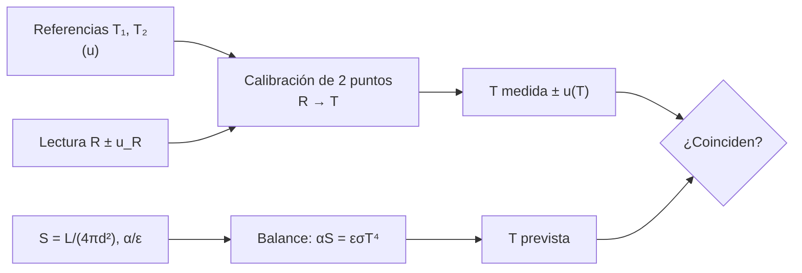

# B13-C16 — Calibración térmica

<!-- nav:top -->
[🏠 Programa](../../../../README.md) · [📚 Bloque B13](../../../tronco-comun/B13-metrologia-tiempo-y-mediciones-cientificas.md) · [← Anterior: B13-C15 — Sensibilidad de detectores](../B13-C15-sensibilidad-de-detectores/CLASE.md) · [Siguiente: B13-C17 — Calibración radiométrica →](../B13-C17-calibracion-radiometrica/CLASE.md)
<!-- /nav -->

## 1. Ubicación, nivel y alcance

Decimosexta clase del bloque B13. En [C15](../B13-C15-sensibilidad-de-detectores/CLASE.md) viste que la oscuridad de un detector depende de su temperatura. Aquí aprendes a **medir y calibrar una temperatura** con un sensor lineal y dos puntos de referencia, cómo se propaga la incertidumbre, y cómo se **predice** la temperatura de equilibrio de una superficie expuesta al Sol con la ley de Stefan–Boltzmann. Nivel N2. No estudias termometría de precisión (escala ITS-90) ni diseño térmico completo.

## 2. Por qué esta clase existe

Un sensor de temperatura pegado a un panel de una nave devuelve una resistencia. Convertirla en kelvin exige calibrarlo contra referencias conocidas, y comprobar que la temperatura medida concuerda con un balance térmico previsto. Una diferencia entre ambas revela un error en la calibración, en las propiedades de la superficie o en el modelo.

La decisión central: **¿cómo convierto una lectura de resistencia en temperatura con incertidumbre, y cuánto debería valer esa temperatura según el balance térmico?**

## 3. Lo que podrás hacer al terminar

1. Explicar cómo el kelvin se define con la constante de Boltzmann y qué papel conserva el punto triple del agua.
2. Calibrar un sensor lineal con dos puntos de referencia.
3. Propagar las incertidumbres de las lecturas y de las referencias a la temperatura.
4. Calcular la irradiancia solar a una distancia dada.
5. Calcular la temperatura de equilibrio de una placa y de una esfera.
6. Estimar cómo un error en las propiedades de la superficie cambia la temperatura.

La evidencia es la **calibración térmica con incertidumbre** del ejercicio 12 (sección 20).

## 4. Con qué llegas y cómo comprobarlo

Necesitas calibración lineal ([C05](../B13-C05-calibracion-instrumental/CLASE.md)), presupuesto de incertidumbre ([C13](../B13-C13-presupuestos-de-incertidumbre/CLASE.md)) y raíces. Cinco preguntas:

1. Con `y = 100 + 0,385 x`, ¿qué `x` da `y = 110`?
2. ¿Cuánto es `81^(1/4)`?
3. ¿Qué es la irradiancia y su unidad?
4. Si una cantidad sube un 1 %, ¿cuánto sube su raíz cuarta (aprox.)?
5. ¿Qué es una incertidumbre combinada?

<details>
<summary>Ver respuestas</summary>

1. `x = 10/0,385 = 25,97`. 2. `3`. 3. La potencia por unidad de superficie, en W/m². 4. Un `0,25 %`. 5. La raíz de la suma de los cuadrados de las contribuciones.
</details>

Con cuatro o cinco aciertos, sigue; si no, repasa C05 y C13.

## 5. Un caso real: el panel y su sensor

Una placa plana mira al Sol a una unidad astronómica con su cara trasera aislada. Su sensor es una resistencia lineal **sintética**, `R(T) = 100,000 + 0,3850 (T − 273,16) Ω`, calibrada con el punto triple del agua (`273,16 K`) y un baño de referencia a `323,15 K` (sintético). Se quiere (a) la temperatura con su incertidumbre desde la resistencia y (b) la temperatura que debe tener la placa según el balance de energía. Es el **ejemplo conductor**.

## 6. Vocabulario

El **kelvin** se define fijando el valor de la constante de Boltzmann, `k = 1,380 649 × 10⁻²³ J/K` (S1, S2); el **punto triple del agua**, `273,16 K`, ya no define el kelvin pero sigue siendo una referencia práctica de calibración (S2). Un **termómetro de resistencia de platino patrón** mide de `−200 °C` a `1000 °C` tras calibrarse en esos puntos (S2). La **calibración de dos puntos** determina la recta de un sensor con dos referencias. La **irradiancia solar** `S = L/(4π d²)` es la potencia solar por unidad de superficie a la distancia `d`, con `L` la luminosidad del Sol. La **ley de Stefan–Boltzmann** `j = εσT⁴` da la potencia radiada por unidad de superficie de un cuerpo de emisividad `ε`. La **absortividad** `α` es la fracción de la irradiancia que absorbe una superficie. La **temperatura de equilibrio** es aquella en que la potencia absorbida iguala a la radiada.

## 7. Modelo mental: dos termómetros y un balance

Piensa en la temperatura como una cantidad que se obtiene de dos maneras independientes: **midiendo** (sensor calibrado) y **calculando** (balance entre lo que la superficie absorbe y lo que irradia). Si coinciden dentro de sus incertidumbres, ambas ganan confianza; si no, algo falla.



*Descripción textual:* con dos referencias y una lectura, la calibración da una temperatura medida con incertidumbre; con la irradiancia y las propiedades de la superficie, el balance da una temperatura prevista; se comparan.

Analogía: pesar y calcular: medir con báscula y calcular por volumen y densidad. Su límite: el balance simple ignora el calor interno, el albedo y la conducción, que pueden ser grandes en una nave real.

## 8. La explicación, paso a paso

### 8.1 El kelvin y el punto triple

Desde 2019 el kelvin se define fijando `k = 1,380 649 × 10⁻²³ J/K`: un kelvin es el cambio de temperatura termodinámica que cambia la energía térmica `kT` en esa cantidad. El punto triple del agua, `273,16 K`, deja de definir la unidad, pero una celda de punto triple evacuada a `611,657 Pa` sigue siendo una referencia práctica, con celdas de laboratorio que concuerdan con `273,16 K` a unos `50 µK` (S2).

### 8.2 Calibración de dos puntos

Se leen `R₁` en `T₁ = 273,16 K` y `R₂` en `T₂ = 323,15 K`. Con un sensor lineal, `T = T₁ + (R − R₁)(T₂ − T₁)/(R₂ − R₁)`. Con las resistencias verdaderas `R₁ = 100,000 Ω` y `R₂ = 119,246 Ω`: `R = 110,0 Ω` da `T = 273,16 + (10,0/19,246) × 49,99 = 299,13 K`.

### 8.3 Incertidumbre de la calibración

`T` depende de cinco entradas (`R`, `R₁`, `R₂`, `T₁`, `T₂`). Con `u(R) = 0,010 Ω` en cada lectura, `u(T₁) = 0,0001 K` (celda de punto triple) y `u(T₂) = 0,020 K` (baño), la propagación (C13) da: `u(T) = 0,0361 K` a `275 K`, `0,0334 K` a `298,15 K` y `0,0418 K` a `323,15 K`. La simulación de Monte Carlo (60 000 muestras) da `0,0363`, `0,0333` y `0,0416 K`, con diferencias inferiores al 1 %. La incertidumbre crece en el extremo de la calibración (`323,15 K`) porque pesa la del baño.

### 8.4 Irradiancia solar

`S = L/(4π d²)`. Con `L = 3,828 × 10²⁶ W` (S3) y `d = 1 au = 1,495 978 707 × 10¹¹ m` (S4): `S = 1361,17 W/m²`. A `1,5 au`, `S` se divide por `1,5² = 2,25`: `604,96 W/m²`.

### 8.5 Balance térmico

Para una placa que mira al Sol y radia solo por la cara iluminada, `α S = ε σ T⁴`, de modo que `T = (αS/(εσ))^{1/4}`. Con `α/ε = 1`, `T = 393,62 K`. Para una esfera isotérmica, el área que absorbe es `πr²` y la que radia es `4πr²`, así que `T = (αS/(4εσ))^{1/4} = 278,33 K`. Con `σ = 5,670 374 419 × 10⁻⁸ W m⁻² K⁻⁴` (S1; el laboratorio la recalcula como `2π⁵k⁴/(15h³c²)` con `h`, `c`, `k` exactas y coincide con CODATA a `10⁻⁹`).

### 8.6 Sensibilidad a las propiedades

Como `T ∝ (α/ε)^{1/4}`, un error de `1 %` en `α/ε` produce `0,25 %` en `T`: el laboratorio da `0,2491 %` (`0,98 K`). Un error de `5 %` produce `4,8 K`. La temperatura es poco sensible a las propiedades pero muy sensible a la irradiancia y a la geometría (C17).

## 9. Magnitudes, símbolos y unidades

| Símbolo | Qué es | Unidad | Valor |
|---|---|---|---|
| `R`, `R₁`, `R₂` | resistencias | Ω | 100 a 119 (sintéticas) |
| `T₁`, `T₂` | referencias | K | 273,16; 323,15 |
| `u(·)` | incertidumbres típicas | Ω; K | `0,010 Ω`; `0,0001 K`; `0,020 K` |
| `S` | irradiancia solar | W/m² | 1361,17 a 1 au |
| `L` | luminosidad solar | W | `3,828 × 10²⁶` |
| `σ` | constante de Stefan–Boltzmann | W m⁻² K⁻⁴ | `5,670 374 419 × 10⁻⁸` |
| `α`, `ε` | absortividad; emisividad | — | `α/ε = 1` (ejemplo) |

## 10. Convenciones y referencias

Temperaturas en kelvin (termodinámica). El sensor es lineal y **sintético**; el baño de `323,15 K` y sus incertidumbres son **sintéticos**. El balance supone equilibrio estacionario, sin calor interno ni albedo, y propiedades grises (independientes de la longitud de onda). La irradiancia se calcula con la luminosidad nominal del Sol y la distancia de 1 au.

## 11. De dónde sale lo que afirmamos

| ID | Fuente | Localizador | Respalda | Estado |
|---|---|---|---|---|
| S1 | NIST, *CODATA 2022* (tabla ASCII) | https://physics.nist.gov/cuu/Constants/Table/allascii.txt | `k`, `h`, `c` exactas; `σ = 5,670 374 419… × 10⁻⁸` | Consultada el 2026-11-05 mediante extracción automática |
| S2 | NIST, *Kelvin: present realization* | https://www.nist.gov/si-redefinition/kelvin-present-realization | Definición del kelvin con `k`; `273,16 K`; celda a `611,657 Pa`; `≈ 50 µK`; patrón de platino `−200` a `1000 °C` | Consultada el 2026-11-05 mediante extracción automática |
| S3 | NASA/NSSDC, *Sun Fact Sheet* (actualizada 2024-05-09) | https://nssdc.gsfc.nasa.gov/planetary/factsheet/sunfact.html | Luminosidad `382,8 × 10²⁴ J/s` | Consultada el 2026-11-05 mediante extracción automática |
| S4 | IERS, *IERS Conventions (2010)*, TN36, Tabla 1.1 | https://iers-conventions.obspm.fr/content/tn36.pdf | `1 au = 1,495 978 707 00 × 10¹¹ m` | Texto extraído del PDF el 2026-11-05 |

Límites: la fórmula de `σ` y el balance de Stefan–Boltzmann son resultados físicos estándar sin cita específica; no se consultó la escala ITS-90; el sensor, el baño y sus incertidumbres son **sintéticos**.

## 12. Cómo ver la calibración

Equivalente accesible a una gráfica de incertidumbre contra temperatura:

| `T` (K) | `u(T)` analítica (K) | `u(T)` Monte Carlo (K) |
|---|---|---|
| 275,00 | 0,03608 | 0,03633 |
| 298,15 | 0,03335 | 0,03333 |
| 323,15 | 0,04182 | 0,04157 |

Descripción larga: la incertidumbre es mínima en el interior del intervalo (`298 K`) y crece hacia los extremos, más en `323 K` por la incertidumbre del baño.

## 13. Ejemplo trabajado: predicción y medida

**Paso 1 · Balance.** `S = 1361,17 W/m²`; `α/ε = 1`; `T = (S/σ)^{1/4} = (2,4004 × 10¹⁰)^{1/4} = 393,6 K`.

**Paso 2 · Lectura.** Con `R = 110,0 Ω` (sintético): `T = 299,13 K` por la calibración de dos puntos, con `u ≈ 0,033 K`.

**Paso 3 · Comparación.** Un sensor que lee `299,13 K` no coincide con el balance (`393,6 K`): la placa real no tiene `α/ε = 1` o recibe otra irradiancia. Con `T = 299,13 K`: `α/ε = σT⁴/S = 5,6704 × 10⁻⁸ × 8,006 × 10⁹/1361,17 = 0,3335`.

**Paso 4 · Interpretación.** Una superficie con `α/ε ≈ 0,33` (por ejemplo, un recubrimiento reflectante) predice `299 K`. La diferencia de `94 K` entre predicción y medida es enorme frente a `u = 0,033 K`: no es un error de medida sino de propiedades.

**Paso 5 · Sentido.** La medida con incertidumbre permite **inferir** una propiedad (`α/ε`) del balance. Con dos cifras significativas: `α/ε = 0,33`. Datos sintéticos.

## 14. Distintas formas de calibrar

**Un punto** (corrige solo un desfase). **Dos puntos** (esta clase): recta exacta, sin control de linealidad. **Varios puntos con mínimos cuadrados** (C05): control de linealidad y de ruido. **Termometría de precisión con polinomios** (escala ITS-90): más exacta; no tratada. Se elige según la incertidumbre buscada y el costo.

## 15. Práctica guiada

**Ejercicio 1 · con los pasos indicados.** Con `R₁ = 100,000 Ω` en `273,16 K` y `R₂ = 119,246 Ω` en `323,15 K`, calcula `T` para `R = 105,0 Ω`. *Pasos:* 8.2.

<details><summary>Solución comentada</summary>

`T = 273,16 + (5,0/19,246) × 49,99 = 273,16 + 12,99 = 286,15 K`.
</details>

**Ejercicio 2 · con una pista.** ¿Qué `T` da `R = R₂`? *Pista:* sustituye.

<details><summary>Solución comentada</summary>

`T = 273,16 + 49,99 = 323,15 K`: la recta pasa por sus referencias (8.2).
</details>

**Ejercicio 3 · casi autónomo.** Calcula `S` a `1 au` con `L = 3,828 × 10²⁶ W`.

<details><summary>Solución comentada</summary>

`4π d² = 4π (1,495 978 707 × 10¹¹)² = 2,8123 × 10²³ m²`; `S = 3,828 × 10²⁶/2,8123 × 10²³ = 1361,2 W/m²` (8.4).
</details>

## 16. Práctica autónoma, transferencia e integrador

**Ejercicio 4.** Calcula `T` de equilibrio de la placa con `α/ε = 0,25`.

<details><summary>Solución comentada</summary>

`T = 393,62 × 0,25^{1/4} = 393,62 × 0,7071 = 278,33 K` (8.5).
</details>

**Ejercicio 5.** Calcula `T` con `α/ε = 2`.

<details><summary>Solución comentada</summary>

`393,62 × 2^{1/4} = 393,62 × 1,1892 = 468,1 K`.
</details>

**Ejercicio 6.** ¿Cuánto cambia `T` si `α/ε` tiene un error de `5 %`?

<details><summary>Solución comentada</summary>

`1,05^{1/4} = 1,01227`: `+1,23 %`, `+4,8 K` (8.6).
</details>

**Ejercicio 7.** Calcula `S` y `T` (placa, `α/ε = 1`) a `1,5 au`.

<details><summary>Solución comentada</summary>

`S = 1361,17/2,25 = 604,96 W/m²`; `T = 393,62/√1,5 = 321,4 K` (`T ∝ S^{1/4} ∝ d^{−1/2}`).
</details>

**Ejercicio 8.** Si el sensor lee `380,0 K`, ¿qué `α/ε` se infiere (placa, 1 au)?

<details><summary>Solución comentada</summary>

`(380/393,62)⁴ = 0,9654⁴ = 0,869` (8.5).
</details>

**Ejercicio 9 · transferencia.** La incertidumbre del baño sube de `0,020` a `0,100 K`. ¿Qué pasa con `u(T)` a `298,15 K`?

<details><summary>Solución comentada</summary>

El coeficiente de `T₂` es `f = (R − R₁)/(R₂ − R₁) ≈ 0,5`; su contribución pasa de `0,010` a `0,050 K`; `u(T)` sube a `≈ 0,059 K` (de `0,033`). Hay que calibrar con un baño mejor o ponderar la referencia.
</details>

**Ejercicio 10 · transferencia.** Un compañero calibra con un único punto (el triple) y supone la pendiente `0,3850 Ω/K` del fabricante. ¿Qué riesgo corre a `323 K`?

<details><summary>Solución comentada</summary>

Si la pendiente real difiere (por ejemplo `1 %`), el error a `323 K` es `0,01 × 50 K = 0,5 K`, 15 veces la `u(T) = 0,033 K` de la calibración de dos puntos. Un solo punto no corrige la pendiente.
</details>

**Ejercicio 11 · transferencia.** El detector de C15 duplica su corriente de oscuridad por cada `6 K` de aumento (ejemplo). Si una calibración térmica tiene `u(T) = 0,5 K`, ¿qué incertidumbre relativa genera en la oscuridad?

<details><summary>Solución comentada</summary>

`D ∝ 2^{T/6}`: `δD/D = ln 2 × 0,5/6 = 5,8 %`. Una calibración térmica de `0,5 K` produce `6 %` de incertidumbre en la oscuridad (modelo de ejemplo, no medido).
</details>

**Ejercicio 12 · integrador.** Elabora tu *calibración térmica con incertidumbre*: la recta de dos puntos con tus referencias (declaradas sintéticas), `T` e `u(T)` en tres lecturas, la comprobación con Monte Carlo, la temperatura prevista por el balance con `α/ε` supuesto, el `α/ε` inferido de una lectura y una discusión de la sensibilidad, con fuentes y rotulado.

<details><summary>Solución modelo</summary>

Tabla de la sección 12; `T = 299,13 K` para `110,0 Ω` con `u ≈ 0,033 K`; balance `393,6 K` para `α/ε = 1`; `α/ε = 0,33` inferido; sensibilidad `0,25 %` por `1 %`.
</details>

## 17. Laboratorio: calibración de dos puntos y balance

El script [calibracion_termica.py](calibracion_termica.py) recalcula `σ` con `h`, `c`, `k` exactas y **la compara con CODATA (`10⁻⁹`)**, calcula `S` y las temperaturas de equilibrio, **verifica que la calibración sin ruido recupera la temperatura exacta** y compara la incertidumbre analítica con Monte Carlo (3 %).

**Datos:** constantes exactas, luminosidad solar publicada, sensor y referencias sintéticos. **Predice antes de ejecutar:** ¿qué temperatura da un `α/ε = 1`? (`≈ 394 K`.) **Ejecución del 2026-11-05 (Python 3.12.9):**

```text
Python 3.12.9 (biblioteca estandar)
sigma calculada = 5.670374419e-08 ; CODATA = 5.670374419e-08
irradiancia solar a 1 au = 1361.17 W/m2
T equilibrio (alpha/eps = 1): placa 393.62 K ; esfera 278.33 K
1 % en alpha/eps -> 0.2491 % en T (0.980 K)
   T (K)   u analitica (K)   u Monte Carlo (K)
  275.00        0.03608          0.03633
  298.15        0.03335          0.03333
  323.15        0.04182          0.04157
Pruebas superadas.
```

```bash
python programa/clases/B13/B13-C16-calibracion-termica/calibracion_termica.py
```

**Límites:** sensor lineal; entradas independientes; equilibrio estacionario sin calor interno ni albedo.

## 18. Errores frecuentes y cómo corregirlos

**Usar grados Celsius en la ley de Stefan–Boltzmann.** Se corrige en el ejercicio 4 (usa kelvin).

**Calibrar con un punto y suponer la pendiente.** Se corrige con el ejercicio 10.

**Ignorar que la incertidumbre crece en los extremos.** Se corrige con el ejercicio 9.

**Creer que la temperatura de equilibrio es muy sensible a `α/ε`.** Se corrige con los ejercicios 5 y 6.

**Confundir un error de medida con uno de propiedades.** Se corrige en el paso 4 del ejemplo trabajado.

## 19. Cómo sabrás que vas bien

Tras 8.2: ¿calculas `T` desde `R`? Si no, ejercicio 1. Tras 8.3: ¿dónde es mínima la incertidumbre? Si dudas, ejercicio 9. Tras 8.5: ¿calculas `T` de equilibrio? Si no, ejercicio 4. Tras el laboratorio: ¿por qué se recalcula `σ`? (para comprobar una constante con una derivación independiente).

## 20. Qué entregas y cómo se evalúa

El producto es tu **calibración térmica con incertidumbre** (ejercicio 12).

| Criterio | Inicial | En desarrollo | Logrado | Destacado |
|---|---|---|---|---|
| Calibración | Sin método | Un punto | Dos puntos correcta | Con `u(T)` propagada |
| Verificación | Ausente | Un caso | Recta exacta y Monte Carlo | Con constantes recalculadas |
| Balance | Sin él | Con errores | `S` y `T` de equilibrio | Infiere `α/ε` |
| Sensibilidad | Sin análisis | Parcial | `¼` de la relación | Compara con la medida |
| Fuentes | Sin fuente | Sin fecha | Con localizador y fecha | Rotula sintético |

**Condiciones críticas (no se compensan con promedio):** usar kelvin; declarar referencias y su incertidumbre; rotular lo sintético.

## 21. Ética, seguridad y límites

Un error térmico puede degradar un detector o poner en riesgo un componente; el balance de esta clase es un orden de magnitud y no sustituye un análisis térmico de misión. Los sensores y baños son simulados. Accesibilidad: tablas equivalentes a las gráficas, fórmulas en texto, ejercicios sin conexión.

## 22. Para cerrar y seguir

El kelvin se define con `k`; un sensor lineal se calibra con dos referencias y su incertidumbre crece hacia los extremos; el balance de Stefan–Boltzmann predice la temperatura de equilibrio con baja sensibilidad a `α/ε`; comparar medida y predicción permite inferir propiedades. Queda una pregunta: la misma ley de Planck que da `σ` describe la luz emitida, ¿cómo se calibra un detector de luz con una fuente de cuerpo negro?

**Glosario español–inglés.** calibración térmica · *thermal calibration*; punto triple · *triple point*; temperatura de equilibrio · *equilibrium temperature*; irradiancia · *irradiance*; emisividad · *emissivity*; absortividad · *absorptivity*; constante de Stefan–Boltzmann · *Stefan–Boltzmann constant*.

**Continuidad.** B13-C17 reutiliza tu capacidad de **usar `h`, `c`, `k` y la ley de Planck** para calibrar un detector de radiación.

**Referencias:** ver sección 11.

<!-- nav:bottom -->
---

[← Anterior: B13-C15 — Sensibilidad de detectores](../B13-C15-sensibilidad-de-detectores/CLASE.md) · [📚 Bloque B13](../../../tronco-comun/B13-metrologia-tiempo-y-mediciones-cientificas.md) · [Siguiente: B13-C17 — Calibración radiométrica →](../B13-C17-calibracion-radiometrica/CLASE.md)
<!-- /nav -->
