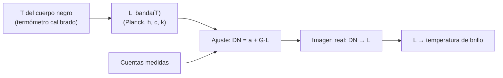

# B13-C17 — Calibración radiométrica

<!-- nav:top -->
[🏠 Programa](../../../../README.md) · [📚 Bloque B13](../../../tronco-comun/B13-metrologia-tiempo-y-mediciones-cientificas.md) · [← Anterior: B13-C16 — Calibración térmica](../B13-C16-calibracion-termica/CLASE.md) · [Siguiente: B13-C18 — Intercomparación de instrumentos →](../B13-C18-intercomparacion-de-instrumentos/CLASE.md)
<!-- /nav -->

## 1. Ubicación, nivel y alcance

Decimoséptima clase del bloque B13. En [C16](../B13-C16-calibracion-termica/CLASE.md) calibraste una temperatura y usaste `σT⁴`. Aquí calibras un **detector de radiación**: conviertes sus cuentas digitales en **radiancia** (W m⁻² sr⁻¹) usando una fuente de cuerpo negro de temperatura conocida y la **ley de Planck**. Nivel N2. No tratas la respuesta espectral real del filtro, la atmósfera ni la calibración en vuelo.

## 2. Por qué esta clase existe

Una cámara infrarroja de una nave mide el calor emitido por la superficie de un planeta. Sus cuentas no significan nada hasta saberse cuánta radiancia corresponde a cada una. En tierra se la apunta a una fuente de cuerpo negro a varias temperaturas; la ley de Planck da la radiancia de cada una; el ajuste da la ganancia. Después, cada imagen puede convertirse en una temperatura de brillo.

La decisión central: **¿qué radiancia corresponde a cada cuenta, con qué incertidumbre, y qué temperatura de brillo implica?**

## 3. Lo que podrás hacer al terminar

1. Escribir la ley de Planck y verificar que su integral reproduce `σT⁴/π`.
2. Calcular la longitud de onda del máximo con la ley de Wien (derivada de Planck).
3. Integrar la radiancia en una banda espectral.
4. Calibrar un detector con cuerpos negros a varias temperaturas.
5. Invertir la calibración y obtener una temperatura de brillo.
6. Identificar los límites: emisividad, banda y extrapolación.

La evidencia es la **calibración radiancia–cuentas** del ejercicio 12 (sección 20).

## 4. Con qué llegas y cómo comprobarlo

Necesitas `h`, `c`, `k` ([C01](../B13-C01-sistema-internacional-y-constantes/CLASE.md)), la calibración lineal ([C05](../B13-C05-calibracion-instrumental/CLASE.md)) y la `σT⁴` ([C16](../B13-C16-calibracion-termica/CLASE.md)). Cinco preguntas:

1. ¿Qué unidad tiene `hc/(λkT)`?
2. ¿Cuánto vale `σT⁴` para `T = 300 K`?
3. ¿Qué es un ajuste lineal de `y` contra `x`?
4. ¿Qué es una integral numérica?
5. ¿Qué es una radiancia?

<details>
<summary>Ver respuestas</summary>

1. Ninguna (adimensional). 2. `5,67 × 10⁻⁸ × 300⁴ = 459,3 W/m²`. 3. La recta `y = a + b x` que minimiza los residuos al cuadrado. 4. La suma aproximada del área bajo una curva con trapecios o parábolas. 5. La potencia por unidad de superficie proyectada y de ángulo sólido (W m⁻² sr⁻¹).
</details>

Con cuatro o cinco aciertos, sigue; si no, repasa C16.

## 5. Un caso real (con datos sintéticos): la cámara térmica y el cuerpo negro

Una cámara infrarroja (banda `8–12 µm`, **sintética**: ganancia `0,80 DN` por W m⁻² sr⁻¹, desplazamiento `120 DN`, ruido `2 DN`) se apunta a una fuente de cuerpo negro a `280, 300, …, 380 K`. Es el **ejemplo conductor**. Además se calcula la irradiancia solar con el Sol como cuerpo negro de `5772 K` (valor de NASA, S3) como comprobación física.

## 6. Vocabulario

Un **cuerpo negro** absorbe toda la radiación incidente y emite el máximo posible a su temperatura. La **radiancia espectral** `L_λ(T)` de un cuerpo negro es `2hc²/λ⁵ × 1/(exp(hc/λkT) − 1)`, en W m⁻² sr⁻¹ m⁻¹ (ley de Planck). La **radiancia de banda** `L_banda` es su integral en un intervalo de longitudes de onda. La **temperatura de brillo** es la de un cuerpo negro que produciría la misma radiancia. La **ley de Wien** dice que el máximo de `L_λ` está en `λ_max = b/T`, con `b = hc/(k x)` y `x` la solución de `x = 5(1 − e⁻ˣ)`. La **emisividad** `ε` es la razón entre lo que emite un cuerpo y lo que emitiría un cuerpo negro. La **ganancia radiométrica** es la pendiente entre cuentas y radiancia.

## 7. Modelo mental: una regla con marcas de luz

El cuerpo negro es una regla cuyas marcas (radiancias) se conocen con exactitud porque Planck las da a partir de `T`. Se apunta el detector a cada marca, se anotan sus cuentas y se dibuja la recta: pendiente (ganancia) y ordenada (desplazamiento). Después se lee una cuenta nueva en la regla y se obtiene la radiancia, y de ella la temperatura de brillo.



*Descripción textual:* la temperatura del cuerpo negro determina su radiancia con Planck; con las cuentas medidas se ajusta una recta; luego cada cuenta de una imagen se convierte en radiancia y en temperatura de brillo.

Analogía: calibrar una báscula con pesas patrón. Su límite: un cuerpo negro real tiene emisividad algo menor que 1 y un campo no uniforme; ambos son una fuente de incertidumbre (C13).

## 8. La explicación, paso a paso

### 8.1 La ley de Planck

`L_λ(T) = (2hc²/λ⁵) / [exp(hc/(λkT)) − 1]`, con `h = 6,626 070 15 × 10⁻³⁴ J s`, `c = 299 792 458 m/s` y `k = 1,380 649 × 10⁻²³ J/K` exactas (S1). Para `λ` en metros y `T` en kelvin da W m⁻² sr⁻¹ por metro de longitud de onda. Para una banda: `L_banda = ∫ L_λ dλ`.

### 8.2 Comprobación con Stefan–Boltzmann

La potencia emitida por unidad de superficie es `π ∫ L_λ dλ = σT⁴`. El laboratorio integra numéricamente Planck (regla de Simpson en escala logarítmica de `λ`) y obtiene `σT⁴` con error relativo de `6 × 10⁻⁹` a `300 K`, `1 × 10⁻¹⁰` a `1000 K` y `3 × 10⁻¹¹` a `5772 K`. Es una prueba independiente: cada lado usa constantes distintas (`σ` de CODATA, S1; `h`, `c`, `k` en Planck).

### 8.3 Wien: dónde está el máximo

Derivando `L_λ` respecto de `λ` (B09) y anulando, resulta `x = 5(1 − e⁻ˣ)` con `x = hc/(λkT)`. La raíz es `x = 4,965 114 232`; entonces `λ_max T = hc/(kx) = 2,897 772 mm K`. Para `5772 K`: `λ_max = 502 nm`; para `300 K`: `9,66 µm`, dentro de la banda de `8–12 µm`: por eso esa banda se usa para ver superficies a temperatura ambiente.

### 8.4 El Sol como cuerpo negro

Con `T = 5772 K` (S3), `σT⁴ = 6,2939 × 10⁷ W/m²`, que coincide con el valor de emisión superficial de la ficha del Sol de la NASA (`62,94 × 10⁶ W/m²`, S3). A `1 au`, con `R = 695 700 km` (S3) y `1 au = 1,495 978 707 × 10¹¹ m` (S4): `S = σT⁴ (R/d)² = 1361,16 W/m²`, igual al valor de C16 (`1361,17`) obtenido con la luminosidad: dos caminos que concuerdan.

### 8.5 La calibración

Con `L_banda(T)` para `T = 280…380 K`: `27,15; 38,50; 52,37; 68,83; 87,89; 109,55 W m⁻² sr⁻¹`. Las cuentas simuladas son `DN = 120 + 0,80 L + ruido`. El ajuste por mínimos cuadrados (C05) devuelve `G = 0,7981 ± 0,0324 DN/(W m⁻² sr⁻¹)` y desplazamiento `119,2 DN` (verdaderos `0,80` y `120`). Sin ruido, la recta se recupera exactamente (`10⁻⁹`).

### 8.6 Inversión y temperatura de brillo

Una cuenta de `250 DN` da `L = (250 − 119,2)/0,7981 = 163,9 W m⁻² sr⁻¹` y, resolviendo `L_banda(T) = 163,9`, una temperatura de brillo de `422,5 K`. **Atención:** `422,5 K` supera el intervalo calibrado (`280–380 K`), es una **extrapolación** (como en C05): hay que calibrar con fuentes que cubran el rango de uso o declarar que no es un valor calibrado. Además, la temperatura de brillo coincide con la real solo si `ε = 1`.

## 9. Magnitudes, símbolos y unidades

| Símbolo | Qué es | Unidad | Valor |
|---|---|---|---|
| `h`, `c`, `k` | constantes de Planck, luz, Boltzmann | J s; m/s; J/K | exactas (S1) |
| `σ` | Stefan–Boltzmann | W m⁻² K⁻⁴ | `5,670 374 419 × 10⁻⁸` |
| `L_λ` | radiancia espectral | W m⁻² sr⁻¹ m⁻¹ | — |
| `L_banda` | radiancia de banda 8–12 µm | W m⁻² sr⁻¹ | 27,15 a 109,55 |
| `G`, `a` | ganancia y desplazamiento | DN/(W m⁻² sr⁻¹); DN | 0,80; 120 (sintéticos) |
| `b` | constante de Wien | m K | `2,897 772 × 10⁻³` (derivada) |
| `ε` | emisividad | — | 1 (ideal) |

## 10. Convenciones y referencias

Radiancias en W m⁻² sr⁻¹ para la banda `8–12 µm` rectangular; longitudes de onda en metros dentro de las fórmulas. El cuerpo negro es ideal (`ε = 1`); la cámara es **sintética**. La temperatura del cuerpo negro se supone conocida con incertidumbre despreciable (a revisar en C13 y C16).

## 11. De dónde sale lo que afirmamos

| ID | Fuente | Localizador | Respalda | Estado |
|---|---|---|---|---|
| S1 | NIST, *CODATA 2022* (tabla ASCII) | https://physics.nist.gov/cuu/Constants/Table/allascii.txt | `h`, `c`, `k` exactas; `σ = 5,670 374 419… × 10⁻⁸` | Consultada el 2026-11-05 mediante extracción automática |
| S2 | BIPM, *SI defining constants* | https://www.bipm.org/en/measurement-units/si-defining-constants | Valores exactos de `h`, `c`, `k` | Consultada el 2026-11-05 mediante extracción automática |
| S3 | NASA/NSSDC, *Sun Fact Sheet* (actualizada 2024-05-09) | https://nssdc.gsfc.nasa.gov/planetary/factsheet/sunfact.html | `T_ef = 5772 K`; radio `695 700 km`; emisión superficial `62,94 × 10⁶ W/m²`; luminosidad `382,8 × 10²⁴ J/s` | Consultada el 2026-11-05 mediante extracción automática |
| S4 | IERS, *IERS Conventions (2010)*, TN36, Tabla 1.1 | https://iers-conventions.obspm.fr/content/tn36.pdf | `1 au = 1,495 978 707 00 × 10¹¹ m` | Texto extraído del PDF el 2026-11-05 |

Límites: la forma de la ley de Planck y la ley de Wien son resultados físicos estándar sin cita específica; la constante de Wien es **derivada** aquí, no tomada de CODATA; la cámara, la fuente y sus ruidos son **sintéticos**.

## 12. Cómo ver la calibración

Equivalente accesible a una gráfica DN contra radiancia:

| `T` (K) | `L_banda` (W m⁻² sr⁻¹) | `DN` ideal = 120 + 0,80 `L` |
|---|---|---|
| 280 | 27,151 | 141,7 |
| 300 | 38,500 | 150,8 |
| 320 | 52,370 | 161,9 |
| 340 | 68,828 | 175,1 |
| 360 | 87,894 | 190,3 |
| 380 | 109,548 | 207,6 |

Descripción larga: seis puntos que crecen más que linealmente con `T` (radiancia ∝ `T⁴` aproximadamente) pero linealmente con la radiancia; la recta DN–`L` tiene pendiente 0,80.

## 13. Ejemplo trabajado: del cuerpo negro a la ganancia

**Paso 1 · Radiancia a 300 K.** `x = hc/(λkT)` con `λ` entre `8` y `12 µm`; la integral de Planck da `L_banda = 38,50 W m⁻² sr⁻¹`.

**Paso 2 · Cuentas esperadas.** `DN = 120 + 0,80 × 38,50 = 150,8` (sin ruido).

**Paso 3 · Ajuste.** Con las seis temperaturas y ruido de `2 DN`, `G = 0,7981 ± 0,0324`, es decir, `4,1 %` de incertidumbre relativa, compatible con `0,80`.

**Paso 4 · Efecto de la emisividad.** Si el cuerpo negro real tiene `ε = 0,95` y se supone 1, las radiancias reales son `5 %` menores que las asumidas: la ganancia estimada sale `5 %` mayor (`≈ 0,84`). Eso es un sesgo mayor que la incertidumbre del ajuste.

**Paso 5 · Sentido.** La incertidumbre de la ganancia (4 %) la domina el ruido con solo seis puntos; la de la fuente (emisividad) puede ser más importante. Con dos cifras: `G = 0,80 ± 0,03` (la cifra de `0,0324` obliga a dos decimales). Datos sintéticos.

## 14. Distintas formas de calibrar

**Cuerpo negro de laboratorio** (esta clase): control de `T` y de `ε`. **Lámpara o fuente de transferencia:** más portátil, requiere calibrar la propia fuente. **Fuentes naturales** (el Sol, la Luna, zonas estables de la superficie): calibración en vuelo. **Intercomparación con otro instrumento** (C18). Se combinan en la práctica.

## 15. Práctica guiada

**Ejercicio 1 · con los pasos indicados.** Calcula `λ_max` a `300 K` con `b = 2,897 772 × 10⁻³ m K`. *Pasos:* 8.3.

<details><summary>Solución comentada</summary>

`2,897 772 × 10⁻³/300 = 9,659 × 10⁻⁶ m = 9,66 µm`.
</details>

**Ejercicio 2 · con una pista.** Calcula `σT⁴` y la radiancia total `σT⁴/π` a `300 K`. *Pista:* `459,3 W/m²`.

<details><summary>Solución comentada</summary>

`459,3/π = 146,2 W m⁻² sr⁻¹` (8.2). La banda `8–12 µm` recoge `38,5/146,2 = 26 %`.
</details>

**Ejercicio 3 · casi autónomo.** Calcula las cuentas ideales a `320 K` con `L = 52,37`.

<details><summary>Solución comentada</summary>

`120 + 0,80 × 52,37 = 161,9 DN` (sección 12).
</details>

## 16. Práctica autónoma, transferencia e integrador

**Ejercicio 4.** ¿Cuánto crece la radiancia de banda de `300` a `380 K`?

<details><summary>Solución comentada</summary>

`109,548/38,500 = 2,85` veces (la radiancia total crece `(380/300)⁴ = 2,57`: en la banda crece más porque el máximo se aleja).
</details>

**Ejercicio 5.** Calcula `λ_max` del Sol (`5772 K`).

<details><summary>Solución comentada</summary>

`2,897 772 × 10⁻³/5772 = 502 nm` (8.3).
</details>

**Ejercicio 6.** Con `S = σT⁴(R/d)²`, calcula `S` del Sol a `1 au`.

<details><summary>Solución comentada</summary>

`6,2939 × 10⁷ × (6,957 × 10⁸/1,495 978 707 × 10¹¹)² = 6,2939 × 10⁷ × 2,1626 × 10⁻⁵ = 1361,2 W/m²` (8.4).
</details>

**Ejercicio 7.** ¿Cuál es la incertidumbre relativa de la ganancia?

<details><summary>Solución comentada</summary>

`0,0324/0,7981 = 4,1 %` (8.5).
</details>

**Ejercicio 8.** Con la recta ajustada, ¿qué radiancia corresponde a `200 DN` y a qué temperatura de brillo (usa la tabla de la sección 12)?

<details><summary>Solución comentada</summary>

`(200 − 119,2)/0,7981 = 101,2 W m⁻² sr⁻¹`: entre `87,9` (360 K) y `109,5` (380 K): `≈ 372 K` por interpolación lineal (`360 + 20 × 13,3/21,7 = 372,3 K`). Dentro del rango calibrado.
</details>

**Ejercicio 9 · transferencia.** La cuenta `250 DN` implica `422,5 K`: ¿es un valor calibrado? ¿Qué harías?

<details><summary>Solución comentada</summary>

No: supera `380 K`. Calibrar con fuentes hasta `≥ 430 K` o informar el valor como extrapolación (8.6).
</details>

**Ejercicio 10 · transferencia.** El cuerpo negro tiene `ε = 0,98`. ¿Qué error de ganancia produce suponer `ε = 1` y cómo lo corriges?

<details><summary>Solución comentada</summary>

Las radiancias reales son `2 %` menores: la ganancia sale `2 %` mayor. Se corrige multiplicando cada radiancia por `ε` (y añadiendo la incertidumbre de `ε` al presupuesto, C13).
</details>

**Ejercicio 11 · transferencia.** Un compañero calcula la radiancia total con `σT⁴` sin dividir entre `π`. ¿Qué error comete?

<details><summary>Solución comentada</summary>

Confunde la **emitancia** (W/m², por unidad de superficie sobre todo el hemisferio) con la **radiancia** (W m⁻² sr⁻¹): la radiancia de un cuerpo negro es `σT⁴/π` (8.2).
</details>

**Ejercicio 12 · integrador.** Elabora tu *calibración radiancia–cuentas*: la tabla de `L_banda(T)` con tu banda, la comprobación `π∫L = σT⁴`, la recta con `G` y `a` y sus incertidumbres, una inversión dentro del rango con su temperatura de brillo y una discusión de la emisividad, con fuentes y rotulado de sintético.

<details><summary>Solución modelo</summary>

Tabla de la sección 12; `rel < 10⁻⁸`; `G = 0,798 ± 0,032`; `200 DN → 101 W m⁻² sr⁻¹ ≈ 372 K`; sesgo `5 %` si `ε = 0,95`.
</details>

## 17. Laboratorio: Planck, Stefan–Boltzmann y calibración

El script [planck_y_calibracion.py](planck_y_calibracion.py) integra Planck con Simpson, **comprueba `π∫L = σT⁴` a `10⁻⁵`**, resuelve Wien por bisección, calcula `S` solar, **verifica que la recta sin ruido se recupera a `10⁻⁹`** y calibra con ruido.

**Datos:** constantes exactas, Sol (NASA), cámara sintética. **Predice antes de ejecutar:** ¿en qué longitud de onda está el máximo a `300 K`? (`≈ 9,7 µm`.) **Ejecución del 2026-11-05 (Python 3.12.9):**

```text
Python 3.12.9 (biblioteca estandar)
T =    300 K: pi*int L = 4.593003e+02 ; sigma T^4 = 4.593003e+02 ; rel = 5.6e-09
T =   1000 K: pi*int L = 5.670374e+04 ; sigma T^4 = 5.670374e+04 ; rel = 1.2e-10
T =   5772 K: pi*int L = 6.293859e+07 ; sigma T^4 = 6.293859e+07 ; rel = 3.2e-11
x = 4.965114232 ; b = lambda_max T = 2.897772 mm K ; lambda_max(5772 K) = 502.0 nm ; lambda_max(300 K) = 9.66 um
sigma T^4 (Sol) = 6.2939e+07 W/m2 ; irradiancia a 1 au = 1361.16 W/m2
T (K): 280, 300, 320, 340, 360, 380
L_banda 8-12 um (W m-2 sr-1): 27.151, 38.500, 52.370, 68.828, 87.894, 109.548
ganancia = 0.7981 +/- 0.0324 DN/(W m-2 sr-1) (verdadera 0.8) ; desplazamiento = 119.2 DN (verdadero 120)
250 DN -> L = 163.922 W m-2 sr-1 -> temperatura de brillo = 422.51 K
Pruebas superadas.
```

```bash
python programa/clases/B13/B13-C17-calibracion-radiometrica/planck_y_calibracion.py
```

**Límites:** cuerpo negro ideal, banda rectangular, sin atmósfera ni respuesta espectral real; la inversión final es una extrapolación.

## 18. Errores frecuentes y cómo corregirlos

**Confundir emitancia y radiancia.** Se corrige con el ejercicio 11.

**Suponer `ε = 1` sin evaluarlo.** Se corrige con el ejercicio 10.

**Extrapolar fuera del rango calibrado.** Se corrige con el ejercicio 9.

**Mezclar micrómetros y metros en Planck.** Se corrige en la sección 10.

**Olvidar la incertidumbre de la ganancia.** Se corrige con el ejercicio 7.

## 19. Cómo sabrás que vas bien

Tras 8.2: ¿por qué coinciden Planck y Stefan–Boltzmann? Si dudas, ejercicio 2. Tras 8.3: ¿dónde está el máximo del Sol? Si no, ejercicio 5. Tras 8.5: ¿cuál es la incertidumbre de la ganancia? Si no, ejercicio 7. Tras el laboratorio: ¿por qué se verifica Planck con una constante distinta? (porque son derivaciones independientes).

## 20. Qué entregas y cómo se evalúa

El producto es tu **calibración radiancia–cuentas** (ejercicio 12).

| Criterio | Inicial | En desarrollo | Logrado | Destacado |
|---|---|---|---|---|
| Planck | Sin fórmula | Con errores | Fórmula y banda | Verifica con `σT⁴` |
| Calibración | Sin ajuste | Sin incertidumbre | `G` y `a` con incertidumbre | Con inversión y brillo |
| Límites | Sin ellos | Menciona | Rango y emisividad | Cuantifica el sesgo |
| Unidades | Mezcladas | Parciales | Coherentes | Distingue emitancia y radiancia |
| Fuentes | Sin fuente | Sin fecha | Con localizador y fecha | Rotula sintético y derivado |

**Condiciones críticas (no se compensan con promedio):** no extrapolar sin declararlo; declarar la emisividad supuesta; rotular lo sintético.

## 21. Ética, seguridad y límites

Una calibración radiométrica sesgada produce temperaturas o flujos equivocados en un producto científico; la calibración real exige laboratorios acreditados. Los datos de esta clase son simulados. Accesibilidad: tablas equivalentes a las gráficas, fórmulas en texto, ejercicios sin conexión.

## 22. Para cerrar y seguir

La ley de Planck, con constantes exactas, da la radiancia de un cuerpo negro; su integral reproduce `σT⁴`; con cuerpos negros a varias temperaturas se calibra un detector; la inversión da radiancia y temperatura de brillo dentro del rango calibrado. Queda una pregunta: cuando dos instrumentos miden lo mismo y no coinciden, ¿cuándo es una discrepancia real?

**Glosario español–inglés.** calibración radiométrica · *radiometric calibration*; radiancia · *radiance*; cuerpo negro · *blackbody*; temperatura de brillo · *brightness temperature*; ley de Wien · *Wien's displacement law*; emisividad · *emissivity*; ganancia · *gain*.

**Continuidad.** B13-C18 reutiliza tu capacidad de **calibrar y declarar incertidumbre** para comparar dos instrumentos.

**Referencias:** ver sección 11.

<!-- nav:bottom -->
---

[← Anterior: B13-C16 — Calibración térmica](../B13-C16-calibracion-termica/CLASE.md) · [📚 Bloque B13](../../../tronco-comun/B13-metrologia-tiempo-y-mediciones-cientificas.md) · [Siguiente: B13-C18 — Intercomparación de instrumentos →](../B13-C18-intercomparacion-de-instrumentos/CLASE.md)
<!-- /nav -->
