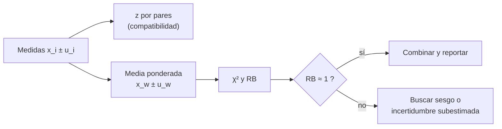

# B13-C18 — Intercomparación de instrumentos

<!-- nav:top -->
[🏠 Programa](../../../../README.md) · [📚 Bloque B13](../../../tronco-comun/B13-metrologia-tiempo-y-mediciones-cientificas.md) · [← Anterior: B13-C17 — Calibración radiométrica](../B13-C17-calibracion-radiometrica/CLASE.md) · [Siguiente: B13-C19 — Metadatos y registros de calibración →](../B13-C19-metadatos-y-registros-de-calibracion/CLASE.md)
<!-- /nav -->

## 1. Ubicación, nivel y alcance

Decimoctava clase del bloque B13. Ya sabes calibrar un instrumento (C05, C16, C17) y declarar su incertidumbre (C12, C13). Ahora comparas **varios instrumentos que miden lo mismo**: la **diferencia normalizada** entre pares, la **media ponderada** y la **razón de Birge** que revela si las incertidumbres declaradas son creíbles. Nivel N2. No tratas intercomparaciones formales entre laboratorios ni correlaciones.

## 2. Por qué esta clase existe

Tres radiómetros miden la misma irradiancia solar y dan `1361,4`, `1360,1` y `1362,9 W/m²`. Cada uno declara una incertidumbre. ¿Concuerdan? ¿Cuál es el mejor valor combinado? ¿Alguna incertidumbre está subestimada? Comparar números sin tener en cuenta sus incertidumbres lleva a descartar buenos instrumentos o a aceptar dudosos.

La decisión central: **¿la discrepancia entre dos instrumentos es compatible con sus incertidumbres, y cómo combino los resultados?**

## 3. Lo que podrás hacer al terminar

1. Calcular la diferencia normalizada `z` entre dos medidas independientes.
2. Decidir si dos medidas son compatibles con un criterio `z ≤ 2`.
3. Calcular la media ponderada y su incertidumbre.
4. Calcular `χ²` y la razón de Birge.
5. Diagnosticar un instrumento con incertidumbre subestimada.
6. Verificar los criterios con una simulación bajo la hipótesis nula.

La evidencia es el **informe de intercomparación** del ejercicio 12 (sección 20).

## 4. Con qué llegas y cómo comprobarlo

Necesitas la combinación en cuadratura ([C13](../B13-C13-presupuestos-de-incertidumbre/CLASE.md)) y la cobertura de `k = 2` ([C12](../B13-C12-incertidumbre-expandida/CLASE.md)). Cinco preguntas:

1. ¿Cuánto es `√(0,6² + 0,8²)`?
2. ¿Qué cobertura aproximada tiene `k = 2`?
3. ¿Qué es una media ponderada?
4. Si `x = 10 ± 1`, ¿cuál es el peso `1/u²`?
5. ¿Qué es la hipótesis nula?

<details>
<summary>Ver respuestas</summary>

1. `1,0`. 2. `≈ 95 %`. 3. Una media donde cada dato pesa según su fiabilidad. 4. `1`. 5. La suposición de que no hay efecto (aquí, que los instrumentos coinciden con las incertidumbres declaradas).
</details>

Con cuatro o cinco aciertos, sigue; si no, repasa C12 y C13.

## 5. Un caso real (con datos sintéticos): tres radiómetros

Tres radiómetros miden la misma irradiancia con incertidumbres típicas `u₁ = 0,60`, `u₂ = 0,80` y `u₃ = 0,50 W/m²`. Los resultados de ejemplo son `1361,4`, `1360,1` y `1362,9 W/m²`. Son datos **sintéticos**: sirven para ver cómo se comporta el análisis. Es el **ejemplo conductor**.

## 6. Vocabulario

Una **intercomparación** es la medición de la misma magnitud con varios instrumentos o laboratorios para evaluar su concordancia. La **diferencia normalizada** de dos medidas independientes es `z = |x₁ − x₂|/√(u₁² + u₂²)`: su denominador es la incertidumbre de la diferencia (S1, 5.1.2 con coeficientes `+1` y `−1`). **Compatibles** significa que `z` es pequeño, en esta clase `z ≤ 2` (cobertura aproximada de 95 %, C12). La **media ponderada** `x_w = Σ(xᵢ/uᵢ²)/Σ(1/uᵢ²)` pesa cada medida por `1/uᵢ²`; su incertidumbre es `u_w = 1/√Σ(1/uᵢ²)`. El **chi cuadrado** `χ² = Σ(xᵢ − x_w)²/uᵢ²` mide la dispersión respecto de la media ponderada en unidades de incertidumbre. La **razón de Birge** `RB = √(χ²/(N − 1))` es cercana a 1 si las incertidumbres son consistentes con la dispersión.

## 7. Modelo mental: una balanza de votos

Cada instrumento «vota» por un valor con un peso `1/u²`: el más preciso pesa más. El resultado combinado se acerca al instrumento más preciso. Pero si los votos están más dispersos de lo que sus incertidumbres admiten, la balanza está mal calibrada: hay incertidumbres subestimadas o sesgos.



*Descripción textual:* de las medidas con incertidumbre salen los `z` por pares y la media ponderada; con ella se calculan `χ²` y la razón de Birge; si es cercana a 1 se combinan; si no, se investiga un sesgo o una incertidumbre subestimada.

Analogía: un jurado con votos de distinto peso. Su límite: la media ponderada supone independencia; si dos instrumentos comparten un error (por ejemplo la misma calibración), sus votos no son independientes.

## 8. La explicación, paso a paso

### 8.1 Diferencia normalizada

La varianza de `x₁ − x₂`, con errores independientes, es `u₁² + u₂²` (S1, 5.1.2). Por tanto `z = |x₁ − x₂|/√(u₁² + u₂²)`. Si ambos instrumentos miden lo mismo y sus incertidumbres son correctas, `z` es el valor absoluto de una variable de desviación 1: `P(z > 1) = 31,7 %` y `P(z > 2) = 4,55 %`.

### 8.2 Los pares del ejemplo

`z₁₂ = |1361,4 − 1360,1|/√(0,36 + 0,64) = 1,300`; `z₁₃ = 1,5/√(0,36 + 0,25) = 1,921`; `z₂₃ = 2,8/√(0,64 + 0,25) = 2,968`. Los pares 1–2 y 1–3 son compatibles (`z ≤ 2`); el par 2–3 no (`z = 2,97`).

### 8.3 Media ponderada

Pesos `1/uᵢ² = 2,778; 1,563; 4,000`; suma `8,340`. `x_w = (1361,4 × 2,778 + 1360,1 × 1,563 + 1362,9 × 4,000)/8,340 = 1361,876 W/m²`; `u_w = 1/√8,340 = 0,346 W/m²`. El valor combinado queda más cerca del instrumento 3, que es el más preciso.

### 8.4 Chi cuadrado y razón de Birge

`χ² = (1361,4 − 1361,876)²/0,36 + (1360,1 − 1361,876)²/0,64 + (1362,9 − 1361,876)²/0,25 = 0,63 + 4,93 + 4,19 = 9,75`. Con `N = 3`, el valor esperado bajo la hipótesis nula es `N − 1 = 2`. `RB = √(9,75/2) = 2,21`. Un valor tan superior a 1 indica que las incertidumbres declaradas no explican la dispersión.

### 8.5 Qué hacer con `RB > 1`

Hay tres respuestas: (a) investigar un sesgo (instrumento 2 aporta `4,93` de `9,75`); (b) revisar el presupuesto de cada incertidumbre (C13); (c) como práctica extendida, multiplicar `u_w` por `RB` (`0,346 × 2,21 = 0,76 W/m²`), que reconoce la dispersión extra sin identificar su causa. Esta práctica no se consultó en una fuente en esta sesión; es un recurso habitual, no una norma.

### 8.6 Verificar los criterios

El laboratorio simula `10⁵` pares con las incertidumbres declaradas y obtiene `P(z > 1) = 0,3162` y `P(z > 2) = 0,0460`, frente a `0,3173` y `0,0455` teóricos. Con tres instrumentos coherentes, el promedio de `χ²` en `2 × 10⁴` repeticiones es `2,004`, coherente con `N − 1 = 2`.

## 9. Magnitudes, símbolos y unidades

| Símbolo | Qué es | Unidad | Valor del ejemplo |
|---|---|---|---|
| `xᵢ` | medida del instrumento `i` | W/m² | 1361,4; 1360,1; 1362,9 |
| `uᵢ` | incertidumbre típica | W/m² | 0,60; 0,80; 0,50 |
| `z` | diferencia normalizada | — | 1,300; 1,921; 2,968 |
| `x_w`, `u_w` | media ponderada e incertidumbre | W/m² | 1361,876; 0,346 |
| `χ²`, `RB` | chi cuadrado; razón de Birge | —; — | 9,75; 2,21 |
| `N` | número de instrumentos | — | 3 |

## 10. Convenciones y referencias

Errores independientes y gaussianos. Las incertidumbres son típicas (`k = 1`). El criterio `z ≤ 2` es de cobertura aproximada de 95 %. Si las incertidumbres se dan expandidas, hay que dividirlas por `k` antes de usarlas. Los datos son **sintéticos**.

## 11. De dónde sale lo que afirmamos

| ID | Fuente | Localizador | Respalda | Estado |
|---|---|---|---|---|
| S1 | JCGM 100:2008 (GUM), 5.1.2 y G.6 | https://www.bipm.org/documents/20126/2071204/JCGM_100_2008_E.pdf | Varianza de una combinación lineal de entradas independientes; `k = 2` ≈ 95 % bajo suposiciones | Texto extraído del PDF el 2026-11-05 |

Límites: la media ponderada, `χ²`, la razón de Birge y su escalado son resultados estadísticos habituales sin cita específica en esta clase; las probabilidades `31,73 %` y `4,55 %` son de la normal (C12); los datos son **sintéticos**.

## 12. Cómo ver la intercomparación

Equivalente accesible a un gráfico con barras de error:

| Instrumento | `xᵢ ± uᵢ` (W/m²) | Peso `1/uᵢ²` | `(xᵢ − x_w)²/uᵢ²` |
|---|---|---|---|
| 1 | 1361,4 ± 0,60 | 2,778 | 0,63 |
| 2 | 1360,1 ± 0,80 | 1,563 | 4,93 |
| 3 | 1362,9 ± 0,50 | 4,000 | 4,19 |
| Combinado | 1361,876 ± 0,346 | 8,340 | `χ² = 9,75` |

Descripción larga: tres intervalos de longitud `±0,6`, `±0,8` y `±0,5` centrados en `1361,4`, `1360,1` y `1362,9`; el de 2 y el de 3 casi no se solapan; el combinado, más estrecho, queda cerca del de 3.

## 13. Ejemplo trabajado: ¿qué instrumento falla?

**Paso 1 · Pares.** `z₂₃ = 2,97 > 2`: los instrumentos 2 y 3 discrepan.

**Paso 2 · Contribuciones.** `χ²` aporta `4,93` (inst. 2) y `4,19` (inst. 3); el 1 aporta `0,63`.

**Paso 3 · Prueba de sensibilidad.** Sin el 2: `x_w = (1361,4 × 2,778 + 1362,9 × 4)/6,778 = 1362,29 W/m²`, `u_w = 0,384`; `z₁₃ = 1,92 ≤ 2`: compatibles; con `N = 2`, `χ² = z₁₃² = 3,69` y `RB = √(3,69/1) = 1,92`.

**Paso 4 · Diagnóstico.** Hay una discrepancia que las incertidumbres declaradas no explican; el instrumento 2 es el sospechoso principal, aunque con solo tres instrumentos no se puede afirmar cuál tiene el sesgo.

**Paso 5 · Sentido.** Reporte: «`1361,9 ± 0,35 W/m²` (media ponderada), con `RB = 2,2`: dispersión superior a la declarada; se recomienda revisar el presupuesto del instrumento 2; con `RB` aplicado, `± 0,76`». Dos cifras en la incertidumbre. Datos sintéticos.

## 14. Distintas formas de comparar

**Pares con `z`:** simple, local. **Media ponderada con `χ²`:** global; detecta subestimación. **Comparación con un patrón de referencia** (más exacta): requiere un patrón. **Intercomparaciones formales** con protocolo y piloto: más rigurosas y no tratadas aquí. Se combinan.

## 15. Práctica guiada

**Ejercicio 1 · con los pasos indicados.** Calcula `z₁₂`. *Pasos:* 8.1.

<details><summary>Solución comentada</summary>

`|1361,4 − 1360,1|/√(0,36 + 0,64) = 1,3/1,0 = 1,30` (compatibles).
</details>

**Ejercicio 2 · con una pista.** Calcula `z₁₃`. *Pista:* `√(0,36 + 0,25)`.

<details><summary>Solución comentada</summary>

`1,5/0,781 = 1,92`.
</details>

**Ejercicio 3 · casi autónomo.** Calcula `z₂₃` y di si son compatibles.

<details><summary>Solución comentada</summary>

`2,8/0,943 = 2,97 > 2`: no son compatibles (8.2).
</details>

## 16. Práctica autónoma, transferencia e integrador

**Ejercicio 4.** Calcula la media ponderada de los instrumentos 1 y 3 y su incertidumbre.

<details><summary>Solución comentada</summary>

Pesos `2,778` y `4,000`; `x_w = 9233,3/6,778 = 1362,29`; `u_w = 1/√6,778 = 0,384 W/m²`.
</details>

**Ejercicio 5.** ¿Qué instrumento aporta más a `χ²` en el caso de tres?

<details><summary>Solución comentada</summary>

El 2 (`4,93` de `9,75`, 51 %) (8.4).
</details>

**Ejercicio 6.** Calcula `RB` y la incertidumbre ampliada con `RB`.

<details><summary>Solución comentada</summary>

`√(9,75/2) = 2,21`; `0,346 × 2,21 = 0,76 W/m²` (8.5).
</details>

**Ejercicio 7.** Con dos medidas idénticas de la misma incertidumbre `u`, ¿cuál es `u_w`?

<details><summary>Solución comentada</summary>

`1/√(2/u²) = u/√2` (la media de dos mejora un `√2`; el laboratorio lo verifica con `u = 1`).
</details>

**Ejercicio 8.** Un compañero compara `1361,4 ± 0,6` con `1360,1 ± 0,8` y dice «difieren en 1,3, más que cualquiera de sus incertidumbres, luego no concuerdan». Corrige.

<details><summary>Solución comentada</summary>

La comparación correcta es con la incertidumbre de la diferencia (`1,0`): `z = 1,3`, compatibles (8.1).
</details>

**Ejercicio 9 · transferencia.** Dos relojes dan un desfase de `+4,0 ± 1,0 ns` y `+1,0 ± 1,5 ns`. ¿Son compatibles? ¿Cuál es la media ponderada?

<details><summary>Solución comentada</summary>

`z = 3,0/√(1 + 2,25) = 1,66`: compatibles. Pesos `1` y `0,444`; `x_w = (4 + 0,444)/1,444 = 3,08 ns`; `u_w = 1/√1,444 = 0,83 ns`. Datos sintéticos.
</details>

**Ejercicio 10 · transferencia.** Los dos relojes comparten la misma referencia calibrada (error común). ¿Qué supuesto se rompe y cómo cambia `u` de la diferencia?

<details><summary>Solución comentada</summary>

La independencia. Con error común positivo, la incertidumbre de la diferencia es **menor** que `√(u₁² + u₂²)` (el error común se cancela), pero la media ponderada **no** mejora más allá de ese error común: `u_w` queda subestimada.
</details>

**Ejercicio 11 · transferencia.** El criterio `z ≤ 2` aprueba el `95,45 %` de pares correctos. Con 20 pares, ¿cuántos rechazos esperas por azar?

<details><summary>Solución comentada</summary>

`20 × 0,0455 ≈ 0,9`: un rechazo por azar es normal; no se concluye un fallo con un solo par (8.1).
</details>

**Ejercicio 12 · integrador.** Elabora tu *informe de intercomparación*: tres o más instrumentos con sus incertidumbres (sintéticos), `z` por pares, media ponderada, `χ²`, `RB`, diagnóstico del instrumento sospechoso, una prueba de sensibilidad (con y sin él) y el reporte final con la verificación bajo hipótesis nula.

<details><summary>Solución modelo</summary>

Tabla de la sección 12; `z = 1,30; 1,92; 2,97`; `x_w = 1361,876 ± 0,346`; `RB = 2,21`; sin el instrumento 2: `1362,29 ± 0,38` y `z₁₃ = 1,92`; nula: `P(z > 2) = 0,046`.
</details>

## 17. Laboratorio: compatibilidad y media ponderada

El script [intercomparacion.py](intercomparacion.py) calcula `z`, la media ponderada, `χ²` y `RB`, **comprueba casos exactos** (`z = 1` con `u = 3, 4`; media de dos datos iguales), **simula la hipótesis nula con `10⁵` pares** y comprueba `E[χ²] = N − 1`.

**Datos:** sintéticos. **Predice antes de ejecutar:** ¿qué par será incompatible? (el 2–3.) **Ejecución del 2026-11-05 (Python 3.12.9):**

```text
Python 3.12.9 (biblioteca estandar)
z(1,2) = 1.300
z(1,3) = 1.921
z(2,3) = 2.968
media ponderada = 1361.876 +/- 0.346 W/m2 ; chi2 = 9.752 ; razon de Birge = 2.208
nula: P(z>1) = 0.3162 (teorica 0.3173) ; P(z>2) = 0.0460 (teorica 0.0455)
con sesgo oculto de +2.0 en el instrumento 2: z(1,2) = 0.700
media de chi2 bajo la nula = 2.004 (teorica N-1 = 2)
Pruebas superadas.
```

```bash
python programa/clases/B13/B13-C18-intercomparacion-de-instrumentos/intercomparacion.py
```

**Límites:** independencia y normalidad; con pocos instrumentos el diagnóstico es incierto. La línea del sesgo oculto muestra que un sesgo puede acercar dos medidas y hacerlas parecer compatibles sin serlo con la verdad.

## 18. Errores frecuentes y cómo corregirlos

**Comparar la diferencia con una sola incertidumbre.** Se corrige con el ejercicio 8.

**Concluir un fallo con un solo par fuera de criterio.** Se corrige con el ejercicio 11.

**Ignorar la correlación entre instrumentos.** Se corrige con el ejercicio 10.

**Usar incertidumbres expandidas como típicas.** Se corrige en la sección 10.

**Dar la media ponderada sin `χ²`.** Se corrige con el ejercicio 6.

## 19. Cómo sabrás que vas bien

Tras 8.1: ¿calculas `z`? Si no, ejercicio 1. Tras 8.3: ¿calculas la media ponderada? Si no, ejercicio 4. Tras 8.4: ¿qué indica `RB = 2,2`? Si dudas, ejercicio 6. Tras el laboratorio: ¿por qué se simula la hipótesis nula? (para saber qué tasa de rechazos es normal).

## 20. Qué entregas y cómo se evalúa

El producto es tu **informe de intercomparación** (ejercicio 12).

| Criterio | Inicial | En desarrollo | Logrado | Destacado |
|---|---|---|---|---|
| Compatibilidad | Solo diferencias | `z` incorrecto | `z` por pares | Con tasa nula verificada |
| Combinación | Promedio simple | Ponderada sin `u` | `x_w ± u_w` | Con `χ²` y `RB` |
| Diagnóstico | Ausente | Genérico | Identifica un sospechoso | Con prueba de sensibilidad |
| Límites | Sin ellos | Parciales | Independencia y pocos datos | Considera error común |
| Fuentes | Sin fuente | Sin fecha | Con localizador y fecha | Rotula sintético |

**Condiciones críticas (no se compensan con promedio):** comparar con la incertidumbre de la diferencia; declarar la independencia supuesta; rotular lo sintético.

## 21. Ética, seguridad y límites

Descartar un instrumento por un solo `z` alto, o aceptar uno sesgado porque coincide con otro igual de sesgado, produce decisiones erradas. Los datos son simulados y no describen radiómetros reales. Accesibilidad: tablas equivalentes al gráfico, fórmulas en texto, ejercicios sin conexión.

## 22. Para cerrar y seguir

`z` compara dos medidas con la incertidumbre de su diferencia; la media ponderada las combina; `χ²` y la razón de Birge revelan incertidumbres subestimadas; la independencia es un supuesto esencial. Queda una pregunta: ¿qué información debe acompañar a cada calibración para que otra persona pueda repetir y confiar en este análisis?

**Glosario español–inglés.** intercomparación · *intercomparison*; diferencia normalizada · *normalized difference*; media ponderada · *weighted mean*; razón de Birge · *Birge ratio*; hipótesis nula · *null hypothesis*; compatible · *consistent*; chi cuadrado · *chi-squared*.

**Continuidad.** B13-C19 reutiliza tu capacidad de **declarar incertidumbre y condiciones** para diseñar un registro de calibración.

**Referencias:** ver sección 11.

<!-- nav:bottom -->
---

[← Anterior: B13-C17 — Calibración radiométrica](../B13-C17-calibracion-radiometrica/CLASE.md) · [📚 Bloque B13](../../../tronco-comun/B13-metrologia-tiempo-y-mediciones-cientificas.md) · [Siguiente: B13-C19 — Metadatos y registros de calibración →](../B13-C19-metadatos-y-registros-de-calibracion/CLASE.md)
<!-- /nav -->
