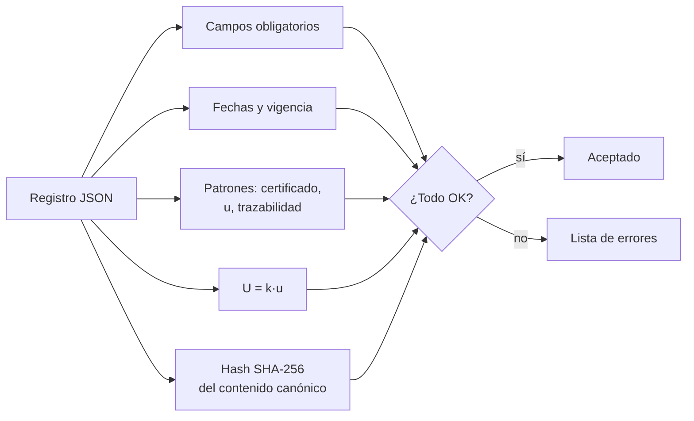

# B13-C19 — Metadatos y registros de calibración

<!-- nav:top -->
[🏠 Programa](../../../../README.md) · [📚 Bloque B13](../../../tronco-comun/B13-metrologia-tiempo-y-mediciones-cientificas.md) · [← Anterior: B13-C18 — Intercomparación de instrumentos](../B13-C18-intercomparacion-de-instrumentos/CLASE.md) · [Siguiente: B13-C20 — Validación de una cadena de medida →](../B13-C20-validacion-de-una-cadena-de-medida/CLASE.md)
<!-- /nav -->

## 1. Ubicación, nivel y alcance

Decimonovena clase del bloque B13. Calibraste (C05, C16, C17), declaraste incertidumbre (C12, C13) y comparaste instrumentos (C18). Ahora aprendes a **dejar constancia**: qué debe contener un **registro de calibración**, cómo se **valida** automáticamente y cómo se protege su **integridad** con un hash. Nivel N2. Escribes un validador. No tratas sistemas de gestión de calidad acreditados ni firmas electrónicas.

## 2. Por qué esta clase existe

Dentro de un año alguien usará los datos de un fotodiodo calibrado hoy. Necesitará saber con qué patrones, a qué temperatura, con qué incertidumbre y hasta cuándo es válida la calibración. Sin esa información, el dato pierde su trazabilidad (C02) y no se puede reutilizar con confianza. Y si el registro se modifica sin dejar rastro, tampoco.

La decisión central: **¿qué información mínima debe llevar un registro para que otra persona pueda confiar en él, y cómo detecto que está incompleto, vencido o alterado?**

## 3. Lo que podrás hacer al terminar

1. Enumerar los metadatos mínimos de una calibración.
2. Estructurar un registro en un formato legible por máquinas (JSON).
3. Escribir reglas de validación: campos, fechas, vigencia, patrones, `U = k u`.
4. Proteger la integridad con un hash SHA-256 del contenido canónico.
5. Detectar un registro alterado, vencido o incompleto.
6. Declarar la vigencia de un archivo de referencia, como la tabla de segundos intercalares.

La evidencia es el **registro de calibración validado** del ejercicio 12 (sección 20).

## 4. Con qué llegas y cómo comprobarlo

Necesitas calibración ([C05](../B13-C05-calibracion-instrumental/CLASE.md)), incertidumbre expandida ([C12](../B13-C12-incertidumbre-expandida/CLASE.md)) y trazabilidad ([C02](../B13-C02-dimensiones-y-trazabilidad/CLASE.md)). Cinco preguntas:

1. ¿Qué tres requisitos tiene la trazabilidad?
2. ¿Qué relación liga `U`, `k` y `u`?
3. ¿Qué es un formato legible por máquinas?
4. ¿Qué es una fecha en formato ISO?
5. ¿Por qué caduca una calibración?

<details>
<summary>Ver respuestas</summary>

1. Referencia a un patrón, cadena ininterrumpida y documentada. 2. `U = k u`. 3. Uno que un programa puede leer sin interpretación humana (JSON, CSV). 4. `aaaa-mm-dd`. 5. Porque el instrumento deriva con el tiempo y las condiciones cambian.
</details>

Con cuatro o cinco aciertos, sigue; si no, repasa C02 y C12.

## 5. Un caso real (con datos sintéticos): el fotodiodo de la clase C05

El registro de ejemplo describe la calibración de C05 (`a = 46,55 DN`, `b = 2,5036 DN/(W/m²)`) con un patrón, condiciones, `k = 2`, `U` y vigencia de un año. Los datos son **sintéticos**. Como ejemplo **real** de vigencia declarada, la cabecera del archivo de segundos intercalares del IERS (C09) indica que expira el 28 de junio de 2027 (S1). Es el **ejemplo conductor**: ¿qué falta o sobra en un registro y cuándo deja de valer?

## 6. Vocabulario

Un **metadato** es un dato que describe otro dato (quién, cuándo, cómo, con qué). Un **registro de calibración** es el documento que recoge una calibración: instrumento, patrones, condiciones, resultado con incertidumbre y vigencia. La **trazabilidad documentada** exige que cada calibración deje constancia (S2, 2.41). La **vigencia** es la fecha hasta la que se acepta la calibración. Un **hash SHA-256** es una huella de 256 bits del contenido: cualquier cambio de un carácter cambia la huella. El **contenido canónico** es una forma de escribir el registro con claves ordenadas y sin espacios, para que el hash sea reproducible. Una **regla de validación** es una condición que un registro debe cumplir.

## 7. Modelo mental: una ficha con sello

Imagina una ficha de laboratorio con un sello de cera. La ficha dice quién calibró, con qué, cuándo y cuánto vale la incertidumbre; el sello (el hash) se rompe si alguien cambia algo. Un revisor automático comprueba que la ficha está completa, vigente y con el sello intacto.



*Descripción textual:* el registro pasa cinco comprobaciones (campos, fechas y vigencia, patrones, coherencia `U = k u` y hash); si todas se cumplen se acepta; si no, se devuelve la lista de errores.

Analogía: la ficha con sello. Su límite: el hash detecta una alteración, no prueba quién escribió la ficha; para eso hace falta una firma, que no se trata aquí.

## 8. La explicación, paso a paso

### 8.1 Campos mínimos

Un registro debe contener: identificador, instrumento (modelo y serie), mensurando y unidad, fecha de calibración, fecha de vigencia, condiciones (por ejemplo, temperatura e intervalo de validez), patrones (cada uno con identificador, certificado, incertidumbre típica y trazabilidad), resultado (modelo, parámetros, `k`, `u` y `U`), software con versiones y operador. Estas exigencias derivan de la definición de calibración y de trazabilidad (S2, 2.39 y 2.41) y de las reglas del bloque: datos, modelo, supuestos, validez y tolerancia.

### 8.2 Formato legible por máquinas

Se usa JSON: claves con nombres, números con unidades declaradas aparte, fechas ISO. Un JSON se valida con un programa; una frase de un informe, no.

### 8.3 Reglas de validación

El validador comprueba: (1) están todos los campos obligatorios; (2) `fecha_calibracion ≤ vigente_hasta` y la fecha de uso está dentro del intervalo; (3) hay al menos un patrón y cada uno declara certificado, incertidumbre y trazabilidad; (4) `|k·u − U| ≤ 10⁻⁹`; (5) el software declara versiones; (6) el hash coincide.

### 8.4 Integridad con hash

El contenido canónico (claves ordenadas, sin espacios) del registro, sin el campo `sha256`, se codifica en UTF-8 y se procesa con SHA-256; el resultado se guarda en el propio registro. Si alguien cambia un parámetro y no rehace el hash, el validador lo detecta. Si lo rehace, el cambio queda a la vista porque el hash viejo está en otras copias. La huella del registro de ejemplo comienza con `85cd27ff0a2248db…` (depende de la versión de Python declarada en el registro).

### 8.5 Vigencia como parte del dato

Todo archivo de referencia caduca. La tabla de segundos intercalares del IERS declara en su cabecera su expiración el `2027-06-28` (S1): desde `2026-11-05` quedan `235` días. Un programa que la use debe leer esa fecha y avisar cuando venza, en lugar de suponer silenciosamente que no ha habido cambios (C09).

### 8.6 Qué detecta y qué no

El validador detecta: falta de vigencia, registro vencido, `U ≠ k u`, falta de patrones, alteración y fecha mal formada (los seis casos de prueba). **No** detecta que un certificado sea falso, que el patrón sea inadecuado o que la incertidumbre esté mal calculada: eso exige revisión humana y comparaciones independientes (C18, C20).

## 9. Magnitudes, símbolos y unidades

| Campo | Qué contiene | Formato | Ejemplo |
|---|---|---|---|
| `id` | identificador del registro | texto | `CAL-FD-0001` |
| `fecha_calibracion`, `vigente_hasta` | fechas | ISO `aaaa-mm-dd` | `2026-11-05`; `2027-11-05` |
| `condiciones` | temperatura, intervalo | K; W/m² | `293,15`; `[100, 1000]` |
| `patrones[]` | id, certificado, `u_k1`, trazabilidad | texto, número | `u_k1 = 0,5` |
| `resultado` | modelo, parámetros, `k`, `u_tipica`, `U` | mixto | `k = 2`; `0,0096`; `0,0192` |
| `software` | versiones | texto | Python declarada |
| `sha256` | huella de integridad | 64 hexadecimales | `85cd27ff…` |

## 10. Convenciones y referencias

JSON codificado en UTF-8, fechas ISO, números con su unidad en la definición del campo. El contenido canónico se obtiene con claves ordenadas y separadores sin espacios. El registro y los certificados son **sintéticos**. La vigencia propuesta (un año) es un ejemplo, no una recomendación.

## 11. De dónde sale lo que afirmamos

| ID | Fuente | Localizador | Respalda | Estado |
|---|---|---|---|---|
| S1 | IERS, *Leap_Second.dat* | https://hpiers.obspm.fr/iers/bul/bulc/Leap_Second.dat | Cabecera con actualización (Boletín 72, julio de 2026) y expiración el 2027-06-28 | Consultada el 2026-11-05 mediante extracción automática |
| S2 | JCGM 200:2012, *International vocabulary of metrology (VIM)*, 3.ª ed., términos 2.39 y 2.41 | https://www.bipm.org/documents/20126/2071204/JCGM_200_2012.pdf | Calibración y trazabilidad como cadena documentada | Texto extraído del PDF el 2026-11-05 |
| S3 | JCGM 100:2008 (GUM), 7.2.3–7.2.4 | https://www.bipm.org/documents/20126/2071204/JCGM_100_2008_E.pdf | Qué debe incluir el reporte de un resultado con incertidumbre expandida | Texto extraído del PDF el 2026-11-05 |

Límites: la lista de campos es una **propuesta didáctica** derivada de estas definiciones, no un formato normativo (no se consultó ISO/IEC 17025); SHA-256 es un algoritmo estándar sin cita aquí; el registro es **sintético**.

## 12. Cómo ver el registro

Equivalente accesible a un diagrama del registro:

| Sección | Campos | Regla de validación |
|---|---|---|
| Identificación | id, instrumento, mensurando, operador | obligatorios |
| Tiempo | fecha de calibración, vigencia | ISO; calibración ≤ vigencia; uso dentro |
| Referencias | patrones (certificado, `u_k1`, trazabilidad) | al menos uno, con los tres datos |
| Resultado | modelo, parámetros, `k`, `u`, `U` | `U = k u` a `10⁻⁹` |
| Reproducibilidad | software y versiones | obligatorio |
| Integridad | `sha256` | coincide con el contenido canónico |

Descripción larga: seis bloques; los cuatro primeros describen el contenido, el quinto lo hace reproducible y el sexto lo protege.

## 13. Ejemplo trabajado: ¿aceptar este registro?

**Paso 1 · Recibo.** El registro `CAL-FD-0001` con vigencia hasta `2027-11-05`.

**Paso 2 · Uso el 2026-12-01.** Campos completos, `fecha_calibracion ≤ vigente_hasta`, uso dentro de vigencia, un patrón con certificado, `2 × 0,0096 = 0,0192 = U`, hash coincide: sin errores.

**Paso 3 · Uso el 2028-01-01.** El validador devuelve «registro vencido en la fecha de uso».

**Paso 4 · Alguien cambia `b` de `2,5036` a `2,6`.** Sin rehacer el hash: «el hash no coincide: registro alterado».

**Paso 5 · Sentido.** El validador no dice que `b = 2,5036` sea correcto; dice que el registro está completo, vigente e íntegro. La confianza en el valor sigue dependiendo de la calibración (C05) y de la validación (C20). Datos sintéticos.

## 14. Distintas formas de registrar

**Informe en papel o PDF:** legible, no validable por máquina. **Hoja de cálculo:** flexible, sin control de campos. **JSON con validación y hash** (esta clase): automático y verificable. **Base de datos con firmas y control de acceso:** nivel institucional, no tratado. Se elige según el riesgo y la escala.

## 15. Práctica guiada

**Ejercicio 1 · con los pasos indicados.** Lista los campos obligatorios del registro. *Pasos:* 8.1.

<details><summary>Solución comentada</summary>

`id`, `instrumento`, `mensurando`, `fecha_calibracion`, `vigente_hasta`, `condiciones`, `patrones`, `resultado`, `software`, `operador` (más `sha256` para la integridad).
</details>

**Ejercicio 2 · con una pista.** ¿Es coherente `k = 2`, `u = 0,0096`, `U = 0,0192`? *Pista:* multiplica.

<details><summary>Solución comentada</summary>

`2 × 0,0096 = 0,0192` ✓ (8.3).
</details>

**Ejercicio 3 · casi autónomo.** ¿Cuántos días quedan de vigencia del registro de ejemplo desde `2026-12-01`?

<details><summary>Solución comentada</summary>

De `2026-12-01` a `2027-11-05`: `339` días.
</details>

## 16. Práctica autónoma, transferencia e integrador

**Ejercicio 4.** El registro declara `k = 2`, `u = 0,0096` y `U = 0,05`. ¿Qué error detecta el validador?

<details><summary>Solución comentada</summary>

`U distinta de k·u` (`0,0192 ≠ 0,05`) (8.3).
</details>

**Ejercicio 5.** Un registro no declara patrones. ¿Es trazable?

<details><summary>Solución comentada</summary>

No: sin referencia a un patrón no hay cadena (C02); el validador responde «sin patrones declarados».
</details>

**Ejercicio 6.** ¿Por qué se usan claves ordenadas y sin espacios para el hash?

<details><summary>Solución comentada</summary>

Para que dos copias con el mismo contenido produzcan el mismo texto y por tanto el mismo hash; si no, un espacio o el orden de las claves cambiaría la huella (8.4).
</details>

**Ejercicio 7.** ¿Cuántos días faltan desde `2026-11-05` para que expire la tabla del IERS?

<details><summary>Solución comentada</summary>

`235` días hasta el `2027-06-28` (8.5).
</details>

**Ejercicio 8.** Si cambias una coma del campo `operador` y rehaces el hash, ¿el validador lo detecta?

<details><summary>Solución comentada</summary>

No: el hash recalculado coincide. Se detecta comparándolo con el hash de una copia anterior o archivada; por eso el hash debe depositarse en otro lugar.
</details>

**Ejercicio 9 · transferencia.** Un registro es válido para `[100, 1000] W/m²`. Se usa a `1200 W/m²`. ¿Lo detecta el validador de esta clase? ¿Qué falta?

<details><summary>Solución comentada</summary>

No: valida el registro, no cada uso. Hay que añadir una comprobación del intervalo de validez en el programa que aplica la calibración (C05, 8.6).
</details>

**Ejercicio 10 · transferencia.** Una misión usa la tabla de segundos intercalares del IERS después del `2027-06-28` sin actualizarla. ¿Qué riesgo corre y qué control propones?

<details><summary>Solución comentada</summary>

Puede perder un segundo intercalar nuevo y errar un segundo (C09, C08). Control: leer la fecha de expiración y fallar con aviso si venció.
</details>

**Ejercicio 11 · transferencia.** Un compañero guarda la calibración como «a = 46,55, b = 2,5036» sin unidades ni condiciones. ¿Qué dos problemas ocasiona?

<details><summary>Solución comentada</summary>

No se sabe en qué unidades ni bajo qué temperatura e intervalo valen (se pierde la validez), y no se puede reproducir ni reutilizar el dato (8.1).
</details>

**Ejercicio 12 · integrador.** Elabora tu *registro de calibración validado*: un JSON con los campos de 8.1 para una calibración tuya (sintética), el validador con las seis reglas, tres casos de prueba que fallan por motivos distintos, el hash y una nota sobre lo que el validador no detecta.

<details><summary>Solución modelo</summary>

Registro de la sección 5; seis casos: sin vigencia, vencido, `U ≠ k u`, sin patrones, alterado, fecha no ISO; nota: certificados falsos, patrón inadecuado e incertidumbre mal calculada no se detectan.
</details>

## 17. Laboratorio: validar un registro

El script [registro_calibracion.py](registro_calibracion.py) construye el registro de ejemplo con su hash, **comprueba que es válido** y **que seis variantes defectuosas son rechazadas** (campo faltante, vencido, `U ≠ k u`, sin patrones, alterado, fecha no ISO); calcula también los días de vigencia restantes de la tabla del IERS.

**Datos:** sintéticos; vigencia del IERS real (S1). **Predice antes de ejecutar:** ¿cuántos errores esperas del registro bueno? (ninguno.) **Ejecución del 2026-11-05 (Python 3.12.9):**

```text
Python 3.12.9 (biblioteca estandar)
hash = 85cd27ff0a2248db... ; errores en el registro bueno: []
- sin vigencia: ["falta el campo obligatorio 'vigente_hasta'"]
- vencido: ['registro vencido en la fecha de uso']
- U != k u: ['U distinta de k * u']
- sin patrones: ['sin patrones declarados']
- alterado sin rehacer el hash: ['el hash no coincide: registro alterado']
- fecha no ISO: ['fecha con formato no ISO']
la tabla del IERS vence el 2027-06-28: faltan 235 dias desde 2026-11-05
Pruebas superadas.
```

```bash
python programa/clases/B13/B13-C19-metadatos-y-registros-de-calibracion/registro_calibracion.py
```

**Límites:** un solo mensurando y modelo lineal; el hash detecta alteración, no autoría; no valida el contenido físico.

## 18. Errores frecuentes y cómo corregirlos

**Guardar números sin unidades ni condiciones.** Se corrige con el ejercicio 11.

**Omitir la vigencia.** Se corrige con los ejercicios 3 y 10.

**Creer que el hash prueba autoría.** Se corrige con el ejercicio 8.

**Validar el registro y no su uso.** Se corrige con el ejercicio 9.

**Aceptar `U` sin `k`.** Se corrige con el ejercicio 4.

## 19. Cómo sabrás que vas bien

Tras 8.1: ¿enumeras los campos? Si no, ejercicio 1. Tras 8.3: ¿qué errores detecta el validador? Si dudas, repasa 8.6. Tras 8.5: ¿cuándo caduca la tabla del IERS? Si no, ejercicio 7. Tras el laboratorio: ¿qué no detecta? (certificados falsos, patrones inadecuados, incertidumbre mal calculada).

## 20. Qué entregas y cómo se evalúa

El producto es tu **registro de calibración validado** (ejercicio 12).

| Criterio | Inicial | En desarrollo | Logrado | Destacado |
|---|---|---|---|---|
| Contenido | Incompleto | Sin vigencia | Todos los campos | Con condiciones y software |
| Validación | Ninguna | Manual | Reglas automáticas | Casos de falla documentados |
| Integridad | Ausente | Mencionada | Hash verificado | Con hash depositado aparte |
| Límites | Sin ellos | Parciales | Dice lo que no detecta | Propone controles adicionales |
| Fuentes | Sin fuente | Sin fecha | Con localizador y fecha | Rotula sintético |

**Condiciones críticas (no se compensan con promedio):** declarar vigencia y condiciones; no afirmar que el hash prueba la veracidad; rotular lo sintético.

## 21. Ética, seguridad y límites

Un registro incompleto o sin vigencia invita a reutilizar una calibración vencida; uno manipulable invita al fraude. El validador de esta clase es didáctico: no sustituye un sistema de calidad acreditado. Los certificados y patrones del ejemplo son ficticios. Accesibilidad: tablas equivalentes al diagrama, texto plano, ejercicios sin conexión.

## 22. Para cerrar y seguir

Un registro de calibración completo lleva instrumento, patrones, condiciones, resultado con `k` y `U`, software y vigencia; se valida con reglas automáticas y se protege con un hash; no sustituye la revisión humana. Queda una pregunta: ¿cómo se juntan calibración, presupuesto, comparación y registro para decidir que una cadena de medida completa es aceptable?

**Glosario español–inglés.** metadato · *metadata*; registro de calibración · *calibration record*; vigencia · *validity period*; hash · *hash*; contenido canónico · *canonical content*; regla de validación · *validation rule*; integridad · *integrity*.

**Continuidad.** B13-C20 reutiliza tu capacidad de **documentar y validar** para aceptar una cadena de medida completa.

**Referencias:** ver sección 11.

<!-- nav:bottom -->
---

[← Anterior: B13-C18 — Intercomparación de instrumentos](../B13-C18-intercomparacion-de-instrumentos/CLASE.md) · [📚 Bloque B13](../../../tronco-comun/B13-metrologia-tiempo-y-mediciones-cientificas.md) · [Siguiente: B13-C20 — Validación de una cadena de medida →](../B13-C20-validacion-de-una-cadena-de-medida/CLASE.md)
<!-- /nav -->
