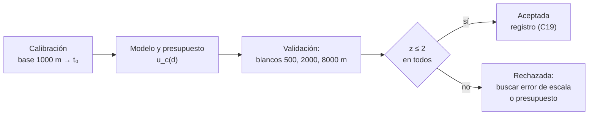

# B13-C20 — Validación de una cadena de medida

<!-- nav:top -->
[🏠 Programa](../../../../README.md) · [📚 Bloque B13](../../../tronco-comun/B13-metrologia-tiempo-y-mediciones-cientificas.md) · [← Anterior: B13-C19 — Metadatos y registros de calibración](../B13-C19-metadatos-y-registros-de-calibracion/CLASE.md) · [Siguiente: B13-C21 — Sistema de referencia celeste ICRF y cuásares →](../../../tronco-comun/B13-metrologia-tiempo-y-mediciones-cientificas.md#b13-c21)
<!-- /nav -->

## 1. Ubicación, nivel y alcance

Vigésima clase del bloque B13 y cierre del recorrido. Reúnes lo aprendido: **patrón** (C06), **calibración** (C05), **presupuesto de incertidumbre** (C13), **comparación** (C18) y **registro** (C19) para **validar una cadena de medida completa** frente a un criterio de aceptación. Nivel N2. Trabajas con un telémetro por tiempo de vuelo simulado. No tratas validación formal de laboratorios ni normas de calidad.

## 2. Por qué esta clase existe

Un telémetro calibrado, con presupuesto y registro, puede seguir fallando: un error de escala oculto que la calibración en una sola distancia no ve. Antes de usar la cadena en una misión hay que **ponerla a prueba con referencias independientes**, a distancias distintas de la de calibración, y decidir con un criterio fijado de antemano si se acepta.

La decisión central: **¿la cadena mide lo que declara, dentro de su incertidumbre, en todo su rango de uso?**

## 3. Lo que podrás hacer al terminar

1. Distinguir calibración (ajustar) de validación (comprobar con referencias independientes).
2. Construir una cadena con calibración, modelo y presupuesto.
3. Definir un criterio de aceptación `z ≤ 2` por blanco.
4. Ejecutar una validación y leer sus resultados.
5. Detectar con la validación un error de escala que la calibración no ve.
6. Documentar la decisión con sus fuentes y límites.

La evidencia es el **informe de validación de una cadena** del ejercicio 12 (sección 20).

## 4. Con qué llegas y cómo comprobarlo

Necesitas calibración ([C05](../B13-C05-calibracion-instrumental/CLASE.md)), presupuesto ([C13](../B13-C13-presupuestos-de-incertidumbre/CLASE.md)) y compatibilidad `z` ([C18](../B13-C18-intercomparacion-de-instrumentos/CLASE.md)). Cinco preguntas:

1. ¿Qué mide `z = |x₁ − x₂|/√(u₁² + u₂²)`?
2. ¿Qué contribuciones tiene `d = c(t − t₀)/(2n)`?
3. ¿Qué diferencia hay entre `u(t)` de una lectura y de la media de `m`?
4. ¿Qué es un registro de calibración?
5. ¿Por qué una referencia debe ser independiente?

<details>
<summary>Ver respuestas</summary>

1. La diferencia entre dos medidas en unidades de la incertidumbre de la diferencia. 2. El tiempo medido, el retardo `t₀` y el índice `n`. 3. La de la media es `u/√m`. 4. El documento con patrones, condiciones, resultado con incertidumbre y vigencia. 5. Para que sus errores no sean los mismos que los del instrumento y se pueda detectar un sesgo.
</details>

Con cuatro o cinco aciertos, sigue; si no, repasa C13 y C18.

## 5. Un caso real (con datos sintéticos): un telémetro de tres blancos

La cadena es `d = c(t − t₀)/(2n)`. Se **calibra** en una base de `1000,000 m` (`u = 0,002 m`) con 200 lecturas para estimar el retardo `t₀` (verdadero `30,0 ns`, desconocido). Luego se **valida** con tres blancos de referencia independientes a `500`, `2000` y `8000 m` (`u_ref = 0,003; 0,005; 0,010 m`), con 100 lecturas cada uno. El ruido del cronómetro es `0,5 ns` y `u(n) = 3 × 10⁻⁶`. Los datos son **sintéticos**. Es el **ejemplo conductor**.

## 6. Vocabulario

La **validación** de una cadena de medida es la comprobación, con evidencia objetiva y referencias independientes, de que cumple los requisitos de su uso previsto. (La definición se formula aquí para esta clase; no se consultó una definición normativa.) La **calibración** (S1, 2.39) establece la relación entre indicaciones y valores de patrones. Un **blanco de referencia** es un objeto cuya distancia se conoce por un método independiente, con su incertidumbre. El **criterio de aceptación** es la regla de decisión fijada de antemano: aquí, `z ≤ 2` en todos los blancos. La **tasa de aceptación** es la fracción de validaciones simuladas que cumplen el criterio. Un **error de escala** es un error que crece con el valor medido (por ejemplo, un `n` equivocado).

## 7. Modelo mental: aprobar con tres exámenes distintos

La calibración es el repaso con un solo ejercicio: ajusta la cadena a un punto. La validación son tres exámenes con preguntas distintas que no se vieron en el repaso. Si la cadena solo «se aprendió» el punto de calibración, falla en los otros.



*Descripción textual:* se calibra en una base; el modelo y el presupuesto dan `u_c`; se mide en tres blancos independientes; si `z ≤ 2` en todos se acepta y se registra; si no, se busca el error de escala o de presupuesto.

Analogía: probar un puente con cargas distintas de la de diseño. Su límite: la validación solo cubre el rango probado; fuera de él no hay garantía (como en C05).

## 8. La explicación, paso a paso

### 8.1 Calibración en la base

Con la base de `D = 1000,000 m` y `m = 200` lecturas del tiempo de ida y vuelta, `t̂₀ = media(t) − 2nD/c`. Su incertidumbre combina el ruido (`σ_t/√200 = 0,0354 ns`) y la de la base (`2n u(D)/c = 0,0133 ns`): `u(t̂₀) = 0,038 ns`. La simulación da `t̂₀ = 29,989 ns ± 0,038 ns` (verdadero `30,0 ns`).

### 8.2 Modelo y presupuesto

`d = c(t − t̂₀)/(2n)`. Contribuciones (C13): cronómetro con 100 lecturas, `0,0075 m`; retardo, `0,0057 m`; índice del aire, `d u(n)/n`: `0,0015 m` a `500 m`, `0,0060 m` a `2000 m` y `0,0240 m` a `8000 m`. Combinadas en cuadratura: `u_c = 0,0095; 0,0111; 0,0258 m`. Las dos primeras no dependen de la distancia; la del aire crece con ella.

### 8.3 Criterio de aceptación

Para cada blanco, `z = |d − d_ref|/√(u_c² + u_ref²)` (C18). Se acepta la cadena si `z ≤ 2` en los tres. El criterio se fija **antes** de medir: decidirlo después permite ajustarlo al resultado. Con un presupuesto exacto, la probabilidad de pasar los tres por azar es `0,9545³ ≈ 0,87`.

### 8.4 Una validación

Con una semilla, los resultados son: `500 m`: `d − d_ref = +0,0013 m`, `z = 0,04`; `2000 m`: `+0,0055 m`, `z = 1,00`; `8000 m`: `−0,0032 m`, `z = 0,41`. Todos `≤ 2`: **aceptada**.

### 8.5 Un defecto oculto

En el caso defectuoso, el aire real tiene `n = 1,000 310` pero el modelo sigue usando `1,000 300`: un error de escala de `10⁻⁵`. La calibración en la base de `1000 m` **absorbe** parte del error en `t̂₀`, así que los blancos cercanos pasan. A `8000 m` el error esperado es `8000 × 10⁻⁵ = 0,080 m`, frente a `u_c ≈ 0,026 m`: `z ≈ 2,9`. La tasa de aceptación del defecto es `0,118`, frente a `0,949` de la cadena correcta.

### 8.6 Cómo se interpreta

La tasa de `0,949` supera el `0,87` teórico porque la incertidumbre `u(n)` declarada es mayor que el error real simulado (el modelo usa el `n` verdadero): el presupuesto es conservador. Una cadena **aceptada** significa «no se detectó una discrepancia con estos blancos y esta incertidumbre»; no prueba que no exista. Una **rechazada** exige investigar: error de escala, `u` subestimada o referencia dudosa (C18). En ambos casos se registra la decisión (C19).

## 9. Magnitudes, símbolos y unidades

| Símbolo | Qué es | Unidad | Valor del ejemplo |
|---|---|---|---|
| `t`, `t₀`, `n` | tiempo, retardo, índice | s; s; — | `t₀ = 30,0 ns`; `n = 1,000 300` |
| `D`, `u(D)` | base de calibración | m | `1000,000`; `0,002` |
| `σ_t` | ruido del cronómetro | ns | `0,5` |
| `m` | lecturas por calibración o blanco | — | 200; 100 |
| `d_ref`, `u_ref` | blanco y su incertidumbre | m | `500, 2000, 8000`; `0,003; 0,005; 0,010` |
| `u_c`, `z` | combinada; diferencia normalizada | m; — | ver 8.4 |

## 10. Convenciones y referencias

Ruido blanco gaussiano; `c` exacta; sin deriva del cronómetro. Los blancos de referencia se simulan con su propia incertidumbre. El criterio `z ≤ 2` corresponde a cobertura aproximada de 95 % (C12). Los datos son **sintéticos** con semilla fija.

## 11. De dónde sale lo que afirmamos

| ID | Fuente | Localizador | Respalda | Estado |
|---|---|---|---|---|
| S1 | JCGM 200:2012, *International vocabulary of metrology (VIM)*, 3.ª ed., términos 2.39 y 2.41 | https://www.bipm.org/documents/20126/2071204/JCGM_200_2012.pdf | Calibración y trazabilidad | Texto extraído del PDF el 2026-11-05 |
| S2 | JCGM 100:2008 (GUM), 5.1.2 y 7.2.3 | https://www.bipm.org/documents/20126/2071204/JCGM_100_2008_E.pdf | Propagación de varianzas y reporte con incertidumbre expandida | Texto extraído del PDF el 2026-11-05 |
| S3 | BIPM, *SI defining constants* | https://www.bipm.org/en/measurement-units/si-defining-constants | `c` exacta | Consultada el 2026-11-05 mediante extracción automática |

Límites: no se consultó una definición normativa de «validación» ni una norma de validación de métodos; el criterio `z ≤ 2` y la estrategia de tres blancos son decisiones didácticas; la cadena, los blancos y sus incertidumbres son **sintéticos**.

## 12. Cómo ver la validación

Equivalente accesible a un gráfico de diferencias con bandas:

| Blanco (m) | `d − d_ref` (m) | `u_c` (m) | `z` | Contribuciones (cronómetro, `t₀`, `n`) (m) |
|---|---|---|---|---|
| 500 | +0,0013 | 0,0095 | 0,04 | 0,0075; 0,0057; 0,0015 |
| 2000 | +0,0055 | 0,0111 | 1,00 | 0,0075; 0,0057; 0,0060 |
| 8000 | −0,0032 | 0,0258 | 0,41 | 0,0075; 0,0057; 0,0240 |

Descripción larga: tres diferencias pequeñas dentro de bandas de `±2 u` que se ensanchan con la distancia por la contribución del aire; en el caso defectuoso el punto de `8000 m` saldría fuera de su banda (`+0,080 m`).

## 13. Ejemplo trabajado: ¿aceptar la cadena?

**Paso 1 · Criterio.** `z ≤ 2` en `500, 2000` y `8000 m`, fijado antes.

**Paso 2 · Presupuesto en `8000 m`.** `√(0,0075² + 0,0057² + 0,0240²) = 0,0258 m`.

**Paso 3 · Diferencia normalizada.** `z = 0,0032/√(0,0258² + 0,010²) = 0,0032/0,0277 = 0,12` con la referencia exacta; con el valor de la simulación (referencia con su propio error) el laboratorio da `0,41`.

**Paso 4 · Decisión.** Los tres `z ≤ 2`: **aceptada**; se archiva el registro (C19) con calibración, presupuesto, blancos y software.

**Paso 5 · Sentido.** Con el defecto de `n` (`10⁻⁵`), `8000 m` daría `0,080 m`: `z ≈ 2,9`, rechazada. Validar a una sola distancia (la de calibración) no habría detectado nada. Con dos cifras: `u_c = 0,026 m`. Datos sintéticos.

## 14. Distintas formas de validar

**Contra blancos de referencia independientes** (esta clase): directa; exige referencias. **Intercomparación con otros instrumentos** (C18): revela discrepancias sin verdad conocida. **Validación en vuelo con objetivos conocidos:** la más realista y la más costosa. **Simulación extremo a extremo:** previa y barata, no sustituye la medida. Se combinan.

## 15. Práctica guiada

**Ejercicio 1 · con los pasos indicados.** Calcula `u(t̂₀)` con `σ_t = 0,5 ns`, `m = 200` y `u(D) = 0,002 m`. *Pasos:* 8.1.

<details><summary>Solución comentada</summary>

`0,5/√200 = 0,0354 ns`; `2 × 1,0003 × 0,002/c = 1,33 × 10⁻¹¹ s = 0,0133 ns`; `√(0,0354² + 0,0133²) = 0,0378 ns`.
</details>

**Ejercicio 2 · con una pista.** Calcula la contribución del cronómetro con 100 lecturas, en metros. *Pista:* `σ_t/√100 × c/(2n)`.

<details><summary>Solución comentada</summary>

`0,05 ns × 0,14985 m/ns = 0,0075 m` (8.2).
</details>

**Ejercicio 3 · casi autónomo.** Calcula `u_c` en el blanco de `2000 m`.

<details><summary>Solución comentada</summary>

`√(0,0075² + 0,0057² + 0,0060²) = 0,0111 m` (8.2).
</details>

## 16. Práctica autónoma, transferencia e integrador

**Ejercicio 4.** ¿Cuánto vale la contribución de `n` en `8000 m`?

<details><summary>Solución comentada</summary>

`8000 × 3 × 10⁻⁶/1,0003 = 0,0240 m`.
</details>

**Ejercicio 5.** Calcula `z` si en `8000 m` la diferencia con la referencia es `+0,060 m`.

<details><summary>Solución comentada</summary>

`0,060/√(0,0258² + 0,010²) = 0,060/0,0277 = 2,17 > 2`: rechazada en ese blanco.
</details>

**Ejercicio 6.** ¿Qué error esperas a `8000 m` si el `n` real difiere `2 × 10⁻⁵` del modelo?

<details><summary>Solución comentada</summary>

`8000 × 2 × 10⁻⁵ = 0,16 m`: `z ≈ 5,8`.
</details>

**Ejercicio 7.** ¿Por qué el defecto de `n` no se detecta en el blanco de `500 m`?

<details><summary>Solución comentada</summary>

El error esperado es `500 × 10⁻⁵ = 0,005 m`, menor que `u_c = 0,0095 m` (y la calibración en `1000 m` absorbe parte): `z` pequeño (8.5).
</details>

**Ejercicio 8.** Con la cadena correcta, ¿qué probabilidad hay de pasar tres blancos independientes con `z ≤ 2` si el presupuesto es exacto?

<details><summary>Solución comentada</summary>

`0,9545³ = 0,870` (8.3). El laboratorio da `0,949` porque el presupuesto es conservador.
</details>

**Ejercicio 9 · transferencia.** La cadena se valida con un solo blanco, el de `1000 m` (el mismo de calibración). ¿Qué problema tiene?

<details><summary>Solución comentada</summary>

No es independiente: el resultado en el punto de calibración ajusta el modelo; un error de escala pasaría inadvertido (8.5, 14).
</details>

**Ejercicio 10 · transferencia.** El criterio se cambia a `z ≤ 3` después de ver que un blanco da `z = 2,4`. ¿Es correcto?

<details><summary>Solución comentada</summary>

No: el criterio se fija antes; cambiarlo tras ver el resultado invalida la validación. Si se cree que `z ≤ 3` es mejor, se cambia y se repite con datos nuevos (8.3).
</details>

**Ejercicio 11 · transferencia.** La validación acepta la cadena. ¿Qué dos cosas hay que documentar para que la aceptación sea útil mañana?

<details><summary>Solución comentada</summary>

Los blancos y su incertidumbre, el criterio, las fechas y la vigencia, y el software con versiones (registro de C19), y los límites: solo se probó hasta `8000 m` y con estas condiciones.
</details>

**Ejercicio 12 · integrador.** Elabora tu *informe de validación de una cadena*: cadena (modelo y calibración), presupuesto por blanco, criterio fijado antes, resultados por blanco con `z`, decisión, un caso defectuoso construido por ti con su detección, tasa de aceptación simulada y el registro de calibración (C19) con fuentes y rotulado de sintético.

<details><summary>Solución modelo</summary>

Tablas de la sección 12; `u_c = 0,0095; 0,0111; 0,0258 m`; `z = 0,04; 1,00; 0,41`; aceptada; defecto `n` `10⁻⁵`: `z ≈ 2,9`, tasa `0,118` frente a `0,949`; registro validado con `validar()` de C19.
</details>

## 17. Laboratorio: calibrar, presupuestar y validar

El script [validacion_cadena.py](validacion_cadena.py) simula la cadena, **comprueba que sin ruido recupera `t₀` y las distancias (`10⁻⁹ m`)**, ejecuta una validación con ruido, y estima **por simulación (3000 validaciones)** la tasa de aceptación de la cadena correcta (entre `0,90` y `0,99`) y la de la defectuosa (`< 0,35`).

**Datos:** sintéticos (semilla fija). **Predice antes de ejecutar:** ¿en qué blanco se notará el defecto de `n`? (el de `8000 m`.) **Ejecución del 2026-11-05 (Python 3.12.9):**

```text
Python 3.12.9 (biblioteca estandar)
t0_hat = 29.989 ns +/- 0.038 ns (verdadero 30.0 ns)
blanco(m)   d - d_ref (m)   u_c (m)    z    contribuciones (cronometro, t0, n) en m
     500      +0.0013     0.0095   0.04   0.0075, 0.0057, 0.0015
    2000      +0.0055     0.0111   1.00   0.0075, 0.0057, 0.0060
    8000      -0.0032     0.0258   0.41   0.0075, 0.0057, 0.0240
validacion: ACEPTADA
tasa de aceptacion: cadena correcta = 0.949 (presupuesto conservador) ; con error de n de 1e-5 = 0.118
error esperado por n en 8000 m = 0.080 m
Pruebas superadas.
```

```bash
python programa/clases/B13/B13-C20-validacion-de-una-cadena-de-medida/validacion_cadena.py
```

**Límites:** ruido blanco; sin deriva; tres blancos; el defecto es un error de escala simulado.

## 18. Errores frecuentes y cómo corregirlos

**Validar con la misma referencia de calibración.** Se corrige con el ejercicio 9.

**Cambiar el criterio después de ver el resultado.** Se corrige con el ejercicio 10.

**Creer que «aceptada» significa «correcta».** Se corrige en 8.6.

**No cubrir el rango de uso.** Se corrige con los ejercicios 5–7.

**No documentar la decisión.** Se corrige con el ejercicio 11.

## 19. Cómo sabrás que vas bien

Tras 8.2: ¿calculas `u_c` por blanco? Si no, ejercicios 2 y 3. Tras 8.5: ¿por qué falla el blanco lejano? Si dudas, ejercicio 7. Tras 8.6: ¿qué significa aceptar? Si dudas, repasa 8.6. Tras el laboratorio: ¿por qué se simula un defecto? (para comprobar que la validación puede fallar).

## 20. Qué entregas y cómo se evalúa

El producto es tu **informe de validación de una cadena** (ejercicio 12).

| Criterio | Inicial | En desarrollo | Logrado | Destacado |
|---|---|---|---|---|
| Cadena | Sin modelo | Parcial | Calibración, modelo, presupuesto | Con registro validado |
| Criterio | Ausente | Después de medir | Fijado antes | Con tasa de aceptación |
| Validación | Un blanco | Blancos no independientes | Varios independientes | Con defecto detectado |
| Interpretación | «Pasó» | Parcial | Alcance y límites | Compara cadena buena y defectuosa |
| Fuentes | Sin fuente | Sin fecha | Con localizador y fecha | Rotula sintético |

**Condiciones críticas (no se compensan con promedio):** referencias independientes; criterio fijado antes; declarar el rango cubierto; rotular lo sintético.

## 21. Ética, seguridad y límites

Aceptar una cadena que no se probó bien puede arruinar una medida de misión; rechazar una buena cuesta tiempo. La decisión debe quedar documentada y firmada por quien responde de ella. Los datos de esta clase son simulados y no validan ningún instrumento real. Accesibilidad: tablas equivalentes al gráfico, fórmulas en texto, ejercicios sin conexión.

## 22. Para cerrar y seguir

Una cadena de medida se calibra, se presupuesta y se **valida con referencias independientes** frente a un criterio fijado de antemano; un error de escala puede escapar a la calibración y aparecer lejos del punto calibrado; aceptar es «no se detectó discrepancia» y se registra con sus límites. Esto cierra las 20 clases del bloque; las clases programadas B13-C21 a B13-C23 amplían la orientación celeste-terrestre y la deriva de instrumentos.

**Glosario español–inglés.** validación · *validation*; cadena de medida · *measurement chain*; blanco de referencia · *reference target*; criterio de aceptación · *acceptance criterion*; error de escala · *scale error*; tasa de aceptación · *acceptance rate*; tiempo de vuelo · *time of flight*.

**Continuidad.** B13-C21 reutiliza tu capacidad de **declarar marcos y convenciones** para enseñar el sistema de referencia celeste y su relación con el terrestre.

**Referencias:** ver sección 11.

<!-- nav:bottom -->
---

[← Anterior: B13-C19 — Metadatos y registros de calibración](../B13-C19-metadatos-y-registros-de-calibracion/CLASE.md) · [📚 Bloque B13](../../../tronco-comun/B13-metrologia-tiempo-y-mediciones-cientificas.md) · [Siguiente: B13-C21 — Sistema de referencia celeste ICRF y cuásares →](../../../tronco-comun/B13-metrologia-tiempo-y-mediciones-cientificas.md#b13-c21)
<!-- /nav -->
