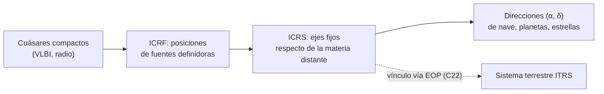

# B13-C21 — Sistema de referencia celeste ICRF y cuásares

<!-- nav:top -->
[🏠 Programa](../../../../README.md) · [📚 Bloque B13](../../../tronco-comun/B13-metrologia-tiempo-y-mediciones-cientificas.md) · [← Anterior: B13-C20 — Validación de una cadena de medida](../B13-C20-validacion-de-una-cadena-de-medida/CLASE.md) · [Siguiente: B13-C22 — Parámetros de orientación terrestre: precesión, nutación, UT1 y movimiento polar →](../B13-C22-parametros-de-orientacion-terrestre-precesion-nutacion-ut1-y-movimiento-polar/CLASE.md)
<!-- /nav -->

## 1. Ubicación, nivel y alcance

Clase 21 del bloque B13 (ampliación). En [C11](../B13-C11-sistemas-de-referencia-terrestres/CLASE.md) fijaste dónde está un punto sobre la Tierra; aquí fijas **hacia dónde apunta** una dirección en el cielo con un sistema que no depende de la Tierra: el **ICRS** y su materialización, el **ICRF**, apoyado en fuentes extragalácticas (cuásares). Nivel N2. Aprendes qué fija el sistema, cómo se mide su calidad en milisegundos de arco y qué significa esa cifra en metros. La conexión con el sistema terrestre se trata en C22.

## 2. Por qué esta clase existe

Para seguir una nave en el espacio profundo hay que decir en qué dirección está respecto de un marco fijo. Si el marco gira aunque sea un poco, todas las direcciones se desplazan. A la distancia de la Luna, una rotación del marco de una décima de milisegundo de arco equivale a casi 19 centímetros. Por eso el marco celeste se ancla a objetos tan lejanos que su movimiento aparente es despreciable.

La decisión central: **¿cómo se define un marco celeste estable y qué incertidumbre angular hereda toda dirección expresada en él?**

## 3. Lo que podrás hacer al terminar

1. Explicar qué es el ICRS y qué es el ICRF, y por qué se usan cuásares.
2. Describir cómo evolucionaron ICRF1, ICRF2 e ICRF3 en número de fuentes y precisión.
3. Convertir una dirección `(α, δ)` en un vector unidad y viceversa.
4. Calcular una separación angular de milisegundos de arco sin perder precisión.
5. Convertir un error angular en una distancia a una distancia dada.
6. Pasar el ICRS a ejes eclípticos con la oblicuidad de J2000.

La evidencia es la **ficha del marco celeste y su error en metros** del ejercicio 12 (sección 20).

## 4. Con qué llegas y cómo comprobarlo

Necesitas trigonometría y vectores ([B04](../../../tronco-comun/B04-algebra-trigonometria-y-geometria-espacial.md)), la conversión arco–metros y los marcos terrestres ([C11](../B13-C11-sistemas-de-referencia-terrestres/CLASE.md)). Cinco preguntas:

1. ¿Cuántos segundos de arco hay en un grado?
2. ¿Cuánto es `cos 90°` y `sen 90°`?
3. Si `θ` es muy pequeño (en radianes), ¿cuánto vale el arco a distancia `d`?
4. ¿Qué es un vector unidad?
5. ¿Qué son la ascensión recta y la declinación?

<details>
<summary>Ver respuestas</summary>

1. `3600`. 2. `0` y `1`. 3. `d θ`. 4. Un vector de módulo 1 que indica una dirección. 5. Las coordenadas angulares de una dirección en el cielo: ángulo a lo largo del ecuador desde un origen, y ángulo sobre el ecuador.
</details>

Con cuatro o cinco aciertos, sigue; si no, repasa B04 y C11.

## 5. Un caso real: ¿cuánto vale un milisegundo de arco?

El ICRF3, adoptado por la IAU en 2018 y vigente desde el 1 de enero de 2019, contiene `4588` fuentes, de las cuales `303` definen los ejes; su incertidumbre mediana es de unos `0,1 mas` en ascensión recta y `0,2 mas` en declinación, con un suelo de ruido de `0,03 mas` por fuente (S2, resumen). Esos números se leen mejor en metros: a la distancia media de la Luna (`384 400 km`, S3), `1 mas` son `1,864 m`, de modo que `0,1 mas` son `18,6 cm` y `0,03 mas` son `5,6 cm`. Es el **ejemplo conductor**.

## 6. Vocabulario

El **Sistema Celeste de Referencia Internacional (ICRS)** es un sistema cinemático: sus ejes tienen direcciones fijas respecto de la materia distante del universo, con origen en el baricentro del sistema solar; sustituyó oficialmente al sistema FK5 el 1 de enero de 1998 (S1, cap. 2). El **Marco Celeste de Referencia Internacional (ICRF)** es su realización: un conjunto de coordenadas precisas de fuentes extragalácticas compactas de radio, medidas con interferometría de línea de base muy larga (VLBI) (S1, 2.2). Una **fuente definidora** es la que tiene observaciones suficientes para asegurar su estabilidad y mantiene los ejes (S1, 2.2). Un **cuásar** es un núcleo galáctico activo muy lejano; su movimiento propio esperado es despreciable (S1, cap. 2). El **suelo de ruido** es el límite de precisión de la posición de una fuente que no baja aunque se observe más (S1; S2). Un **milisegundo de arco (mas)** es `1/3 600 000` de grado; `1 mas = 4,848 × 10⁻⁹ rad`. Las **coordenadas ICRS** `(α, δ)` son ascensión recta y declinación respecto de esos ejes.

## 7. Modelo mental: anclar el marco a lo más lejano

Imagina fijar un mapa a las fuentes más lejanas, que casi no se mueven. Las coordenadas de cada cuásar son las marcas del mapa; los ejes salen de ellas. Cualquier dirección que midas es relativa a esas marcas; cualquier error común de las marcas es un giro de todo el mapa.



*Descripción textual:* las posiciones de cuásares compactos medidas por VLBI forman el ICRF, que materializa el ICRS; toda dirección celeste se expresa respecto de esos ejes; un vínculo con parámetros de orientación terrestre lo conecta con el sistema terrestre.

Analogía: un mapa anclado a montañas lejanas. Su límite: los cuásares tienen estructura y variabilidad que limitan la precisión de cada posición (el suelo de ruido), y el marco se actualiza con nuevas realizaciones.

## 8. La explicación, paso a paso

### 8.1 Qué fija el sistema

La IAU recomendó en 1991 que el origen del sistema celeste estuviera en el baricentro del sistema solar y que sus ejes fueran fijos respecto de los cuásares, con plano principal cercano al ecuador medio de J2000.0; en 1997 adoptó el ICRS, que reemplazó al FK5 el 1 de enero de 1998 (S1, cap. 2). Es un sistema **cinemático**: no depende de un modelo de movimiento planetario.

### 8.2 Por qué cuásares

Las fuentes están tan lejos que su movimiento propio esperado es despreciable (S1, cap. 2). Se observan en radio con VLBI, que da las posiciones más precisas. La precisión última la limita la inestabilidad estructural de las fuentes en radio (S1, cap. 2).

### 8.3 Tres realizaciones

ICRF1 (1995): `212` fuentes definidoras con incertidumbre mediana `0,35 mas` en ascensión recta y `0,40 mas` en declinación; ejes estables a `0,02 mas` (S1, 2.2). ICRF2 (2009; fundamental desde el 1 de enero de 2010): `295` definidoras, `3414` fuentes en total, suelo de ruido `≈ 0,04 mas` y ejes estables dentro de `0,01 mas` (S1, 2.2). ICRF3 (adoptado por la IAU en 2018, vigente desde el 1 de enero de 2019): `4588` fuentes, `303` definidoras, mediana `0,1 mas`/`0,2 mas`, suelo de ruido `0,03 mas`, con medidas en `8,4`, `24` y `32 GHz` (S2, resumen).

### 8.4 De coordenadas a vectores

`(α, δ)` define el vector unidad `(cos δ cos α, cos δ sen α, sen δ)`; la inversa es `α = atan2(y, x)`, `δ = arcsen z`. Con vectores, una rotación de los ejes es una multiplicación por una matriz, y una dirección se compara con otra con un producto escalar y uno vectorial.

### 8.5 Separaciones de milisegundos de arco

La forma `acos(u·v)` pierde precisión para ángulos pequeños: `cos(1 mas) = 1 − 1,2 × 10⁻¹⁷`, que en coma flotante de doble precisión (error relativo `≈ 10⁻¹⁶`) se redondea a `1`, y `acos(1) = 0`. El laboratorio lo confirma: para dos direcciones separadas `1,000 000 mas`, `acos` devuelve `0,000 000 mas`, mientras que la forma `atan2(|u × v|, u·v)` devuelve `1,000 000 mas`. Para separaciones de mas hay que usar la forma estable.

### 8.6 Errores angulares en metros

A distancia `d`, el arco de un error `θ` es `d θ`. Con `1 mas = 4,848 × 10⁻⁹ rad`: a la Luna (`3,844 × 10⁸ m`), `1,864 m`; a `2 au` (`2 × 1,495 978 707 × 10¹¹ m`, S4), `1451 m`. Una rotación de los ejes de `0,1 mas` alrededor de `z` cambia la ascensión recta de **todas** las fuentes en `0,1 mas` (el laboratorio: `0,100 000 mas`), sin cambiar su declinación. Y el ICRS puede pasarse a ejes eclípticos de J2000.0 con una rotación alrededor de `x` por la oblicuidad `ε₀ = 84 381,406″ = 23,439 28°` (S4): el polo norte celeste queda a latitud eclíptica `90° − ε₀ = 66,560 721°`.

## 9. Magnitudes, símbolos y unidades

| Símbolo | Qué es | Unidad | Valor |
|---|---|---|---|
| `α`, `δ` | ascensión recta, declinación | ° | — |
| `mas` | milisegundo de arco | `4,848 × 10⁻⁹ rad` | — |
| `ε₀` | oblicuidad de J2000.0 | ″; ° | `84 381,406`; `23,439 28` (S4) |
| `d` | distancia al objeto | m | Luna `3,844 × 10⁸` |
| `d θ` | arco de un error angular | m | `1,864 m` por mas a la Luna |
| ICRF3 | fuentes; definidoras | — | `4588`; `303` (S2) |

## 10. Convenciones y referencias

Direcciones en el ICRS (ejes fijos respecto de los cuásares); ángulos en grados salvo que se indique `mas`. Se ignoran movimiento propio, paralaje y aberración. Las posiciones del laboratorio son **sintéticas**; las cifras de calidad de ICRF1–3 proceden de las fuentes citadas con su fecha de consulta.

## 11. De dónde sale lo que afirmamos

| ID | Fuente | Localizador | Respalda | Estado |
|---|---|---|---|---|
| S1 | IERS, *IERS Conventions (2010)*, TN36, cap. 2 (§2.1, §2.2) | https://iers-conventions.obspm.fr/content/tn36.pdf | Definición del ICRS; ICRF1 y ICRF2 (fuentes, precisión, estabilidad); vínculo vía EOP con exactitud `±0,1 mas` | Texto extraído del PDF el 2026-11-05 |
| S2 | *The third realization of the International Celestial Reference Frame by VLBI*, arXiv:2010.13625 | https://arxiv.org/abs/2010.13625 | ICRF3: `4588` fuentes, `303` definidoras, mediana `0,1`/`0,2 mas`, suelo `0,03 mas`, adopción IAU 2018, vigente 2019-01-01 | Resumen consultado el 2026-11-05 (solo la página de resumen) |
| S3 | NASA/NSSDC, *Moon Fact Sheet* (actualizada 2024-01-11) | https://nssdc.gsfc.nasa.gov/planetary/factsheet/moonfact.html | Semieje mayor `0,3844 × 10⁶ km` | Consultada el 2026-11-05 mediante extracción automática |
| S4 | IERS, *IERS Conventions (2010)*, TN36, Tabla 1.1 | https://iers-conventions.obspm.fr/content/tn36.pdf | `ε₀ = 84 381,406″`; `1 au = 1,495 978 707 00 × 10¹¹ m` | Texto extraído del PDF el 2026-11-05 |

Límites: de S2 solo se leyó el resumen (los autores no se citan por no haberse leído el texto completo); las fórmulas de vectores son resultados geométricos estándar; las posiciones de ejemplo son **sintéticas**.

## 12. Cómo ver la calidad de los marcos

Equivalente accesible a una gráfica de precisión contra el tiempo:

| Realización | Año | Fuentes (definidoras) | Mediana / suelo de ruido | Equivalente a la Luna |
|---|---|---|---|---|
| ICRF1 | 1995 | 212 definidoras | `0,35`/`0,40 mas` (mediana) | `65`/`75 cm` |
| ICRF2 | 2009 | 3414 (295) | suelo `≈ 0,04 mas` | `7,5 cm` |
| ICRF3 | 2018–2019 | 4588 (303) | `0,1`/`0,2 mas` (mediana); suelo `0,03 mas` | `19`/`37 cm`; `5,6 cm` |

Descripción larga: de ICRF1 a ICRF3 el número de fuentes crece más de veinte veces (de 212 definidoras a 4588 en total) y el suelo de ruido baja de unos `0,2` a `0,03 mas`.

## 13. Ejemplo trabajado: convertir un error de marco en metros

**Paso 1 · Dato.** Incertidumbre mediana de ICRF3 en declinación `0,2 mas` (S2).

**Paso 2 · Radianes.** `0,2 × 4,848 × 10⁻⁹ = 9,70 × 10⁻¹⁰ rad`.

**Paso 3 · A la Luna.** `3,844 × 10⁸ × 9,70 × 10⁻¹⁰ = 0,373 m`.

**Paso 4 · A 2 au.** `2,992 × 10¹¹ × 9,70 × 10⁻¹⁰ = 290 m`.

**Paso 5 · Sentido.** Es la incertidumbre **mediana de las posiciones de las fuentes**, no de una medida de una nave: esa depende del instrumento (C13). Con dos cifras: `37 cm` a la Luna y `290 m` a `2 au`. Regla útil: **1 mas ≈ 1,9 m a la Luna ≈ 1,5 km a 2 au**.

## 14. Distintas formas de fijar una dirección

**ICRF por VLBI** (esta clase): la más precisa en radio, requiere radiotelescopios. **Catálogos estelares ópticos** (como Hipparcos, mencionado en S1): precisión menor y movimientos propios. **Efemérides de planetas:** ligadas al ICRS con precisión mejor que `1 mas` (S1). **Marcos sin ancla** (solo estrellas locales): derivan. Se combinan, con vínculos documentados.

## 15. Práctica guiada

**Ejercicio 1 · con los pasos indicados.** Convierte `1 mas` a radianes. *Pasos:* `1° = π/180 rad`; `1° = 3 600 000 mas`.

<details><summary>Solución comentada</summary>

`π/(180 × 3 600 000) = 4,848 × 10⁻⁹ rad`.
</details>

**Ejercicio 2 · con una pista.** Calcula `1 mas` en metros a la Luna. *Pista:* `d θ`.

<details><summary>Solución comentada</summary>

`3,844 × 10⁸ × 4,848 × 10⁻⁹ = 1,864 m` (8.6).
</details>

**Ejercicio 3 · casi autónomo.** Calcula `0,1 mas` y `0,03 mas` en centímetros a la Luna.

<details><summary>Solución comentada</summary>

`18,6 cm` y `5,6 cm` (8.6).
</details>

## 16. Práctica autónoma, transferencia e integrador

**Ejercicio 4.** ¿Por qué `acos(u·v)` devuelve `0` para dos direcciones separadas `1 mas`?

<details><summary>Solución comentada</summary>

`cos(1 mas) = 1 − 1,2 × 10⁻¹⁷`; la doble precisión no distingue ese número de `1` (error relativo `≈ 10⁻¹⁶`); `acos(1) = 0` (8.5).
</details>

**Ejercicio 5.** Convierte la oblicuidad `84 381,406″` en grados.

<details><summary>Solución comentada</summary>

`84 381,406/3600 = 23,439 28°` (8.6).
</details>

**Ejercicio 6.** Una rotación de ejes de `0,1 mas` alrededor de `z` desplaza una fuente a declinación `60°`. ¿Cuántos mas de arco recorre sobre el cielo?

<details><summary>Solución comentada</summary>

El cambio de `α` es `0,1 mas` y el arco es `Δα cos δ = 0,1 × cos 60° = 0,05 mas`.
</details>

**Ejercicio 7.** ¿Cuánto mejoró la mediana en ascensión recta de ICRF1 a ICRF3?

<details><summary>Solución comentada</summary>

De `0,35` a `0,1 mas`: `3,5` veces; en declinación, de `0,40` a `0,2`: `2` veces (S1, S2).
</details>

**Ejercicio 8.** ¿Qué fracción de las fuentes de ICRF3 son definidoras?

<details><summary>Solución comentada</summary>

`303/4588 = 6,6 %` (S2). En ICRF2: `295/3414 = 8,6 %` (S1).
</details>

**Ejercicio 9 · transferencia.** Un error de `0,1 mas` en el marco se propaga a la dirección de una nave a `2 au`. ¿Cuántos metros de desviación transversal produce?

<details><summary>Solución comentada</summary>

`2,992 × 10¹¹ × 4,848 × 10⁻¹⁰ = 145 m` (8.6).
</details>

**Ejercicio 10 · transferencia.** Un compañero afirma que «las estrellas brillantes de un catálogo son un buen marco porque se ven bien». Responde con 8.2.

<details><summary>Solución comentada</summary>

Las estrellas cercanas tienen movimiento propio y paralaje que deforman el marco con el tiempo; los cuásares, por su distancia, tienen movimiento propio despreciable y definen ejes estables (S1, cap. 2).
</details>

**Ejercicio 11 · transferencia.** Los ejes del ICRS son estables a `0,01 mas` (ICRF2, S1). ¿Cuánto es a la Luna?

<details><summary>Solución comentada</summary>

`1,864 cm`: una deriva de ejes menor que el suelo de ruido de una fuente típica.
</details>

**Ejercicio 12 · integrador.** Elabora tu *ficha del marco celeste y su error en metros*: una tabla de ICRF1–3 con fuentes y precisión, la conversión de cada precisión a metros a la Luna y a `2 au`, la demostración de que `acos` falla a `1 mas`, una rotación de ejes de `0,1 mas` y la nota de fuentes con lo que no se leyó.

<details><summary>Solución modelo</summary>

Tabla de la sección 12 con columnas en metros; `acos → 0`, `atan2 → 1,000 000 mas`; rotación `0,1 mas` cambia `α` pero no `δ`; S2 solo resumen.
</details>

## 17. Laboratorio: direcciones y mas

El script [icrs_direcciones.py](icrs_direcciones.py) construye vectores unidad, calcula separaciones con `atan2` y con `acos`, **comprueba que una separación de 1 mas se recupera a `10⁻⁶`**, que una rotación de ejes de 0,1 mas cambia `α` en exactamente 0,1 mas, y que el polo norte celeste cae a `90° − ε₀` de latitud eclíptica.

**Datos:** `ε₀` y `1 au` del IERS; posiciones sintéticas. **Predice antes de ejecutar:** ¿qué dará `acos` para 1 mas? (cero.) **Ejecución del 2026-11-05 (Python 3.12.9):**

```text
Python 3.12.9 (biblioteca estandar)
separacion verdadera = 1.000000 mas ; atan2 = 1.000000 mas ; acos = 0.000000 mas
rotacion de 0.1 mas: delta alfa = 0.100000 mas ; delta dec = 0.00e+00 mas
polo norte celeste: latitud ecliptica = 66.560721 grados (90 - eps0 = 66.560721)
1 mas a Luna: 1.864 m
1 mas a 2 au: 1451 m
0.03 mas a la Luna = 5.59 cm ; 0.1 mas = 18.6 cm
Pruebas superadas.
```

```bash
python programa/clases/B13/B13-C21-sistema-de-referencia-celeste-icrf-y-cuasares/icrs_direcciones.py
```

**Límites:** sin movimiento propio, paralaje ni aberración; no se implementa la transformación a coordenadas terrestres (C22).

## 18. Errores frecuentes y cómo corregirlos

**Calcular separaciones pequeñas con `acos`.** Se corrige con el ejercicio 4.

**Confundir la mediana de las fuentes con la incertidumbre de una medida.** Se corrige en el paso 5 del ejemplo trabajado.

**Olvidar el factor `cos δ` al pasar un cambio de ascensión recta a arco.** Se corrige con el ejercicio 6.

**Usar estrellas cercanas como marco fijo.** Se corrige con el ejercicio 10.

**Mezclar mas con segundos de arco (`1″ = 1000 mas`).** Se corrige con los ejercicios 1 y 5.

## 19. Cómo sabrás que vas bien

Tras 8.3: ¿recuerdas cómo mejoró cada realización? Si no, ejercicio 7. Tras 8.5: ¿por qué falla `acos`? Si dudas, ejercicio 4. Tras 8.6: ¿conviertes mas en metros? Si no, ejercicios 2 y 9. Tras el laboratorio: ¿qué nunca cambia al rotar los ejes en `z`? (la declinación).

## 20. Qué entregas y cómo se evalúa

El producto es tu **ficha del marco celeste y su error en metros** (ejercicio 12).

| Criterio | Inicial | En desarrollo | Logrado | Destacado |
|---|---|---|---|---|
| Definiciones | Las confunde | Parciales | ICRS, ICRF y fuentes | Distingue cinemático y realización |
| Cifras | Sin fuente | Sin fecha | Con S1–S4 y fecha | Declara lo no leído |
| Conversión | Sin unidades | Con errores | mas → m correcto | Con `cos δ` y distancias |
| Numérico | Sin comprobar | Un caso | `atan2` y rotación verificados | Muestra el fallo de `acos` |
| Interpretación | Sin sentido físico | Parcial | Mediana frente a medida | Discute el suelo de ruido |

**Condiciones críticas (no se compensan con promedio):** no presentar la mediana de las fuentes como la incertidumbre de una medida; citar solo fuentes consultadas y decir que S2 es solo resumen; rotular lo sintético.

## 21. Ética, seguridad y límites

Un marco celeste mal aplicado desvía una trayectoria o un apuntado; para operaciones se usan los catálogos y el software oficiales vigentes. Esta clase no sustituye las publicaciones del IERS ni de la IAU. Accesibilidad: tablas equivalentes a las gráficas, fórmulas en texto, ejercicios sin conexión.

## 22. Para cerrar y seguir

El ICRS fija ejes respecto de los cuásares; el ICRF los materializa con posiciones VLBI cada vez más precisas (ICRF3: `0,1 mas` de mediana, `0,03 mas` de suelo); un error angular se traduce en metros multiplicando por la distancia; las separaciones de mas exigen fórmulas estables. Queda una pregunta: ¿cómo se conecta este marco, fijo en el cielo, con el marco terrestre que gira con la Tierra y se mueve respecto de su eje?

**Glosario español–inglés.** sistema celeste de referencia · *celestial reference system*; marco celeste de referencia · *celestial reference frame*; cuásar · *quasar*; interferometría de línea de base muy larga · *very long baseline interferometry (VLBI)*; fuente definidora · *defining source*; milisegundo de arco · *milliarcsecond*; suelo de ruido · *noise floor*.

**Continuidad.** B13-C22 reutiliza tu capacidad de **expresar un error angular en metros** para estudiar la orientación de la Tierra respecto de este marco.

**Referencias:** ver sección 11.

<!-- nav:bottom -->
---

[← Anterior: B13-C20 — Validación de una cadena de medida](../B13-C20-validacion-de-una-cadena-de-medida/CLASE.md) · [📚 Bloque B13](../../../tronco-comun/B13-metrologia-tiempo-y-mediciones-cientificas.md) · [Siguiente: B13-C22 — Parámetros de orientación terrestre: precesión, nutación, UT1 y movimiento polar →](../B13-C22-parametros-de-orientacion-terrestre-precesion-nutacion-ut1-y-movimiento-polar/CLASE.md)
<!-- /nav -->
