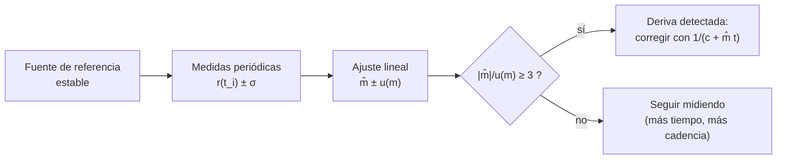

# B13-C23 — Estabilidad y deriva temporal de instrumentos

<!-- nav:top -->
[🏠 Programa](../../../../README.md) · [📚 Bloque B13](../../../tronco-comun/B13-metrologia-tiempo-y-mediciones-cientificas.md) · [← Anterior: B13-C22 — Parámetros de orientación terrestre: precesión, nutación, UT1 y movimiento polar](../B13-C22-parametros-de-orientacion-terrestre-precesion-nutacion-ut1-y-movimiento-polar/CLASE.md) · [Siguiente: B14-C01 — Arquitectura de software científico →](../../B14/B14-C01-arquitectura-de-software-cientifico/CLASE.md)
<!-- /nav -->

## 1. Ubicación, nivel y alcance

Clase 23 del bloque B13 (ampliación `0.2.0`). En [C05](../B13-C05-calibracion-instrumental/CLASE.md) calibraste un instrumento en un instante; en [C07](../B13-C07-relojes-atomicos-y-frecuencia/CLASE.md) describiste la estabilidad de un reloj. Aquí sigues **cómo cambia la respuesta de un instrumento con los años**: la **deriva**. Aprendes a medirla con una fuente de referencia estable, a ajustar una tendencia con su incertidumbre, a decidir **cuánto tiempo de datos hace falta para detectarla** y a corregirla. Nivel N2. Trabajas con una serie simulada; no tratas fuentes de referencia que a su vez derivan ni modelos no lineales.

## 2. Por qué esta clase existe

Un detector espacial lleva años en órbita. Su sensibilidad cambia lentamente por daño de radiación, contaminación y envejecimiento. Si nadie lo sigue, una serie de décadas mezcla la señal real con la deriva del instrumento. Un cambio de un décimo de punto porcentual al año parece insignificante, pero se acumula a un punto en diez años, comparable con la exactitud absoluta del instrumento.

La decisión central: **¿cuánto cambió el instrumento, con qué incertidumbre, desde cuándo se puede afirmar y cómo se corrige?**

## 3. Lo que podrás hacer al terminar

1. Definir deriva y distinguirla de ruido y de salto.
2. Ajustar una tendencia lineal a medidas de una referencia estable.
3. Calcular la incertidumbre de la pendiente y el tiempo de detección a 3σ.
4. Corregir la serie dividiendo por la tendencia ajustada.
5. Estimar cómo la cadencia y la duración del seguimiento afectan la detección.
6. Verificar la incertidumbre de la pendiente con una simulación.

La evidencia es el **informe de seguimiento de deriva** del ejercicio 12 (sección 20).

## 4. Con qué llegas y cómo comprobarlo

Necesitas el ajuste lineal ([C05](../B13-C05-calibracion-instrumental/CLASE.md)), la incertidumbre de la pendiente `u(b) = s/√Sxx` y la cobertura de `1σ` ([C12](../B13-C12-incertidumbre-expandida/CLASE.md)). Cinco preguntas:

1. ¿Qué es `Sxx` en un ajuste lineal?
2. ¿Qué cobertura tiene un intervalo de `±1σ` normal?
3. Si una cantidad cae `0,15 %` al año, ¿cuánto cae en 10 años (aprox.)?
4. ¿Qué significa un residuo?
5. ¿Qué es una referencia estable?

<details>
<summary>Ver respuestas</summary>

1. `Σ(xᵢ − x̄)²`. 2. `68,3 %`. 3. `1,5 %`. 4. La diferencia entre el dato y el ajuste. 5. Una fuente cuyo valor no cambia (dentro de una incertidumbre dada) en el periodo de seguimiento.
</details>

Con cuatro o cinco aciertos, sigue; si no, repasa C05.

## 5. Un caso real: la sensibilidad de una cámara espacial

El manual del instrumento WFC3 del telescopio espacial Hubble indica que la sensibilidad del canal UVIS cambia entre `0,1` y `0,2 %` por año según el filtro; para el filtro F814W en UVIS2 da una pérdida de `0,11 %` por año con incertidumbre `±0,07 %`; la calibración fotométrica más reciente incorpora esa dependencia temporal (S1, §6.8). Con ese orden de magnitud se simula un detector con deriva de `−0,15 %/año` y ruido de `0,30 %` por medida, medido cada tres meses durante diez años contra una fuente estable de referencia. Los datos de la simulación son **sintéticos**. Es el **ejemplo conductor**.

## 6. Vocabulario

La **deriva** es el cambio lento y continuo de la respuesta de un instrumento con el tiempo (C04: error sistemático que varía de forma predecible). Un **salto** es un cambio brusco (por ejemplo, tras una intervención). La **estabilidad** de un instrumento es su capacidad de mantener sus propiedades metrológicas en el tiempo. La **respuesta relativa** `r(t)` es el cociente entre la indicación y la de la época inicial para una fuente estable. La **tendencia** es el ajuste lineal `r(t) = c + m t`; `m` es la tasa de cambio en `1/año`. La **incertidumbre de la pendiente** es `u(m) = s/√Sxx` (C05). El **tiempo de detección** es el mínimo de seguimiento para que `|m|/u(m)` supere un umbral (aquí `3`). Una **calibración dependiente del tiempo** es una calibración cuyos parámetros se expresan como función de la fecha (S1).

## 7. Modelo mental: un tren que se aleja despacio

Piensa en un tren que se aleja a velocidad muy pequeña. En un día no notas nada; en un año, un poco; en diez, mucho. Para saberlo con confianza necesitas medirlo muchas veces y durante bastante tiempo: la pendiente se determina mejor con muchas medidas y con un intervalo largo.



*Descripción textual:* se mide periódicamente una referencia estable; se ajusta una recta con su incertidumbre; si la pendiente supera tres veces su incertidumbre se declara deriva y se corrige; si no, se sigue midiendo.

Analogía: el tren que se aleja. Su límite: el tren avisa si se mueve; aquí la referencia misma puede derivar y el efecto observado mezcla instrumento y fuente.

## 8. La explicación, paso a paso

### 8.1 El modelo

`r(t) = 1 + m t + ε`, con `ε` ruido blanco gaussiano de desviación `σ = 0,30 %`. En el ejemplo, `m = −0,15 %/año` y las medidas se toman cada `Δt = 0,25 año` durante `T = 10 años`: `N = 41` puntos.

### 8.2 Ajuste de la tendencia

Se aplica el ajuste de C05: `m̂ = Sxy/Sxx`, `ĉ = r̄ − m̂ t̄`, `s` de los residuos y `u(m) = s/√Sxx`. Con los 41 puntos, `Sxx = Δt² Σk² = 0,0625 × 5740 = 358,75 año²` (`k = −20…20`), así que `u(m) = 0,30/18,94 = 0,0158 %/año`. El laboratorio obtiene `m̂ = −0,162 ± 0,013 %/año` (verdadero `−0,15`) con `s = 0,239 %`.

### 8.3 Cuánto dura hasta detectar

La relación `|m|/u(m)` crece con el tiempo de seguimiento: `0,40` a 1 año, `0,97` a 2, `1,69` a 3, `2,52` a 4, `3,47` a 5, `5,63` a 7 y `9,47` a 10 años. Con el umbral `3σ`, la deriva de `0,15 %/año` se detecta con unos **5 años** de datos. Como `u(m) ∝ σ/(N^{3/2} Δt)` (con `N` puntos), alargar el seguimiento ayuda más que muestrear más seguido: doblar `T` multiplica `Sxx` por `8`; doblar la cadencia solo lo multiplica por `2`.

### 8.4 Corregir la serie

La respuesta corregida es `r_c(t) = r(t)/(ĉ + m̂ t)`. En el ejemplo, la última medida sin corregir vale `0,9858` (`−1,42 %`) y corregida `1,0020` (`+0,20 %`), frente a la verdad `1,0000`. La corrección elimina la deriva sistemática pero deja un residuo de ruido y de incertidumbre de `m̂`: un error de `0,013 %/año × 10 años = 0,13 %` en el extremo.

### 8.5 Verificar la incertidumbre

El laboratorio repite `4000` veces el seguimiento de diez años. La pendiente verdadera cae dentro de `m̂ ± u(m)` en `67,5 %` de las repeticiones, frente a `68,3 %` esperado (dentro de cinco errores binomiales): `u(m)` es fiable. Sin ruido, la recta se recupera exactamente (`10⁻¹²`).

### 8.6 Qué no cubre

Si la referencia deriva, el ajuste mezcla ambas derivas; hay que disponer de **dos referencias independientes** y compararlas (C18). Si hay un salto o una deriva no lineal, el residuo del ajuste lineal tiene estructura (no es ruido blanco) y hay que dividir la serie. Y la exactitud absoluta no mejora con el seguimiento: el manual indica una exactitud absoluta media de `≈ 2 %`, con `5–10 %` en filtros estrechos (S1), de modo que una deriva de `0,11 %/año` acumula en diez años (`1,1 %`) un efecto de la misma magnitud.

## 9. Magnitudes, símbolos y unidades

| Símbolo | Qué es | Unidad | Valor del ejemplo |
|---|---|---|---|
| `r(t)` | respuesta relativa | — | 1 al inicio |
| `m`, `m̂` | tasa de deriva real y ajustada | %/año | `−0,15`; `−0,162` |
| `σ`, `s` | ruido real y residual | % | `0,30`; `0,239` |
| `Δt`, `T`, `N` | cadencia, duración, número de puntos | año; año; — | `0,25`; 10; 41 |
| `u(m)` | incertidumbre de la pendiente | %/año | `0,0158` |
| `Sxx` | `Σ(tᵢ − t̄)²` | año² | `358,75` |

## 10. Convenciones y referencias

La deriva se expresa en porcentaje por año; el signo negativo es pérdida de sensibilidad. La fuente de referencia es estable por hipótesis. El ruido es blanco, gaussiano e independiente. Los datos son **sintéticos** con semilla fija; las cifras del instrumento WFC3 se citan solo como orden de magnitud.

## 11. De dónde sale lo que afirmamos

| ID | Fuente | Localizador | Respalda | Estado |
|---|---|---|---|---|
| S1 | STScI, *WFC3 Instrument Handbook*, §6.8 «UVIS Sensitivity» | https://hst-docs.stsci.edu/wfc3ihb/chapter-6-uvis-imaging-with-wfc3/6-8-uvis-sensitivity | Cambio de sensibilidad UVIS de `0,1–0,2 %/año`; F814W/UVIS2 `0,11 ± 0,07 %/año`; calibración dependiente del tiempo (ISR 2021-04, ISR 2022-02); exactitud absoluta `≈ 2 %` (`5–10 %` en banda estrecha) | Consultada el 2026-11-05 mediante extracción automática |

Límites: el ajuste lineal y la fórmula `u(m) = s/√Sxx` son resultados estadísticos estándar (C05) sin cita específica; los informes técnicos ISR citados por el manual no se consultaron; los datos de la serie son **sintéticos**.

## 12. Cómo ver la deriva

Equivalente accesible a una gráfica de `r(t)` con recta:

| Duración del seguimiento (años) | Puntos `N` | `u(m)` (%/año) | `|m|/u(m)` (con `m = 0,15`) |
|---|---|---|---|
| 1 | 5 | 0,3795 | 0,40 |
| 2 | 9 | 0,1549 | 0,97 |
| 3 | 13 | 0,0889 | 1,69 |
| 4 | 17 | 0,0594 | 2,52 |
| 5 | 21 | 0,0432 | 3,47 |
| 7 | 29 | 0,0266 | 5,63 |
| 10 | 41 | 0,0158 | 9,47 |

Descripción larga: la incertidumbre de la pendiente cae rápidamente al principio (`÷ 2,4` de 1 a 2 años) y cada vez más despacio; la relación señal–ruido de la deriva cruza `3` entre 4 y 5 años.

## 13. Ejemplo trabajado: ¿cuándo puedo afirmar que hay deriva?

**Paso 1 · Datos.** `σ = 0,30 %`, `Δt = 0,25 año`, deriva esperada `0,15 %/año`.

**Paso 2 · Incertidumbre a 5 años.** `N = 21`, `k = −10…10`: `Σk² = 770`, `Sxx = 0,0625 × 770 = 48,1 año²`, `√Sxx = 6,94`; `u(m) = 0,30/6,94 = 0,0432 %/año`.

**Paso 3 · Relación.** `0,15/0,0432 = 3,47 ≥ 3`: detectable a 5 años; a 4 años (`2,52`) todavía no.

**Paso 4 · Corrección.** Con `m̂ = −0,162 %/año`, la medida de 10 años `0,9858` pasa a `0,9858/(ĉ + m̂ × 10) = 1,0020`.

**Paso 5 · Sentido.** Hay que seguir un instrumento al menos 5 años para afirmar una deriva de `0,15 %/año` con este ruido; antes, la decisión es «no detectada», no «no hay». Con dos cifras: `m̂ = −0,16 ± 0,01 %/año`. Datos sintéticos.

## 14. Distintas formas de seguir la deriva

**Fuente de referencia estable** (esta clase): directa, requiere una fuente conocida. **Dos o más referencias independientes** (C18): separan deriva de referencia e instrumento. **Comparación con otro instrumento** (C18): sin verdad conocida. **Calibración periódica completa** (C05): más cara y exacta. **Modelo dependiente del tiempo en la calibración** (S1): se actualiza con los resultados del seguimiento. Se combinan.

## 15. Práctica guiada

**Ejercicio 1 · con los pasos indicados.** ¿Cuánto cambia la respuesta en 10 años con `−0,15 %/año`? *Pasos:* `m T`.

<details><summary>Solución comentada</summary>

`−0,15 × 10 = −1,5 %` (la medida sin corregir: `0,985`).
</details>

**Ejercicio 2 · con una pista.** Calcula `Sxx` para `N = 41` puntos cada `0,25 año`. *Pista:* `Δt² Σk²`, `Σk² = 2(1² + … + 20²) = 5740`.

<details><summary>Solución comentada</summary>

`0,0625 × 5740 = 358,75 año²` (8.2).
</details>

**Ejercicio 3 · casi autónomo.** Calcula `u(m)` con `σ = 0,30 %` y la relación `|m|/u(m)`.

<details><summary>Solución comentada</summary>

`0,30/√358,75 = 0,0158 %/año`; `0,15/0,0158 = 9,5` (8.2).
</details>

## 16. Práctica autónoma, transferencia e integrador

**Ejercicio 4.** ¿Con cuántos años de datos se alcanza `3σ` de detección?

<details><summary>Solución comentada</summary>

Con 5 años (`3,47`); con 4 no (`2,52`) (sección 12).
</details>

**Ejercicio 5.** Si se duplica la cadencia (`Δt = 0,125 año`) manteniendo `T = 4 años`, ¿se detecta la deriva?

<details><summary>Solución comentada</summary>

`N = 33`, `Σk² = 2 × 1496 = 2992`, `Sxx = 0,015625 × 2992 = 46,75`; `u = 0,30/6,84 = 0,0439`; `0,15/0,0439 = 3,42 ≥ 3`: sí. Doblar la cadencia mejora `u(m)` solo por `√2`.
</details>

**Ejercicio 6.** Con una cadencia anual (`Δt = 1`) durante 10 años (`N = 11`), ¿cuánto vale `u(m)`?

<details><summary>Solución comentada</summary>

`Sxx = Σk² = 2(1 + 4 + 9 + 16 + 25) = 110`; `u = 0,30/10,49 = 0,0286 %/año` (frente a `0,0158` con cadencia trimestral).
</details>

**Ejercicio 7.** El manual da `0,11 ± 0,07 %/año` para F814W/UVIS2. ¿Cuánto es en 10 años con su incertidumbre?

<details><summary>Solución comentada</summary>

`1,1 ± 0,7 %` (S1). La incertidumbre es la mitad del efecto: la deriva es detectable pero pobremente determinada.
</details>

**Ejercicio 8.** Con una deriva de `0,15 %/año`, ¿cuántos años tarda en acumular `2 %` (exactitud absoluta media del manual)?

<details><summary>Solución comentada</summary>

`2/0,15 = 13,3 años` (8.6).
</details>

**Ejercicio 9 · transferencia.** La fuente de referencia pierde `0,05 %/año` por envejecimiento y no se sabe. ¿Qué pendiente observas si el instrumento pierde `0,15 %/año` y mide la fuente?

<details><summary>Solución comentada</summary>

Mide la razón instrumento/fuente: `−0,15 − (−0,05) = −0,10 %/año`. Se subestima la deriva del instrumento; hace falta una segunda referencia independiente (8.6, C18).
</details>

**Ejercicio 10 · transferencia.** Tras una intervención, la respuesta salta `−0,5 %`. ¿Cómo se manifiesta en el ajuste lineal y qué haces?

<details><summary>Solución comentada</summary>

Los residuos tienen estructura (positivos antes, negativos después, o al revés) y `s` crece; se divide la serie en dos tramos y se ajusta cada uno con su salto (8.6).
</details>

**Ejercicio 11 · transferencia.** Un compañero afirma «no hay deriva» porque a 2 años `|m|/u(m) = 0,97`. Responde.

<details><summary>Solución comentada</summary>

No detectada no es igual a inexistente: con `u(m) = 0,155 %/año`, una deriva de `0,15 %/año` es indistinguible del ruido a 2 años (8.3, paso 5).
</details>

**Ejercicio 12 · integrador.** Elabora tu *informe de seguimiento de deriva*: la serie simulada (tu `m`, `σ`, `Δt`, `T`), el ajuste con `m̂ ± u(m)`, la relación `|m|/u(m)` por duración, el tiempo de detección a 3σ, la corrección de la serie, la cobertura simulada y los límites (referencia estable, ruido blanco, deriva lineal), con fuentes y rotulado de sintético.

<details><summary>Solución modelo</summary>

Tabla de la sección 12; `m̂ = −0,162 ± 0,013 %/año`; detección a 5 años; corrección `0,9858 → 1,0020`; cobertura `67,5 %`.
</details>

## 17. Laboratorio: tendencia, detección y corrección

El script [deriva_instrumental.py](deriva_instrumental.py) genera la serie de diez años, ajusta la tendencia, **comprueba que sin ruido la recta se recupera a `10⁻¹²`**, calcula la relación `|m|/u(m)` por duración, el tiempo de detección a 3σ y **verifica que la cobertura 1σ simulada coincide con `0,683`**.

**Datos:** sintéticos (semilla fija). **Predice antes de ejecutar:** ¿en cuántos años se detecta `0,15 %/año` con `σ = 0,30 %`? (unos 5.) **Ejecución del 2026-11-05 (Python 3.12.9):**

```text
Python 3.12.9 (biblioteca estandar)
10 anios, N = 41: pendiente = -0.162 +/- 0.013 %/anio (verdadera -0.15) ; s = 0.239 %
sin correccion, ultima medida = 0.9858; con correccion = 1.0020 (verdad 1.0000)
cobertura 1 sigma de la pendiente = 0.675 (esperada ~0.683)
T (anios)   N    u(m) (%/anio)   |m|/u(m)
     1      5         0.3795       0.40
     2      9         0.1549       0.97
     3     13         0.0889       1.69
     4     17         0.0594       2.52
     5     21         0.0432       3.47
     7     29         0.0266       5.63
    10     41         0.0158       9.47
la deriva de 0.15 %/anio se detecta a 3 sigma con unos 5 anios de datos
u(m): formula aprox = 0.0158 ; exacta = 0.0158 %/anio
Pruebas superadas.
```

```bash
python programa/clases/B13/B13-C23-estabilidad-y-deriva-temporal-de-instrumentos/deriva_instrumental.py
```

**Límites:** referencia estable, deriva lineal, ruido blanco; sin saltos.

## 18. Errores frecuentes y cómo corregirlos

**Concluir «no hay deriva» sin considerar la incertidumbre.** Se corrige con el ejercicio 11.

**Suponer que la referencia no deriva.** Se corrige con el ejercicio 9.

**Ajustar una recta a una serie con saltos.** Se corrige con el ejercicio 10.

**Pensar que muestrear más seguido sustituye alargar el seguimiento.** Se corrige con los ejercicios 5 y 6.

**Corregir la deriva y declarar incertidumbre cero.** Se corrige en 8.4.

## 19. Cómo sabrás que vas bien

Tras 8.2: ¿calculas `u(m)`? Si no, ejercicios 2 y 3. Tras 8.3: ¿cuánto hay que seguir un instrumento? Si no, ejercicio 4. Tras 8.6: ¿qué no cubre el método? Si dudas, ejercicios 9 y 10. Tras el laboratorio: ¿por qué se verifica la cobertura? (para comprobar que `u(m)` dice la verdad).

## 20. Qué entregas y cómo se evalúa

El producto es tu **informe de seguimiento de deriva** (ejercicio 12).

| Criterio | Inicial | En desarrollo | Logrado | Destacado |
|---|---|---|---|---|
| Ajuste | Sin tendencia | Sin incertidumbre | `m̂ ± u(m)` | Verifica cobertura |
| Detección | Sin criterio | Visual | `3σ` y tiempo | Compara cadencias |
| Corrección | Ausente | Sin incertidumbre | Con residuo y límite | Con dos referencias |
| Límites | Sin ellos | Parciales | Referencia, saltos, linealidad | Propone controles |
| Fuentes | Sin fuente | Sin fecha | Con localizador y fecha | Rotula sintético |

**Condiciones críticas (no se compensan con promedio):** no afirmar ausencia de deriva sin su incertidumbre; declarar la hipótesis de referencia estable; rotular lo sintético.

## 21. Ética, seguridad y límites

Ignorar la deriva de un instrumento contamina series científicas largas; corregirla mal introduce sesgos nuevos. Los datos de esta clase son simulados y las cifras del WFC3 solo son un orden de magnitud: para usar el instrumento hay que consultar su calibración vigente. Accesibilidad: tablas equivalentes a la gráfica, fórmulas en texto, ejercicios sin conexión.

## 22. Para cerrar y seguir

La deriva se mide con una referencia estable y una tendencia con su incertidumbre; la detección a 3σ exige años de datos (unos 5 para `0,15 %/año` con `0,30 %` de ruido); se corrige dividiendo por la tendencia, con incertidumbre residual; la referencia, los saltos y la no linealidad exigen precauciones. Con esta clase queda cerrado el bloque B13: unidades, tiempo, referencias, incertidumbre y cadenas de medida validadas.

**Glosario español–inglés.** deriva · *drift*; estabilidad · *stability*; tendencia · *trend*; referencia estable · *stable reference*; salto · *step change*; tiempo de detección · *detection time*; calibración dependiente del tiempo · *time-dependent calibration*.

**Continuidad.** Los bloques siguientes (en especial B14 y B15) reutilizan tu capacidad de **seguir y corregir instrumentos** para tratar datos y señales científicas.

**Referencias:** ver sección 11.

<!-- nav:bottom -->
---

[← Anterior: B13-C22 — Parámetros de orientación terrestre: precesión, nutación, UT1 y movimiento polar](../B13-C22-parametros-de-orientacion-terrestre-precesion-nutacion-ut1-y-movimiento-polar/CLASE.md) · [📚 Bloque B13](../../../tronco-comun/B13-metrologia-tiempo-y-mediciones-cientificas.md) · [Siguiente: B14-C01 — Arquitectura de software científico →](../../B14/B14-C01-arquitectura-de-software-cientifico/CLASE.md)
<!-- /nav -->
