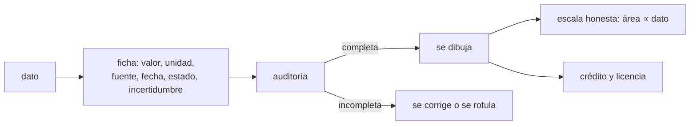

# B130-C01 — Infografías con fuentes verificables

<!-- nav:top -->
[🏠 Programa](../../../../README.md) · [📚 Bloque B130](../../../tronco-comun/B130-comunicacion-y-divulgacion-cientifica.md) · [← Anterior: B129-C07 — Proyecto de ciencia ciudadana validable](../../../tronco-comun/B129-ciencia-ciudadana-astronomica.md#b129-c07) · [Siguiente: B130-C02 — Visualización de datos para comunicar →](../B130-C02-visualizacion-de-datos-para-comunicar/CLASE.md)
<!-- /nav -->

## 1. Ubicación, nivel y alcance

Clase 1 del bloque B130. Nivel N3. Una infografía es una afirmación con forma de imagen: si pierde la fuente, la fecha o la incertidumbre, el lector no puede comprobarla. Aquí conviertes una infografía de datos planetarios en una lista de afirmaciones auditables, calculas cuánto exagera un círculo mal escalado, redondeas una cifra según su incertidumbre y acreditas una imagen con licencia abierta. Los datos de gravedad, radio y densidad proceden de las fichas de la NASA/NSSDC; la lista con defectos es sintética.

## 2. Por qué esta clase existe

Comunicar con imágenes exige mantener la fuente y la incertidumbre; la clase de comunicación general no entra en cómo se audita una pieza visual. La decisión central: **¿qué debe llevar cada cifra de una infografía para que otra persona pueda verificarla, y qué diseño la deforma?**

## 3. Lo que podrás hacer al terminar

1. Describir cada cifra con valor, unidad, fuente, fecha, estado e incertidumbre.
2. Distinguir los estados observado, modelado, consultado e ilustrativo.
3. Calcular el factor de mentira de un par de círculos y escalar por área.
4. Redondear un valor a la cifra de su incertidumbre.
5. Explicar el color representativo de una imagen infrarroja sin llamarla «falsa» ni «real».
6. Redactar un crédito de imagen CC BY con sus elementos.

La evidencia es la **auditoría de una infografía de datos planetarios** del ejercicio 12 (sección 20).

## 4. Con qué llegas y cómo comprobarlo

1. ¿Qué es una fuente primaria?
2. ¿Qué es una incertidumbre?
3. ¿Qué es una cifra significativa?
4. ¿Qué es un dato sintético?
5. ¿Qué es una licencia abierta?

<details>
<summary>Ver respuestas</summary>

1. Un documento o dato original de quien lo produjo, no un resumen de otro. 2. Una medida de cuánto puede alejarse el valor del dato real. 3. Un dígito que aporta información sobre el valor. 4. Un dato generado para el ejemplo, no medido. 5. Una licencia que permite reutilizar la obra con condiciones claras, por ejemplo citar al autor.
</details>

Con cuatro o cinco aciertos, sigue; si no, repasa los prerrequisitos.

## 5. Un caso de contexto y casos de referencia

Una infografía compara la Tierra y Marte con círculos. La gravedad media es `9,820 m/s²` y `3,73 m/s²` (razón `2,6327`). Si el **diámetro** del círculo es proporcional al dato, el área de la Tierra parece `6,93` veces la de Marte y el factor de mentira vale `3,633`; si el **área** es proporcional, vale `1,000`. Es el **ejemplo conductor**. Las cifras de las fichas son consultadas; la infografía es un ejercicio.

## 6. Vocabulario

La **ficha de procedencia** guarda por cada cifra: valor, unidad, fuente, fecha, estado e incertidumbre. El **estado** dice si la cifra es *observada*, *modelada*, *consultada* (leída de una fuente) o *ilustrativa*. El **factor de mentira** (definición adoptada aquí) es `LF = efecto en el gráfico / efecto en los datos`, con efecto `(B − A)/A`. El **color representativo** traduce longitudes de onda invisibles a colores visibles. Un **crédito** nombra al autor, enlaza la fuente y la licencia, e indica si hubo cambios.

## 7. Modelo mental: la etiqueta de un frasco



*Descripción textual:* cada dato pasa por una ficha; si la auditoría la encuentra completa se dibuja con una escala honesta y su crédito; si no, se corrige o se rotula como ilustrativo.

Analogía: una infografía sin ficha es un frasco sin etiqueta; puede contener lo correcto, pero nadie lo sabe. Límite: tener ficha completa no vuelve verdadera la cifra, solo la hace comprobable.

## 8. La explicación, paso a paso

### 8.1 La ficha de procedencia

La auditoría del laboratorio revisa seis campos. De siete afirmaciones, cuatro (las de las fichas NASA/NSSDC del 2026-11-11) salen completas y tres (sintéticas) fallan: una sin fuente, una sin fecha y una con estado `real`, que no es un estado admitido porque no dice cómo se sabe. La incertidumbre se escribe «no informada» cuando la fuente no la da; no se inventa.

### 8.2 Escalar un círculo

| Magnitud | Razón Tierra/Marte | LF con diámetro ∝ dato | LF con área ∝ dato |
|---|---|---|---|
| gravedad | 2,6327 | 3,633 | 1,000 |
| densidad | 1,4014 | 2,401 | 1,000 |
| radio | 1,8796 | 2,880 | 1,000 |

La revisión de Franconeri et al. (2021) ordena los canales visuales por la precisión con que se juzga una razón: posición, longitud, área, ángulo, intensidad. Por eso, cuando se puede, conviene una barra (longitud) antes que un círculo (área); si se usa el círculo, el área debe seguir al dato.

### 8.3 Incertidumbre y cifras

Con una incertidumbre **ilustrativa** de `0,05 m/s²`, `3,7342` se escribe `3,73 ± 0,05`; con `0,3`, `9,8201` se escribe `9,8 ± 0,3`. Escribir `3,7342` sugiere una precisión que el dato no tiene.

### 8.4 Color e imagen con crédito

NASA y ESA/Webb explican que Webb mide infrarrojo, que las exposiciones se publican como datos en blanco y negro por filtro y que el color es una traducción: los filtros se ordenan por longitud de onda, la menor en azul y la mayor en rojo. La página de ESA/Webb añade que más allá de ese orden la elección es en parte estética; por eso un pie de imagen debe decir «color representativo». ESO publica sus imágenes bajo CC BY 4.0 y pide un crédito completo y visible, con enlace en línea, e indicar si se modificó el material, también si se usó IA. La política que consultamos no cubre todo: el logotipo de ESO exige permiso aparte.

## 9. Magnitudes, símbolos y unidades

| Símbolo | Qué es | Unidad | Valor / nota |
|---|---|---|---|
| `g` | gravedad superficial media | m/s² | 9,820 (Tierra); 3,73 (Marte) |
| `ρ` | densidad media | kg/m³ | 5513; 3934 |
| `R` | radio medio volumétrico | km | 6371,000; 3389,5 |
| `LF` | factor de mentira | — | 1 = escala honesta |
| `u` | incertidumbre | misma que el valor | ilustrativa: 0,05 |
| `λ` | longitud de onda | µm | ilustrativa: 1,15; 2,00; 4,44 |

## 10. Convenciones y referencias

Gravedad, radio y densidad: valores medios de las fichas NASA/NSSDC. Fechas en formato AAAA-MM-DD. Sin sistema de referencia espacial: son magnitudes globales de cada cuerpo. Estados admitidos: observado, modelado, consultado, ilustrativo. El factor de mentira es una definición de esta clase; la fuente original de Tufte no se consultó.

## 11. De dónde sale lo que afirmamos

| ID | Fuente | Localizador | Respalda | Estado |
|---|---|---|---|---|
| S1 | NASA/NSSDC, Earth Fact Sheet — https://nssdc.gsfc.nasa.gov/planetary/factsheet/earthfact.html (consultada 2026-11-11) | ficha completa | g 9,820 m/s²; radio 6371,000 km; densidad 5513 kg/m³ | Consultada |
| S2 | NASA/NSSDC, Mars Fact Sheet — https://nssdc.gsfc.nasa.gov/planetary/factsheet/marsfact.html (consultada 2026-11-11) | ficha completa | g 3,73 m/s²; radio 3389,5 km; densidad 3934 kg/m³ | Consultada |
| S3 | Franconeri, Padilla, Shah, Zacks y Hullman (2021), *Psychological Science in the Public Interest* 22(3) — página de la APS https://www.psychologicalscience.org/publications/visual-data-communication.html (consultada 2026-11-11) | página resumen, no el artículo | orden de canales (posición, longitud, área, ángulo, intensidad) y cautela sobre el eje | Consultada (resumen) |
| S4 | NASA, «How are Webb's full-color images made?» — https://science.nasa.gov/mission/webb/science-overview/science-explainers/how-are-webbs-full-color-images-made (consultada 2026-11-11) | explicador completo | orden cromático y color representativo | Consultada |
| S5 | ESA/Webb, Image processing — https://esawebb.org/about/general/image-processing/ (consultada 2026-11-11) | página completa | pasos de procesado; color en parte estético | Consultada |
| S6 | ESO, política de uso de imágenes — https://www.eso.org/public/outreach/copyright/ (consultada 2026-11-11) | página completa | CC BY 4.0, crédito, indicar cambios | Consultada |
| — | Tufte (factor de mentira); Cleveland y McGill (1984) | — | solo se cita su nombre; la definición es de esta clase | No consultada |

Límites: la lista con defectos, la incertidumbre y las longitudes de onda son ilustrativas; no se evalúa ninguna infografía real ni se afirma impacto alguno en el público.

## 12. Cómo ver la auditoría de una infografía

| Elemento | Resultado |
|---|---|
| Afirmaciones completas | 4 de 7 |
| LF por diámetro (gravedad) | 3,633 |
| LF por área | 1,000 |
| `3,7342` con `u = 0,05` | `3,73 ± 0,05` |

Descripción larga: la tabla resume la auditoría; el círculo escalado por diámetro exagera la diferencia entre `2,4` y `3,6` veces, y el escalado por área la reproduce exacta.

## 13. Ejemplo trabajado: ¿cuánto exagera el círculo de la densidad?

**Paso 1 · Razón.** `5513/3934 = 1,4014`.

**Paso 2 · Efecto en los datos.** `1,4014 − 1 = 0,4014`.

**Paso 3 · Efecto en el gráfico con diámetro ∝ dato.** El área va con el cuadrado: `1,4014² − 1 = 0,9639`.

**Paso 4 · Factor.** `LF = 0,9639/0,4014 = 2,401`. Con área ∝ dato, `LF = 1`.

## 14. Distintas formas de mostrar una cifra

**Por tabla:** valores exactos con unidad. **Por barra:** longitud, el canal más preciso. **Por círculo:** solo con área ∝ dato. **Por texto:** `3,73 ± 0,05 m/s²` para quien usa lector de pantalla. Toda imagen necesita un texto alternativo con la misma cifra.

## 15. Práctica guiada

**Ejercicio 1 · con los pasos indicados.** Calcula el LF por diámetro para el radio (`6371,0` frente a `3389,5`). *Pasos:* razón, razón al cuadrado menos 1, divide por razón menos 1.

<details><summary>Solución comentada</summary>

`1,8796² − 1 = 2,5330`; entre `0,8796` da `2,880`, igual que el laboratorio.
</details>

**Ejercicio 2 · con una pista.** Escribe `9,8201 ± 0,3` con la cifra correcta. *Pista:* redondea a la posición de la incertidumbre.

<details><summary>Solución comentada</summary>

`9,8 ± 0,3`.
</details>

**Ejercicio 3 · casi autónomo.** ¿Por qué la gravedad de Marte lleva estado «consultado» y no «observado»?

<details><summary>Solución comentada</summary>

Porque nosotros la leímos de una ficha; no la medimos. «Observado» se reserva para datos de una observación con su método.
</details>

## 16. Práctica autónoma, transferencia e integrador

**Ejercicio 4 · autónomo.** Completa la ficha de la densidad de Marte con los seis campos.

<details><summary>Solución comentada</summary>

`3934`, `kg/m³`, NASA/NSSDC Mars Fact Sheet, `2026-11-11`, consultado, incertidumbre no informada.
</details>

**Ejercicio 5 · autónomo.** ¿Qué LF tiene una barra cuya longitud es proporcional al dato?

<details><summary>Solución comentada</summary>

`1`: el efecto en el gráfico es la razón menos 1, igual que en los datos.
</details>

**Ejercicio 6 · autónomo.** Una afirmación dice «`42 m`» sin fuente. ¿Qué haces?

<details><summary>Solución comentada</summary>

Buscar la fuente; si no existe, rotularla ilustrativa o retirarla. No se publica como dato.
</details>

**Ejercicio 7 · autónomo.** Ordena por longitud de onda tres filtros (1,15; 2,00; 4,44 µm) y asigna colores.

<details><summary>Solución comentada</summary>

Azul, verde y rojo, en ese orden. El pie dice «color representativo».
</details>

**Ejercicio 8 · autónomo.** ¿Qué elementos faltan en «Foto: ESO»?

<details><summary>Solución comentada</summary>

El enlace en línea, la licencia (CC BY 4.0) y si se modificó el material.
</details>

**Ejercicio 9 · transferencia.** **Transferencia.** Una infografía dice «Marte tiene `38 %` de la gravedad terrestre». ¿Cómo la verificas?

<details><summary>Solución comentada</summary>

`3,73/9,820 = 0,380`: coincide, pero la ficha debe citar ambas fuentes con fecha.
</details>

**Ejercicio 10 · transferencia.** **Transferencia.** Un cartel muestra una nebulosa con colores vistosos sin pie explicativo. ¿Qué agregas?

<details><summary>Solución comentada</summary>

Que las longitudes de onda son infrarrojas, que el color es representativo y qué filtro va en cada color.
</details>

**Ejercicio 11 · transferencia.** **Transferencia.** Un compañero afirma que el cartel «aumentó el interés del público». ¿Qué pides?

<details><summary>Solución comentada</summary>

Una medición con fuente y límites (ver C05). Esta clase no aporta evidencia de impacto.
</details>

**Ejercicio 12 · integrador.** **Integrador.** Elabora tu *auditoría de una infografía de datos planetarios*: ficha de procedencia de al menos cuatro cifras, LF de sus círculos, cifras redondeadas, color representativo (si aplica) y crédito.

<details><summary>Solución comentada</summary>

Secciones 8.1–8.4 y la salida del laboratorio.
</details>

## 17. Laboratorio: auditar una infografía

El script [infografia.py](infografia.py) audita las fichas de procedencia, calcula el factor de mentira, redondea según la incertidumbre, asigna colores por orden cromático y valida un crédito CC BY (**comprueba** 4 de 7 completas, LF área = 1 con 1e-12 y los redondeos esperados).

**Datos:** gravedad, radio y densidad de las fichas NASA/NSSDC (consultadas el 2026-11-11); defectos, incertidumbre y longitudes de onda **sintéticos o ilustrativos**. **Predice antes de ejecutar:** ¿qué LF da la gravedad por diámetro? (3,633.) **Ejecución del 2026-11-11 (Python 3.12.9):**

```text
Python 3.12.9 (biblioteca estandar)
Auditoria de procedencia (datos NASA/NSSDC consultados 2026-11-11; defectos SINTETICOS):
  g_tierra                 OK
  g_marte                  OK
  rho_tierra               OK
  rho_marte                OK
  defecto_sin_fuente       FALLA: falta fuente
  defecto_sin_fecha        FALLA: falta fecha
  defecto_estado_invalido  FALLA: estado no admitido
Afirmaciones completas: 4/7
Factor de mentira (circulos Tierra frente a Marte):
  gravedad  razon 2.6327  LF diametro = 3.633  LF area = 1.000
  densidad  razon 1.4014  LF diametro = 2.401  LF area = 1.000
  radio     razon 1.8796  LF diametro = 2.880  LF area = 1.000
Cifras significativas con incertidumbre ILUSTRATIVA 0.05 m/s2:
  3.7342 +/- 0.05  -> 3.73 +/- 0.05
  9.8201 +/- 0.3   -> 9.8 +/- 0.3
Color representativo (orden cromatico, longitudes ILUSTRATIVAS en um): {1.15: 'azul', 2.0: 'verde', 4.44: 'rojo'}
Credito CC BY: Imagen de ejemplo - ESO/Autor (https://www.eso.org/public/), CC BY 4.0; modificada | faltan: []
Pruebas superadas.
```

```bash
python programa/clases/B130/B130-C01-infografias-con-fuentes-verificables/infografia.py
```

**Límites:** la auditoría solo comprueba que los campos existan, no que la fuente diga lo que la ficha afirma; el LF mide la exageración geométrica, no la comprensión.

## 18. Errores frecuentes y cómo corregirlos

**Escalar el diámetro con el dato.** Se corrige con 8.2.

**Dar más cifras de las que justifica la incertidumbre.** Se corrige con 8.3.

**Llamar «real» a una imagen de color representativo, o «falsa» sin explicar.** Se corrige con 8.4.

**Publicar una cifra sin fecha de consulta.** Se corrige con 8.1.

## 19. Cómo sabrás que vas bien

Tras la sección 8: ¿qué LF esperabas para la densidad y cuál obtuviste? Si dudas, repasa el ejemplo 13. Tras el laboratorio: ¿qué comprueba y qué no? (ver la sección 17).

## 20. Qué entregas y cómo se evalúa

El producto es tu **auditoría de una infografía de datos planetarios** (ejercicio 12).

| Criterio | Inicial | En desarrollo | Logrado | Destacado |
|---|---|---|---|---|
| Conceptos | Los confunde | Parciales | Distingue estados y LF | Explica los límites |
| Cálculo | Sin unidades | Con errores | Fichas y LF correctos con unidades | Calcula casos nuevos |
| Numérico | Sin comprobar | Un caso | Redondeo coherente con la incertidumbre | Interpreta las diferencias |
| Fuentes | Sin fuente | Sin fecha | Fuentes con fecha y estado | Declara lo ilustrativo y lo no consultado |
| Límites | No los nombra | Uno | Tres | Discute qué no audita el script |

**Condiciones críticas (no se compensan con promedio):** rotular lo sintético e ilustrativo; no presentar una cifra sin fuente como dato; no afirmar impacto sin fuente; citar solo lo consultado.

## 21. Ética, seguridad y límites

Clase educativa: los datos de la lista de prueba son sintéticos y ninguna cifra describe una infografía real. Se resume una licencia desde su página oficial; no es asesoría legal. Accesibilidad: tablas equivalentes a las imágenes, texto alternativo con la misma cifra, fórmulas en texto, ejercicios sin conexión.

## 22. Para cerrar y seguir

Una cifra con ficha completa se puede comprobar; un círculo mal escalado exagera hasta `3,6` veces. Queda una pregunta: ¿cómo elegir un gráfico que no engañe?

**Glosario español–inglés.** ficha de procedencia · *provenance record*; factor de mentira · *lie factor*; cifra significativa · *significant figure*; color representativo · *representative color*; crédito · *credit line*.

**Continuidad.** [B130-C02](../B130-C02-visualizacion-de-datos-para-comunicar/CLASE.md) estudia la visualización honesta de datos.

**Referencias:** ver sección 11.

<!-- nav:bottom -->
---

[← Anterior: B129-C07 — Proyecto de ciencia ciudadana validable](../../../tronco-comun/B129-ciencia-ciudadana-astronomica.md#b129-c07) · [📚 Bloque B130](../../../tronco-comun/B130-comunicacion-y-divulgacion-cientifica.md) · [Siguiente: B130-C02 — Visualización de datos para comunicar →](../B130-C02-visualizacion-de-datos-para-comunicar/CLASE.md)
<!-- /nav -->
