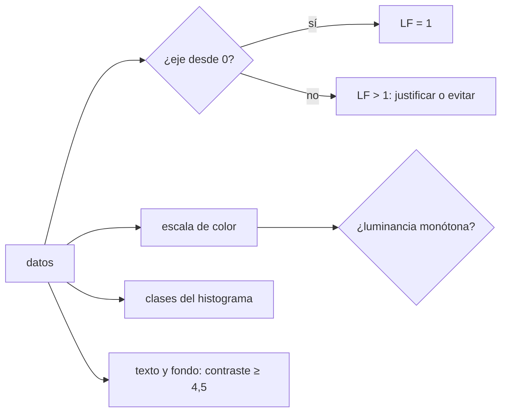

# B130-C02 — Visualización de datos para comunicar

<!-- nav:top -->
[🏠 Programa](../../../../README.md) · [📚 Bloque B130](../../../tronco-comun/B130-comunicacion-y-divulgacion-cientifica.md) · [← Anterior: B130-C01 — Infografías con fuentes verificables](../B130-C01-infografias-con-fuentes-verificables/CLASE.md) · [Siguiente: B130-C03 — Comunicación oral de la ciencia →](../B130-C03-comunicacion-oral-de-la-ciencia/CLASE.md)
<!-- /nav -->

## 1. Ubicación, nivel y alcance

Clase 2 del bloque B130. Nivel N3. Analizar datos y comunicarlos son dos competencias: el gráfico que sirve para explorar no siempre sirve para un público. Aquí mides cuánto exagera un eje truncado, compruebas con luminancia si una escala de color ordena los valores, verificas el contraste de un texto con la fórmula de WCAG y ves cómo el número de clases cambia lo que cuenta un histograma. Todos los datos de los gráficos son sintéticos; las fórmulas de luminancia y contraste son las de W3C.

## 2. Por qué esta clase existe

Elegir un gráfico honesto para el público es una competencia propia. La decisión central: **¿qué diseño muestra la diferencia que existe en los datos, ni más ni menos, y la puede leer cualquier persona?**

## 3. Lo que podrás hacer al terminar

1. Calcular el factor de mentira de un gráfico de barras con eje truncado.
2. Calcular la luminancia relativa de un color y la razón de contraste de dos.
3. Comprobar si una escala de color es monótona en luminancia.
4. Mostrar cómo el número de clases cambia la forma de un histograma.
5. Explicar por qué «empezar en cero» es una regla con excepciones.
6. Separar lo consultado (fórmulas y umbrales) de lo sintético (datos y colores ancla).

La evidencia es el **informe de honestidad de un gráfico** del ejercicio 12 (sección 20).

## 4. Con qué llegas y cómo comprobarlo

1. ¿Qué es un eje de un gráfico?
2. ¿Qué es la luminancia?
3. ¿Qué es un histograma?
4. ¿Qué es una escala de color?
5. ¿Qué es un dato sintético?

<details>
<summary>Ver respuestas</summary>

1. La recta con la que se mide una variable en el gráfico. 2. Cuánta luz parece emitir un color en una escala de 0 a 1. 3. Un gráfico de barras que cuenta datos por intervalos. 4. Una asignación de colores ordenados a valores. 5. Un dato generado para el ejemplo, no medido.
</details>

Con cuatro o cinco aciertos, sigue; si no, repasa los prerrequisitos.

## 5. Un caso de contexto y casos de referencia

Dos barras ilustrativas valen `52` y `56`: la diferencia real es `7,7 %`. Con el eje desde `0` el factor de mentira vale `1,00`; desde `40`, `4,33`; desde `50`, `26,00`. Es el **ejemplo conductor**. La misma barra, tres historias. Los valores no son mediciones.

## 6. Vocabulario

El **factor de mentira** (definición adoptada aquí) es `LF = efecto en el gráfico / efecto en los datos`, con efecto `(B − A)/A`. La **luminancia relativa** `L = 0,2126 R + 0,7152 G + 0,0722 B` se calcula con canales linealizados. La **razón de contraste** es `(L₁ + 0,05)/(L₂ + 0,05)` con `L₁ ≥ L₂`. Una escala es **monótona en luminancia** si la luminancia no desciende al subir el valor.

## 7. Modelo mental: el volumen de una radio



*Descripción textual:* de los datos salen cuatro decisiones: el eje, la escala de color, las clases del histograma y el contraste del texto; cada una se mide con un número.

Analogía: subir el volumen no cambia la canción, pero lo que se oye es distinto. Límite: un eje truncado no siempre engaña; en una serie de temperaturas puede ser lo correcto, siempre que se diga.

## 8. La explicación, paso a paso

### 8.1 Eje truncado

Con el eje desde `base`, las barras miden `A − base` y `B − base`. Para `52` y `56`: desde `40` miden `12` y `16`; el efecto dibujado es `0,333` frente a `0,0769` real. Franconeri et al. (2021) advierten, según su página resumen, que empezar en cero no siempre es lo mejor, porque puede ocultar patrones o crear otros: la regla útil es **decir dónde empieza el eje y no usar barras (cuya longitud se lee como cantidad) con eje cortado**. Un gráfico de puntos o de líneas sí admite un eje que no empiece en cero, con la ruptura indicada.

### 8.2 Escalas de color

| Escala | Luminancias por ancla | Descensos |
|---|---|---|
| arcoíris (ilustrativa) | 0,072 · 0,787 · 0,715 · 0,928 · 0,213 | 2 |
| tipo viridis (ilustrativa) | 0,019 · 0,088 · 0,222 · 0,445 · 0,782 | 0 |

La escala arcoíris no ordena: el rojo final es más oscuro que el amarillo anterior, así que un valor mayor parece menor en una fotocopia en gris. La escala tipo viridis sube de forma monótona. Los colores ancla son una aproximación del autor, no consultada; solo prueban el método de medida.

### 8.3 Contraste

Con WCAG 2.2, el texto normal pide al menos `4,5:1` y el texto grande `3:1`; la comparación se hace sin redondear. Gris `#767676` sobre blanco da `4,542:1` y cumple; `#999999` da `2,849:1` y no cumple; amarillo sobre blanco da `1,074:1`, casi invisible. Este criterio es una condición mínima de legibilidad, no garantiza que el gráfico se entienda.

### 8.4 Clases de un histograma

Una muestra sintética con dos grupos (medias `30` y `60`, `n = 300`, semilla `130`) muestra `0` máximos con `2` clases, `2` con `12` y `10` con `60`: pocas clases borran la estructura y muchas inventan picos. Se informa el número de clases y, si hay duda, se prueba más de uno.

## 9. Magnitudes, símbolos y unidades

| Símbolo | Qué es | Unidad | Valor / nota |
|---|---|---|---|
| `LF` | factor de mentira | — | 1 = honesto |
| `L` | luminancia relativa | — (0 a 1) | blanco 1; negro 0 |
| `C` | razón de contraste | `:1` | 1 a 21 |
| `k` | número de clases | — | 2; 12; 60 |
| `base` | inicio del eje | unidad del dato | 0; 40; 50 (ilustrativos) |

## 10. Convenciones y referencias

Colores en sRGB de 8 bits; fórmulas de la página de comprensión de WCAG 2.2. Sin sistema de referencia espacial. Barras, colores ancla y muestra son sintéticos o ilustrativos. El factor de mentira es una definición de esta clase.

## 11. De dónde sale lo que afirmamos

| ID | Fuente | Localizador | Respalda | Estado |
|---|---|---|---|---|
| S1 | W3C, WCAG 2.2, Understanding SC 1.4.3 Contrast (Minimum) — https://www.w3.org/WAI/WCAG22/Understanding/contrast-minimum.html (consultada 2026-11-11) | página completa | umbrales 4,5:1 y 3:1; fórmulas de luminancia y contraste | Consultada |
| S2 | Franconeri, Padilla, Shah, Zacks y Hullman (2021), *Psychological Science in the Public Interest* 22(3) — página de la APS https://www.psychologicalscience.org/publications/visual-data-communication.html (consultada 2026-11-11) | página resumen, no el artículo | orden de canales; cautela sobre empezar el eje en cero; público con poca numeracía | Consultada (resumen) |
| — | Tufte (factor de mentira); Cleveland y McGill (1984); la escala viridis (valores ancla) | — | la definición de LF es de esta clase; los anclas son aproximados | No consultada |

Límites: no se evalúa ningún gráfico real ni se afirma que un diseño mejore la comprensión; eso exige medirla (C05).

## 12. Cómo ver la honestidad de un gráfico

| Medida | Valor |
|---|---|
| LF con eje desde 50 | 26,00 |
| contraste `#767676`/blanco | 4,542:1 |
| descensos de luminancia (arcoíris) | 2 |
| máximos con 12 clases | 2 |

Descripción larga: la tabla reúne un número por decisión de diseño; el eje desde 50 multiplica por 26 la diferencia visual.

## 13. Ejemplo trabajado: el eje desde 50

**Paso 1 · Efecto real.** `(56 − 52)/52 = 0,0769`.

**Paso 2 · Barras dibujadas.** `52 − 50 = 2` y `56 − 50 = 6`.

**Paso 3 · Efecto dibujado.** `(6 − 2)/2 = 2`.

**Paso 4 · Factor.** `LF = 2/0,0769 = 26,0`.

## 14. Distintas formas de elegir un gráfico

**Cantidades:** barras con eje desde cero. **Cambio en el tiempo:** líneas. **Distribución:** histograma con el número de clases declarado. **Dos magnitudes:** puntos. **Siempre:** tabla equivalente y texto alternativo.

## 15. Práctica guiada

**Ejercicio 1 · con los pasos indicados.** Calcula el LF de `52` y `56` con eje desde `40`. *Pasos:* barras `12` y `16`, efecto dibujado, divide por `0,0769`.

<details><summary>Solución comentada</summary>

`(16 − 12)/12 = 0,3333`; entre `0,0769` da `4,33`.
</details>

**Ejercicio 2 · con una pista.** ¿Cumple `#999999` sobre blanco para texto normal? *Pista:* umbral `4,5`.

<details><summary>Solución comentada</summary>

No: `2,849:1`; tampoco para texto grande (`3:1`).
</details>

**Ejercicio 3 · casi autónomo.** ¿Por qué el arcoíris engaña en una fotocopia en gris?

<details><summary>Solución comentada</summary>

Su luminancia no es monótona: dos valores distintos pueden salir igual de oscuros o el mayor más oscuro.
</details>

## 16. Práctica autónoma, transferencia e integrador

**Ejercicio 4 · autónomo.** Barras `10` y `12` con eje desde `0`: ¿LF?

<details><summary>Solución comentada</summary>

`1`.
</details>

**Ejercicio 5 · autónomo.** Para que el LF sea `2` con barras `52` y `56`, ¿desde qué base se dibuja?

<details><summary>Solución comentada</summary>

El efecto dibujado es `4/(52 − base)`; con `LF = 2` debe valer `2 × 0,0769 = 0,1538`, luego `52 − base = 26` y `base = 26`.
</details>

**Ejercicio 6 · autónomo.** Calcula la razón de contraste de blanco sobre negro.

<details><summary>Solución comentada</summary>

`(1 + 0,05)/(0 + 0,05) = 21`.
</details>

**Ejercicio 7 · autónomo.** ¿Qué hace un histograma con `2` clases en la muestra bimodal?

<details><summary>Solución comentada</summary>

Oculta los dos grupos: `0` máximos.
</details>

**Ejercicio 8 · autónomo.** Escribe un texto alternativo de una frase para un gráfico de barras de `52` y `56`.

<details><summary>Solución comentada</summary>

«Dos barras ilustrativas, de 52 y 56, con el eje desde cero; la segunda es un 7,7 % mayor».
</details>

**Ejercicio 9 · transferencia.** **Transferencia.** Una serie ilustrativa de temperaturas varía entre `286` y `289 K`. ¿Puedes empezar el eje en `285 K`?

<details><summary>Solución comentada</summary>

En una línea sí, con el inicio rotulado; en barras no, porque exagera. La cautela viene de S2.
</details>

**Ejercicio 10 · transferencia.** **Transferencia.** Un gráfico usa rojo y verde para dos grupos. ¿Qué compruebas además del contraste?

<details><summary>Solución comentada</summary>

Que se distingan por forma, etiqueta o luminancia para quien no distingue esos colores. No se consultó una norma específica de daltonismo.
</details>

**Ejercicio 11 · transferencia.** **Transferencia.** Alguien dice «este gráfico de colores aumentó la comprensión». ¿Qué respondes?

<details><summary>Solución comentada</summary>

Que se necesita una medición con su método y límites (C05); esta clase no aporta esa evidencia.
</details>

**Ejercicio 12 · integrador.** **Integrador.** Elabora tu *informe de honestidad de un gráfico*: LF del eje, luminancia de la escala, contraste del texto, número de clases probado, texto alternativo y qué es consultado o sintético.

<details><summary>Solución comentada</summary>

Secciones 8.1–8.4 y la salida del laboratorio.
</details>

## 17. Laboratorio: honestidad de un gráfico

El script [honestidad_grafico.py](honestidad_grafico.py) calcula el LF de ejes truncados, la luminancia y el contraste, la monotonía de dos escalas y el número de máximos de un histograma con tres números de clases (**comprueba** LF = 1 desde cero, blanco/negro = 21 y los máximos esperados).

**Datos:** fórmulas y umbrales de WCAG 2.2 (consultados el 2026-11-11); barras, colores ancla y muestra bimodal (semilla 130) **sintéticos o ilustrativos**. **Predice antes de ejecutar:** ¿cuántos descensos tiene la escala arcoíris? (2.) **Ejecución del 2026-11-11 (Python 3.12.9):**

```text
Python 3.12.9 (biblioteca estandar)
Eje truncado, barras ILUSTRATIVAS 52 y 56:
  eje desde  0: LF =   1.00
  eje desde 40: LF =   4.33
  eje desde 50: LF =  26.00
Contraste (WCAG 2.2): blanco/negro = 21.0
  gris #767676 sobre blanco         4.542:1  texto normal (4.5): cumple  grande (3): cumple
  gris #999999 sobre blanco         2.849:1  texto normal (4.5): NO cumple  grande (3): NO cumple
  amarillo #FFFF00 sobre blanco     1.074:1  texto normal (4.5): NO cumple  grande (3): NO cumple
Luminancia relativa a lo largo de cada escala (ancla a ancla):
  arcoiris (ILUSTRATIVA)       0.072 0.787 0.715 0.928 0.213  -> descensos: 2
  tipo viridis (ILUSTRATIVA)   0.019 0.088 0.222 0.445 0.782  -> descensos: 0
Maximos locales segun el numero de clases (muestra SINTETICA bimodal, n = 300, semilla 130):
   2 clases -> 0 maximos
  12 clases -> 2 maximos
  60 clases -> 10 maximos
Pruebas superadas.
```

```bash
python programa/clases/B130/B130-C02-visualizacion-de-datos-para-comunicar/honestidad_grafico.py
```

**Límites:** miden propiedades del dibujo, no la comprensión del público; la escala tipo viridis es una aproximación; el recuento de máximos con la semilla fija es una ilustración, no un teorema.

## 18. Errores frecuentes y cómo corregirlos

**Cortar el eje de unas barras sin decirlo.** Se corrige con 8.1.

**Usar un arcoíris para valores ordenados.** Se corrige con 8.2.

**Dar el contraste por cumplido sin calcularlo.** Se corrige con 8.3.

**Elegir las clases del histograma que cuentan la historia deseada.** Se corrige con 8.4.

## 19. Cómo sabrás que vas bien

Tras la sección 8: ¿qué LF esperabas desde `50` y cuál obtuviste? Si dudas, repasa el ejemplo 13. Tras el laboratorio: ¿qué comprueba y qué no? (ver la sección 17).

## 20. Qué entregas y cómo se evalúa

El producto es tu **informe de honestidad de un gráfico** (ejercicio 12).

| Criterio | Inicial | En desarrollo | Logrado | Destacado |
|---|---|---|---|---|
| Conceptos | Los confunde | Parciales | Explica eje, color y contraste | Explica los límites |
| Cálculo | Sin unidades | Con errores | LF y contraste correctos | Calcula casos nuevos |
| Numérico | Sin comprobar | Un caso | Prueba varias clases o bases | Interpreta las diferencias |
| Fuentes | Sin fuente | Sin fecha | Fuentes con fecha y estado | Declara lo sintético y lo no consultado |
| Límites | No los nombra | Uno | Tres | Discute qué no mide el informe |

**Condiciones críticas (no se compensan con promedio):** rotular lo sintético e ilustrativo; declarar el inicio del eje; no afirmar impacto sin fuente; citar solo lo consultado.

## 21. Ética, seguridad y límites

Clase educativa: los datos son sintéticos y el informe no evalúa un gráfico real ni a un público. Un gráfico honesto puede ser ilegible si el público no lo conoce; por eso se mide después (C05). Accesibilidad: tablas equivalentes a los gráficos, texto alternativo, fórmulas en texto, ejercicios sin conexión.

## 22. Para cerrar y seguir

Con las mismas dos barras, el eje puede multiplicar por `26` la diferencia visual. Queda una pregunta: ¿cómo cuentas estos datos en voz alta ante un auditorio?

**Glosario español–inglés.** eje truncado · *truncated axis*; luminancia relativa · *relative luminance*; razón de contraste · *contrast ratio*; escala de color · *color map*; texto alternativo · *alt text*.

**Continuidad.** [B130-C03](../B130-C03-comunicacion-oral-de-la-ciencia/CLASE.md) estudia la comunicación oral.

**Referencias:** ver sección 11.

<!-- nav:bottom -->
---

[← Anterior: B130-C01 — Infografías con fuentes verificables](../B130-C01-infografias-con-fuentes-verificables/CLASE.md) · [📚 Bloque B130](../../../tronco-comun/B130-comunicacion-y-divulgacion-cientifica.md) · [Siguiente: B130-C03 — Comunicación oral de la ciencia →](../B130-C03-comunicacion-oral-de-la-ciencia/CLASE.md)
<!-- /nav -->
