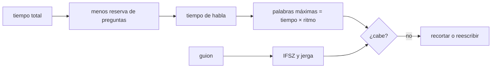

# B130-C03 — Comunicación oral de la ciencia

<!-- nav:top -->
[🏠 Programa](../../../../README.md) · [📚 Bloque B130](../../../tronco-comun/B130-comunicacion-y-divulgacion-cientifica.md) · [← Anterior: B130-C02 — Visualización de datos para comunicar](../B130-C02-visualizacion-de-datos-para-comunicar/CLASE.md) · [Siguiente: B130-C04 — Divulgación científica en redes sociales →](../B130-C04-divulgacion-cientifica-en-redes-sociales/CLASE.md)
<!-- /nav -->

## 1. Ubicación, nivel y alcance

Clase 3 del bloque B130. Nivel N3. Hablar ante un público no es leer un artículo en voz alta: el oyente no puede volver atrás. Aquí conviertes un guion en números: cuántas palabras caben en el tiempo, cuán legible es el texto en español con la escala INFLESZ y qué fracción de las palabras es jerga sin explicar. Los dos guiones son ejemplos ilustrativos escritos para la clase; la velocidad de habla es un parámetro que tú eliges, no una norma.

## 2. Por qué esta clase existe

Presentar ante público requiere técnicas propias; la clase de comunicación escrita general no cubre el tiempo, el ritmo ni la jerga hablada. La decisión central: **¿qué cabe en el tiempo disponible y qué entenderá una persona que oye el guion una sola vez?**

## 3. Lo que podrás hacer al terminar

1. Calcular el presupuesto de tiempo de una charla con reserva para preguntas.
2. Contar palabras, frases y sílabas de un guion y calcular su índice de legibilidad.
3. Interpretar el índice con los tramos de la escala INFLESZ.
4. Medir la densidad de jerga con un glosario.
5. Reescribir un guion para bajar la jerga y subir la legibilidad.
6. Separar lo consultado (tramos INFLESZ) de lo ilustrativo (guiones, velocidades).

La evidencia es el **guion con tiempos y métricas** del ejercicio 12 (sección 20).

## 4. Con qué llegas y cómo comprobarlo

1. ¿Qué es una sílaba?
2. ¿Qué es un diptongo?
3. ¿Qué es jerga?
4. ¿Qué es un porcentaje de reserva?
5. ¿Qué es un dato sintético?

<details>
<summary>Ver respuestas</summary>

1. Un grupo de sonidos que se pronuncia en un golpe de voz. 2. Dos vocales que se pronuncian en la misma sílaba, como en «ciencia». 3. Vocabulario técnico que el público no conoce. 4. La parte del tiempo que no se usa para hablar sino para preguntas. 5. Un dato generado para el ejemplo, no medido.
</details>

Con cuatro o cinco aciertos, sigue; si no, repasa los prerrequisitos.

## 5. Un caso de contexto y casos de referencia

Una charla ilustrativa dura `10 min` con `8` diapositivas y `20 %` para preguntas: quedan `8,0 min` de habla, `60 s` por diapositiva. A `120 palabras/min` caben `960` palabras y un guion de `1000` no cabe; a `150` caben `1200` y sí cabe. El guion A tiene índice `2,4` (muy difícil, `21,7 %` de jerga) y el B `80,5` (muy fácil, `2,6 %`). Es el **ejemplo conductor**; todo es ilustrativo.

## 6. Vocabulario

El **índice de Szigriszt-Pazos** es `IFSZ = 206,835 − 62,3 · S/P − P/F`, con `S` sílabas, `P` palabras y `F` frases. La **escala INFLESZ** lo clasifica: menos de `40` muy difícil; `40–55` algo difícil; `55–65` normal; `65–80` bastante fácil; más de `80` muy fácil. La **densidad de jerga** es la fracción de palabras que están en un glosario técnico. El **presupuesto de tiempo** es el tiempo de habla menos la reserva.

## 7. Modelo mental: una maleta de mano



*Descripción textual:* el tiempo total, menos las preguntas, da el tiempo de habla; multiplicado por el ritmo da las palabras máximas; el guion se mide con legibilidad y jerga, y si no cabe se recorta.

Analogía: una maleta de mano tiene límite de peso: lo valioso es decidir qué se queda fuera. Límite: la legibilidad mide el texto, no la voz, el gesto ni la imagen que lo acompañan.

## 8. La explicación, paso a paso

### 8.1 Cuánto cabe

`habla = 10 × (1 − 0,2) = 8 min`; `8 × 60/8 = 60 s` por diapositiva; `8 × 120 = 960` palabras. Los ritmos de `120` y `150 palabras/min` son valores de ejemplo, no una norma consultada: mide el tuyo cronometrando un ensayo.

### 8.2 Contar sílabas

El laboratorio cuenta núcleos vocálicos: una vocal abierta (`a, e, o`) junto a otra abierta forma hiato («poeta» = `3`); una cerrada (`i, u`) junto a una abierta forma diptongo («tiene» = `2`); `í` y `ú` con tilde cuentan como abiertas («país» = `2`). Diez palabras de prueba coinciden con el recuento manual. Es una heurística y falla en casos como «ahu-mar»: revisa los resultados dudosos a mano.

### 8.3 Legibilidad

| Guion | Palabras | Frases | Sílabas | IFSZ | Tramo | Jerga |
|---|---|---|---|---|---|---|
| A (jerga) | 23 | 1 | 67 | 2,4 | muy difícil | 21,7 % |
| B (llano) | 39 | 4 | 73 | 80,5 | muy fácil | 2,6 % |

La escala INFLESZ fue propuesta por Barrio-Cantalejo et al. (2008) para textos dirigidos a pacientes, con el umbral `55` como mínimo recomendable en salud. Aplicarla a una charla de astronomía es una extrapolación: sirve para comparar versiones de un guion, no para certificar que el público entiende. Y solo consultamos el resumen del artículo, de modo que la fórmula del índice debe contrastarse con la fuente original antes de usarla como estándar.

### 8.4 Lo que no mide el índice

Frases cortas y palabras comunes ayudan a un oyente que no puede releer, pero el índice no ve la estructura (abrir con una pregunta, un ejemplo cercano, una sola idea por diapositiva), ni el ritmo, ni los silencios. Para accesibilidad, la guía del IAU sobre extensión inclusiva pide planear la actividad pensando en necesidades visuales, auditivas, motoras y cognitivas; el detalle sobre cómo hablar y describir imágenes está en sus documentos «Good Practices», que no consultamos.

## 9. Magnitudes, símbolos y unidades

| Símbolo | Qué es | Unidad | Valor / nota |
|---|---|---|---|
| `T` | duración total | min | 10 (ilustrativo) |
| `ρ` | reserva de preguntas | fracción | 0,2 |
| `v` | ritmo de habla | palabras/min | 120; 150 (ilustrativos) |
| `S, P, F` | sílabas, palabras, frases | — | ver 8.3 |
| `IFSZ` | índice de legibilidad | — | 2,4; 80,5 |
| `J` | densidad de jerga | fracción | 0,217; 0,026 |

## 10. Convenciones y referencias

Guiones en español, sin cifras. Palabras: secuencias de letras; frases: separadas por `.`, `!` o `?`. Glosario de jerga: ocho términos ilustrativos. No hay sistema de referencia espacial. Todos los datos de los guiones y velocidades son sintéticos o ilustrativos.

## 11. De dónde sale lo que afirmamos

| ID | Fuente | Localizador | Respalda | Estado |
|---|---|---|---|---|
| S1 | Barrio-Cantalejo et al. (2008), *Anales del Sistema Sanitario de Navarra* 31(2):135-152 — https://recyt.fecyt.es/index.php/ASSN/article/view/1953 (consultada 2026-11-11) | resumen obtenido por buscador; texto completo no consultado | tramos de la escala INFLESZ y umbral 55 para textos de salud | Consultada (resumen) |
| S2 | IAU Office of Astronomy Outreach, Inclusive Outreach — https://iau-oao.nao.ac.jp/iau-inclusion/inclusive-outreach-2 (consultada 2026-11-11) | página general | planear pensando en necesidades visuales, auditivas, motoras y cognitivas | Consultada |
| — | Fórmula de Szigriszt-Pazos | — | la usa el laboratorio; no se consultó en una fuente concreta | No consultada |
| — | Ritmos de habla (120 y 150 palabras/min); «Good Practices» del IAU | — | son parámetros ilustrativos; el documento no se leyó | No consultada |

Límites: no se mide a ningún público; el índice no se calibró para exposiciones orales de astronomía.

## 12. Cómo ver un guion

| Medida | Guion A | Guion B |
|---|---|---|
| IFSZ | 2,4 | 80,5 |
| Tramo | muy difícil | muy fácil |
| Jerga | 21,7 % | 2,6 % |
| Habla disponible | 8,0 min | 8,0 min |

Descripción larga: el guion B sube el índice en `78` puntos y baja la jerga de `21,7 %` a `2,6 %` con la misma idea (la paralaje), a costa de más palabras.

## 13. Ejemplo trabajado: el índice del guion B

**Paso 1 · Cuentas.** `P = 39`, `F = 4`, `S = 73`.

**Paso 2 · Cocientes.** `S/P = 1,872`; `P/F = 9,75`.

**Paso 3 · Índice.** `206,835 − 62,3 × 1,872 − 9,75 = 80,5`.

**Paso 4 · Tramo.** `80,5` supera `80`: muy fácil.

## 14. Distintas formas de preparar una charla

**Por tiempo:** palabras máximas. **Por estructura:** apertura, idea, ejemplo, cierre. **Por jerga:** cada término técnico se define al usarlo. **Por accesibilidad:** describir en voz alta lo que muestra cada imagen. **Por ensayo:** cronometrar y ajustar.

## 15. Práctica guiada

**Ejercicio 1 · con los pasos indicados.** Calcula las palabras máximas de una charla de `15 min` con `20 %` de preguntas a `130 palabras/min`. *Pasos:* tiempo de habla, multiplica por el ritmo.

<details><summary>Solución comentada</summary>

`15 × 0,8 = 12 min`; `12 × 130 = 1560` palabras.
</details>

**Ejercicio 2 · con una pista.** Cuenta las sílabas de «telescopio». *Pista:* «pio» es un diptongo.

<details><summary>Solución comentada</summary>

te-les-co-pio: `4`.
</details>

**Ejercicio 3 · casi autónomo.** Clasifica un índice de `58`.

<details><summary>Solución comentada</summary>

Entre `55` y `65`: normal.
</details>

## 16. Práctica autónoma, transferencia e integrador

**Ejercicio 4 · autónomo.** Segundos por diapositiva con `12 min` de habla y `10` diapositivas.

<details><summary>Solución comentada</summary>

`720/10 = 72 s`.
</details>

**Ejercicio 5 · autónomo.** Si el guion B se alargase a `4` frases de `15` palabras con `1,9` sílabas por palabra, ¿cuál sería el IFSZ?

<details><summary>Solución comentada</summary>

`206,835 − 62,3 × 1,9 − 15 = 73,5`: bastante fácil.
</details>

**Ejercicio 6 · autónomo.** Calcula la densidad de jerga de un guion de `50` palabras con `4` términos del glosario.

<details><summary>Solución comentada</summary>

`4/50 = 0,08`, es decir `8 %`.
</details>

**Ejercicio 7 · autónomo.** ¿Cuántas sílabas tiene «estrella»?

<details><summary>Solución comentada</summary>

es-tre-lla: `3`.
</details>

**Ejercicio 8 · autónomo.** Reescribe «calibración heliocéntrica» para un público general en una frase.

<details><summary>Solución comentada</summary>

Por ejemplo: «ajustar las medidas tomando como referencia al Sol». Cuida que no cambie el significado.
</details>

**Ejercicio 9 · transferencia.** **Transferencia.** Tu ensayo mide `100 palabras/min` y el guion tiene `900` palabras para `8 min` de habla. ¿Qué haces?

<details><summary>Solución comentada</summary>

Caben `800`: recortas unas `100` palabras o amplías el tiempo; no aceleras la voz hasta el límite de la comprensión.
</details>

**Ejercicio 10 · transferencia.** **Transferencia.** Una persona del público tiene baja visión. ¿Qué ajustas en el guion?

<details><summary>Solución comentada</summary>

Describes en voz alta las imágenes y lees las cifras clave; la idea de planear para necesidades diversas viene de S2, el detalle práctico no se consultó.
</details>

**Ejercicio 11 · transferencia.** **Transferencia.** Un colega dice «el guion B enseña más porque su IFSZ es mayor». ¿Qué respondes?

<details><summary>Solución comentada</summary>

El índice mide legibilidad, no aprendizaje; para saber si enseña hay que medir la comprensión (C05).
</details>

**Ejercicio 12 · integrador.** **Integrador.** Elabora tu *guion con tiempos y métricas*: presupuesto de tiempo, versión inicial y reescrita con IFSZ y jerga, lista de términos definidos y qué es consultado o ilustrativo.

<details><summary>Solución comentada</summary>

Secciones 8.1–8.4 y la salida del laboratorio.
</details>

## 17. Laboratorio: presupuesto y legibilidad de un guion

El script [guion.py](guion.py) cuenta sílabas con una heurística (10 palabras de prueba), calcula el IFSZ y la densidad de jerga de dos guiones y el presupuesto de una charla (**comprueba** el recuento de sílabas, que el guion B es más legible y que 1000 palabras no caben a 120 palabras/min pero sí a 150).

**Datos:** tramos INFLESZ (resumen consultado el 2026-11-11); guiones, glosario y ritmos **ilustrativos**. **Predice antes de ejecutar:** ¿cuántas palabras caben a `120 palabras/min`? (960.) **Ejecución del 2026-11-11 (Python 3.12.9):**

```text
Python 3.12.9 (biblioteca estandar)
Silabas: 10 casos de prueba superados.
Guion A (jerga, ILUSTRATIVO): palabras = 23, frases = 1, silabas = 67, IFSZ = 2.4 (muy dificil), jerga = 21.7 %
Guion B (llano, ILUSTRATIVO): palabras = 39, frases = 4, silabas = 73, IFSZ = 80.5 (muy facil), jerga = 2.6 %
Presupuesto de una charla ILUSTRATIVA (10 min, 8 diapositivas, 20 % para preguntas):
  120 palabras/min: habla 8.0 min, 60 s por diapositiva, maximo 960 palabras, guion de 1000 palabras: NO cabe
  150 palabras/min: habla 8.0 min, 60 s por diapositiva, maximo 1200 palabras, guion de 1000 palabras: cabe
Pruebas superadas.
```

```bash
python programa/clases/B130/B130-C03-comunicacion-oral-de-la-ciencia/guion.py
```

**Límites:** heurística de sílabas; fórmula no consultada en fuente concreta; el índice se calibró para textos de salud y no mide la comprensión.

## 18. Errores frecuentes y cómo corregirlos

**Llenar el tiempo total con palabras sin reservar las preguntas.** Se corrige con 8.1.

**Tomar un índice alto como prueba de que el público aprendió.** Se corrige con 8.4.

**Usar un término técnico sin definirlo.** Se corrige con 8.3.

**Suponer un ritmo de habla sin cronometrarlo.** Se corrige con 8.1.

## 19. Cómo sabrás que vas bien

Tras la sección 8: ¿cuántas palabras esperabas a `120 palabras/min` y cuántas obtuviste? Si dudas, repasa el ejemplo 13. Tras el laboratorio: ¿qué comprueba y qué no? (ver la sección 17).

## 20. Qué entregas y cómo se evalúa

El producto es tu **guion con tiempos y métricas** (ejercicio 12).

| Criterio | Inicial | En desarrollo | Logrado | Destacado |
|---|---|---|---|---|
| Conceptos | Los confunde | Parciales | Explica tiempo, índice y jerga | Explica los límites |
| Cálculo | Sin unidades | Con errores | Presupuesto e índice correctos | Calcula casos nuevos |
| Numérico | Sin comprobar | Un caso | Compara dos versiones | Interpreta las diferencias |
| Fuentes | Sin fuente | Sin fecha | Fuentes con fecha y estado | Declara lo ilustrativo y lo no consultado |
| Límites | No los nombra | Uno | Tres | Discute qué no mide el índice |

**Condiciones críticas (no se compensan con promedio):** rotular lo ilustrativo; no presentar el índice como medida de comprensión; no afirmar impacto sin fuente; citar solo lo consultado.

## 21. Ética, seguridad y límites

Clase educativa: los guiones son ejemplos y las métricas son indicadores simplificados; ninguna describe a un público real. Simplificar no autoriza a decir algo falso: la versión llana debe seguir siendo correcta. Accesibilidad: tablas equivalentes a las gráficas, fórmulas en texto, ejercicios sin conexión.

## 22. Para cerrar y seguir

Una charla de `10 min` con preguntas deja `8 min` de habla y, a `120 palabras/min`, `960` palabras. Queda una pregunta: ¿qué cambia cuando el público está en una red social y puede responder o compartir?

**Glosario español–inglés.** legibilidad · *readability*; densidad de jerga · *jargon density*; presupuesto de tiempo · *time budget*; guion · *script*; ritmo de habla · *speaking rate*.

**Continuidad.** [B130-C04](../B130-C04-divulgacion-cientifica-en-redes-sociales/CLASE.md) estudia la divulgación en redes sociales.

**Referencias:** ver sección 11.

<!-- nav:bottom -->
---

[← Anterior: B130-C02 — Visualización de datos para comunicar](../B130-C02-visualizacion-de-datos-para-comunicar/CLASE.md) · [📚 Bloque B130](../../../tronco-comun/B130-comunicacion-y-divulgacion-cientifica.md) · [Siguiente: B130-C04 — Divulgación científica en redes sociales →](../B130-C04-divulgacion-cientifica-en-redes-sociales/CLASE.md)
<!-- /nav -->
