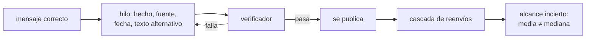

# B130-C04 — Divulgación científica en redes sociales

<!-- nav:top -->
[🏠 Programa](../../../../README.md) · [📚 Bloque B130](../../../tronco-comun/B130-comunicacion-y-divulgacion-cientifica.md) · [← Anterior: B130-C03 — Comunicación oral de la ciencia](../B130-C03-comunicacion-oral-de-la-ciencia/CLASE.md) · [Siguiente: B130-C05 — Evaluación de la comprensión del público →](../../../tronco-comun/B130-comunicacion-y-divulgacion-cientifica.md#b130-c05)
<!-- /nav -->

## 1. Ubicación, nivel y alcance

Clase 4 del bloque B130. Nivel N3. En una red social el mensaje se recorta, se separa de su contexto y lo reenvían personas que no leyeron la fuente. Aquí preparas un hilo que lleve la fuente y el texto alternativo, divides un mensaje en publicaciones de largo limitado, estructuras la corrección de un mito y ves con una simulación sintética por qué el alcance de un mensaje es muy incierto. Los hechos astronómicos del ejemplo salen de la ficha de la Tierra de la NASA/NSSDC; la cascada es un modelo, no una medición de ninguna red.

## 2. Por qué esta clase existe

Las redes tienen formatos y riesgos propios que no están tratados en la comunicación escrita u oral. La decisión central: **¿cómo se publica un mensaje correcto, con su fuente, de modo que resista el recorte y la difusión?**

## 3. Lo que podrás hacer al terminar

1. Dividir un texto en una serie numerada de publicaciones dentro de un límite de caracteres.
2. Verificar que un hilo tenga enlace a la fuente, fecha de consulta y texto alternativo.
3. Estructurar la corrección de un mito poniendo el hecho a la vista.
4. Simular una cascada de compartidos y leer su media, su mediana y su cola.
5. Explicar qué dicen y qué no dicen los estudios citados sobre difusión y corrección.
6. Separar lo consultado de lo sintético y de lo que no se consultó (normas de plataformas).

La evidencia es el **hilo verificado con su lista de comprobación** del ejercicio 12 (sección 20).

## 4. Con qué llegas y cómo comprobarlo

1. ¿Qué es una fuente primaria?
2. ¿Qué es un texto alternativo?
3. ¿Qué es una media y una mediana?
4. ¿Qué es una semilla de un generador aleatorio?
5. ¿Qué es un dato sintético?

<details>
<summary>Ver respuestas</summary>

1. Un documento o dato original de quien lo produjo. 2. Una descripción en texto de una imagen para quien no la ve. 3. La media es el promedio; la mediana, el valor central. 4. El valor inicial que hace repetible una secuencia aleatoria. 5. Un dato generado para el ejemplo, no medido.
</details>

Con cuatro o cinco aciertos, sigue; si no, repasa los prerrequisitos.

## 5. Un caso de contexto y casos de referencia

Un hilo corrige el mito «las estaciones se deben a la distancia al Sol»: el hecho es que la inclinación del eje es de `23,44°` respecto de la órbita, y la distancia solo varía entre `147,095` y `152,100` millones de km (ficha de la Tierra, consultada el 2026-11-11). Dividido con un límite paramétrico de `280` caracteres da `3` publicaciones de `274`, `158` y `135` caracteres. Es el **ejemplo conductor**. En la cascada sintética con `R = 1,2` el alcance medio es `31,8` pero la mediana es `4`.

## 6. Vocabulario

Un **hilo** es una serie numerada de publicaciones. El **texto alternativo** describe una imagen en texto. Una **cascada** es el conjunto de reenvíos que parte de una publicación. El **número reproductivo** `R` es el promedio de reenvíos que provoca cada reenvío; `R < 1` apaga la cascada, `R > 1` puede crecer. Un **proceso de ramificación** modela esto con una descendencia aleatoria por individuo; aquí es de Poisson con media `R`.

## 7. Modelo mental: una botella al mar



*Descripción textual:* el mensaje se convierte en un hilo con fuente y texto alternativo, el verificador lo devuelve si falla y, si pasa, se publica; después la cascada produce un alcance muy variable.

Analogía: quien lanza una botella al mar no controla a quién llega; solo controla lo que lleva dentro. Límite: en una red real los algoritmos de recomendación y la estructura de los seguidores cambian la difusión; el modelo no los incluye.

## 8. La explicación, paso a paso

### 8.1 Dividir un hilo

El laboratorio parte el texto por frases, sin cortar ninguna, y numera cada publicación con `(k/n)`. El límite de `280` caracteres es un parámetro de ejemplo: las normas actuales de cada plataforma no se consultaron y cambian. Cada publicación debe poder entenderse sola, porque se comparte sola.

### 8.2 Verificar el hilo

El verificador comprueba cinco cosas: que ninguna publicación pase el límite, que haya un enlace a la fuente, que conste la fecha de consulta, que cada imagen tenga texto alternativo y que el hecho aparezca poco después del mito. El hilo completo no tiene problemas; un hilo cortado a su primera publicación y una imagen sin descripción fallan en tres: sin enlace, sin fecha y sin texto alternativo.

### 8.3 Corregir un mito

Lewandowsky et al. (2012) revisan por qué las correcciones suelen fallar y dan recomendaciones para diseñarlas, según el resumen que consultamos. No consultamos esas recomendaciones concretas; la regla del laboratorio («el hecho va junto al mito y la fuente después») es un criterio de esta clase, no una cita. Cualquier hilo de corrección debería pasar por la lectura de la fuente original.

### 8.4 Alcance incierto

| `R` | Media simulada | Media teórica | Mediana | p90 | P(≥ 100) |
|---|---|---|---|---|---|
| 0,8 | 4,47 | 4,57 | 2 | 11 | 0,0001 |
| 1,0 | 10,79 | 11,00 | 2 | 34 | 0,0077 |
| 1,2 | 31,76 | 32,15 | 4 | 103 | 0,1062 |

La media teórica de `10` generaciones es `(1 − R¹¹)/(1 − R)`; la simulación la reproduce con menos de `5 %` de error. Pero la mediana es mucho menor que la media: casi todas las cascadas se apagan pronto y unas pocas llegan lejos, así que el alcance de una publicación individual no se puede prometer. Vosoughi, Roy y Aral (2018), en su resumen, informan que en ~126 000 historias de Twitter (2006–2017) las falsas llegaron más lejos y más rápido que las verdaderas y que los bots las difundían al mismo ritmo que las verdaderas; ese hallazgo es de una plataforma y un periodo, y esta simulación no lo comprueba ni lo reproduce.

## 9. Magnitudes, símbolos y unidades

| Símbolo | Qué es | Unidad | Valor / nota |
|---|---|---|---|
| `L` | límite de caracteres | caracteres | 280 (parámetro) |
| `n` | publicaciones del hilo | — | 3 |
| `R` | número reproductivo | reenvíos por reenvío | 0,8; 1,0; 1,2 (sintéticos) |
| `T` | alcance total de una cascada | personas | media 4,5 a 31,8 |
| `ε` | oblicuidad de la Tierra | grados | 23,44 (consultada) |
| `d` | distancia Tierra–Sol | millones de km | 147,095 a 152,100 (consultada) |

## 10. Convenciones y referencias

Fecha de consulta en formato AAAA-MM-DD. Cascada: una semilla (`130`), `20 000` cascadas por valor de `R`, `10` generaciones, tope de `100 000`. Los valores astronómicos son de la ficha de la Tierra de la NASA/NSSDC; el hilo, el límite y `R` son ilustrativos o sintéticos.

## 11. De dónde sale lo que afirmamos

| ID | Fuente | Localizador | Respalda | Estado |
|---|---|---|---|---|
| S1 | NASA/NSSDC, Earth Fact Sheet — https://nssdc.gsfc.nasa.gov/planetary/factsheet/earthfact.html (consultada 2026-11-11) | ficha completa | oblicuidad 23,44°; perihelio 147,095 y afelio 152,100 millones de km | Consultada |
| S2 | Vosoughi, Roy y Aral (2018), *Science* 359:1146 — DOI 10.1126/science.aap9559; resumen obtenido por buscador (consultado 2026-11-11) | solo resumen | difusión de historias verdaderas y falsas en Twitter 2006–2017 | Consultada (resumen) |
| S3 | Lewandowsky, Ecker, Seifert, Schwarz y Cook (2012), *Psychological Science in the Public Interest* 13(3):106-131 — DOI 10.1177/1529100612451018; resumen obtenido por buscador (consultado 2026-11-11) | solo resumen | las correcciones pueden fallar; hay recomendaciones de diseño | Consultada (resumen) |
| — | Debunking Handbook (el servidor respondió con error); normas actuales de las plataformas | — | no se consultaron | No consultada |

Límites: no se mide ninguna red real; el proceso de ramificación es un modelo mínimo; los estudios citados no se generalizan a la divulgación astronómica.

## 12. Cómo ver un hilo y su alcance

| Elemento | Valor |
|---|---|
| Publicaciones del hilo | 3 |
| Problemas del hilo completo | ninguno |
| Media / mediana con `R = 1,2` | 31,8 / 4 |
| P(alcance ≥ 100) con `R = 1,2` | 0,106 |

Descripción larga: el hilo cumple todas las comprobaciones, y aun así su alcance posible es muy desigual: la mediana es ocho veces menor que la media.

## 13. Ejemplo trabajado: la media teórica con R = 1,2

**Paso 1 · Fórmula.** `T = (1 − R¹¹)/(1 − R)`.

**Paso 2 · Potencia.** `1,2¹¹ = 7,430`.

**Paso 3 · Cociente.** `(1 − 7,430)/(1 − 1,2) = 32,15`.

**Paso 4 · Comparación.** La simulación da `31,76`: diferencia relativa `1,2 %`.

## 14. Distintas formas de contar lo mismo

**Por imagen:** esquema con texto alternativo. **Por hilo:** mito, hecho, fuente. **Por pregunta:** «¿Sabías que…?» seguida de la respuesta con fuente. **Por vídeo corto:** con subtítulos. En todos, la fuente va dentro de la pieza, no en una respuesta aparte.

## 15. Práctica guiada

**Ejercicio 1 · con los pasos indicados.** ¿Cuántas publicaciones de `280` caracteres (con `8` de reserva) necesita un texto de `600` caracteres si se corta por frases? *Pasos:* capacidad útil por publicación y cociente.

<details><summary>Solución comentada</summary>

Capacidad `272`; `600/272 = 2,2`: al menos `3`, pero al cortar por frases puede necesitar más.
</details>

**Ejercicio 2 · con una pista.** Calcula la media teórica con `R = 0,8`. *Pista:* `0,8¹¹ = 0,0859`.

<details><summary>Solución comentada</summary>

`(1 − 0,0859)/0,2 = 4,57`.
</details>

**Ejercicio 3 · casi autónomo.** ¿Por qué la mediana es menor que la media?

<details><summary>Solución comentada</summary>

Porque pocas cascadas muy grandes elevan la media; la mayoría se apaga pronto.
</details>

## 16. Práctica autónoma, transferencia e integrador

**Ejercicio 4 · autónomo.** ¿Qué verifica el laboratorio sobre las imágenes?

<details><summary>Solución comentada</summary>

Que cada una tenga un texto alternativo no vacío.
</details>

**Ejercicio 5 · autónomo.** Con `R = 1`, ¿cuál es la media teórica a `10` generaciones?

<details><summary>Solución comentada</summary>

`11` (un individuo por generación, sumando la inicial).
</details>

**Ejercicio 6 · autónomo.** Escribe el texto alternativo de un esquema del eje inclinado de la Tierra.

<details><summary>Solución comentada</summary>

Por ejemplo: «Esquema de la Tierra en dos puntos de su órbita con el eje inclinado `23,44°` hacia la misma dirección».
</details>

**Ejercicio 7 · autónomo.** Reescribe «La Tierra está más cerca en verano» como mito en una frase con su hecho.

<details><summary>Solución comentada</summary>

«Mito: el verano llega por la cercanía al Sol. Hecho: llega por la inclinación del eje de `23,44°`».
</details>

**Ejercicio 8 · autónomo.** Explica por qué un solo hilo no permite prometer un alcance.

<details><summary>Solución comentada</summary>

La mediana de la cascada es mucho menor que la media y la cola es larga (sección 8.4).
</details>

**Ejercicio 9 · transferencia.** **Transferencia.** Una cuenta ajena difunde una imagen tuya sin el crédito. ¿Qué incluyes desde el principio para que el crédito viaje con ella?

<details><summary>Solución comentada</summary>

El crédito y la licencia dentro de la propia imagen o en su pie, además de la fuente en el texto (C01).
</details>

**Ejercicio 10 · transferencia.** **Transferencia.** Alguien afirma que «lo falso siempre se difunde más que lo verdadero». ¿Qué respondes?

<details><summary>Solución comentada</summary>

El estudio citado trata de historias verificadas en Twitter de 2006 a 2017; no es una ley general ni abarca la divulgación astronómica.
</details>

**Ejercicio 11 · transferencia.** **Transferencia.** Te piden publicar sin la fuente porque «no cabe». ¿Qué haces?

<details><summary>Solución comentada</summary>

Pones el enlace en la última publicación, acortas el texto o usas una imagen con la fuente; sin fuente no se publica una afirmación.
</details>

**Ejercicio 12 · integrador.** **Integrador.** Elabora tu *hilo verificado con su lista de comprobación*: hilo dividido, resultado del verificador, texto alternativo, mito y hecho con fuente, y qué es consultado, sintético o no consultado.

<details><summary>Solución comentada</summary>

Secciones 8.1–8.4 y la salida del laboratorio.
</details>

## 17. Laboratorio: hilo y cascada

El script [hilo.py](hilo.py) divide un hilo, lo verifica con cinco reglas y simula `20 000` cascadas de Galton–Watson para tres valores de `R` (**comprueba** el hilo completo sin problemas, los fallos del hilo cortado y que la media simulada difiere de la teórica en menos de `5 %`).

**Datos:** oblicuidad y distancias de la ficha NASA/NSSDC (consultada el 2026-11-11); hilo, límite y cascada **sintéticos o ilustrativos**. **Predice antes de ejecutar:** ¿cuál será la media teórica con `R = 1`? (11.) **Ejecución del 2026-11-11 (Python 3.12.9):**

```text
Python 3.12.9 (biblioteca estandar)
Hilo ILUSTRATIVO dividido en 3 publicaciones (limite parametrico 280 caracteres):
  [274] Un mito comun: las estaciones se deben a que la Tierra esta ...
  [158] Cuando un hemisferio se inclina hacia el Sol recibe la luz m...
  [135] Fuente: ficha de la Tierra de NASA/NSSDC, https://nssdc.gsfc...
Problemas del hilo completo: ninguno
Problemas de un hilo cortado y una imagen sin texto alternativo: ['sin enlace a la fuente', 'sin fecha de consulta', 'imagen img1 sin texto alternativo']
Cascada SINTETICA (Galton-Watson, descendencia Poisson(R), 10 generaciones, 20000 cascadas, semilla 130):
  R = 0.8: media =    4.47 (teorica   4.57), mediana =   2, p90 =   11, P(alcance >= 100) = 0.0001
  R = 1.0: media =   10.79 (teorica  11.00), mediana =   2, p90 =   34, P(alcance >= 100) = 0.0077
  R = 1.2: media =   31.76 (teorica  32.15), mediana =   4, p90 =  103, P(alcance >= 100) = 0.1062
Pruebas superadas.
```

```bash
python programa/clases/B130/B130-C04-divulgacion-cientifica-en-redes-sociales/hilo.py
```

**Límites:** el modelo ignora algoritmos de recomendación y estructura de la red; el verificador comprueba presencia, no veracidad; el límite de caracteres es un parámetro.

## 18. Errores frecuentes y cómo corregirlos

**Publicar un hilo sin fuente dentro de la pieza.** Se corrige con 8.2.

**Prometer un alcance a partir de un caso.** Se corrige con 8.4.

**Generalizar un estudio de una plataforma a todas.** Se corrige con 8.4.

**Repetir el mito sin dejar claro el hecho.** Se corrige con 8.3.

## 19. Cómo sabrás que vas bien

Tras la sección 8: ¿qué media esperabas con `R = 1` y cuál obtuviste? Si dudas, repasa el ejemplo 13. Tras el laboratorio: ¿qué comprueba y qué no? (ver la sección 17).

## 20. Qué entregas y cómo se evalúa

El producto es tu **hilo verificado con su lista de comprobación** (ejercicio 12).

| Criterio | Inicial | En desarrollo | Logrado | Destacado |
|---|---|---|---|---|
| Conceptos | Los confunde | Parciales | Explica hilo, fuente y cascada | Explica los límites |
| Cálculo | Sin unidades | Con errores | Medias y medianas correctas | Calcula casos nuevos |
| Numérico | Sin comprobar | Un caso | Contrasta con la media teórica | Interpreta las diferencias |
| Fuentes | Sin fuente | Sin fecha | Fuentes con fecha y estado | Declara lo sintético y lo no consultado |
| Límites | No los nombra | Uno | Tres | Discute qué no modela la cascada |

**Condiciones críticas (no se compensan con promedio):** rotular lo sintético; no presentar la cascada como medición; no afirmar impacto sin fuente; citar solo lo consultado.

## 21. Ética, seguridad y límites

Clase educativa: la cascada y el hilo son ejemplos; ningún resultado describe una red ni a personas reales. No se enseña a manipular la difusión: se enseña a publicar con fuente. Antes de publicar un hilo real, revisa las normas actuales de la plataforma y la privacidad de las personas que aparezcan. Accesibilidad: tablas equivalentes a las gráficas, texto alternativo, fórmulas en texto, ejercicios sin conexión.

## 22. Para cerrar y seguir

Un hilo de `3` publicaciones con fuente y texto alternativo resiste el recorte, pero su alcance es incierto: con `R = 1,2` la media es `31,8` y la mediana `4`. Queda una pregunta: ¿cómo sabes si el público entendió?

**Glosario español–inglés.** hilo · *thread*; texto alternativo · *alt text*; cascada · *cascade*; número reproductivo · *reproduction number*; corrección · *debunking*.

**Continuidad.** [B130-C05](../B130-C05-evaluacion-de-la-comprension-del-publico/CLASE.md) estudia la evaluación de la comprensión.

**Referencias:** ver sección 11.

<!-- nav:bottom -->
---

[← Anterior: B130-C03 — Comunicación oral de la ciencia](../B130-C03-comunicacion-oral-de-la-ciencia/CLASE.md) · [📚 Bloque B130](../../../tronco-comun/B130-comunicacion-y-divulgacion-cientifica.md) · [Siguiente: B130-C05 — Evaluación de la comprensión del público →](../../../tronco-comun/B130-comunicacion-y-divulgacion-cientifica.md#b130-c05)
<!-- /nav -->
