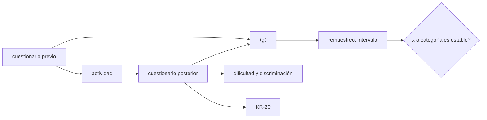

# B130-C05 — Evaluación de la comprensión del público

<!-- nav:top -->
[🏠 Programa](../../../../README.md) · [📚 Bloque B130](../../../tronco-comun/B130-comunicacion-y-divulgacion-cientifica.md) · [← Anterior: B130-C04 — Divulgación científica en redes sociales](../B130-C04-divulgacion-cientifica-en-redes-sociales/CLASE.md) · [Siguiente: B130-C06 — Publicación de un proyecto educativo →](../B130-C06-publicacion-de-un-proyecto-educativo/CLASE.md)
<!-- /nav -->

## 1. Ubicación, nivel y alcance

Clase 5 del bloque B130. Nivel N3. Las clases anteriores producen piezas; esta pregunta si funcionaron. Medir la comprensión exige un cuestionario antes y después, una forma de resumir la mejora y una idea de cuánto se puede confiar en el número. Aquí calculas la ganancia normalizada de Hake, la dificultad y la discriminación de cada ítem, la fiabilidad KR-20 y un intervalo por remuestreo. Todas las respuestas son sintéticas: no describen a nadie.

## 2. Por qué esta clase existe

Saber si la divulgación funcionó exige medir la comprensión; ninguna otra clase lo trata. La decisión central: **¿qué número resume la mejora del público, y cuánto se puede confiar en que no sea azar?**

## 3. Lo que podrás hacer al terminar

1. Calcular la ganancia normalizada de un grupo a partir de promedios previos y posteriores.
2. Clasificarla con los umbrales de Hake y decir cuán robusta es la clasificación.
3. Calcular la dificultad y la discriminación de un ítem.
4. Calcular KR-20 y comprobarlo contra el alfa de Cronbach.
5. Estimar un intervalo de confianza por remuestreo.
6. Explicar qué no demuestra un estudio pre/post.

La evidencia es el **informe de evaluación pre/post sintético** del ejercicio 12 (sección 20).

## 4. Con qué llegas y cómo comprobarlo

1. ¿Qué es un cuestionario pre/post?
2. ¿Qué es una media y una varianza?
3. ¿Qué es una correlación?
4. ¿Qué es un remuestreo (bootstrap)?
5. ¿Qué es un dato sintético?

<details>
<summary>Ver respuestas</summary>

1. El mismo cuestionario (o uno equivalente) antes y después de una actividad. 2. El promedio y la media de los cuadrados de las desviaciones. 3. Una medida de cuánto varían juntas dos variables, de −1 a 1. 4. Repetir el cálculo con muestras sacadas con reemplazo de los mismos datos. 5. Un dato generado para el ejemplo, no medido.
</details>

Con cuatro o cinco aciertos, sigue; si no, repasa los prerrequisitos.

## 5. Un caso de contexto y casos de referencia

Un grupo sintético de `60` personas responde `12` ítems. La media sube de `43,61 %` a `60,42 %`, y la ganancia normalizada vale `0,298`: baja, pero a una milésima del umbral `0,3`. El intervalo bootstrap del `95 %` es `[0,199; 0,390]`, que cruza el umbral. Es el **ejemplo conductor**: dos grupos con la misma historia pueden caer en categorías distintas por azar. Los datos son sintéticos.

## 6. Vocabulario

La **ganancia normalizada de un grupo** es `⟨g⟩ = (⟨S_f⟩ − ⟨S_i⟩)/(100 − ⟨S_i⟩)`: la fracción de la mejora posible que se logró. Hake llama ganancia alta a `⟨g⟩ ≥ 0,7`, media a `0,3 ≤ ⟨g⟩ < 0,7` y baja a `⟨g⟩ < 0,3`. La **dificultad** de un ítem es la proporción de respuestas correctas. La **discriminación** es la correlación entre acertar el ítem y el puntaje en los demás. **KR-20** y el **alfa de Cronbach** miden la consistencia interna; para ítems dicotómicos coinciden.

## 7. Modelo mental: pesar antes y después



*Descripción textual:* los dos cuestionarios dan la ganancia normalizada; el posterior da además dificultad, discriminación y fiabilidad; el remuestreo da un intervalo que dice si la categoría es estable.

Analogía: pesar a una persona antes y después de una dieta con una balanza que cambia un poco cada vez: la diferencia importa solo si supera ese cambio. Límite: sin grupo de comparación, una mejora puede deberse a haber contestado dos veces el mismo cuestionario.

## 8. La explicación, paso a paso

### 8.1 Ganancia normalizada

`⟨g⟩ = (60,42 − 43,61)/(100 − 43,61) = 16,81/56,39 = 0,298`. Hake (1998) la definió con promedios de grupo y la usó en una encuesta de `62` cursos de física introductoria (`N = 6542`) con pruebas de mecánica. Sus resultados no se trasladan a la divulgación astronómica; aquí se usa la definición y los umbrales, no sus medias.

### 8.2 Un intervalo para el número

Con `2000` remuestreos de las `60` personas, el intervalo del `95 %` es `[0,199; 0,390]`. Como cruza `0,3`, no se puede decir con seguridad que la ganancia es «baja» ni «media». El número puntual esconde esa incertidumbre; el intervalo la muestra.

### 8.3 Ítems

| Ítem | Pre | Post | Discriminación |
|---|---|---|---|
| 1 | 0,77 | 0,80 | 0,32 |
| 2 | 0,68 | 0,85 | 0,10 |
| 6 | 0,52 | 0,63 | 0,20 |
| 12 | 0,13 | 0,28 | 0,41 |

El ítem 2 discrimina poco (`0,10`): acertarlo casi no distingue a quienes entendieron más; se revisa o se reemplaza. El ítem 12 es difícil (`0,28` correctas) pero discrimina bien. La tabla completa está en la salida del laboratorio.

### 8.4 Fiabilidad

KR-20 y el alfa de Cronbach dan ambos `0,7295` con diferencia `0` (menor que `1e-12`): son la misma cantidad calculada por dos vías. Un valor así sugiere consistencia interna moderada, pero no dice que el cuestionario mida lo que se quiere medir (validez). La fórmula de KR-20 no se consultó en una fuente concreta; la comprobación cruzada valida el código, no la fórmula.

### 8.5 Qué no demuestra

Un estudio pre/post no separa el efecto de la actividad de la práctica, la maduración o el interés de quien contesta. El marco del NSF para evaluar proyectos de educación informal (Friedman, 2008) no pudo consultarse (el enlace respondió con error), de modo que esta clase no cita sus categorías.

## 9. Magnitudes, símbolos y unidades

| Símbolo | Qué es | Unidad | Valor / nota |
|---|---|---|---|
| `⟨S_i⟩, ⟨S_f⟩` | promedios previo y posterior | % | 43,61; 60,42 |
| `⟨g⟩` | ganancia normalizada | — | 0,298 |
| `p_j` | dificultad del ítem `j` | proporción | 0,28 a 0,85 (post) |
| `r_j` | discriminación | — (−1 a 1) | 0,10 a 0,48 |
| `KR-20` | fiabilidad | — | 0,7295 |
| `n, k` | personas, ítems | — | 60; 12 |

## 10. Convenciones y referencias

Respuestas: 1 = correcta, 0 = incorrecta. Modelo generador: logístico de un parámetro con habilidad media `−0,5`, mejora media `1,2` y dificultades de `−1,5` a `1,5` (todo inventado). Semilla `130`. Sin sistema de referencia espacial.

## 11. De dónde sale lo que afirmamos

| ID | Fuente | Localizador | Respalda | Estado |
|---|---|---|---|---|
| S1 | Hake, R. R. (1998), «Interactive-engagement versus traditional methods», *Am. J. Phys.* 66, 64, doi:10.1119/1.18809 (PDF leído con PyMuPDF, 2026-11-11) | ecuación (1) y definiciones de ganancia alta, media y baja; 62 cursos, N = 6542 | definición y umbrales de `⟨g⟩` | Consultada |
| — | Fórmulas de KR-20 y alfa de Cronbach; Tavakol y Dennick (2011) (la página exigió verificación humana) | — | las usa el laboratorio y se comprueban entre sí | No consultada |
| — | Friedman (2008), marco NSF de evaluación de proyectos de educación informal (enlace con error 404) | — | no se cita ningún contenido | No consultada |

Límites: los datos son sintéticos; el estudio de Hake es de física, no de divulgación astronómica; no se afirma que ninguna actividad de divulgación mejore la comprensión.

## 12. Cómo ver una evaluación pre/post

| Medida | Valor |
|---|---|
| Media pre / post | 43,61 % / 60,42 % |
| `⟨g⟩` | 0,298 (baja) |
| Intervalo 95 % | [0,199; 0,390] |
| KR-20 / alfa | 0,7295 / 0,7295 |

Descripción larga: la ganancia cae justo bajo el umbral de `0,3` y su intervalo lo cruza, así que la categoría no es estable; la fiabilidad es moderada.

## 13. Ejemplo trabajado: ganancia a mano

**Paso 1 · Promedios.** `⟨S_i⟩ = 40 %`, `⟨S_f⟩ = 70 %`.

**Paso 2 · Mejora lograda.** `70 − 40 = 30` puntos.

**Paso 3 · Mejora posible.** `100 − 40 = 60` puntos.

**Paso 4 · Ganancia.** `⟨g⟩ = 30/60 = 0,5`: media, según Hake.

## 14. Distintas formas de medir la comprensión

**Por cuestionario:** pre/post con ítems de opción múltiple. **Por explicación:** pedir que la persona explique con sus palabras (se corrige con rúbrica). **Por predicción:** pedir que anticipe un resultado antes y después. **Por comparación:** un grupo que recibió la actividad y otro que no. Cada una mide algo distinto.

## 15. Práctica guiada

**Ejercicio 1 · con los pasos indicados.** Calcula `⟨g⟩` con `⟨S_i⟩ = 55 %` y `⟨S_f⟩ = 73 %`. *Pasos:* mejora lograda, mejora posible, cociente.

<details><summary>Solución comentada</summary>

`18/45 = 0,40`: media.
</details>

**Ejercicio 2 · con una pista.** ¿Qué dificultad tiene un ítem que aciertan `39` de `60` personas? *Pista:* proporción.

<details><summary>Solución comentada</summary>

`39/60 = 0,65`.
</details>

**Ejercicio 3 · casi autónomo.** ¿Por qué el intervalo de `⟨g⟩` es más informativo que el valor `0,298`?

<details><summary>Solución comentada</summary>

Porque muestra que la categoría puede ser baja o media.
</details>

## 16. Práctica autónoma, transferencia e integrador

**Ejercicio 4 · autónomo.** Si `⟨S_i⟩ = 90 %` y `⟨S_f⟩ = 92 %`, ¿cuánto vale `⟨g⟩`?

<details><summary>Solución comentada</summary>

`2/10 = 0,2`: baja, aunque suban dos puntos.
</details>

**Ejercicio 5 · autónomo.** ¿Qué `⟨S_f⟩` se necesita para `⟨g⟩ = 0,7` con `⟨S_i⟩ = 43,61 %`?

<details><summary>Solución comentada</summary>

`43,61 + 0,7 × 56,39 = 83,08 %`.
</details>

**Ejercicio 6 · autónomo.** Un ítem con discriminación `−0,1` ¿qué indica?

<details><summary>Solución comentada</summary>

Que quienes puntúan más alto en el resto lo aciertan menos: se revisa por si tiene una clave errónea o es ambiguo.
</details>

**Ejercicio 7 · autónomo.** ¿Por qué KR-20 y el alfa coinciden aquí?

<details><summary>Solución comentada</summary>

Con ítems 0/1, la varianza de un ítem es `p(1 − p)`, que es el término de KR-20.
</details>

**Ejercicio 8 · autónomo.** Si el intervalo fuera `[0,31; 0,39]`, ¿qué concluirías de la categoría?

<details><summary>Solución comentada</summary>

Que es media con más seguridad, con la salvedad de la validez del cuestionario.
</details>

**Ejercicio 9 · transferencia.** **Transferencia.** Aplicas el mismo cuestionario a los asistentes de una charla antes y justo después. ¿Qué sesgo te preocupa?

<details><summary>Solución comentada</summary>

La memoria inmediata y la práctica con el cuestionario; un seguimiento semanas después y un grupo de comparación lo reducen.
</details>

**Ejercicio 10 · transferencia.** **Transferencia.** Un informe dice «el taller consiguió ganancia alta (`⟨g⟩ = 0,72`) como en Hake». ¿Qué señalas?

<details><summary>Solución comentada</summary>

Hake estudió cursos de física con pruebas de mecánica; compararse con sus medias o con sus categorías no se justifica sin cuestionarios equivalentes.
</details>

**Ejercicio 11 · transferencia.** **Transferencia.** Quieres evaluar a niños pequeños. ¿Qué cambias del cuestionario?

<details><summary>Solución comentada</summary>

Formato oral o con dibujos, consentimiento de quienes los cuidan y revisión ética; la clase no consultó guías para ello.
</details>

**Ejercicio 12 · integrador.** **Integrador.** Elabora tu *informe de evaluación pre/post sintético*: promedios, `⟨g⟩` con intervalo, dificultad y discriminación de los ítems, KR-20 y qué no demuestra.

<details><summary>Solución comentada</summary>

Secciones 8.1–8.5 y la salida del laboratorio.
</details>

## 17. Laboratorio: ganancia normalizada y fiabilidad

El script [evaluacion.py](evaluacion.py) genera `60` respuestas sintéticas a `12` ítems antes y después, calcula `⟨g⟩`, su intervalo bootstrap, la dificultad y discriminación de cada ítem y compara KR-20 con el alfa (**comprueba** el caso a mano `40 → 70 = 0,5`, que el intervalo contiene a `⟨g⟩` y que KR-20 y el alfa difieren menos de 1e-12).

**Datos:** definición y umbrales de Hake (consultados el 2026-11-11); respuestas **sintéticas** con semilla 130. **Predice antes de ejecutar:** ¿la ganancia será baja, media o alta? (baja, por poco: 0,298.) **Ejecución del 2026-11-11 (Python 3.12.9):**

```text
Python 3.12.9 (biblioteca estandar)
Datos SINTETICOS: 60 personas, 12 items. Media pre = 43.61 %, media post = 60.42 %
Ganancia normalizada de la clase <g> = 0.298 (baja, umbrales de Hake 0.3 y 0.7)
Intervalo bootstrap 95 % de <g> (2000 remuestreos): [0.199, 0.390]
Items (dificultad = proporcion correcta; discriminacion = correlacion con el resto, post):
  item  pre   post  disc
    1  0.77  0.80   0.32
    2  0.68  0.85   0.10
    3  0.55  0.78   0.44
    4  0.58  0.75   0.41
    5  0.48  0.62   0.34
    6  0.52  0.63   0.20
    7  0.32  0.52   0.38
    8  0.40  0.60   0.44
    9  0.40  0.53   0.48
   10  0.18  0.42   0.36
   11  0.22  0.47   0.42
   12  0.13  0.28   0.41
Fiabilidad (post): KR-20 = 0.7295 ; alfa de Cronbach = 0.7295 ; diferencia = 0.0e+00
Pruebas superadas.
```

```bash
python programa/clases/B130/B130-C05-evaluacion-de-la-comprension-del-publico/evaluacion.py
```

**Límites:** respuestas generadas por un modelo; sin grupo de comparación; la validez del cuestionario no se evalúa; el bootstrap supone una muestra representativa.

## 18. Errores frecuentes y cómo corregirlos

**Dar una categoría sin intervalo.** Se corrige con 8.2.

**Trasladar las medias de Hake a la divulgación.** Se corrige con 8.1.

**Confundir fiabilidad con validez.** Se corrige con 8.4.

**Atribuir toda la mejora a la actividad.** Se corrige con 8.5.

## 19. Cómo sabrás que vas bien

Tras la sección 8: ¿qué categoría esperabas y cuál obtuviste? Si dudas, repasa el ejemplo 13. Tras el laboratorio: ¿qué comprueba y qué no? (ver la sección 17).

## 20. Qué entregas y cómo se evalúa

El producto es tu **informe de evaluación pre/post sintético** (ejercicio 12).

| Criterio | Inicial | En desarrollo | Logrado | Destacado |
|---|---|---|---|---|
| Conceptos | Los confunde | Parciales | Explica `⟨g⟩`, dificultad y fiabilidad | Explica los límites |
| Cálculo | Sin unidades | Con errores | `⟨g⟩` y KR-20 correctos | Calcula casos nuevos |
| Numérico | Sin comprobar | Un caso | Intervalo y contraste KR-20/alfa | Interpreta la estabilidad de la categoría |
| Fuentes | Sin fuente | Sin fecha | Fuentes con fecha y estado | Declara lo sintético y lo no consultado |
| Límites | No los nombra | Uno | Tres | Discute validez y diseño |

**Condiciones críticas (no se compensan con promedio):** rotular los datos como sintéticos; no atribuir impacto a una actividad real; no usar las medias de Hake como referencia; citar solo lo consultado.

## 21. Ética, seguridad y límites

Clase educativa: los datos son sintéticos; no se evaluó a nadie. Con personas reales se necesita consentimiento informado, datos anonimizados y, según el caso, revisión ética; estas condiciones no se consultaron en una norma concreta. Un puntaje bajo evalúa la actividad y el cuestionario, no a la persona. Accesibilidad: tablas equivalentes a las gráficas, fórmulas en texto, ejercicios sin conexión.

## 22. Para cerrar y seguir

Una subida de `43,6 %` a `60,4 %` da `⟨g⟩ = 0,298`, y su intervalo `[0,199; 0,390]` cruza el umbral de categoría. Queda una pregunta: ¿cómo publicas todo el proyecto de forma abierta y verificable?

**Glosario español–inglés.** ganancia normalizada · *normalized gain*; dificultad del ítem · *item difficulty*; discriminación · *discrimination*; fiabilidad · *reliability*; remuestreo · *bootstrap*.

**Continuidad.** [B130-C06](../B130-C06-publicacion-de-un-proyecto-educativo/CLASE.md) estudia la publicación de un proyecto educativo.

**Referencias:** ver sección 11.

<!-- nav:bottom -->
---

[← Anterior: B130-C04 — Divulgación científica en redes sociales](../B130-C04-divulgacion-cientifica-en-redes-sociales/CLASE.md) · [📚 Bloque B130](../../../tronco-comun/B130-comunicacion-y-divulgacion-cientifica.md) · [Siguiente: B130-C06 — Publicación de un proyecto educativo →](../B130-C06-publicacion-de-un-proyecto-educativo/CLASE.md)
<!-- /nav -->
