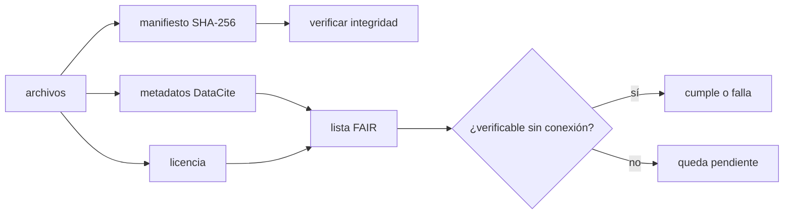

# B130-C06 — Publicación de un proyecto educativo

<!-- nav:top -->
[🏠 Programa](../../../../README.md) · [📚 Bloque B130](../../../tronco-comun/B130-comunicacion-y-divulgacion-cientifica.md) · [← Anterior: B130-C05 — Evaluación de la comprensión del público](../B130-C05-evaluacion-de-la-comprension-del-publico/CLASE.md) · [Siguiente: B131-C01 — Actividades de medición astronómica para el aula →](../../B131/B131-C01-actividades-de-medicion-astronomica-para-el-aula/CLASE.md)
<!-- /nav -->

## 1. Ubicación, nivel y alcance

Clase 6 del bloque B130. Nivel N3. Un proyecto educativo termina cuando otras personas pueden encontrarlo, reutilizarlo y comprobar que no cambió. Aquí armas un paquete en memoria, lo describes con los metadatos obligatorios de DataCite, calculas las huellas SHA-256 de sus archivos, revisas los enlaces internos y los formatos, y compruebas qué parte de los principios FAIR se puede verificar sin conexión. El paquete, los autores y el identificador son ficticios.

## 2. Por qué esta clase existe

Cerrar un proyecto educativo implica publicarlo de forma abierta y verificable; no hay otra clase al respecto. La decisión central: **¿qué debe llevar el paquete para que alguien más lo encuentre, lo reutilice legalmente y detecte una alteración, y qué de eso no puedes comprobar tú solo?**

## 3. Lo que podrás hacer al terminar

1. Completar los metadatos obligatorios de DataCite 4.5.
2. Elegir una licencia abierta y redactar la atribución que exige.
3. Calcular un manifiesto de huellas SHA-256 y detectar un cambio.
4. Revisar enlaces internos y formatos abiertos.
5. Distinguir lo que cumple, lo que falla y lo no verificable de una lista FAIR.
6. Explicar por qué «publicado» no equivale a «verificado» ni a «revisado».

La evidencia es el **paquete publicable con manifiesto de integridad** del ejercicio 12 (sección 20).

## 4. Con qué llegas y cómo comprobarlo

1. ¿Qué es un identificador persistente?
2. ¿Qué es una función hash?
3. ¿Qué es una licencia abierta?
4. ¿Qué es un formato abierto?
5. ¿Qué es un dato sintético?

<details>
<summary>Ver respuestas</summary>

1. Un nombre que sigue apuntando a lo mismo aunque cambie su dirección web. 2. Una función que convierte datos en una huella de tamaño fijo, distinta si cambian los datos. 3. Una licencia que permite reutilizar, adaptar y compartir con condiciones claras. 4. Un formato con especificación pública que se puede leer sin programa propietario. 5. Un dato generado para el ejemplo, no medido.
</details>

Con cuatro o cinco aciertos, sigue; si no, repasa los prerrequisitos.

## 5. Un caso de contexto y casos de referencia

Un paquete ilustrativo de tres archivos (`README.md`, `datos.csv`, `LICENSE.txt`) tiene los seis metadatos obligatorios. Al cambiar un solo carácter de `datos.csv`, la huella global pasa de `3fa95073…` a `ff126f01…`. Su `README.md` enlaza a `fig.png`, que no existe: un enlace roto. De los diez principios FAIR, `6` se pueden comprobar sin conexión y cumplen, y `4` no se pueden verificar sin conexión. Es el **ejemplo conductor**; todo es ficticio.

## 6. Vocabulario

Los **metadatos obligatorios** de DataCite 4.5 son Identifier, Creator, Title, Publisher, PublicationYear y ResourceType. Un **manifiesto** lista cada archivo con su huella. **SHA-256** es una función hash de 256 bits. Los **principios FAIR** piden que los datos sean encontrables, accesibles, interoperables y reutilizables. Un **recurso educativo abierto** (REA) es material de enseñanza en el dominio público o con licencia abierta que permite acceder, reutilizar, adaptar y redistribuir.

## 7. Modelo mental: el sobre lacrado



*Descripción textual:* los archivos producen un manifiesto de huellas, llevan una licencia y se describen con metadatos; la lista FAIR toma metadatos y licencia y separa lo que se puede comprobar de lo que queda pendiente.

Analogía: un sobre lacrado revela si lo abrieron, pero no dice si la carta es verdadera. Límite: la huella prueba que el archivo no cambió desde que se calculó, no que su contenido sea correcto.

## 8. La explicación, paso a paso

### 8.1 Metadatos

DataCite 4.5 marca como obligatorias seis propiedades. El laboratorio devuelve la lista de las que faltan: con todo completo, ninguna; con `Publisher` vacío, `['Publisher']`. Completar los campos no basta para que el identificador exista: `10.0000/ejemplo` no es un DOI registrado.

### 8.2 Licencia y atribución

La página oficial de Creative Commons resume que CC BY 4.0 permite compartir y adaptar para cualquier fin, también comercial, y exige dar crédito, enlazar la licencia e indicar si hubo cambios, sin sugerir el respaldo de quien licencia. ESO aplica CC BY 4.0 a sus imágenes y pide el crédito sin alterar, con enlace; su logotipo queda excluido (C01). El paquete usa una licencia para el contenido (`CC BY 4.0`) y otra para el código (`Apache-2.0`), y lo declara en `LICENSE.txt`. Esto no es asesoría legal: no se consultó el texto legal completo.

### 8.3 Integridad

| Archivo | Huella SHA-256 (16 primeros caracteres) |
|---|---|
| `LICENSE.txt` | `b829fd110fb436ec…` |
| `README.md` | `d6c55d2517dad714…` |
| `datos.csv` | `f26d1966b20757bb…` |

La huella global de este manifiesto empieza por `3fa95073…`; con un carácter distinto en `datos.csv` empieza por `ff126f01…`. Quien descargue el paquete puede recalcularlo y comparar, siempre que la huella publicada llegue por un canal que no se haya alterado.

### 8.4 Lista FAIR

| Principio | Resultado |
|---|---|
| F1 identificador · F2 metadatos ricos · F3 metadatos con el identificador | cumple |
| I1 formato abierto · I3 referencias calificadas · R1 licencia y procedencia | cumple |
| F4 · A1 · A2 · I2 | no verificable sin conexión |

Los enunciados de GO FAIR son, por ejemplo, F1 «(meta)data are assigned a globally unique and persistent identifier» y R1 «(meta)data are richly described with a plurality of accurate and relevant attributes». El laboratorio solo traduce a comprobaciones algunos de ellos con reglas de esta clase (por ejemplo, tres palabras clave); el cumplimiento real exige un repositorio con identificador registrado.

### 8.5 Publicado, verificado y revisado

Publicar es poner el paquete a disposición; verificar es poder comprobar que no cambió y que sus fuentes son rastreables; revisar es que una persona competente juzgue su contenido. Los estados del repositorio quedan en E0 hasta registrar la revisión disciplinar. La Recomendación de la UNESCO sobre REA (25 de noviembre de 2019) invita a promover el acceso inclusivo y la cooperación; no establece que un recurso abierto sea correcto.

## 9. Magnitudes, símbolos y unidades

| Símbolo | Qué es | Unidad | Valor / nota |
|---|---|---|---|
| `h` | huella SHA-256 | 64 caracteres hexadecimales | ver 8.3 |
| `n` | archivos del paquete | — | 3 (4 con la figura) |
| `m` | metadatos obligatorios | — | 6 |
| `F` | principios FAIR comprobados | — | 10 evaluados: 6, 4 |
| `año` | PublicationYear | año | 2026 (ficticio) |

## 10. Convenciones y referencias

Huellas en hexadecimal minúscula; fechas AAAA-MM-DD. El identificador `10.0000/ejemplo` es ficticio. Formatos abiertos admitidos en el laboratorio: `.md`, `.csv`, `.json`, `.txt`, `.py`, `.svg` (lista de esta clase). Sin sistema de referencia espacial.

## 11. De dónde sale lo que afirmamos

| ID | Fuente | Localizador | Respalda | Estado |
|---|---|---|---|---|
| S1 | DataCite Metadata Schema 4.5 — https://datacite-metadata-schema.readthedocs.io/en/4.5/properties/overview/ (consultada 2026-11-11) | tabla de propiedades | seis propiedades obligatorias | Consultada |
| S2 | GO FAIR, FAIR Principles — https://www.gofair.foundation/fair-principles/ (consultada 2026-11-11) | página completa | enunciados F1–F4, A1–A2, I1–I3 y R1 | Consultada |
| S3 | Creative Commons, CC BY 4.0 — https://creativecommons.org/licenses/by/4.0/ (consultada 2026-11-11) | resumen oficial | permisos y condiciones de la licencia | Consultada (resumen) |
| S4 | UNESCO, Recomendación sobre los REA — https://www.unesco.org/en/legal-affairs/recommendation-open-educational-resources-oer (consultada 2026-11-11) | página de la Recomendación | adopción el 25-11-2019; definición de REA | Consultada |
| S5 | ESO, política de imágenes — https://www.eso.org/public/outreach/copyright/ (consultada 2026-11-11) | página completa | CC BY 4.0 y crédito | Consultada |
| — | Wilkinson et al. (2016), *Scientific Data* (el artículo exigió una autenticación); texto legal de CC; norma FIPS 180 de SHA-256 | — | no se leyeron | No consultada |

Límites: el paquete es ficticio; no se registró ningún identificador ni se publicó nada; las reglas de la lista FAIR del laboratorio son traducciones de esta clase.

## 12. Cómo ver un paquete

| Elemento | Resultado |
|---|---|
| Metadatos obligatorios que faltan | ninguno |
| Huella global | `3fa95073…` → `ff126f01…` tras un cambio |
| Enlaces internos rotos | `README.md` → `fig.png` |
| FAIR | 6 cumplen, 4 no verificables, 0 fallan |

Descripción larga: el paquete es íntegro y completo en lo que se puede comprobar sin conexión, tiene un enlace roto antes de añadir la figura, y deja cuatro principios pendientes de un repositorio real.

## 13. Ejemplo trabajado: detectar la alteración

**Paso 1 · Huellas originales.** Se calcula una por archivo y se ordenan por nombre.

**Paso 2 · Huella global.** SHA-256 del manifiesto serializado: `3fa95073…`.

**Paso 3 · Cambio.** `datos.csv` pasa de `2,0.7` a `2,0.8`.

**Paso 4 · Nueva huella.** `ff126f01…`: distinta, la alteración se detecta.

## 14. Distintas formas de publicar

**Repositorio de código:** versiones y etiquetas. **Repositorio de datos con DOI:** identificador persistente. **Página web:** fácil de leer, difícil de verificar sin huellas. **Archivo comprimido:** una sola huella. En todas, licencia, metadatos y manifiesto dentro del paquete.

## 15. Práctica guiada

**Ejercicio 1 · con los pasos indicados.** ¿Qué metadatos faltan si un registro tiene Identifier, Title y Publisher? *Pasos:* compara con las seis obligatorias.

<details><summary>Solución comentada</summary>

Faltan Creator, PublicationYear y ResourceType.
</details>

**Ejercicio 2 · con una pista.** ¿Qué elementos de atribución exige CC BY 4.0? *Pista:* crédito, licencia, cambios.

<details><summary>Solución comentada</summary>

Dar crédito apropiado, enlazar la licencia, indicar si se modificó el material y no sugerir respaldo.
</details>

**Ejercicio 3 · casi autónomo.** ¿Por qué cambiar un byte cambia toda la huella?

<details><summary>Solución comentada</summary>

Porque una función hash está diseñada para que un cambio mínimo produzca una huella distinta.
</details>

## 16. Práctica autónoma, transferencia e integrador

**Ejercicio 4 · autónomo.** ¿Cuántos caracteres hexadecimales tiene una huella SHA-256?

<details><summary>Solución comentada</summary>

`256/4 = 64`.
</details>

**Ejercicio 5 · autónomo.** Corrige el enlace roto del paquete.

<details><summary>Solución comentada</summary>

Añadir `fig.svg` y apuntar el `README.md` a él, o quitar el enlace. Con la figura SVG los enlaces rotos son `[]`.
</details>

**Ejercicio 6 · autónomo.** ¿Qué principio FAIR no puedes comprobar sin conexión y por qué?

<details><summary>Solución comentada</summary>

F4 (indexado), A1 (recuperable), A2 y I2: dependen de un servicio externo.
</details>

**Ejercicio 7 · autónomo.** ¿Qué licencia pondrías al código y cuál al texto?

<details><summary>Solución comentada</summary>

Una licencia de código (por ejemplo, Apache-2.0) y una de contenido (por ejemplo, CC BY 4.0); se declaran por separado.
</details>

**Ejercicio 8 · autónomo.** Redacta la atribución para una imagen de ESO modificada.

<details><summary>Solución comentada</summary>

El crédito exacto de la imagen, el enlace en línea, «CC BY 4.0», «modificada: recorte» e indicar si se usó IA; sin sugerir respaldo de ESO.
</details>

**Ejercicio 9 · transferencia.** **Transferencia.** Un colega publica los archivos pero no la huella. ¿Qué ganaste y qué te falta?

<details><summary>Solución comentada</summary>

Sin huella publicada por un canal separado no puedes comprobar que el archivo es el original.
</details>

**Ejercicio 10 · transferencia.** **Transferencia.** Tu proyecto incluye fotos de estudiantes. ¿Qué cambias antes de publicar?

<details><summary>Solución comentada</summary>

Obtienes consentimiento, anonimizas o las retiras; esta clase no consultó la normativa de datos personales.
</details>

**Ejercicio 11 · transferencia.** **Transferencia.** Un documento dice «publicado en abierto, por lo tanto verificado». ¿Qué respondes?

<details><summary>Solución comentada</summary>

Abrir el acceso no verifica contenido ni integridad; faltan las huellas, la revisión disciplinar y el registro de fuentes (8.5).
</details>

**Ejercicio 12 · integrador.** **Integrador.** Elabora tu *paquete publicable con manifiesto de integridad*: archivos, metadatos obligatorios, licencia, manifiesto SHA-256, revisión de enlaces y formatos, lista FAIR y qué no se verificó.

<details><summary>Solución comentada</summary>

Secciones 8.1–8.5 y la salida del laboratorio.
</details>

## 17. Laboratorio: paquete verificable

El script [paquete.py](paquete.py) comprueba los metadatos obligatorios, calcula el manifiesto SHA-256, detecta una alteración, revisa enlaces y formatos y evalúa la lista FAIR comprobable sin conexión (**comprueba** el vector de prueba SHA-256 de `abc`, que un carácter distinto cambia la huella y que el recuento es `6` cumplen y `4` no verificables).

**Datos:** esquema DataCite, principios FAIR y licencias (consultados el 2026-11-11); archivos, autores e identificador **ficticios**. **Predice antes de ejecutar:** ¿cuántos enlaces rotos tiene el paquete inicial? (1: `fig.png`.) **Ejecución del 2026-11-11 (Python 3.12.9):**

```text
Python 3.12.9 (biblioteca estandar)
Vector de prueba SHA-256 de b'abc': correcto.
Metadatos obligatorios (DataCite 4.5) que faltan: ninguno
  con Publisher vacio faltan: ['Publisher']
Manifiesto SHA-256 (archivos SINTETICOS):
  LICENSE.txt  b829fd110fb436ec...
  README.md    d6c55d2517dad714...
  datos.csv    f26d1966b20757bb...
Huella global: 3fa95073cfab73a6...
Huella global tras cambiar un caracter de datos.csv: ff126f01e0ffb931... -> distinta
Enlaces internos rotos: [('README.md', 'fig.png')]
Formatos no abiertos en el paquete: ninguno
Lista FAIR (sobre lo comprobable sin conexion):
  F1 identificador                         cumple
  F2 metadatos ricos                       cumple
  F3 metadatos con el identificador        cumple
  F4 indexado en un buscador               no verificable sin conexion
  A1 recuperable por protocolo estandar    no verificable sin conexion
  A2 metadatos aun sin datos               no verificable sin conexion
  I1 formato abierto                       cumple
  I2 vocabularios FAIR                     no verificable sin conexion
  I3 referencias calificadas               cumple
  R1 licencia y procedencia                cumple
Resumen: 6 cumplen, 4 no verificables sin conexion, 0 fallan de 10
Pruebas superadas.
```

```bash
python programa/clases/B130/B130-C06-publicacion-de-un-proyecto-educativo/paquete.py
```

**Límites:** el paquete está en memoria; el identificador no existe; las reglas FAIR son aproximaciones de esta clase; la huella no prueba que el contenido sea correcto.

## 18. Errores frecuentes y cómo corregirlos

**Dar por registrado un identificador de ejemplo.** Se corrige con 8.1.

**Publicar sin licencia o con una sin atribución.** Se corrige con 8.2.

**Publicar la huella junto al archivo por el mismo canal sin más cuidado.** Se corrige con 8.3.

**Confundir abierto con verificado o revisado.** Se corrige con 8.5.

## 19. Cómo sabrás que vas bien

Tras la sección 8: ¿cuántos principios FAIR esperabas verificar sin conexión y cuántos obtuviste? Si dudas, repasa el ejemplo 13. Tras el laboratorio: ¿qué comprueba y qué no? (ver la sección 17).

## 20. Qué entregas y cómo se evalúa

El producto es tu **paquete publicable con manifiesto de integridad** (ejercicio 12).

| Criterio | Inicial | En desarrollo | Logrado | Destacado |
|---|---|---|---|---|
| Conceptos | Los confunde | Parciales | Distingue abierto, verificado y revisado | Explica los límites |
| Cálculo | Sin unidades | Con errores | Manifiesto y huella correctos | Detecta una alteración |
| Numérico | Sin comprobar | Un caso | Revisa enlaces y formatos | Interpreta lo no verificable |
| Fuentes | Sin fuente | Sin fecha | Fuentes con fecha y estado | Declara lo ficticio y lo no consultado |
| Límites | No los nombra | Uno | Tres | Discute qué no prueba una huella |

**Condiciones críticas (no se compensan con promedio):** rotular lo ficticio; no presentar un identificador de ejemplo como registrado; no confundir publicado con revisado; citar solo lo consultado.

## 21. Ética, seguridad y límites

Clase educativa: el paquete es ficticio y nada se publicó. No es asesoría legal ni de protección de datos; antes de publicar un proyecto real, revisa la licencia de cada parte y el consentimiento de las personas que aparezcan. Una huella no sustituye a la revisión. Accesibilidad: tablas equivalentes a las gráficas, fórmulas en texto, ejercicios sin conexión y formatos abiertos.

## 22. Para cerrar y seguir

Un paquete con seis metadatos, licencia, manifiesto y enlaces sin romper cumple `6` de `10` principios FAIR comprobables sin conexión y deja `4` pendientes de un repositorio real. Con esto cierra el bloque: fuente en la pieza (C01–C02), mensaje al público (C03–C04), medición (C05) y publicación (C06).

**Glosario español–inglés.** manifiesto · *manifest*; huella · *checksum / hash*; recurso educativo abierto · *open educational resource*; metadatos · *metadata*; atribución · *attribution*.

**Continuidad.** Vuelve al [bloque B130](../../../tronco-comun/B130-comunicacion-y-divulgacion-cientifica.md).

**Referencias:** ver sección 11.

<!-- nav:bottom -->
---

[← Anterior: B130-C05 — Evaluación de la comprensión del público](../B130-C05-evaluacion-de-la-comprension-del-publico/CLASE.md) · [📚 Bloque B130](../../../tronco-comun/B130-comunicacion-y-divulgacion-cientifica.md) · [Siguiente: B131-C01 — Actividades de medición astronómica para el aula →](../../B131/B131-C01-actividades-de-medicion-astronomica-para-el-aula/CLASE.md)
<!-- /nav -->
