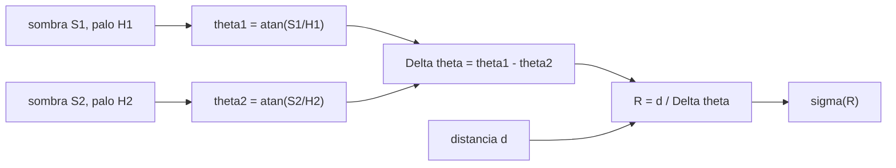

# B131-C01 — Actividades de medición astronómica para el aula

<!-- nav:top -->
[🏠 Programa](../../../../README.md) · [📚 Bloque B131](../../../tronco-comun/B131-didactica-de-la-astronomia.md) · [← Anterior: B130-C06 — Publicación de un proyecto educativo](../../../tronco-comun/B130-comunicacion-y-divulgacion-cientifica.md#b130-c06) · [Siguiente: B131-C02 — Resultados de aprendizaje observables en astronomía →](../B131-C02-resultados-de-aprendizaje-observables-en-astronomia/CLASE.md)
<!-- /nav -->

## 1. Ubicación, nivel y alcance

Clase 1 del bloque B131. Nivel N4. Una actividad de medición es la forma más directa de que el estudiante vea que la astronomía se hace con datos con error. Aquí tomas una actividad clásica, el radio de la Tierra con la sombra de un gnomon en dos lugares, la analizas con **datos de sombra publicados por una escuela** y le añades lo que suele faltar en el aula: la incertidumbre y su propagación. Usas [B132](../../../tronco-comun/B132-historia-y-arqueoastronomia-aplicadas.md) solo como contexto histórico de Eratóstenes. **Esta clase es educativa; la observación del Sol exige las precauciones de la sección 21.**

## 2. Por qué esta clase existe

El catálogo no tenía clases de didáctica. La decisión central de esta: **¿qué debe llevar una actividad de medición para que enseñe a medir y no solo a calcular un número?**

## 3. Lo que podrás hacer al terminar

1. Calcular el ángulo solar a partir de la sombra de un gnomon, `θ = atan(S/H)`.
2. Calcular el radio de la Tierra con dos sitios, `R = d / Δθ`, y compararlo con el valor nominal de la IAU.
3. Propagar la incertidumbre de la sombra y de la distancia hasta el radio.
4. Contrastar la propagación lineal con una simulación Monte Carlo y explicar su diferencia.
5. Interpretar la dispersión de un aula **sintética** de 20 grupos y elegir entre media y mediana.
6. Separar lo consultado (datos de sombra, constante IAU) de lo ilustrativo (incertidumbres) y de lo simulado (el aula).

La evidencia es la **ficha de medición con incertidumbre** del ejercicio 12 (sección 20).

## 4. Con qué llegas y cómo comprobarlo

1. ¿Qué es la latitud?
2. ¿Qué es la tangente de un ángulo en un triángulo rectángulo?
3. ¿Qué es la desviación estándar?
4. ¿Qué es el mediodía solar local?
5. ¿Por qué no se debe mirar al Sol sin filtro certificado?

<details>
<summary>Ver respuestas</summary>

1. El ángulo norte o sur de un lugar respecto del ecuador. 2. El cociente entre el cateto opuesto y el adyacente. 3. Una medida de la dispersión de los valores alrededor de su media. 4. El instante en que el Sol cruza el meridiano del lugar y la sombra es más corta. 5. Porque su luz puede dañar la retina de forma permanente.
</details>

Con cuatro o cinco aciertos, sigue; si no, repasa los prerrequisitos.

## 5. Un caso de contexto y casos de referencia

El proyecto *Eratosthenes Experiment* (Ellinogermaniki Agogi, Grecia) propone que pares de escuelas en un mismo meridiano midan al mediodía solar la sombra de un palo de un metro. El **ejemplo conductor** usa la presentación de ESA/CESAR del 21 de marzo de 2018: una escuela de Caude (40,45 ° N) y otra de Granada (37,17 ° N), separadas 365 km. Con las latitudes teóricas la presentación obtiene `R = 6376 km`. Con las **sombras medidas** (86,0 y 83,9 cm en Caude con un palo de 100 cm; 76,5 cm en Granada con un palo de 101 cm) este laboratorio obtiene `R = 6525 km`, un `+2,3 %` sobre el radio ecuatorial nominal de la IAU (`6378,1 km`).

## 6. Vocabulario

El **gnomon** es una vara vertical cuya sombra marca la altura del Sol. El **ángulo cenital** `θ` es el que forma el Sol con la vertical: `tan θ = S/H`. La **incertidumbre** `σ` cuantifica cuánto puede diferir una medida de su valor verdadero. La **propagación** de incertidumbres traslada `σ` de las medidas al resultado. Una simulación **Monte Carlo** repite el cálculo con medidas perturbadas al azar. El **error estándar** es `σ/√n`.

## 7. Modelo mental: dos sombras, un arco



*Descripción textual:* cada sombra da un ángulo; la diferencia de ángulos es el arco de meridiano entre los sitios; dividir la distancia entre el arco da el radio.

Analogía: medir el tamaño de una pelota midiendo cuánto se curva una cinta pegada a ella. Límite: el método supone Tierra esférica, mismo meridiano y Sol en el ecuador celeste (equinoccio).

## 8. La explicación, paso a paso

### 8.1 Sombra a ángulo

Con `H = 100 cm` y `S = 86,0 cm`: `θ = atan(0,86) = 40,6955 °`. Con `S = 83,9 cm`: `39,9966 °`. En Granada, `76,5/101` da `37,1412 °`. En el equinoccio el ángulo cenital coincide con la latitud, de modo que la sombra teórica es `H tan φ`: `85,26 cm` en Caude y `76,58 cm` en Granada (la presentación da 85,25 y 76,57).

### 8.2 Radio

El promedio de Caude es `40,3461 °`; `Δθ = 3,2049 °`; `R = 365 / (3,2049 × π/180) = 6525 km`. Con las latitudes teóricas el resultado es `6376 km`. Una diferencia de apenas `0,075 °` en `Δθ` (3,28 ° teórico frente a 3,2049 ° medido) mueve el radio un `2,3 %` respecto del teórico.

### 8.3 Incertidumbre

Con una incertidumbre **ilustrativa** de `1,0 cm` por lectura de sombra y `5 km` en la distancia: `σθ(Caude) = 0,235 °` (promedio de dos lecturas), `σθ(Granada) = 0,360 °`, `σΔθ = 0,430 °` y `σR = 881 km`, es decir `13,5 %`. La simulación Monte Carlo (200 000 muestras) da `951 km`: la propagación lineal subestima un `7 %` porque `R = d/Δθ` es no lineal cuando `Δθ` es pequeño y su error relativo es grande.

### 8.4 Un aula sintética

Con 20 grupos **simulados** que leen una vez cada sombra con ruido de `1 cm`: media `6672 km`, desviación `1521 km`, error estándar `340 km`; mediana `6266 km`, mínimo `5059`, máximo `11057`. El valor extremo sale de un `Δθ` casi nulo en una pareja de lecturas. La mediana resiste mejor ese caso.

### 8.5 Sensibilidad

Errar `0,1 °` en `Δθ` cambia el radio un `3,1 %`. Con sitios más separados `Δθ` crece y el error relativo baja: separar los sitios es una decisión de diseño.

## 9. Magnitudes, símbolos y unidades

| Símbolo | Qué es | Unidad | Valor / nota |
|---|---|---|---|
| `S` | longitud de la sombra | cm | 86,0; 83,9; 76,5 |
| `H` | altura del gnomon | cm | 100; 101 |
| `θ` | ángulo cenital | ° | 40,35 y 37,14 |
| `d` | distancia entre sitios | km | 365 |
| `R` | radio de la Tierra | km | 6525 (medido); 6378,1 (nominal) |
| `σS` | incertidumbre de la sombra | cm | 1,0 (ilustrativa) |

## 10. Convenciones y referencias

Ángulos en grados; en la fórmula `R = d/Δθ`, `Δθ` va en radianes (`× π/180`). Referencia: radio ecuatorial nominal `6,3781 × 10⁶ m` (IAU 2015, Resolución B3), un factor de conversión exacto, no una medición. Supuestos: equinoccio, mismo meridiano, Tierra esférica.

## 11. De dónde sale lo que afirmamos

| ID | Fuente | Localizador | Respalda | Estado |
|---|---|---|---|---|
| S1 | CESAR/ESA, «Eratosthenes experiment», Caude, 2018-03-21 — https://cesar.esa.int/upload/201808/eratosthenescaude21mar2018_v2_03apr2018.pdf (consultada 2026-11-11, PDF leído con PyMuPDF) | diapositivas de geometría y mediciones | latitudes, distancia 365 km, palos de 100 y 101 cm, sombras 86,0; 83,9 y 76,5 cm, resultado teórico 6376 km | Consultada |
| S2 | IAU, Resolución B3 (2015), PDF leído con PyMuPDF (consultada 2026-11-11) — https://www.iau.org/common/Uploaded%20files/IAUGA2015-Resolution-B3-recommended-nominal-conversion.pdf | tabla de constantes planetarias | `R_eE = 6,3781 × 10⁶ m` nominal | Consultada |
| S3 | Eratosthenes Experiment — https://eratosthenes.ea.gr/ (consultada 2026-11-11) | página principal | pares de escuelas en el mismo meridiano miden al mediodía solar la sombra de un palo de 1 m | Consultada |
| S4 | IAU Office of Astronomy for Education — https://astro4edu.org/ (consultada 2026-11-11) | página principal | la OAE ofrece materiales de aula abiertos y guías para docentes | Consultada |
| — | Propagación de errores y Monte Carlo | — | cálculo de `σR`; contrastado entre sí | No consultadas en una fuente concreta |
| — | Incertidumbres `σS`, `σd` y el aula de 20 grupos | — | todo el análisis de error | Ilustrativo / simulado |

Límites: los datos de sombra son de **una** actividad y de pocas lecturas; la presentación no declara incertidumbres, por eso las nuestras son ilustrativas; el aula de 20 grupos no se observó.

## 12. Cómo ver la medición

| Magnitud | Valor |
|---|---|
| `Δθ` medido | 3,2049 ° |
| `R` medido | 6525 km |
| `σR` lineal / Monte Carlo | 881 / 951 km |
| error estándar del aula sintética | 340 km |

Descripción larga: el resultado medido cae cerca del valor nominal, pero su incertidumbre es del orden del 13 %, mucho mayor que el `2,3 %` de diferencia: no se puede decir que esté «mejor» o «peor» que otro sin ella.

## 13. Ejemplo trabajado: del palo al radio

**Paso 1 · Ángulos.** `atan(0,86) = 40,70 °`, `atan(0,839) = 40,00 °`; promedio `40,35 °`. `atan(76,5/101) = 37,14 °`.

**Paso 2 · Arco.** `Δθ = 3,2049 °`.

**Paso 3 · Radio.** `365 / 0,055936 = 6525 km`.

**Paso 4 · Incertidumbre.** `σΔθ = 0,430 °`; `σR/R = √((0,430/3,2049)² + (5/365)²) = 13,5 %`.

## 14. Distintas formas de describir la medición

**Por geometría:** triángulo sombra–palo. **Por fórmula:** `R = d/Δθ`. **Por incertidumbre:** `σ` lineal y Monte Carlo. **Por aula:** media, mediana y error estándar. **Por riesgo:** gnomon sí, mirar al Sol no.

## 15. Práctica guiada

**Ejercicio 1 · con los pasos indicados.** Calcula el ángulo de la sombra de 86,0 cm con un palo de 100 cm. *Pasos:* cociente y arcotangente.

<details><summary>Solución comentada</summary>

`atan(0,86) = 40,6955 °`.
</details>

**Ejercicio 2 · con una pista.** Calcula `R` con `Δθ = 3,2049 °` y `d = 365 km`. *Pista:* pasa grados a radianes.

<details><summary>Solución comentada</summary>

`3,2049 × π/180 = 0,055936`; `R = 365/0,055936 = 6525 km`.
</details>

**Ejercicio 3 · casi autónomo.** Calcula la circunferencia terrestre que implica ese radio.

<details><summary>Solución comentada</summary>

`2π × 6525 = 40 998 km`.
</details>

## 16. Práctica autónoma, transferencia e integrador

**Ejercicio 4 · autónomo.** ¿Qué sombra da un palo de 100 cm en el equinoccio a 40,45 ° N?

<details><summary>Solución comentada</summary>

`100 × tan 40,45 ° = 85,26 cm`.
</details>

**Ejercicio 5 · autónomo.** ¿Cuánto vale `σθ` en Granada si `σS = 1 cm`?

<details><summary>Solución comentada</summary>

`H/(H² + S²) σS = 101/(101² + 76,5²) = 0,00629 rad = 0,360 °`.
</details>

**Ejercicio 6 · autónomo.** ¿Cuántos grupos independientes harían falta para un error estándar de 100 km si la dispersión por grupo es 1521 km?

<details><summary>Solución comentada</summary>

`n = (1521/100)² ≈ 231`. Es una extrapolación de un aula **sintética**.
</details>

**Ejercicio 7 · autónomo.** ¿Qué parte de `σR/R` aporta la distancia (`5 km`)?

<details><summary>Solución comentada</summary>

`5/365 = 1,4 %`, frente a `13,4 %` del ángulo: domina el ángulo.
</details>

**Ejercicio 8 · autónomo.** ¿Cómo cambia el error relativo del radio por errar `0,1 °` si los sitios se separan hasta `Δθ = 6,4 °`?

<details><summary>Solución comentada</summary>

`0,1/6,4 = 1,6 %`, la mitad que con `3,2 °`.
</details>

**Ejercicio 9 · transferencia.** **Transferencia.** La actividad exige el equinoccio. ¿Qué ajuste necesitarías en otra fecha?

<details><summary>Solución comentada</summary>

Corregir con la declinación del Sol: `θ = φ − δ`; sin esa corrección el radio sale sesgado.
</details>

**Ejercicio 10 · transferencia.** **Transferencia.** En el aula sintética un grupo da `11 057 km`. ¿Lo descartas o lo analizas?

<details><summary>Solución comentada</summary>

Lo analizas: puede venir de lecturas casi iguales (`Δθ` casi nulo); descartarlo sin criterio ocultaría el efecto no lineal. Se reporta con y sin él y se usa la mediana.
</details>

**Ejercicio 11 · transferencia.** **Transferencia.** ¿Por qué esta actividad es segura aunque trate del Sol y qué no debe añadirse?

<details><summary>Solución comentada</summary>

Porque solo se mira la sombra, no el Sol; no debe añadirse observación directa ni con instrumentos sin filtro certificado.
</details>

**Ejercicio 12 · integrador.** **Integrador.** Elabora tu *ficha de medición con incertidumbre*: datos con unidades, método, `R`, `σR` por dos vías, aula con media y mediana, comparación con el valor nominal y lista de qué es consultado, ilustrativo y simulado.

<details><summary>Solución comentada</summary>

Secciones 8.1–8.5 y la salida del laboratorio.
</details>

## 17. Laboratorio: dos sombras y un radio

El script [eratostenes.py](eratostenes.py) calcula ángulos, radio, `σR` lineal y Monte Carlo, y un aula sintética (**comprueba** la sombra teórica de la presentación, el radio teórico 6376 km y que la propagación lineal coincide con Monte Carlo dentro del 10 %).

**Datos:** sombras, latitudes y distancia **consultados** (S1); constante IAU **consultada** (S2); incertidumbres **ilustrativas**; aula **simulada**. **Predice antes de ejecutar:** ¿el radio medido quedará más cerca o más lejos del nominal que el teórico de 6376 km? (más lejos, +2,3 %). **Ejecución del 2026-11-11 (Python 3.12.9):**

```text
Python 3.12.9 (biblioteca estandar)
Datos de sombra CONSULTADOS (CESAR/ESA 2018); incertidumbres ILUSTRATIVAS; el aula SINTETICA es simulada, no observada.
Sombra teorica: Caude 85.26 cm (presentacion 85.25) ; Granada 76.58 cm (presentacion 76.57)
Radio con las latitudes teoricas: 6376 km (presentacion 6376)
Angulos de las lecturas: Caude 40.6955, 39.9966 ; Granada 37.1412 (grados)
Delta theta = 3.2049 deg ; R medido = 6525 km ; error frente a nominal = +2.3 %
sigma(theta_Caude) = 0.235 deg ; sigma(theta_Granada) = 0.360 deg ; sigma(R) lineal = 881 km (13.5 %)
Monte Carlo (200000): sigma(R) = 951 km ; lineal/MC = 0.926
Aula SINTETICA (20 grupos, 1 lectura por sitio): media 6672 km ; desv. 1521 km ; error estandar 340 km
  mediana 6266 km ; minimo 5059 ; maximo 11057
Sensibilidad: error de R al errar 0.1 deg en Delta theta -> 3.1 %
Pruebas superadas.
```

```bash
python programa/clases/B131/B131-C01-actividades-de-medicion-astronomica-para-el-aula/eratostenes.py
```

**Límites:** tres lecturas de una sola jornada; incertidumbres supuestas; Tierra esférica y mismo meridiano (Caude y Granada difieren unos 17′ de longitud).

## 18. Errores frecuentes y cómo corregirlos

**Dar el resultado sin incertidumbre.** Se corrige con 8.3.

**Usar grados donde se piden radianes.** Se corrige con la sección 10.

**Comparar dos resultados por su diferencia sin mirar `σ`.** Se corrige con la sección 12.

**Descartar el valor extremo sin analizarlo.** Se corrige con el ejercicio 10.

## 19. Cómo sabrás que vas bien

Tras la sección 8: ¿qué radio esperabas con `Δθ = 3,2 °` y cuál obtuviste? Si dudas, repasa el ejemplo 13. Tras el laboratorio: ¿qué comprueba? (ver la sección 17).

## 20. Qué entregas y cómo se evalúa

El producto es tu **ficha de medición con incertidumbre** (ejercicio 12).

| Criterio | Inicial | En desarrollo | Logrado | Destacado |
|---|---|---|---|---|
| Conceptos | Los confunde | Parciales | Calcula ángulo y radio | Explica los supuestos |
| Cálculo | Sin unidades | Con errores | Con unidades y `σ` | Calcula casos nuevos |
| Numérico | Sin comprobar | Una vía | Lineal frente a Monte Carlo | Interpreta la diferencia |
| Fuentes | Sin fuente | Sin fecha | Fuentes con fecha y estado | Declara lo ilustrativo y lo simulado |
| Límites | No los nombra | Uno | Tres | Discute qué falta del método |

**Condiciones críticas (no se compensan con promedio):** dar `σ` con cada resultado; rotular lo simulado como no observado; no mirar al Sol sin filtro certificado.

## 21. Ética, seguridad y límites

Clase educativa. **Nunca mires el Sol directamente ni con instrumentos**; la actividad solo requiere la sombra. Cualquier actividad de observación solar con proyección o filtros requiere material certificado y supervisión, y está fuera de esta clase. Los datos del aula son sintéticos y no describen a estudiantes reales. Accesibilidad: tablas equivalentes a las figuras, fórmulas en texto, ejercicios sin conexión.

## 22. Para cerrar y seguir

Dos sombras dan `R = 6525 km`, un `+2,3 %` sobre el nominal, con una incertidumbre del `13,5 %`: sin ella no hay conclusión. Queda una pregunta: ¿qué resultado de aprendizaje justifica esta actividad?

**Glosario español–inglés.** gnomon · *gnomon*; ángulo cenital · *zenith angle*; propagación de incertidumbres · *error propagation*; error estándar · *standard error*; mediana · *median*.

**Continuidad.** [B131-C02](../B131-C02-resultados-de-aprendizaje-observables-en-astronomia/CLASE.md) enseña a redactar resultados de aprendizaje observables.

**Referencias:** ver sección 11.

<!-- nav:bottom -->
---

[← Anterior: B130-C06 — Publicación de un proyecto educativo](../../../tronco-comun/B130-comunicacion-y-divulgacion-cientifica.md#b130-c06) · [📚 Bloque B131](../../../tronco-comun/B131-didactica-de-la-astronomia.md) · [Siguiente: B131-C02 — Resultados de aprendizaje observables en astronomía →](../B131-C02-resultados-de-aprendizaje-observables-en-astronomia/CLASE.md)
<!-- /nav -->
