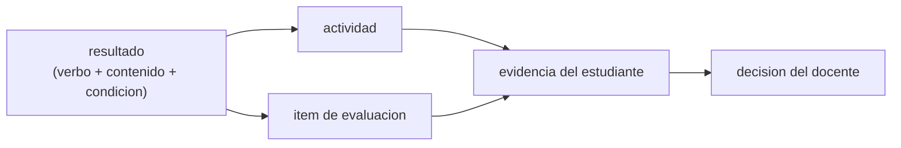

# B131-C02 — Resultados de aprendizaje observables en astronomía

<!-- nav:top -->
[🏠 Programa](../../../../README.md) · [📚 Bloque B131](../../../tronco-comun/B131-didactica-de-la-astronomia.md) · [← Anterior: B131-C01 — Actividades de medición astronómica para el aula](../B131-C01-actividades-de-medicion-astronomica-para-el-aula/CLASE.md) · [Siguiente: B131-C03 — Conocimientos previos y concepciones alternativas →](../B131-C03-conocimientos-previos-y-concepciones-alternativas/CLASE.md)
<!-- /nav -->

## 1. Ubicación, nivel y alcance

Clase 2 del bloque B131. Nivel N4. Un resultado de aprendizaje es lo que el estudiante podrá **hacer** al terminar y que tú puedes **observar**. Aquí aprendes a redactarlos con verbos observables, a asignarles un nivel cognitivo y a comprobar que cada uno tiene una actividad y un ítem de evaluación que lo mide. Retomas la actividad de [B131-C01](../B131-C01-actividades-de-medicion-astronomica-para-el-aula/CLASE.md) como ejemplo. **Esta clase es educativa; no valida un currículo oficial.**

## 2. Por qué esta clase existe

Sin resultados observables, una actividad no se puede evaluar. La decisión central: **¿este enunciado dice algo que pueda verse que el estudiante hace?**

## 3. Lo que podrás hacer al terminar

1. Distinguir un verbo observable (`calcular`) de uno que no lo es (`comprender`).
2. Asignar un nivel cognitivo ilustrativo (1 recordar … 6 crear).
3. Reescribir un resultado no observable en uno observable.
4. Construir la matriz resultado–actividad–ítem y detectar resultados huérfanos.
5. Detectar el desajuste entre el nivel del resultado y el del ítem.
6. Separar lo consultado (nada numérico) de lo ilustrativo (listas y niveles) y de lo sintético (diez resultados).

La evidencia es tu **lista revisada de resultados de aprendizaje** del ejercicio 12 (sección 20).

## 4. Con qué llegas y cómo comprobarlo

1. ¿Qué es un objetivo de una clase?
2. ¿Qué es una actividad de aprendizaje?
3. ¿Qué es un ítem de evaluación?
4. ¿Qué es una matriz de doble entrada?
5. ¿Qué diferencia hay entre recordar y aplicar?

<details>
<summary>Ver respuestas</summary>

1. Lo que se pretende que el estudiante logre. 2. Lo que el estudiante hace para lograrlo. 3. Una pregunta o tarea que mide un resultado. 4. Una tabla que cruza dos listas. 5. Recordar repite un dato; aplicar lo usa en una situación nueva.
</details>

Con cuatro o cinco aciertos, sigue; si no, repasa los prerrequisitos.

## 5. Un caso de contexto y casos de referencia

La Oficina de Astronomía para la Educación de la IAU (OAE) publica materiales de aula abiertos y guías para docentes; este bloque no reproduce ninguno. El **ejemplo conductor** es un conjunto **sintético** de diez resultados de una unidad de astronomía básica, cinco actividades y siete ítems. Tres resultados («Comprender la gravitación universal», «Conocer la historia de la astronomía», «Apreciar la belleza del cielo nocturno») no se pueden observar; los otros siete sí. Todo es **ilustrativo**.

## 6. Vocabulario

Un **resultado de aprendizaje** es un enunciado de lo que el estudiante será capaz de hacer. Es **observable** si su verbo describe una acción visible o evaluable. El **nivel cognitivo** ordena la exigencia: recordar, comprender, aplicar, analizar, evaluar, crear. La **alineación** es la correspondencia entre resultado, actividad e ítem. Un resultado **huérfano** no tiene actividad o no tiene ítem.

## 7. Modelo mental: una cadena de tres eslabones



*Descripción textual:* cada resultado debe tener al menos una actividad que lo ejercite y un ítem que lo mida; de esa evidencia sale una decisión.

Analogía: un plano de instalación: cada punto de luz (resultado) necesita su cable (actividad) y su interruptor (ítem). Límite: un verbo observable no garantiza un buen resultado; el contenido y la condición también cuentan.

## 8. La explicación, paso a paso

### 8.1 Verbos

Un resultado bien formado tiene **verbo observable + contenido + condición o criterio**: «Calcular la distancia a un asteroide a partir de su paralaje». Verbos no observables como `comprender`, `saber`, `conocer`, `apreciar` no dicen qué hacer. La lista del laboratorio es **ilustrativa**.

### 8.2 Revisión del conjunto

El laboratorio revisa los diez resultados: siete observables y tres a reescribir (`R2`, `R5`, `R9`). Los niveles: `R1` calcular (3), `R3` explicar (2), `R4` identificar (1), `R6` diseñar (6), `R7` comparar (4), `R8` justificar (5), `R10` estimar (3).

### 8.3 Cobertura

Cada resultado observable tiene al menos una actividad y un ítem: `R7` tiene dos actividades y un ítem, los demás una y una. Ningún observable queda huérfano. La cobertura se calcula con una matriz y con conjuntos y ambas coinciden.

### 8.4 Desajuste de nivel

`I5` mide `R7` en nivel 3 (calcular) pero el resultado pide comparar (nivel 4); `I6` mide `R8` en nivel 3 pero el resultado pide justificar (nivel 5). Son 2 desajustes: el ítem es más fácil que el resultado y sobreestima el logro.

### 8.5 Reescritura de los no observables

`R2` → «Calcular la fuerza gravitatoria entre dos cuerpos con la ley de Newton». `R5` → «Ordenar en una línea de tiempo cinco hitos de la astronomía y describir uno». `R9` es una actitud: se observa con conductas («Registrar el cielo de una noche en una bitácora con fecha y hora»).

## 9. Magnitudes, símbolos y unidades

| Símbolo | Qué es | Unidad | Valor / nota |
|---|---|---|---|
| `N` | resultados del conjunto | — | 10 |
| `N_obs` | resultados observables | — | 7 |
| nivel | nivel cognitivo ilustrativo | 1–6 | `R1`: 3 |
| desajuste | ítem con nivel menor que el resultado | — | 2 |

## 10. Convenciones y referencias

Los niveles 1–6 son una convención del curso inspirada en las taxonomías de objetivos y **no** se tomaron de una fuente concreta. La lista de verbos es solo ilustrativa y está en español sin tildes en el script.

## 11. De dónde sale lo que afirmamos

| ID | Fuente | Localizador | Respalda | Estado |
|---|---|---|---|---|
| S1 | IAU Office of Astronomy for Education — https://astro4edu.org/ (consultada 2026-11-11) | página principal | la OAE ofrece materiales de aula abiertos y guías para docentes | Consultada |
| — | Taxonomías de objetivos de aprendizaje (niveles 1–6) | — | los niveles ilustrativos | No consultada |
| — | Los diez resultados, cinco actividades y siete ítems | — | todo el ejemplo | Sintético / ilustrativo |

Límites: no se consultó ninguna taxonomía; el análisis es léxico, de la primera palabra del enunciado, y no entiende el significado.

## 12. Cómo ver la alineación

| Magnitud | Valor |
|---|---|
| observables | 7 de 10 |
| huérfanos | 0 |
| desajustes de nivel | 2 (`I5`, `I6`) |

Descripción larga: la alineación es buena en cobertura pero débil en nivel: los ítems de comparar y justificar miden solo cálculo.

## 13. Ejemplo trabajado: reparar `R8`

**Paso 1 · Verbo.** `justificar` → nivel 5.

**Paso 2 · Ítem.** `I6` mide nivel 3.

**Paso 3 · Reparación.** Cambiar el ítem a «Elige una escala para un modelo del Sistema Solar y justifica en dos frases qué distorsiona».

**Paso 4 · Re-chequeo.** El nuevo ítem es de nivel 5; el desajuste desaparece.

## 14. Distintas formas de describir un resultado

**Por verbo:** observable o no. **Por nivel:** 1–6. **Por evidencia:** qué producto lo demuestra. **Por cobertura:** actividades e ítems. **Por actitud:** conducta observable en lugar de «apreciar».

## 15. Práctica guiada

**Ejercicio 1 · con los pasos indicados.** Clasifica «Comprender la gravitación universal». *Pasos:* toma el verbo y compáralo con la lista.

<details><summary>Solución comentada</summary>

`comprender` está en la lista de no observables: se reescribe (8.5).
</details>

**Ejercicio 2 · con una pista.** ¿Qué nivel tiene «Justificar la elección de una escala»? *Pista:* mira el verbo.

<details><summary>Solución comentada</summary>

`justificar` es nivel 5.
</details>

**Ejercicio 3 · casi autónomo.** Reescribe `R5` con un verbo observable.

<details><summary>Solución comentada</summary>

«Ordenar en una línea de tiempo cinco hitos de la astronomía y describir uno».
</details>

## 16. Práctica autónoma, transferencia e integrador

**Ejercicio 4 · autónomo.** ¿Cuántas actividades cubren `R7`?

<details><summary>Solución comentada</summary>

Dos: `A1` y `A5`.
</details>

**Ejercicio 5 · autónomo.** ¿Qué desajuste tiene `I5`?

<details><summary>Solución comentada</summary>

Mide `R7` en nivel 3 y el resultado pide nivel 4.
</details>

**Ejercicio 6 · autónomo.** ¿Qué fracción de los resultados es observable?

<details><summary>Solución comentada</summary>

`7/10 = 70 %`.
</details>

**Ejercicio 7 · autónomo.** Propón un ítem de nivel 4 para `R7`.

<details><summary>Solución comentada</summary>

«Dadas las magnitudes de dos estrellas, indica cuál es más luminosa y cuántas veces, y explica qué supuesto sobre la distancia hiciste».
</details>

**Ejercicio 8 · autónomo.** Escribe un resultado observable para la actitud de `R9`.

<details><summary>Solución comentada</summary>

«Registrar en una bitácora el cielo de tres noches con fecha, hora y dibujo».
</details>

**Ejercicio 9 · transferencia.** **Transferencia.** El análisis lee solo la primera palabra. ¿Qué enunciado engañaría al script?

<details><summary>Solución comentada</summary>

«Calcular de memoria las fases lunares»: el verbo es observable pero el contenido es de nivel 1. Un humano lo revisa.
</details>

**Ejercicio 10 · transferencia.** **Transferencia.** Aplica el método a una unidad de tu elección: ¿qué tres resultados escribirías?

<details><summary>Solución comentada</summary>

Respuesta abierta: cada uno con verbo, contenido y criterio, su actividad y su ítem.
</details>

**Ejercicio 11 · transferencia.** **Transferencia.** ¿Por qué una cobertura completa no basta para decir que la evaluación es válida?

<details><summary>Solución comentada</summary>

Porque cubre pero puede medir un nivel inferior (como `I5` e `I6`) o preguntar algo que no ejercita la actividad.
</details>

**Ejercicio 12 · integrador.** **Integrador.** Elabora tu *lista revisada de resultados de aprendizaje*: 8–10 resultados observables de una unidad, su nivel, su actividad, su ítem, el chequeo de huérfanos y de desajustes, y qué es ilustrativo.

<details><summary>Solución comentada</summary>

Secciones 8.1–8.5 y la salida del laboratorio.
</details>

## 17. Laboratorio: revisión de resultados y alineación

El script [resultados.py](resultados.py) clasifica los diez resultados, calcula la cobertura por dos vías (matriz y conjuntos) y detecta los desajustes de nivel (**comprueba** que ambas vías coinciden y que `comprender` no es observable).

**Datos:** ningún dato consultado; resultados, actividades e ítems **sintéticos**; lista de verbos **ilustrativa**. **Predice antes de ejecutar:** ¿cuántos de los diez resultados son observables? (siete.) **Ejecución del 2026-11-11 (Python 3.12.9):**

```text
Python 3.12.9 (biblioteca estandar)
Resultados, actividades e items SINTETICOS; lista de verbos y niveles ILUSTRATIVA; ningun dato consultado.
id   verbo         nivel  estado           resultado
R1   calcular      3      observable       Calcular la distancia a un asteroide a partir de su paralaje
R2   comprender    -      no observable    Comprender la gravitacion universal
R3   explicar      2      observable       Explicar por que cambian las estaciones usando la inclinacion del eje
R4   identificar   1      observable       Identificar las fases de la Luna en un diagrama
R5   conocer       -      no observable    Conocer la historia de la astronomia
R6   disenar       6      observable       Disenar un experimento para medir el radio de la Tierra
R7   comparar      4      observable       Comparar la luminosidad de dos estrellas con sus magnitudes
R8   justificar    5      observable       Justificar la eleccion de una escala para un modelo del Sistema Solar
R9   apreciar      -      no observable    Apreciar la belleza del cielo nocturno
R10  estimar       3      observable       Estimar el periodo de un planeta con una curva de luz
Observables: 7 de 10 ; a reescribir: R2, R5, R9
Cobertura (actividades, items) por resultado observable:
  R1: actividades 1 ; items 1
  R3: actividades 1 ; items 1
  R4: actividades 1 ; items 1
  R6: actividades 1 ; items 1
  R7: actividades 2 ; items 1
  R8: actividades 1 ; items 1
  R10: actividades 1 ; items 1
Observables sin actividad: ninguno ; sin item: ninguno
Desajuste de nivel (item < resultado):
  I5 mide R7 en nivel 3 y el resultado pide 4
  I6 mide R8 en nivel 3 y el resultado pide 5
  total 2
Pruebas superadas.
```

```bash
python programa/clases/B131/B131-C02-resultados-de-aprendizaje-observables-en-astronomia/resultados.py
```

**Límites:** análisis léxico de la primera palabra; los niveles y verbos son una convención; ningún dato es de un curso real.

## 18. Errores frecuentes y cómo corregirlos

**Escribir «comprender» como resultado.** Se corrige con 8.5.

**Confundir actividad con resultado** («hacer una maqueta»). Se corrige con la sección 6.

**Medir con un ítem más fácil que el resultado.** Se corrige con 8.4.

**Dar por válida una evaluación solo porque cubre.** Se corrige con el ejercicio 11.

## 19. Cómo sabrás que vas bien

Tras la sección 8: ¿cuántos resultados esperabas observables y cuántos hay? Si dudas, repasa el ejemplo 13. Tras el laboratorio: ¿qué comprueba? (ver la sección 17).

## 20. Qué entregas y cómo se evalúa

El producto es tu **lista revisada de resultados de aprendizaje** (ejercicio 12).

| Criterio | Inicial | En desarrollo | Logrado | Destacado |
|---|---|---|---|---|
| Conceptos | Los confunde | Parciales | Verbo, contenido y criterio | Explica los límites del método |
| Alineación | Sin matriz | Matriz incompleta | Matriz sin huérfanos | Detecta desajustes de nivel |
| Numérico | Sin comprobar | Una vía | Cobertura por dos vías | Interpreta las diferencias |
| Fuentes | Sin fuente | Sin fecha | Fuentes con fecha y estado | Declara lo ilustrativo y lo no consultado |
| Límites | No los nombra | Uno | Tres | Discute qué no mide el método |

**Condiciones críticas (no se compensan con promedio):** rotular los resultados del ejemplo como sintéticos; no presentar la taxonomía como consultada; citar solo lo consultado.

## 21. Ética, seguridad y límites

Clase educativa: no valida currículos oficiales ni evalúa a personas reales. Los datos son sintéticos. Si un resultado implica observación del Sol, debe incluir la condición «con filtro certificado o proyección indirecta supervisada». Accesibilidad: tablas equivalentes a las figuras, fórmulas en texto, ejercicios sin conexión.

## 22. Para cerrar y seguir

Siete de diez resultados son observables, ninguno queda huérfano, pero dos ítems miden por debajo del resultado. Queda una pregunta: ¿qué creen ya tus estudiantes que podría desviar esos resultados?

**Glosario español–inglés.** resultado de aprendizaje · *learning outcome*; nivel cognitivo · *cognitive level*; alineación · *alignment*; ítem · *item*; matriz · *matrix*.

**Continuidad.** [B131-C03](../B131-C03-conocimientos-previos-y-concepciones-alternativas/CLASE.md) trata de los conocimientos previos y las concepciones alternativas.

**Referencias:** ver sección 11.

<!-- nav:bottom -->
---

[← Anterior: B131-C01 — Actividades de medición astronómica para el aula](../B131-C01-actividades-de-medicion-astronomica-para-el-aula/CLASE.md) · [📚 Bloque B131](../../../tronco-comun/B131-didactica-de-la-astronomia.md) · [Siguiente: B131-C03 — Conocimientos previos y concepciones alternativas →](../B131-C03-conocimientos-previos-y-concepciones-alternativas/CLASE.md)
<!-- /nav -->
