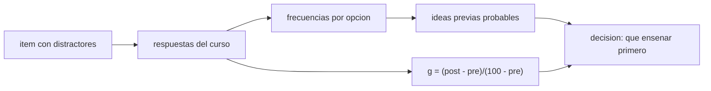

# B131-C03 — Conocimientos previos y concepciones alternativas

<!-- nav:top -->
<!-- /nav -->

## 1. Ubicación, nivel y alcance

Clase 3 del bloque B131. Nivel N4. Los estudiantes llegan con ideas propias sobre el cielo; algunas son **concepciones alternativas** persistentes. Aquí aprendes a diagnosticarlas con preguntas de opción múltiple cuyos distractores representan esas ideas, a medir el cambio con la **ganancia normalizada** y a contrarrestar la idea más común sobre las estaciones con un cálculo. Los resultados de aprendizaje de [B131-C02](../B131-C02-resultados-de-aprendizaje-observables-en-astronomia/CLASE.md) dicen qué evaluar; esta clase dice qué esperar encontrar. **Esta clase es educativa; el curso de 60 estudiantes es sintético.**

## 2. Por qué esta clase existe

Enseñar sin saber qué creen ya los estudiantes deja intactas las ideas previas. La decisión central: **¿qué distractor elegiste para atrapar qué idea, y cómo sabrás si el cambio es real?**

## 3. Lo que podrás hacer al terminar

1. Citar las dos concepciones más documentadas (estaciones por distancia; fases por sombra de la Tierra) con su fuente y sus límites.
2. Refutar con un cálculo la idea de la distancia: flujo en perihelio frente a afelio y efecto de la inclinación.
3. Diseñar un ítem con distractores diagnósticos y leer sus frecuencias.
4. Calcular la ganancia normalizada de un curso por dos vías.
5. Comparar un resultado sintético con la referencia de Hake (resumen) sin generalizar.
6. Separar lo consultado de lo estándar no consultado y de lo sintético.

La evidencia es el **informe de diagnóstico de un curso sintético** del ejercicio 12 (sección 20).

## 4. Con qué llegas y cómo comprobarlo

1. ¿Qué es la excentricidad de una órbita?
2. ¿Qué es la inclinación del eje de la Tierra?
3. ¿Qué es un distractor?
4. ¿Qué es un porcentaje de acierto?
5. ¿Qué es una prueba antes y después (pre/post)?

<details>
<summary>Ver respuestas</summary>

1. Un número entre 0 y 1 que mide cuánto se aleja la órbita de un círculo. 2. El ángulo (unos 23,4 °) entre el eje de rotación y la perpendicular al plano de la órbita. 3. Una opción incorrecta pero verosímil. 4. El número de aciertos dividido por el de respuestas, por cien. 5. Medir el mismo contenido antes y después de enseñarlo.
</details>

Con cuatro o cinco aciertos, sigue; si no, repasa los prerrequisitos.

## 5. Un caso de contexto y casos de referencia

La revisión de Bailey y Slater (2004, *Astronomy Education Review*) recoge que la explicación alternativa más común de las estaciones es que la Tierra está más cerca del Sol en verano, y la de las fases lunares, que las produce la sombra de la Tierra o un «eclipse». Cita también una entrevista en video con 23 personas de una comunidad universitaria, de las cuales 21 no dieron una explicación científica de las estaciones ni de las fases: una muestra pequeña y no representativa. El **ejemplo conductor** de esta clase es un curso **sintético** de 60 estudiantes con dos ítems; no representa a ningún curso real.

## 6. Vocabulario

Una **concepción alternativa** es una idea previa que se opone a la explicación científica. Un **distractor diagnóstico** es una opción incorrecta escrita para que la elija quien tiene esa idea. La **ganancia normalizada** `g = (post − pre)/(100 − pre)` mide qué fracción de la mejora posible se logró. El **perihelio** es el punto de la órbita más cercano al Sol; el **afelio**, el más lejano. La **oblicuidad** es la inclinación del eje.

## 7. Modelo mental: de la respuesta a la idea



*Descripción textual:* cada opción elegida es un indicio de una idea; las frecuencias orientan qué enseñar y la ganancia mide el cambio.

Analogía: un análisis de errores comunes en un examen de conducir. Límite: elegir un distractor es un indicio, no un diagnóstico de la idea de una persona.

## 8. La explicación, paso a paso

### 8.1 Por qué no es la distancia

Con `e = 0,0167` (valor estándar, **no consultado**) la órbita pasa de `0,9833 UA` en el perihelio a `1,0167 UA` en el afelio. El flujo solar es inversamente proporcional al cuadrado de la distancia: `(1,0167/0,9833)² = 1,0691`, un `6,9 %` más en el perihelio. Pero el perihelio ocurre en enero: el hemisferio norte recibe un `6,9 %` más de flujo en su invierno. La distancia no puede explicar las estaciones.

### 8.2 Lo que sí cambia: la inclinación

A `45 °` N con oblicuidad `23,44 °` (valor estándar, **no consultado**), la insolación al mediodía por unidad de área horizontal es `cos(φ − δ)`: `0,9300` en el solsticio de junio y `0,3675` en el de diciembre, un cociente de `2,53`. El efecto de la inclinación es unas `22 veces` el de la distancia (`1,53/0,069`). La duración del día suma al efecto.

### 8.3 Un curso sintético

Con 60 estudiantes **sintéticos** (semilla 131) y dos ítems (estaciones y fases): en el pre-test, 35,0 % de aciertos en ambos; el distractor «distancia» atrae al `36,7 %` y «sombra» al `46,7 %`. En el post-test los aciertos son `61,7 %` y `65,0 %`; los distractores bajan a `28,3 %` y `26,7 %`.

### 8.4 Ganancia normalizada

Pre `35,0 %`, post `63,3 %`: `g = 28,3/65,0 = 0,436`. Por conteos da el mismo valor. La media de ganancias individuales (con pre menor que el máximo) es `0,425` sobre 53 estudiantes: no coincide exactamente con la ganancia del curso, y conviene decir cuál se usa.

### 8.5 La referencia de Hake y sus límites

El resumen de Hake (1998) informa de ganancias medias de `0,23 ± 0,04` en 14 cursos tradicionales y `0,48 ± 0,14` en 48 cursos con métodos de «compromiso interactivo» de **mecánica** de física introductoria. No es astronomía y es un estudio observacional entre cursos; el `0,436` sintético no prueba ningún método.

## 9. Magnitudes, símbolos y unidades

| Símbolo | Qué es | Unidad | Valor / nota |
|---|---|---|---|
| `e` | excentricidad | — | 0,0167 (estándar, no consultado) |
| `q`, `Q` | perihelio, afelio | UA | 0,9833; 1,0167 |
| `δ` | declinación solar | ° | ±23,44 |
| `g` | ganancia normalizada | — | 0,436 |
| pre, post | porcentaje de aciertos | % | 35,0; 63,3 |

## 10. Convenciones y referencias

Distancias en unidades astronómicas con semieje 1; ángulos en grados; porcentajes con una cifra decimal. `g` se calcula con las medias del curso. Los umbrales de bajo/medio/alto usados en la literatura (0,3 y 0,7) **no se consultaron** y no se usan aquí.

## 11. De dónde sale lo que afirmamos

| ID | Fuente | Localizador | Respalda | Estado |
|---|---|---|---|---|
| S1 | Bailey J. M., Slater T. F., «A Review of Astronomy Education Research», *Astronomy Education Review* 2(2):20-45, 2004 — https://indico.unina.it/event/73/contributions/1042/attachments/359/632/2004_-_Review_of_Astronomy_Education_Research.pdf (consultada 2026-11-11, PDF leído con PyMuPDF) | introducción y sección de fases lunares | distancia como explicación alternativa de las estaciones; modelo de eclipse para las fases; 21 de 23 entrevistados | Consultada |
| S2 | Hake R. R., «Interactive-engagement versus traditional methods», *Am. J. Phys.* 66:64-74, 1998 — https://pubs.aip.org/ajp/article/66/1/64/1055076 (consultada 2026-11-11) | resumen | ganancias 0,23 ± 0,04 (14 cursos) y 0,48 ± 0,14 (48 cursos) | Consultada (solo el resumen) |
| — | `e = 0,0167`, oblicuidad `23,44 °` y la ley del inverso del cuadrado | — | cálculo de 8.1 y 8.2; verificado por dos vías | No consultados en una fuente concreta |
| — | El curso de 60 estudiantes, sus probabilidades y errores | — | 8.3 y 8.4 | Sintético |

Límites: no se leyó el texto completo de Hake; los datos de Bailey y Slater son de estudios heterogéneos; no se afirma que la distancia o la sombra sean las ideas de *tus* estudiantes.

## 12. Cómo ver el diagnóstico

| Magnitud | Valor |
|---|---|
| flujo perihelio/afelio | 1,0691 |
| insolación junio/diciembre a 45 ° N | 2,53 |
| pre → post | 35,0 % → 63,3 % |
| `g` del curso | 0,436 |

Descripción larga: la distancia produce un 6,9 % de diferencia con signo contrario al de las estaciones; la inclinación produce un factor 2,5.

## 13. Ejemplo trabajado: del distractor a la decisión

**Paso 1 · Frecuencia.** En el pre-test el `36,7 %` elige «distancia» en el ítem de estaciones.

**Paso 2 · Idea probable.** Una parte del curso ya sostiene la idea de la distancia.

**Paso 3 · Contraste.** Se les pide predecir qué hemisferio tiene verano en enero; el cálculo 8.1 desmiente la idea.

**Paso 4 · Re-medición.** En el post-test baja a `28,3 %`: persiste en parte, y eso orienta una segunda ronda.

## 14. Distintas formas de describir el cambio

**Por frecuencia:** `%` por opción. **Por ganancia:** `g` del curso o individual. **Por idea:** distancia, sombra. **Por física:** flujo y ángulo. **Por límite:** quién es la muestra.

## 15. Práctica guiada

**Ejercicio 1 · con los pasos indicados.** Calcula perihelio y afelio con `e = 0,0167`. *Pasos:* `1 ∓ e`.

<details><summary>Solución comentada</summary>

`0,9833` y `1,0167 UA`.
</details>

**Ejercicio 2 · con una pista.** Calcula el cociente de flujos. *Pista:* inverso del cuadrado.

<details><summary>Solución comentada</summary>

`(1,0167/0,9833)² = 1,0691`.
</details>

**Ejercicio 3 · casi autónomo.** Calcula `g` con pre 35,0 % y post 63,3 %.

<details><summary>Solución comentada</summary>

`(63,3 − 35,0)/(100 − 35,0) = 0,435` (0,436 sin redondear).
</details>

## 16. Práctica autónoma, transferencia e integrador

**Ejercicio 4 · autónomo.** `g` con pre 40 % y post 70 %.

<details><summary>Solución comentada</summary>

`30/60 = 0,50`.
</details>

**Ejercicio 5 · autónomo.** ¿Cuántos puntos porcentuales bajó el distractor «distancia»?

<details><summary>Solución comentada</summary>

`36,7 − 28,3 = 8,4` puntos.
</details>

**Ejercicio 6 · autónomo.** Cociente de insolación entre solsticios a `30 °` N.

<details><summary>Solución comentada</summary>

`cos(6,56 °)/cos(53,44 °) = 0,9935/0,5957 = 1,67`.
</details>

**Ejercicio 7 · autónomo.** Si la distancia mandara, ¿qué estación tendrían a la vez los dos hemisferios?

<details><summary>Solución comentada</summary>

La misma en los dos (verano en enero, en el perihelio). En la realidad las estaciones están invertidas entre hemisferios, lo que la distancia no puede explicar y la inclinación sí.
</details>

**Ejercicio 8 · autónomo.** Diseña un ítem de opción múltiple sobre las fases con tres distractores diagnósticos.

<details><summary>Solución comentada</summary>

Opciones: sombra de la Tierra, nubes, distancia a la Tierra, mitad visible iluminada (correcta). Cada distractor corresponde a una idea.
</details>

**Ejercicio 9 · transferencia.** **Transferencia.** La entrevista de 21 de 23 ¿permite decir que el 91 % de los adultos tiene la idea errónea?

<details><summary>Solución comentada</summary>

No: es una muestra pequeña, de una comunidad, no aleatoria y de un video.
</details>

**Ejercicio 10 · transferencia.** **Transferencia.** Un colega dice «mi `g` de 0,44 prueba que mi método supera a lo tradicional (0,23)». ¿Qué le respondes?

<details><summary>Solución comentada</summary>

Los 0,23 son de mecánica, entre cursos, sin asignación aleatoria; un `g` sin grupo de comparación ni control de la dificultad del test no atribuye causa.
</details>

**Ejercicio 11 · transferencia.** **Transferencia.** ¿Qué ventaja y qué riesgo tiene que la ganancia del curso (0,436) difiera de la media individual (0,425)?

<details><summary>Solución comentada</summary>

Ventaja: refleja el curso como conjunto; riesgo: oculta quién gana. Se declara cuál se usa y por qué.
</details>

**Ejercicio 12 · integrador.** **Integrador.** Elabora tu *informe de diagnóstico del curso sintético*: frecuencias pre/post por distractor, `g` por dos vías, el cálculo que refuta la distancia, la comparación con la referencia citada y los límites.

<details><summary>Solución comentada</summary>

Secciones 8.1–8.5 y la salida del laboratorio.
</details>

## 17. Laboratorio: distractores, ganancia y estaciones

El script [concepciones.py](concepciones.py) calcula el flujo perihelio/afelio, la insolación al mediodía, simula un curso de 60 estudiantes y calcula `g` por conteos y con medias (**comprueba** que ambas vías coinciden a 1e-12 y que el flujo es 1,0689–1,0691).

**Datos:** Bailey y Slater y el resumen de Hake **consultados**; `e` y oblicuidad **estándar no consultados**; curso **sintético**. **Predice antes de ejecutar:** ¿qué `g` saldrá si el acierto pasa de 35 % a 63 %? (≈ 0,43.) **Ejecución del 2026-11-11 (Python 3.12.9):**

```text
Python 3.12.9 (biblioteca estandar)
Bailey y Slater 2004 CONSULTADO (PDF); Hake 1998 solo RESUMEN; e y oblicuidad estandar NO consultados; el curso es SINTETICO.
Distancia Sol-Tierra: perihelio 0.9833 UA, afelio 1.0167 UA ; flujo perihelio/afelio = 1.0691 (+6.9 %)
  El perihelio ocurre en enero: el hemisferio norte esta mas cerca en su invierno, de modo que la distancia no explica las estaciones.
Insolacion al mediodia a 45 deg N (cos del angulo cenital): solsticio de junio 0.9300 ; de diciembre 0.3675 ; cociente 2.53
  Efecto de la inclinacion / efecto de la distancia = 22.2 veces
Curso SINTETICO de 60 estudiantes (semilla 131), 2 items: estaciones y fases lunares
  estaciones     pre : correcta  35.0 % ; distractor 'distancia'  36.7 % ; otra  28.3 %
  estaciones     post: correcta  61.7 % ; distractor 'distancia'  28.3 % ; otra  10.0 %
  fases lunares  pre : correcta  35.0 % ; distractor 'sombra'  46.7 % ; otra  18.3 %
  fases lunares  post: correcta  65.0 % ; distractor 'sombra'  26.7 % ; otra   8.3 %
Pre 35.0 % ; post 63.3 % ; ganancia normalizada del curso g = 0.436 (por conteos 0.436)
Media de ganancias individuales (solo con pre < maximo) = 0.425 sobre 53 estudiantes
Referencia consultada (Hake, resumen): tradicional 0.23, interactivo 0.48; este g sintetico NO prueba ningun metodo.
Pruebas superadas.
```

```bash
python programa/clases/B131/B131-C03-conocimientos-previos-y-concepciones-alternativas/concepciones.py
```

**Límites:** el curso es simulado con probabilidades elegidas por nosotros; el cálculo de la insolación omite atmósfera y duración del día; la ganancia sintética no es un resultado de enseñanza.

## 18. Errores frecuentes y cómo corregirlos

**Creer que la distancia explica las estaciones.** Se corrige con 8.1.

**Presentar la ganancia de un curso como prueba de un método.** Se corrige con 8.5 y el ejercicio 10.

**Generalizar una entrevista pequeña.** Se corrige con el ejercicio 9.

**No decir qué ganancia se usa.** Se corrige con el ejercicio 11.

## 19. Cómo sabrás que vas bien

Tras la sección 8: ¿qué flujo esperabas en el perihelio y cuál obtuviste? Si dudas, repasa el ejemplo 13. Tras el laboratorio: ¿qué comprueba? (ver la sección 17).

## 20. Qué entregas y cómo se evalúa

El producto es tu **informe de diagnóstico del curso sintético** (ejercicio 12).

| Criterio | Inicial | En desarrollo | Logrado | Destacado |
|---|---|---|---|---|
| Conceptos | Los confunde | Parciales | Distingue idea, distractor y ganancia | Explica los límites de cada uno |
| Cálculo | Sin unidades | Con errores | Flujo, insolación y `g` correctos | Calcula casos nuevos |
| Numérico | Sin comprobar | Una vía | `g` por dos vías | Interpreta la diferencia |
| Fuentes | Sin fuente | Sin fecha | Fuentes con fecha y estado | Declara solo-resumen y no consultado |
| Límites | No los nombra | Uno | Tres | Discute qué evidencia falta |

**Condiciones críticas (no se compensan con promedio):** rotular el curso como sintético; no usar la ganancia como prueba causal; citar solo lo consultado.

## 21. Ética, seguridad y límites

Clase educativa. No uses estos ítems para etiquetar a un estudiante; el diagnóstico es del grupo y sirve para enseñar. Los datos son sintéticos. Al cuestionar una idea previa, hazlo sin ridiculizar: la persona la construyó con su experiencia. Observar el Sol, por ejemplo para ver la inclinación de la sombra, exige filtros certificados o proyección indirecta. Accesibilidad: tablas equivalentes a las figuras, fórmulas en texto, ejercicios sin conexión.

## 22. Para cerrar y seguir

La distancia da un `6,9 %` de diferencia con signo contrario al esperado, la inclinación un factor `2,5`; un curso sintético mejora de `35,0 %` a `63,3 %` con `g = 0,436`, y eso no prueba ningún método. Queda una pregunta: ¿en qué orden conviene enseñar los conceptos?

**Glosario español–inglés.** concepción alternativa · *alternative conception*; distractor · *distractor*; ganancia normalizada · *normalized gain*; perihelio · *perihelion*; oblicuidad · *obliquity*.

**Continuidad.** [B131-C04](../B131-C04-secuenciacion-conceptual-de-una-unidad/CLASE.md) ordena los conceptos de una unidad.

**Referencias:** ver sección 11.

<!-- nav:bottom -->
<!-- /nav -->
