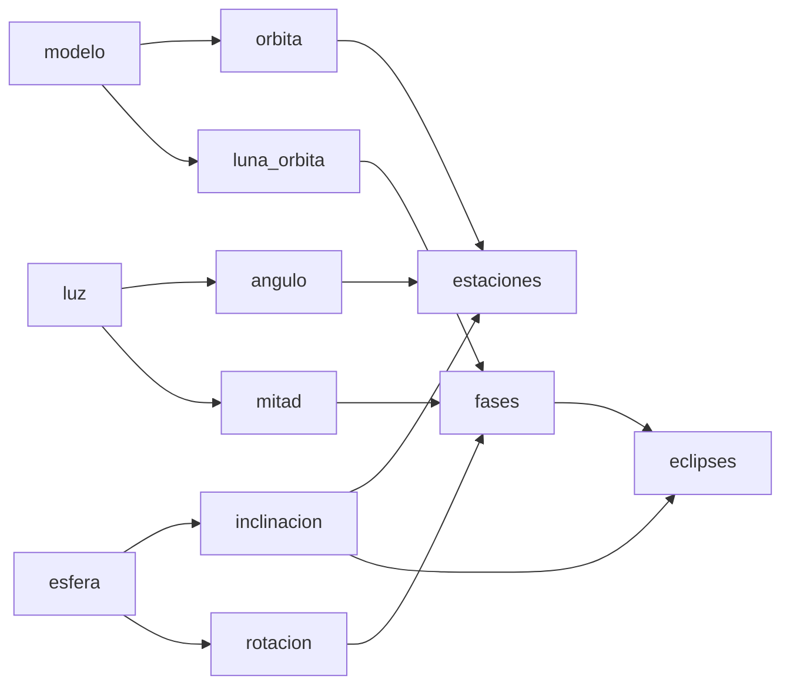

# B131-C04 — Secuenciación conceptual de una unidad

<!-- nav:top -->
<!-- /nav -->

## 1. Ubicación, nivel y alcance

Clase 4 del bloque B131. Nivel N4. Una unidad es una red de conceptos que dependen unos de otros. Aquí representas esa red como un **grafo de prerrequisitos**, la ordenas con un algoritmo, detectas saltos y ciclos y calculas el camino crítico. Tomas como caso la unidad «Día, estaciones y fases lunares», que enlaza con las concepciones de [B131-C03](../B131-C03-conocimientos-previos-y-concepciones-alternativas/CLASE.md). **Esta clase es educativa; el grafo es una propuesta del curso, no una progresión de aprendizaje validada.**

## 2. Por qué esta clase existe

Un orden de enseñanza es una hipótesis sobre qué necesita saber el estudiante antes de cada paso. La decisión central: **¿qué concepto debe ir antes de cuál, y quién lo dice?**

## 3. Lo que podrás hacer al terminar

1. Representar una unidad como grafo de prerrequisitos.
2. Obtener un orden topológico y verificarlo arista por arista.
3. Detectar un ciclo de dependencias.
4. Calcular el camino crítico (cadena mínima de sesiones).
5. Contar los órdenes válidos y entender que casi ningún orden al azar lo es.
6. Rotular el grafo como ilustrativo y no como evidencia empírica.

La evidencia es el **mapa y orden de una unidad** del ejercicio 12 (sección 20).

## 4. Con qué llegas y cómo comprobarlo

1. ¿Qué es un prerrequisito?
2. ¿Qué es un grafo dirigido?
3. ¿Qué es un ciclo?
4. ¿Qué es una permutación?
5. ¿Cuántas permutaciones tienen 4 elementos?

<details>
<summary>Ver respuestas</summary>

1. Un concepto que debe entenderse antes que otro. 2. Un conjunto de nodos con flechas. 3. Un camino que vuelve a su punto de partida. 4. Una reordenación de los elementos. 5. `4! = 24`.
</details>

Con cuatro o cinco aciertos, sigue; si no, repasa los prerrequisitos.

## 5. Un caso de contexto y casos de referencia

El **ejemplo conductor** es una unidad **ilustrativa** de 12 conceptos: la luz viaja en línea recta, la Tierra es esférica, la rotación (día y noche), la traslación, la inclinación del eje, el ángulo de incidencia, la causa de las estaciones, la Luna orbita la Tierra, la Luna siempre tiene una mitad iluminada, las fases, los eclipses y la escala del sistema Tierra–Luna–Sol. Un docente que empieza por «estaciones» se salta tres prerrequisitos.

## 6. Vocabulario

Un **grafo de prerrequisitos** tiene un nodo por concepto y una flecha de `p` a `c` si `p` es prerrequisito de `c`. Un **orden topológico** lista los nodos de modo que cada uno aparece después de sus prerrequisitos. El **camino crítico** es la cadena más larga de dependencias. Un **ciclo** hace imposible el orden.

## 7. Modelo mental: un mapa de dependencias



*Descripción textual:* las estaciones dependen de la órbita, la inclinación y el ángulo de incidencia; las fases, de la mitad iluminada, la órbita lunar y la rotación; los eclipses, de las fases y la inclinación.

Analogía: una receta con pasos que requieren ingredientes preparados antes. Límite: los prerrequisitos reales de un estudiante no siempre son estrictos; el grafo es una hipótesis.

## 8. La explicación, paso a paso

### 8.1 Orden topológico

El algoritmo toma un nodo sin prerrequisitos pendientes, lo coloca y descuenta una dependencia de sus sucesores; los empates se resuelven por nombre. El laboratorio da 12 conceptos en orden, empezando por `esfera`, `inclinacion`, `luz`, `angulo`, `modelo`, y terminando en `eclipses`. Se verifica que ninguna arista queda al revés: **0 violaciones**.

### 8.2 Camino crítico

La profundidad de cada concepto es `1 + máximo` de las profundidades de sus prerrequisitos. El máximo es `5` (acaba en `eclipses`): aun con tiempo ilimitado, hacen falta al menos cinco etapas encadenadas.

### 8.3 Un orden con saltos

El orden «estaciones primero» tiene **3 violaciones** (por ejemplo `orbita` debe ir antes que `estaciones`). No es un error de fondo si se justifica una pregunta motivadora al inicio, pero entonces se declara como tal.

### 8.4 Ciclos

Si se añade la dependencia «`luz` depende de `estaciones`», el algoritmo no ordena todos los nodos y devuelve «ciclo»: una unidad no puede imponer dos conceptos que se piden mutuamente.

### 8.5 Cuántos órdenes sirven

Por programación dinamica sobre subconjuntos hay `32 130` órdenes válidos de `479 001 600` permutaciones (`6,7 × 10⁻⁵`). El muestreo de 200 000 permutaciones al azar da `5,5 × 10⁻⁵`: un orden elegido sin criterio casi nunca respeta los prerrequisitos. El muestreo solo confirma el orden de magnitud.

## 9. Magnitudes, símbolos y unidades

| Símbolo | Qué es | Unidad | Valor / nota |
|---|---|---|---|
| `N` | conceptos | — | 12 |
| `A` | aristas (prerrequisitos) | — | 16 |
| profundidad | longitud de la cadena hasta el nodo | etapas | máximo 5 |
| violaciones | aristas al revés en un orden | — | 0 (topológico), 3 (docente) |
| `V` | órdenes válidos | — | 32 130 |

## 10. Convenciones y referencias

Los empates se resuelven por orden alfabético, de modo que el orden es determinista. El grafo es **ilustrativo**; una progresión de aprendizaje real se apoya en estudios con estudiantes que aquí no se consultaron.

## 11. De dónde sale lo que afirmamos

| ID | Fuente | Localizador | Respalda | Estado |
|---|---|---|---|---|
| S1 | Bailey J. M., Slater T. F., *Astronomy Education Review* 2(2):20-45, 2004 — https://indico.unina.it/event/73/contributions/1042/attachments/359/632/2004_-_Review_of_Astronomy_Education_Research.pdf (consultada 2026-11-11, PDF leído con PyMuPDF) | secciones sobre fases lunares y movimiento diurno | los temas de fases, estaciones y movimiento diurno son los más estudiados en la investigación de concepciones | Consultada (solo se usa como contexto del tema) |
| — | Ordenación topológica, camino crítico y conteo por subconjuntos | — | resultados 8.1–8.5; verificados arista por arista y con muestreo | No consultadas en una fuente concreta |
| — | El grafo de 12 conceptos y sus prerrequisitos | — | todo el caso | Ilustrativo |

Límites: no se consultó ninguna progresión de aprendizaje publicada; el grafo no se probó con estudiantes.

## 12. Cómo ver la secuencia

| Magnitud | Valor |
|---|---|
| violaciones del orden topológico | 0 |
| camino crítico | 5 etapas |
| violaciones del orden del docente | 3 |
| órdenes válidos / permutaciones | 32 130 / 479 001 600 |

Descripción larga: de las casi 480 millones de maneras de ordenar los 12 conceptos, solo unas 32 mil respetan los prerrequisitos; hay libertad, pero acotada.

## 13. Ejemplo trabajado: poner «estaciones» en su lugar

**Paso 1 · Prerrequisitos.** `estaciones` ← `orbita`, `inclinacion`, `angulo`.

**Paso 2 · Sus prerrequisitos.** `orbita` ← `modelo`; `inclinacion` ← `esfera`; `angulo` ← `luz`.

**Paso 3 · Colocación.** `estaciones` solo puede ir después de `modelo`, `esfera`, `luz`, `orbita`, `inclinacion` y `angulo`: posición 9 en el orden del laboratorio.

**Paso 4 · Re-chequeo.** Ningún sucesor queda antes de ella.

## 14. Distintas formas de describir una unidad

**Por grafo:** nodos y flechas. **Por lista:** orden topológico. **Por niveles:** profundidad. **Por riesgo:** violaciones. **Por evidencia:** qué estudio respalda cada flecha.

## 15. Práctica guiada

**Ejercicio 1 · con los pasos indicados.** Lista los prerrequisitos directos de `fases`. *Pasos:* léelos en la tabla.

<details><summary>Solución comentada</summary>

`mitad`, `luna_orbita` y `rotacion`.
</details>

**Ejercicio 2 · con una pista.** ¿Qué profundidad tiene `estaciones`? *Pista:* `1 + máximo` de sus prerrequisitos.

<details><summary>Solución comentada</summary>

Sus prerrequisitos tienen profundidad 1 (`luz`, `esfera`, `modelo`) o 2 (`angulo`, `inclinacion`, `orbita`); la de `estaciones` es 3.
</details>

**Ejercicio 3 · casi autónomo.** ¿Por qué `eclipses` tiene profundidad 5?

<details><summary>Solución comentada</summary>

Por la cadena `modelo` → `luna_orbita` → `mitad` → `fases` → `eclipses`: cinco conceptos encadenados. El laboratorio confirma el máximo de 5.
</details>

## 16. Práctica autónoma, transferencia e integrador

**Ejercicio 4 · autónomo.** Cuenta las violaciones de poner `fases` antes de `rotacion`.

<details><summary>Solución comentada</summary>

Una: la arista `rotacion → fases`.
</details>

**Ejercicio 5 · autónomo.** Fracción de permutaciones válidas.

<details><summary>Solución comentada</summary>

`32 130 / 479 001 600 = 6,7 × 10⁻⁵`.
</details>

**Ejercicio 6 · autónomo.** ¿Cuántos órdenes válidos tiene el grafo `a → b`, `a → c`?

<details><summary>Solución comentada</summary>

Dos: `a b c` y `a c b`.
</details>

**Ejercicio 7 · autónomo.** Añade «mareas» con prerrequisito `luna_orbita` y `orbita`. ¿Cambia el camino crítico?

<details><summary>Solución comentada</summary>

Su profundidad es 3; el máximo sigue en 5.
</details>

**Ejercicio 8 · autónomo.** Propón una dependencia que cree un ciclo y explica por qué es inválida.

<details><summary>Solución comentada</summary>

«`modelo` depende de `eclipses`»: `eclipses` depende (indirectamente) de `modelo`; ninguno podría empezar.
</details>

**Ejercicio 9 · transferencia.** **Transferencia.** Un docente quiere abrir con la pregunta «¿por qué hay estaciones?». ¿Cómo lo justificas sin romper el grafo?

<details><summary>Solución comentada</summary>

Como pregunta motivadora o diagnóstico (ver C03), no como contenido a explicar; el contenido sigue el orden topológico.
</details>

**Ejercicio 10 · transferencia.** **Transferencia.** ¿Qué evidencia necesitarías para afirmar que `luz` es realmente prerrequisito de `angulo` para tus estudiantes?

<details><summary>Solución comentada</summary>

Datos de desempeño (quienes fallan `luz` fallan `angulo`) en un grupo real; el grafo solo es una hipótesis.
</details>

**Ejercicio 11 · transferencia.** **Transferencia.** ¿Qué pasa si el camino crítico (5) supera el número de sesiones disponibles?

<details><summary>Solución comentada</summary>

Hay que recortar la unidad o fusionar etapas; no se puede comprimir una cadena de dependencias en menos etapas sin saltar prerrequisitos.
</details>

**Ejercicio 12 · integrador.** **Integrador.** Elabora tu *mapa y orden de una unidad*: 10–12 conceptos, prerrequisitos, orden topológico, camino crítico, número de violaciones de un orden alternativo y qué es ilustrativo.

<details><summary>Solución comentada</summary>

Secciones 8.1–8.5 y la salida del laboratorio.
</details>

## 17. Laboratorio: orden topológico y caminos

El script [secuencia.py](secuencia.py) ordena el grafo, calcula el camino crítico, cuenta violaciones de un orden del docente, detecta un ciclo, cuenta los órdenes válidos por programación dinámica y los compara con un muestreo (**comprueba** 0 violaciones, detección del ciclo y un caso de dos órdenes).

**Datos:** ningún dato consultado; grafo **ilustrativo**. **Predice antes de ejecutar:** ¿cuántas violaciones tiene «estaciones primero»? (tres.) **Ejecución del 2026-11-11 (Python 3.12.9):**

```text
Python 3.12.9 (biblioteca estandar)
Grafo de 12 conceptos ILUSTRATIVO (propuesta del curso); sin progresion de aprendizaje publicada consultada.
Orden topologico (empates por nombre):
   1. esfera       <- (sin prerrequisito)
   2. inclinacion  <- esfera
   3. luz          <- (sin prerrequisito)
   4. angulo       <- luz
   5. modelo       <- (sin prerrequisito)
   6. luna_orbita  <- modelo
   7. mitad        <- luz, luna_orbita
   8. orbita       <- modelo
   9. estaciones   <- orbita, inclinacion, angulo
  10. rotacion     <- esfera, luz
  11. fases        <- mitad, luna_orbita, rotacion
  12. eclipses     <- fases, inclinacion
Violaciones del orden propuesto: 0
Camino critico: 5 conceptos (acaba en eclipses) ; si se ensenan de a uno por sesion hacen falta al menos 5 sesiones encadenadas
Orden del docente (estaciones primero): 3 violaciones ; p. ej. orbita debe ir antes que estaciones
Con 'luz' dependiendo de 'estaciones': orden = None (None indica ciclo)
Ordenes validos exactos (programacion dinamica): 32130 de 479001600 permutaciones ; fraccion 6.708e-05
Muestreo de 200000 permutaciones al azar: 5.5e-05 cumplen el orden (un orden al azar casi nunca es valido)
Pruebas superadas.
```

```bash
python programa/clases/B131/B131-C04-secuenciacion-conceptual-de-una-unidad/secuencia.py
```

**Límites:** el grafo es una propuesta; el orden topológico es uno entre miles; la cuenta supone que todos los prerrequisitos son estrictos.

## 18. Errores frecuentes y cómo corregirlos

**Tratar el orden del libro como el único posible.** Se corrige con 8.5.

**Empezar por el concepto «interesante» sin sus prerrequisitos.** Se corrige con 8.3 y el ejercicio 9.

**Creer que un grafo es evidencia.** Se corrige con la sección 10 y el ejercicio 10.

**Confundir camino crítico con total de conceptos.** Se corrige con 8.2.

## 19. Cómo sabrás que vas bien

Tras la sección 8: ¿qué posición esperabas para `estaciones` y cuál obtuviste? Si dudas, repasa el ejemplo 13. Tras el laboratorio: ¿qué comprueba? (ver la sección 17).

## 20. Qué entregas y cómo se evalúa

El producto es tu **mapa y orden de una unidad** (ejercicio 12).

| Criterio | Inicial | En desarrollo | Logrado | Destacado |
|---|---|---|---|---|
| Conceptos | Los confunde | Parciales | Grafo y orden correctos | Explica los límites |
| Cálculo | Sin criterio | Con errores | Orden, camino crítico y violaciones | Cuenta órdenes válidos |
| Numérico | Sin comprobar | Una vía | Orden verificado arista por arista | Contrasta con muestreo |
| Fuentes | Sin fuente | Sin fecha | Fuentes con fecha y estado | Declara lo ilustrativo |
| Límites | No los nombra | Uno | Tres | Discute qué evidencia falta |

**Condiciones críticas (no se compensan con promedio):** rotular el grafo como hipótesis; no presentarlo como progresión validada; citar solo lo consultado.

## 21. Ética, seguridad y límites

Clase educativa. El grafo no sustituye la observación de cómo aprenden tus estudiantes. Si la unidad incluye observar el Sol, el orden debe poner la seguridad (filtros certificados o proyección indirecta) antes de la actividad. Accesibilidad: el mapa tiene su equivalente textual en la tabla del laboratorio; ejercicios sin conexión.

## 22. Para cerrar y seguir

Doce conceptos, 16 dependencias, un camino crítico de 5 etapas y solo 32 130 órdenes válidos entre 479 millones: ordenar es una decisión con límites. Queda una pregunta: ¿cómo hacer visible cada concepto en el aula?

**Glosario español–inglés.** grafo de prerrequisitos · *prerequisite graph*; orden topológico · *topological order*; camino crítico · *critical path*; ciclo · *cycle*; secuenciación · *sequencing*.

**Continuidad.** [B131-C05](../B131-C05-demostraciones-visuales-y-modelos-para-el-aula/CLASE.md) trata de demostraciones visuales y modelos.

**Referencias:** ver sección 11.

<!-- nav:bottom -->
<!-- /nav -->
