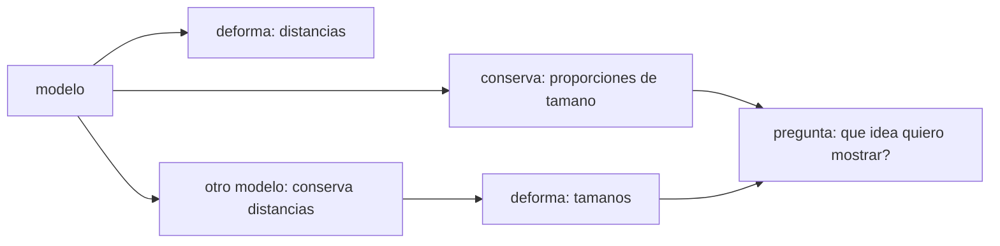

# B131-C05 — Demostraciones visuales y modelos para el aula

<!-- nav:top -->
[🏠 Programa](../../../../README.md) · [📚 Bloque B131](../../../tronco-comun/B131-didactica-de-la-astronomia.md) · [← Anterior: B131-C04 — Secuenciación conceptual de una unidad](../B131-C04-secuenciacion-conceptual-de-una-unidad/CLASE.md) · [Siguiente: B131-C06 — Aprendizaje basado en problemas con datos astronómicos →](../B131-C06-aprendizaje-basado-en-problemas-con-datos-astronomicos/CLASE.md)
<!-- /nav -->

## 1. Ubicación, nivel y alcance

Clase 5 del bloque B131. Nivel N4. Un modelo a escala es la demostración más repetida de la astronomía escolar, y también la que más se presta a transmitir una idea falsa. Aquí calculas modelos a escala del Sistema Solar con radios de la IAU, ves por qué no pueden mostrar a la vez tamaños y distancias en un aula, y verificas la geometría de la fase lunar por dos vías. Sigues el orden de [B131-C04](../B131-C04-secuenciacion-conceptual-de-una-unidad/CLASE.md): el concepto de escala va antes de las fases. **Esta clase es educativa; la maqueta no requiere observar el Sol y debe mantenerse así.**

## 2. Por qué esta clase existe

Un modelo es útil por lo que conserva y engañoso por lo que deforma. La decisión central: **¿qué propiedad del cielo conserva tu demostración y cuál sacrifica?**

## 3. Lo que podrás hacer al terminar

1. Calcular el factor de escala a partir del diámetro del Sol del modelo.
2. Obtener el tamaño y la distancia de Tierra, Júpiter y Neptuno en el modelo.
3. Demostrar con números que tamaño y distancia no caben a la misma escala en un aula.
4. Dimensionar un modelo Tierra–Luna.
5. Calcular la fracción iluminada `k = (1 + cos i)/2` y verificarla con Monte Carlo.
6. Separar lo consultado (radios IAU) de lo estándar no consultado (semiejes, UA, Luna).

La evidencia es la **tabla de escalas con su deformación** del ejercicio 12 (sección 20).

## 4. Con qué llegas y cómo comprobarlo

1. ¿Qué es una escala 1 : N?
2. ¿Qué es una unidad astronómica?
3. ¿Qué es el ángulo de fase de la Luna?
4. ¿Qué es un muestreo de Monte Carlo?
5. ¿Por qué la Luna muestra siempre una mitad iluminada?

<details>
<summary>Ver respuestas</summary>

1. Que una longitud del modelo representa N veces esa longitud real. 2. Aproximadamente la distancia media Tierra–Sol. 3. El ángulo Sol–Luna–Tierra. 4. Estimar una cantidad con puntos aleatorios. 5. Porque el Sol ilumina siempre una mitad de la Luna; lo que cambia es cuánto de esa mitad vemos.
</details>

Con cuatro o cinco aciertos, sigue; si no, repasa los prerrequisitos.

## 5. Un caso de contexto y casos de referencia

La IAU fijó en 2015 (Resolución B3) radios nominales exactos: Sol `6,957 × 10⁸ m`, Tierra ecuatorial `6,3781 × 10⁶ m`, Júpiter ecuatorial `7,1492 × 10⁷ m`; son factores de conversión, no mediciones. El **ejemplo conductor** es un Sol de 10 cm: la Tierra mide `0,917 mm` y está a `10,75 m`; Neptuno, a `323 m`. Los semiejes, la UA y los datos lunares son valores estándar **no consultados** y se tratan como ilustrativos.

## 6. Vocabulario

El **factor de escala** `k` es modelo/real. Un **modelo de dos escalas** usa una para tamaños y otra para distancias. El **ángulo de fase** `i` es el que forman el Sol y la Tierra vistos desde la Luna. La **fracción iluminada** `k_f` es la parte del disco visible que está iluminada. El **terminador** es el límite entre el día y la noche de un cuerpo.

## 7. Modelo mental: lo que un modelo conserva y lo que deforma



*Descripción textual:* ningún modelo único conserva tamaños y distancias a la vez; hay que elegir según la idea que se quiere mostrar.

Analogía: un mapa del metro conserva las conexiones y deforma las distancias. Límite: un modelo de fases con linterna y esfera exige una sala oscura y una fuente puntual, y aun así no muestra la escala.

## 8. La explicación, paso a paso

### 8.1 Modelo A: una sola escala

Si el Sol del modelo mide `10 cm` de diámetro, `k = 0,10/(2 × 6,957 × 10⁸) = 7,19 × 10⁻¹¹` (1 : `1,391 × 10¹⁰`). La Tierra mide `0,917 mm` y está a `10,75 m`; Júpiter, `10,28 mm` a `55,9 m`; Neptuno está a `323 m`. Con un Sol de 1 m las distancias se multiplican por diez: Neptuno a `3,2 km`.

### 8.2 Modelo B: todo dentro del aula

Si Neptuno debe quedar a `8 m`, el Sol mide `2,47 mm` y la Tierra `0,0227 mm` (22,7 µm), a `0,266 m`. Esa Tierra no se ve: tamaño y distancia no caben juntos en una sala. La razón entre la distancia Tierra–Sol y el diámetro solar es `107,5`, una cifra que el modelo A conserva y el B no.

### 8.3 Modelo Tierra–Luna

Con una Tierra de `5 cm`, la Luna mide `1,36 cm` y está a `1,51 m`. Un error frecuente es poner la Luna a 20 cm: se conservan los dos tamaños, pero no la distancia.

### 8.4 Fases: geometría y verificación

Para un ángulo de fase `i`, la fracción iluminada del disco es `(1 + cos i)/2`: `1,0000` en la luna llena (`i = 0 °`), `0,8536` a `45 °`, `0,5000` a `90 °`, `0,1464` a `135 °` y `0` en la luna nueva (`180 °`). La verificación por Monte Carlo (400 000 puntos en el disco, semilla 131) coincide con error máximo `5,4 × 10⁻⁴`. Suponiendo un movimiento uniforme, `i = 90 °` corresponde a unos `7,4` días tras la luna nueva.

### 8.5 La sombra no es la causa

Las fases no son la sombra de la Tierra sobre la Luna (ver [B131-C03](../B131-C03-conocimientos-previos-y-concepciones-alternativas/CLASE.md)); la maqueta de linterna debe mostrar la esfera siempre medio iluminada y cambiar el punto de vista.

## 9. Magnitudes, símbolos y unidades

| Símbolo | Qué es | Unidad | Valor / nota |
|---|---|---|---|
| `R_☉` | radio solar nominal | m | `6,957 × 10⁸` (IAU) |
| `k` | factor de escala | — | `7,19 × 10⁻¹¹` (Sol de 10 cm) |
| `i` | ángulo de fase | ° | 0–180 |
| `k_f` | fracción iluminada | — | `(1 + cos i)/2` |
| `d` | distancia en el modelo | m | Tierra 10,75 |

## 10. Convenciones y referencias

Longitudes del modelo en m, cm y mm; distancias reales en m o UA. Los radios nominales de la IAU son conversiones exactas. `i = 0 °` es luna llena y `180 °` luna nueva. La fecha del día supone una órbita circular uniforme, ilustrativa.

## 11. De dónde sale lo que afirmamos

| ID | Fuente | Localizador | Respalda | Estado |
|---|---|---|---|---|
| S1 | IAU, Resolución B3 (2015), PDF leído con PyMuPDF (consultada 2026-11-11) — https://www.iau.org/common/Uploaded%20files/IAUGA2015-Resolution-B3-recommended-nominal-conversion.pdf | tabla de constantes | radios nominales del Sol, la Tierra y Júpiter | Consultada |
| S2 | Bailey y Slater, *Astronomy Education Review* 2(2), 2004 (PDF leído, 2026-11-11) | sección de fases lunares | el modelo de «eclipse» como concepción alternativa de las fases | Consultada |
| — | Semiejes planetarios, UA, distancia y radio de la Luna, mes sinódico | — | todas las distancias del modelo | Estándar, no consultados |
| — | Fórmula `(1 + cos i)/2` | — | verificada por Monte Carlo | No consultada en una fuente concreta |

Límites: la maqueta no se probó con estudiantes; no se afirma que un modelo mejore el aprendizaje, cosa que esta clase no mide.

## 12. Cómo ver los modelos

| Magnitud | Valor |
|---|---|
| Tierra en el modelo A (Sol 10 cm) | 0,917 mm a 10,75 m |
| Neptuno en el modelo A | 323 m |
| Tierra en el modelo B (Neptuno a 8 m) | 0,0227 mm |
| `k_f` a `i = 90 °` | 0,5000 |

Descripción larga: para ver los planetas hay que renunciar a las distancias reales, y para ver las distancias reales hay que salir del aula.

## 13. Ejemplo trabajado: dimensionar el modelo Tierra–Luna

**Paso 1 · Escala.** Tierra de 5 cm: `k = 0,05/(2 × 6,3781 × 10⁶)`.

**Paso 2 · Luna.** `2 × 1,7374 × 10⁶ × k = 1,36 cm`.

**Paso 3 · Distancia.** `3,844 × 10⁸ × k = 1,51 m`.

**Paso 4 · Lectura.** La Luna cabe en una mesa si se separan 1,5 m: es menos de lo que se suele dibujar.

## 14. Distintas formas de describir un modelo

**Por escala:** una o dos. **Por propiedad conservada:** tamaños o distancias. **Por tamaño físico:** aula, patio, ciudad. **Por fase:** `i` y `k_f`. **Por seguridad:** maqueta sí, observar el Sol no.

## 15. Práctica guiada

**Ejercicio 1 · con los pasos indicados.** Calcula `k` para un Sol de 10 cm. *Pasos:* diámetro real `2R_☉`.

<details><summary>Solución comentada</summary>

`0,10/(1,391 × 10⁹) = 7,19 × 10⁻¹¹`.
</details>

**Ejercicio 2 · con una pista.** Calcula la distancia de la Tierra en ese modelo. *Pista:* `1 UA × k`.

<details><summary>Solución comentada</summary>

`1,496 × 10¹¹ × 7,19 × 10⁻¹¹ = 10,75 m`.
</details>

**Ejercicio 3 · casi autónomo.** Calcula `k_f` para `i = 60 °`.

<details><summary>Solución comentada</summary>

`(1 + 0,5)/2 = 0,75`.
</details>

## 16. Práctica autónoma, transferencia e integrador

**Ejercicio 4 · autónomo.** `k_f` para `i = 120 °`.

<details><summary>Solución comentada</summary>

`(1 − 0,5)/2 = 0,25`.
</details>

**Ejercicio 5 · autónomo.** ¿Dónde queda Neptuno si el Sol del modelo mide 1 m?

<details><summary>Solución comentada</summary>

A `3233 m`, unos `3,2 km`.
</details>

**Ejercicio 6 · autónomo.** Dimensiona la Luna y su distancia para una Tierra de 10 cm.

<details><summary>Solución comentada</summary>

Se duplican los valores de 8.3: `2,72 cm` y `3,01 m`.
</details>

**Ejercicio 7 · autónomo.** ¿Cuántas veces es mayor el modelo de 1 m que el de 10 cm en cada longitud?

<details><summary>Solución comentada</summary>

Diez veces: `10,75 m → 107,5 m` para la Tierra.
</details>

**Ejercicio 8 · autónomo.** ¿Cuál es la fracción de error de Monte Carlo esperada con 400 000 puntos para `k_f = 0,5`?

<details><summary>Solución comentada</summary>

Del orden de `√(0,25/400 000) ≈ 8 × 10⁻⁴`; el laboratorio obtuvo `5,4 × 10⁻⁴` como máximo.
</details>

**Ejercicio 9 · transferencia.** **Transferencia.** Un estudiante dice que el Sistema Solar «está muy apretado» porque el modelo cabe en una hoja. ¿Qué respondes?

<details><summary>Solución comentada</summary>

Que el modelo de hoja deforma las distancias; la razón distancia/diámetro solar es de `107,5` y se pierde.
</details>

**Ejercicio 10 · transferencia.** **Transferencia.** Quieres explicar las fases con linterna y esfera. ¿Qué parte de la idea falsa de «sombra» evita la maqueta?

<details><summary>Solución comentada</summary>

La Tierra (la cabeza del observador) no proyecta sombra sobre la esfera; se ve siempre la mitad iluminada desde otro punto.
</details>

**Ejercicio 11 · transferencia.** **Transferencia.** Un colega propone mostrar el tamaño del Sol proyectándolo con un telescopio. ¿Qué observas?

<details><summary>Solución comentada</summary>

Que es una actividad de riesgo que queda fuera de esta clase: solo con material certificado y supervisión; el modelo de este bloque no la necesita.
</details>

**Ejercicio 12 · integrador.** **Integrador.** Elabora tu *tabla de escalas con su deformación*: dos modelos, tamaños y distancias, qué conserva y qué deforma cada uno, la fase lunar con verificación y el rótulo de consultado y estándar no consultado.

<details><summary>Solución comentada</summary>

Secciones 8.1–8.4 y la salida del laboratorio.
</details>

## 17. Laboratorio: escalas y fases

El script [escalas.py](escalas.py) calcula los modelos A y B, el modelo Tierra–Luna y la fracción iluminada analítica y por Monte Carlo (**comprueba** el error de Monte Carlo menor que 3e-3 y los casos `i = 0 °` y `90 °`).

**Datos:** radios IAU **consultados**; semiejes, UA, Luna y mes sinódico **estándar no consultados**. **Predice antes de ejecutar:** ¿cuánto mide la Tierra si Neptuno queda a 8 m? (unas decenas de micrómetros.) **Ejecución del 2026-11-11 (Python 3.12.9):**

```text
Python 3.12.9 (biblioteca estandar)
Radios IAU 2015 B3 CONSULTADOS; semiejes, UA, Luna y mes sinodico ESTANDAR NO CONSULTADOS (ilustrativos).

Modelo A (misma escala para tamano y distancia), Sol de 10 cm de diametro (1 : 1.391e+10)
  cuerpo      diametro      distancia al Sol
  Tierra         0.917 mm       10.75 m
  Jupiter       10.276 mm       55.94 m
  Neptuno (distancia)                323.30 m

Modelo A (misma escala para tamano y distancia), Sol de 100 cm de diametro (1 : 1.391e+09)
  cuerpo      diametro      distancia al Sol
  Tierra         9.168 mm      107.52 m
  Jupiter      102.763 mm      559.41 m
  Neptuno (distancia)               3233.01 m

Modelo B (Neptuno a 8 m en el aula): Sol de 2.47 mm ; Tierra de 0.0227 mm ; Tierra a 0.266 m
  -> la Tierra es menor que un grano de polvo visible; no se puede mostrar a la vez distancia y tamano en un aula.
Distancia Tierra-Sol / diametro solar = 107.5 ; angulo del Sol visto desde la Tierra = 0.533 deg

Modelo Tierra-Luna con Tierra de 5 cm: Luna de 1.36 cm a 1.51 m

Fase lunar: fraccion iluminada k = (1 + cos i)/2, i = angulo de fase (Sol-Luna-Tierra)
  i[deg]  k analitica  k Monte Carlo  dia aprox. (i = 180 deg al dia 0)
      0       1.0000       1.0000    14.77
     45       0.8536       0.8533    11.07
     90       0.5000       0.4999     7.38
    135       0.1464       0.1470     3.69
    180       0.0000       0.0000     0.00
Error maximo analitica-Monte Carlo = 5.41e-04
Pruebas superadas.
```

```bash
python programa/clases/B131/B131-C05-demostraciones-visuales-y-modelos-para-el-aula/escalas.py
```

**Límites:** órbitas circulares y uniformes; la fase calculada es la del disco, no incluye la libración ni la atmósfera terrestre; la «Tierra menor que un grano de polvo» es una comparación cualitativa.

## 18. Errores frecuentes y cómo corregirlos

**Poner todos los cuerpos a la misma escala de tamaño y de distancia en una hoja.** Se corrige con 8.2.

**Colocar la Luna demasiado cerca de la Tierra.** Se corrige con 8.3.

**Explicar las fases con una sombra.** Se corrige con 8.5.

**Observar el Sol sin protección «para comparar tamaños».** Se corrige con la sección 21.

## 19. Cómo sabrás que vas bien

Tras la sección 8: ¿qué tamaño esperabas para la Tierra y cuál obtuviste? Si dudas, repasa el ejemplo 13. Tras el laboratorio: ¿qué comprueba? (ver la sección 17).

## 20. Qué entregas y cómo se evalúa

El producto es tu **tabla de escalas con su deformación** (ejercicio 12).

| Criterio | Inicial | En desarrollo | Logrado | Destacado |
|---|---|---|---|---|
| Conceptos | Los confunde | Parciales | Distingue conservar y deformar | Explica los límites del modelo |
| Cálculo | Sin unidades | Con errores | Dos modelos con unidades | Calcula casos nuevos |
| Numérico | Sin comprobar | Un caso | Fase por dos vías | Interpreta las diferencias |
| Fuentes | Sin fuente | Sin fecha | Fuentes con fecha y estado | Declara lo estándar no consultado |
| Límites | No los nombra | Uno | Tres | Discute qué enseña cada modelo |

**Condiciones críticas (no se compensan con promedio):** declarar qué deforma cada modelo; no incluir observación directa del Sol; citar solo lo consultado.

## 21. Ética, seguridad y límites

Clase educativa. **Nunca mires el Sol directamente ni con binoculares, telescopio o cámara sin filtro certificado**; el modelo de este bloque se hace con objetos y no necesita observar el Sol. Una linterna potente apuntada a los ojos también es un riesgo: úsala con cuidado. Los datos son estándar o ilustrativos. Accesibilidad: tablas equivalentes a las figuras, fórmulas en texto, ejercicios sin conexión.

## 22. Para cerrar y seguir

Un Sol de 10 cm pone la Tierra a `10,75 m` y la hace de `0,917 mm`; en un aula de 8 m para Neptuno la Tierra mide `22,7 µm`: ningún modelo conserva todo. Queda una pregunta: ¿cómo pasar de la demostración a un problema que los estudiantes resuelvan con datos?

**Glosario español–inglés.** factor de escala · *scale factor*; ángulo de fase · *phase angle*; fracción iluminada · *illuminated fraction*; terminador · *terminator*; maqueta · *scale model*.

**Continuidad.** [B131-C06](../B131-C06-aprendizaje-basado-en-problemas-con-datos-astronomicos/CLASE.md) plantea un problema con datos astronómicos.

**Referencias:** ver sección 11.

<!-- nav:bottom -->
---

[← Anterior: B131-C04 — Secuenciación conceptual de una unidad](../B131-C04-secuenciacion-conceptual-de-una-unidad/CLASE.md) · [📚 Bloque B131](../../../tronco-comun/B131-didactica-de-la-astronomia.md) · [Siguiente: B131-C06 — Aprendizaje basado en problemas con datos astronómicos →](../B131-C06-aprendizaje-basado-en-problemas-con-datos-astronomicos/CLASE.md)
<!-- /nav -->
