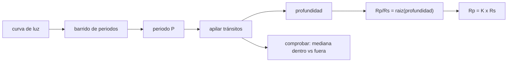

# B131-C06 — Aprendizaje basado en problemas con datos astronómicos

<!-- nav:top -->
[🏠 Programa](../../../../README.md) · [📚 Bloque B131](../../../tronco-comun/B131-didactica-de-la-astronomia.md) · [← Anterior: B131-C05 — Demostraciones visuales y modelos para el aula](../B131-C05-demostraciones-visuales-y-modelos-para-el-aula/CLASE.md) · [Siguiente: B131-C07 — Ejercicios de transferencia →](../B131-C07-ejercicios-de-transferencia/CLASE.md)
<!-- /nav -->

## 1. Ubicación, nivel y alcance

Clase 6 del bloque B131. Nivel N4. En el aprendizaje basado en problemas (ABP) los estudiantes parten de un problema abierto y construyen el conocimiento al resolverlo. Aquí diseñas uno con datos astronómicos: una **curva de luz sintética** con un tránsito, de la que el grupo debe recuperar el período, la profundidad y el radio relativo del planeta, con una segunda vía de comprobación. El problema sigue a las demostraciones de [B131-C05](../B131-C05-demostraciones-visuales-y-modelos-para-el-aula/CLASE.md). **Esta clase es educativa; la curva de luz es simulada y no es una observación.**

## 2. Por qué esta clase existe

Un problema con datos reales o realistas enseña más que un ejercicio con respuesta única, pero exige diseñar qué se espera. La decisión central: **¿qué sabe el estudiante al empezar, qué datos recibe y cómo comprobará su respuesta?**

## 3. Lo que podrás hacer al terminar

1. Describir qué es el ABP según Savery (2006) y en qué se distingue de un ejercicio.
2. Generar una curva de luz de tránsito con ruido y semilla fija.
3. Recuperar el período con un barrido de caja y la profundidad por dos vías.
4. Pasar de la profundidad al radio relativo `Rp/Rs` y a radios terrestres con los radios nominales de la IAU.
5. Evaluar cómo el ruido degrada la detección.
6. Separar lo consultado, lo ilustrativo y lo simulado.

La evidencia es el **informe del problema resuelto** del ejercicio 12 (sección 20).

## 4. Con qué llegas y cómo comprobarlo

1. ¿Qué es un tránsito planetario?
2. ¿Qué es una curva de luz?
3. ¿Qué es la desviación estándar del ruido?
4. ¿Qué es plegar una serie de datos con un período?
5. ¿Qué es una razón señal/ruido?

<details>
<summary>Ver respuestas</summary>

1. El paso de un planeta por delante de su estrella, que reduce su brillo. 2. El brillo en función del tiempo. 3. La dispersión de las medidas alrededor del valor esperado. 4. Superponer los datos tomando el tiempo módulo el período. 5. El cociente entre el tamaño de la señal y el del ruido.
</details>

Con cuatro o cinco aciertos, sigue; si no, repasa los prerrequisitos.

## 5. Un caso de contexto y casos de referencia

Savery (2006) describe el ABP como un enfoque centrado en el estudiante en que se investiga un problema definido, se conecta la teoría con la práctica y se aplica lo que se sabe para llegar a una solución viable (según el resumen del artículo). El **ejemplo conductor** es un planeta **sintético** con período `3,2 d`, `Rp/Rs = 0,10` (profundidad `0,0100`), duración `0,12 d`, ruido `0,002` y 1440 puntos en 30 días. Todo es **ilustrativo**; no representa ninguna estrella real.

## 6. Vocabulario

La **profundidad** es la caída relativa de brillo: `(Rp/Rs)²`. La **duración** es el tiempo del tránsito. Un **modelo de caja** supone una caída plana. El **barrido de períodos** prueba muchos períodos y elige el que mejor apila las caídas. La **relación señal/ruido** (SNR) es `profundidad × √N / σ`. Un **problema abierto** admite varias vías y exige justificar.

## 7. Modelo mental: de la curva al planeta



*Descripción textual:* se busca el período que mejor alinea las caídas, se apilan, se mide la profundidad y se convierte en radio relativo; una segunda vía comprueba.

Analogía: encontrar el compás de una canción entre ruido. Límite: el modelo de caja ignora el oscurecimiento al limbo y la forma real del tránsito.

## 8. La explicación, paso a paso

### 8.1 Los datos

El laboratorio genera 1440 puntos (cada 30 min durante 30 d) con ruido gaussiano de `0,002` y diez tránsitos de `0,12 d` (unos 5,8 puntos cada uno, 57 en total).

### 8.2 Período

El barrido de `1,0` a `8,0 d` con paso `0,002 d` da el mejor período `3,202 d` (inyectado `3,2`), con una SNR del barrido de `25,5`.

### 8.3 Profundidad: dos vías

Con el período recuperado, la caja da profundidad `0,00942` y la diferencia de medianas (fuera menos dentro) da `0,00970`, frente a `0,0100` inyectada. La caja subestima un poco porque su ventana discretizada no coincide con el tránsito.

### 8.4 Radio

`Rp/Rs = √0,00942 = 0,0970` (inyectado `0,10`, error `−3,0 %`). Con una estrella de 1 radio solar nominal, `Rp = 0,0970 × 6,957 × 10⁸ / 6,3781 × 10⁶ = 10,6` radios terrestres nominales, unos `0,95` de Júpiter. Un planeta **sintético** de ese tamaño sería un gigante gaseoso.

### 8.5 Cuando el ruido manda

Con ruido `0,002`, el período sale `3,200 d` y SNR `24,0`; con `0,010`, `3,200 d` y SNR `7,5`; con `0,030`, el barrido da `3,815 d`, un período falso y SNR `4,4`. Con mucho ruido una detección aparente puede ser un artefacto: hay que exigir un umbral y repetir.

## 9. Magnitudes, símbolos y unidades

| Símbolo | Qué es | Unidad | Valor / nota |
|---|---|---|---|
| `P` | período | d | 3,2 inyectado; 3,202 recuperado |
| `δ` | profundidad | relativa | 0,0100; 0,00942 |
| `Rp/Rs` | radio relativo | — | 0,10; 0,0970 |
| `σ` | ruido por punto | relativa | 0,002 |
| SNR | señal/ruido | — | 25,5 |

## 10. Convenciones y referencias

Tiempo en días, flujo relativo a 1. El radio solar nominal `6,957 × 10⁸ m` y el terrestre `6,3781 × 10⁶ m` son conversiones exactas de la IAU (2015, Resolución B3). El período se busca entre 1 y 8 días.

## 11. De dónde sale lo que afirmamos

| ID | Fuente | Localizador | Respalda | Estado |
|---|---|---|---|---|
| S1 | Savery J. R., «Overview of Problem-based Learning: Definitions and Distinctions», *Interdisciplinary Journal of Problem-Based Learning* 1(1), 2006 — https://docs.lib.purdue.edu/ijpbl/vol1/iss1/3/ (consultada 2026-11-11) | resumen | el ABP es un enfoque centrado en el estudiante para resolver un problema definido | Consultada (solo el resumen) |
| S2 | IAU, Resolución B3 (2015), PDF leído con PyMuPDF (consultada 2026-11-11) — https://www.iau.org/common/Uploaded%20files/IAUGA2015-Resolution-B3-recommended-nominal-conversion.pdf | tabla de constantes | radios nominales del Sol y de la Tierra | Consultada |
| — | Modelo de caja, barrido de períodos y SNR | — | 8.2–8.5; contrastado por dos vías | No consultados en una fuente concreta |
| — | Curva de luz, período inyectado, ruido | — | todo el caso | Simulado / ilustrativo |

Límites: no se leyó el texto completo de Savery; no se evaluó si el ABP mejora el aprendizaje, y esta clase no afirma tal cosa.

## 12. Cómo ver el problema

| Magnitud | Valor |
|---|---|
| período recuperado | 3,202 d |
| profundidad (caja / medianas) | 0,00942 / 0,00970 |
| `Rp/Rs` recuperado | 0,0970 (−3,0 %) |
| `Rp` | 10,6 radios terrestres |

Descripción larga: la profundidad se recupera con unos pocos por ciento de error con SNR 25; con ruido 15 veces mayor, el barrido encuentra un período falso.

## 13. Ejemplo trabajado: de la profundidad al radio

**Paso 1 · Profundidad.** `δ = 0,00942`.

**Paso 2 · Radio relativo.** `√0,00942 = 0,0970`.

**Paso 3 · Radio en unidades terrestres.** `0,0970 × 6,957 × 10⁸/6,3781 × 10⁶ = 0,0970 × 109,08 = 10,6`.

**Paso 4 · Comparación.** Frente a Júpiter (`11,21` radios terrestres nominales, de `7,1492 × 10⁷ / 6,3781 × 10⁶`): `0,95`.

## 14. Distintas formas de describir el problema

**Por pregunta:** ¿hay un planeta? **Por datos:** curva de luz. **Por método:** barrido y apilado. **Por incertidumbre:** SNR y dos vías. **Por pedagogía:** problema abierto, no ejercicio.

## 15. Práctica guiada

**Ejercicio 1 · con los pasos indicados.** Calcula la profundidad de un tránsito con `Rp/Rs = 0,05`. *Pasos:* eleva al cuadrado.

<details><summary>Solución comentada</summary>

`0,05² = 0,0025`.
</details>

**Ejercicio 2 · con una pista.** ¿Cuántos puntos hay en un tránsito de `0,12 d` con cadencia de 30 min? *Pista:* `0,12/(30/1440)`.

<details><summary>Solución comentada</summary>

`0,12/0,02083 = 5,76` puntos.
</details>

**Ejercicio 3 · casi autónomo.** Calcula `Rp` en radios terrestres para `Rp/Rs = 0,0970`.

<details><summary>Solución comentada</summary>

`0,0970 × 109,08 = 10,6`.
</details>

## 16. Práctica autónoma, transferencia e integrador

**Ejercicio 4 · autónomo.** SNR de la señal apilada con profundidad `0,00942`, 57 puntos y `σ = 0,002`.

<details><summary>Solución comentada</summary>

`0,00942 × √57 / 0,002 = 35,6` (el laboratorio da 35,5).
</details>

**Ejercicio 5 · autónomo.** ¿Cuántos tránsitos caben en 30 d con `P = 3,2 d` y primer tránsito en 1,1 d?

<details><summary>Solución comentada</summary>

Los centros están en `1,1 + 3,2 n ≤ 30`: `n = 0…9`, diez tránsitos.
</details>

**Ejercicio 6 · autónomo.** Si el ruido sube de `0,002` a `0,010`, ¿cuánto baja la SNR con la misma señal?

<details><summary>Solución comentada</summary>

Cinco veces (de 24 a 7,5 en el laboratorio, con alguna variación porque la dispersión de la serie incluye la señal).
</details>

**Ejercicio 7 · autónomo.** ¿Qué `Rp/Rs` daría una profundidad de `0,0001`?

<details><summary>Solución comentada</summary>

`0,01`, es decir, un planeta de `1,09` radios terrestres alrededor de un Sol nominal.
</details>

**Ejercicio 8 · autónomo.** Estima cuántos puntos dentro del tránsito necesitas para SNR 10 con profundidad `0,001` y `σ = 0,002`.

<details><summary>Solución comentada</summary>

`10 = 0,001 √N / 0,002` → `√N = 20`, `N = 400`.
</details>

**Ejercicio 9 · transferencia.** **Transferencia.** ¿Qué hace distinto a este problema de un ejercicio de «halla la profundidad»?

<details><summary>Solución comentada</summary>

No dice el método ni el período; el grupo decide cómo buscarlo, justifica y comprueba con dos vías.
</details>

**Ejercicio 10 · transferencia.** **Transferencia.** El barrido con ruido `0,030` dio un período falso. ¿Qué criterio de aula pondrías para aceptar una detección?

<details><summary>Solución comentada</summary>

Un umbral de SNR (decidido de antemano), al menos tres tránsitos y repetir con otra semilla o subconjunto.
</details>

**Ejercicio 11 · transferencia.** **Transferencia.** Un grupo informa «el planeta tiene 10,6 radios terrestres» sin más. ¿Qué falta?

<details><summary>Solución comentada</summary>

La incertidumbre, el supuesto sobre el radio de la estrella (1 radio solar nominal, ilustrativo) y que la curva es sintética.
</details>

**Ejercicio 12 · integrador.** **Integrador.** Elabora tu *informe del problema resuelto*: planteamiento abierto, datos y semilla, método, período, profundidad por dos vías, radio, efecto del ruido, límites y qué es sintético.

<details><summary>Solución comentada</summary>

Secciones 8.1–8.5 y la salida del laboratorio.
</details>

## 17. Laboratorio: un tránsito sintético

El script [transito.py](transito.py) genera la curva, barre los períodos, calcula la profundidad por dos vías, el radio y la sensibilidad al ruido (**comprueba** período dentro de 0,01 d y profundidad dentro del 10 %). Tarda unos 15 s.

**Datos:** radios IAU **consultados**; la curva **simulada** (semilla 131). **Predice antes de ejecutar:** ¿qué período saldrá con ruido 0,030? (probablemente uno falso.) **Ejecución del 2026-11-11 (Python 3.12.9):**

```text
Python 3.12.9 (biblioteca estandar)
Curva SINTETICA (modelo de caja + ruido gaussiano, semilla 131); radios nominales IAU 2015 B3 CONSULTADOS; parametros ILUSTRATIVOS.
Puntos: 1440 ; cadencia 30 min ; duracion 30 d ; ruido 0.002
Inyectado: P = 3.2 d ; Rp/Rs = 0.1 ; profundidad = 0.0100 ; duracion = 0.12 d
Barrido 1.0-8.0 d (paso 0.002 d): mejor periodo = 3.202 d ; profundidad de caja = 0.00942 ; SNR del mejor periodo = 25.5
Segunda via (mediana fuera - mediana dentro, con el periodo recuperado): profundidad = 0.00970 (57 puntos dentro)
Rp/Rs recuperado = 0.0970 (inyectado 0.1) ; error relativo -3.0 %
Radio del planeta SINTETICO = 10.6 radios terrestres nominales (para Rs = 1 radio solar nominal) = 0.95 Jupiter aprox.
Relacion senal/ruido del transito apilado = 35.5
Sensibilidad al ruido (periodo recuperado, SNR del mejor periodo):
  ruido 0.002: periodo 3.200 d ; SNR 24.0
  ruido 0.010: periodo 3.200 d ; SNR 7.5
  ruido 0.030: periodo 3.815 d ; SNR 4.4
Pruebas superadas.
```

```bash
python programa/clases/B131/B131-C06-aprendizaje-basado-en-problemas-con-datos-astronomicos/transito.py
```

**Límites:** modelo de caja, ruido gaussiano blanco, sin variabilidad estelar ni oscurecimiento al limbo; un solo planeta; el cociente `0,95` usa el radio ecuatorial nominal de Júpiter aproximado.

## 18. Errores frecuentes y cómo corregirlos

**Aceptar el pico más alto del barrido sin umbral.** Se corrige con 8.5 y el ejercicio 10.

**Dar el radio sin decir el de la estrella.** Se corrige con el ejercicio 11.

**Confundir profundidad con radio relativo.** Se corrige con 8.4.

**Presentar la curva simulada como observación.** Se corrige con la sección 5.

## 19. Cómo sabrás que vas bien

Tras la sección 8: ¿qué período esperabas y cuál obtuviste? Si dudas, repasa el ejemplo 13. Tras el laboratorio: ¿qué comprueba? (ver la sección 17).

## 20. Qué entregas y cómo se evalúa

El producto es tu **informe del problema resuelto** (ejercicio 12).

| Criterio | Inicial | En desarrollo | Logrado | Destacado |
|---|---|---|---|---|
| Conceptos | Los confunde | Parciales | Profundidad, `Rp/Rs` y SNR correctos | Explica los límites del modelo |
| Cálculo | Sin unidades | Con errores | Período y radio con unidades | Calcula casos nuevos |
| Numérico | Sin comprobar | Una vía | Dos vías de profundidad | Interpreta el efecto del ruido |
| Fuentes | Sin fuente | Sin fecha | Fuentes con fecha y estado | Declara lo simulado |
| Límites | No los nombra | Uno | Tres | Discute qué falta para una detección real |

**Condiciones críticas (no se compensan con promedio):** rotular la curva como simulada; no generalizar el ABP como método superior; citar solo lo consultado.

## 21. Ética, seguridad y límites

Clase educativa. La curva es simulada y no describe ninguna estrella ni a ningún estudiante. Si el problema se hiciera con datos reales, hay que citar la fuente, la licencia y la fecha. Nada de esta clase requiere observar el Sol. Accesibilidad: tablas equivalentes a las figuras, fórmulas en texto, ejercicios sin conexión.

## 22. Para cerrar y seguir

Con ruido `0,002` el período sale `3,202 d`, la profundidad `0,00942` y `Rp/Rs = 0,0970`; con ruido 15 veces mayor, el barrido se equivoca. Queda una pregunta: ¿cómo saber si los estudiantes pueden usar esto en una situación distinta?

**Glosario español–inglés.** aprendizaje basado en problemas · *problem-based learning*; curva de luz · *light curve*; tránsito · *transit*; profundidad · *depth*; relación señal/ruido · *signal-to-noise ratio*.

**Continuidad.** [B131-C07](../B131-C07-ejercicios-de-transferencia/CLASE.md) trata de los ejercicios de transferencia.

**Referencias:** ver sección 11.

<!-- nav:bottom -->
---

[← Anterior: B131-C05 — Demostraciones visuales y modelos para el aula](../B131-C05-demostraciones-visuales-y-modelos-para-el-aula/CLASE.md) · [📚 Bloque B131](../../../tronco-comun/B131-didactica-de-la-astronomia.md) · [Siguiente: B131-C07 — Ejercicios de transferencia →](../B131-C07-ejercicios-de-transferencia/CLASE.md)
<!-- /nav -->
