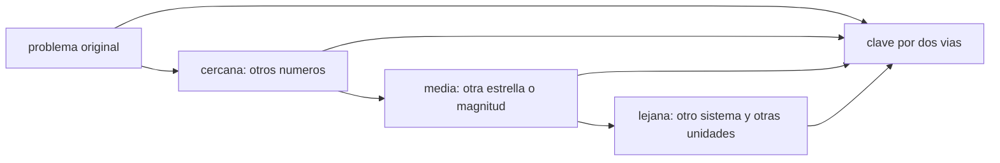

# B131-C07 — Ejercicios de transferencia

<!-- nav:top -->
[🏠 Programa](../../../../README.md) · [📚 Bloque B131](../../../tronco-comun/B131-didactica-de-la-astronomia.md) · [← Anterior: B131-C06 — Aprendizaje basado en problemas con datos astronómicos](../B131-C06-aprendizaje-basado-en-problemas-con-datos-astronomicos/CLASE.md) · [Siguiente: B131-C08 — Evaluación formativa en el aula de astronomía →](../B131-C08-evaluacion-formativa-en-el-aula-de-astronomia/CLASE.md)
<!-- /nav -->

## 1. Ubicación, nivel y alcance

Clase 7 del bloque B131. Nivel N4. Un estudiante que resuelve el problema que practicó no demuestra que puede usar lo aprendido en otra situación. Un **ejercicio de transferencia** cambia algo del problema: los números, la magnitud pedida, el cuerpo central o el contexto. Aquí generas un banco de variantes de la tercera ley de Kepler, con **clave verificada por dos vías**, y las clasificas según cuántos rasgos cambian. Continúas el problema de [B131-C06](../B131-C06-aprendizaje-basado-en-problemas-con-datos-astronomicos/CLASE.md). **Esta clase es educativa; los sistemas de los enunciados son sintéticos.**

## 2. Por qué esta clase existe

Resolver bien un problema practicado puede ser memoria. La decisión central: **¿qué debe cambiar para que el ejercicio mida que el estudiante comprendió la ley y no el procedimiento?**

## 3. Lo que podrás hacer al terminar

1. Resolver la tercera ley con `P² = a³/M` (años, UA, masas solares) y en SI con `P = 2π√(a³/GM)`.
2. Generar variantes que cambian uno, dos y tres rasgos de un problema.
3. Verificar la clave de cada variante por dos vías.
4. Clasificar una variante como cercana, media o lejana según los rasgos que cambia.
5. Distinguir lo consultado (parámetros de la IAU), lo estándar no consultado y lo sintético.
6. Reconocer lo que la bibliografía de transferencia advierte y lo que esta clase no prueba.

La evidencia es el **banco de variantes con clave** del ejercicio 12 (sección 20).

## 4. Con qué llegas y cómo comprobarlo

1. ¿Qué dice la tercera ley de Kepler?
2. ¿Qué es el semieje mayor?
3. ¿Qué es una masa solar?
4. ¿Qué es un parámetro gravitacional `GM`?
5. ¿Por qué se verifica un resultado con una segunda vía?

<details>
<summary>Ver respuestas</summary>

1. Que el cuadrado del período es proporcional al cubo del semieje. 2. La mitad del eje más largo de la elipse. 3. La masa del Sol, usada como unidad. 4. El producto de la constante gravitatoria por la masa. 5. Para detectar errores que una sola vía no ve.
</details>

Con cuatro o cinco aciertos, sigue; si no, repasa los prerrequisitos.

## 5. Un caso de contexto y casos de referencia

Barnett y Ceci (2002) proponen una taxonomía para el estudio de la **transferencia lejana** y sostienen que estimar un único tamaño de efecto de transferencia es un error por la complejidad del fenómeno (según el inicio de su resumen; no se leyó el texto completo). La clasificación de esta clase es una **convención propia**, más simple, y no reproduce la suya. El **ejemplo conductor** es un problema original (período de un planeta de `2,92 UA` alrededor del Sol) y tres variantes cada vez más lejanas. Todos los sistemas son **sintéticos**.

## 6. Vocabulario

**Transferencia** es usar lo aprendido en una situación distinta de la de aprendizaje. Una variante **cercana** cambia los números; una **media**, además el cuerpo central o la magnitud pedida; una **lejana**, también el contexto y las unidades. La **clave** es la respuesta correcta verificada. Una **segunda vía** calcula lo mismo con otro método.

## 7. Modelo mental: cuántos rasgos cambian



*Descripción textual:* de una variante a la siguiente cambian más rasgos; cada una se resuelve con dos vías y se compara.

Analogía: aprender a manejar un auto y luego uno distinto, en otra ciudad y con otras señales. Límite: contar rasgos no mide cuán difícil es la transferencia para cada estudiante.

## 8. La explicación, paso a paso

### 8.1 Las dos vías

Vía 1: `P = √(a³/M)`, con `P` en años, `a` en UA y `M` en masas solares. Vía 2: `P = 2π√(a³/GM)` con `GM` nominal solar `1,3271244 × 10²⁰ m³ s⁻²` (IAU 2015), `a` en metros y `P` en segundos. La segunda conoce las constantes del SI; la primera, solo la relación de escala. Para `a = 1 UA` y `M = 1` dan `1,0000` y `1,00002` años.

### 8.2 Cuatro problemas

Con semilla 131: **original** (0 rasgos): planeta a `2,92 UA` del Sol → `P = 4,99 años`. **Cercana** (1): cuerpo con `P = 15,9 años` alrededor del Sol, se pide `a` → `6,323 UA`. **Media** (2): estrella de `0,45` masas solares y `a = 0,32 UA` → `P = 0,2698 años`. **Lejana** (3): satélite a `14,8` radios jovianos nominales de Júpiter, `P` en días → `7,032 días`. La diferencia entre vías es de `10⁻⁵` relativo en todos, bajo la tolerancia de `10⁻³`.

### 8.3 Qué mide cada una

La cercana mide ejecución del procedimiento; la media, si el estudiante reconoce el papel de `M`; la lejana, si entiende la ley como relación entre magnitudes y no como una receta en UA y años. Un estudiante puede resolver las dos primeras y fallar la tercera.

### 8.4 Sensibilidad

Si `a` se duplica, `P` se multiplica por `2^1,5 = 2,8284`: una comprobación de cordura que el estudiante puede hacer sin calculadora.

## 9. Magnitudes, símbolos y unidades

| Símbolo | Qué es | Unidad | Valor / nota |
|---|---|---|---|
| `P` | período | años o días | 4,99; 7,032 |
| `a` | semieje mayor | UA o radios jovianos | 2,92; 14,8 |
| `M` | masa del cuerpo central | masas solares | 1; 0,45 |
| `GM☉` | parámetro gravitacional solar nominal | m³ s⁻² | `1,3271244 × 10²⁰` |
| rasgos | nº de rasgos que cambian | — | 0 a 3 |

## 10. Convenciones y referencias

La UA (`1,495978707 × 10¹¹ m`) y el año juliano (`3,15576 × 10⁷ s`) son valores estándar **no consultados**. La masa del cuerpo menor se ignora en la vía 1 (de ahí la diferencia de `10⁻⁵`). El `GM` de Júpiter es nominal (IAU 2015, `1,2668653 × 10¹⁷ m³ s⁻²`).

## 11. De dónde sale lo que afirmamos

| ID | Fuente | Localizador | Respalda | Estado |
|---|---|---|---|---|
| S1 | IAU, Resolución B3 (2015), PDF leído con PyMuPDF (consultada 2026-11-11) — https://www.iau.org/common/Uploaded%20files/IAUGA2015-Resolution-B3-recommended-nominal-conversion.pdf | tabla de constantes | `GM` nominales del Sol y de Júpiter; radio ecuatorial de Júpiter | Consultada |
| S2 | Barnett S. M., Ceci S. J., «When and where do we apply what we learn? A taxonomy for far transfer», *Psychological Bulletin* 128(4):612-637, 2002 (referencia obtenida por búsqueda web, 2026-11-11; la página de PubMed no mostró el resumen) | inicio del resumen, vía búsqueda | la transferencia lejana es compleja y no se resume en un tamaño de efecto | Consultada parcialmente; no se leyó el texto |
| — | UA, año juliano, relación `P² = a³/M` | — | cálculos de 8.1–8.4 | Estándar, no consultados |
| — | Los cuatro problemas | — | todo el caso | Sintético |

Límites: el resumen de Barnett y Ceci se conoció solo en su inicio; la clasificación por rasgos es propia y no está validada.

## 12. Cómo ver el banco

| Variante | Rasgos | Respuesta |
|---|---|---|
| original | 0 | 4,99 años |
| cercana | 1 | 6,323 UA |
| media | 2 | 0,2698 años |
| lejana | 3 | 7,032 días |

Descripción larga: las cuatro respuestas coinciden entre las dos vías a una parte en cien mil, y cada una exige algo más del estudiante.

## 13. Ejemplo trabajado: la variante lejana

**Paso 1 · Semieje.** `14,8 × 7,1492 × 10⁷ = 1,058 × 10⁹ m`.

**Paso 2 · Cubo.** `a³ = 1,185 × 10²⁷ m³`.

**Paso 3 · Período.** `2π√(1,185 × 10²⁷/1,2668653 × 10¹⁷) = 6,08 × 10⁵ s`.

**Paso 4 · Días.** `6,08 × 10⁵/86 400 = 7,03 días`.

## 14. Distintas formas de describir una variante

**Por rasgos:** 0–3. **Por unidades:** UA y años o SI. **Por magnitud pedida:** `P` o `a`. **Por clave:** dos vías. **Por advertencia:** el éxito en una variante no prueba comprensión general.

## 15. Práctica guiada

**Ejercicio 1 · con los pasos indicados.** Calcula `P` para `a = 2,92 UA` y `M = 1`. *Pasos:* `a³`, raíz cuadrada.

<details><summary>Solución comentada</summary>

`2,92³ = 24,897`; `√24,897 = 4,99` años.
</details>

**Ejercicio 2 · con una pista.** Calcula `a` para `P = 15,9 años` y `M = 1`. *Pista:* `a = (P²M)^(1/3)`.

<details><summary>Solución comentada</summary>

`15,9² = 252,8`; `252,8^(1/3) = 6,32 UA`.
</details>

**Ejercicio 3 · casi autónomo.** Calcula `P` con `M = 0,45` y `a = 0,32 UA`.

<details><summary>Solución comentada</summary>

`0,32³ = 0,03277`; `/0,45 = 0,07282`; raíz `0,2698` años.
</details>

## 16. Práctica autónoma, transferencia e integrador

**Ejercicio 4 · autónomo.** Pasa `0,2698 años` a días.

<details><summary>Solución comentada</summary>

`0,2698 × 365,25 = 98,5` días.
</details>

**Ejercicio 5 · autónomo.** ¿Por cuánto se multiplica `P` si `M` se cuadruplica con `a` fijo?

<details><summary>Solución comentada</summary>

Por `1/√4 = 0,5`.
</details>

**Ejercicio 6 · autónomo.** ¿Qué rasgos cambian de la variante cercana a la media?

<details><summary>Solución comentada</summary>

El cuerpo central (otra estrella) y la magnitud pedida (de `a` a `P`).
</details>

**Ejercicio 7 · autónomo.** Escribe una variante cercana con tus números y su clave.

<details><summary>Solución comentada</summary>

Respuesta abierta; p. ej. `a = 4 UA` → `P = 8 años`.
</details>

**Ejercicio 8 · autónomo.** Calcula `P` por la vía 2 para `a = 1 UA`.

<details><summary>Solución comentada</summary>

`2π√((1,496 × 10¹¹)³/1,327 × 10²⁰) = 3,156 × 10⁷ s = 1,00002 años`.
</details>

**Ejercicio 9 · transferencia.** **Transferencia.** Un estudiante resuelve bien las tres primeras y falla la lejana. ¿Qué indica y qué harías?

<details><summary>Solución comentada</summary>

Que domina el procedimiento en UA y años pero no la relación general; propondrías el cambio de unidades y contextos con apoyo gradual, sin concluir sobre su capacidad general.
</details>

**Ejercicio 10 · transferencia.** **Transferencia.** ¿Por qué un buen resultado en variantes cercanas no basta para decir que hubo transferencia?

<details><summary>Solución comentada</summary>

Porque cambian solo los números y se puede resolver por imitación; la transferencia lejana exige reconocer la estructura en otro contexto.
</details>

**Ejercicio 11 · transferencia.** **Transferencia.** ¿Se puede concluir de esta clase que practicar variantes mejora la transferencia?

<details><summary>Solución comentada</summary>

No: la clase no mide aprendizaje, solo genera y verifica ejercicios, y la bibliografía citada advierte de que la transferencia lejana es compleja.
</details>

**Ejercicio 12 · integrador.** **Integrador.** Elabora tu *banco de variantes con clave*: un problema original, tres variantes de 1, 2 y 3 rasgos, clave por dos vías y qué mide cada una, con lo sintético rotulado.

<details><summary>Solución comentada</summary>

Secciones 8.1–8.4 y la salida del laboratorio.
</details>

## 17. Laboratorio: banco de variantes

El script [transferencia.py](transferencia.py) genera las cuatro variantes con semilla fija y las resuelve por las dos vías (**comprueba** que difieren menos de 1e-3 relativo y que `a = 1 UA`, `M = 1` da un año).

**Datos:** `GM` nominales **consultados**; UA y año **estándar no consultados**; sistemas **sintéticos**. **Predice antes de ejecutar:** ¿qué diferencia habrá entre las dos vías? (menos de una parte en mil.) **Ejecución del 2026-11-11 (Python 3.12.9):**

```text
Python 3.12.9 (biblioteca estandar)
(GM) nominales IAU 2015 B3 CONSULTADOS; UA, ano y valores de los enunciados ESTANDAR/ILUSTRATIVOS; sistemas SINTETICOS.
variante   rasgos  enunciado -> respuesta (via 1) ; respuesta (via 2) ; diferencia relativa
original  0  Un planeta SINTETICO orbita al Sol con a = 2.92 UA. Halla P.
          -> 4.99 anos ; 4.99 anos ; 1.9e-05
cercana   1  Un cuerpo SINTETICO orbita al Sol con P = 15.9 anos. Halla a.
          -> 6.323 UA ; 6.323 UA ; 1.3e-05
media     2  Un planeta SINTETICO orbita una estrella de 0.45 masas solares con a = 0.32 UA. Halla P.
          -> 0.2698 anos ; 0.2699 anos ; 1.9e-05
lejana    3  Un satelite SINTETICO orbita a Jupiter con a = 14.8 radios jovianos nominales. Halla P en dias.
          -> 7.032 dias ; 7.032 dias ; 1.9e-05
Mayor diferencia entre vias: 1.9e-05 (tolerancia 1e-3)
Comprobacion: a = 1 UA, M = 1 -> P = 1.0000 anos ; por SI = 1.00002 anos
Si a se duplica, P se multiplica por 2.8284 (2^1.5 = 2.8284)
Pruebas superadas.
```

```bash
python programa/clases/B131/B131-C07-ejercicios-de-transferencia/transferencia.py
```

**Límites:** órbitas circulares o con semieje dado, sin masa del cuerpo menor; las dos vías comparten constantes (no son independientes de `GM`); la clasificación por rasgos es una convención.

## 18. Errores frecuentes y cómo corregirlos

**Llamar «transferencia» a un cambio de números.** Se corrige con 8.3 y el ejercicio 10.

**Usar la ley en UA y años con otro cuerpo central.** Se corrige con el ejercicio 5.

**Dar la clave sin verificarla.** Se corrige con 8.1.

**Concluir sobre la capacidad general de un estudiante.** Se corrige con el ejercicio 9.

## 19. Cómo sabrás que vas bien

Tras la sección 8: ¿qué período esperabas para la variante lejana y cuál obtuviste? Si dudas, repasa el ejemplo 13. Tras el laboratorio: ¿qué comprueba? (ver la sección 17).

## 20. Qué entregas y cómo se evalúa

El producto es tu **banco de variantes con clave** (ejercicio 12).

| Criterio | Inicial | En desarrollo | Logrado | Destacado |
|---|---|---|---|---|
| Conceptos | Los confunde | Parciales | Distingue cercana, media y lejana | Explica los límites de la clasificación |
| Cálculo | Sin unidades | Con errores | Cuatro variantes con unidades | Genera casos nuevos |
| Numérico | Sin comprobar | Una vía | Clave por dos vías | Interpreta las diferencias |
| Fuentes | Sin fuente | Sin fecha | Fuentes con fecha y estado | Declara lo parcial |
| Límites | No los nombra | Uno | Tres | Discute qué evidencia falta |

**Condiciones críticas (no se compensan con promedio):** rotular los sistemas como sintéticos; no afirmar que las variantes mejoren la transferencia; citar solo lo consultado.

## 21. Ética, seguridad y límites

Clase educativa. Las variantes no deben usarse para clasificar a estudiantes reales ni para concluir sobre su capacidad. Los sistemas son sintéticos. Ninguna variante requiere observar el Sol. Accesibilidad: enunciados con texto, fórmulas en texto, ejercicios sin conexión.

## 22. Para cerrar y seguir

Cuatro variantes de 0 a 3 rasgos coinciden por dos vías a una parte en cien mil; resolver bien las cercanas no prueba transferencia. Queda una pregunta: ¿cómo evaluar durante la clase, a tiempo de corregir?

**Glosario español–inglés.** transferencia · *transfer*; tercera ley de Kepler · *Kepler's third law*; clave · *answer key*; semieje mayor · *semi-major axis*; parámetro gravitacional · *gravitational parameter*.

**Continuidad.** [B131-C08](../B131-C08-evaluacion-formativa-en-el-aula-de-astronomia/CLASE.md) trata de la evaluación formativa.

**Referencias:** ver sección 11.

<!-- nav:bottom -->
---

[← Anterior: B131-C06 — Aprendizaje basado en problemas con datos astronómicos](../B131-C06-aprendizaje-basado-en-problemas-con-datos-astronomicos/CLASE.md) · [📚 Bloque B131](../../../tronco-comun/B131-didactica-de-la-astronomia.md) · [Siguiente: B131-C08 — Evaluación formativa en el aula de astronomía →](../B131-C08-evaluacion-formativa-en-el-aula-de-astronomia/CLASE.md)
<!-- /nav -->
