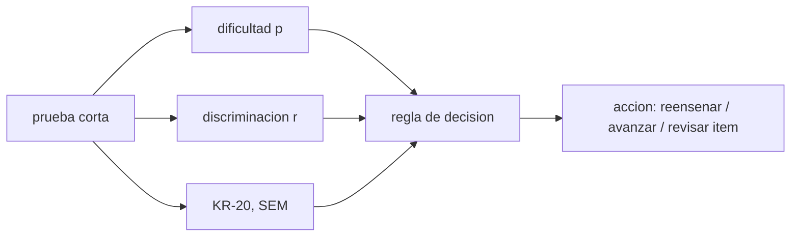

# B131-C08 — Evaluación formativa en el aula de astronomía

<!-- nav:top -->
[🏠 Programa](../../../../README.md) · [📚 Bloque B131](../../../tronco-comun/B131-didactica-de-la-astronomia.md) · [← Anterior: B131-C07 — Ejercicios de transferencia](../B131-C07-ejercicios-de-transferencia/CLASE.md) · [Siguiente: B131-C09 — Rúbricas de evaluación →](../B131-C09-rubricas-de-evaluacion/CLASE.md)
<!-- /nav -->

## 1. Ubicación, nivel y alcance

Clase 8 del bloque B131. Nivel N4. La evaluación formativa recoge evidencia durante el aprendizaje para decidir qué hacer a continuación. Aquí analizas una prueba corta **sintética** de 10 ítems y 40 estudiantes: dificultad y discriminación de cada ítem, fiabilidad (KR-20), error de medida y una regla de decisión para reenseñar. Los ítems miden los resultados de [B131-C02](../B131-C02-resultados-de-aprendizaje-observables-en-astronomia/CLASE.md) y los distractores de [B131-C03](../B131-C03-conocimientos-previos-y-concepciones-alternativas/CLASE.md). **Esta clase es educativa; los datos son sintéticos y no describen ningún curso.**

## 2. Por qué esta clase existe

Una prueba formativa solo sirve si se usa para decidir. La decisión central: **¿qué ítems, qué ideas y qué estudiantes necesitan algo distinto mañana, y cuánto puedes fiarte de lo que mide la prueba?**

## 3. Lo que podrás hacer al terminar

1. Calcular la dificultad `p` de un ítem como proporción de aciertos.
2. Calcular la discriminación como correlación punto-biserial del ítem con el resto de la prueba.
3. Calcular KR-20, comprobarlo contra el alfa de Cronbach y el error estándar de medida.
4. Aplicar una regla de decisión explícita (ilustrativa) y reconocer sus límites.
5. Citar la evidencia sobre evaluación formativa con su alcance.
6. Separar lo consultado, lo estándar no consultado y lo sintético.

La evidencia es el **informe de ítems con decisiones** del ejercicio 12 (sección 20).

## 4. Con qué llegas y cómo comprobarlo

1. ¿Qué es una proporción?
2. ¿Qué es una correlación?
3. ¿Qué es la varianza?
4. ¿Qué diferencia hay entre evaluación formativa y sumativa?
5. ¿Qué es un ítem de opción múltiple?

<details>
<summary>Ver respuestas</summary>

1. Una parte dividida entre el total. 2. Una medida de cuánto varían juntas dos variables. 3. La media de los cuadrados de las desviaciones respecto de la media. 4. La formativa orienta la enseñanza durante el proceso; la sumativa certifica al final. 5. Una pregunta con una opción correcta y varios distractores.
</details>

Con cuatro o cinco aciertos, sigue; si no, repasa los prerrequisitos.

## 5. Un caso de contexto y casos de referencia

Black y Wiliam (1998) revisaron la literatura sobre evaluación formativa en el aula. En el texto discuten, entre otros, un metaanálisis sobre retroalimentación (131 estudios, 607 tamaños de efecto, 12 652 participantes) con un efecto medio de `0,4`, una desviación de casi 1 entre efectos y en torno a dos de cada cinco efectos negativos; subrayan que la retroalimentación puede perjudicar según cómo se dé. (La extracción de texto del PDF salió degradada en algunos pasajes, por lo que no se cita la autoría del metaanálisis ni se fía de más detalle.) El **ejemplo conductor** es una prueba **sintética** de 10 ítems con dificultades dispares.

## 6. Vocabulario

La **dificultad** `p` es la proporción de aciertos del ítem (más alto = más fácil). La **discriminación** `r` mide si quienes aciertan el ítem puntúan mejor en el resto. **KR-20** estima la consistencia interna de una prueba de ítems dicotómicos. El **error estándar de medida** `SEM = s √(1 − KR20)` cuantifica la incertidumbre de una puntuación. Una **regla de decisión** dice qué hacer según los datos.

## 7. Modelo mental: del ítem a la decisión



*Descripción textual:* de cada ítem se obtienen su dificultad y su discriminación; de la prueba, su fiabilidad; con una regla explícita se decide la acción.

Analogía: un tablero de control del auto. Límite: con pocos estudiantes los indicadores son muy ruidosos.

## 8. La explicación, paso a paso

### 8.1 Los datos

40 estudiantes y 10 ítems sintéticos con dificultades de `−1,5` a `2,2` en una escala logística y habilidad `N(0,1)` (semilla 131). Media `4,70`, desviación `1,71`.

### 8.2 Dificultad y discriminación

Los aciertos van de `0,825` (ítem 1) a `0,100` (ítem 10). La discriminación corregida (con el resto) va de `−0,022` (ítem 3) a `0,405` (ítem 10). Con el umbral ilustrativo `r < 0,2`, siete ítems «discriminan poco»; los ítems 9 y 10 además salen por su dificultad (`p < 0,2`). Con solo 40 estudiantes, el error típico de una correlación cercana a cero es del orden de `0,16`, de modo que varios «discrimina poco» pueden ser azar.

### 8.3 Fiabilidad

`KR-20 = 0,367`, igual al alfa de Cronbach; `SEM = 1,36` puntos sobre 10. Con solo los cinco primeros ítems, `KR-20 = 0,281`: menos ítems, menos fiabilidad. Una prueba tan corta no sirve para decidir sobre una persona, solo para orientar la enseñanza del grupo.

### 8.4 Regla de decisión

La regla ilustrativa «reenseñar si el acierto es menor que `0,6`» marca seis ítems de diez (5 a 10). Antes de actuar hay que revisar qué miden: el ítem 10 (`p = 0,10`, `r = 0,405`) discrimina bien y es difícil; reenseñarlo puede ser razonable. El ítem 5 (`p = 0,575`, `r = 0,004`) no discrimina nada: conviene revisarlo antes que reenseñar.

### 8.5 Qué dice la evidencia, con límites

Black y Wiliam indican que la retroalimentación formativa puede tener un efecto positivo medio, pero con gran variación y efectos negativos frecuentes: no basta con evaluar, importa cómo se usa el resultado (ver [B131-C10](../B131-C10-retroalimentacion-efectiva/CLASE.md)). Esta clase no mide el efecto de ninguna evaluación.

## 9. Magnitudes, símbolos y unidades

| Símbolo | Qué es | Unidad | Valor / nota |
|---|---|---|---|
| `N`, `K` | estudiantes, ítems | — | 40, 10 |
| `p` | dificultad (acierto) | proporción | 0,825 … 0,100 |
| `r` | discriminación corregida | — | −0,022 … 0,405 |
| `KR-20` | fiabilidad | — | 0,367 |
| `SEM` | error estándar de medida | puntos | 1,36 |

## 10. Convenciones y referencias

`p` y `r` se calculan sobre la puntuación del resto (total menos el ítem). La varianza usada es la poblacional. Los umbrales de revisión (`p` fuera de 0,2–0,9, `r < 0,2`) y la regla `p < 0,6` son **ilustrativos**.

## 11. De dónde sale lo que afirmamos

| ID | Fuente | Localizador | Respalda | Estado |
|---|---|---|---|---|
| S1 | Black P., Wiliam D., «Assessment and Classroom Learning», *Assessment in Education* 5(1):7-74, 1998, DOI 10.1080/0969595980050102 — PDF obtenido de https://www.gla.ac.uk/t4/learningandteaching/files/PGCTHE/BlackandWiliam1998.pdf (consultada 2026-11-11, PDF leído con PyMuPDF; texto parcialmente degradado) | sección sobre retroalimentación | metaanálisis comentado: 131 estudios, 607 efectos, efecto medio 0,4, gran dispersión, efectos negativos frecuentes | Consultada (extracción parcial) |
| — | Dificultad, punto-biserial, KR-20, SEM | — | cálculos; contrastados por dos vías | No consultadas en una fuente concreta |
| — | Umbrales y regla de decisión | — | 8.2 y 8.4 | Ilustrativo |
| — | Prueba de 40 estudiantes | — | todo el caso | Sintético |

Límites: no se consultó la autoría del metaanálisis citado ni su texto; el efecto 0,4 no se transfiere a astronomía ni a ningún curso concreto.

## 12. Cómo ver la prueba

| Magnitud | Valor |
|---|---|
| ítem más fácil / más difícil | 0,825 / 0,100 |
| `KR-20` | 0,367 |
| `SEM` | 1,36 puntos |
| ítems a reenseñar (`p < 0,6`) | 6 de 10 |

Descripción larga: la prueba combina ítems fáciles y difíciles, pero su fiabilidad es baja; las decisiones deben tomarse sobre el grupo y con cautela.

## 13. Ejemplo trabajado: el ítem 5

**Paso 1 · Dificultad.** `23/40 = 0,575` (menor que 0,6 → «reenseñar»).

**Paso 2 · Discriminación.** `r = 0,004`: no distingue a quienes saben de quienes no.

**Paso 3 · Diagnóstico.** Probablemente el ítem es ambiguo o mide otra cosa.

**Paso 4 · Acción.** Revisar el ítem y sus distractores antes de reenseñar.

## 14. Distintas formas de describir la prueba

**Por ítem:** `p` y `r`. **Por prueba:** KR-20 y SEM. **Por decisión:** reenseñar, avanzar o revisar. **Por grupo:** sin etiquetar a personas. **Por límite:** muestra y longitud.

## 15. Práctica guiada

**Ejercicio 1 · con los pasos indicados.** Calcula `p` si 33 de 40 aciertan. *Pasos:* divide.

<details><summary>Solución comentada</summary>

`33/40 = 0,825`.
</details>

**Ejercicio 2 · con una pista.** Calcula `SEM` con `s = 1,71` y `KR-20 = 0,367`. *Pista:* `s √(1 − KR20)`.

<details><summary>Solución comentada</summary>

`1,71 × √0,633 = 1,71 × 0,7956 = 1,36`.
</details>

**Ejercicio 3 · casi autónomo.** ¿Qué dice un ítem con `p = 0,10` y `r = 0,405`?

<details><summary>Solución comentada</summary>

Que es muy difícil, pero quienes lo aciertan son los de mejor puntuación: discrimina bien.
</details>

## 16. Práctica autónoma, transferencia e integrador

**Ejercicio 4 · autónomo.** ¿Cuántos estudiantes acertaron el ítem 10 (`p = 0,100`)?

<details><summary>Solución comentada</summary>

`0,100 × 40 = 4`.
</details>

**Ejercicio 5 · autónomo.** ¿Qué ítems marca la regla `p < 0,6`?

<details><summary>Solución comentada</summary>

Del 5 al 10 (seis ítems).
</details>

**Ejercicio 6 · autónomo.** ¿Por qué baja el KR-20 al usar solo cinco ítems?

<details><summary>Solución comentada</summary>

Porque con menos ítems se acumula menos señal sobre la habilidad respecto del ruido: `0,367 → 0,281`.
</details>

**Ejercicio 7 · autónomo.** Un ítem tiene `r = −0,022`. ¿Qué haces?

<details><summary>Solución comentada</summary>

Revisarlo (clave, enunciado, distractores); con 40 estudiantes puede ser azar, pero si se repite se descarta.
</details>

**Ejercicio 8 · autónomo.** Estima el error típico de una correlación nula con `n = 40`.

<details><summary>Solución comentada</summary>

Aprox. `1/√(n − 1) = 0,16`.
</details>

**Ejercicio 9 · transferencia.** **Transferencia.** La regla dice «reenseñar el ítem 5» pero su `r` es 0,004. ¿Qué haces?

<details><summary>Solución comentada</summary>

Primero revisar el ítem: sin discriminación, el bajo acierto no indica un contenido por reenseñar.
</details>

**Ejercicio 10 · transferencia.** **Transferencia.** Un colega usa el `KR-20 = 0,367` para nota final. ¿Qué respondes?

<details><summary>Solución comentada</summary>

Que una fiabilidad baja y un `SEM` de 1,36 puntos sobre 10 impiden decidir sobre una persona; solo orienta la enseñanza del grupo.
</details>

**Ejercicio 11 · transferencia.** **Transferencia.** ¿Qué dice la evidencia citada sobre usar evaluación formativa «porque funciona»?

<details><summary>Solución comentada</summary>

Que el efecto medio de 0,4 viene con gran dispersión y muchos efectos negativos; depende de cómo se use, y no se transfiere sin más a tu aula.
</details>

**Ejercicio 12 · integrador.** **Integrador.** Elabora tu *informe de ítems con decisiones*: tabla de `p` y `r`, KR-20 y SEM, una regla de decisión explícita, las acciones por ítem y los límites de una prueba de 40 estudiantes.

<details><summary>Solución comentada</summary>

Secciones 8.1–8.5 y la salida del laboratorio.
</details>

## 17. Laboratorio: análisis de ítems

El script [items.py](items.py) genera la prueba sintética y calcula `p`, `r` por dos fórmulas, KR-20, alfa de Cronbach, SEM y la regla de decisión (**comprueba** que KR-20 y alfa coinciden y que las dos fórmulas de `r` coinciden a 1e-9).

**Datos:** ningún dato consultado; prueba **sintética**; umbrales **ilustrativos**. **Predice antes de ejecutar:** ¿el KR-20 de 10 ítems será alto o bajo con 40 estudiantes? (bajo.) **Ejecución del 2026-11-11 (Python 3.12.9):**

```text
Python 3.12.9 (biblioteca estandar)
Prueba SINTETICA (modelo logistico, semilla 131); umbrales y regla de decision ILUSTRATIVOS; ningun dato consultado.
40 estudiantes, 10 items ; media 4.70 ; desviacion 1.71
item  p(dificultad)  disc. (r punto-biserial corregida)  revision          decision
  1       0.825          0.302                           ok                avanzar
  2       0.675          0.112                           discrimina poco   avanzar
  3       0.675         -0.022                           discrimina poco   avanzar
  4       0.600          0.370                           ok                avanzar
  5       0.575          0.004                           discrimina poco   reensenar
  6       0.400          0.103                           discrimina poco   reensenar
  7       0.475          0.152                           discrimina poco   reensenar
  8       0.225          0.063                           discrimina poco   reensenar
  9       0.150          0.030                           dificultad, discrimina poco  reensenar
 10       0.100          0.405                           dificultad        reensenar
KR-20 = 0.367 (alfa de Cronbach 0.367) ; SEM = 1.36 puntos
Mayor diferencia punto-biserial entre formulas = 1.7e-16
Items con acierto < 0.6 (a reensenar): 6 de 10
KR-20 con solo los 5 primeros items = 0.281 (menos items, menor fiabilidad)
Pruebas superadas.
```

```bash
python programa/clases/B131/B131-C08-evaluacion-formativa-en-el-aula-de-astronomia/items.py
```

**Límites:** respuestas generadas con un modelo logístico simple, sin distractores ni adivinación; la discriminación con 40 estudiantes es muy inestable.

## 18. Errores frecuentes y cómo corregirlos

**Tomar un ítem difícil por un ítem malo.** Se corrige con el ejemplo 13 y el ejercicio 3.

**Reenseñar sin revisar el ítem.** Se corrige con el ejercicio 9.

**Usar una prueba formativa corta para calificar.** Se corrige con el ejercicio 10.

**Dar por probado que la evaluación formativa «siempre funciona».** Se corrige con el ejercicio 11.

## 19. Cómo sabrás que vas bien

Tras la sección 8: ¿qué ítems esperabas reenseñar y cuáles marcó la regla? Si dudas, repasa el ejemplo 13. Tras el laboratorio: ¿qué comprueba? (ver la sección 17).

## 20. Qué entregas y cómo se evalúa

El producto es tu **informe de ítems con decisiones** (ejercicio 12).

| Criterio | Inicial | En desarrollo | Logrado | Destacado |
|---|---|---|---|---|
| Conceptos | Los confunde | Parciales | Distingue `p`, `r` y fiabilidad | Explica los límites |
| Cálculo | Sin unidades | Con errores | Tabla completa y KR-20 | Calcula casos nuevos |
| Numérico | Sin comprobar | Una vía | `r` y KR-20 por dos vías | Interpreta las diferencias |
| Fuentes | Sin fuente | Sin fecha | Fuentes con fecha y estado | Declara la extracción parcial |
| Límites | No los nombra | Uno | Tres | Discute qué evidencia falta |

**Condiciones críticas (no se compensan con promedio):** rotular los datos como sintéticos; no calificar personas con la prueba; citar solo lo consultado.

## 21. Ética, seguridad y límites

Clase educativa. La evaluación formativa orienta la enseñanza y no debe usarse para etiquetar a estudiantes. Los datos son sintéticos. Si un ítem trata de observar el Sol, debe incluir la precaución de filtros certificados. Accesibilidad: tablas equivalentes a las figuras, fórmulas en texto, ejercicios sin conexión.

## 22. Para cerrar y seguir

Una prueba sintética de 10 ítems y 40 estudiantes da `KR-20 = 0,367` y `SEM = 1,36`: sirve para orientar al grupo, no para decidir sobre una persona. Queda una pregunta: ¿con qué criterios evaluarás las producciones abiertas?

**Glosario español–inglés.** evaluación formativa · *formative assessment*; dificultad del ítem · *item difficulty*; discriminación · *discrimination*; fiabilidad · *reliability*; error estándar de medida · *standard error of measurement*.

**Continuidad.** [B131-C09](../B131-C09-rubricas-de-evaluacion/CLASE.md) trata de las rúbricas.

**Referencias:** ver sección 11.

<!-- nav:bottom -->
---

[← Anterior: B131-C07 — Ejercicios de transferencia](../B131-C07-ejercicios-de-transferencia/CLASE.md) · [📚 Bloque B131](../../../tronco-comun/B131-didactica-de-la-astronomia.md) · [Siguiente: B131-C09 — Rúbricas de evaluación →](../B131-C09-rubricas-de-evaluacion/CLASE.md)
<!-- /nav -->
