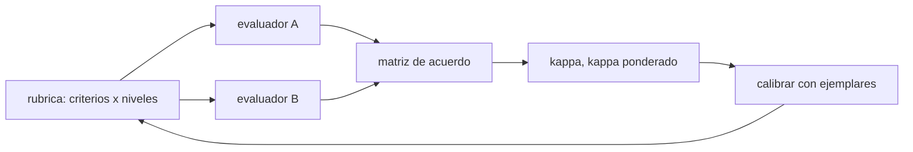

# B131-C09 — Rúbricas de evaluación

<!-- nav:top -->
[🏠 Programa](../../../../README.md) · [📚 Bloque B131](../../../tronco-comun/B131-didactica-de-la-astronomia.md) · [← Anterior: B131-C08 — Evaluación formativa en el aula de astronomía](../B131-C08-evaluacion-formativa-en-el-aula-de-astronomia/CLASE.md) · [Siguiente: B131-C10 — Retroalimentación efectiva →](../B131-C10-retroalimentacion-efectiva/CLASE.md)
<!-- /nav -->

## 1. Ubicación, nivel y alcance

Clase 9 del bloque B131. Nivel N4. Una rúbrica describe qué significa cada nivel de calidad en cada criterio de una producción abierta, como el informe de medición de [B131-C01](../B131-C01-actividades-de-medicion-astronomica-para-el-aula/CLASE.md). Aquí diseñas una rúbrica de 4 criterios y 4 niveles y mides, con datos **sintéticos**, cuánto coinciden dos evaluadores antes y después de calibrar con ejemplares: acuerdo exacto, acuerdo adyacente, kappa de Cohen y kappa ponderado cuadrático por dos vías. **Esta clase es educativa; los trabajos y los evaluadores son simulados.**

## 2. Por qué esta clase existe

Una rúbrica sin acuerdo entre evaluadores asigna notas que dependen de quién corrige. La decisión central: **¿dos personas distintas darían el mismo nivel a este trabajo, y cómo lo sabes?**

## 3. Lo que podrás hacer al terminar

1. Redactar una rúbrica analítica con criterios y niveles descritos en términos observables.
2. Calcular acuerdo exacto y adyacente entre dos evaluadores.
3. Calcular kappa de Cohen y kappa ponderado cuadrático.
4. Verificar el kappa ponderado con una segunda fórmula (covarianza).
5. Interpretar el efecto de calibrar con ejemplares, sin generalizarlo.
6. Separar lo consultado (nada numérico) de lo ilustrativo y lo sintético.

La evidencia es la **rúbrica con acuerdo calculado** del ejercicio 12 (sección 20).

## 4. Con qué llegas y cómo comprobarlo

1. ¿Qué es un criterio de evaluación?
2. ¿Qué es un nivel de logro?
3. ¿Qué es una matriz de confusión entre dos evaluadores?
4. ¿Qué es el acuerdo por azar?
5. ¿Qué es una covarianza?

<details>
<summary>Ver respuestas</summary>

1. Un aspecto de la producción que se valora. 2. Un grado de calidad descrito para un criterio. 3. Una tabla que cruza los niveles dados por cada evaluador. 4. La coincidencia esperada si cada uno puntuara al azar con sus propias frecuencias. 5. Una medida de cuánto varían juntas dos variables.
</details>

Con cuatro o cinco aciertos, sigue; si no, repasa los prerrequisitos.

## 5. Un caso de contexto y casos de referencia

La revisión de Jönsson y Svingby (2007) sobre el uso de rúbricas (fiabilidad, validez y consecuencias educativas) se conoce aquí solo por su referencia bibliográfica y por resúmenes de terceros en una búsqueda web; **no se consultó el texto**, de modo que esta clase no afirma nada de su contenido. El **ejemplo conductor** es una rúbrica **ilustrativa** para el informe de medición con cuatro criterios (datos y unidades, método, incertidumbre, comunicación), cuatro niveles (1 inicial a 4 destacado) y 30 trabajos **sintéticos**.

## 6. Vocabulario

Una **rúbrica analítica** puntúa cada criterio por separado; una **holística**, el trabajo en conjunto. El **acuerdo exacto** es la fracción de pares con el mismo nivel; el **adyacente**, con diferencia de a lo sumo un nivel. **Kappa** de Cohen corrige el acuerdo exacto por el azar: `κ = (po − pe)/(1 − pe)`. El **kappa ponderado cuadrático** penaliza más las discrepancias grandes. La **calibración** es el trabajo conjunto de los evaluadores con ejemplares.

## 7. Modelo mental: de la rúbrica al acuerdo



*Descripción textual:* dos evaluadores aplican la rúbrica, su matriz de acuerdo da el kappa y, si es bajo, se calibran con ejemplares y se vuelve a medir.

Analogía: dos termómetros que deben dar la misma temperatura. Límite: el acuerdo no garantiza validez: dos evaluadores pueden coincidir en un criterio equivocado.

## 8. La explicación, paso a paso

### 8.1 Ronda 1, sin calibrar

30 trabajos × 4 criterios = 120 pares de niveles. Acuerdo exacto `50/120 = 0,417`, adyacente `101/120 = 0,842`, `κ = 0,205`, `κ ponderado = 0,435` y un sesgo de `+0,32` niveles del evaluador B (configurado así en la simulación). La matriz de acuerdo (filas A, columnas B):

| A \ B | 1 | 2 | 3 | 4 |
|---|---|---|---|---|
| 1 | 5 | 6 | 8 | 3 |
| 2 | 4 | 20 | 9 | 7 |
| 3 | 0 | 11 | 8 | 11 |
| 4 | 0 | 1 | 10 | 17 |

### 8.2 Ronda 2, tras calibrar

Con ruido menor y sin sesgo: acuerdo exacto `0,675`, adyacente `0,983`, `κ = 0,531`, `κ ponderado = 0,757`, sesgo `+0,01`. Es una simulación con ruido elegido por nosotros; no mide el efecto de la calibración en la realidad.

### 8.3 Dos vías para el kappa ponderado

Por la matriz de desacuerdo, `κw = 1 − Σ w o / Σ w e` con `w = (i − j)²/(L − 1)²`; por covarianza, `κw = 2 sxy/(sx² + sy² + (x̄ − ȳ)²)`. Ambas dan `0,435` y `0,757`; difieren menos de `10⁻⁹`.

### 8.4 Por criterio

En la ronda 1: datos y unidades `0,495`, método `0,418`, incertidumbre `0,373`, comunicación `0,358`. Con solo 30 trabajos por criterio, las diferencias entre criterios son poco fiables.

### 8.5 Qué hacer con el acuerdo

No se usa un umbral publicado en esta clase (no se consultó ninguno). Una regla razonable del aula: fijar de antemano qué acuerdo se exige, calibrar con ejemplares cuando no se alcanza y revisar los criterios donde más discrepan; y, si hay consecuencias para el estudiante, tener un tercer evaluador o una instancia de revisión.

## 9. Magnitudes, símbolos y unidades

| Símbolo | Qué es | Unidad | Valor / nota |
|---|---|---|---|
| `po` | acuerdo exacto | fracción | 0,417 → 0,675 |
| `κ` | kappa de Cohen | — | 0,205 → 0,531 |
| `κw` | kappa ponderado cuadrático | — | 0,435 → 0,757 |
| `L` | niveles | — | 4 |
| `n` | pares evaluados | — | 120 |

## 10. Convenciones y referencias

Niveles de 1 a 4. Los kappa se calculan sobre los 120 pares agrupados; las varianzas son poblacionales. Los parámetros de ruido y sesgo son **ilustrativos**.

## 11. De dónde sale lo que afirmamos

| ID | Fuente | Localizador | Respalda | Estado |
|---|---|---|---|---|
| S1 | Jönsson A., Svingby G., «The use of scoring rubrics: Reliability, validity and educational consequences», *Educational Research Review* 2(2):130-144, 2007 (referencia obtenida por búsqueda web el 2026-11-11; la página del editor devolvió HTTP 403) | solo la referencia | ninguna afirmación de contenido | **No consultada** |
| — | Kappa de Cohen, kappa ponderado y su fórmula con covarianza | — | cálculos; contrastados por dos vías | No consultados en una fuente concreta |
| — | Los 30 trabajos, los dos evaluadores, el ruido y el sesgo | — | todo el caso | Sintético / ilustrativo |

Límites: no se consultó bibliografía sobre rúbricas; la mejora entre rondas es un artefacto de los parámetros elegidos.

## 12. Cómo ver el acuerdo

| Magnitud | Ronda 1 | Ronda 2 |
|---|---|---|
| acuerdo exacto | 0,417 | 0,675 |
| acuerdo adyacente | 0,842 | 0,983 |
| `κ` | 0,205 | 0,531 |
| `κw` | 0,435 | 0,757 |

Descripción larga: las discrepancias de un nivel son frecuentes en la ronda 1; el `κw` es mayor que el `κ` porque casi todas las discrepancias son adyacentes.

## 13. Ejemplo trabajado: un kappa simple a mano

Dos evaluadores clasifican 50 trabajos como «aprobado/reprobado»: ambos aprueban 20, ambos reprueban 15, A aprueba y B reprueba 5, A reprueba y B aprueba 10.

**Paso 1 · Acuerdo.** `po = (20 + 15)/50 = 0,70`.

**Paso 2 · Azar.** A aprueba `25/50`, B aprueba `30/50`: `pe = 0,5 × 0,6 + 0,5 × 0,4 = 0,50`.

**Paso 3 · Kappa.** `κ = (0,70 − 0,50)/(1 − 0,50) = 0,40`.

## 14. Distintas formas de describir una rúbrica

**Por criterios:** qué se valora. **Por niveles:** descriptores observables. **Por acuerdo:** `po`, `κ`, `κw`. **Por sesgo:** diferencia media. **Por uso:** formativo o con consecuencias.

## 15. Práctica guiada

**Ejercicio 1 · con los pasos indicados.** Calcula el acuerdo exacto con 50 coincidencias en 120 pares. *Pasos:* divide.

<details><summary>Solución comentada</summary>

`50/120 = 0,417`.
</details>

**Ejercicio 2 · con una pista.** Calcula el acuerdo adyacente de la ronda 1 con 101 pares dentro de un nivel. *Pista:* divide.

<details><summary>Solución comentada</summary>

`101/120 = 0,842`.
</details>

**Ejercicio 3 · casi autónomo.** Calcula el peso cuadrático de una discrepancia de 2 niveles con `L = 4`.

<details><summary>Solución comentada</summary>

`2²/(4 − 1)² = 4/9 = 0,444`.
</details>

## 16. Práctica autónoma, transferencia e integrador

**Ejercicio 4 · autónomo.** Suma de la diagonal de la matriz de la ronda 1.

<details><summary>Solución comentada</summary>

`5 + 20 + 8 + 17 = 50`.
</details>

**Ejercicio 5 · autónomo.** ¿Cuál es la frecuencia marginal del nivel 3 para el evaluador A?

<details><summary>Solución comentada</summary>

Fila 3: `0 + 11 + 8 + 11 = 30` de 120.
</details>

**Ejercicio 6 · autónomo.** Con `po = 0,8` y `pe = 0,6`, calcula `κ`.

<details><summary>Solución comentada</summary>

`(0,8 − 0,6)/0,4 = 0,50`.
</details>

**Ejercicio 7 · autónomo.** ¿Por qué el `κw` (0,435) supera al `κ` (0,205) en la ronda 1?

<details><summary>Solución comentada</summary>

Porque la mayoría de las discrepancias son de un nivel y el ponderado las penaliza poco.
</details>

**Ejercicio 8 · autónomo.** ¿Qué indica un sesgo de `+0,32` niveles?

<details><summary>Solución comentada</summary>

Que B puntúa en promedio un tercio de nivel más alto que A: severidad distinta, que se corrige calibrando.
</details>

**Ejercicio 9 · transferencia.** **Transferencia.** Un acuerdo alto en «comunicación» y bajo en «incertidumbre». ¿Qué revisas?

<details><summary>Solución comentada</summary>

Los descriptores de «incertidumbre»: probablemente son ambiguos o piden juicios distintos; se reescriben con indicadores observables y ejemplares.
</details>

**Ejercicio 10 · transferencia.** **Transferencia.** Los dos evaluadores coinciden mucho pero ambos ignoran un criterio importante. ¿Qué mide el acuerdo?

<details><summary>Solución comentada</summary>

Fiabilidad, no validez: acuerdan, pero pueden medir lo equivocado.
</details>

**Ejercicio 11 · transferencia.** **Transferencia.** ¿Por qué no concluir de la ronda 2 que «calibrar sube el kappa a 0,76»?

<details><summary>Solución comentada</summary>

Porque el ruido de la ronda 2 se fijó menor por construcción; es una simulación y no una medición del efecto de calibrar.
</details>

**Ejercicio 12 · integrador.** **Integrador.** Elabora tu *rúbrica con acuerdo calculado*: 4 criterios × 4 niveles con descriptores observables, una matriz de acuerdo (real o sintética rotulada), `po`, `κ`, `κw` por dos vías y una decisión.

<details><summary>Solución comentada</summary>

Secciones 8.1–8.5 y la salida del laboratorio.
</details>

## 17. Laboratorio: acuerdo entre dos evaluadores

El script [acuerdo.py](acuerdo.py) simula dos rondas de 30 trabajos × 4 criterios, calcula acuerdos y kappa, y el kappa ponderado por dos vías (**comprueba** que coinciden a 1e-9 y que la ronda calibrada mejora).

**Datos:** ningún dato consultado; trabajos y evaluadores **sintéticos**. **Predice antes de ejecutar:** ¿qué será mayor, `κ` o `κw` en la ronda 1? (`κw`.) **Ejecución del 2026-11-11 (Python 3.12.9):**

```text
Python 3.12.9 (biblioteca estandar)
30 trabajos x 4 criterios, dos evaluadores SINTETICOS (semilla 131); parametros ILUSTRATIVOS; ningun dato consultado.
Ronda 1 (sin calibrar): acuerdo exacto 0.417 ; adyacente 0.842 ; kappa 0.205 ; kappa ponderado 0.435 (via covarianza 0.435) ; sesgo B-A +0.32
Ronda 2 (calibrada)   : acuerdo exacto 0.675 ; adyacente 0.983 ; kappa 0.531 ; kappa ponderado 0.757 (via covarianza 0.757) ; sesgo B-A +0.01
Por criterio, ronda 1 (kappa ponderado):
  Datos y unidades   0.495   (n = 30 trabajos: estimacion muy inestable)
  Metodo             0.418   (n = 30 trabajos: estimacion muy inestable)
  Incertidumbre      0.373   (n = 30 trabajos: estimacion muy inestable)
  Comunicacion       0.358   (n = 30 trabajos: estimacion muy inestable)
Matriz de la ronda 1 (filas A, columnas B):
  nivel 1:   5   6   8   3
  nivel 2:   4  20   9   7
  nivel 3:   0  11   8  11
  nivel 4:   0   1  10  17
Pruebas superadas.
```

```bash
python programa/clases/B131/B131-C09-rubricas-de-evaluacion/acuerdo.py
```

**Límites:** los evaluadores simulados observan un nivel verdadero latente que en un aula no existe; los criterios se agrupan en un solo kappa aunque no sean independientes.

## 18. Errores frecuentes y cómo corregirlos

**Reportar solo el acuerdo exacto.** Se corrige con 8.1 y el ejercicio 7.

**Creer que acuerdo es validez.** Se corrige con el ejercicio 10.

**Concluir un efecto de la calibración a partir de una simulación.** Se corrige con el ejercicio 11.

**Descriptores vagos («bueno», «adecuado»).** Se corrige con el ejercicio 9.

## 19. Cómo sabrás que vas bien

Tras la sección 8: ¿qué acuerdo esperabas en la ronda 1 y cuál obtuviste? Si dudas, repasa el ejemplo 13. Tras el laboratorio: ¿qué comprueba? (ver la sección 17).

## 20. Qué entregas y cómo se evalúa

El producto es tu **rúbrica con acuerdo calculado** (ejercicio 12).

| Criterio | Inicial | En desarrollo | Logrado | Destacado |
|---|---|---|---|---|
| Conceptos | Los confunde | Parciales | Distingue acuerdo, kappa y validez | Explica los límites |
| Cálculo | Sin unidades | Con errores | `po`, `κ` y `κw` correctos | Calcula casos nuevos |
| Numérico | Sin comprobar | Una vía | `κw` por dos vías | Interpreta las diferencias |
| Fuentes | Sin fuente | Sin fecha | Fuentes con fecha y estado | Declara lo no consultado |
| Límites | No los nombra | Uno | Tres | Discute qué falta del diseño |

**Condiciones críticas (no se compensan con promedio):** rotular los datos como sintéticos; no presentar acuerdo como validez; no citar lo no consultado.

## 21. Ética, seguridad y límites

Clase educativa. Si la rúbrica tiene consecuencias para estudiantes, debe publicarse con antelación, aplicarse con ejemplares, permitir revisión y no usar una sola persona evaluadora. Los datos son sintéticos. Si el trabajo evaluado implica observar el Sol, la rúbrica debe incluir el cumplimiento de las precauciones como criterio. Accesibilidad: tablas equivalentes a las figuras, fórmulas en texto, ejercicios sin conexión.

## 22. Para cerrar y seguir

Dos evaluadores simulados pasan de `κw = 0,435` a `0,757` al calibrar, por construcción; el acuerdo mide fiabilidad, no validez. Queda una pregunta: ¿cómo comunicar el nivel al estudiante para que mejore?

**Glosario español–inglés.** rúbrica · *rubric*; criterio · *criterion*; acuerdo entre evaluadores · *inter-rater agreement*; kappa de Cohen · *Cohen's kappa*; calibración · *calibration*.

**Continuidad.** [B131-C10](../B131-C10-retroalimentacion-efectiva/CLASE.md) trata de la retroalimentación.

**Referencias:** ver sección 11.

<!-- nav:bottom -->
---

[← Anterior: B131-C08 — Evaluación formativa en el aula de astronomía](../B131-C08-evaluacion-formativa-en-el-aula-de-astronomia/CLASE.md) · [📚 Bloque B131](../../../tronco-comun/B131-didactica-de-la-astronomia.md) · [Siguiente: B131-C10 — Retroalimentación efectiva →](../B131-C10-retroalimentacion-efectiva/CLASE.md)
<!-- /nav -->
