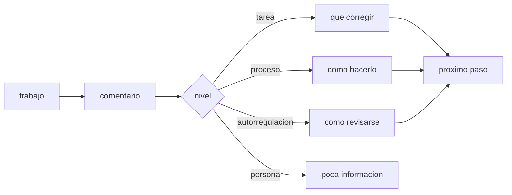

# B131-C10 — Retroalimentación efectiva

<!-- nav:top -->
[🏠 Programa](../../../../README.md) · [📚 Bloque B131](../../../tronco-comun/B131-didactica-de-la-astronomia.md) · [← Anterior: B131-C09 — Rúbricas de evaluación](../B131-C09-rubricas-de-evaluacion/CLASE.md) · [Siguiente: B131-C11 — Plan completo de una clase de astronomía →](../B131-C11-plan-completo-de-una-clase-de-astronomia/CLASE.md)
<!-- /nav -->

## 1. Ubicación, nivel y alcance

Clase 10 del bloque B131. Nivel N4. La retroalimentación es la información que recibe el estudiante sobre su trabajo para poder mejorarlo. La evidencia indica que puede ayudar o perjudicar según su tipo y la forma de darla. Aquí auditas dos conjuntos **sintéticos** de comentarios al informe de [B131-C01](../B131-C01-actividades-de-medicion-astronomica-para-el-aula/CLASE.md): uno dirigido sobre todo a la persona y otro reescrito hacia la tarea, el proceso y la autorregulación, y mides cuán específicos son. **Esta clase es educativa; los comentarios son inventados y la clasificación es una heurística.**

## 2. Por qué esta clase existe

Un comentario como «muy bien» o «desastre» no dice qué hacer. La decisión central: **¿qué información da este comentario al estudiante para su próximo paso?**

## 3. Lo que podrás hacer al terminar

1. Distinguir cuatro niveles de comentario: tarea, proceso, autorregulación y persona.
2. Clasificar comentarios con una regla explícita y medir su exactitud contra una etiqueta manual.
3. Medir la proporción de comentarios específicos (con un dato, sección o magnitud).
4. Reescribir un comentario de persona como uno de tarea, proceso o autorregulación.
5. Citar la evidencia sobre retroalimentación con sus límites.
6. Separar lo consultado (resúmenes), lo citado de memoria y lo sintético.

La evidencia es la **auditoría de comentarios** del ejercicio 12 (sección 20).

## 4. Con qué llegas y cómo comprobarlo

1. ¿Qué es un comentario específico?
2. ¿Qué es una rúbrica?
3. ¿Qué es una etiqueta manual?
4. ¿Qué es una matriz de confusión?
5. ¿Qué es una heurística?

<details>
<summary>Ver respuestas</summary>

1. Uno que señala un hecho concreto del trabajo. 2. Una descripción de niveles de calidad por criterio. 3. La categoría que asigna una persona. 4. Una tabla de categoría real frente a categoría predicha. 5. Una regla práctica que no garantiza ser correcta.
</details>

Con cuatro o cinco aciertos, sigue; si no, repasa los prerrequisitos.

## 5. Un caso de contexto y casos de referencia

Hattie y Timperley (2007), en el resumen consultado, afirman que la retroalimentación es una de las influencias más fuertes en el aprendizaje, pero que su efecto depende del tipo y de cómo se da, y proponen un modelo de las propiedades que la hacen eficaz. Wisniewski, Zierer y Hattie (2020) reúnen 435 estudios con 994 tamaños de efecto y 61 000 participantes: `d = 0,48` con heterogeneidad significativa; el contenido informativo del comentario es un moderador importante, y los efectos son mayores sobre resultados cognitivos y motores que sobre motivacionales y conductuales (según el resumen). Los **cuatro niveles** de esta clase (tarea, proceso, autorregulación, persona) son los de la referencia de 2007 **citados de memoria**; su texto no se consultó. El **ejemplo conductor** son 24 comentarios **sintéticos**.

## 6. Vocabulario

El comentario **de tarea** informa si el resultado es correcto o completo; **de proceso**, sobre la estrategia para hacerlo; **de autorregulación**, sobre cómo el estudiante se monitorea y decide; **de persona**, sobre sus cualidades («eres muy inteligente»). Un comentario es **específico** si cita un dato verificable del trabajo. Una **regla de palabras clave** clasifica con listas de términos.

## 7. Modelo mental: de la información al próximo paso



*Descripción textual:* según su nivel, el comentario aporta qué corregir, cómo hacerlo o cómo revisarse; el de persona aporta poca información para actuar.

Analogía: un GPS que dice «vas bien» frente a uno que dice «gira a la derecha en 200 m». Límite: «poca información» no significa que los comentarios de persona sean siempre malos; significa que no orientan la acción.

## 8. La explicación, paso a paso

### 8.1 Antes

12 comentarios sintéticos: 5 de tarea, 0 de proceso, 0 de autorregulación y 7 de persona (`58,3 %`). Solo 2 son específicos (`17 %`). Ejemplos: «Muy bien, buen trabajo.», «Falta la unidad en la tabla 2.».

### 8.2 Después

12 comentarios reescritos: 4 de tarea, 3 de proceso, 4 de autorregulación y 1 de persona (`8,3 %`); 7 son específicos (`58 %`). Ejemplo: «La tabla 2 omite la unidad de la sombra (cm): añádela y recalcula Δθ.».

### 8.3 El clasificador

La regla de palabras clave acierta `10/12 = 0,833` en el conjunto «antes» y `12/12` en «después». Los fallos son instructivos: «Eres muy inteligente.» se clasificó como autorregulación porque contiene «elige» dentro de «int**elige**nte»; «Podrías esforzarte más.» se clasificó como tarea porque la palabra clave «esfuerz» no coincide con «esforz». **Advertencia:** las palabras clave se ajustaron con estos 24 comentarios a la vista, de modo que la exactitud de `12/12` es optimista y no se generaliza.

### 8.4 Qué cambia de verdad

Reescribir mueve el foco de la persona a la acción, y aumenta lo específico. El laboratorio no mide si los estudiantes mejoran con esos comentarios.

### 8.5 La evidencia y sus límites

El efecto medio `d = 0,48` del metaanálisis de 2020 es un promedio sobre estudios muy distintos (heterogeneidad significativa); no se puede aplicar a un conjunto de 24 comentarios ni a tu curso. Los autores señalan que pocos estudios físicos y conductuales reducen la precisión de esos efectos, y que no se modelaron factores como el nivel del estudiante.

## 9. Magnitudes, símbolos y unidades

| Símbolo | Qué es | Unidad | Valor / nota |
|---|---|---|---|
| `n` | comentarios por conjunto | — | 12 |
| % persona | comentarios de persona | % | 58,3 → 8,3 |
| % específicos | comentarios con dato verificable | % | 17 → 58 |
| exactitud | del clasificador | fracción | 0,833; 1,000 |
| `d` | tamaño de efecto del metaanálisis | — | 0,48 (referencia) |

## 10. Convenciones y referencias

«Específico» se detecta si el comentario contiene un número, «tabla», «sección», «figura», «sigma», «incertidumbre» o «unidad». Las etiquetas manuales las asigna el autor del curso y son **ilustrativas**; en un uso real las asignarían dos personas y se mediría su acuerdo (ver [B131-C09](../B131-C09-rubricas-de-evaluacion/CLASE.md)).

## 11. De dónde sale lo que afirmamos

| ID | Fuente | Localizador | Respalda | Estado |
|---|---|---|---|---|
| S1 | Hattie J., Timperley H., «The Power of Feedback», *Review of Educational Research* 77(1):81-112, 2007, DOI 10.3102/003465430298487 — https://findanexpert.unimelb.edu.au/scholarlywork/334554-the-power-of-feedback (consultada 2026-11-11) | resumen en la ficha del repositorio institucional | el efecto depende del tipo de retroalimentación y de cómo se da; el artículo propone un modelo | Consultada (solo el resumen) |
| S2 | Wisniewski B., Zierer K., Hattie J., «The Power of Feedback Revisited: A Meta-Analysis of Educational Feedback Research», *Frontiers in Psychology* 10:3087 — https://www.frontiersin.org/articles/10.3389/fpsyg.2019.03087/full (consultada 2026-11-11; primeros 100 000 caracteres) | resumen | 435 estudios, 994 efectos, d = 0,48, heterogeneidad significativa | Consultada (resumen) |
| S3 | Black P., Wiliam D., *Assessment in Education* 5(1), 1998 (PDF leído, 2026-11-11; texto parcialmente degradado) | sección sobre retroalimentación | la retroalimentación puede tener efectos negativos según cómo se dé | Consultada (extracción parcial) |
| — | Los cuatro niveles (tarea, proceso, autorregulación, persona) | — | la clasificación del laboratorio | Citados de memoria; texto no consultado |
| — | Los 24 comentarios, etiquetas manuales y reglas | — | todo el caso | Sintético / ilustrativo |

Límites: no se leyó el texto de Hattie y Timperley; del artículo de Wisniewski et al. solo se leyeron el resumen y el inicio del texto.

## 12. Cómo ver la auditoría

| Magnitud | Antes | Después |
|---|---|---|
| comentarios de persona | 58,3 % | 8,3 % |
| comentarios específicos | 17 % | 58 % |
| comentarios de proceso | 0 | 25 % |
| exactitud del clasificador | 0,833 | 1,000 (optimista) |

Descripción larga: tras reescribir, casi todos los comentarios dicen qué hacer, cómo hacerlo o cómo revisarse; los de persona pasan de más de la mitad a uno de doce.

## 13. Ejemplo trabajado: reescribir un comentario

**Paso 1 · Original.** «Revisa los cálculos.» (tarea, no específico).

**Paso 2 · Qué falta.** Dónde, qué y cómo.

**Paso 3 · Reescritura.** «En la tabla 2, recalcula Δθ con θ = atan(S/H) y comprueba con la segunda vía antes de entregar.»

**Paso 4 · Nivel.** Mezcla tarea, proceso y autorregulación; es específico (tabla 2, fórmula).

## 14. Distintas formas de describir un comentario

**Por nivel:** tarea, proceso, autorregulación, persona. **Por especificidad:** cita un dato o no. **Por acción:** dice qué hacer o no. **Por tono:** informativo o valorativo. **Por evidencia:** qué respalda su uso.

## 15. Práctica guiada

**Ejercicio 1 · con los pasos indicados.** Clasifica «Falta la unidad en la tabla 2.» *Pasos:* ¿habla del resultado o de la persona?

<details><summary>Solución comentada</summary>

De tarea y específico (tabla 2, unidad).
</details>

**Ejercicio 2 · con una pista.** Clasifica «Eres muy inteligente.» *Pista:* ¿qué información da para actuar?

<details><summary>Solución comentada</summary>

De persona: ninguna información de acción.
</details>

**Ejercicio 3 · casi autónomo.** Calcula el porcentaje de comentarios de persona si 7 de 12 lo son.

<details><summary>Solución comentada</summary>

`7/12 = 58,3 %`.
</details>

## 16. Práctica autónoma, transferencia e integrador

**Ejercicio 4 · autónomo.** Reescribe «Bien.» como comentario de tarea específico.

<details><summary>Solución comentada</summary>

«Tu cálculo de Δθ = 3,2049° es correcto; falta la incertidumbre de R.»
</details>

**Ejercicio 5 · autónomo.** Reescribe «Incompleto.» como comentario de proceso.

<details><summary>Solución comentada</summary>

«Recorre la lista de la sección 8.1 y marca qué pasos faltan en tu informe.»
</details>

**Ejercicio 6 · autónomo.** Escribe un comentario de autorregulación para un informe sin comprobación.

<details><summary>Solución comentada</summary>

«Antes de entregar, calcula R con otra vía y compara; anota qué diferencia aceptas.»
</details>

**Ejercicio 7 · autónomo.** Calcula la exactitud si el clasificador acierta 10 de 12.

<details><summary>Solución comentada</summary>

`10/12 = 0,833`.
</details>

**Ejercicio 8 · autónomo.** ¿Por qué falló el clasificador con «Eres muy inteligente»?

<details><summary>Solución comentada</summary>

Porque la cadena «elige» está dentro de «inteligente»: las reglas de subcadenas confunden palabras.
</details>

**Ejercicio 9 · transferencia.** **Transferencia.** El clasificador acierta 12/12 en «después». ¿Por qué no lo usas como prueba de que funciona?

<details><summary>Solución comentada</summary>

Porque sus palabras clave se ajustaron a esos mismos comentarios; hay que probarlo con comentarios nuevos y etiquetas de dos personas.
</details>

**Ejercicio 10 · transferencia.** **Transferencia.** Un colega dice «los metaanálisis dicen que la retroalimentación sube 0,48 desviaciones; la mía también». ¿Qué respondes?

<details><summary>Solución comentada</summary>

Que 0,48 es un promedio con heterogeneidad significativa y depende del contenido del comentario; el efecto en tu aula hay que medirlo, y puede ser menor o negativo.
</details>

**Ejercicio 11 · transferencia.** **Transferencia.** ¿Debes evitar siempre el elogio? ¿Qué enseña el laboratorio?

<details><summary>Solución comentada</summary>

No necesariamente; enseña que el elogio de persona aporta poca información para actuar. Un elogio ligado a la tarea («tu comprobación con dos vías es sólida») informa.
</details>

**Ejercicio 12 · integrador.** **Integrador.** Elabora tu *auditoría de comentarios*: 12 comentarios reales (anónimos) o sintéticos rotulados, su nivel, su especificidad, una reescritura de los menos útiles y una regla de uso con sus límites.

<details><summary>Solución comentada</summary>

Secciones 8.1–8.5 y la salida del laboratorio.
</details>

## 17. Laboratorio: auditoría de comentarios

El script [comentarios.py](comentarios.py) clasifica 24 comentarios sintéticos con una regla de palabras clave, calcula la exactitud por dos vías (matriz de confusión y conteo directo) y la especificidad (**comprueba** que ambas exactitudes coinciden y que los comentarios de persona bajan tras reescribir).

**Datos:** resúmenes de Hattie y Timperley y de Wisniewski et al. **consultados**; niveles **de memoria**; comentarios **sintéticos**. **Predice antes de ejecutar:** ¿qué porcentaje de comentarios del conjunto «antes» es de persona? (más de la mitad.) **Ejecución del 2026-11-11 (Python 3.12.9):**

```text
Python 3.12.9 (biblioteca estandar)
Comentarios SINTETICOS; etiquetas manuales y clasificador ILUSTRATIVOS; niveles de Hattie y Timperley 2007 de memoria (texto NO consultado).
Antes (12 comentarios): exactitud del clasificador 0.833
  nivel (etiqueta manual)   n    % ; especificos
  tarea                     5   41.7 % ; 2
  proceso                   0    0.0 % ; 0
  autorregulacion           0    0.0 % ; 0
  persona                   7   58.3 % ; 0
  comentarios especificos en total: 2 de 12 (17 %)
    desacuerdo: 'Eres muy inteligente.' manual=persona clasificador=autorregulacion
    desacuerdo: 'Podrias esforzarte mas.' manual=persona clasificador=tarea
Despues (12 comentarios): exactitud del clasificador 1.000
  nivel (etiqueta manual)   n    % ; especificos
  tarea                     4   33.3 % ; 4
  proceso                   3   25.0 % ; 2
  autorregulacion           4   33.3 % ; 1
  persona                   1    8.3 % ; 0
  comentarios especificos en total: 7 de 12 (58 %)
Proporcion de comentarios dirigidos a la persona: antes 58 % ; despues 8 %
Referencia consultada (resumen, Wisniewski et al. 2020): d = 0.48 con heterogeneidad significativa; no se aplica a este conjunto sintetico.
Pruebas superadas.
```

```bash
python programa/clases/B131/B131-C10-retroalimentacion-efectiva/comentarios.py
```

**Límites:** conjuntos muy pequeños; reglas ajustadas a los propios datos; «específico» es una regla léxica; no se mide el efecto en estudiantes.

## 18. Errores frecuentes y cómo corregirlos

**Confundir elogio con retroalimentación.** Se corrige con el ejercicio 11.

**Dar solo el veredicto («mal») sin el camino.** Se corrige con el ejemplo 13.

**Validar un clasificador con los mismos datos.** Se corrige con el ejercicio 9.

**Aplicar un efecto medio a tu aula.** Se corrige con el ejercicio 10.

## 19. Cómo sabrás que vas bien

Tras la sección 8: ¿qué porcentaje de comentarios de persona esperabas antes y cuál obtuviste? Si dudas, repasa el ejemplo 13. Tras el laboratorio: ¿qué comprueba? (ver la sección 17).

## 20. Qué entregas y cómo se evalúa

El producto es tu **auditoría de comentarios** (ejercicio 12).

| Criterio | Inicial | En desarrollo | Logrado | Destacado |
|---|---|---|---|---|
| Conceptos | Los confunde | Parciales | Distingue los cuatro niveles | Explica los límites de la clasificación |
| Cálculo | Sin criterio | Con errores | Porcentajes y exactitud correctos | Propone una medida nueva |
| Numérico | Sin comprobar | Una vía | Exactitud por dos vías | Interpreta los fallos |
| Fuentes | Sin fuente | Sin fecha | Fuentes con fecha y estado | Declara lo citado de memoria |
| Límites | No los nombra | Uno | Tres | Discute qué evidencia falta |

**Condiciones críticas (no se compensan con promedio):** rotular los comentarios como sintéticos; no aplicar un tamaño de efecto a tu aula; no citar lo no consultado como leído.

## 21. Ética, seguridad y límites

Clase educativa. Los comentarios reales sobre estudiantes son datos personales: anonimízalos antes de analizarlos y no los publiques. Los datos del laboratorio son inventados. La retroalimentación debe cuidar el respeto: critica el trabajo, no a la persona. Si el trabajo implica observar el Sol, el comentario debe recordar las precauciones. Accesibilidad: tablas equivalentes a las figuras, fórmulas en texto, ejercicios sin conexión.

## 22. Para cerrar y seguir

Reescribir 12 comentarios baja los dirigidos a la persona de `58,3 %` a `8,3 %` y sube los específicos de `17 %` a `58 %`; el efecto sobre el aprendizaje queda sin medir. Queda una pregunta: ¿cómo juntar todo en una clase?

**Glosario español–inglés.** retroalimentación · *feedback*; autorregulación · *self-regulation*; comentario específico · *specific comment*; tamaño de efecto · *effect size*; heterogeneidad · *heterogeneity*.

**Continuidad.** [B131-C11](../B131-C11-plan-completo-de-una-clase-de-astronomia/CLASE.md) integra el bloque en un plan de clase.

**Referencias:** ver sección 11.

<!-- nav:bottom -->
---

[← Anterior: B131-C09 — Rúbricas de evaluación](../B131-C09-rubricas-de-evaluacion/CLASE.md) · [📚 Bloque B131](../../../tronco-comun/B131-didactica-de-la-astronomia.md) · [Siguiente: B131-C11 — Plan completo de una clase de astronomía →](../B131-C11-plan-completo-de-una-clase-de-astronomia/CLASE.md)
<!-- /nav -->
