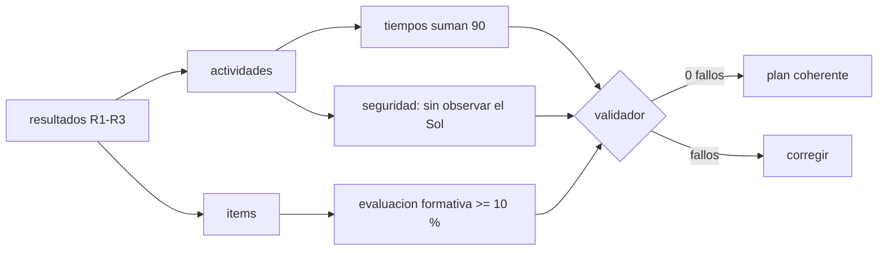

# B131-C11 — Plan completo de una clase de astronomía

<!-- nav:top -->
[🏠 Programa](../../../../README.md) · [📚 Bloque B131](../../../tronco-comun/B131-didactica-de-la-astronomia.md) · [← Anterior: B131-C10 — Retroalimentación efectiva](../B131-C10-retroalimentacion-efectiva/CLASE.md) · [Siguiente: B132-C01 — Crítica histórica de fuentes y método historiográfico →](../../B132/B132-C01-critica-historica-de-fuentes-y-metodo-historiografico/CLASE.md)
<!-- /nav -->

## 1. Ubicación, nivel y alcance

Clase 11 del bloque B131. Nivel N4. Un plan de clase integra resultados de aprendizaje, actividades, evaluación, tiempos y seguridad. Aquí armas un plan de 90 minutos sobre las **fases de la Luna** con todo lo del bloque: los resultados observables de [B131-C02](../B131-C02-resultados-de-aprendizaje-observables-en-astronomia/CLASE.md), el diagnóstico de [B131-C03](../B131-C03-conocimientos-previos-y-concepciones-alternativas/CLASE.md), el orden de [B131-C04](../B131-C04-secuenciacion-conceptual-de-una-unidad/CLASE.md), la maqueta de [B131-C05](../B131-C05-demostraciones-visuales-y-modelos-para-el-aula/CLASE.md), la evaluación formativa de [B131-C08](../B131-C08-evaluacion-formativa-en-el-aula-de-astronomia/CLASE.md) y la retroalimentación de [B131-C10](../B131-C10-retroalimentacion-efectiva/CLASE.md), y lo validas con un programa que revisa su coherencia. **Esta clase es educativa; no sustituye el currículo oficial ni el juicio del docente.**

## 2. Por qué esta clase existe

Un buen plan se puede revisar: sus tiempos suman, cada resultado tiene actividad y evaluación, y nada pone en riesgo a nadie. La decisión central: **¿este plan es coherente y seguro antes de entrar al aula?**

## 3. Lo que podrás hacer al terminar

1. Estructurar una clase en bloques con tiempo, tipo, resultados e ítems.
2. Verificar que los tiempos suman la duración de la clase.
3. Verificar que cada resultado tiene al menos una actividad y un ítem de evaluación.
4. Aplicar reglas de equilibrio (evaluación formativa, exposición continua) y de seguridad.
5. Calcular la tabla de fases lunares y comprobarla por simetría y por conteo independiente.
6. Rotular lo ilustrativo y lo estándar no consultado.

La evidencia es el **plan de clase validado** del ejercicio 12 (sección 20).

## 4. Con qué llegas y cómo comprobarlo

1. ¿Qué es un resultado de aprendizaje observable?
2. ¿Qué es una actividad?
3. ¿Qué es un ítem de evaluación?
4. ¿Qué es el ángulo de fase?
5. ¿Qué precaución se toma al hablar del Sol en el aula?

<details>
<summary>Ver respuestas</summary>

1. Un enunciado con un verbo que describe una acción visible. 2. Lo que hace el estudiante para aprender. 3. Una tarea o pregunta que mide un resultado. 4. El ángulo Sol–Luna–Tierra. 5. No observarlo directamente ni con instrumentos sin filtro certificado.
</details>

Con cuatro o cinco aciertos, sigue; si no, repasa los prerrequisitos.

## 5. Un caso de contexto y casos de referencia

La IAU Office of Astronomy for Education (OAE) ofrece materiales de aula abiertos y guías para docentes (según su página principal); este bloque no los reproduce ni los evalúa. El **ejemplo conductor** es un plan **propio y ilustrativo** de 90 minutos con tres resultados: explicar con un diagrama por qué se ve una fase (R1), calcular la fracción iluminada para un ángulo de fase (R2) y justificar por qué la sombra de la Tierra no causa las fases (R3). Tiene siete bloques y no incluye ninguna observación del Sol.

## 6. Vocabulario

Un **bloque** es un tramo del plan con un tiempo y un tipo (diagnóstico, exposición, actividad, evaluación o cierre). La **alineación** es la correspondencia entre resultados, actividades e ítems. La **evaluación formativa** del plan es el tiempo dedicado a diagnóstico y evaluación. Un **plan defectuoso** es un contraejemplo que incumple reglas a propósito para probar el validador.

## 7. Modelo mental: el plan como circuito cerrado



*Descripción textual:* el validador comprueba tiempos, alineación, proporción de evaluación formativa y seguridad; sin fallos el plan es coherente según las reglas.

Analogía: una lista de verificación previa al vuelo. Límite: un plan que cumple las reglas puede ser pedagógicamente débil; las reglas son mínimos, no calidad.

## 8. La explicación, paso a paso

### 8.1 El plan

| Bloque | Min | Tipo | Contenido | Resultados |
|---|---|---|---|---|
| B1 | 10 | diagnóstico | pregunta inicial con distractores sobre la causa de las fases | R3 |
| B2 | 12 | exposición | geometría Sol–Tierra–Luna con linterna y esfera | R1 |
| B3 | 25 | actividad | parejas ordenan fases con la maqueta y dibujan el ángulo | R1 |
| B4 | 10 | exposición | fórmula `k = (1 + cos i)/2` y tabla | R2 |
| B5 | 18 | actividad | cálculo de `k` en cinco ángulos con verificación | R2 |
| B6 | 10 | evaluación | ticket de salida: dibuja `i = 90 °` y explica por qué no es sombra | R1, R3 |
| B7 | 5 | cierre | síntesis y tarea: bitácora de la Luna | — |

Suma `10 + 12 + 25 + 10 + 18 + 10 + 5 = 90` min. La evaluación formativa (B1 + B6) ocupa `20` min, el `22 %`.

### 8.2 La tabla de fases

Con un modelo circular uniforme (mes sinódico `29,530589 d`, estándar no consultado): nueva (día 0, `i = 180 °`, `k = 0`), creciente (3,69 d, `135 °`, `0,146`), cuarto creciente (7,38 d, `90 °`, `0,500`), gibosa creciente (11,07 d, `45 °`, `0,854`), llena (14,77 d, `0 °`, `1,000`), y las simétricas menguantes. La simetría `k(i) + k(180 − i) = 1` se cumple a `10⁻¹⁶`; un conteo independiente de puntos en el disco a `i = 90 °` da `0,4985` (esperado `0,5`).

### 8.3 Las reglas

(1) Los tiempos suman 90 min. (2) Cada resultado tiene al menos una actividad y un ítem. (3) La evaluación formativa ocupa al menos el 10 % del tiempo. (4) Ninguna exposición dura más de 15 min seguidos. (5) Toda actividad que mencione el Sol lleva una precaución o declara «sin observación del Sol». Son reglas **ilustrativas** del curso.

### 8.4 Un plan defectuoso

El contraejemplo tiene 95 min, `R1` sin ítem, `R3` sin actividad ni ítem, una exposición de 20 min y una actividad «observar el Sol con binoculares» sin precaución. El validador encuentra 6 fallos. La última actividad, además de incumplir la regla, es **peligrosa**: nunca se debe observar el Sol con binoculares sin filtro certificado.

### 8.5 Qué no garantiza el validador

El plan propuesto pasa todas las reglas, pero esto no prueba que enseñe: falta probarlo con estudiantes, ajustar los tiempos a su ritmo y revisar los ítems con el análisis de [B131-C08](../B131-C08-evaluacion-formativa-en-el-aula-de-astronomia/CLASE.md).

## 9. Magnitudes, símbolos y unidades

| Símbolo | Qué es | Unidad | Valor / nota |
|---|---|---|---|
| `T` | duración de la clase | min | 90 |
| `t_i` | tiempo de cada bloque | min | 10, 12, 25, 10, 18, 10, 5 |
| `f` | fracción de evaluación formativa | % | 22 |
| `i` | ángulo de fase | ° | 0–180 |
| `k` | fracción iluminada | — | 0–1 |

## 10. Convenciones y referencias

Tiempos en minutos enteros. `i = 0 °` es luna llena. Los umbrales de las reglas (10 %, 15 min) son ilustrativos. El mes sinódico y la fórmula de `k` son estándar **no consultados**.

## 11. De dónde sale lo que afirmamos

| ID | Fuente | Localizador | Respalda | Estado |
|---|---|---|---|---|
| S1 | IAU Office of Astronomy for Education — https://astro4edu.org/ (consultada 2026-11-11) | página principal | la OAE ofrece materiales de aula abiertos y guías para docentes | Consultada |
| S2 | Bailey y Slater, *Astronomy Education Review* 2(2), 2004 (PDF leído, 2026-11-11) | sección de fases lunares | el modelo de «eclipse» es la concepción alternativa más común de las fases | Consultada |
| — | Mes sinódico, `k = (1 + cos i)/2` | — | 8.2; verificada por simetría y conteo | No consultados en una fuente concreta |
| — | El plan, las reglas y los tiempos | — | todo el caso | Ilustrativo |

Límites: ningún plan se probó con estudiantes; las reglas no tienen respaldo bibliográfico consultado.

## 12. Cómo ver el plan

| Magnitud | Plan propuesto | Plan defectuoso |
|---|---|---|
| minutos | 90 | 95 |
| evaluación formativa | 22 % | 26 % |
| fallos | 0 | 6 |

Descripción larga: el plan propuesto pasa las cinco reglas; el defectuoso incumple tiempos, alineación, exposición continua y seguridad.

## 13. Ejemplo trabajado: revisar el resultado R3

**Paso 1 · Resultado.** «Justificar por qué la sombra de la Tierra no causa las fases».

**Paso 2 · Actividad.** B1 (diagnóstico con distractores) la pone en juego.

**Paso 3 · Ítem.** B6 (ticket de salida) la mide.

**Paso 4 · Nivel.** El verbo `justificar` pide nivel 5; el ticket pide explicar por qué no es una sombra: coincide.

## 14. Distintas formas de describir el plan

**Por tiempo:** bloques y minutos. **Por resultado:** actividades e ítems. **Por tipo:** exposición, actividad, evaluación. **Por riesgo:** seguridad. **Por evidencia:** qué muestra el ticket.

## 15. Práctica guiada

**Ejercicio 1 · con los pasos indicados.** Suma los tiempos del plan. *Pasos:* suma de los siete bloques.

<details><summary>Solución comentada</summary>

`10 + 12 + 25 + 10 + 18 + 10 + 5 = 90`.
</details>

**Ejercicio 2 · con una pista.** Calcula el porcentaje de evaluación formativa. *Pista:* B1 + B6.

<details><summary>Solución comentada</summary>

`20/90 = 22 %`.
</details>

**Ejercicio 3 · casi autónomo.** Calcula `k` para `i = 45 °`.

<details><summary>Solución comentada</summary>

`(1 + 0,7071)/2 = 0,854`.
</details>

## 16. Práctica autónoma, transferencia e integrador

**Ejercicio 4 · autónomo.** ¿Cuántos minutos de exposición hay en total?

<details><summary>Solución comentada</summary>

`12 + 10 = 22` min, nunca más de 12 seguidos.
</details>

**Ejercicio 5 · autónomo.** ¿Qué resultados mide B6?

<details><summary>Solución comentada</summary>

R1 y R3.
</details>

**Ejercicio 6 · autónomo.** ¿Qué fallos encuentra el validador en el plan defectuoso?

<details><summary>Solución comentada</summary>

Suma 95 min; `R1` sin ítem; `R3` sin actividad y sin ítem; exposición de 20 min; actividad con el Sol sin precaución.
</details>

**Ejercicio 7 · autónomo.** Reduce el plan a 60 min conservando las reglas.

<details><summary>Solución comentada</summary>

Respuesta abierta: p. ej. quitar B4 como exposición (integrar la fórmula en B5), acortar B3 a 15 min y B5 a 12; mantener ≥ 6 min de evaluación formativa.
</details>

**Ejercicio 8 · autónomo.** Verifica la simetría con `i = 30 °`.

<details><summary>Solución comentada</summary>

`k(30) = 0,933`; `k(150) = 0,067`; la suma es 1.
</details>

**Ejercicio 9 · transferencia.** **Transferencia.** Adapta el plan a las estaciones. ¿Qué bloques cambias?

<details><summary>Solución comentada</summary>

El diagnóstico (distractor de la distancia), la demostración (inclinación en vez de linterna-esfera de fases), el cálculo (insolación `cos(φ − δ)`) y el ticket; la estructura se conserva.
</details>

**Ejercicio 10 · transferencia.** **Transferencia.** Un plan cumple las cinco reglas pero los estudiantes no aprenden. ¿Qué indica?

<details><summary>Solución comentada</summary>

Que las reglas son mínimos de coherencia, no calidad: faltan datos del aula (ítems, retroalimentación, ritmo).
</details>

**Ejercicio 11 · transferencia.** **Transferencia.** Una actividad pide «ver las manchas solares con un telescopio». ¿Qué cambias?

<details><summary>Solución comentada</summary>

La eliminas del plan de aula o la sustituyes por imágenes ya publicadas; la observación solar solo se hace con equipos certificados y supervisión especializada, fuera de esta clase.
</details>

**Ejercicio 12 · integrador.** **Integrador.** Elabora tu *plan de clase validado*: 3–4 resultados observables, bloques con tiempos, ítems, evaluación formativa, seguridad, el resultado del validador y qué es ilustrativo.

<details><summary>Solución comentada</summary>

Secciones 8.1–8.5 y la salida del laboratorio.
</details>

## 17. Laboratorio: validación del plan

El script [plan.py](plan.py) tabula las fases, comprueba la simetría y un conteo independiente, y valida el plan propuesto y uno defectuoso con cinco reglas (**comprueba** que el propuesto tiene 0 fallos y el defectuoso al menos 5).

**Datos:** ningún dato consultado; plan y reglas **ilustrativos**. **Predice antes de ejecutar:** ¿cuántos fallos tendrá el plan defectuoso? (seis.) **Ejecución del 2026-11-11 (Python 3.12.9):**

```text
Python 3.12.9 (biblioteca estandar)
Plan, reglas y tiempos ILUSTRATIVOS; mes sinodico y formula de k estandar NO consultados; ningun dato de estudiantes reales.
Fases (modelo circular uniforme, ILUSTRATIVO): dia, angulo de fase i, fraccion iluminada k
  nueva              dia  0.00   i =  180.0   k = 0.000
  creciente          dia  3.69   i =  135.0   k = 0.146
  cuarto creciente   dia  7.38   i =   90.0   k = 0.500
  gibosa creciente   dia 11.07   i =   45.0   k = 0.854
  llena              dia 14.77   i =    0.0   k = 1.000
  gibosa menguante   dia 18.46   i =  315.0   k = 0.854
  cuarto menguante   dia 22.15   i =  270.0   k = 0.500
  menguante          dia 25.84   i =  225.0   k = 0.146
Simetria k(i) + k(180 - i) - 1: maximo 1.1e-16 ; conteo independiente del disco a i = 90: 0.4985 (esperado 0.5000)

Plan propuesto: 7 bloques, 90 min, 3 resultados
  evaluacion formativa (diagnostico + evaluacion): 20 min = 22 %
  fallos: 0

Plan defectuoso: 4 bloques, 95 min, 3 resultados
  evaluacion formativa (diagnostico + evaluacion): 25 min = 26 %
  fallos: 6
   - (1) tiempos suman 95 min, no 90
   - (2) R1 sin item de evaluacion
   - (2) R3 sin actividad
   - (2) R3 sin item de evaluacion
   - (4) exposicion de 20 min seguidos en X1
   - (5) X2 menciona el Sol sin precaucion de seguridad

Pruebas superadas.
```

```bash
python programa/clases/B131/B131-C11-plan-completo-de-una-clase-de-astronomia/plan.py
```

**Límites:** las reglas son comprobaciones formales; el plan defectuoso incluye una actividad peligrosa a propósito, como contraejemplo, y no debe aplicarse; en el modelo circular uniforme los ángulos `i` de la rama menguante se imprimen módulo 360 (`315 °` equivale a `45 °` con la fase menguante).

## 18. Errores frecuentes y cómo corregirlos

**Un plan con más contenido que tiempo.** Se corrige con la regla (1) y el ejercicio 7.

**Un resultado sin ítem.** Se corrige con la regla (2) y el ejemplo 13.

**Exposiciones largas sin pausa.** Se corrige con la regla (4).

**Observar el Sol sin protección.** Se corrige con la regla (5) y el ejercicio 11.

## 19. Cómo sabrás que vas bien

Tras la sección 8: ¿cuántos fallos esperabas en el plan defectuoso y cuántos hay? Si dudas, repasa el ejemplo 13. Tras el laboratorio: ¿qué comprueba? (ver la sección 17).

## 20. Qué entregas y cómo se evalúa

El producto es tu **plan de clase validado** (ejercicio 12).

| Criterio | Inicial | En desarrollo | Logrado | Destacado |
|---|---|---|---|---|
| Conceptos | Los confunde | Parciales | Plan con resultados, actividades e ítems | Explica lo que no garantiza el validador |
| Cálculo | Sin unidades | Con errores | Tiempos y porcentajes correctos | Calcula casos nuevos |
| Numérico | Sin comprobar | Una vía | Validador sin fallos y fases verificadas | Interpreta los fallos de un contraejemplo |
| Fuentes | Sin fuente | Sin fecha | Fuentes con fecha y estado | Declara lo ilustrativo |
| Límites | No los nombra | Uno | Tres | Discute qué evidencia falta |

**Condiciones críticas (no se compensan con promedio):** cero actividades que requieran observar el Sol sin filtro certificado; rotular las reglas como ilustrativas; citar solo lo consultado.

## 21. Ética, seguridad y límites

Clase educativa. **Nunca se debe mirar el Sol directamente ni con binoculares, telescopios, cámaras u otros instrumentos sin filtro certificado**; cualquier observación solar queda fuera de este plan y exige material certificado y supervisión competente. La linterna de la maqueta no debe dirigirse a los ojos. Los datos son ilustrativos y no describen estudiantes ni cursos reales. Se debe cuidar la inclusión: ofrece alternativas a quienes no pueden manipular la maqueta. Accesibilidad: tabla de bloques equivalente al esquema, fórmulas en texto, ejercicios sin conexión.

## 22. Para cerrar y seguir

Un plan de 90 minutos con siete bloques, tres resultados alineados, 22 % de evaluación formativa y ninguna observación del Sol pasa las cinco reglas; el contraejemplo falla seis. Queda una pregunta: ¿qué pasó cuando lo aplicaste con estudiantes reales? Ese dato es el que falta.

**Glosario español–inglés.** plan de clase · *lesson plan*; bloque · *block*; alineación · *alignment*; ticket de salida · *exit ticket*; fase lunar · *lunar phase*.

**Continuidad.** Este es el cierre del bloque B131; sigue [B132](../../../tronco-comun/B132-historia-y-arqueoastronomia-aplicadas.md).

**Referencias:** ver sección 11.

<!-- nav:bottom -->
---

[← Anterior: B131-C10 — Retroalimentación efectiva](../B131-C10-retroalimentacion-efectiva/CLASE.md) · [📚 Bloque B131](../../../tronco-comun/B131-didactica-de-la-astronomia.md) · [Siguiente: B132-C01 — Crítica histórica de fuentes y método historiográfico →](../../B132/B132-C01-critica-historica-de-fuentes-y-metodo-historiografico/CLASE.md)
<!-- /nav -->
